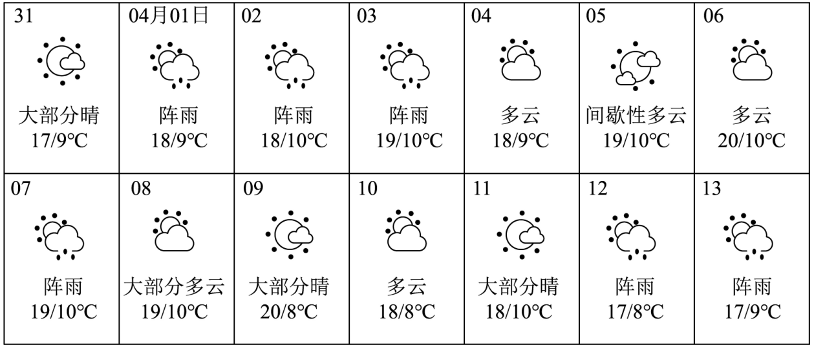
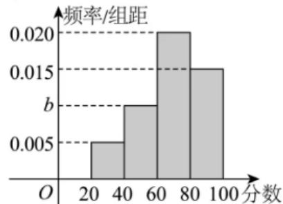

# 2025二模 计数原理与二项式专题 · 教师版

> 本地预览：题目、答案及分类尚未全部审定。校对使用的PDF为高中工作台解析版，尚未逐区确认区级印刷原卷。

## 二项通项、指定项与赋值求和

明确幂指数及通项，先列指数方程；系数和优先考虑赋值而非逐项展开。

### 嘉定 · 第5题

在 $\left( 2 x - { \frac { 1 } { \sqrt { x } } } \right) ^ { \ell }$ 6 的二项展开式中，常数项的值为

> 本题资料或解析有待核事项，预览不可作为已审定成品。

**考点：** 二项式通项与常数项

**难度依据：** 二项展开式常数项；需完成一次转化或结合基本条件后计算

**核查说明：** 展开式指数OCR为上标ell后接6，需回核指数。；已人工阅读底稿题干和解析；尚未逐页对照原PDF，不作为数学终审。；历史分类审查记录（不把旧记录直接判为当前未解决）：展开式指数OCR为上标ell后接6，需回核指数。 本次只归组，未修改题干、答案或专题归属；上述具体疑点仍交回源/数学复核处理。

【答案】60.

【解析】

利用二项展开式的通项公式即可得出

二项式 $\left( 2 x - { \frac { 1 } { \sqrt { x } } } \right) ^ { \ell }$ 的展开式的通项公式为：

$$
T _ {r + 1} = \mathrm{C} _ {6} ^ {r} (2 x) ^ {6 - r} \left(- \frac {1}{\sqrt {x}}\right) ^ {r} = (- 1) ^ {r} \mathrm{C} _ {6} ^ {r} 2 ^ {6 - r} x ^ {6 - \frac {3}{2} r},
$$

令 $6 - { \frac { 3 } { 2 } } r = 0$ ，解得 $r = 4$

所以二项式的展开式中的常数项为 $( - 1 ) ^ { 4 } \mathrm { C } _ { 6 } ^ { 4 } 2 ^ { 2 } = 6 0$

故答案为：60.

### 奉贤 · 第4题

在 $\left(\sqrt{x}-\dfrac{2}{x}\right)^9$ 的二项展开式中，常数项为________。（用数字作答）

> 本题资料或解析有待核事项，预览不可作为已审定成品。

**考点：** 二项式展开通项

**难度依据：** 二项式通项；需完成一次转化或结合基本条件后计算

**核查说明：** 原二项式严重乱码，应回核原卷表达式。；已人工阅读底稿题干和解析；尚未逐页对照原PDF，不作为数学终审。；历史分类审查记录（不把旧记录直接判为当前未解决）：原二项式严重乱码，应回核原卷表达式。 本次只归组，未修改题干、答案或专题归属；上述具体疑点仍交回源/数学复核处理。

【答案】$-672$。

【解析】

二项展开式的通项为

$$T_{r+1}=\mathrm{C}_9^r(\sqrt{x})^{9-r}\left(-\frac2x\right)^r
=\mathrm{C}_9^r(-2)^r x^{(9-3r)/2},\qquad r=0,1,\ldots,9.$$

令 $\dfrac{9-3r}{2}=0$，得 $r=3$。通项编号为 $r+1$，因此常数项是第4项：

$$T_4=\mathrm{C}_9^3(-2)^3=84\times(-8)=-672.$$

源解析将此处写为 $T_3$，其系数与结果正确，但项号应为 $T_4$。

### 宝山 · 第6题

$\left( x + { \frac { 2 } { x } } \right) ^ { \mathsf { f } }$ 6 的二项展开式中， $x ^ { 2 }$ 项的系数为

> 本题资料或解析有待核事项，预览不可作为已审定成品。

**考点：** 二项式通项求指定系数

**难度依据：** 指定项系数；需一次转化并结合定义域或几何条件计算

**核查说明：** 题干指数6上标破损，需回核并修复。；已人工阅读完整底稿题干及原解，未逐页对照正式PDF，分类不等于数学终审。；历史分类审查记录（不把旧记录直接判为当前未解决）：题干指数6上标破损，需回核并修复。 本次只归组，未修改题干、答案或专题归属；上述具体疑点仍交回源/数学复核处理。

【答案】60

【解析】

写出二项展开式通项公式，由x的指数为2求得项数，从而得到系数

由题意得二项式的展开式的通项公式为 $\vert T _ { K + 1 } = { \bf C } _ { 6 } ^ { k } \cdot x ^ { 6 - k } \cdot \left( \frac { 2 } { x } \right) ^ { k } = { \bf C } _ { 6 } ^ { k } \cdot 2 ^ { k } x ^ { 6 - 2 k } ,$ 令6−2k = 2，得k = 2，所以x2项的系数为 $\mathbf { C } _ { 6 } ^ { 2 } \cdot 2 ^ { 2 } = 6 0$

故答案为：60

### 崇明 · 第9题

若 $( x + 1 ) ^ { 1 0 } = a _ { 0 } + a _ { 1 } ( x - 1 ) + a _ { 2 } ( x - 1 ) ^ { 2 } + \dots + a _ { 1 0 } ( x - 1 ) ^ { 1 0 }$ ，则 $a _ { 0 } + a _ { 1 } + a _ { 2 } + \cdots + a _ { 1 0 } =$

**考点：** 多项式移位展开与赋值

**难度依据：** 赋值法求系数和；需一次转化并结合定义域或几何条件计算

**核查说明：** 已人工阅读完整底稿题干及原解，未逐页对照正式PDF，分类不等于数学终审。

【答案】$3 ^ { 1 0 }$

【解析】

令x = 2求解即可.

令x = 2，则 $( 2 + 1 ) ^ { 1 0 } = a _ { 0 } + a _ { 1 } + a _ { 2 } + \cdots + a _ { 1 0 }$ ，即 $\mathrm { l } a _ { 0 } + a _ { 1 } + a _ { 2 } + \cdots + a _ { 1 0 } = 3 ^ { 1 0 }$

故答案为： $3 ^ { 1 0 }$

### 普陀 · 第6题

设t ∈ R，若 $\left( 1 + { \frac { t } { x } } \right) \left( 1 - x \right)$ 6的展开式中x3项的系数为10，则t =

**考点：** 二项式系数计算

**难度依据：** 二项式系数；直接调用定义或基本公式，运算路径短

**核查说明：** 已人工阅读底稿题干和解析；尚未逐页对照原PDF，不作为数学终审。

【答案】2

【解析】

根据二项式定理求x3项的系数即可.

$x ^ { 3 }$ 项为 $1 \times \mathrm { C } _ { 6 } ^ { 3 } \cdot 1 ^ { 3 } \cdot ( - x ) ^ { 3 } + \frac { t } { x } \times \mathrm { C } _ { 6 } ^ { 4 } \cdot 1 ^ { 2 } \cdot ( - x ) ^ { 4 } = ( - 2 0 + 1 5 t ) x ^ { 3 } ,$

由− $- 2 0 + 1 5 t = 1 0 \Rightarrow t = 2$

故答案为：2

### 杨浦 · 第6题

$\left( x - { \frac { 1 } { \sqrt { x } } } \right)$ 6 的二项展开式中的常数项为

> 本题资料或解析有待核事项，预览不可作为已审定成品。

**考点：** 二项通项与常数项

**难度依据：** 二项展开常数项；需一次转化并结合定义域或几何条件计算

**核查说明：** 题干6次方脱离上标，原解也有错误指数OCR，需核改数学显示。；已人工阅读完整底稿题干及原解，未逐页对照正式PDF，分类不等于数学终审。；历史分类审查记录（不把旧记录直接判为当前未解决）：题干6次方脱离上标，原解也有错误指数OCR，需核改数学显示。 本次只归组，未修改题干、答案或专题归属；上述具体疑点仍交回源/数学复核处理。

【答案】15

【解析】

根据二项式展开式的通项公式，结合题意，即可容易求得结果.

因为 $\left( x - { \frac { 1 } { \sqrt { x } } } \right) ^ { \mathrm { t } }$ 的通项公式 $T _ { r + 1 } = C _ { 6 } ^ { r } { ( x ) } ^ { 6 - r } { \left( - \frac { 1 } { \sqrt { x } } \right) } ^ { r } = C _ { 6 } ^ { r } \cdot { \left( - 1 \right) } ^ { r } \cdot x ^ { 6 - \frac { 3 } { 2 } r }$

$$
(r = 0, 1, 2, \dots , 6)
$$

${ \widehat { \vec { \mathbf { \tau } } } } { \mathbf 6 } - \frac { 3 } { 2 } r = 0$ ，故可得r = 4，则二项展开式的常数项为 $C _ { 6 } ^ { 4 } \cdot ( - 1 ) ^ { 4 } = 1 5$

故答案为：15

### 松江 · 第5题

$\left( 3 x ^ { 2 } + { \frac { 1 } { x } } \right)$ 6 的二项展开式中的常数项为

> 本题资料或解析有待核事项，预览不可作为已审定成品。

**考点：** 二项通项与常数项

**难度依据：** 二项展开常数项；需一次转化并结合定义域或几何条件计算

**核查说明：** 题干6次方脱离上标，解析12-3r误为512-3r，需修复排版。；已人工阅读完整底稿题干及原解，未逐页对照正式PDF，分类不等于数学终审。；历史分类审查记录（不把旧记录直接判为当前未解决）：题干6次方脱离上标，解析12-3r误为512-3r，需修复排版。 本次只归组，未修改题干、答案或专题归属；上述具体疑点仍交回源/数学复核处理。

【答案】135.

【解析】

根据二项式展开式的通项特征即可求解.

由题，二项展开式的通项为

$$
T _ {r + 1} = \mathrm{C} _ {6} ^ {r} (3 x ^ {2}) ^ {6 - r} \cdot \left(\frac {1}{x}\right) ^ {r} = \mathrm{C} _ {6} ^ {r} 3 ^ {6 - r} \cdot x ^ {1 2 - 2 r} \cdot x ^ {- r} = \mathrm{C} _ {6} ^ {r} 3 ^ {6 - r} \cdot x ^ {1 2 - 3 r}.
$$

令 $5 1 2 - 3 r = 0 .$ ，得 $r = 4$

所以常数项为 $\mathrm { C _ { 6 } ^ { 4 } 3 ^ { 2 } } = \frac { 6 ! } { 4 ! ( 6 - 4 ) ! } \times 9 = 1 5 \times 9 = 1 3 5 .$

故答案为：135.

### 浦东 · 第7题

$\mathcal { \mathrm { 7 } } \mathrm {  { \left( \boldsymbol { x } - \frac { 1 } { \mathit { x } } \right) } ^ { 1 0 } }$ 的展开式中，常数项为

> 本题资料或解析有待核事项，预览不可作为已审定成品。

**考点：** 通项指数与系数

**难度依据：** 二项展开常数项；需一次转化并结合定义域或几何条件计算

**核查说明：** 题干首部混入编号7与异常字体，需清理但不改变十次方。；已人工阅读完整底稿题干及原解，未逐页对照正式PDF，分类不等于数学终审。；历史分类审查记录（不把旧记录直接判为当前未解决）：题干首部混入编号7与异常字体，需清理但不改变十次方。 本次只归组，未修改题干、答案或专题归属；上述具体疑点仍交回源/数学复核处理。

【答案】-252.

【解析】

用二项式定理即可.

根据二项式定理，第r+1项为 $C _ { 1 0 } ^ { r } x ^ { 1 0 - r } \cdot \left( - \frac { 1 } { x } \right) ^ { r }$ ，由于是常数，

$$
r = 1 0 - r, \mathrm{r} = 5,
$$

其常数项系数为 $- C _ { 1 0 } ^ { 5 } { = } - 2 5 2 .$ .，

故答案为：-252.

### 金山 · 第5题

在 $\left( a x + { \frac { 1 } { x } } \right) ^ { \sharp }$ 展开式中x的系数为80，则实数a的值为

> 本题资料或解析有待核事项，预览不可作为已审定成品。

**考点：** 二项展开系数反求参数

**难度依据：** 指定项系数；需一次转化并结合定义域或几何条件计算

**核查说明：** 题干二项式指数识别为sharp，原解使用5次方，必须回核指数。；已人工阅读完整底稿题干及原解，未逐页对照正式PDF，分类不等于数学终审。；历史分类审查记录（不把旧记录直接判为当前未解决）：题干二项式指数识别为sharp，原解使用5次方，必须回核指数。 本次只归组，未修改题干、答案或专题归属；上述具体疑点仍交回源/数学复核处理。

【答案】2

【解析】

利用二项式定理求出展开式中x的项，再由给定的系数求出a值.

$\left( a x + { \frac { 1 } { x } } \right) ^ { 5 }$ 展开式中x的项为 $\mathrm { C } _ { 5 } ^ { 2 } ( a x ) ^ { 3 } \cdot \left( { \frac { 1 } { x } } \right) ^ { 2 } = 1 0 a ^ { 3 } x .$

依题意， $1 0 a ^ { 3 } = 8 0$ ，所以 $. a = 2$

故答案为：2

### 闵行 · 第5题

在 $\left( 2 x + { \frac { 1 } { x } } \right)$ 6 的二项展开式中，常数项是 ．（用数值作答）

> 本题资料或解析有待核事项，预览不可作为已审定成品。

**考点：** 二项式常数项

**难度依据：** 二项式常数项；需一次代换或条件转换后计算

**核查说明：** 题干幂6游离，原解常数项指数等式乱码，需校净。；已人工阅读底稿题干和原解；未逐页对照PDF，不作为数学终审。；历史分类审查记录（不把旧记录直接判为当前未解决）：题干幂6游离，原解常数项指数等式乱码，需校净。 本次只归组，未修改题干、答案或专题归属；上述具体疑点仍交回源/数学复核处理。

【答案】160.

【解析】

由二项展开式的通项令r = 3计算即可.

展开式的通项为 $T _ { r + 1 } = \mathrm { C } _ { 6 } ^ { r } { ( 2 x ) } ^ { 6 - r } { ( x ^ { - 1 } ) } ^ { r }$

令 $\displaystyle { \mathrm {  ~ \tilde { \theta } ~ } } - r - r = 0 \Rightarrow r = 3 ,$

所以常数项为 $\mathrm { C _ { 6 } ^ { 3 } 2 ^ { 3 } } = 1 6 0$

故答案为：160.

### 青浦 · 第3题

$( 1 - a x ) ^ { \ell }$ 6的二项展开式中x3项的系数是20，则实数a的值是

> 本题资料或解析有待核事项，预览不可作为已审定成品。

**考点：** 二项式通项与系数

**难度依据：** 二项式指定项系数；需完成一次转化或结合基本条件后计算

**核查说明：** 展开指数OCR破损，系数方程20误识为0，需回核原式。；已人工阅读底稿题干和解析；尚未逐页对照原PDF，不作为数学终审。；历史分类审查记录（不把旧记录直接判为当前未解决）：展开指数OCR破损，系数方程20误识为0，需回核原式。 本次只归组，未修改题干、答案或专题归属；上述具体疑点仍交回源/数学复核处理。

【答案】−1.

【解析】

利用二项式定理展开式的通项公式求解即可.

根据二项式展开式的通项公式 $T _ { r + 1 } = \mathrm { C } _ { n } ^ { r } a ^ { n - r } b ^ { r }$

则 $( 1 - a x ) ^ { \ell }$ 6展开式中 $\mathrm { i } x ^ { 3 }$ 项为 $\mathrm { C } _ { 6 } ^ { 3 } \times 1 ^ { 6 - 3 } \times ( - a x ) ^ { 3 }$ ，

又 $\mathrm { C } _ { 6 } ^ { 3 } = \frac { 6 ! } { 3 ! ( 6 - 3 ) ! } = 2 0$ ，则该项为 $2 0 \times ( - a ) ^ { 3 } x ^ { 3 }$

已知x3项的系数是20，则 $0 \times ( - a ) ^ { 3 } = 2 0$ ，即 $( - a ) ^ { 3 } = 1$ ，

解得a = −1.

故答案为：−1.

## 排列组合公式与分步分类

区分有序无序、允许重复与相邻约束，划分互斥情形再使用乘加法则。

### 奉贤 · 第13题

下列有关排列组合数的计算公式，错误的是（ ）

A. $\mathrm { P } _ { n } ^ { m } + \mathrm { P } _ { n } ^ { m - 1 } = \mathrm { P } _ { n + 1 } ^ { m }$ （m，n是正整数，且 $m \leq n )$

B. $\mathbf { P } _ { n } ^ { m } = \mathbf { C } _ { n } ^ { m } \mathbf { P } _ { m } ^ { m } \mathbf { \Lambda } ( m$ ，n是正整数，且 $m \leq n )$

C. ${ \mathrm P } _ { n } ^ { m } = n { \mathrm P } _ { n - 1 } ^ { m - 1 } { \mathrm { ( } } m { \mathrm { . } }$ ，n是正整数，且 $. m \leq n )$

D. $\mathbf { C } _ { n } ^ { m } + \mathbf { C } _ { n } ^ { m - 1 } = \mathbf { C } _ { n + 1 } ^ { m } \mathbf { \Delta } \left( m \right.$ ，n是正整数，且 $. m \leq n )$

**考点：** 排列组合计算

**难度依据：** 排列组合公式；需完成一次转化或结合基本条件后计算

**核查说明：** 已人工阅读底稿题干和解析；尚未逐页对照原PDF，不作为数学终审。

【答案】A

【解析】

对于A：举反例说明即可；对于BCD：根据排列数、组合数公式运算求解即可.

对于选项A：例如 $\scriptstyle { | m = n = 2 }$ ，则 $\mathrm { P _ { 2 } ^ { 2 } + P _ { 2 } ^ { 1 } = 4 , P _ { 3 } ^ { 2 } = 6 }$

即 $\mathrm { P _ { 2 } ^ { 2 } + P _ { 2 } ^ { 1 } \neq P _ { 3 } ^ { 2 } }$ ，故A错误；

对于选项B：因为 $\mathrm { C } _ { n } ^ { m } \mathrm { P } _ { m } ^ { m } = \frac { n ! } { m ! \cdot ( n - m ) ! } \cdot m ! = \frac { n ! } { ( n - m ) ! } = \mathrm { P } _ { n } ^ { m }$ ，故B正确；

对于选项C：因为 $n \mathrm { P } _ { n - 1 } ^ { m - 1 } = n \cdot { \frac { ( n - 1 ) ! } { ( n - m ) ! } } = { \frac { n ! } { ( n - m ) ! } } = \mathrm { P } _ { n } ^ { m }$ ，故C正确；

对于选项D：因为 $\mathbf { C } _ { n } ^ { m } + \mathbf { C } _ { n } ^ { m - 1 } = { \frac { n ! } { m ! \cdot ( n - m ) ! } } + { \frac { n ! } { ( m - 1 ) ! \cdot ( n - m + 1 ) ! } }$

$$
= \frac {n !}{m ! \cdot (n - m + 1) !} [ (n - m + 1) + m ] = \frac {(n + 1) !}{m ! \cdot (n - m + 1) !} = C _ {n + 1} ^ {m},
$$

所以 $\mathbf { C } _ { n } ^ { m } + \mathbf { C } _ { n } ^ { m - 1 } = \mathbf { C } _ { n + 1 } ^ { m }$ ，故D正确；

故选：A.

### 宝山 · 第10题

有3件商品的编号分别为 $i ( i = 1 , 2 , 3 )$ ，它们的售价（元） $S \left( i \right) \in \left\{ 5 , 7 , 8 , 1 0 , 1 1 , 2 0 \right\}$ ，且满足$S \left( 1 \right) \leq S \left( 2 \right) \leq S \left( 3 \right)$ ，则这3件商品售价的所有可能情况有 种.

**考点：** 分类重复组合计数

**难度依据：** 允许重复的无序选择；需连接多个条件或多步模型转化

**核查说明：** 已人工阅读完整底稿题干及原解，未逐页对照正式PDF，分类不等于数学终审。

【答案】56.

【解析】

利用组合数中允许重复的原则，分四类讨论，再由加法原理和组合数计算即可.

分四类讨论：

①当S (1) = S (2) = S (3)时，有6种情况；

②当S (1) = S (2) < S (3)时，

若S (1) = S (2) = 5，S (3)有5种选法；

若S (1) = S (2) = 7，S (3)有4种选法；

若S (1) = S (2) = 8，S (3)有3种选法；

若S (1) = S (2) = 10，S (3)有2种选法；

若S (1) = S (2) = 11，S (3)有1种选法；

由加法原理可得共有15种；

③当S (1) < S (2) = S (3)时，

若S (1) = 5，选择S (2) = S (3)有5种选法；

若S (1) = 7，选择S (2) = S (3)有4种选法；

若S (1) = 8，选择S (2) = S (3)有3种选法；

若S (1) = 10，选择S (2) = S (3)有2种选法；

若S (1) = 11，选择S (2) = S (3)有1种选法；

由加法原理可得共有15种；

④当 $S \left( 1 \right) < S \left( 2 \right) < S \left( 3 \right)$ 时，有C3 = 20种，

综上，共有6 + 15 + 15 + 20 = 56种.

故答案为：56.

### 杨浦 · 第14题

3名同学报名参加社团活动，有4个社团可以报名，这些社团招收人数不限，但每位同学只能报名其中1个社团，则这3位同学可能的报名结果共有（ ）种.

A. 6

B. 24

C. 64

D. 81

**考点：** 独立报名选择计数

**难度依据：** 分步乘法计数；直接运用定义或基础公式，推理链短

**核查说明：** 已人工阅读完整底稿题干及原解，未逐页对照正式PDF，分类不等于数学终审。

【答案】C

【解析】

由分步乘法原理计算可得.

由题意可得每位同学有4种选择，根据乘法原理，共有43 = 64种.

故选：C

### 松江 · 第7题

有4辆车停放在5个并排车位上，客车甲车体较宽，停放时需要占两个车位，并且乙车与客车甲相邻停放，则共有 种不同的停放方法.

**考点：** 捆绑排列与相邻条件

**难度依据：** 相邻排列的捆绑法；需一次转化并结合定义域或几何条件计算

**核查说明：** 已人工阅读完整底稿题干及原解，未逐页对照正式PDF，分类不等于数学终审。

【答案】12.

【解析】

利用相邻问题捆绑法求解.

因为客车甲占两个车位且乙车与客车甲相邻停放.

所以将乙车与客车甲捆绑，看成一个车有A2种排法，与余下的两辆车全排有A3种排法，

所以共有 $\mathrm { A _ { 2 } ^ { 2 } \cdot A _ { 3 } ^ { 3 } = 1 2 }$ 种不同的停放方法.

故答案为：12.

## 有限集合与受限序列计数

由间断、间距、原像或前缀和限制识别合法结构，必要时用补集与递推。

### 崇明 · 第12题

已知集合M中的任一个元素都是整数，当存在整数 $a , c \in M , b \notin M$ 且 $a < b <$ c时，称M为“间断整数集”．集合 $\{ x \mid 1 \leq x \leq 1 0 , x \in \mathbf { Z } \}$ 的所有子集中，是“间断整数集”的个数为

> 本题资料或解析有待核事项，预览不可作为已审定成品。

**考点：** 连续整数段的补集计数

**难度依据：** 间断整数集；需连接多个条件或多步模型转化

**核查说明：** 两元素的不满足集合列表丢失，虽可计数，交付时需核原卷。；已人工阅读完整底稿题干及原解，未逐页对照正式PDF，分类不等于数学终审。；历史分类审查记录（不把旧记录直接判为当前未解决）：两元素的不满足集合列表丢失，虽可计数，交付时需核原卷。 本次只归组，未修改题干、答案或专题归属；上述具体疑点仍交回源/数学复核处理。

【解析】

根据子集中元素的个数分类，每一类都利用组合数计数，再剔除不满足定义的子集，最后根据分类加法计数原理求值即可.

由题意，满足“间断整数集”定义的子集至少有2个元素，至多有9个元素，

按子集中元素的个数分类，

①当元素个数为2时，不满足定义的子集有：

此时满足定义的子集有 $\mathrm { \dot { C } _ { 1 0 } ^ { 2 } - 9 }$ 个，

②当元素个数为3时，不满足定义的子集有：

{1, 2, 3}, {2, 3, 4}, {3, 4, 5}, {4, 5, 6}, {5, 6, 7}, {6, 7, 8}, {7, 8, 9}, {8, 9, 10}，共8个；

此时满足定义的子集有 $\mathrm { C } _ { 1 0 } ^ { 3 } - 8 ^ { \prime }$ 个，

③当元素个数为4时，不满足定义的子集有：

{1, 2, 3, 4}, {2, 3, 4, 5}, {3, 4, 5, 6}, {4, 5, 6, 7}, {5, 6, 7, 8}, {6, 7, 8, 9}, {7, 8, 9, 10}，共7个； 此时满足定义的子集有 $\mathrm { C } _ { 1 0 } ^ { 4 } - 7 ^ { \prime }$ 个，

④当元素个数为5时，不满足定义的子集有：

{1, 2, 3, 4, 5}, {2, 3, 4, 5, 6}, {3, 4, 5, 6, 7}, {4, 5, 6, 7, 8}, {5, 6, 7, 8, 9}, {6, 7, 8, 9, 10}，共6个； 此时满足定义的子集有 $\mathrm { C } _ { 1 0 } ^ { 5 } - 6$ 个，

⑤当元素个数为6时，不满足定义的子集有：

{1, 2, 3, 4, 5, 6}, {2, 3, 4, 5, 6, 7}, {3, 4, 5, 6, 7, 8}, {4, 5, 6, 7, 8, 9}, {5, 6, 7, 8, 9, 10}，共5个；

$$
\mathrm{C} _ {1 0} ^ {6} - 5 ^ {\prime}
$$

⑥当元素个数为7时，不满足定义的子集有：

{1, 2, 3, 4, 5, 6, 7}, {2, 3, 4, 5, 6, 7, 8}, {3, 4, 5, 6, 7, 8, 9}, {4, 5, 6, 7, 8, 9, 10}，共4个；

此时满足定义的子集有 $\mathrm { C } _ { 1 0 } ^ { 7 } - 4 ^ { \prime }$ 个，

⑦当元素个数为8时，不满足定义的子集有：

{1, 2, 3, 4, 5, 6, 7, 8}, {2, 3, 4, 5, 6, 7, 8, 9}, {3, 4, 5, 6, 7, 8, 9, 10}，共3个；

此时满足定义的子集有 $\mathrm { C } _ { 1 0 } ^ { 8 } - 3 ^ { \prime }$ 个，

⑧当元素个数为9时，不满足定义的子集有：

{1, 2, 3, 4, 5, 6, 7, 8, 9}, {2, 3, 4, 5, 6, 7, 8, 9, 10}，共2个；

此时满足定义的子集有 $\mathrm { C } _ { 1 0 } ^ { 9 } - 2$ 个，

综上所述，满足题意的子集共有 $\left( \mathrm { C } _ { 1 0 } ^ { 2 } + \mathrm { C } _ { 1 0 } ^ { 3 } + \cdot \cdot \cdot + \mathrm { C } _ { 1 0 } ^ { 9 } \right) - \left( 2 + 3 + 4 + \cdot \cdot \cdot + 9 \right) = 9 6 8 \cdot$ 个. 故答案为：968.

## 二、选择题

### 徐汇 · 第16题

已知函数 $y = f ( x )$ 的定义域和值域都为R，且图像是一条连续不断的曲线，其导函数 $y = f ^ { \prime } ( x )$ 的值如下表：

| $x$ | $(-\infty,x_1)$ | $x_1$ | $(x_1,x_2)$ | $x_2$ | $(x_2,+\infty)$ |
|---|---|---|---|---|---|
| $f'(x)$ | $+$ | 0 | $-$ | 0 | $+$ |

设 $D\subseteq\mathbf R$，若集合 $\{y\mid y=f(x),x\in D\}=\{a,b,c\}$，其中 $a,b,c$ 为常数，则符合要求的集合 $D$ 的个数不可能是（　）。

A. 3

B. 27

C. 63

D. 343

> 本题资料或解析有待核事项，预览不可作为已审定成品。

**考点：** 导数表判断原像数与集合计数

**难度依据：** 导数符号表与方程根数；需参数分类、构造递推或综合最值分析

**核查说明：** 题干所指导数数值表未保留，无法独立判断反像个数限制；源解排除27的依据写得不全。；已人工阅读完整底稿题干及原解，未逐页对照正式PDF，分类不等于数学终审。；历史分类审查记录（不把旧记录直接判为当前未解决）：题干所指导数数值表未保留，无法独立判断反像个数限制；源解排除27的依据写得不全。 当前底稿已有回源补丁，涉及question；具体修复范围以底稿patches和2025二模-缺表回源补丁-第三批.json,2025二模-残余OCR回源补丁-第四批.json为准。本题仍按可辨数学任务归组，不据分组宣称数学已审定。

【答案】B

【解析】

根据若对应的 = 的 取值的情况可以有1个，2个或3个，且对应2个根的情况的时候即可判断A，根据若 $\dot { \boldsymbol { y } } = a , \boldsymbol { y } = b , \boldsymbol { y } = c$ c对应的根的个数为2，2，3即可判断C，根据若 $\scriptstyle y = a , y = b , y = c$ 对应的根的个数为3，3，3即可判断D.

由题意可得，若对应的y = t的x取值的情况可以有1个，2个或3个，且对应2个根的情况的时候，

t的取值只要2个，若 $y = a , y = b , y = c$ 对应的根的个数为1，1，2，

则符合要求的集合的个数为1 $\times 1 \times \left( 2 ^ { 2 } - 1 \right) = 3$ ，A有可能；

若 $\dot { \boldsymbol { y } } = a , \boldsymbol { y } = b , \boldsymbol { y } = c$ 对应的根的个数为2，2，3，

则符合要求的隹合的个数为 $\left( 2 ^ { 2 } - 1 \right) \times \left( 2 ^ { 2 } - 1 \right) \times \left( 2 ^ { 3 } - 1 \right) = 6 3$ ，C有可能；

若 $\dot { \boldsymbol { y } } = a , \boldsymbol { y } = b , \boldsymbol { y } = c ,$ 对应的根的个数为3，3，3，

则符合要求的集合的个数为 $( 2 ^ { 3 } - 1 ) \times ( 2 ^ { 3 } - 1 ) \times ( 2 ^ { 3 } - 1 ) = 3 4 3$ ，D有可能.故选：B.

## 三、解答题

### 普陀 · 第9题

设i,j,n为正整数，集合 $M = \{ 1 , 3 , 5 , \cdots , 2 n - 1 \}$ ，若集合A满足 $A \subseteq M ,$ ，且对A中任意的两个元素 $i , j ,$ 皆有 $| i - j | > 4 \#$ 立，记满足条件的集合A的个数为 $\scriptstyle { | a _ { n } }$ ，则 $a _ { 8 } =$

> 本地版本的第9、10题题号顺序存在冲突；本题子集范围的表述也须核正式原卷。

**考点：** 满足间距条件的子集计数

**难度依据：** 满足间距条件的子集；需连接多个条件、建模或作分类讨论

**核查说明：** 按现有题干子集条件，源答案19似漏空集和8个单元素集（另加9）；原题可能有OCR遗漏，先核原卷，不擅改。；已人工阅读底稿题干和解析；尚未逐页对照原PDF，不作为数学终审。；本机题目版PDF将该两题排序为第10、第9题，与底稿相反；PDF为重编候选，正式原卷题号需另核。；历史分类审查记录（不把旧记录直接判为当前未解决）：按现有题干子集条件，源答案19似漏空集和8个单元素集（另加9）；原题可能有OCR遗漏，先核原卷，不擅改。；本机题目版PDF将该两题排序为第10、第9题，与底稿相反；PDF为重编候选，正式原卷题号需另核。 本次只归组，未修改题干、答案或专题归属；上述具体疑点仍交回源/数学复核处理。

【答案】19

【解析】

【分析】利用分类思想，列举思想即可得到答案

【详解】当 n = 8 时，M = {1, 3, 5, ⋯ , 15}

若A为二元集：如

$\begin{array} { c } { { \{ 1 , 7 \} , \{ 1 , 9 \} , \{ 1 , 1 1 \} } } \\  { 1 3 \} , \{ 7 , 1 5 \} , \{ 9 , 1 5 \} } \end{array}$ , {1, 13}, {1, 15}, {3, 9}, {3, 11}, {3, 13}, {3, 15}, {5, 11}, {5, 13}, {5, 15}, {7,

，共有15种，

若 A 为三元集：如 {1, 7, 13}, {1, 7, 15}, {1, 9, 15}, {3, 9, 15} ，共有4种，所以总共有：

$a _ { 8 } = 1 5 + 4 = 1 9$ 种；

故答案为：19

### 浦东 · 第12题

已知数列 $\{ a _ { n } \} , ~ a _ { 1 } = 1 , a _ { n } \in \{ 1 , - 1 \} , ( n \geq 2 )$ ，并且前n项的和 $\mid S _ { n }$ 满足：
①存在小于1013的正整数t，使得 $S _ { 2 t + 1 } = - 1$ ；
②对任意的正整数k和m，都有 $| S _ { 2 m } - S _ { 2 k - 1 } | \leq 1$
则满足以上条件的数列 $\left\{ S _ { n } \right\} ( 1 \leq n \leq 2 0 2 5 )$ 共有 个

> 本题资料或解析有待核事项，预览不可作为已审定成品。

**考点：** 奇偶前缀和约束与构造计数

**难度依据：** 正负一数列前缀和限制；需参数分类、构造递推或综合最值分析

**核查说明：** 本次仅核此字段，不代表全卷数学与视觉终审。；已人工阅读完整底稿题干及原解，未逐页对照正式PDF，分类不等于数学终审。

【答案】$2^{1012}-1$

【解析】

根据 $S_n$ 的奇偶性，结合 $S_{2t+1}=-1,S_1=1$ 分析可知 $S_{2m}=0$，进而可得 $a_2=-1$，$a_{2k+1}+a_{2k+2}=0\ (k\in\mathbf N^*)$，求数列个数，并排除不满足条件①的情况。

因为 $a_1=1,a_n\in\{1,-1\}\ (n\ge2)$，可知 $S_n$ 的奇偶性与 $n$ 一致。

对于①，存在小于1013的正整数 $t$，使得 $S_{2t+1}=-1$。

对于②，对任意正整数 $k,m$，都有 $|S_{2m}-S_{2k-1}|\le1$。因为该绝对值为奇数，所以 $|S_{2m}-S_{2k-1}|=1$。

令 $k=t+1$，则 $|S_{2m}-S_{2t+1}|=|S_{2m}+1|=1$，可得 $S_{2m}=0$ 或 $S_{2m}=-2$。

令 $k=1$，则 $|S_{2m}-S_1|=|S_{2m}-1|=1$，可得 $S_{2m}=0$ 或 $S_{2m}=2$。

综上，对任意正整数 $m$，$S_{2m}=0$。且 $a_1=1$，可得 $a_2=-1$，$a_{2k+1}+a_{2k+2}=0\ (k\in\mathbf N^*)$。

即 $a_1,a_2$ 确定，$a_{2k+1},a_{2k+2}$ 不相等，有2种可能。此时 $S_{2n}=0,S_{2n-1}=\pm1$，条件②满足。

对于数列 $\{S_n\}\ (1\le n\le2025)$，$(a_3,a_4),(a_5,a_6),\ldots,(a_{2023},a_{2024}),a_{2025}$ 均有2种可能，故数列共有 $2^{\frac{2024-2}{2}+1}=2^{1012}$ 个。

又因为存在小于1013的正整数 $t$，使得 $S_{2t+1}=-1$，所以不能对所有 $k\in\mathbf N^*,k\le1012$ 都有 $a_{2k+1}=1$。即 $a_3=a_5=\cdots=a_{2025}=1$ 这一种情况不符合题意。

综上，符合题意的数列共有 $2^{1012}-1$ 个。

【复核说明】上述量词表述经独立计数复核作规范化澄清，并非PDF逐字转录。因 $S_{2k}=0$，故 $S_{2k+1}=a_{2k+1}$；条件①等价于在 $a_3,a_5,\ldots,a_{2025}$ 中至少有一项为 $-1$，只须排除所有这些项均为1的一种情形。

## 抽样概率中的组合计数

先锁定样本空间和条件事件，再计数；大题保留统计与期望小问。

### 嘉定 · 第9题

在由1，2，3，4，5这五个数组成的无重复数字的四位数中，其能被3整除的概率为

**考点：** 排列组合与古典概型

**难度依据：** 排列组合计数；需完成一次转化或结合基本条件后计算

**核查说明：** 已人工阅读底稿题干和解析；尚未逐页对照原PDF，不作为数学终审。

【解析】

利用排列数公式分别求出由1，2，3，4，5这五个数组成的无重复数字的四位数的个数，及其中能被3整除的四位数的个数，再根据古典概型公式即可得解.

由1，2，3，4，5这五个数组成的无重复数字的四位数共 $\mathrm { A } _ { 5 } ^ { 4 } = 5 \times 4 \times 3 \times 2 = 1 2 0 $ 个，

其中能被3整除的四位数是由1，2，4，5组成的，共 ${ \bf A } _ { 4 } ^ { 4 } = 4 \times 3 \times 2 \times 1 = 2 4$

故由1，2，3，4，5这五个数组成的无重复数字的四位数中，其能被3整除的概率为 ${ \frac { 2 4 } { 1 2 0 } } = { \frac { 1 } { 5 } }$ 故答案为： $\frac { 1 } { 5 }$

### 宝山 · 第19题

某游乐园的活动项目共有三类，分别是“过山车”等10个体验类项目、“海豚之舞”等4个表演类项目、“智力闯关”等3个互动类项目.因设备维护需要，项目并非每日都全部开放.以下数据是项目开放的数量x（个）和游客平均等待时间y（分钟/个）的关系：

| 类别 | 体验类 | 体验类 | 体验类 | 体验类 | 体验类 | 演出类 | 演出类 | 互动类 | 互动类 |
|---|---|---|---|---|---|---|---|---|---|
| 开放数量 $x$ | 4 | 5 | 6 | 7 | 8 | 2 | 4 | 2 | 3 |
| 平均等待时间 $y$ | 76 | 73 | 67 | $m$ | 60 | 53 | 30 | 46 | 30 |

(1) (4分)体验类项目中，若y关于x的回归方程为 $y=-4.3x+93.8$ ，请计算m的值，并依据该模型预测所有体验类项目均开放时的平均等待时间（精确到整数）；
(2) (4分)小王游玩当日，体验类、演出类、互动类项目分别开放了8个、4个、3个，他计划随机游玩其中的3个项目，已知他选择的项目中至少包含1个互动类项目，求他的等待总时间恰为120分钟的概率；
(3) (6分)为提高游客的参与度，园方在互动类项目“智力闯关”中设计了两关.通过第一关的游客奖励20个游园币，游客可以选择结束或继续闯关.若继续闯关，则必须完成第二关的所有题目.第二关包含2道相互独立的选择题，每答对1题可再奖励20个游园币，每答错1题则要扣除10个游园币。每个游园币可兑换园区内任意一个项目的1分钟等待时间.小王已通过第一关，假设他在第二关中每道题答对的概率均为p，为了获得更多项目等待时间的兑换奖励，小王是否应该继续闯关？请你帮他做出决策.

> 本题资料或解析有待核事项，预览不可作为已审定成品。

**考点：** (1)回归中心与预测；(2)条件概率与组合计数；(3)二项奖励期望与决策

**难度依据：** 回归预测条件概率与策略期望；需参数分类、构造递推或综合最值分析

**核查说明：** 题干项目开放数与等待时间表未保留，第二问等待时间组成依赖原表，须补齐。；已人工阅读完整底稿题干及原解，未逐页对照正式PDF，分类不等于数学终审。；历史分类审查记录（不把旧记录直接判为当前未解决）：题干项目开放数与等待时间表未保留，第二问等待时间组成依赖原表，须补齐。 当前底稿已有回源补丁，涉及question；具体修复范围以底稿patches和2025二模-缺表回源补丁-第三批.json,2025二模-残余OCR回源补丁-第四批.json为准。本题仍按可辨数学任务归组，不据分组宣称数学已审定。

【解析】

$$
\overline {{{x}}} = \frac {4 + 5 + 6 + 7 + 8}{5} = 6, \overline {{{y}}} = \frac {7 6 + 7 3 + 6 7 + m + 6 0}{5} = \frac {m + 2 7 6}{5},
$$

代入回归方程 $y = - 4 . 3 x + 9 3 . 8$ ，得 $\frac { m + 2 7 \dot { 6 } } { 5 } = - 4 . 3 \times 6 + 9 3 . 8$ ，解得 $m = 6 4$

当x = 10时 $, y = - 4 . 3 \times 1 0 + 9 3 . 8 = 5 0 . 8$ ，即开放所有体验类项目时的平均等待时间约为51分钟.

(2) 记事件A =“等待总时间恰为120分钟”，事件B =“选择的3个项目中至少包含1个互动类项目”，

因为全部的项目数为15个，其中互动类项目有3个，则事件B共包含了 $\mathrm { ^ { 7 } C _ { 1 5 } ^ { 3 } - C _ { 1 2 } ^ { 3 } }$ 种；在事件B的条件下，等待总时间恰为120分钟，此时的可能情况有：

①一个互动类项目，一个体验类项目，一个演出类项目，此时共有 $\mathrm { C _ { 3 } ^ { 1 } C _ { 8 } ^ { 1 } C _ { 4 } ^ { 1 } }$ 种情况；

②两个互动类项目，一个体验类项目，此时共有 $\mathrm { C _ { 3 } ^ { 2 } C _ { 8 } ^ { 1 } }$ 种情况.

由条件概率公式得 $P \left( A | B \right) = \frac { P \left( A B \right) } { P \left( B \right) } = \frac { n \left( A B \right) } { n \left( B \right) } = \frac { \mathrm { C _ { 3 } ^ { 2 } C _ { 8 } ^ { 1 } } + \mathrm { C _ { 3 } ^ { 1 } C _ { 4 } ^ { 1 } C _ { 8 } ^ { 1 } } } { \mathrm { C _ { 1 5 } ^ { 3 } - C _ { 1 2 } ^ { 3 } } } = \frac { 2 4 } { 4 7 } .$

(3) 设小王参加第二关获得的游园币数为随机变量X，则X所有可能取值为−20,10,40，

$$
P (X = - 2 0) = (1 - p) ^ {2}, P (X = 1 0) = \mathrm{C} _ {2} ^ {1} p (1 - p), P (X = 4 0) = p ^ {2},
$$

$$
E (X) = 4 0 \cdot P ^ {2} + 1 0 \cdot \mathrm{C} _ {2} ^ {1} p (1 - p) + (- 2 0) \cdot (1 - p) ^ {2} = 6 0 p - 2 0.
$$

所以，当 $0 \leq p < \frac { 1 } { 3 }$ 时， $E ( X ) < 0$ ，不建议小王继续闯关；

当 $| p = \frac 1 3$ 时， $E ( X ) = 0$ ，小王可根据自 己的情况随机选择；

当 $\frac { 1 } { 3 } < p \leq$ 1时， $E ( X ) > 0$ ，建议小王继续闯关.

### 崇明 · 第15题

抛掷一枚质地均匀的硬币n次（其中n为大于等于2的整数），设事件A表示“n次中既有正面朝上又有反面朝上”，事件B表示“n次中至多有一次正面朝上”，若事件A与事件B是独立的，则n的值为（ ）

A. 5

B. 4

C. 3

D. 2

> 本题资料或解析有待核事项，预览不可作为已审定成品。

**考点：** 对立事件及独立性方程

**难度依据：** 独立事件与抛币；需连接多个条件或多步模型转化

**核查说明：** 源解只试n=2、3、4，未说明n>=5无解；选项题可排除，但一般唯一性论证不完整。；已人工阅读完整底稿题干及原解，未逐页对照正式PDF，分类不等于数学终审。；历史分类审查记录（不把旧记录直接判为当前未解决）：源解只试n=2、3、4，未说明n>=5无解；选项题可排除，但一般唯一性论证不完整。 本次只归组，未修改题干、答案或专题归属；上述具体疑点仍交回源/数学复核处理。

【答案】C

【解析】

先分别求出事件A、事件B以及事件A∩B发生的概率，再根据事件A与事件B独立的性质$P ( A \cap B ) = P ( A ) P ( B )$ 来求解n的值.

抛掷一枚质地均匀的硬币n次，所有可能的结果有2n种.

事件A表示“n次中既有正面朝上又有反面朝上”，其对立事件 $\bar { \cdot } \overline { { A } }$ 为“n次都是正面朝上或n次都是反面朝上”，A包含的情况有2种，所以 $P \left( { \overline { { A } } } \right) = { \frac { 2 } { 2 ^ { n } } } = { \frac { 1 } { 2 ^ { n - 1 } } }$ 根据对立事件概率之和为1，可得 $P \left( A \right) = 1 - P \left( { \overline { { A } } } \right) = 1 - { \frac { 1 } { 2 ^ { n - 1 } } }$

事件B表示“n次中至多有一次正面朝上”，即“n次中没有正面朝上（全是反面朝上）”或“n次中有一次正面朝上”.

“n次中没有正面朝上”的情况有1种；“n次中有一次正面朝上”，从n次中选1次为正面朝上，有$\mathrm { C } _ { n } ^ { 1 } = n$ 种情况.

所以事件B包含的情况共有n+1种，则 $P \left( B \right) = \frac { n + 1 } { 2 ^ { n } }$

事件A∩B表示“n次中既有正面朝上又有反面朝上且至多有一次正面朝上”，即“n次中有一次正面朝上”，有 $\mathrm { C } _ { n } ^ { 1 } = n$ 种情况，所以 $P \left( A \cap B \right) = { \frac { n } { 2 ^ { n } } }$

因为事件A与事件B是独立的，所以 $P ( A \cap B ) = P ( A ) P ( B )$ ，即 ${ \frac { n } { 2 ^ { n } } } = \left( 1 - { \frac { 1 } { 2 ^ { n - 1 } } } \right) \times { \frac { n + 1 } { 2 ^ { n } } }$

可得： $n = \left( 1 - { \frac { 1 } { 2 ^ { n - 1 } } } \right) ( n + 1 )$ .展开得： $n = n + 1 - { \frac { n + 1 } { 2 ^ { n - 1 } } }$ .即 $n + 1 = 2 ^ { n - 1 }$

当n = 2时，2 + 1 = 3，22−1 = 2，等式不成立；

当n = 3时，3 + 1 = 4，23−1 = 4，等式成立；

当n = 4时，4 + 1 = 5，24−1 = 8，等式不成立.

所以n = 3.

故选：C.

### 崇明 · 第19题

某区2025年3月31日至4月13日的天气预报如图所示。

(1)（4分）从3月31日至4月13日某天开始，连续统计三天，求这三天中至少有两天是阵雨的概率；

(2)（4分）根据天气预报，该区4月14日的最低气温是 $9^\circ\mathrm C$。温差是指一段时间内最高温度与最低温度之间的差值，例如3月31日的最高温度为 $17^\circ\mathrm C$，最低温度为 $9^\circ\mathrm C$，当天的温差为 $8^\circ\mathrm C$。记4月1日至4日这4天温差的方差为 $s_1^2$，4月11日至14日这4天温差的方差为 $s_2^2$。若 $s_2^2=\dfrac43s_1^2$，求4月14日天气预报的最高气温；

(3)（6分）从3月31日至4月13日中随机抽取两天，用 $X$ 表示一天温差不高于 $9^\circ\mathrm C$ 的天数，求 $X$ 的分布列及期望。

> 本题资料或解析有待核事项，预览不可作为已审定成品。

**考点：** (1)连续三天的古典概型；(2)方差方程求温差；(3)超几何分布列与期望

**难度依据：** 天气样本概率方差与分布列；需连接多个条件或多步模型转化

**核查说明：** 原PDF第(2)问方差方程有温差9与23/3两个根，原解仅取9，且结论日期误写4月11日；本补丁不改原解，交统一数学复核。；题干天气预报图完全缺失，最高17最低19而温差8显然矛盾；第二问方差方程除x=9还有23/3，若需整数温度须由原图或题意确认；结论日期4月11误写应为4月14。；已人工阅读完整底稿题干及原解，未逐页对照正式PDF，分类不等于数学终审。；历史分类审查记录（不把旧记录直接判为当前未解决）：题干天气预报图完全缺失，最高17最低19而温差8显然矛盾；第二问方差方程除x=9还有23/3，若需整数温度须由原图或题意确认；结论日期4月11误写应为4月14。 本次只归组，未修改题干、答案或专题归属；上述具体疑点仍交回源/数学复核处理。

【解析】

(1) 设“从3月31日至4月13日某天开始，连续统计三天，这三天中至少有两天是阵雨”为事件A，连续统计三天共有12个样本点，事件A共有4个样本点，所以 $P \left( A \right) = \frac { 4 } { 1 2 } = \frac { 1 } { 3 }$

(2) 由天气图，4月1日至4日温差分别为 $9,8,9,9$，因此 $s_1^2=\frac3{16}$。设4月14日温差为 $x$，则4月11日至14日温差为 $8,9,8,x$，平均数为 $\frac{x+25}{4}$。

由题设 $s_2^2=\frac43s_1^2=\frac14$，得

$$
\frac{3x^2-50x+211}{16}=\frac14,
\qquad 3x^2-50x+207=0.
$$

解得 $x=9$ 或 $x=\frac{23}{3}$。两者均非负，又当日最低气温为 $9^\circ\mathrm C$，故按现有题设，最高气温可为 $18^\circ\mathrm C$ 或 $\frac{50}{3}^\circ\mathrm C$。

源解只给出前者，漏掉第二根；题设未明确规定温度必须为整数，不能擅自舍去。若另有正式条件限定温度为整数，则只保留 $18^\circ\mathrm C$。

(3) 从3月31 日 至4月13 日，一天温差不超过9∘C的共有11天，高于9∘C的共有3天

$$
P (X = 0) = \frac {\mathrm{C} _ {3} ^ {2}}{\mathrm{C} _ {1 4} ^ {2}} = \frac {3}{9 1}, P (X = 1) = \frac {\mathrm{C} _ {1 1} ^ {1} \mathrm{C} _ {3} ^ {1}}{\mathrm{C} _ {1 4} ^ {2}} = \frac {3 3}{9 1}, P (X = 2) = \frac {\mathrm{C} _ {1 1} ^ {2}}{\mathrm{C} _ {1 4} ^ {2}} = \frac {5 5}{9 1}
$$

随机变量 $X$ 的分布列为：

| $X$ | 0 | 1 | 2 |
|:---:|:---:|:---:|:---:|
| $P$ | $\frac3{91}$ | $\frac{33}{91}$ | $\frac{55}{91}$ |

随机变量X的期望E (X) $= 0 \times { \frac { 3 } { 9 1 } } + 1 \times { \frac { 3 3 } { 9 1 } } + 2 \times { \frac { 5 5 } { 9 1 } } = { \frac { 1 1 } { 7 } } .$

### 普陀 · 第19题

某区为推进教育数字化转型，通过聚合区域学校的教育资源，依托AI技术搭建了区域智慧题库系统，形成了“A通识过关—B综合拓展—C创新提升”三层动态原库，且A,B,C三层题量之比为7:3:2，设该题库中任意1道题被选到的可能性都相同.
(1) (6分)现有4人参加一项比赛，若每人分别独立地从该题库中随机选取一道题作答，求这4人中至少有2人的选题来自B层的概率；
(2) (8分)现采用分层随机抽样的方法，使用智能组卷系统从该题库中选取12道题生成试卷，若某老师要从生成的这份12道题的试卷中随机选取3道题做进一步改编，记该老师选到A层题的题数为X，求X的分布与期望E(X)

**考点：** (1)二项概率；(2)分层抽样后分布列与期望

**难度依据：** 二项概率与分布列期望；需连接多个条件、建模或作分类讨论

**核查说明：** 已人工阅读底稿题干和解析；尚未逐页对照原PDF，不作为数学终审。

【解析】

(1) 因为A,B,C三层题量之比为7:3:2，

所以在B层选题的概率为 ${ \frac { 3 } { 1 2 } } = { \frac { 1 } { 4 } }$ ，不在B层选题的概率为 $- \frac { 1 } { 4 } = \frac { 3 } { 4 }$

设至少2人的选题来自B层的概率为 $P ,$ ，从B层选题数量为 $X _ { 1 }$ ，

由题意得 $X _ { 1 } \sim B \left( 4 , \frac { 1 } { 4 } \right)$ 而二项分布概率公式为 $P \left( X _ { 1 } = k \right) = \mathbf { C } _ { 4 } ^ { k } { \Bigg ( } { \frac { 1 } { 4 } } { \Bigg ) } ^ { k } { \Bigg ( } { \frac { 3 } { 4 } } { \Bigg ) } ^ { n - k }$ 则至少2人的选题来自B层的概率为 $P ( X _ { 1 } = 2 ) + P ( X _ { 1 } = 3 ) + P ( X _ { 1 } = 4 )$

$$
P = \mathrm{C} _ {4} ^ {2} \left(\frac {1}{4}\right) ^ {2} \left(\frac {3}{4}\right) ^ {2} + \mathrm{C} _ {4} ^ {3} \left(\frac {1}{4}\right) ^ {3} \left(\frac {3}{4}\right) + \mathrm{C} _ {4} ^ {4} \left(\frac {1}{4}\right) ^ {4} = \frac {5 4}{2 5 6} + \frac {1 2}{2 5 6} + \frac {1}{2 5 6} = \frac {6 7}{2 5 6}.
$$

(2) 因为A,B,C三层题量之比为7:3:2，

所以在A层最多抽到7道，且X可取0,1,2,3，

则P (X = 0) = C07C35 1 , P (X = 1) = C17C25 7 C3 22 12 22

$$
P (X = 2) = \frac {\mathrm{C} _ {7} ^ {2} \mathrm{C} _ {5} ^ {1}}{\mathrm{C} _ {1 2} ^ {3}} = \frac {2 1}{4 4}, P (X = 3) = \frac {\mathrm{C} _ {7} ^ {3} \mathrm{C} _ {5} ^ {0}}{\mathrm{C} _ {1 2} ^ {3}} = \frac {7}{4 4},
$$

其分布列为

所以期望 $\overline { { E ( X ) } } = 0 \times \frac { 1 } { 2 2 } + 1 \times \frac { 7 } { 2 2 } + 2 \times \frac { 2 1 } { 4 4 } + 3 \times \frac { 7 } { 4 4 } = \frac { 7 } { 4 } .$

### 杨浦 · 第19题

为弘扬中华民族传统文化、增强民族自豪感，某学校开展中华古诗词背诵比赛，分为初赛和复赛.全校同学都参加了初赛，并随机抽取一个班级进行初赛成绩统计，已知该班级共有40位学生，他们的初赛分数的频率分布直方图如图所示：

(1) (4分)计算b的值，并估计该校这次初赛的平均分数.
(2) (4分)初赛分数达到80及以上的同学，称为优秀参赛选手，现从班级中随机选出2位同学，用X代表其中的优秀参赛选手人数，求X的分布；
(3) (6分)为增加比赛的趣味性，复赛规则如下：复赛试题将从题库中随机抽取，每位参赛选手将有机会回答填空、选择和简答各1题；每答对1题得1分，答错或不答得0分，每位选手可以自行选择回答问题的顺序，若答对一题可继续答下一题，直到3题全部答完；若答错或不答则比赛结束例如：选手甲可自行按“简答—填空—选择”顺序答题，甲答对第一题得1分，并继续回答第二题且答错得0分，结束比赛，总分为1分.
小杨作为优秀参赛选手，代表班级参加复赛.根据他初赛的答题正确频率，可估计他填空、选择和简答的答题正确概率分别为：

| 题型 | 填空 | 选择 | 简答 |
| --- | ---: | ---: | ---: |
| 答题正确概率 | 80% | 90% | 80% |

若小杨每次答题的结果都相互独立，那么为尽量在比赛中获得较高分数，小杨应该采用怎样的答题顺序？请说明理由.

> 本题资料或解析有待核事项，预览不可作为已审定成品。

**考点：** (1)频率直方图和均值；(2)超几何分布列；(3)独立作答顺序及得分期望

**难度依据：** 频率分布、抽样分布与策略期望；需参数分类、构造递推或综合最值分析

**核查说明：** 第三问答题正确概率表未保留，解析中给出的0.8/0.9/0.8不能代替原表核对；分布列表也未显示。；已人工阅读完整底稿题干及原解，未逐页对照正式PDF，分类不等于数学终审。；历史分类审查记录（不把旧记录直接判为当前未解决）：第三问答题正确概率表未保留，解析中给出的0.8/0.9/0.8不能代替原表核对；分布列表也未显示。 本次只归组，未修改题干、答案或专题归属；上述具体疑点仍交回源/数学复核处理。

【解析】

(1) 由频率分步直方图中小矩形的面积和为1可得：

$$
2 0 \times (0. 0 0 5 + b + 0. 0 2 0 + 0. 0 1 5) = 1,
$$

解得b = 0.010；

该校这次初赛的平均分数为 $2 0 \times ( 3 0 \times 0 . 0 0 5 + 5 0 \times 0 . 0 1 0 + 7 0 \times 0 . 0 2 0 + 9 0 \times 0 . 0 1 5 ) = 6 8 .$

(2) 初赛分数达到80及以上的同学为 $0 . 0 1 5 \times 2 0 \times 4 0 = 1 2 { \AA }$ ，非优秀为28人，

由题意可得X的可能取值为0,1,2，

$$
P (X = 0) = \frac {\mathrm{C} _ {2 8} ^ {2}}{\mathrm{C} _ {4 0} ^ {2}} = \frac {\frac {2 8 \times 2 7}{2}}{\frac {4 0 \times 3 9}{2}} = \frac {6 3}{1 3 0},
$$

$$
P (X = 1) = \frac {\mathrm{C} _ {2 8} ^ {1} \mathrm{C} _ {1 2} ^ {1}}{\mathrm{C} _ {4 0} ^ {2}} = \frac {\overline {{2 8 \times 1 2}}}{\underline {{\frac {4 0 \times 3 9}{2}}}} = \frac {5 6}{1 3 0} = \frac {2 8}{6 5},
$$

$$
P (X = 2) = \frac {\mathrm{C} _ {1 2} ^ {2}}{\mathrm{C} _ {4 0} ^ {2}} = \frac {\frac {1 2 \times 1 1}{2}}{\frac {4 0 \times 3 9}{2}} = \frac {1 1}{1 3 0},
$$

所以X的分布列为：

(3) 按照不同题目顺序分类讨论：

填空，选择，简答：

得零分的概率： $1 - 0 . 8 = 0 . 2 ,$

得一分的概率： $0 . 8 \times ( 1 - 0 . 9 ) = 0 . 0 8$

得两分的概率： $0 . 8 \times 0 . 9 \times 0 . 2 = 0 . 1 4 4 _ { \cdot }$

得三分的概率： $0 . 8 \times 0 . 9 \times 0 . 8 = 0 . 5 7 6$

期望为 $E _ { 1 } = 0 \times 0 . 2 + 1 \times 0 . 0 8 + 2 \times 0 . 1 4 4 + 3 \times 0 . 5 7 6 = 2 . 0 9 6 \%$ ；

因为填空和简答的正确率相同，所以“简答，选择，填空”的期望与之相同；

填空，简答，选择：

得零分的概率：1 − 0.8 = 0.2，

得一分的概率： $0 . 8 \times 0 . 2 = 0 . 1 6 ,$

得两分的概率： $0 . 8 \times 0 . 8 \times 0 . 1 = 0 . 0 6 4 ,$

得三分的概率： $0 . 8 \times 0 . 8 \times 0 . 9 = 0 . 5 7 6 .$

期望为 $E _ { 2 } = 0 \times 0 . 2 + 1 \times 0 . 1 6 + 2 \times 0 . 0 6 4 + 3 \times 0 . 5 7 6 = 2 . 0 1 6 \dot { ^ { \circ } }$ 分；

因为填空和简答的正确率相同，所以“简答，填空，选择”的期望与之相同；

选择，填空，简答：

得零分的概率： $1 - 0 . 9 = 0 . 1$

得一分的概率： $0 . 9 \times ( 1 - 0 . 8 ) = 0 . 1 8$

得两分的概率： $0 . 9 \times 0 . 8 \times 0 . 2 = 0 . 1 4 4 ,$

得三分的概率： $0 . 9 \times 0 . 8 \times 0 . 8 = 0 . 5 7 6 ,$

期望为 $E _ { 3 } = 0 \times 0 . 1 + 1 \times 0 . 1 8 + 2 \times 0 . 1 4 4 + 3 \times 0 . 5 7 6 = 2 . 1 9 6 \%$ ；

因为填空和简答的正确率相同，所以“选择，简答，填空”的期望与之相同；

所以 $E _ { 3 } > E _ { 1 } > E _ { 2 }$

小杨应采用“选择，填空，简答”或“选择，简答，填空”的顺序.

### 青浦 · 第19题

某工厂生产某款电池，在满电状态下能够持续放电时间不低于10小时的为合格品，工程师选择某台生产电池的机器进行参数调试，在调试前后，分别在其产品中随机抽取样本数据进行统计，制作了如下的2×2列联表：
(1) (4分)根据表中数据，依据 $\alpha = 0 . 0 1$ 的独立性检验，能否认为参数调试与产品质量有关联；
(2) (4分)现从调试前的样本中按合格和不合格，用分层随机抽样法抽取8件产品重新做参数调试，再从这8件产品中随机抽取3件做对比分析，记抽取的3件中合格的件数为X，求X的分布列和数学期望；
(3) (6分)用样本分布的频率估计总体分布的概率，若现在随机抽取调试后的产品1000件，记其中合格的件数为Y，求使事件“Y = k”的概率最大时k的取值.
参考公式及数据： $\chi ^ { 2 } = \frac { n ( a d - b c ) ^ { 2 } } { \left( a + b \right) \left( c + d \right) \left( a + c \right) \left( b + d \right) }$ ，其 $\displaystyle \# n = a + b + c + d .$

> 本题资料或解析有待核事项，预览不可作为已审定成品。

**考点：** (1)列联表与独立性检验；(2)分层抽样与分布列期望；(3)二项分布概率最大

**难度依据：** 独立性检验与分布列；需综合转化、参数分析或完整证明，推理链较长

**核查说明：** 题干缺2x2列联表及临界值表，解析分布列未显示；检验不拒绝零假设不能据此断言无关联，需修正结论措辞。；已人工阅读底稿题干和解析；尚未逐页对照原PDF，不作为数学终审。；历史分类审查记录（不把旧记录直接判为当前未解决）：题干缺2x2列联表及临界值表，解析分布列未显示；检验不拒绝零假设不能据此断言无关联，需修正结论措辞。 本次只归组，未修改题干、答案或专题归属；上述具体疑点仍交回源/数学复核处理。

【解析】

(1) 零假设为 $H _ { 0 } { \mathrm { : } }$ ：假设依据 $\alpha = 0 . 0 1$ 的独立性检验，认为参数调试与产品质量无关联；

$$
\left| \chi^ {2} = \frac {1 0 0 (4 5 \times 5 - 3 5 \times 1 5) ^ {2}}{8 0 \times 2 0 \times 4 0 \times 6 0} \approx 2. 3 4 4 <   x _ {0. 0 1} = 6. 6 3 5, \right.
$$

故依据 $\alpha = 0 . 0 1$ 的独立性检验，没有充分证据说明零假设 $H _ { 0 }$ 不成立，

因此可认为 $H _ { 0 }$ 成立，即认为参数调试与产品质量无关联；

(2) 依题意，用分层随机抽样法抽取的8件产品中，

合格产品有 $8 \times { \frac { 4 5 } { 6 0 } } = 6$ 件，不合格产品有2件，

而从这8件产品中随机抽取3件，其中的合格品件数X的可能值有1,2,3.

$$
P (X = 1) = \frac {\mathrm{C} _ {6} ^ {1} \mathrm{C} _ {2} ^ {2}}{\mathrm{C} _ {8} ^ {3}} = \frac {3}{2 8}, P (X = 2) = \frac {\mathrm{C} _ {6} ^ {2} \mathrm{C} _ {2} ^ {1}}{\mathrm{C} _ {8} ^ {3}} = \frac {1 5}{2 8}, P (X = 3) = \frac {\mathrm{C} _ {6} ^ {3} \mathrm{C} _ {2} ^ {0}}{\mathrm{C} _ {8} ^ {3}} = \frac {1 0}{2 8}.
$$

故X的分布列为：

$$
E (X) = 1 \times \frac {3}{2 8} + 2 \times \frac {1 5}{2 8} + 3 \times \frac {1 0}{2 8} = \frac {9}{4};
$$

(3) 依题意，因随机抽取调试后的产品的合格率为 ${ \frac { 3 5 } { 4 0 } } = { \frac { 7 } { 8 } }$ ，故Y $\sim B \left( 1 0 0 0 , \frac { 7 } { 8 } \right)$

$$
P (Y = k) = \mathrm{C} _ {1 0 0 0} ^ {k} \left(\frac {7}{8}\right) ^ {k} \left(\frac {1}{8}\right) ^ {1 0 0 0 - k}, k = 0, 1, \dots , 1 0 0 0,
$$

$$
\text {由} \frac {P (Y = k + 1)}{P (Y = k)} = \frac {\mathrm{C} _ {1 0 0 0} ^ {k + 1} \left(\frac {7}{8}\right) ^ {k + 1} \left(\frac {1}{8}\right) ^ {9 9 9 - k}}{\mathrm{C} _ {1 0 0 0} ^ {k} \left(\frac {7}{8}\right) ^ {k} \left(\frac {1}{8}\right) ^ {1 0 0 0 - k}} = \frac {1 0 0 0 - k}{k + 1} \times 7 = \frac {7 0 0 0 - 7 k}{k + 1},
$$

故由 $\frac { 7 0 0 0 - 7 k } { k + 1 } > 1$ 可解得 $k < 8 7 4 { \frac { 7 } { 8 } }$ 1 ，

因 $k \in \mathbf { Z }$ ，故当 $0 < k \le 8 7 4$ 时， $P ( Y = k )$ 单调递增；

由 ${ \frac { 7 0 0 0 - 7 0 0 0 k } { k + 1 } } \leq 1 { \overline { { \boxplus } } }$ 解得 $k \geq 8 7 4 { \frac { 7 } { 8 } }$ ，即当 $k \geq 8 7 5$ 时， $P ( \boldsymbol { Y } = k )$ 单调递减.

故当事件 ${ } ^ { \mathrm { : 6 } } Y = k { } ^ { \mathrm { : 9 } }$ 的概率最大时， $k = 8 7 5$

### 静安 · 第11题

从m个男生和n个女生 $( 1 0 \geq m > n \geq 4 )$ 中任选2个人当队长，假设事件A表示选出的2人性别相同，事件B表示选出的2人性别不同．如果事件A的概率和事件B的概率相等，那么m−n的可能值为

**考点：** 同异性别等概率；组合计数与整数限制

**难度依据：** 同异性别等概率；组合计数与整数限制；需组合两类关系并检查区间或等号

**核查说明：** 已人工阅读底稿题干和原解；未逐页对照PDF，不作为数学终审。

【答案】4.

【解析】

根 据 $P ( A ) = P ( B )$ ， 可 得 $( m - n ) ^ { 2 } = m + n$ ， 易 得 $9 \leq m + n \leq 1 9$ ， 从 而 可 得 出$3 \leq m - n \leq 4$ ，再分m−n = 3和m−n = 4两种情况讨论即可.

因为 $P ( A ) = P ( B )$ ，所以 ${ \frac { \mathrm { { C } } _ { m } ^ { 2 } + \mathrm { { C } } _ { n } ^ { 2 } } { \mathrm { { C } } _ { m + n } ^ { 2 } } } = { \frac { \mathrm { { C } } _ { m } ^ { 1 } \mathrm { { C } } _ { n } ^ { 1 } } { \mathrm { { C } } _ { m + n } ^ { 2 } } }$

即 $\mathrm { C } _ { m } ^ { 2 } + \mathrm { C } _ { n } ^ { 2 } = \mathrm { C } _ { m } ^ { 1 } \mathrm { C } _ { n } ^ { 1 }$ ，整理得 $( m - n ) ^ { 2 } = m + n$

因为 $1 0 \geq m > n \geq 4$ ，所以 $) \leq m + n \leq 1 9$ ，即 $9 \leq ( m - n ) ^ { 2 } \leq 1 9$

所以 $\ : \leq m - n \leq \sqrt { 1 9 } \ :$ ，又因为m,n都是正整数，

所以 $3 \leq m - n \leq 4 ,$

当m−n = 3时，此时 $m + n = 9$

所以 $\left\{ { \begin{array} { l } { m = 6 } \\ { n = 3 } \end{array} } \right.$ （舍去），

当 $m - n = 4$ 时，此时m + n = 16，

所以 $\begin{array} { l } { { \int } m = 1 0 } \\ { { \it \Omega } } \\ { { \it \Omega } } \end{array} ,$ ，

综上所述， $\begin{array} { l } { m = 1 0 } \\ { n = 6 } \end{array} ,$

所以 $m - n = 4 .$

故答案为：4.

### 黄浦 · 第10题

若从2025的所有正约数中任取一个数，则这个数是一个完全平方数的概率为

**考点：** 质因数指数计数；随机约数为平方数

**难度依据：** 质因数指数计数；随机约数为平方数；需组合两类关系并检查区间或等号

**核查说明：** 已人工阅读底稿题干和原解；未逐页对照PDF，不作为数学终审。

【解析】

利用质因数可得2025的所有正约数，从而可求概率.

因为 $\phantom { - } 2 0 2 5 = 3 ^ { 4 } \times 5 ^ { 2 }$ ，所以2025的正约数为1, 3, 5, 9, 15, 25, 27, 45, 75, 81, 135, 225, 405, 675, 2025共15个数，

其中完全平方数有1, 9, 25, 81, 225, 2025共6个数，

所以从2025的所有正约数中任取一个数，则这个数是一个完全平方数的概率为 ${ \frac { 6 } { 1 5 } } = { \frac { 2 } { 5 } }$

$$
\frac {2}{5}
$$

## 整除、有限函数覆盖与整数构造

把等差条件、有限函数覆盖、整除及乘积结构转为约束；下界论证须配可达构造。

### 杨浦 · 第16题

设A是由k个二次函数组成的集合，对于连续的正整数1,2,3,⋯,2025，存在二次函数
$y = f _ { i } ( x ) \in A ( 1 \leq i \leq 2 0 2 5 , i \in \mathbf { Z } , y = f _ { i } ( x )$ 可重复)，使得f1 (1), f2 (2), f3 (3), ⋯ , f2025 (2025)是等差数列，则k的最小可能值是（ ）.

A. 507

B. 1013

C. 1519

D. 2025

> 本题资料或解析有待核事项，预览不可作为已审定成品。

**考点：** 每个二次函数最多覆盖两个整数点

**难度依据：** 二次函数与直线交点数；需参数分类、构造递推或综合最值分析

**核查说明：** 源解只证明至少1013个，未给能以1013个二次函数实现的构造，证明尚缺充分性。；已人工阅读完整底稿题干及原解，未逐页对照正式PDF，分类不等于数学终审。；历史分类审查记录（不把旧记录直接判为当前未解决）：源解只证明至少1013个，未给能以1013个二次函数实现的构造，证明尚缺充分性。 本次只归组，未修改题干、答案或专题归属；上述具体疑点仍交回源/数学复核处理。

【答案】B

【解析】

由等差数列的基本量法求出通项，结合题意与二次函数 ${ f } _ { i } \left( x \right)$ 的表达式合并后由二次方程解的个数求解.

设等差数列的首项为a，公差为d，则第i项满足 $a _ { i } = a + ( i - 1 ) d .$ ，

每个二次函数 $f _ { i } \left( x \right) = a _ { i } x ^ { 2 } + b _ { i } x + c _ { i }$ 满足 $f _ { i } \left( i \right) = a _ { i } i ^ { 2 } + b _ { i } i + c _ { i } = a _ { 1 } + ( i - 1 ) d ,$

变形为 $a _ { i } i ^ { 2 } + ( b _ { i } - d ) i + ( c _ { i } - a + d ) = 0$

对于固定的 $a _ { i } , b _ { i } , c _ { i } , d ,$ ，这是一个关于i的二次方程，最多有两个整数解，因此，每个二次函数最多能覆盖两个不同的i值.

所以总共2025个i值需要覆盖，因此需要 ${ \frac { 2 0 2 5 } { 2 } } = 1 0 1 2 . 5$ 个，但i为整数，所以需要1013个故选：B

## 三、解答题

### 虹口 · 第10题

已知9个小球的编号为1、 $2 , \cdots 9 ,$ ，从中有放回地摸取小球三次，并依次记录其编号，若这三个编号成等差数列，则共有 种不同的摸取方法.

**考点：** 等差中项与奇偶计数

**难度依据：** 三项等差条件；需连接多个条件或多步模型转化

**核查说明：** 已人工阅读完整底稿题干及原解，未逐页对照正式PDF，分类不等于数学终审。

【答案】41.

【解析】

设这三个编号分别为a、b、c，对三个编号是否相同进行分类讨论，利用分类加法计数原理可得结果.

若三个编号成等差数列，若三个编号相同，共有9种，

若三个编号彼此都不相同，设这三个编号为a、b、c，则 $2 b = a + c .$

则a、c同为奇数或同为偶数，则b可由 $2 b = a +$ c来确定，

奇数编号的小球共5个，偶数编号的小球共4个，

若a、c同为奇数，则a、c的选择方法种数为2C2 = 20种；

若a、c同为偶数，则a、c的选择方法种数为 $\mathrm { 2 C _ { 4 } ^ { 2 } = 1 2 }$ 种.

当三个编号彼此不同时，不同的摸法种数为 $2 0 + 1 2 = 3 2$ 种.

综上所述，不同的摸法种数为 $9 + 3 2 = 4 1$ 种.

故答案为：41.

### 虹口 · 第12题

记|A|为有限集合A中的元素个数.设 $\omega > 0 , ~ S _ { \omega } = \left\{ \theta \ : | \ : 2 ^ { 2 0 2 5 } + \omega \right.$ ⋅θ能被7整除}，若对于任意实数a和任意正整数 ${ \mathrm { . } } n ,$ ，恒有 $\left| S _ { \omega } \cap \left( a , a + n \mathrm { e } ^ { - 0 . 5 n } \right) \right| \leq 3$ ，则实数ω的取值范围是

> 本题资料或解析有待核事项，预览不可作为已审定成品。

**考点：** 模7余数、点列间距与区间覆盖

**难度依据：** 等间隔点集与区间交集；需参数分类、构造递推或综合最值分析

**核查说明：** S_omega集合定义及区间长度多处TeX损坏；f(x)指数误漏x，必须核对以保持ne^(-n/2)。；已人工阅读完整底稿题干及原解，未逐页对照正式PDF，分类不等于数学终审。；历史分类审查记录（不把旧记录直接判为当前未解决）：S_omega集合定义及区间长度多处TeX损坏；f(x)指数误漏x，必须核对以保持ne^(-n/2)。 本次只归组，未修改题干、答案或专题归属；上述具体疑点仍交回源/数学复核处理。

【解析】

分析可知，集合 $S _ { \omega }$ 中的元素θ只需满足 $\omega \theta + 1$ 能被7整除即可，设 $\displaystyle \langle \omega \theta + 1 = 7 k \left( k \in \mathbf { Z } \right)$ ，则θ需取以 $\frac { 7 } { \omega }$ 为间隔的等间隔分布的实数，可知区间 $\left( a , a + n ^ { - { \frac { 1 } { 2 } } n } \right)$ 中最多只能找到三个θ值，即求$n \mathrm { e } ^ { - { \frac { 1 } { 2 } } n }$ 的最大值，利用导数求出函数 $f \left( x \right) = x \mathrm { e } ^ { - \frac { 1 } { 2 } }$ 的最大值为 $\frac { 2 } { \mathrm { e } }$ ，则任意一段长度不超过 $\frac { 2 } { \mathrm { e } }$ 的区间里最多只能找到三个θ值，由此可得出关于ω的不等式，解之即可.

$$
2 ^ {2 0 2 5} = 8 ^ {\frac {2 0 2 5}{3}} = (1 + 7) ^ {6 7 5} = 1 + \mathrm{C} _ {6 7 5} ^ {1} \cdot 7 + \mathrm{C} _ {6 7 5} ^ {2} \cdot 7 ^ {2} + \dots + \mathrm{C} _ {6 7 5} ^ {6 7 4} \cdot 7 ^ {6 7 4} + 7 ^ {6 7 5},
$$

所以， $2 ^ { 2 0 2 5 }$ 被7除余数为1，

因此，集合 $S _ { \omega }$ 中的元素θ只需满 $\mathbb { E } \omega \theta + 1$ 能被7整除即可，

设 $\omega \theta + 1 = 7 k \left( k \in { \bf Z } \right)$ ，从而可得 $\theta = \frac { 7 k - 1 } { \omega }$ ,

即θ需取以 $\frac { 7 } { \omega }$ 为间隔的等间隔分布的实数，

不论实数a和正整数n如何选取，区间 $\left( a , a + n ^ { - { \frac { 1 } { 2 } } n } \right)$ 中最多只能找到三个θ值，

考虑到任意性，考虑区间长度最长的情况，即求 $n \mathrm { e } ^ { - { \frac { 1 } { 2 } } n }$ 的最大值，

设 $\cdot f \left( x \right) = x \mathrm { e } ^ { - \frac { 1 } { 2 } }$ ，其中 $\boldsymbol { x } \in \mathbf { R }$ ，则 $f ^ { \prime } \left( x \right) = { \bigg ( } 1 - { \frac { 1 } { 2 } } x { \bigg ) } \mathrm { e } ^ { - { \frac { 1 } { 2 } } x }$ ，

由 $f ^ { \prime } \left( x \right) > 0 \bar { }$ 可得 $x < 2$ ，由 $f ^ { \prime } \left( x \right) < 0$ 可得 $x > 2$

所以，函数f(x)的增区间为 $( - \infty , 2 )$ ，减区间为 $( 2 , + \infty )$

所以， $f ( x ) _ { \mathrm { m a x } } = f \left( 2 \right) = \frac { 2 } { \mathrm { e } }$

因此，问题的要求是在任意一段长度不超过 $\frac { 2 } { \mathrm { e } }$ 的区间里最多只能找到三个θ值而θ的取值是以 $\frac { 7 } { \omega }$ 为间隔的，故临界情况是：长度为 $\frac { 2 } { \mathrm { e } }$ 的区间刚好对应3个间隔，$\xrightarrow { \cdots - 1 } \phi ^ { 1 } \xrightarrow { 1 } \phi ^ { 1 } \phi ^ { 2 }$

因此，只需 ${ \frac { 3 \times 7 } { \omega } } \geq { \frac { 2 } { \mathrm { e } } }$ 解得 $0 < \omega \leq { \frac { 2 1 \mathrm { e } } { 2 } }$

## 二、选择题

### 金山 · 第12题

$\mathrm { i } \frac { \pi } { \times } x _ { 1 } , x _ { 2 } , x _ { 3 } , x _ { 4 } , x _ { 5 }$ 均是正整数，且
$\{ x \mid x \mid x = x _ { m } x _ { n } x _ { p } x _ { q } , 1 \leq m < n < p < q \leq 5 \} = \{ 1 0 8 , 1 4 4 , 2 8 8 , 4 3 2 \} , \ : \ : \ : \forall \| x _ { 1 } + x _ { 2 } + x _ { 3 } + x _ { 4 } + x _ { 5 }$ 的值为

> 本题资料或解析有待核事项，预览不可作为已审定成品。

**考点：** 质因数分解与多重集合反推

**难度依据：** 四数积集合反推整数；需参数分类、构造递推或综合最值分析

**核查说明：** 题干集合花括号和量词有乱码；源解将108分解只列两类但未证明穷尽所有整数分解，需补唯一性论证。；已人工阅读完整底稿题干及原解，未逐页对照正式PDF，分类不等于数学终审。；历史分类审查记录（不把旧记录直接判为当前未解决）：题干集合花括号和量词有乱码；源解将108分解只列两类但未证明穷尽所有整数分解，需补唯一性论证。 本次只归组，未修改题干、答案或专题归属；上述具体疑点仍交回源/数学复核处理。

【答案】22.

【解析】

先将108,144,288,432四个数都写成2的指数幂和3的指数幂的积的形式，再根据$1 0 8 = 2 \times 3 \times 3 \times 6 = 3 \times 3 \times 3 \times 4$ ，分 $1 0 8 = 2 \times 3 \times 3 \times$ 6和 $1 0 8 = 3 \times 3 \times 3 \times 4$ 两种情况讨论，即可得解.

108 = 22 × 33 = 2 × 3 × 3 × 6 = 3 × 3 × 3 × 4，

144 = 24 × 32, 288 = 25 × 32, 432 = 24 × 33，

当 $\lvert 1 0 8 = 2 \times 3 \times 3 \times 6 \rvert \tilde { \lvert }$ ，

不妨取 $x _ { 1 } = 2 , x _ { 2 } = 3 , x _ { 3 } = 3 , x _ { 4 } = 6 ,$

则 $| 4 3 2 = 2 ^ { 4 } \times 3 ^ { 3 } = 3 \times 3 \times 6 \times 8 = 8 x _ { 2 } x _ { 3 } x _ { 4 }$ ，此时 $x _ { 5 } = 8$

而144 = 24 × 32 = 2 × 3 × 3 × 8, 288 = 25 × 32 = 2 × 3 × 6 × 8，

所以 $\mathbf { \langle } x _ { 1 } = 2 , x _ { 2 } = 3 , x _ { 3 } = 3 , x _ { 4 } = 6 , x _ { 5 } = 8$ 满足题目条件；

当 $1 0 8 = 3 \times 3 \times 3 \times 4 \boxed { \div }$

不妨取 $x _ { 1 } = 3 , x _ { 2 } = 3 , x _ { 3 } = 3 , x _ { 4 } = 4 ,$

则 $( 4 3 2 = 2 ^ { 4 } \times 3 ^ { 3 } = 3 \times 3 \times 3 \times 1 6 = 1 6 x _ { 1 } x _ { 2 } x _ { 3 }$ ，此时 $x _ { 5 } = 1 6$

而从 $\begin{array} { r } { , x _ { 1 } = 3 , x _ { 2 } = 3 , x _ { 3 } = 3 , x _ { 4 } = 4 , x _ { 5 } = 1 6 ^ { \textnormal { \scriptsize { F } } } } \end{array}$ 中任取4个数相乘不能得出144，

所以 $\lvert { , x _ { 1 } = 3 , x _ { 2 } = 3 , x _ { 3 } = 3 , x _ { 4 } = 4 , x _ { 5 } = 1 6 }$ 不满足条件，

综上所述， $x _ { 1 } = 2 , x _ { 2 } = 3 , x _ { 3 } = 3 , x _ { 4 } = 6 , x _ { 5 } = 8 ,$

所以 $x _ { 1 } + x _ { 2 } + x _ { 3 } + x _ { 4 } + x _ { 5 } = 2 2 .$

故答案为：22.

## 二、选择题

