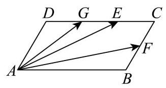

# 2026二模 宝山区原卷 · 学生版

> 本地预览：题目、答案及分类尚未全部审定。校对使用的PDF为教研整理版，尚未逐区确认区级印刷原卷。

## 填空题

按本区原卷题号顺序排列。

### 宝山 · 第1题

已知集合 $A = \{ 0,3\} , B = \{ 0,4\}$ ，则 $A \cup  B =$ ___.

### 宝山 · 第2题

已知 $\cos a = \frac{1}{3}$ ，则 $\cos {2a} =$ ___.

### 宝山 · 第3题

已知 $i$ 是虚数单位，且复数 $z$ 满足 $\left( {1 + i}\right) z = 2$ ，则 $\left| z\right|  =$ ___.

### 宝山 · 第4题

若 $\overrightarrow{n} = \left( {1,2}\right)$ 是直线 $l : {ax} + y - 1 = 0$ 的一个法向量，则实数 $a$ 的值为___.

### 宝山 · 第5题

将边长为 2 的正方形绕其一边旋转一周，所得几何体的体积为___.

### 宝山 · 第6题

已知随机变量 $X \sim  N\left( {2,{\sigma }^{2}}\right)$ ，且 $P\left( {X \geq  3}\right)  = \frac{1}{5}$ ，那么 $P\left( {X \leq  1}\right)  =$ ___.

### 宝山 · 第7题

设 $a, b > 0, a + \frac{1}{2b} = 1$ ，则 ${2b} + \frac{1}{a}$ 的最小值为___.

### 宝山 · 第8题

若函数 $y = f\left( x\right)$ 是定义在 $\mathbf{R}$ 上的奇函数,且当 $x \geq  0$ 时, $f\left( x\right)  = {x}^{2} - {2x} + a\left( {a \in  \mathbf{R}}\right)$ , 则 $f\left( {-1}\right)$ 的值为___.

### 宝山 · 第9题

若 ${\left( 1 + x\right) }^{4}{\left( 2 - x\right) }^{5} = {a}_{0} + {a}_{1}x + {a}_{2}{x}^{2} + \cdots  + {a}_{9}{x}^{9}$ ，则 ${a}_{2} =$ ___.

### 宝山 · 第10题

如图，平行四边形 ${ABCD}$ 中， ${AB} = 6,{AD} = 2, F$ 是 ${BC}$ 的中点， $G$ 、 $E$ 是 ${DC}$ 的三等分点,若 $\overrightarrow{AE} \cdot  \overrightarrow{FG} =  - {15}$ ,则 $\angle {BAD} =$ ___.

### 宝山 · 第11题

已知点 $P\text{ 、 }Q$ 分别是椭圆 $\frac{{x}^{2}}{9} + \frac{{y}^{2}}{5} = 1$ 和圆 ${\left( x - 2\right) }^{2} + {y}^{2} = 1$ 上的两个动点,且点 $A\left( {2,1}\right)$ ，则 $\left| {PA}\right|  + \left| {PQ}\right|$ 的最大值为___.

### 宝山 · 第12题

已知集合 $A = \{ x \mid  1 \leq  x \leq  n, x \in  \mathbf{Z}\} , S \subseteq  A$ ，当 $a\text{ 、 }b \in  S$ 且 $a \neq  b$ 时，都有 $\left| {a - b}\right|  > 2$ ，若满足条件的集合 $\mathrm{S}$ 至少有 100 个，则正整数 $n$ 的最小值是___.

## 选择题

按本区原卷题号顺序排列。

### 宝山 · 第13题

两个变量 $x$ 与 $y$ 之间的回归方程 ( )

A. 表示 $x$ 与 $y$ 之间的函数关系;

B. 表示 $x$ 与 $y$ 之间的不确定关系;

C. 反映 $x$ 与 $y$ 之间的真实关系;

D. 是反映 $x$ 与 $y$ 之间的真实关系的一种最佳拟合.

### 宝山 · 第14题

在 ${ABC}$ 中， $A, B$ 均为锐角，设甲: $\sin A < \sin C$ ；乙: ${ABC}$ 是钝角三角形，则甲是乙的 ( )

A. 充要条件

B. 充分不必要条件

C. 必要不充分条件

D. 既不充分也不必要条件

> 本题资料或解析有待核事项，预览不可作为已审定成品。

### 宝山 · 第15题

如图，正方体 ${ABCD} - {A}_{1}{B}_{1}{C}_{1}{D}_{1}$ 的棱长为 1，任作平面 $a$ 与对角线 $A{C}_{1}$ 垂直，使平面 $a$ 与正方体的六条棱都有公共点.记截面 ${PQRSWE}$ 的面积为S，截面周长为 $L$ ，则有( )

A. $\mathrm{S}$ 为定值， $L$ 为定值

B. $\mathrm{S}$ 为定值， $L$ 不为定值

C. $\mathrm{S}$ 不为定值， $L$ 为定值

D. $\mathrm{S}$ 不为定值， $L$ 不为定值

### 宝山 · 第16题

设正项数列 $\left\{  {a}_{n}\right\}$ 的首项 ${a}_{1} = 1$ ,前 $n$ 项和为 ${S}_{n}$ ,若对任意的正整数 $n$ 都有 $A \geq  \frac{{a}_{n + 1}}{{S}_{n}}$ , 其中 $A\widehat{1}\mathbf{R}$ ，则称 $\left\{  {a}_{n}\right\}$ 是 “ $A$ -数列”. 下列结论中错误的是( )

A. 若 $\left\{  {a}_{n}\right\}$ 是公差为 2 的等差数列，则 $\left\{  {a}_{n}\right\}$ 是 “3 - 数列”；

B. 若 $\left\{  {a}_{n}\right\}$ 是 “ 2 - 数列”，则 $\left\{  {a}_{n}\right\}$ 可能为常数列:

C. 若 $\left\{  {a}_{n}\right\}$ 是 “ 2 - 数列”，则不存在正整数 $n \geq  2$ ，满足 ${a}_{n} > 2 \cdot  {3}^{n - 2}$ ；

D. 对任意 $1 < p < q$ ,若 ${a}_{n} = \frac{1}{2}\left( {{p}^{n - 1} + {q}^{n - 1}}\right)$ ,且满足 $1 + A \geq  q$ ,则 $\left\{  {a}_{n}\right\}$ 是 “ $A -$ 数列”.

> 本题资料或解析有待核事项，预览不可作为已审定成品。

## 解答题

按本区原卷题号顺序排列。

### 宝山 · 第17题

如图，在四棱锥 $P - {ABCD}$ 中， ${ABCD}$ 是边长为 1 的正方形， ${PA}\bot$ 平面 ${ABCD}$ ， $E$ 是 ${PA}$ 的中点.

(1)求证: ${BD} \bot$ 平面 ${PAC}$ ；

(2)若直线 ${BE}$ 与平面 ${PAC}$ 所成角的正弦值为 $\frac{\sqrt{10}}{5}$ ，求三棱锥 $B - {PCD}$ 的体积.

### 宝山 · 第18题

已知 $f\left( x\right)  = {\log }_{a}x, g\left( x\right)  = 2{\log }_{a}\left( {{2x} + t - 2}\right) ,\left( {a > 0, a \neq  1, t \in  \mathbf{R}}\right)$ .

(1) 若 $f\left( 1\right)  = g\left( 2\right)$ ，求 $t$ 的值；

(2)当 $x \in  \left\lbrack  {1,4}\right\rbrack$ 时 $f\left( x\right)  \geq  g\left( x\right)$ 恒成立，求 $t$ 的取值范围.

### 宝山 · 第19题

为调查大学数学专业的学生对中华优秀传统文化的了解情况，现对某大学的数学专业学生进行抽样调查.已知被调查的男、女生人数均为 ${20n}$ ( $n$ 为正整数),得到以下 $2 \times  2$ 列联表:

(1)调查结果显示有 97.5% 的把握认为该校学生对中华优秀传统文化的了解与性别有关， 但没有 99% 的把握认为该校学生对中华优秀传统文化的了解与性别有关，求 $n$ 的值；

(2)当 $n = 4$ 时，采用分层抽样的方式在“了解中华优秀传统文化”的学生中抽取 10 人.

①从这 10 人中随机抽取 3 人进行第二次调查，在第二次调查中，已知至少有 2 名女生被抽到，求抽到男生的概率；

②在“不了解中华优秀传统文化”的男生中再随机抽取 $m\left( {m \in  \mathbf{N}}\right)$ 人，然后从这 ${10} + m$ 人中随机抽取 2 人. 用随机变量 $X$ 表示抽到 “了解中华优秀传统文化”的女生人数,若随机变量 $X$ 的数学期望值不小于 $\frac{1}{2}$ ,求 $m$ 的最大值.

<table><tr><td></td><td>男生</td><td>女生</td><td>合计</td></tr><tr><td>了解</td><td></td><td>10n</td><td></td></tr><tr><td>不了解</td><td>5n</td><td></td><td></td></tr><tr><td>合计</td><td></td><td></td><td></td></tr></table>

参考公式: ${\chi }^{2} = \frac{n{\left( ad - bc\right) }^{2}}{\left( {a + b}\right) \left( {c + d}\right) \left( {a + c}\right) \left( {b + d}\right) }$ ,其中 $n = a + b + c + d$ .

参考数据:

<table><tr><td>$P\left( {{\chi }^{2} \geq  k}\right)$</td><td>0.05</td><td>0.025</td><td>0.010</td><td>0.005</td></tr><tr><td>$k$</td><td>3.841</td><td>5.024</td><td>6.635</td><td>7.879</td></tr></table>

### 宝山 · 第20题

将以坐标原点为顶点,以 $x$ 轴为对称轴,并经过点 $P\left( {1,1}\right)$ 的抛物线记为 $C$ . 作两条直线分别与抛物线 $C$ 相交于点 $A\left( {{x}_{1},{y}_{1}}\right) \text{ 、 }B\left( {{x}_{2},{y}_{2}}\right)$ ,设 ${PA}\text{ 、 }{PB}$ 的斜率分别为 ${k}_{PA}\text{ 、 }{k}_{PB}$ ,且满足 ${k}_{PA} + {k}_{PB} = 0.$

(1)求抛物线 $C$ 的标准方程；

(2)证明:直线 ${AB}$ 的斜率 ${k}_{AB} =  - \frac{1}{2}$ ；

(3)若直线 ${AB}$ 在 $y$ 轴上的截距 $b \in  \left\lbrack  {0,1}\right\rbrack$ ，求 $\bigtriangleup  {ABP}$ 面积的最大值.

### 宝山 · 第21题

已知 $y = f\left( x\right)$ 和 $y = g\left( x\right)$ 均为定义在 $\mathbf{R}$ 上的可导函数,且函数 $y = f\left( x\right)$ 满足: ${f}_{1}\left( x\right)  = f\left( x\right) ,{f}_{n + 1}\left( x\right)  = {f}_{n}^{\prime }\left( x\right) \;\left( {n\text{ 是正整数 }}\right) .$

(1)若 $f\left( x\right)  = {\mathrm{e}}^{ax} + b\cos x$ 满足 ${f}_{3}\left( x\right)  = {f}_{1}\left( x\right)$ ，求实数 $a$ 、 $b$ 的值；

(2)设数列 $\left\{  {a}_{n}\right\}$ 是无穷数列，若 $f\left( x\right)  = x - \cos x$ ，且 ${a}_{1} = a,{a}_{n + 1} = {f}_{2}\left( {a}_{n}\right)$ ，是否存在实数 $a$ ,使得 $\left\{  {a}_{n}\right\}$ 是常数列,请说明理由:

(3) 若 $y = {f}_{n}\left( x\right) \left( {n \leq  2}\right)$ 是定义域上的增函数,函数 $y = g\left( x\right)$ 是周期函数,且存在 ${x}_{0} \in  \mathbf{R}$ 对任意实数 $x$ ,都有 $g\left( {x}_{0}\right)  \geq  g\left( x\right)  > 0$ ,求证: “ ${f}_{n}\left( x\right)  = 0\left( {n \geq  3}\right)$ 恒成立”的充要条件是 “ $y = {f}_{2}\left( x\right)  \cdot  g\left( x\right)$ 是周期函数”.

> 本题资料或解析有待核事项，预览不可作为已审定成品。

