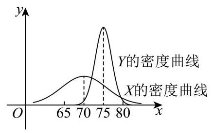

# 2026二模 徐汇区原卷 · 学生版

> 本地预览：题目、答案及分类尚未全部审定。校对使用的PDF为教研整理版，尚未逐区确认区级印刷原卷。

## 填空题

按本区原卷题号顺序排列。

### 徐汇 · 第1题

不等式 $\frac{1}{x - 2} > 0$ 的解集为___.

### 徐汇 · 第2题

函数 $y = {2}^{x} - 1$ 的零点是___.

### 徐汇 · 第3题

计算: $\mathop{\sum }\limits_{{i = 1}}^{{+\infty }}\frac{1}{{2}^{i}} =$ ___.

### 徐汇 · 第4题

若函数 $y = f\left( x\right)$ 在 $x = {x}_{0}$ 处的切线方程为 $y = {2x} - 1$ ,则 $\mathop{\lim }\limits_{{h \rightarrow  0}}\frac{f\left( {{x}_{0} + h}\right)  - f\left( {x}_{0}\right) }{h} =$

### 徐汇 · 第5题

若幂函数 $y = {x}^{a}$ 在区间 $\left( {0, + \infty }\right)$ 上是严格减函数，则实数 $a$ 的取值范围是___.

### 徐汇 · 第6题

若 $\tan \left( {a - \beta }\right)  = \frac{2}{3},\tan \beta  = 1$ ，则 $\tan a =$ ___.

### 徐汇 · 第7题

若 ${\left( x + \frac{1}{x}\right) }^{n}$ 的二项展开式中，第 5 项为常数项，则 $n =$ ___.

### 徐汇 · 第8题

已知向量 $\overrightarrow{a}\text{ 、 }\overrightarrow{b}$ ，其中 $\left| \overrightarrow{b}\right|  = 3$ ， $\overrightarrow{a}$ 在 $\overrightarrow{b}$ 方向上的投影向量是 $\frac{2}{9}\overrightarrow{b}$ ，则 $\overrightarrow{a} \cdot  \overrightarrow{b} =$ ___.

### 徐汇 · 第9题

已知实数 ${a}_{1}$ 、 ${a}_{2}$ 、 ${a}_{3}$ 、 ${a}_{4}$ 、 ${a}_{5}$ 满足

$\left\{  {x \mid  \left( {x - {a}_{1}}\right) \left( {x - {a}_{2}}\right) \left( {x - {a}_{3}}\right) \left( {x - {a}_{4}}\right) \left( {x - {a}_{5}}\right)  = 0}\right\}   = \{ 1,2,3,4\}$ ,则 ${a}_{1}\text{ 、 }{a}_{2}\text{ 、 }{a}_{3}\text{ 、 }{a}_{4}\text{ 、 }{a}_{5}$ 的方差的最大值为___.

### 徐汇 · 第10题

设 $A, B$ 是一个随机试验中的两个事件,且 $P\left( B\right)  = \frac{1}{3}, P\left( {\bar{B} \mid  A}\right)  = \frac{3}{5}, P\left( {\bar{B} \mid  \bar{A}}\right)  = \frac{9}{10}$ ,则 $P\left( A\right)  =$ ___.

### 徐汇 · 第11题

已知复数 ${w}_{1},{w}_{2}$ 满足 $\overline{{w}_{1}} - \overline{{w}_{2}} = \frac{4}{{w}_{1} - {w}_{2}}$ ,记满足 $\left| {z - {w}_{i}}\right|  \in  \left\lbrack  {1,3}\right\rbrack  \left( {i = 1,2}\right)$ 的复数 $z$ 组成的集合为 $A$ . 若 ${z}_{1} \in  A$ 且 ${z}_{2} \in  A$ ，则 $\left| {{z}_{1} - {z}_{2}}\right|$ 的取值范围是___.

> 本题资料或解析有待核事项，预览不可作为已审定成品。

### 徐汇 · 第12题

如图为一架农业无人机沿固定航线匀速飞行，并在某时刻向下喷洒农药的示意图. 将种植坡面视为坡角为 $\theta$ 的平面，航线视为直线，无人机视为航线上的点，无人机在任意时刻喷洒农药的雾滴形成的形状均为以铅垂线为轴、母线与轴夹角为 ${45}^{ \circ  }$ 的圆锥及其内部. 若无人机飞行的海拔高度恒定，航线与种植坡面平行且距离为 3 米，假设无人机飞行时农药喷洒不间断且不受风速影响；则飞行过程中会在种植坡面上形成一条宽为 $L\left( \theta \right)$ 米的“农药条带”，当 ${0}^{ \circ  } \leq  \theta  \leq  {15}^{ \circ  }$ 时， $L\left( \theta \right)$ 的最大值为___. (结果精确到 0.01 )

航线 无人机

## 选择题

按本区原卷题号顺序排列。

### 徐汇 · 第13题

已知 $a\text{ 、 }b \in  \mathbf{R}$ ，则 “ $\ln a > \ln b$ ” 是 “ ${\mathrm{e}}^{a - b} > 1$ ” 的( )

A. 充分非必要条件

B. 必要非充分条件

C. 充要条件

D. 既非充分又非必要条件

### 徐汇 · 第14题

已知甲、乙两班在某次数学测验中成绩近似服从正态分布,甲班成绩 $X \sim  N\left( {{\mu }_{1},{\sigma }_{1}{}^{2}}\right)$ , 乙班成绩 $Y \sim  N\left( {{\mu }_{2},{\sigma }_{2}{}^{2}}\right)$ ,其密度曲线如图所示,则有( )

A. ${\mu }_{1} < {\mu }_{2}$ 且 ${\sigma }_{1} < {\sigma }_{2}$

B. ${\mu }_{1} > {\mu }_{2}$ 且 ${\sigma }_{1} > {\sigma }_{2}$

C. $P\left( {X \leq  {70}}\right)  = P\left( {Y \geq  {75}}\right)$

D. $P\left( {X \geq  {75}}\right)  > P\left( {Y \geq  {75}}\right)$

### 徐汇 · 第15题

设 $\omega  > 0$ ,函数 $y = \frac{\sqrt{3}}{2}\cos {\omega x} + \frac{1}{2}\sin {\omega x}$ 在区间 $\left( {\frac{\pi }{2},\pi }\right)$ 上没有最大值和最小值,则 $\omega$ 的取值范围为( )

A. $\left( {0,\frac{1}{2}}\right\rbrack$

B. $\left\lbrack  {\frac{1}{3},\frac{1}{2}}\right\rbrack$

C. $\left( {0,\frac{1}{6}}\right\rbrack   \cup  \left\lbrack  {\frac{1}{3},\frac{7}{6}}\right\rbrack  \;$

D. $\left( {0,\frac{1}{6}}\right\rbrack   \cup  \left\lbrack  {\frac{1}{3},\frac{1}{2}}\right\rbrack$

### 徐汇 · 第16题

设 $m \in  \mathbf{R}$ . 定义点 $P\left( {m,\frac{1}{2}m - 1}\right)$ 的 $t -$ 相伴集合为 ${A}_{P - t} = \{ \left( {x, y}\right) \parallel x - m \mid   \leq  t$ 且 $\left. {\left| {y - \left( {\frac{1}{2}m - 1}\right) }\right|  \leq  t}\right\}$ ,其中 $t$ 为正实数. 给出以下两个命题:

① 若 $m = 0$ ，则其 1-相伴集合 ${A}_{P - 1}$ 所对应平面图形的面积为 2;

② 设 ${t}_{0} > 0$ ，若对任意实数 $m$ 及任意 $t \leq  {t}_{0}$ ，集合 ${A}_{P - t}$ 所对应平面图形与抛物线 ${x}^{2} = {2y}$ 均无公共点,则 ${t}_{0} < \frac{7}{12}$ .

则正确的选项是 ( )

A. ①是真命题，②是真命题

B. ①是假命题，②是假命题

C. ①是真命题，②是假命题

D. ①是假命题，②是真命题

> 本题资料或解析有待核事项，预览不可作为已审定成品。

## 解答题

按本区原卷题号顺序排列。

### 徐汇 · 第17题

如图，在四棱锥 $P - {ABCD}$ 中， $\bigtriangleup  {PCD}$ 为等边三角形，底面 ${ABCD}$ 为直角梯形， ${AB}//{CD},{CD} \bot  {AD},{CD} = 4,{AB} = {AD} = 2$ .

(1)求证: ${PB}\bot {CD}$ ；

(2)若四棱锥 $P - {ABCD}$ 的体积为 $4\sqrt{3}$ ，求直线 ${PD}$ 与平面 ${PBC}$ 所成角的大小.

### 徐汇 · 第18题

为落实《全民健身条例》，某区体育局对本区居民的健身场所选择偏好进行调研. 数据显示，居民主要选择商业健身场馆(如健身房、体育中心)和社区公共运动场(如小区健身点、 街心公园) 两类场所.为了解年龄因素是否影响健身场所的选择, 研究人员将成年居民分为青壮年组 (≥18 岁且 < 40 岁) 和中老年组 (≥40 岁), 从该区随机抽取 170 名成年居民进行调查,得到如下不完整的 $2 \times  2$ 列联表:

<table><tr><td></td><td>青壮年</td><td>中老年</td><td>合计</td></tr><tr><td>商业健身场馆</td><td>60</td><td></td><td></td></tr><tr><td>社区公共运动场</td><td></td><td>50</td><td></td></tr><tr><td>合计</td><td>80</td><td></td><td>170</td></tr></table>

(1)请补充 $2 \times  2$ 列联表，并根据表中数据判断能否有 95% 的把握认为年龄与居民健身场所的选择有关;

(2)用分层抽样的方式从选择社区公共运动场的居民中抽取 14 个人，再从 14 个人中随机抽取 7 个人，用随机变量 $X$ 表示这 7 个人中中老年与青壮年人数之差的绝对值，求 $X$ 的分布和数学期望.

参考公式及数据: ${\chi }^{2} = \frac{n{\left( ad - bc\right) }^{2}}{\left( {a + b}\right) \left( {c + d}\right) \left( {a + c}\right) \left( {b + d}\right) }$ ,其中 $n = a + b + c + d$ .

<table><tr><td>$P\left( {{\chi }^{2} \geq  {\chi }_{0}}\right)$</td><td>0.1</td><td>0.05</td><td>0.025</td><td>0.01</td><td>0.005</td><td>0.001</td></tr><tr><td>${\chi }_{0}$</td><td>2.706</td><td>3.841</td><td>5.024</td><td>6.635</td><td>7.879</td><td>10.828</td></tr></table>

### 徐汇 · 第19题

已知函数 $y = f\left( x\right)$ ,其中 $f\left( x\right)  = \frac{{2a} - 1 + g\left( x\right) }{a - g\left( x\right) }, a \in  \mathbf{R}$ 且 $a > 0$ .

(1)设 $g\left( x\right)  = {2}^{x}$ ，写出函数 $y = f\left( x\right)$ 的定义域，并判断是否存在正数 $a$ ，使得函数 $y = f\left( x\right)$ 为奇函数,说明理由;

(2)设 $g\left( x\right)  = {\log }_{2}x$ . 若关于 $x$ 的方程 $f\left( x\right)  = g\left( x\right)$ 的解集为单元素集合,求正数 $a$ 的值.

### 徐汇 · 第20题

已知无穷数列 $\left\{  {\lambda }_{n}\right\}$ 为严格增数列,且 ${\lambda }_{n} > 0$ . 双曲线 ${C}_{n}$ 的方程为 ${x}^{2} - {y}^{2} = {\lambda }_{n}{}^{2},{A}_{n}\text{ 、 }{B}_{n}$ 为双曲线 ${C}_{n}$ 上两个不同的动点,其中 ${A}_{n}$ 在双曲线 ${C}_{n}$ 的右支上.

(1)若 ${\lambda }_{1} = 1$ ，求双曲线 ${C}_{1}$ 的渐近线方程和焦点坐标；

(2)若 ${\lambda }_{1} = 1,{\lambda }_{2} = 2$ ，且点 $T\left( {t,0}\right)$ 为线段 ${A}_{1}{A}_{2}$ 的中点，求实数 $t$ 的取值范围；

(3)已知直线 ${A}_{n}{B}_{n}$ 过双曲线 ${C}_{n + 1}$ 的右顶点. 若 ${B}_{n}$ 在双曲线 ${C}_{n}$ 的右支上，则称弦 ${A}_{n}{B}_{n}$ 为双曲线 ${C}_{n}$ 的“同支弦”，否则称其为双曲线 ${C}_{n}$ 的“异支弦”. 是否存在等差数列 $\left\{  {\lambda }_{n}\right\}$ ，使得对于任意正整数 $n$ ,双曲线 ${C}_{n}$ “同支弦”弦长的最小值均大于双曲线 ${C}_{n}$ “异支弦”弦长的最小值? 若存在,请求出数列 $\left\{  {\lambda }_{n}\right\}$ 的通项公式; 若不存在,请说明理由.

### 徐汇 · 第21题

已知函数 $y = f\left( x\right)$ 与函数 $y = g\left( x\right)$ 的定义域均为 $\mathbf{R}$ ,且在 $\mathbf{R}$ 上的导函数分别为 ${f}^{\prime }\left( x\right)$ 和 ${g}^{\prime }\left( x\right)$ . 若存在常数 $k$ ,使得对任意实数 $x,{g}^{\prime }\left( x\right)  \geq  k \cdot  \left| {{f}^{\prime }\left( x\right) }\right|$ 恒成立,则称 $y = g\left( x\right)$ 是 $y = f\left( x\right)$ 的“ $k$ -调整函数”，并称 $k$ 为调整系数.

(1)设 $f\left( x\right)  = \cos x, g\left( x\right)  = {2x}$ . 求证: $y = g\left( x\right)$ 是 $y = f\left( x\right)$ 的“2-调整函数”；

(2) 设 $f\left( x\right)  = {x}^{2}, g\left( x\right)  = {\mathrm{e}}^{x} + {bx}$ . 若存在实数 $b \in  \left\lbrack  {-2, - 1}\right\rbrack$ ，使得 $y = g\left( x\right)$ 是 $y = f\left( x\right)$ 的 “ $k$ -调整函数”，求调整系数 $k$ 的取值范围；

(3) 已知 $y = g\left( x\right)$ 是 $y = f\left( x\right)$ 的“1-调整函数”，函数 $y = g\left( x\right)$ 的值域是一个闭区间，记作集合 $P$ ，函数 $y = f\left( x\right)$ 的值域记作集合 $Q$ . 若 $P \subseteq  Q$ ，求证：$y = f\left( x\right)  - g\left( x\right)$ 为常值函数.

> 第（3）问的现有题设与求证结论存在冲突；正式原卷或勘误尚待确认，本题仅供审题讨论。

