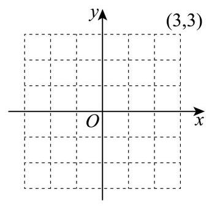

# 2026二模 普陀区原卷 · 学生版

> 本地预览：题目、答案及分类尚未全部审定。校对使用的PDF为教研整理版，尚未逐区确认区级印刷原卷。

## 填空题

按本区原卷题号顺序排列。

### 普陀 · 第1题

根据中国汽车工业协会发布的数据，2025 年 7 月至 2026 年 1 月，我国新能源汽车月度销量 (单位:万辆) 为:143.2,156.7,162.4,158.3,182.1,173.5,168.9，则这 7 个月新能源汽车销量的中位数为___万辆.

### 普陀 · 第2题

已知复数 $z$ 满足 $\left( {\mathrm{i} - 1}\right) \left( {z - 3\mathrm{i}}\right)  = 3 + \mathrm{i}$ ，其中 $\mathrm{i}$ 为虚数单位，则 $\bar{z} =$ ___.

### 普陀 · 第3题

已知点 $P\left( {2, y}\right)$ 在抛物线 ${y}^{2} = {4x}$ 上，则 $P$ 点到抛物线焦点 $F$ 的距离为___.

### 普陀 · 第4题

设 $a \in  \mathbf{R}$ ,若关于 $x$ 的不等式 $\frac{a}{x - 1} \leq  1$ 的解集是 $\left( {-\infty ,1}\right)  \cup  \lbrack 2, + \infty )$ ,则 $a$ 的值为___.

### 普陀 · 第5题

设 $t \in  \mathbf{R}$ ,若 ${\left( tx - \frac{1}{x}\right) }^{6}$ 的展开式中的常数项是 -540,则该展开式中所有项的系数和为 ___. (结果用数值表达)

### 普陀 · 第6题

某大型管线网的局部呈网格结构，如图建立平面直角坐标系，一小型机器人沿管线移动执行巡检任务，在某次巡检的路径中经过了点: $\left( {-3, - 2}\right)$ 、 $\left( {-2, m}\right)$ 、 $\left( {-1, - 2}\right)$ 、 $\left( {0, - 1}\right)$ 、 $\left( {1,0}\right) \text{ 、 }\left( {2,1}\right) \text{ 、 }\left( {3,2}\right)$ ,若该机器人经过的点的纵坐标 $y$ 关于横坐标 $x$ 的一元线性回归方程是 $y = \frac{11}{14}x - \frac{5}{7}$ ，则 $m$ 的值为___.

> 本题资料或解析有待核事项，预览不可作为已审定成品。

### 普陀 · 第7题

设 $n \geq  1, n \in  \mathbf{N},{S}_{n}$ 是等差数列 $\left\{  {a}_{n}\right\}$ 的前 $n$ 项和,且公差 $d \neq  0$ ,若 ${a}_{1}{a}_{3} = {S}_{4}$ ,且 ${a}_{3}$ , ${a}_{4},{a}_{6}$ 成等比数列,则 ${S}_{n} =$ ___.

### 普陀 · 第8题

在 ${ABC}$ 中, $\angle {ACB} = \frac{\pi }{2},{AC} = 1$ ,过点 $A$ 作直线 $l//{BC}$ ,将 ${ABC}$ 绕直线 $l$ 旋转一周所得到的几何体记为 $\Omega$ ，若 $\Omega$ 的体积是 $\frac{4}{3}\pi$ ，则 $\Omega$ 的表面积为___.

### 普陀 · 第9题

已知向量 $\overrightarrow{a} = \left( {1,2}\right) ,\overrightarrow{b} = \left( {-1,1}\right) ,\overrightarrow{c} = \left( {3,4}\right)$ ，函数 $y = f\left( x\right)$ 的表达式为 $f\left( x\right)  = \left\{  \begin{array}{l} x + 1, x < 2 \\  {2x} - 1, x \geq  2 \end{array}\right.$ ,设 $\overrightarrow{d}\left( x\right)  = f\left( x\right)  \cdot  \overrightarrow{a} + f\left( {x + 2}\right)  \cdot  \overrightarrow{b}$ ,若 $\overrightarrow{d}\left( x\right) //\overrightarrow{c}$ ,则 $x =$

### 普陀 · 第10题

设 $a \in  \mathbf{R}$ ,集合 $M = \{  - 1, - 2, - a\} , N = \left\{  {x \mid  {x}^{2} - {ax} \leq  0}\right\}$ ,若集合 $A \subseteq  \left( {M \cap  N}\right)$ ,且满足条件的 $A$ 恰有 2 个，则 $a$ 的取值范围为___.

### 普陀 · 第11题

设定义域为 $\mathbf{R}$ 的函数 $y = f\left( x\right)$ 的导函数为 $y = {f}^{\prime }\left( x\right)$ ,令 $g\left( x\right)  = {f}^{\prime }\left( x\right)  + {\left( x + \sqrt{{x}^{2} + 1}\right) }^{2}$ ,若函数 $y = f\left( x\right)$ 和函数 $y = g\left( x\right)$ 皆为偶函数,则不等式 $f\left( {x + 2}\right)  > f\left( {{2x} - 3}\right)$ 的解集为___.

### 普陀 · 第12题

设 $k \geq  2, n \geq  1, k, n \in  \mathbf{N},{S}_{n}$ 是等比数列 $\left\{  {a}_{n}\right\}$ 的前 $n$ 项和,且 ${a}_{1} > 0$ ,公比为 3,令 ${b}_{n} = {S}_{n} + \frac{1}{{S}_{n}}$ ,若恰存在 2 个 $k$ 的值,对任意的 $n < k$ ,皆有 ${b}_{n} > {b}_{k}$ 成立,则 ${a}_{1}$ 的取值范围为___.

> 本题资料或解析有待核事项，预览不可作为已审定成品。

## 选择题

按本区原卷题号顺序排列。

### 普陀 · 第13题

已知直线 $l\text{ 、 }m$ 和平面 $a$ ，若 $m \subset  a$ ，则 “ $l$ 与 $m$ 不相交”是 “ $l//a$ ”的( )

A. 充分非必要条件必要条件

B. 必要非充分条件

C. 充分必要条件

D. 既非充分又非必要

### 普陀 · 第14题

设 $x\text{ 、 }y\text{ 、 }z \in  \mathbf{R}$ ,若 ${10}^{x} = {y}^{-\frac{1}{2}} = {\log }_{3}z$ ,则下列结论中不可能成立的是 ( )

A. $y < x < z$

B. $x < y < z$

C. $x < z < y$

D. $z < y < x$

### 普陀 · 第15题

某科技公司每位员工皆佩戴红色或蓝色中仅一种颜色的工牌，该公司为促进跨部门协作, 采用智能轮岗系统进行员工交换部门, 初始时, 甲部门有 2 名红色工牌员工、 1 名蓝色工牌员工，乙部门有 2 名红色工牌员工、 2 名蓝色工牌员工，系统执行一次随机交换指令: 从甲、乙 2 个部门中随机各选取 1 名员工进行交换，设交换后甲部门中红色工牌员工的人数为 $X$ ,则 $X$ 的期望为( )

A. $\frac{7}{4}$

B. $\frac{5}{3}$

C. $\frac{11}{6}$

D. $\frac{13}{6}$

### 普陀 · 第16题

在直角坐标平面中,方程 $\left( {x + \sqrt{9 - {y}^{2}}}\right) \left( {x - \sqrt{{18} - 2{y}^{2}}}\right)  = 0$ 表示的曲线称为 “ $G$ 圆". 点 $P, Q$ 是 “ $G$ 圆”上的任意两点, $O$ 为坐标原点. 对如下两个命题:

①若点 $A\left( {-3,0}\right) \text{ 、 }B\left( {3,0}\right)$ ，则 $\left| {PA}\right|  + \left| {PB}\right|$ 的值不可能等于 8 ；

②若 ${OP} \bot  {OQ}$ ，则 $\frac{1}{{\left| OP\right| }^{2}} + \frac{1}{{\left| OQ\right| }^{2}}$ 的取值范围为 $\left\lbrack  {\frac{1}{6},\frac{2}{9}}\right\rbrack$ .

则下列结论中正确的是 ( )

A. ①为真②为真

B. ①为真②为假

C. ①为假②为真

D. ①为假 ②为假

## 解答题

按本区原卷题号顺序排列。

### 普陀 · 第17题

如图，在正三棱柱 ${ABC} - {A}_{1}{B}_{1}{C}_{1}$ 中， $D$ 、 $E$ 分别是棱 ${A}_{1}{B}_{1}$ 、 ${A}_{1}A$ 的中点，且 ${A}_{1}A = {A}_{1}{B}_{1} = 2.$

(1)求证:直线 ${A}_{1}B \bot$ 平面 ${C}_{1}{DE}$ ；

(2)求点 $A$ 到平面 ${A}_{1}{CB}$ 的距离.

### 普陀 · 第18题

设 ${ABC}$ 的内角 $A, B, C$ 的对边分别为 $a, b, c$ ,且 $b\sin \left( {A + \frac{5\pi }{6}}\right)  = a\cos A\cos C + c{\cos }^{2}A.$

(1)求角 $A$ 的大小；

(2)点 $O$ 、 $D$ 分别满足 $\left( {\overrightarrow{OA} + \overrightarrow{OB}}\right)  \cdot  \overrightarrow{AB} = 0$ ， $\left( {\overrightarrow{OA} + \overrightarrow{OC}}\right)  \cdot  \overrightarrow{AC} = 0$ ， $\overrightarrow{BD} = 2\overrightarrow{DC}$ ， ${AB} \cdot  {AD} = 0$ ,求 $\frac{\overrightarrow{CO} \cdot  \overrightarrow{AB}}{\overrightarrow{CO} \cdot  \overrightarrow{CB} + \overrightarrow{CO} \cdot  \overrightarrow{CA}}$ 的值.

### 普陀 · 第19题

2016-2025 年全国普通高中生均经费(单位:元)如下表所示:

<table><tr><td>年份</td><td>2016</td><td>2017</td><td>2018</td><td>2019</td><td>2020</td></tr><tr><td>生均经费</td><td>11500</td><td>12100</td><td>12800</td><td>13500</td><td>14300</td></tr><tr><td>年份</td><td>2021</td><td>2022</td><td>2023</td><td>2024</td><td>2025</td></tr><tr><td>生均经费</td><td>15100</td><td>15800</td><td>16500</td><td>17300</td><td>18100</td></tr></table>

2026 年全国两会明确, “十五五” (2026-2030年) 期间将深入实施县域普通高中振兴计划，持续增加普通高中生均经费的投入与学位供给.

(1)设上表中10年生均经费的平均数为 $\bar{x}$ ，现从这10个数据中不放回地随机抽取两个不同的数据，已知抽取的两个数据中至少有一个低于 $\bar{x}$ ，求两个数据都低于 $\bar{x}$ 的概率；

(2)在评估不同发展阶段的投入稳定性时，不仅看波动幅度，还需考虑增长基数，统计学中常用变异系数 ${CV}$ ( ${CV} = \frac{\text{ 标准差 }}{\text{ 平均数 }}$ ) 来衡量相对自身水平的波动程度. 将 2016-2020 作为阶段 $A$ ，2021-2025 作为阶段 $B$ ，分别计算 $A$ 、 $B$ 两阶段生均经费的标准差和变异系数 (结果均精确到 0.001 )，根据计算结果，你认为哪个阶段的投入更稳定；

(3)教育经济学研究显示，生均经费每增长1%，可带动学位供给增长 0.3%；而学位供给每增长 1%，可带动毛入学率约增长 0.5%. 已知 2025 年全国高中阶段毛入学率为 92.0%，“十五五”规划目标是在此基础上再提升 2 个百分点，根据预算报告，预计“十五五”期间生均经费年增长率可保持 5%. 请据此预测 2030 年全国高中阶段毛入学率, 并判断 5% 的增速能否支撑规划目标的实现.

### 普陀 · 第20题

设 $a > 0, b > 0, m\text{ 、 }t \in  \mathbf{R}$ ,双曲线 $\Gamma  : \frac{{x}^{2}}{{a}^{2}} - \frac{{y}^{2}}{{b}^{2}} = 1$ 的一条渐近线方程是 $y = 2\sqrt{2}x$ , 点 $P$ 为 $\Gamma$ 右支上的一点,直线 $l$ 的方程是 $x - {my} - t = 0, O$ 是坐标原点.

(1)若点 $P$ 的坐标为 $\left( {3,8}\right)$ ，求双曲线 $\Gamma$ 的方程；

(2)若直线 $l$ 经过点 $O$ ，且与 $\Gamma$ 交于 $A$ 、 $B$ 两点，直线 ${PA}$ 、 ${PB}$ 的斜率分别为 ${k}_{1}$ 、 ${k}_{2}$ ， 求 ${k}_{1} \cdot  {k}_{2}$ 的值;

(3)设点 ${F}_{1}$ 是 $\Gamma$ 的左焦点，点 ${A}_{1}\text{ 、 }{A}_{2}$ 是 $\Gamma$ 的左、右两个顶点，直线 ${A}_{1}P$ 与直线 $x = 1$ 交于点 $M$ ,直线 $l$ 经过点 $P$ 与 $\Gamma$ 的右支交于另外一点 $Q$ ,若 $a = 3$ ,且直线 ${MQ}$ 恒过点 ${A}_{2}$ ,求 $\vartriangle  {F}_{1}{PQ}$ 周长的取值范围.

> 原题允许交点恰为右顶点，源解析未讨论这一情形，原答案不能直接作为标准答案。

### 普陀 · 第21题

已知 $p\text{ 、 }q$ 为实数,设函数 $y = f\left( x\right)$ 的最小值为 $f\left( p\right)$ ,函数 $y = g\left( x\right)$ 的最小值为 $g\left( q\right)$ ,若 $f\left( p\right)  = g\left( q\right)$ 且 $p \neq  q$ ,则称函数 $y = f\left( x\right)$ 和函数 $y = g\left( x\right)$ 是 $T$ 函数.

(1)设函数 $y = f\left( x\right)$ 的表达式为 $f\left( x\right)  = \sin x$ ，函数 $y = g\left( x\right)$ 的表达式为 $g\left( x\right)  = \cos x$ ， 请判断函数 $y = f\left( x\right)$ 和函数 $y = g\left( x\right)$ 是否为 $T$ 函数，并说明理由；

(2)设 $a\text{ 、 }b$ 为正实数，函数 $y = f\left( x\right)$ 的表达式为 $f\left( x\right)  = {x}^{2} + 2\left( {a - 1}\right) x + {a}^{2} - {2a} + 7$ ， 函数 $y = g\left( x\right)$ 的表达式为 $g\left( x\right)  = {bx} + \frac{9}{bx}\left( {x > 0}\right)$ ,若函数 $y = f\left( x\right)$ 和函数 $y = g\left( x\right)$ 不是 $T$ 函数,求 $\frac{1}{a} + b$ 的最小值;

(3) 设 $k\text{ 、 }t\text{ 、 }a$ 为实数，函数 $y = f\left( x\right)$ 的表达式为 $f\left( x\right)  =  - {\mathrm{e}}^{{kt} + x} - {2kt}\left( {x \leq  0}\right)$ ，函数 $y = g\left( x\right)$ 的表达式为 $g\left( x\right)  = \left( {x - 2}\right) \ln x - {ax} - 2$ ,若存在 $t \in  \left( {1,{\mathrm{e}}^{2}}\right)$ ,对任意的 $x \in  \left( {0, + \infty }\right)$ ,皆有 $g\left( x\right)  \geq  g\left( t\right)$ 成立,且函数 $y = f\left( x\right)$ 和函数 $y = g\left( x\right)$ 是 $T$ 函数,求 $k$ 的取值范围.

