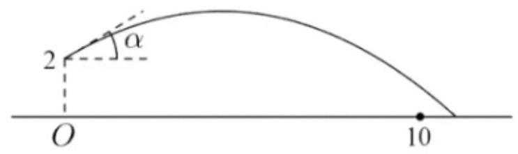
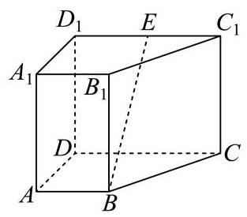
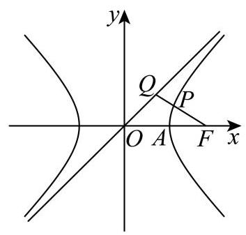
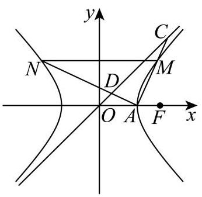

# 2026二模 杨浦区原卷 · 学生版

> 本地预览：题目、答案及分类尚未全部审定。校对使用的PDF为教研整理版，尚未逐区确认区级印刷原卷。

## 填空题

按本区原卷题号顺序排列。

### 杨浦 · 第1题

设全集 $U = \{ x \mid  1 \leq  x \leq  6, x \in  \mathbf{Z}\} , B = \{ 1,2\}$ ，用列举法表示 ${\eth }_{U}B =$ ___.

> 本题资料或解析有待核事项，预览不可作为已审定成品。

### 杨浦 · 第2题

计算 $\mathop{\sum }\limits_{{i = 1}}^{n}\left( {{2i} - 1}\right)  =$ ___.

### 杨浦 · 第3题

若幂函数 $y = {x}^{a}$ 的图像经过点 $\left( {\sqrt{3},3\sqrt{3}}\right)$ ，则实数 $a =$ ___.

### 杨浦 · 第4题

在 ${\left( x + \frac{2}{x}\right) }^{6}$ 的二项展开式中，常数项的值为___.

### 杨浦 · 第5题

设正实数 $a, b$ 满足 $a + b = 3$ ，则 ${a}^{2} + {b}^{2}$ 的最小值为___.

### 杨浦 · 第6题

不等式 ${3}^{x} + {\log }_{2}x < 3$ 的解集为___.

### 杨浦 · 第7题

已知圆锥的底面半径为 1,体积为 $\frac{\sqrt{3}\pi }{3}$ ,则该圆锥的侧面积为___.

### 杨浦 · 第8题

直线 $l : \left( {a - 3}\right) x + \left( {{2a} + 1}\right) y - 3 = 0$ 的一个法向量是 $\overrightarrow{n} = \left( {3,2}\right)$ ，则实数 $a =$ ___.

### 杨浦 · 第9题

已知随机变量 $X$ 服从二项分布 $B\left( {{90}, p}\right)$ ，若 $E\left\lbrack  X\right\rbrack   = {30}$ ，则 $D\left\lbrack  X\right\rbrack   =$ ___.

### 杨浦 · 第10题

设集合 $A = \{ z\parallel z + 1 \mid   = \left| {z - a}\right| , z \in  \mathbf{C}\} , B = \{ z\parallel z \mid   = 1, z \in  \mathbf{C}\}$ ，若 $A \cap  B \neq  \varnothing$ ，则实数 $a$ 的取值范围是___.

> 本题资料或解析有待核事项，预览不可作为已审定成品。

### 杨浦 · 第11题

掷实心球时，将轨迹视为抛物线的一部分，设实心球离手位置在起掷点 $O$ 正上方 2 米, 出手角度 $a$ 即抛物线在该处切线与水平地面所成角,如图所示. 已知实心球轨迹最高点距离地面 3 米,若要成绩不小于 10 米 (实心球落地点到起掷点的距离),则出手角度 $a$ 的最大值为___. (精确到 ${0.1}^{ \circ  }$ ).

### 杨浦 · 第12题

记 $\overrightarrow{{a}_{1}},\overrightarrow{{a}_{2}}\ldots ,\overrightarrow{{a}_{m}}$ 是空间中的 $m\left( {m \in  \mathbf{N}, m \geq  1}\right)$ 个不同的非零向量,满足: ①其中任意向量在其它向量方向上的投影均为其本身或零向量; ②其中任意三个向量 $\overrightarrow{{a}_{i}}\text{ 、 }\overrightarrow{{a}_{j}}\text{ 、 }\overrightarrow{{a}_{k}}$ 均不能使 $\frac{1}{\left| \overrightarrow{{a}_{k}}\right| }\overrightarrow{{a}_{k}} = \frac{1}{2}\left( {\frac{1}{\left| \overrightarrow{{a}_{i}}\right| }\overrightarrow{{a}_{i}} + \frac{1}{\left| \overrightarrow{{a}_{j}}\right| }\overrightarrow{{a}_{j}}}\right)$ 成立，则 $m$ 的最大值为___.

## 选择题

按本区原卷题号顺序排列。

### 杨浦 · 第13题

设 $a > b$ ，下列不等式中恒成立的是( )

A. $\frac{1}{a} < \frac{1}{b}$

B. ${a}^{2} > {b}^{2}$

C. ${a}^{3} > {b}^{3}$

D. $\left| a\right|  > \left| b\right|$

### 杨浦 · 第14题

事件 $A\text{ 、 }B$ 相互独立,若 $P\left( A\right)  = \frac{1}{2}, P\left( B\right)  = \frac{1}{3}$ ,则 $A$ 与 $\bar{B}$ 同时发生的概率为 ( ) .

A. 0

B. $\frac{1}{6}$

C. $\frac{5}{6}$

D. $\frac{1}{3}$

### 杨浦 · 第15题

已知函数 $y = f\left( x\right)$ 和 $y = g\left( x\right)$ 的定义域都为 $\mathbf{R}$ 且都存在导函数. 若 $y = f\left( x\right)$ 和 $y = g\left( x\right)$ 的零点均有且仅有 $x = 0$ ,且当 $x \neq  0$ 时恒有 $f\left( x\right)  < g\left( x\right)$ ,则下列情形中不可能的是 ( ) .

A. 0 是 $y = f\left( x\right)$ 的极大值点,也是 $y = g\left( x\right)$ 的极大值点

B. 0 是 $y = f\left( x\right)$ 的极小值点,也是 $y = g\left( x\right)$ 的极小值点

C. 0 是 $y = f\left( x\right)$ 的极大值点,也是 $y = g\left( x\right)$ 的极小值点

D. 0是 $y = f\left( x\right)$ 的极小值点,也是 $y = g\left( x\right)$ 的极大值点

### 杨浦 · 第16题

已知数列 $\left\{  {a}_{n}\right\}$ ,给出以下定义: 若存在常数 $k > 0$ ,对于任意的 $n \in  {\mathbf{N}}^{ * }$ ,都有 ${a}_{n + 2} - {a}_{n + 1} \geq  k\left( {{a}_{n + 1} - {a}_{n}}\right)$ ,则称数列 $\left\{  {a}_{n}\right\}$ 为 “ $k$ -加速数列”,现给出下列命题:

①若 ${a}_{n} = \frac{1}{n}$ ，则对任意 $k > 0$ ，数列 $\left\{  {a}_{n}\right\}$ 都不是 “ $k$ -加速数列”；

②若数列 $\left\{  {a}_{n}\right\}$ 是 “1 - 加速数列”，且 ${a}_{n} \in  \mathbf{Z}$ ， ${a}_{1} = {a}_{2026} = {2026}$ ，则数列 $\left\{  {a}_{n}\right\}$ 存在最小项； ③若数列 $\left\{  {a}_{n}\right\}$ 是 “2 -加速数列”，且 ${a}_{1} = 1,{a}_{2} = 2$ ，则存在 $M > 0$ ，使得 $\left| {a}_{n}\right|  < M$ ； ④正数列 $\left\{  {a}_{n}\right\}$ 是等比数列且公比 $q \neq  1$ ，则 $\left\{  {a}_{n}\right\}$ 是 “ $k$ -加速数列” 的充要条件是 $k = 1$ . 其中正确的命题是( )

A. ①②③

B. ②

C. ②④

D. ③④

## 解答题

按本区原卷题号顺序排列。

### 杨浦 · 第17题

一次考试后，数学兴趣小组分析某班级考试成绩. 该班级共 40 人，将得分由高到低平均分为四组, 第一组 (均分最高的一组) 的数据为 141、140、138、134、133、133、133、132、132、132.

(1)求第一组的得分的均值与中位数；

(2)若从第一组中等可能的选取 2 名学生，求 2 人得分都在 135 分以上的概率；

(3)兴趣小组考察某客观题的得分情况. 将前 15 名学生作为高分组，后 25 名学生作为非高分组; 前 15 名学生中 13 人答对该题，后 25 名学生中 16 人答对该题.据此，填写表格，并判断是否有 95%的把握认为答对该题与进入高分组有关？

附: ${\chi }^{2} = \frac{n{\left( ad - bc\right) }^{2}}{\left( {a + b}\right) \left( {c + d}\right) \left( {a + c}\right) \left( {b + d}\right) }P\left( {{\chi }^{2} \geq  {6.635}}\right)  \approx  {0.01}, P\left( {{\chi }^{2} \geq  {5.024}}\right)  \approx  {0.025}$ , $P\left( {{\chi }^{2} \geq  {3.841}}\right)  \approx  {0.05},\;P\left( {{\chi }^{2} \geq  {2.706}}\right)  \approx  {0.1}.$

<table><tr><td></td><td>高分组</td><td>非高分组</td><td>总计</td></tr><tr><td>某客观题答对</td><td></td><td></td><td></td></tr><tr><td>某客观题答错</td><td></td><td></td><td></td></tr><tr><td>总计</td><td></td><td></td><td></td></tr></table>

### 杨浦 · 第18题

如图，在直四棱柱 ${ABCD} - {A}_{1}{B}_{1}{C}_{1}{D}_{1}$ 中， ${AB}//{CD}$ ， ${AD} \bot  {CD}$ ， ${AB} = 2$ ， ${AD} = 3$ ， ${CD} = 4$ .

(1)设 $E$ 是 ${C}_{1}{D}_{1}$ 的中点，求证: ${BE}//$ 平面 $A{A}_{1}{D}_{1}D$ ；

(2)若直四棱柱 ${ABCD} - {A}_{1}{B}_{1}{C}_{1}{D}_{1}$ 的体积为 36，求平面 ${D}_{1}{AC}$ 与平面 ${ABCD}$ 所成的锐二面角的大小.

> 本题资料或解析有待核事项，预览不可作为已审定成品。

### 杨浦 · 第19题

已知函数 $f\left( x\right)  = 2\sin {\omega x}$ (常数 $\omega  > 0$ ).

(1) 若 $\omega  = 1$ ,在 ${ABC}$ 中,角 $A\text{ 、 }B\text{ 、 }C$ 的对边分别为 $a\text{ 、 }b\text{ 、 }c$ . 若 $f\left( {A + \frac{\pi }{2}}\right)  =  - 1, a = \sqrt{3}b$ , 求角 $B$ 的大小；

( 2 )若 $y = f\left( x\right)$ 的最小正周期为 $\pi$ ，将其图像向左平移 $\frac{\pi }{12}$ 个单位，再向上平移 $h\left( {h > 0}\right)$ 个单位得到函数 $y = g\left( x\right)$ 的图像. 当 $x \in  \left\lbrack  {0,\frac{\pi }{2}}\right\rbrack$ 时恒有 $g\left( x\right)  > 0$ ,求 $h$ 的取值范围.

### 杨浦 · 第20题

已知 $A\text{ 、 }F$ 分别是双曲线 $\Gamma  : {x}^{2} - {y}^{2} = \lambda$ (常数 $\lambda  > 0$ ) 的右顶点和右焦点,记 $\Gamma$ 过一、 三象限的渐近线为 ${l}_{0}$ .

( 1 )求双曲线 $\Gamma$ 的离心率和渐近线 ${l}_{0}$ 的方程；

(2)设 $\lambda  = 2$ ， $Q$ 是 ${l}_{0}$ 上一点，若线段 ${FQ}$ 的中点 $P$ 在双曲线 $\Gamma$ 上，求点 $Q$ 的坐标；

(3)设 $\lambda  = 1$ ，过 $A$ 作两条相互垂直的直线与双曲线 $\Gamma$ 交于 $M$ 、 $N$ 两点(M在第一象限)， 若直线 ${AM}$ 、 ${AN}$ 分别与 ${l}_{0}$ 交于 $C$ 、 $D$ 两点，且 $\bigtriangleup  {AMN}$ 与 $\bigtriangleup  {ACD}$ 的面积之比为 2，求直线 ${AM}$ 的方程.

### 杨浦 · 第21题

设函数 $y = f\left( x\right)$ 的定义域为 $D$ ,值域 $A \subseteq  \left\lbrack  {-1,1}\right\rbrack$ . 若 ${x}_{1},{x}_{2} \in  D$ 且满足 $f\left( {x}_{1}\right)  + f\left( {x}_{2}\right)  = f\left( {{x}_{1} + {x}_{2}}\right)$ ,则称 ${X}_{1}$ 与 ${x}_{2}$ 构成 “函数 $y = f\left( x\right)$ 的线性对”.

(1)若 $f\left( x\right)  = \cos x$ ，判断 $\frac{\pi }{3}$ 与 $\pi$ 是否构成函数 $y = f\left( x\right)$ 的线性对，并说明理由；

( 2 )若 $f\left( x\right)  = {2}^{x} - \frac{1}{2}, D = \left( {-\infty ,0}\right)$ . 若对于任意 ${x}_{1} \in  \left( {-\infty , a}\right)$ (常数 $a \leq  0$ )，都存在 ${x}_{2} \in  D$ ,使得 ${x}_{1}$ 与 ${x}_{2}$ 构成函数 $y = f\left( x\right)$ 的线性对,求 $a$ 的取值范围;

(3)函数 $y = f\left( x\right)$ 是定义在 $\mathbf{R}$ 上的奇函数，且满足:若 ${x}_{1}$ 与 ${x}_{2}$ 构成函数 $y = f\left( x\right)$ 的线性对,则 ${X}_{1}$ 与 $- {x}_{2}$ 也构成函数 $y = f\left( x\right)$ 的线性对. 求证: 对任意 $x \in  \mathbf{R}, f\left( x\right)  = 0$ .

