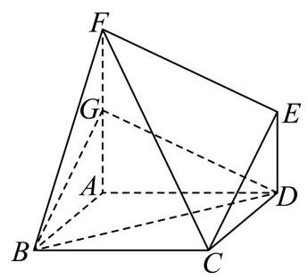
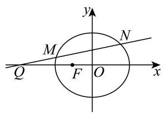

# 2026二模 松江区原卷 · 学生版

> 本地预览：题目、答案及分类尚未全部审定。校对使用的PDF为教研整理版，尚未逐区确认区级印刷原卷。

## 填空题

按本区原卷题号顺序排列。

### 松江 · 第1题

已知集合 $A = \{ x \mid  x\rangle 0\} , B = \{  - 1,0,1,2\}$ ，则 $A \cap  B$ 等于___.

### 松江 · 第2题

不等式 $\left| {3 - x}\right|  < 1$ 的解集为___.

### 松江 · 第3题

已知复数 $z$ 满足 $\left( {1 + \mathrm{i}}\right)  \cdot  z = 1 - \mathrm{i}$ (其中 $\mathrm{i}$ 为虚数单位), 则 $z \cdot  \bar{z} =$ ___.

### 松江 · 第4题

已知抛物线 ${y}^{2} = {2px}\left( {p > 0}\right)$ 的准线恰好平分圆 ${\left( x + 2\right) }^{2} + {\left( y + 1\right) }^{2} = 1$ 的周长，则该抛物线的焦点坐标为___.

### 松江 · 第5题

若 $\overrightarrow{a}$ 、 $\overrightarrow{b}$ 都是单位向量， $\overrightarrow{a} \cdot  \overrightarrow{b} = 0$ ，则向量 $\overrightarrow{b}$ 与 $\overrightarrow{a} - \overrightarrow{b}$ 的夹角大小为___.

### 松江 · 第6题

已知等比数列 $\left\{  {a}_{n}\right\}$ 的前 $n$ 项和为 ${S}_{n}$ ，且 ${a}_{2} = 3,{a}_{5} = {81}$ . 若 ${S}_{n} = {40}$ ，则 $n =$ ___.

### 松江 · 第7题

已知函数 $f\left( x\right)  = \left\{  \begin{matrix} {3}^{x} - a, x \geq  0 \\  b - {\left( \frac{1}{3}\right) }^{x}, x < 0 \end{matrix}\right.$ 为奇函数，则 $a + b$ 的值为___.

### 松江 · 第8题

若 ${\left( 3 - 2x\right) }^{6} = {a}_{0} + {a}_{1}x + {a}_{2}{x}^{2} + \cdots  + {a}_{6}{x}^{6}$ ，则 ${a}_{1} + 2{a}_{2} + 3{a}_{3} + \cdots  + 6{a}_{6} =$ ___.

### 松江 · 第9题

已知函数 $y = {\log }_{a}\left( {x + 2}\right)  + 1\left( {a > 0\text{ 且 }a \neq  1}\right)$ 的图像过定点 $\left( {s, t}\right)$ ，正实数 $m$ 、 $n$ 满足 ${nt} - {ms} = 1$ ，则 $\frac{1}{m} + \frac{3}{n}$ 的最小值为___.

### 松江 · 第10题

在四棱柱 ${ABCD} - {A}_{1}{B}_{1}{C}_{1}{D}_{1}$ 中，底面 ${ABCD}$ 为平行四边形， $\left| \overrightarrow{A{A}_{1}}\right|  = 2$ ，异面直线 $A{A}_{1}$ 与 ${BD}$ 的夹角为 $\arccos \frac{2}{5},\overrightarrow{AD} \cdot  \overrightarrow{D{C}_{1}} - \overrightarrow{AB} \cdot  \overrightarrow{B{C}_{1}} = 4$ ，则 $\left| \overrightarrow{B{D}_{1}}\right|  =$ ___.

### 松江 · 第11题

如图,某公园划出一块平整的三角形草地 ${ABC}$ ,在边 ${BC}$ 上设置一个观景点 $D$ ,点 $D$ 到顶点 $C$ 的距离为 2 百米, ${AD}$ 平分 $\angle {BAC}$ ,边 ${AB}$ 和 ${AD}$ 的长度都为 3 百米. 现需要沿着三角形草地 ${ABC}$ 的边安装一圈灯带，则该灯带的长度为___百米.

### 松江 · 第12题

记号 $\max \{ a, b\}$ 表示 $a\text{ 、 }b$ 中取较大的数,如 $\max \{ 1,2\}  = 2$ . 在平面直角坐标系中,定义 $d\left( {A, B}\right)  = \max \left\{  {\left| {{x}_{1} - {x}_{2}}\right| ,\left| {{y}_{1} - {y}_{2}}\right| }\right\}$ 为两点 $A\left( {{x}_{1},{y}_{1}}\right) \text{ 、 }B\left( {{x}_{2},{y}_{2}}\right)$ 的 “切比雪夫距离”. 已知点 $O$ 为坐标原点,点 $C$ 在圆 ${\left( x - 1\right) }^{2} + {\left( y - 1\right) }^{2} = 1$ 上,点 $A$ 在直线 ${3x} + {4y} - {10} = 0$ 上, 则 $d\left( {C, A}\right)  + d\left( {C, O}\right)$ 的最小值为___.

## 选择题

按本区原卷题号顺序排列。

### 松江 · 第13题

若实数 $a$ 、 $b$ 满足 ${a}^{2} > {b}^{2}$ ，则下列不等式恒成立的是( )

A. $a > b > 0$

B. $a > 0 > b$

C. $a > \left| b\right|$

D. $\left| a\right|  > \left| b\right|$

### 松江 · 第14题

一个袋中有大小与质地完全相同的红、黄、蓝三个球, 从袋中依次随机不放回地摸出两个球，记“第一次取到红球”为事件 $A$ ，“第二次取到黄球”为事件 $B$ ，则( )

A. $A, B$ 相互独立

B. $P\left( B\right)  = \frac{1}{2}$

C. $P\left( {A \mid  B}\right)  = \frac{1}{2}$

D. $P\left( \bar{A}\right)  = \frac{1}{2}$

### 松江 · 第15题

在平面直角坐标系中,如果将函数 $y = f\left( x\right)$ 的图象绕坐标原点逆时针旋转 $a$ 弧度后, 所得曲线仍然是某个函数的图象,那么称函数 $y = f\left( x\right)$ 为 “ $a$ 旋转函数”. 若函数 $y = {ax} - \frac{1}{x}$ 为 “ $\frac{\pi }{4}$ 旋转函数”，则 $a$ 的值为( )

A. -1

B. 0

C. 1

D. 2

### 松江 · 第16题

已知数列 $\left\{  {a}_{n}\right\}$ 满足 ${a}_{n + 1} = 2{a}_{n}^{2} - 1\left( {n\text{ 为正整数 }}\right)$ ,关于数列 $\left\{  {a}_{n}\right\}$ 有以下两个命题: ①若 $1 < {a}_{3} < \frac{17}{8}$ ,则 ${a}_{1}$ 的取值范围是 $\left( {1,\frac{3\sqrt{2}}{4}}\right)$ ; ②若 ${a}_{1} + {a}_{3} = 0$ ,则 ${a}_{1}$ 的所有可能取值的个数是 4 个. 则以下选项正确的是 ( )

A. ①是真命题，②是假命题

B. ①是假命题，②是真命题

C. 两个都是真命题

D. 两个都是假命题

## 解答题

按本区原卷题号顺序排列。

### 松江 · 第17题

在如图所示的多面体中,已知四边形 ${ABCD}$ 是菱形, $\angle {ABC} = {60}^{ \circ  },{FA} \bot$ 平面 ${ABCD},{ED} \bot$ 平面 ${ABCD},{AB} = {FA} = {2ED} = 2$ ，点 $G$ 为线段 ${AF}$ 的中点.

(1)求证:平面 ${BDG}//$ 平面 ${CEF}$ ；

(2)求直线 ${BC}$ 与平面 ${BDG}$ 所成角的正弦值.

> 本题资料或解析有待核事项，预览不可作为已审定成品。

### 松江 · 第18题

已知函数 $y = f\left( x\right)$ 的表达式为 $f\left( x\right)  = \frac{\sqrt{3}}{2}\sin {2x} + {\cos }^{2}x$ .

(1)若将函数 $y = f\left( x\right)$ 的图像向右平移 $\varphi \left( {\varphi  > 0}\right)$ 个单位长度，得到函数 $y = g\left( x\right)$ 的图像关于直线 $x = \frac{\pi }{6}$ 对称,求 $\varphi$ 的最小值;

( 2 )若函数 $y = f\left( x\right)$ 在区间 $\left( {-\frac{\pi }{12}, m}\right)$ 上恰有 2 个极值点和 2 个零点，求实数 $m$ 的取值范围.

### 松江 · 第19题

质监部门从某超市销售的甲、乙两种食用油中各随机抽取 100 桶检测某项质量指标, 由检测结果得到如下的频率分布直方图:

(甲)

(乙)

(1)写出频率分布直方图(甲)中网的值；记甲、乙两种食用油 100 桶样本的质量指标的方差分别为 ${S}_{\mathrm{\text{ 甲 }}}^{2}$ 、 ${S}_{\mathrm{\text{ 乙 }}}^{2}$ ，试比较 ${S}_{\mathrm{\text{ 甲 }}}^{2}$ 与 ${S}_{\mathrm{\text{ 乙 }}}^{2}$ 的大小(只要求写出结果)；

(2)在甲、乙两种食用油中各随机抽取 1 桶，用频率估计概率，求恰有 1 桶的质量指标大于 10 且小于 40 的概率;

(3)由频率分布直方图可以认为，乙种食用油的质量指标值 $Z$ 服从正态分布 $N\left( {\mu ,{\sigma }^{2}}\right)$ . 其

中 $\mu$ 近似为样本平均数 $\bar{x},{\sigma }^{2}$ 近似为样本方差 ${s}^{2}$ ,现从乙种食用油中随机抽取 10 桶,设 $X$ 表示质量指标值位于 $\left( {{26.50},{38.45}}\right)$ 的桶数,求 $X$ 的数学期望. (结果保留两位小数)

注: ①同一组数据用该区间的中点值作代表; ②若 $Z \sim  N\left( {\mu ,{\sigma }^{2}}\right)$ ,则

$P\left( {\mu  - \sigma  < Z < \mu  + \sigma }\right)  = {0.6826}, P\left( {\mu  - {2\sigma } < Z < \mu  + {2\sigma }}\right)  = {0.9545}$

> 本题资料或解析有待核事项，预览不可作为已审定成品。

### 松江 · 第20题

已知椭圆 $\Gamma  : \frac{{x}^{2}}{{a}^{2}} + \frac{{y}^{2}}{3} = 1\left( {a > 0}\right)$ 的左焦点为 $F\left( {-1,0}\right)$ ,过点 $Q\left( {-4,0}\right)$ 作斜率不为 0 的直线 $l$ 与椭圆 $\Gamma$ 交于 $M, N$ 两点.

(1)求椭圆下的离心率；

(2)设直线 ${MF}\text{ 、 }{NF}$ 的斜率分别为 ${k}_{1},{k}_{2}$ ，求 ${k}_{1} + {k}_{2}$ 的值；

(3)若点 $E$ 满足 $\left| {EM}\right|  = \left| {EN}\right|  = \left| {EF}\right|$ ，点 $D$ 在椭圆上， ${MD} \bot  x$ 轴，探究直线 ${EF}$ 与直线 ${DQ}$ 的斜率之积是否为定值？若为定值，请求出该值；若不为定值，请说明理由.

### 松江 · 第21题

若函数 $y = M\left( x\right) \text{ 、 }y = N\left( x\right)$ 在区间 $I$ 上满足 $\left| {M\left( x\right) }\right|  \leq  N\left( x\right)$ ,则称函数 $y = N\left( x\right)$ 为 $y = M\left( x\right)$ 在区间 $I$ 上的绝对值上界函数. 设定义在 $\mathbf{R}$ 上的函数 $y = f\left( x\right) \text{ 、 }y = g\left( x\right)$ 的导数为 $y = {f}^{\prime }\left( x\right) \text{ 、 }y = {g}^{\prime }\left( x\right)$ .

(1)判断函数 $y = x$ 是不是函数 $y = \sin x$ 在区间 $\left\lbrack  {0,\pi }\right\rbrack$ 上的绝对值上界函数，并说明理由;

(2)若函数 $y = {g}^{\prime }\left( x\right)$ 为 $y = {f}^{\prime }\left( x\right)$ 在 $\mathbf{R}$ 上的绝对值上界函数，求证:对任意 $h > 0$ ，都有 $\left| {f\left( {x + h}\right)  - f\left( x\right) }\right|  \leq  g\left( {x + h}\right)  - g\left( x\right) ;$

(3)若函数 $y = {g}^{\prime }\left( x\right)$ 为 $y = {f}^{\prime }\left( x\right)$ 在 $\mathbf{R}$ 上的绝对值上界函数，实数 $a, b\left( {a < b}\right)$ 满足 $g{\left( x\right) }_{\min } = g\left( a\right)  = f\left( a\right) , g{\left( x\right) }_{\max } = g\left( b\right)  = f\left( b\right)$ ,确定 $f\left( {x}_{0}\right) , g\left( {x}_{0}\right)$ 在 ${x}_{0} \in  \mathbf{R}$ 时的大小关系 $\left( {g{\left( x\right) }_{\min }\text{ 、 }g{\left( x\right) }_{\max }}\right.$ 分别表示函数 $y = g\left( x\right)$ 的最小值和最大值)

> 本题资料或解析有待核事项，预览不可作为已审定成品。

