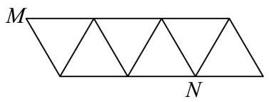
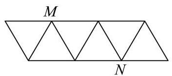
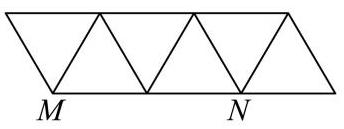

# 2026二模 长宁区原卷 · 学生版

> 本地预览：题目、答案及分类尚未全部审定。校对使用的PDF为教研整理版，尚未逐区确认区级印刷原卷。

## 填空题

按本区原卷题号顺序排列。

### 长宁 · 第1题

已知集合 $A = \{ 1,2,3\} , B = \left( {2, + \infty }\right)$ ，则 $A \cap  B =$ ___.

> 本题资料或解析有待核事项，预览不可作为已审定成品。

### 长宁 · 第2题

已知正实数 $a\text{ 、 }b$ 满足 ${ab} = 1$ ，则 $a + {4b}$ 的最小值等于___.

### 长宁 · 第3题

已知向量 $\overrightarrow{a} = \left( {x,2,3}\right)$ ， $\overrightarrow{b} = \left( {2, y,6}\right)$ ，若 $\overrightarrow{a}\bot \overrightarrow{b}$ ，则实数 $x + y =$ ___.

### 长宁 · 第4题

在 ${\left( 1 + x\right) }^{6}$ 的展开式中，含 ${x}^{3}$ 项的系数为___.

### 长宁 · 第5题

函数 $y = \sin x, x \in  \left\lbrack  {-\frac{\pi }{2},\frac{3\pi }{4}}\right\rbrack$ 的值域为___.

### 长宁 · 第6题

已知随机变量 $X$ 的分布为

<table><tr><td>$X$</td><td>0</td><td>1</td><td>2</td></tr><tr><td>$P$</td><td>0.4</td><td>0.2</td><td>0.4</td></tr></table>

则 $X$ 的期望为___.

### 长宁 · 第7题

设等比数列 $\left\{  {a}_{n}\right\}$ 的前 $n$ 项和为 ${S}_{n}$ ,若 ${S}_{2} = 3,{S}_{4} = {15}$ ,则 ${S}_{6} =$ ___.

### 长宁 · 第8题

在 ${ABC}$ 中， $D$ 是 ${BC}$ 的中点， $\left| \overrightarrow{AD}\right|  = 4$ ， $\left| \overrightarrow{BC}\right|  = 6$ ，则 $\overrightarrow{AB} \cdot  \overrightarrow{AC} =$ ___.

### 长宁 · 第9题

将 4 个不同的小球依次随机投入 3 个篮子中，每个篮子不空的概率为___(用分数表示) .

### 长宁 · 第10题

已知复数 $z$ 满足: $\left| z\right|  = 1$ ，且 $\left| {z - \mathrm{i}}\right|  \leq  1$ ，则 $\left| {z\mathrm{i} - 1}\right|$ 的最小值为___.

### 长宁 · 第11题

如图，某画框内摆放着三个矩形工艺品，它们的长均为 50cm，宽均为 10cm. 点 $A$ 、 $B$ 、

$C\text{ 、 }D$ 在同一条直线上,点 $F$ 在边 ${BE}$ 上,点 $I$ 在边 ${GH}$ 上,测得 $B\text{ 、 }C$ 两点间距离为 ${10}\mathrm{\;{cm}}$ . 为了使 $\angle {BFC} = \angle {HID}$ ，则 $C$ 、 $D$ 两点间距离为___ $\mathrm{{cm}}$ . (精确到 ${0.1}\mathrm{\;{cm}}$ )

### 长宁 · 第12题

等腰 ${ABC}$ 的三个顶点均在椭圆 $\Gamma  : \frac{{x}^{2}}{2026} + {y}^{2} = 1$ 上，且 $A\text{ 、 }B\text{ 、 }C$ 中有且仅有两个点是椭圆 $\Gamma$ 的顶点，则满足条件的 ${ABC}$ 共有___个.

## 选择题

按本区原卷题号顺序排列。

### 长宁 · 第13题

下列函数中既是奇函数又是增函数的是( )

A. $y = {x}^{2}$

B. $y = {x}^{3}$

C. $y = {2}^{x}$

D. $y = \lg x$

### 长宁 · 第14题

对于随机事件 $A\text{ 、 }B,$ “ $P\left( A\right)  = P\left( {A \mid  B}\right)$ ”是“ $A\text{ 、 }B$ 互相独立”的( )条件.

A. 充分非必要

B. 必要非充分

C. 充要

D. 非充分 非必要

### 长宁 · 第15题

将下列平面图形沿等边三角形的边折起，不能折成如图所示几何体的是( ).

A.

B.

D.

C.

> 本题资料或解析有待核事项，预览不可作为已审定成品。

### 长宁 · 第16题

已知 $f\left( x\right)  = \left( {1 - a}\right) x + a\sin x$ .

① 存在 $a \in  \left( {0,1}\right)$ ,使得函数 $y = f\left( x\right)$ 在 $\mathbf{R}$ 上严格增;

②对于任意 $a \in  \left( {0,1}\right)$ ,直线 $y = \left( {1 - a}\right) x + a$ 与曲线 $y = f\left( x\right)$ 都相切且有无数个切点,每个切点的横坐标都不是函数 $y = f\left( x\right)$ 的极值点.

对于以上两个结论, 下列判断正确的是 ( )

A. ①正确，②错误；

B. ①错误，②正确；

C. ①正确，②正确；

D. ①错误，②错误.

## 解答题

按本区原卷题号顺序排列。

### 长宁 · 第17题

一次校内常规体检后，数学建模活动小组学生随机抽取了 10 名学生体重数据(单位: kg): 55, 58, 62, 74, 88, 68, 54, 52, 56, 86.

(1)求该组数据的极差和第 25 百分位数；

(2)依据体检数据，求得这 10 名学生体重 $y$ (单位: $\mathrm{{kg}}$ )关于身高 $x$ (单位: $\mathrm{{cm}}$ )的回归方程为 $y = {2.3x} + b$ ,已知这 10 名学生身高 (单位:cm) 的平均数为 176.3,求 $b$ 的值(精确到 0.1)

(3)体重(kg)与身高(m)平方的比称为体重指标，体重指标不低于 28.0 称为肥胖，为了解该校学生肥胖是否与性别有关,从已获得数据中随机抽样得到了如下 $2 \times  2$ 列联表.

<table><tr><td rowspan="2"></td><td colspan="2">男生</td><td colspan="2">女生</td><td rowspan="2">总计</td></tr><tr><td>观察值</td><td>预期值</td><td>观察值</td><td>预期值</td></tr><tr><td>不肥胖</td><td>99</td><td></td><td></td><td></td><td>168</td></tr><tr><td>肥胖</td><td></td><td></td><td>$m$</td><td></td><td></td></tr><tr><td>总计</td><td>120</td><td></td><td></td><td></td><td>200</td></tr></table>

求表中 $m$ 的值. 已知零假设为:肥胖与性别无关，计算男生肥胖人数的预期值(精确到 0.1).

### 长宁 · 第18题

如图， $P$ 是圆锥顶点， $O$ 是底面圆心，点 $A$ 、 $B$ 在底面圆周上， ${OA}\bot {OB}$ ， ${OA} = {OB} = 1$ .

(1)若圆锥的侧面积为 ${2\pi }$ ，求圆锥的体积；

(2)若直线 ${PA}$ 与平面 ${POB}$ 所成角为 30，求二面角 $P - {AB} - O$ 的平面角的正切值

### 长宁 · 第19题

已知 $f\left( x\right)  = {\log }_{a}x$ (其中 $a > 0, a \neq  1$ ).

(1)若函数 $y = f\left( x\right)$ 的图象过点 $\left( {2, - 1}\right)$ ，求不等式 $f\left( {{2x} - 1}\right)  > f\left( {x + 1}\right)$ 的解集；

( 2 )若恰有两个不同的实数 $x$ ，使得 $f\left( x\right)$ ， $f\left( {x - m}\right)$ ， $f\left( 4\right)$ 成等差数列，求实数 $m$ 的取值范围.

### 长宁 · 第20题

双曲线 $\Gamma  : \frac{{x}^{2}}{3} - \frac{{y}^{2}}{{b}^{2}} = 1\left( {b > 0}\right)$ 经过点 $P\left( {2,1}\right)$ ，不垂直 $x$ 轴的直线与 $\Gamma$ 交于不同于 $P$ 的 $A$ 、 $B$ 两点，直线 ${PA}$ 、 ${PB}$ 分别与 $y$ 轴交于点 $M$ 、 $N$ .

(1)求 $\Gamma$ 的离心率；

(2)设直线 ${PA}$ 与 $x$ 轴交于点 $Q$ ，且 $\overrightarrow{MQ} = 2\overrightarrow{QP}$ ，求点 $A$ 的横坐标；

(3) 若 $M$ 、 $N$ 关于原点对称，证明:直线 ${AB}$ 经过定点.

> 本题资料或解析有待核事项，预览不可作为已审定成品。

### 长宁 · 第21题

设函数 $y = f\left( x\right)$ 定义域为 $I$ ,区间 $D \subseteq  I$ ,记函数 $y = f\left( x\right)$ 在区间 $D$ 上的最大值为 ${M}_{f}\left( D\right)$ ,最小值为 ${m}_{f}\left( D\right)$ .

(1)设 $f\left( x\right)  = {\mathrm{e}}^{x} - {ax}$ ， $D = \left( {-1,1}\right)$ ，若 ${m}_{f}\left( D\right)  = f\left( 0\right)$ ，求实数 $a$ 的值；

(2)设 $f\left( x\right)  = {x}^{3} - 3{x}^{2}, D = \left\lbrack  {t, t + 2}\right\rbrack$ ，若 ${M}_{f}\left( D\right)  - {m}_{f}\left( D\right)  = 4$ ，且 $- 1 \leq  t \leq  1$ ，求 $t$ 的值;

(3)已知 $f\left( 0\right)  = 0, f\left( 1\right)  = 1$ ，且对任意闭区间 $D \subseteq  \left\lbrack  {0,1}\right\rbrack$ ， ${M}_{f}\left( D\right)$ 与 ${m}_{f}\left( D\right)$ 均存在. 求证: “ $y = f\left( x\right)$ 在区间 $\left\lbrack  {0,1}\right\rbrack$ 上严格增”的充要条件是“对于任意闭区间 ${D}_{1}\text{ 、 }{D}_{2} \subseteq  \left\lbrack  {0,1}\right\rbrack$ , 当 ${M}_{f}\left( {D}_{1}\right)  = {M}_{f}\left( {D}_{2}\right)$ ,且 ${m}_{f}\left( {D}_{1}\right)  = {m}_{f}\left( {D}_{2}\right)$ 时,均有 ${D}_{1} = {D}_{2}$ ."

> 本题资料或解析有待核事项，预览不可作为已审定成品。

