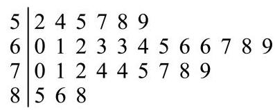
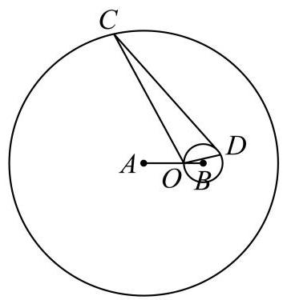

# 2026二模 黄浦区原卷 · 学生版

> 本地预览：题目、答案及分类尚未全部审定。校对使用的PDF为教研整理版，尚未逐区确认区级印刷原卷。

## 填空题

按本区原卷题号顺序排列。

### 黄浦 · 第1题

若 $A = \left\lbrack  {-1,1}\right\rbrack$ ， $B = \left\{  {x\left| {\;{x}^{2} - {2x} \leq  0}\right. }\right\}$ ，则 $A \cap  B =$ ___.

### 黄浦 · 第2题

若直线 ${3x} + y - 2 = 0$ 与 $x - {ay} + 1 = 0$ 垂直，则 $a$ 的值为___.

### 黄浦 · 第3题

底面半径为 1 、母线长为 3 的圆锥的侧面展开图中扇形的中心角为___.

### 黄浦 · 第4题

在公比 $q$ 为正数的等比数列 $\left\{  {a}_{n}\right\}$ 中， ${a}_{2} + {a}_{4} = {60}$ ， ${a}_{4} + {a}_{6} = {15}$ ，则 $q$ 的值为___.

### 黄浦 · 第5题

在 ${\left( x - 2\right) }^{6}$ 的展开式中，含 ${x}^{4}$ 项的系数为___.

### 黄浦 · 第6题

如图是某班级 30 名学生某次数学测验的得分茎叶图 (茎为十位, 叶为个位), 则这些测验分数的第 80 百分位数是___.

### 黄浦 · 第7题

已知 $\tan a < 0$ ，且 $\cos \left( {\frac{\pi }{2} + a}\right)  = \frac{2\sqrt{2}}{3}$ ，则 $\cos a$ 的值为___.

### 黄浦 · 第8题

在复平面内,点 $P, Q, O$ 分别表示复数 $z, w,0$ ,已知 $\left| z\right|  = 3,\left| w\right|  = 5, u = z + w$ ,且 $\left| u\right|  = 7$ ，则向量 $\overrightarrow{OP}$ 与 $\overrightarrow{OQ}$ 的夹角为___.

> 本题资料或解析有待核事项，预览不可作为已审定成品。

### 黄浦 · 第9题

某射击社团共有 10 名成员，其中社长与副社长各一人，现随机抽取 4 人组成代表队参加校际联谊活动，则社长与副社长两人至少有一人参加联谊活动的概率为___.

### 黄浦 · 第10题

已知曲线 ${\Gamma }_{1} : {y}^{2} = {2px}\left( {p > 0}\right)$ 与曲线 ${\Gamma }_{2} : \frac{{y}^{2}}{{a}^{2}} - \frac{{x}^{2}}{{b}^{2}} = 1\left( {y > 0}\right)$ 交于两点 $P, Q$ 点 $F$ 是 ${\Gamma }_{1}$ 的焦点，点 $O$ 是坐标原点. 若 $\left| {PF}\right|  + \left| {QF}\right|  = {10}\left| {OF}\right|$ ，则 ${\Gamma }_{2}$ 的离心率为___.

### 黄浦 · 第11题

在空间直角坐标系 $O - {xyz}$ 中,将点集 $\left\{  {\left( {x, y, z}\right) \left.\parallel  x\right|  \leq  1,\left| y\right|  \leq  1,\left| z\right|  \leq  1}\right\}$ 所表示的立方体的表面满足 $z < 1$ 的部分记为 $S$ ,同时满足 “ $\left| \overrightarrow{OP}\right|  \leq  \sqrt{3}$ ” 与 “ $\{ Q \mid  \overrightarrow{OQ} = \lambda \overrightarrow{OP},\lambda  \in  \left\lbrack  {0,1}\right\rbrack  \}  \cap  S = \varnothing$ 或 $\{ P\}$ ”的点 $P$ 的集合所表示几何体的体积为___.

> 本题资料或解析有待核事项，预览不可作为已审定成品。

### 黄浦 · 第12题

如图所示，某圆形游乐园的半径为 140 米，其圆心在点 $A$ 处，游乐园内有一圆形广场， 其半径为 20 米,圆心在与点 $A$ 相距 60 米的点 $B$ 处,游客中心位于圆形广场的边界线与 $A$ , $B$ 连线的交点 $O$ 处. 现打算在游乐园的边界线与圆形广场的边界线上各选一点 $C, D$ ,在这两处各建一座游乐设施(其占地大小忽略不计)，将 $\bigtriangleup  {OCD}$ 的内部区域作为游客的休闲区并使其面积最大，则此最大面积为___.

## 选择题

按本区原卷题号顺序排列。

### 黄浦 · 第13题

若 $a, b$ 是空间中的两条直线，则 “ $a//b$ ” 是 “存在平面 $a$ ，使 $a \subset  a, b \subset  a$ ” 的( ).

A. 充分非必要条件

B. 必要非充分条件

C. 充要条件

D. 既非充分也非必要条件

### 黄浦 · 第14题

变量 $x, y$ 之间的一组相关数据如表所示: 若 $x, y$ 之间的线性回归方程为 $\widehat{y} = \widehat{bx} + {12.28}$ ,则 $\widehat{b}$ 的值为 ( )

<table><tr><td>$x$</td><td>4</td><td>5</td><td>6</td><td>7</td></tr><tr><td>$y$</td><td>8.2</td><td>7.8</td><td>6.6</td><td>5.4</td></tr></table>

A. -0.92

B. -0.94

C. -0.96

D. -0.98

### 黄浦 · 第15题

设函数 $y = f\left( x\right)$ 的定义域为 $\mathbf{R}$ ,则下列结论: ①若 $y = f\left( x\right)$ 是奇函数或偶函数，且在区间 $\lbrack 0, + \infty )$ 上严格增,则对任意的 ${x}_{1},{x}_{2} \in  \mathbf{R}, f\left( {x}_{1}\right)  > f\left( {x}_{2}\right)  \Rightarrow  {x}_{1}^{2} > {x}_{2}^{2}$ 或 ${x}_{1}^{3} > {x}_{2}^{3}$ ; ② 若对任意的 ${x}_{1},{x}_{2} \in  \mathbf{R},{x}_{1}^{2} = {x}_{2}^{2} \Rightarrow  {\left\lbrack  f\left( {x}_{1}\right) \right\rbrack  }^{2} = {\left\lbrack  f\left( {x}_{2}\right) \right\rbrack  }^{2}$ ,则 $y = f\left( x\right)$ 是奇函数或偶函数. 其中正确的说法是( ).

A. ①和②均正确

B. ①正确，②错误

C. ①错误，②正确

D. ①和② 均错误

### 黄浦 · 第16题

若无穷数列 $\left\{  {a}_{n}\right\}$ 的首项为 1,且对任意的 $n \in  {\mathbf{N}}^{ * },\left\{  {a}_{n}\right\}$ 的前 $n$ 项和都可以表示成 $\left\{  {a}_{n}\right\}$ 的两项之差,则称 $\left\{  {a}_{n}\right\}$ 为 $T$ 数列,所有 $T$ 数列组成的集合为 $T$ 集. 下列结论正确的是 ( ) .

A. 任意一个 $T$ 数列均不是等差数列

B. 任意一个 $T$ 数列均不是等比数列

C. $T$ 集中含有且仅含有有限个等差数列

D. $T$ 集中含有无穷多个等比数列

## 解答题

按本区原卷题号顺序排列。

### 黄浦 · 第17题

小明每天上学出发时会选择是否骑共享单车. 根据平台统计和他的使用习惯:若出发时不下雨，他选择骑共享单车的概率为 0.8 ；若出发时下雨，他选择骑共享单车的概率为 0.4 . 假设本周小明每天上学出发时下雨的概率均为 0.25 ，且出发地共享单车供应充足.

(1)求本周某天小明上学出发时选择骑共享单车去学校的概率；

(2)已知本周某天小明选择了骑共享单车去学校，求该天小明出发时不下雨的概率；

(3)设小明在本周的前三天中选择骑共享单车去学校的天数为 $X$ ，且这三天中每天的骑行选择相互独立,求随机变量 $X$ 的分布,并计算其数学期望 $E\left\lbrack  X\right\rbrack$ 和方差 $D\left\lbrack  X\right\rbrack$ .

### 黄浦 · 第18题

如图，在直三棱柱 ${ABC} - {A}_{1}{B}_{1}{C}_{1}$ 中，点 $D$ 、 $E$ 分别是棱 ${BC}\text{ 、 }C{C}_{1}$ 上的点(点 $D$ 异于点 $C)$ ,且 ${AD} \bot  {DE}$ .

(1)求证:平面 ${ADE} \bot$ 平面 ${BC}{C}_{1}{B}_{1}$ ；

(2)若 ${ABC}$ 是正三角形, ${BC} = C{C}_{1}$ ,且三棱柱 ${ABC} - {A}_{1}{B}_{1}{C}_{1}$ 的体积是三棱锥 $E - {ADC}$ 的体积的 12 倍,求 ${A}_{1}E$ 与平面 ${ADE}$ 所成的角的大小.

> 本题资料或解析有待核事项，预览不可作为已审定成品。

### 黄浦 · 第19题

已知 $f\left( x\right)  = 2\sin x\cos x - 2{\sin }^{2}x$ .

(1)求函数 $y = f\left( x\right)$ 的最小正周期与单调增区间；

(2)将函数 $y = f\left( x\right)$ 的图象上的所有点沿向量 $\overrightarrow{n} = \left( {\theta ,1}\right) \left( {0 \leq  \theta  \leq  \frac{\pi }{2}}\right)$ 平移，得到 $y = g\left( x\right)$ 的图象. 若 $y = g\left( x\right)$ 同时满足: ①图象关于点 $A\left( {-\frac{3\pi }{8},0}\right)$ 对称; ②有且仅有 2 个极大值点在区间 $\left\lbrack  {0, a}\right\rbrack$ 上. 求 $a$ 的取值范围.

> 本题资料或解析有待核事项，预览不可作为已审定成品。

### 黄浦 · 第20题

已知点 ${F}_{1}\text{ 、 }{F}_{2}$ 分别是曲线 $\Gamma  : \frac{{x}^{2}}{6} + \frac{{y}^{2}}{2} = 1$ 的左、右焦点,动直线 $l$ 过点 ${F}_{1}$ 且不过点 ${F}_{2}$ , 它与 $\Gamma$ 交于点 $P\text{ 、 }Q$ .

(1)求点 ${F}_{1}\text{ 、 }{F}_{2}$ 的坐标；

(2)若 $\overrightarrow{{F}_{2}P} \cdot  \overrightarrow{{F}_{2}Q} = {11}$ ，求直线 $l$ 的方程；

(3)设直线 ${l}_{1}$ 过点 ${F}_{1}$ 且与 $l$ 垂直，直线 ${l}_{2} : x = m$ 与 ${l}_{1}$ 的交点为 $T$ ，求证:存在唯一的常数 $m$ ,使得点 $T$ 与 $\Gamma$ 的中心的连线平分线段 ${PQ}$ ,并求此时 $\frac{\left| PQ\right| }{\left| T{F}_{1}\right| }$ 的最大值.

> 本题资料或解析有待核事项，预览不可作为已审定成品。

### 黄浦 · 第21题

对于公共定义域为 $D$ 的函数 $y = f\left( x\right)$ 与 $y = g\left( x\right)$ ,定义集合 ${E}_{f - g} = \left\{  {t\left| {\;t = f\left( x\right)  - g\left( x\right) }\right. , x \in  D}\right\}  .$

(1)若 $f\left( x\right)  = {x}^{2} - {x}^{3}, g\left( x\right)  = {2x} - {x}^{3}$ ，求 ${E}_{f - g}$ ；

( 2 )若 $f\left( x\right)  = {\mathrm{e}}^{x}, g\left( x\right)  = \ln \left( {x - p}\right)  + q\left( {p, q \in  \mathbf{R}}\right)$ ，且 ${E}_{f - g} = \lbrack 0, + \infty )$ ，求 $q - p$ 的最小值;

(3)已知 $y = f\left( x\right)$ 是定义在 $\left( {0, + \infty }\right)$ 上的增函数，其图像是连续曲线，且存在正数 ${x}_{0}$ ，使得 $f\left( {x}_{0}\right)  > 0$ . 若 $g\left( x\right)  =  - f\left( x\right) , h\left( x\right)  = \frac{1}{2}f\left( {2x}\right)$ ,且 ${E}_{f - h} = \{ 0\}$ ,求证: ${E}_{f - g} = \left( {0, + \infty }\right)$ .

