# 2026二模 三角函数与解三角形专题 · 教师版

> 本地预览：题目、答案及分类尚未全部审定。校对使用的PDF为教研整理版，尚未逐区确认区级印刷原卷。

## 终边、同角关系与恒等变换

由象限或坐标确定符号，用诱导、倍角和和差公式化简求值。

### 嘉定 · 第3题

已知角 $a$ 的终边经过点 $P\left( {1, - 2}\right)$ ，则 $\sin a =$ ___.

> 本题资料或解析有待核事项，预览不可作为已审定成品。

**考点：** 终边点坐标求三角函数

**难度依据：** 终边点坐标直接求值

**核查说明：** 题干与答案解析尚未逐页对照原卷，数学内容未独立终审。

**【答案】** $- \frac{2\sqrt{5}}{5}$

**【解析】**

**【分析】**利用任意角的三角函数的定义,求得 $\sin a$ 的值.

**【详解】**设坐标原点为 $O$ ,

由题意可得: $x = 1, y =  - 2,\left| {OP}\right|  = \sqrt{{1}^{2} + {\left( -2\right) }^{2}} = \sqrt{5}$ ,

故 $\sin a = \frac{y}{\left| OP\right| } = \frac{-2}{\sqrt{5}} =  - \frac{2\sqrt{5}}{5}$ .

故答案为: $- \frac{2\sqrt{5}}{5}$ .

### 奉贤 · 第17题

已知函数 $y = f\left( x\right)$ 的表达式为 $f\left( x\right)  = \sin \left( {{\pi x} + \varphi }\right) ,\left( {-\frac{\pi }{2} < \varphi  < \frac{\pi }{2}}\right)$ .

(1) $f\left( 0\right)  = \frac{3}{5}$ ，求 $f\left( \frac{1}{4}\right)$ 的值；

(2)若 $f\left( \frac{1}{2}\right) , f\left( 1\right) , f\left( 2\right)$ 依次成等比数列，求 $\varphi$ 的值.

**考点：** (1) 同角关系及和角公式求值；(2) 等比中项与非零条件求参数

**难度依据：** 诱导公式及和角公式；等比中项与非零条件

**【答案】** (1) $\frac{7\sqrt{2}}{10}$

(2) $\frac{\pi }{4}$

**【解析】**

**【小问 1 详解】**

由 $f\left( 0\right)  = \sin \varphi  = \frac{3}{5}, - \frac{\pi }{2} < \varphi  < \frac{\pi }{2}$ ,得 $\cos \varphi  = \frac{4}{5}$ ,

则 $f\left( \frac{1}{4}\right)  = \sin \left( {\frac{\pi }{4} + \varphi }\right)  = \sin \frac{\pi }{4}\cos \varphi  + \cos \frac{\pi }{4}\sin \varphi  = \frac{\sqrt{2}}{2} \times  \frac{4}{5} + \frac{\sqrt{2}}{2} \times  \frac{3}{5} = \frac{7\sqrt{2}}{10}$ .

**【小问 2 详解】**

由 $f\left( \frac{1}{2}\right)  = \sin \left( {\frac{\pi }{2} + \varphi }\right)  = \cos \varphi ,\;f\left( 1\right)  = \sin \left( {\pi  + \varphi }\right)  =  - \sin \varphi$ ,

$f\left( 2\right)  = \sin \left( {{2\pi } + \varphi }\right)  = \sin \varphi ,$

因 $f\left( \frac{1}{2}\right) , f\left( 1\right) , f\left( 2\right)$ 成等比数列,故 ${\left\lbrack  f\left( 1\right) \right\rbrack  }^{2} = f\left( \frac{1}{2}\right) f\left( 2\right)$ ,

即 ${\sin }^{2}\varphi  = \cos \varphi  \cdot  \sin \varphi$ ,得 $\sin \varphi \left( {\sin \varphi  - \cos \varphi }\right)  = 0$ ;

若 $f\left( \frac{1}{2}\right) , f\left( 1\right) , f\left( 2\right)$ 依次成等比数列,则 $\sin \varphi  \neq  0$ ;

所以 $\sin \varphi  = \cos \varphi ,\tan \varphi  = 1$ ,又 $- \frac{\pi }{2} < \varphi  < \frac{\pi }{2}$ ,故 $\varphi  = \frac{\pi }{4}$ ,此时 $f\left( \frac{1}{2}\right) , f\left( 1\right) , f\left( 2\right)$ 依次

为 $\frac{\sqrt{2}}{2}, - \frac{\sqrt{2}}{2},\frac{\sqrt{2}}{2}$ ,符合题意;

综上， $\varphi  = \frac{\pi }{4}$ .

### 宝山 · 第2题

已知 $\cos a = \frac{1}{3}$ ，则 $\cos {2a} =$ ___.

**考点：** 二倍角余弦直接求值

**难度依据：** 二倍角余弦直接求值

**【答案】** $- \frac{7}{9}$

**【解析】**

**【详解】** $\because \cos a = \frac{1}{3}$

$\therefore \cos {2a} = 2{\left( \cos a\right) }^{2} - 1 = 2 \times  \frac{1}{9} - 1 =  - \frac{7}{9}$

### 崇明 · 第6题

已知 $\cos \theta  =  - \frac{3}{5}$ ，则 $\cos {2\theta }$ 的值为___.

**考点：** 二倍角余弦公式

**难度依据：** 二倍角余弦公式

**【答案】** $- \frac{7}{25}$

**【解析】**

**【分析】**利用二倍角的余弦公式, 即可求得结果.

**【详解】**由 $\cos \theta  =  - \frac{3}{5}$ ,则 $\cos {2\theta } = 2{\cos }^{2}\theta  - 1 = 2 \times  \frac{9}{25} - 1 =  - \frac{7}{25}$ .

故答案为: $- \frac{7}{25}$ .

### 徐汇 · 第6题

若 $\tan \left( {a - \beta }\right)  = \frac{2}{3},\tan \beta  = 1$ ，则 $\tan a =$ ___.

**考点：** 由已知正切求和角正切

**难度依据：** 直接代公式

**【答案】** 5

**【解析】**

**【详解】**由 $\tan \left( {a - \beta }\right)  = \frac{2}{3},\tan \beta  = 1$ ,

则 $\tan a = \tan \left\lbrack  {\left( {a - \beta }\right)  + \beta }\right\rbrack   = \frac{\tan \left( {a - \beta }\right)  + \tan \beta }{1 - \tan \left( {a - \beta }\right) \tan \beta } = \frac{\frac{2}{3} + 1}{1 - \frac{2}{3} \times  1} = 5$ .

### 浦东 · 第18题

已知 $f\left( x\right)  = \sqrt{3}\sin x + 2\cos \left( {x + \varphi }\right)$ ， $\varphi  \in  \left\lbrack  {0,\pi }\right\rbrack$ .

(1)若函数 $y = f\left( x\right)$ 是定义在 $\mathrm{R}$ 上的奇函数，求常数 $\varphi$ 的值；

(2)若 $\varphi  = \frac{\pi }{3}$ ，若关于 $x$ 的不等式 $f\left( x\right)  + \frac{x}{2} - a > 0$ 对任意 $x \in  \left\lbrack  {0,\pi }\right\rbrack$ 恒成立，求实数 $a$ 的取值范围.

**考点：** (1)展开角和判断奇偶性；(2)分离参数，对闭区间函数求导并比较最值

**难度依据：** 三角化简后驻点与端点比较

**【答案】** (1) $\frac{\pi }{2}$

(2) $\left( {-\infty ,\frac{5\pi }{12} - \frac{\sqrt{3}}{2}}\right)$

**【解析】**

**【分析】**(1) 根据奇函数定义进行求解即可;

(2)化简 $f\left( x\right)$ ，分离参数 $a$ ，令 $g\left( x\right)  = \cos x + \frac{1}{2}x$ ，求导，得到函数 $y = g\left( x\right)$ 在 $x \in  \left\lbrack  {0,\pi }\right\rbrack$ 上的最小值，进而求出实数 $a$ 的取值范围.

**【小问 1 详解】**

若函数 $y = f\left( x\right)$ 是定义在 $\mathbf{R}$ 上的奇函数,

则 $f\left( {-x}\right)  =  - f\left( x\right)$ 对任意 $x \in  \mathbf{R}$ 恒成立,

即 $\sqrt{3}\sin x + 2\cos \left( {x + \varphi }\right)  =  - \sqrt{3}\sin \left( {-x}\right)  - 2\cos \left( {-x + \varphi }\right)$

即 $\cos \left( {x + \varphi }\right)  + \cos \left( {-x + \varphi }\right)  = 0$ 对 $x \in  \mathbf{R}$ 恒成立.

即 $2\cos x \cdot  \cos \varphi  = 0$ 对 $x \in  \mathbf{R}$ 恒成立.

因此 $\varphi  = {k\pi } + \frac{\pi }{2}\left( {k \in  \mathbf{Z}}\right)$ . 又 $\varphi  \in  \left\lbrack  {0,\pi }\right\rbrack$ ,故 $\varphi  = \frac{\pi }{2}$ .

因此,若函数 $y = f\left( x\right)$ 是定义在 $\mathbf{R}$ 上的奇函数,常数 $\varphi$ 的值为 $\frac{\pi }{2}$ ;

**【小问 2 详解】**

若 $\varphi  = \frac{\pi }{3}$ ,则 $f\left( x\right)  = \cos x$ ,

由题意,即 $a < \cos x + \frac{1}{2}x$ 对任意 $x \in  \left\lbrack  {0,\pi }\right\rbrack$ 恒成立.

令 $g\left( x\right)  = \cos x + \frac{1}{2}x$ ,即 $a < g{\left( x\right) }_{\min }$ ,

由 ${g}^{\prime }\left( x\right)  = \frac{1}{2} - \sin x$ ,

可知函数 $y = g\left( x\right)$ 在 $x \in  \left\lbrack  {0,\pi }\right\rbrack$ 内的两个驻点为 ${x}_{1} = \frac{\pi }{6},{x}_{2} = \frac{5\pi }{6}$ ,

比较 $g\left( 0\right)  = 1, g\left( \frac{\pi }{6}\right)  = \frac{\pi }{12} + \frac{\sqrt{3}}{2}, g\left( \frac{5\pi }{6}\right)  = \frac{5\pi }{12} - \frac{\sqrt{3}}{2}, g\left( \pi \right)  = \frac{\pi }{2} - 1$ 的大小,

可知函数 $y = g\left( x\right)$ 在 $x \in  \left\lbrack  {0,\pi }\right\rbrack$ 上的最小值为 $g\left( \frac{5\pi }{6}\right)  = \frac{5\pi }{12} - \frac{\sqrt{3}}{2}$ .

因此，实数 $a$ 的取值范围为 $\left( {-\infty ,\frac{5\pi }{12} - \frac{\sqrt{3}}{2}}\right)$ .

### 金山 · 第5题

已知角 $a$ 为第四象限角，且 $\sin a =  - \frac{4}{5}$ ，则 $\cos \alpha  =$ ___.

**考点：** 象限与同角关系

**难度依据：** 象限与同角关系

**【答案】** $\frac{3}{5}$

**【解析】**

**【详解】** $\therefore \sin a =  - \frac{4}{5},{\sin }^{2}a + {\cos }^{2}a = 1,\therefore {\left( -\frac{4}{5}\right) }^{2} + {\cos }^{2}a = 1,\therefore \cos a =  \pm  \frac{3}{5}$ ,

$\because a$ 为第四象限角, $\therefore \cos a > 0,\therefore \cos a = \frac{3}{5}$ .

### 金山 · 第14题

函数 $y = \cos \left( {\frac{\pi }{2} - {2x}}\right)$ 是( )

A. 最小正周期为 $\pi$ 的奇函数

B. 最小正周期为 $\pi$ 的偶函数

C. 最小正周期为 $\frac{\pi }{2}$ 的奇函数

D. 最小正周期为 $\frac{\pi }{2}$ 的偶函数

**考点：** 诱导公式周期和奇偶性

**难度依据：** 诱导公式周期和奇偶性

**【答案】** A

**【解析】**

**【详解】** $y = \cos \left( {\frac{\pi }{2} - {2x}}\right)  = \sin {2x}$ ,

$T = \frac{2\pi }{2} = \pi$ ,故最小正周期为 $\pi$ ,

设 $y = f\left( x\right)  = \sin {2x}, f\left( {-x}\right)  = \sin \left( {-{2x}}\right)  =  - \sin {2x} =  - f\left( x\right)$ ,

故 $y = f\left( x\right)  = \sin {2x}$ 为奇函数,故选项 $\mathrm{A}$ 正确.

### 青浦 · 第3题

在平面直角坐标系 ${xOy}$ 中，角 $a$ 的顶点与坐标原点 $O$ 重合、始边与 $x$ 轴的正半轴重合, 其终边经过点 $P\left( {1, - 3}\right)$ ，则 $\tan a =$ ___.

**考点：** 终边点坐标求正切

**难度依据：** 终边点坐标求正切

**【答案】** -3

**【解析】**

**【详解】**因为角 $a$ 的顶点与坐标原点 $O$ 重合、始边与 $x$ 轴的正半轴重合,其终边经过点 $P\left( {1, - 3}\right)$ ,所以,由三角函数终边上点的定义, $\tan a = \frac{-3}{1} =  - 3$

### 静安 · 第5题

若 $\frac{\sin \left( {{2\pi } - a}\right) }{\tan \left( {\pi  - a}\right) } \cdot  \cot \left( {\frac{\pi }{2} + a}\right)  = \frac{1}{3}$ ，则 $\cos {2a} =$ ___.

**考点：** 诱导公式与二倍角

**难度依据：** 诱导公式与二倍角

**【答案】** $\frac{7}{9}$

**【解析】**

**【分析】**根据诱导公式以及二倍角公式即可求解.

**【详解】** $\frac{\sin \left( {{2\pi } - a}\right) }{\tan \left( {\pi  - a}\right) } \cdot  \cot \left( {\frac{\pi }{2} + a}\right)  = \frac{-\sin a}{-\tan a} \cdot  \left( {-\tan a}\right)  =  - \sin a = \frac{1}{3} \Rightarrow  \sin a =  - \frac{1}{3}$ , 故 $\cos {2a} = 1 - 2{\sin }^{2}a = 1 - 2 \times  {\left( -\frac{1}{3}\right) }^{2} = \frac{7}{9}$ .

### 黄浦 · 第7题

已知 $\tan a < 0$ ，且 $\cos \left( {\frac{\pi }{2} + a}\right)  = \frac{2\sqrt{2}}{3}$ ，则 $\cos a$ 的值为___.

**考点：** 诱导公式与同角关系

**难度依据：** 诱导公式与同角关系

**【答案】** $\frac{1}{3}$

**【解析】**

**【分析】**利用诱导公式可得 $\sin a =  - \frac{2\sqrt{2}}{3}$ ,结合同角三角函数关系运算求解,注意根据符号判断角 $a$ 所在象限.

**【详解】**因为 $\cos \left( {\frac{\pi }{2} + a}\right)  =  - \sin a = \frac{2\sqrt{2}}{3}$ ,即 $\sin a =  - \frac{2\sqrt{2}}{3} < 0$ ,

且 $\tan a < 0$ ,可知角 $a$ 为第四象限角,

所以 $\cos a = \sqrt{1 - {\sin }^{2}a} = \sqrt{1 - {\left( -\frac{2\sqrt{2}}{3}\right) }^{2}} = \frac{1}{3}$ .

## 图像、周期、值域与参数

结合区间端点和最值点位置研究周期、平移、零点及频率参数。

### 嘉定 · 第7题

函数 $y = {\sin }^{4}x + {\cos }^{4}x$ 的最小正周期是___.

> 本题资料或解析有待核事项，预览不可作为已审定成品。

**考点：** 倍角化简与最小正周期

**难度依据：** 倍角化简后判周期

**核查说明：** 题干与答案解析尚未逐页对照原卷，数学内容未独立终审。

**【答案】** $\frac{\pi }{2}$

**【解析】**

**【分析】**根据 ${\sin }^{2}x + {\cos }^{2}x = 1$ 和正弦、余弦的二倍角公式化简即可求解.

**【详解】** $\because y = {\sin }^{4}x + {\cos }^{4}x = {\left( {\sin }^{2}x + {\cos }^{2}x\right) }^{2} - 2{\sin }^{2}x \cdot  {\cos }^{2}x \; =  - \frac{1}{2}{\sin }^{2}{2x} + 1 =  - \frac{1 - \cos {4x}}{4} + 1 = \frac{1}{4}\cos {4x} + \frac{3}{4}$

$\therefore y = {\sin }^{4}x + {\cos }^{4}x$ 的最小正周期是 $T = \frac{2\pi }{4} = \frac{\pi }{2}$ .

**【点睛】**本题考查三角函数的性质. 三角函数的性质问题,先化简为 $A\sin \left( {{\omega x} + \varphi }\right)  + B$ 的形式再求解.

### 嘉定 · 第9题

已知向量 $\overrightarrow{a} = \left( {\cos x,\sin x}\right) ,\overrightarrow{b} = \left( {3,\sqrt{3}}\right)$ ，且 $x \in  \left\lbrack  {0,\frac{\pi }{2}}\right\rbrack$ ，则 $\overrightarrow{a}$ 在 $\overrightarrow{b}$ 方向上的数量投影的取值范围为___

> 本题资料或解析有待核事项，预览不可作为已审定成品。

**考点：** 数量投影与三角函数值域；有限区间三角函数值域

**难度依据：** 向量投影转三角函数区间值域

**核查说明：** 题干与答案解析尚未逐页对照原卷，数学内容未独立终审。

**【答案】** $\left\lbrack  {\frac{1}{2},1}\right\rbrack$

**【解析】**

**【分析】**代入数量投影公式,转化为三角函数值域问题求解.

**【详解】** $\overrightarrow{a}$ 在 $\overrightarrow{b}$ 方向上的数量投影为

$\frac{\overrightarrow{a} \cdot  \overrightarrow{b}}{\left| \overrightarrow{b}\right| } = \frac{3\cos x + \sqrt{3}\sin x}{2\sqrt{3}} = \frac{2\sqrt{3}\cos \left( {x - \frac{\pi }{6}}\right) }{2\sqrt{3}} = \cos \left( {x - \frac{\pi }{6}}\right) ,$

$x \in  \left\lbrack  {0,\frac{\pi }{2}}\right\rbrack  ,\;x - \frac{\pi }{6} \in  \left\lbrack  {-\frac{\pi }{6},\frac{\pi }{3}}\right\rbrack  ,\;\cos \left( {x - \frac{\pi }{6}}\right)  \in  \left\lbrack  {\frac{1}{2},1}\right\rbrack  .$

### 奉贤 · 第10题

已知复数 $z = \cos \theta  + \mathrm{i}\sin \theta ,\theta  \in  \lbrack 0,{2\pi }),\mathrm{i}$ 是虚数单位,则 ${\left| z + 6\right| }^{2} + {\left| z - 8\mathrm{i}\right| }^{2}$ 的取值范围是___.

**考点：** 复数模的坐标展开；辅助角公式求范围

**难度依据：** 复数模的坐标展开；辅助角公式求范围

**【答案】** [82,122]

**【解析】**

**【详解】** $\because {\mathrm{i}}^{2} =  - 1$ ,

$\therefore {\left| z + 6\right| }^{2} + {\left| z - 8\mathrm{i}\right| }^{2} = {\left| \left( \cos \theta  + 6\right)  + \mathrm{i}\sin \theta \right| }^{2} + {\left| \cos \theta  + \mathrm{i}\left( \sin \theta  - 8\right) \right| }^{2}$

$= \left( {{\cos }^{2}\theta  + {12}\cos \theta  + {36} + {\sin }^{2}\theta }\right)  + \left( {{\cos }^{2}\theta  + {\sin }^{2}\theta  - {16}\sin \theta  + {64}}\right)$

$= {37} + {12}\cos \theta  + {65} - {16}\sin \theta  = {102} + {12}\cos \theta  - {16}\sin \theta$ ,

$= {102} + {20}\left( {\frac{3}{5}\cos \theta  - \frac{4}{5}\sin \theta }\right)$ ,设 $\cos \varphi  = \frac{3}{5},\sin \varphi  = \frac{4}{5}$ ,

则 ${\left| z + 6\right| }^{2} + {\left| z - 8\mathrm{i}\right| }^{2} = {102} + {20}\cos \left( {\theta  + \varphi }\right)$ ,

当 $\theta  + \varphi  = {2k\pi }, k \in  \mathbf{Z}$ ,即 $\cos \theta  = \frac{3}{5},\sin \theta  =  - \frac{4}{5}$ 时, $\cos \left( {\theta  + \varphi }\right)  = 1$ ,

此时 ${\left| z + 6\right| }^{2} + {\left| z - 8\mathrm{i}\right| }^{2}$ 取最大值 122,

当 $\theta  + \varphi  = {2k\pi } + \pi , k \in  \mathbf{Z}$ ,即 $\cos \theta  =  - \frac{3}{5},\sin \theta  = \frac{4}{5}$ 时, $\cos \left( {\theta  + \varphi }\right)  =  - 1$ ,

此时 ${\left| z + 6\right| }^{2} + {\left| z - 8\mathrm{i}\right| }^{2}$ 取最小值 82 ,

$\therefore {\left| z + 6\right| }^{2} + {\left| z - 8\mathrm{i}\right| }^{2} = {102} + {12}\cos \theta  - {16}\sin \theta  \in  \left\lbrack  {{82},{122}}\right\rbrack$ .

### 奉贤 · 第12题

在平面直角坐标系 ${xOy}$ 中,点 $A\left( {\cos \theta ,\sin \theta }\right) , B\left( {-\sin \theta ,\cos \theta }\right) ,\theta  \in  \lbrack 0,{2\pi })$ . 若点 $P\left( {x, y}\right)$ 满足: $\overrightarrow{OP} \cdot  \overrightarrow{OA} = 1,\overrightarrow{OP} \cdot  \overrightarrow{OB} = 2$ ，则 ${xy}$ 的最大值是___.

**考点：** 坐标数量积确定旋转坐标；倍角与辅助角求积的最大值

**难度依据：** 坐标数量积确定旋转坐标；倍角与辅助角求积的最大值

**【答案】** $\frac{5}{2}$

**【解析】**

**【分析】**通过条件建立关于 $x$ 与 $y$ 的二元一次方程组,解出 $x, y$ ,并使用辅助角公式变形求解.

**【详解】** $\overrightarrow{OP} = \left( {x, y}\right) ,\overrightarrow{OA} = \left( {\cos \theta ,\sin \theta }\right) ,\overrightarrow{OB} = \left( {-\sin \theta ,\cos \theta }\right)$ ,

由题意得 $\left\{  \begin{array}{l} \overrightarrow{OP} \cdot  \overrightarrow{OA} = x\cos \theta  + y\sin \theta  = 1 \\  \overrightarrow{OP} \cdot  \overrightarrow{OB} =  - x\sin \theta  + y\cos \theta  = 2 \end{array}\right.$ 解得 $\left\{  \begin{array}{l} x = \cos \theta  - 2\sin \theta \\  y = \sin \theta  + 2\cos \theta  \end{array}\right.$ ,

${xy} = 2{\cos }^{2}\theta  - 2{\sin }^{2}\theta  - 3\sin \theta \cos \theta  = 2\cos {2\theta } - \frac{3}{2}\sin {2\theta } = \frac{5}{2}\sin \left( {{2\theta } + \varphi }\right) ,\theta  \in  \lbrack 0,{2\pi })$ , 当 $\sin \left( {{2\theta } + \varphi }\right)  = 1$ 时， $y$ 取最大值为 $\frac{5}{2}$ ，

所以 $y$ 的最大值是 $\frac{5}{2}$ .

### 奉贤 · 第15题

音乐，是人类精神通过无意识计算而获得的愉悦享受，1807 年法国数学家傅里叶发现代表任何周期性声音的公式是形如 $y = A\sin {wx}$ 的简单正弦型函数之和,而且这些正弦型函数的频率都是其中一个最小频率的整数倍, 比如用小提琴演奏的某音叉的声音图象是由下图 1,2,3 三个函数图象组成的, 则小提琴演奏的该音叉的声音函数可以为 ( )

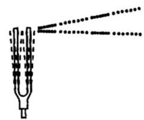

音叉

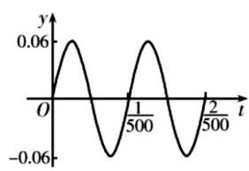

图1

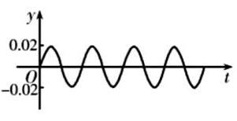

图2

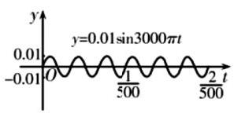

图3

A. $f\left( t\right)  = {0.06}\sin {1000\pi t} + {0.02}\sin {1500\pi t} + {0.01}\sin {3000\pi t}$

B. $f\left( t\right)  = {0.06}\sin {500\pi t} + {0.02}\sin {2000\pi t} + {0.01}\sin {3000\pi t}$

C. $f\left( t\right)  = {0.06}\sin {1000\pi t} + {0.02}\sin {2000\pi t} + {0.01}\sin {3000\pi t}$

D. $f\left( t\right)  = {0.06}\sin {1000\pi t} + {0.02}\sin {2500\pi t} + {0.01}\sin {3000\pi t}$

**考点：** 由图像振幅周期确定正弦表达式

**难度依据：** 由图像振幅周期确定正弦表达式

**【答案】** C

**【解析】**

**【分析】**由图 1 求出 $A\text{ 、 }T\text{ 、 }\omega$ 的值,写出对应函数的解析式,再结合选项得出函数 $f\left( t\right)$ 的解析式.

**【详解】**解: 由图 1 知, $A = {0.06}, T = \frac{2}{500} - \frac{1}{500} = \frac{1}{500}$ ,

所以 $\omega  = \frac{2\pi }{T} = {1000\pi }$ ,所以 $y = {0.06}\sin {1000\pi t}$ ;

结合题意知,函数 $f\left( t\right)  = {0.06}\sin {1000\pi t} + {0.02}\sin {2000\pi t} + {0.01}\sin {3000\pi t}$ .

故选: $C$ .

### 崇明 · 第11题

设 ${f}_{1}\left( x\right)  = \sin x,{f}_{2}\left( x\right)  = \cos \left( {x + \frac{\pi }{6}}\right)$ . 若对任意 $t \in  \mathbf{R}$ ,存在 $i \in  \{ 1,2\}$ 使得函数 $y = {f}_{i}\left( x\right)$ 在区间 $\left\lbrack  {t, t + a}\right\rbrack  \left( {a > 0}\right)$ 上是单调函数，则实数 $a$ 的取值范围是___.

**考点：** 两个三角函数单调区间端点及量词

**难度依据：** 两个三角函数单调区间端点及量词

**【答案】** $\left( {0,\frac{\pi }{3}}\right\rbrack$

**【解析】**

**【分析】**先找出两个函数的单调区间的分界点, 再进行排序, 找到相邻两分界点的最小间距即可

**【详解】** ${f}_{1}\left( x\right)  = \sin x$ ,由正弦函数的性质得到单调区间的分界点 $x = \frac{\pi }{2} + {k\pi }, k \in  \mathrm{Z}$ ,

相邻分界点间隔为 $\pi$ ,因此每个单调区间的长度为 $\pi$ ;

${f}_{2}\left( x\right)  = \cos \left( {x + \frac{\pi }{6}}\right)$ ,令 $x + \frac{\pi }{6} = {l\pi }, l \in  \mathrm{Z}$ ,则 $x = {l\pi } - \frac{\pi }{6}, l \in  \mathrm{Z}$ ,

故单调区间的分界点 $x = {k\pi } - \frac{\pi }{6},\;k \in  \mathrm{Z}$ ,

相邻分界点间隔为 $\pi$ ,因此每个单调区间的长度为 $\pi$ .

两类分界点合并排序,可发现它们交替排列,相邻两个不同类型的分界点的间隔交替为 $\frac{\pi }{3}$ 和 $\frac{2\pi }{3}$

所以两类分界点之间的最小距离为 $\frac{\pi }{3}$ ,所以 $a \leq  \frac{\pi }{3}$ ,又 $a > 0$ ,所以 $a$ 的取值范围是 $\left( {0,\frac{\pi }{3}}\right\rbrack$ .

### 徐汇 · 第15题

设 $\omega  > 0$ ,函数 $y = \frac{\sqrt{3}}{2}\cos {\omega x} + \frac{1}{2}\sin {\omega x}$ 在区间 $\left( {\frac{\pi }{2},\pi }\right)$ 上没有最大值和最小值,则 $\omega$ 的取值范围为( )

A. $\left( {0,\frac{1}{2}}\right\rbrack$

B. $\left\lbrack  {\frac{1}{3},\frac{1}{2}}\right\rbrack$

C. $\left( {0,\frac{1}{6}}\right\rbrack   \cup  \left\lbrack  {\frac{1}{3},\frac{7}{6}}\right\rbrack  \;$

D. $\left( {0,\frac{1}{6}}\right\rbrack   \cup  \left\lbrack  {\frac{1}{3},\frac{1}{2}}\right\rbrack$

**考点：** 相位区间避开正弦极值点，注意端点

**难度依据：** 需分类相位区间并判断端点

**【答案】** C

**【解析】**

**【详解】**因为 $y = \frac{\sqrt{3}}{2}\cos {\omega x} + \frac{1}{2}\sin {\omega x} = \sin \left( {{\omega x} + \frac{\pi }{3}}\right)$ ,

由 $\frac{\pi }{2} < x < \pi ,\omega  > 0 \Rightarrow  \frac{\omega \pi }{2} + \frac{\pi }{3} < {\omega x} + \frac{\pi }{3} < {\omega \pi } + \frac{\pi }{3}$ .

因为函数 $y = \sin \left( {{\omega x} + \frac{\pi }{3}}\right)$ 在 $\left( {\frac{\pi }{2},\pi }\right)$ 上没有最大值和最小值,

所以函数的半个周期的区间长度不小于 $\frac{\pi }{2}$ ,即 $\frac{\pi }{\omega } \geq  \frac{\pi }{2} \Rightarrow  0 < \omega  \leq  2$ .

结合正弦函数性质，则有 $0 < \frac{\omega \pi }{2} + \frac{\pi }{3} < {\omega \pi } + \frac{\pi }{3} \leq  \frac{\pi }{2}$ 或 $\frac{\pi }{2} \leq  \frac{\omega \pi }{2} + \frac{\pi }{3} < {\omega \pi } + \frac{\pi }{3} \leq  \frac{3\pi }{2}$ ，

解得 $0 < \omega  \leq  \frac{1}{6}$ 或 $\frac{1}{3} \leq  \omega  \leq  \frac{7}{6}$ . 即 $\omega$ 的取值范围为: $\left( {0,\frac{1}{6}}\right\rbrack   \cup  \left\lbrack  {\frac{1}{3},\frac{7}{6}}\right\rbrack$ .

### 杨浦 · 第19题

已知函数 $f\left( x\right)  = 2\sin {\omega x}$ (常数 $\omega  > 0$ ).

(1) 若 $\omega  = 1$ ,在 ${ABC}$ 中,角 $A\text{ 、 }B\text{ 、 }C$ 的对边分别为 $a\text{ 、 }b\text{ 、 }c$ . 若 $f\left( {A + \frac{\pi }{2}}\right)  =  - 1, a = \sqrt{3}b$ , 求角 $B$ 的大小；

( 2 )若 $y = f\left( x\right)$ 的最小正周期为 $\pi$ ，将其图像向左平移 $\frac{\pi }{12}$ 个单位，再向上平移 $h\left( {h > 0}\right)$ 个单位得到函数 $y = g\left( x\right)$ 的图像. 当 $x \in  \left\lbrack  {0,\frac{\pi }{2}}\right\rbrack$ 时恒有 $g\left( x\right)  > 0$ ,求 $h$ 的取值范围.

**考点：** (1)同角关系与正弦定理解三角形；(2)周期、相位变换和闭区间最值

**难度依据：** 解三角形与区间取值两问转换

**【答案】** (1) $B = \frac{\pi }{6}$

(2) $\left( {1, + \infty }\right)$

**【解析】**

**【分析】**(1) 利用函数解析式由 $f\left( {A + \frac{\pi }{2}}\right)  =  - 1$ ,求出角 $A$ ,再由 $a = \sqrt{3}b$ ,利用正弦定理求出 $\sin B$ ,可得角 $B$ 的大小;

( 2 )由函数图象的变换，求出 $g\left( x\right)$ 解析式，由 $x \in  \left\lbrack  {0,\frac{\pi }{2}}\right\rbrack$ 时 $g{\left( x\right) }_{\min } > 0$ ，求出 $h$ 的取值范围.

**【小问 1 详解】**

$\omega  = 1$ 时,函数 $f\left( x\right)  = 2\sin x, f\left( {A + \frac{\pi }{2}}\right)  = 2\sin \left( {A + \frac{\pi }{2}}\right)  = 2\cos A =  - 1,\cos A =  - \frac{1}{2}$ ,

${ABC}$ 中, $A \in  \left( {0,\pi }\right)$ ,所以 $A = \frac{2\pi }{3},\sin A = \frac{\sqrt{3}}{2}$

$a = \sqrt{3}b$ ,由正弦定理可得 $\sin A = \sqrt{3}\sin B,\sin B = \frac{1}{2}$ ,

由 $B \in  \left( {0,\frac{\pi }{3}}\right)$ ,所以 $B = \frac{\pi }{6}$ .

**【小问 2 详解】**

函数 $f\left( x\right)  = 2\sin {\omega x}$ (常数 $\omega  > 0$ ), $y = f\left( x\right)$ 的最小正周期为 $\pi$ ,

所以 $T = \frac{2\pi }{\omega } = \pi$ ,得 $\omega  = 2$ ,即 $f\left( x\right)  = 2\sin {2x}$ ,

所以 $g\left( x\right)  = 2\sin 2\left( {x + \frac{\pi }{12}}\right)  + h = 2\sin \left( {{2x} + \frac{\pi }{6}}\right)  + h$ ,

$x \in  \left\lbrack  {0,\frac{\pi }{2}}\right\rbrack$ 时, ${2x} + \frac{\pi }{6} \in  \left\lbrack  {\frac{\pi }{6},\frac{7\pi }{6}}\right\rbrack$ ,则有 $2\sin \left( {{2x} + \frac{\pi }{6}}\right)  \in  \left\lbrack  {-1,2}\right\rbrack$ ,此时

$g\left( x\right)  \in  \left\lbrack  {-1 + h,2 + h}\right\rbrack  ,$

当 $x \in  \left\lbrack  {0,\frac{\pi }{2}}\right\rbrack$ 时恒有 $g\left( x\right)  > 0$ ,则有 $- 1 + h > 0$ ,解得 $h > 1$ ,

所以 $h$ 的取值范围为 $\left( {1, + \infty }\right)$ .

### 松江 · 第18题

已知函数 $y = f\left( x\right)$ 的表达式为 $f\left( x\right)  = \frac{\sqrt{3}}{2}\sin {2x} + {\cos }^{2}x$ .

(1)若将函数 $y = f\left( x\right)$ 的图像向右平移 $\varphi \left( {\varphi  > 0}\right)$ 个单位长度，得到函数 $y = g\left( x\right)$ 的图像关于直线 $x = \frac{\pi }{6}$ 对称,求 $\varphi$ 的最小值;

( 2 )若函数 $y = f\left( x\right)$ 在区间 $\left( {-\frac{\pi }{12}, m}\right)$ 上恰有 2 个极值点和 2 个零点，求实数 $m$ 的取值范围.

**考点：** (1)化辅助角并用对称轴求最小平移；(2)排序零点和极值点确定区间端点

**难度依据：** 须同步计数两类特征点

**【答案】** (1) $\frac{\pi }{2}$

(2) $m \in  \left( {\frac{5\pi }{6},\frac{7\pi }{6}}\right\rbrack$

**【解析】**

**【分析】**(1) 利用辅助角公式, 结合平移变换和三角函数的对称性即可求解;

(2)利用相位整体思想，分析正弦函数的极值点和零点情况，即可确定动区间的范围，从而可求得参数范围.

**【小问 1 详解】**

由 $f\left( x\right)  = \frac{\sqrt{3}}{2}\sin {2x} + {\cos }^{2}x = \frac{\sqrt{3}}{2}\sin {2x} + \frac{1}{2}\cos {2x} + \frac{1}{2} = \sin \left( {{2x} + \frac{\pi }{6}}\right)  + \frac{1}{2}$ ,

当函数 $f\left( x\right)$ 右移 $\varphi$ 个单位得 $g\left( x\right)$ ,

则 $g\left( x\right)  = f\left( {x - \varphi }\right)  = \sin \left\lbrack  {2\left( {x - \varphi }\right)  + \frac{\pi }{6}}\right\rbrack   + \frac{1}{2} = \sin \left( {{2x} - {2\varphi } + \frac{\pi }{6}}\right)  + \frac{1}{2}$ ,

由 $g\left( x\right)$ 关于 $x = \frac{\pi }{6}$ 对称,可得: $2 \cdot  \frac{\pi }{6} - {2\varphi } + \frac{\pi }{6} = {k\pi } + \frac{\pi }{2},\left( {k \in  \mathrm{Z}}\right)$ ,

整理得: $\varphi  =  - \frac{k\pi }{2}, k \in  \mathrm{Z}$ ,又 $\varphi  > 0$ ,取 $k =  - 1$ 得最小正数 $\varphi  = \frac{\pi }{2}$ ,

即 $\varphi$ 的最小值为 $\frac{\pi }{2}$ ;

**【小问 2 详解】**

由 (1) 可得: $f\left( x\right)  = \sin \left( {{2x} + \frac{\pi }{6}}\right)  + \frac{1}{2}$ ,

当 $x \in  \left( {-\frac{\pi }{12}, m}\right)$ ,令 $t = {2x} + \frac{\pi }{6} \in  \left( {0,{2m} + \frac{\pi }{6}}\right)$ ,

再由 $y = \sin t + \frac{1}{2}$ 的零点满足: $t = \frac{7\pi }{6} + {2k\pi }$ 或 $t = \frac{11\pi }{6} + {2k\pi }, k \in  \mathrm{Z}$ ,

不妨取 $k = 0$ ,可得两个正数零点是 $t = \frac{7\pi }{6}$ 或 $t = \frac{11\pi }{6}$ ,依次增大的第三个正数零点是 $t = \frac{19\pi }{6}$

再由 $y = \sin t + \frac{1}{2}$ 的极值点满足: $t = \frac{\pi }{2} + {k\pi }, k \in  \mathrm{Z}$ ,

同理可得两个正数极值点是 $t = \frac{\pi }{2}, t = \frac{3\pi }{2}$ ,依次增大的第三个正数极值点是 $t = \frac{5\pi }{2}$ ,

所以函数 $y = f\left( x\right)$ 在区间 $\left( {-\frac{\pi }{12}, m}\right)$ 上恰有 2 个极值点和 2 个零点,

即满足在 $\left( {0,{2m} + \frac{\pi }{6}}\right)$ 内取到 $t = \frac{7\pi }{6}, t = \frac{11\pi }{6}, t = \frac{\pi }{2}, t = \frac{3\pi }{2}$ ,不能取到 $t = \frac{19\pi }{6}$ 和 $t = \frac{5\pi }{2}$

则 $\frac{11\pi }{6} < {2m} + \frac{\pi }{6} \leq  \frac{15\pi }{6} \Rightarrow  \frac{5\pi }{6} < m \leq  \frac{7\pi }{6}$ ，

即所求实数 $m$ 的取值范围 $m \in  \left( {\frac{5\pi }{6},\frac{7\pi }{6}}\right\rbrack$ .

### 虹口 · 第15题

一定存在各项均为正数且不为常数列的无穷等差数列 $\left\{  {a}_{n}\right\}$ ,使得 ( ).

A. $\left\{  {\sin {a}_{n}}\right\}$ 为严格增数列

B. $\left\{  {\cos {a}_{n}}\right\}$ 为公差不为零的等差数 列.

C. $\left\{  {\cos {S}_{n}}\right\}$ 为等比数列 (其中, ${S}_{n} = \mathop{\sum }\limits_{{i = 1}}^{n}{a}_{i}$ )

D. $\left\{  {\sin \frac{1}{{a}_{n}}}\right\}$ 为周期数列

> 本题资料或解析有待核事项，预览不可作为已审定成品。

**考点：** 正项等差数列与三角函数序列构造；周期性有界性与反例

**难度依据：** 正项等差数列与三角函数序列构造；周期性有界性与反例

**核查说明：** 原解声称正弦数列必周期性波动，等差步长与周期不一定有公周期，该论证待重审。

**【答案】** C

**【解析】**

**【分析】**利用等差数列、等比数列及三角函数性质对各选项逐一分析是否存在符合条件的无穷等差数列.

**【详解】**在 $\mathrm{A}$ 选项中，假设 $\left\{  {\sin {a}_{n}}\right\}$ 是严格递增的无穷数列,

但 $\sin {a}_{n} \in  \left\lbrack  {-1,1}\right\rbrack$ ,且是周期函数,在一个周期内有增有减,

对无穷等差数列 $\left\{  {a}_{n}\right\}$ ,当 $n \rightarrow   + \infty$ ,则 ${a}_{n} \rightarrow   + \infty$ ,

所以 $\sin {a}_{n}$ 会周期性波动,不可能一直严格递增, A 错误,

在 $\mathrm{B}$ 选项中，设等差数列 $\left\{  {a}_{n}\right\}$ 的首项为 ${a}_{1}$ ，公差为 $d\left( {d \neq  0}\right)$ ，

则 ${a}_{n} = {a}_{1} + \left( {n - 1}\right) d$ ,所以

$\cos {a}_{n + 1} - \cos {a}_{n} =  - 2\sin \frac{{a}_{n + 1} + {a}_{n}}{2}\sin \frac{{a}_{n + 1} - {a}_{n}}{2} =  - 2\sin \frac{2{a}_{1} + \left( {{2n} - 1}\right) d}{2}\sin \frac{d}{2}$ ,

由于 $\sin \frac{2{a}_{1} + \left( {{2n} - 1}\right) d}{2}$ 是关于 $n$ 的周期变化的函数,

所以 $\cos {a}_{n + 1} - \cos {a}_{n}$ 不是常数,

即 $\left\{  {\cos {a}_{n}}\right\}$ 不是公差不为零的等差数列, B 错误,

在 $\mathrm{C}$ 选项中,设等差数列 $\left\{  {a}_{n}\right\}$ 的首项为 ${a}_{1}$ ,公差为 $d\left( {d \neq  0}\right)$ ,

则 ${S}_{n} = n{a}_{1} + \frac{n\left( {n - 1}\right) d}{2}$ ,

若 $\left\{  {\cos {S}_{n}}\right\}$ 为等比数列,则 ${\left( \cos {S}_{2}\right) }^{2} = \cos {S}_{1}\cos {S}_{3}$ ,

${S}_{1} = {a}_{1},\;{S}_{2} = 2{a}_{1} + \frac{2 \times  1}{2}d = 2{a}_{1} + d,\;{S}_{3} = 3{a}_{1} + \frac{3 \times  2}{2}d = 3{a}_{1} + {3d},$

${\cos }^{2}\left( {2{a}_{1} + d}\right)  = \cos {a}_{1}\cos \left( {3{a}_{1} + {3d}}\right) ,$

当 ${a}_{1} = \pi , d = {2\pi }$ 时,则 ${a}_{n} = \pi  + \left( {\mathrm{n} - 1}\right) {2\pi } = \left( {2\mathrm{n} - 1}\right) \pi$ ,

该数列各项均为正数，且不为常数列，其 $n$ 项和为

${S}_{n} = \frac{n\left( {{a}_{1} + {a}_{n}}\right) }{2} = \frac{n\left\lbrack  {\pi  + \left( {2\mathrm{n} - 1}\right) \pi }\right\rbrack  }{2} = {n}^{2}\pi$ ,此时数列 $\cos {S}_{n} = \cos \left( {{n}^{2}\pi }\right)$ ,

当 $n$ 为奇数时, ${n}^{2}$ 为奇数, $\cos \left( {{n}^{2}\pi }\right)  =  - 1$ ,

当 $n$ 为偶数时, ${n}^{2}$ 为偶数, $\cos \left( {{n}^{2}\pi }\right)  = 1$ ,

故 $\left\{  {\cos {S}_{n}}\right\}$ 为数列 $\{  - 1,1, - 1,1,\cdots \}$ ，是公比为 -1 的等比数列，

所以存在这样的无穷等差数列 $\left\{  {a}_{n}\right\}$ 使得 $\left\{  {\cos {S}_{n}}\right\}$ 为等比数列, C 正确,

在 $\mathrm{D}$ 选项中，因为 $\left\{  {a}_{n}\right\}$ 是各项为正数且不为常数列的无穷等差数列,

所以 $\mathop{\lim }\limits_{{n \rightarrow  \infty }}{a}_{n} =  + \infty$ ,即 $\mathop{\lim }\limits_{{n \rightarrow  \infty }}\frac{1}{{a}_{n}} = 0$ ,

所以 $\sin \frac{1}{{a}_{n}}$ 会趋近于 $\sin 0 = 0$ ,

而周期数列是指经过一定的项数后会重复出现相同的项,

所以 $\left\{  {\sin \frac{1}{{a}_{n}}}\right\}$ 不可能是周期数列, D 错误.

### 长宁 · 第5题

函数 $y = \sin x, x \in  \left\lbrack  {-\frac{\pi }{2},\frac{3\pi }{4}}\right\rbrack$ 的值域为___.

**考点：** 正弦函数值域

**难度依据：** 正弦函数值域

**【答案】** $\left\lbrack  {-1,1}\right\rbrack$

**【解析】**

**【分析】**直接根据正弦函数的单调性判断函数的最大值及最小值, 进而可得函数值域.

**【详解】**因为 $x \in  \left\lbrack  {-\frac{\pi }{2},\frac{3\pi }{4}}\right\rbrack$ ,由正弦函数的性质得: 函数 $y = \sin x$ 在 $\left\lbrack  {-\frac{\pi }{2},\frac{\pi }{2}}\right\rbrack$ 上单调递增,在 $\left( {\frac{\pi }{2},\frac{3\pi }{4}}\right\rbrack$ 上单调递减,

当 $x =  - \frac{\pi }{2}$ 时,函数有最小值 ${y}_{\min } =  - 1$ ,当 $x = \frac{\pi }{2}$ 时,函数有最大值 ${y}_{\max } = 1$ .

所以函数在 $\left\lbrack  {-\frac{\pi }{2},\frac{3\pi }{4}}\right\rbrack$ 上值域为 $\left\lbrack  {-1,1}\right\rbrack$ .

### 闵行 · 第19题

已知 $m \in  \mathbf{R}, f\left( x\right)  = m\sin x + \left( {1 - m}\right) \cos x$ .

(1) 当 $m = \frac{1}{2}$ 时,解方程 $f\left( x\right)  = 0$ ;

( 2 )若函数 $y = f\left( x\right)$ 在 $\left( {0,\frac{\pi }{2}}\right)$ 上有唯一的极值点，求 $m$ 的取值范围，并判断这个极值点是极大值点还是极小值点.

**考点：** （1）三角方程；（2）导数零点存在唯一性及极值

**难度依据：** 三角方程与极值；导数研究极值点

**【答案】** (1) 方程的解集为 $\left\{  {x\left| {\;x = {k\pi } - \frac{\pi }{4}}\right. , k \in  Z}\right\}$

(2) $m \in  \left( {0,1}\right)$ ,极值点为极大值点.

**【解析】**

**【分析】**(1) 利用辅助角公式化简, 再利用正弦函数的性质即可求出;

(2)先对 $f\left( x\right)$ 进行求导，令 $g\left( x\right)  = \frac{\sin x}{\sin x + \cos x}$ 并求导即可求出 $m$ 的取值范围.

**【小问 1 详解】**

当 $m = \frac{1}{2}$ 时, $f\left( x\right)  = \frac{1}{2}\sin x + \frac{1}{2}\cos x = \frac{\sqrt{2}}{2}\sin \left( {x + \frac{\pi }{4}}\right)$ ,

令 $f\left( x\right)  = 0$ ,得 $\frac{\sqrt{2}}{2}\sin \left( {x + \frac{\pi }{4}}\right)  = 0$ ,即 $\sin \left( {x + \frac{\pi }{4}}\right)  = 0,\therefore x + \frac{\pi }{4} = {k\pi }, k \in  \mathrm{Z}$ ,解得 $x = {k\pi } - \frac{\pi }{4}, k \in  \mathrm{Z},$

故方程的解集为 $\left\{  {x\left| {\;x = {k\pi } - \frac{\pi }{4}}\right. , k \in  \mathrm{Z}}\right\}$ .

**【小问 2 详解】**

由题意得 ${f}^{\prime }\left( x\right)  = m\cos x - \left( {1 - m}\right) \sin x = m\left( {\sin x + \cos x}\right)  - \sin x$ ,

在区间 $\left( {0,\frac{\pi }{2}}\right)$ 上, $\sin x + \cos x > 0,\therefore {f}^{\prime }\left( x\right)  = \left( {\sin x + \cos x}\right) \left( {m - \frac{\sin x}{\sin x + \cos x}}\right)$ ,

令 $g\left( x\right)  = \frac{\sin x}{\sin x + \cos x}$ ,则 ${g}^{\prime }\left( x\right)  = \frac{1}{{\left( \sin x + \cos x\right) }^{2}} > 0$ ,

$\therefore g\left( x\right)$ 在 $\left( {0,\frac{\pi }{2}}\right)$ 上单调递增,且 $g\left( x\right)  \in  \left( {0,1}\right)$ ,

若函数 $y = f\left( x\right)$ 在 $\left( {0,\frac{\pi }{2}}\right)$ 上有唯一的极值点,则 ${f}^{\prime }\left( x\right)  = 0$ 在该区间有唯一解,

即 $m = g\left( x\right)$ 有唯一解,故 $m$ 的取值范围为 $\left( {0,1}\right)$ ,

设 ${x}_{0}$ 为该极值点,

当 $x \in  \left( {0,{x}_{0}}\right)$ 时, $g\left( x\right) \left\langle  {m,{f}^{\prime }\left( x\right) }\right\rangle  0, f\left( x\right)$ 单调递增; 当 $x \in  \left( {{x}_{0},\frac{\pi }{2}}\right)$ 时,

$g\left( x\right)  > m,{f}^{\prime }\left( x\right)  < 0, f\left( x\right)$ 单调递减,

所以极值点为极大值点.

### 青浦 · 第8题

若函数 $y = \sin \left( {{\omega x} - \frac{\pi }{3}}\right)$ (常数 $\omega  > 0$ ) 在区间 $\left( {0,\pi }\right)$ 没有最值，则 $\omega$ 的取值范围是 ___.

**考点：** 开区间三角函数最值与频率参数

**难度依据：** 开区间三角函数最值与频率参数

**【答案】** $0 < \omega  \leq  \frac{5}{6}$

**【解析】**

**【分析】**根据题意先求出 ${\omega x} - \frac{\pi }{3}$ 的取值范围,然后根据题意列出不等式,解之即可求解.

**【详解】**因为 $\omega  > 0, x \in  \left( {0,\pi }\right)$ ,所以 $- \frac{\pi }{3} < {\omega x} - \frac{\pi }{3} < {\omega \pi } - \frac{\pi }{3}$ ,

又因为函数 $y = \sin \left( {{\omega x} - \frac{\pi }{3}}\right)$ (常数 $\omega  > 0$ ) 在区间 $\left( {0,\pi }\right)$ 没有最值,

所以 ${\omega \pi } - \frac{\pi }{3} \leq  \frac{\pi }{2}$ ,解得 $0 < \omega  \leq  \frac{5}{6}$ ,所以 $\omega$ 的取值范围是 $0 < \omega  \leq  \frac{5}{6}$

故答案为: $0 < \omega  \leq  \frac{5}{6}$ .

### 青浦 · 第18题

已知函数 $y = f\left( x\right)$ ,其中 $f\left( x\right)  = \frac{\sqrt{3}}{2}\sin {2x} + \frac{1}{2}\cos {2x}$ .

(1) 若 $f\left( {x}_{0}\right)  = \frac{1}{3},\;{x}_{0} \in  \left\lbrack  {0,\frac{\pi }{2}}\right\rbrack$ 求 $\cos 2{x}_{0}$ 的值;

( 2 )若方程 $f\left( x\right)  = a$ 在区间 $\left( {0,\frac{7\pi }{6}}\right)$ 上恰有两个不同的零点 ${x}_{1}$ ， ${x}_{2}$ ，求实数 $a$ 的取值范围及 ${x}_{1} + {x}_{2}$ 的值.

**考点：** (1) 辅助角与角的范围求余弦；(2) 有限区间三角方程根数及对称

**难度依据：** 辅助角范围及方程根的个数对称

**【答案】** (1) $\frac{1 - 2\sqrt{6}}{6}$

(2) $- 1 < a \leq  \frac{1}{2},{x}_{1} + {x}_{2} = \frac{4\pi }{3}$

**【解析】**

**【分析】**(1) 先化简函数 $f\left( x\right)$ ,代入得到 $\sin \left( {2{x}_{0} + \frac{\pi }{6}}\right)$ ,根据角的范围及函数值的大小确定 $\cos \left( {2{x}_{0} + \frac{\pi }{6}}\right)$ ,然后凑角求出 $\cos 2{x}_{0}$ 的值; (2) 换元转化为函数 $y = \sin t$ 与直线 $y = a$ 恰有两个不同的零点,根据图象得到 $a$ 的范围,根据对称轴得到 ${x}_{1} + {x}_{2}$ 的值.

**【小问 1 详解】**

$f\left( x\right)  = \frac{\sqrt{3}}{2}\sin {2x} + \frac{1}{2}\cos {2x} = \sin \left( {{2x} + \frac{\pi }{6}}\right) ,$

$f\left( {x}_{0}\right)  = \sin \left( {2{x}_{0} + \frac{\pi }{6}}\right)  = \frac{1}{3},\;{x}_{0} \in  \left\lbrack  {0,\frac{\pi }{2}}\right\rbrack  ,$

所以 $2{x}_{0} + \frac{\pi }{6} \in  \left\lbrack  {\frac{\pi }{6},\frac{7\pi }{6}}\right\rbrack  ,0 < \sin \left( {2{x}_{0} + \frac{\pi }{6}}\right)  < \frac{1}{2}$ ,可得 $2{x}_{0} + \frac{\pi }{6} \in  \left\lbrack  {\frac{\pi }{2},\pi }\right\rbrack$ ,

所以 $\cos \left( {2{x}_{0} + \frac{\pi }{6}}\right)  =  - \frac{2\sqrt{2}}{3}$ ,

则

$\cos 2{x}_{0} = \cos \left( {2{x}_{0} + \frac{\pi }{6} - \frac{\pi }{6}}\right)  = \cos \left( {2{x}_{0} + \frac{\pi }{6}}\right) \cos \frac{\pi }{6} + \sin \left( {2{x}_{0} + \frac{\pi }{6}}\right) \sin \frac{\pi }{6} =  - \frac{2\sqrt{2}}{3} \times  \frac{\sqrt{3}}{2} + \frac{1}{3} \times  \frac{1}{2} = \frac{1 - 2\sqrt{6}}{6}$

**【小问 2 详解】**

因为 $x \in  \left( {0,\frac{7\pi }{6}}\right) ,{2x} + \frac{\pi }{6} \in  \left( {\frac{\pi }{6},\frac{5\pi }{2}}\right)$ ,令 $t = {2x} + \frac{\pi }{6}$ ,

函数 $y = \sin t$ 与直线 $y = a$ 在区间 $\left( {\frac{\pi }{6},\frac{5\pi }{2}}\right)$ 上恰有两个不同的零点,

$y = \sin t$ 在区间 $\left( {\frac{\pi }{6},\frac{5\pi }{2}}\right)$ 的图象特征:

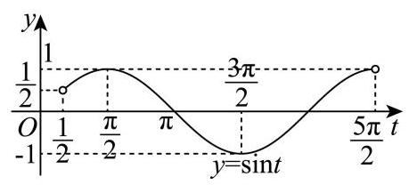

函数 $y = \sin t$ 与直线 $y = a$ 恰有两个不同的交点,所以 $- 1 < a \leq  \frac{1}{2}$ ,

即在区间 $\left( {\frac{\pi }{2},\frac{3\pi }{2}}\right)$ 和 $\left( {{2\pi },\frac{5\pi }{2}}\right)$ 各有一个交点,且关于 $t = \frac{3\pi }{2}$ 对称,

${t}_{1} + {t}_{2} = {3\pi }$ ,即 $2{x}_{1} + \frac{\pi }{6} + 2{x}_{2} + \frac{\pi }{6} = {3\pi }$ ,可得 ${x}_{1} + {x}_{2} = \frac{4\pi }{3}$ .

### 黄浦 · 第19题

已知 $f\left( x\right)  = 2\sin x\cos x - 2{\sin }^{2}x$ .

(1)求函数 $y = f\left( x\right)$ 的最小正周期与单调增区间；

(2)将函数 $y = f\left( x\right)$ 的图象上的所有点沿向量 $\overrightarrow{n} = \left( {\theta ,1}\right) \left( {0 \leq  \theta  \leq  \frac{\pi }{2}}\right)$ 平移，得到 $y = g\left( x\right)$ 的图象. 若 $y = g\left( x\right)$ 同时满足: ①图象关于点 $A\left( {-\frac{3\pi }{8},0}\right)$ 对称; ②有且仅有 2 个极大值点在区间 $\left\lbrack  {0, a}\right\rbrack$ 上. 求 $a$ 的取值范围.

> 本题资料或解析有待核事项，预览不可作为已审定成品。

**考点：** （1）三角恒等变形周期与单调区间；（2）平移对称与闭区间极大值点计数

**难度依据：** 三角恒等图像平移与极值点

**核查说明：** 具名教研整理PDF第11–12物理页题设区间为[0,a]、答案为(11π/8,19π/8]；解析中g(x)=√2 sin(2x−π/4)，按极大值点计数疑应为[11π/8,19π/8)，需独立数学复核，不能直接沿用原解。

**【答案】** (1) 最小正周期为 $\pi$ ,单调增区间为 $\left\lbrack  {{k\pi } - \frac{3\pi }{8},{k\pi } + \frac{\pi }{8}}\right\rbrack  \left( {k \in  \mathbf{Z}}\right)$

(2) $\left\lbrack {\frac{11\pi }{8},\frac{19\pi }{8}}\right)$

**【解析】**

**【分析】**(1) 利用三角恒等变换化简函数 $f\left( x\right)$ 的解析式,利用正弦型函数的周期公式和正弦型函数的单调性可求得答案;

(2)利用三角函数图象变换可得出函数 $g\left( x\right)$ 的解析式，根据函数 $g\left( x\right)$ 满足条件①以及 $\theta$ 的范围可得出 $\theta$ 的值,再根据函数 $g\left( x\right)$ 满足条件②可得出关于 $a$ 的不等式,解之即可.

**【小问 1 详解】**

因为 $f\left( x\right)  = \sin {2x} - \left( {1 - \cos {2x}}\right)  = \sin {2x} + \cos {2x} - 1 = \sqrt{2}\sin \left( {{2x} + \frac{\pi }{4}}\right)  - 1$ ,

所以函数 $y = f\left( x\right)$ 的最小正周期为 $\frac{2\pi }{2} = \pi$ ,

由 ${2k\pi } - \frac{\pi }{2} \leq  {2x} + \frac{\pi }{4} \leq  {2k\pi } + \frac{\pi }{2}\left( {k \in  \mathbf{Z}}\right)$ ,可得 ${k\pi } - \frac{3\pi }{8} \leq  x \leq  {k\pi } + \frac{\pi }{8}\left( {k \in  \mathbf{Z}}\right)$ ,

所以函数 $y = f\left( x\right)$ 的单调增区间为 $\left\lbrack  {{k\pi } - \frac{3\pi }{8},{k\pi } + \frac{\pi }{8}}\right\rbrack  \left( {k \in  \mathbf{Z}}\right)$ .

**【小问 2 详解】**

由 (1) 知 $f\left( x\right)  = \sqrt{2}\sin \left( {{2x} + \frac{\pi }{4}}\right)  - 1$ ,

将函数 $y = f\left( x\right)$ 的图象上的所有点沿向量 $\overrightarrow{n} = \left( {\theta ,1}\right) \left( {0 \leq  \theta  \leq  \frac{\pi }{2}}\right)$ 平移，得到 $y = g\left( x\right)$ 的图象,

所以 $g\left( x\right)  = \sqrt{2}\sin \left( {{2x} - {2\theta } + \frac{\pi }{4}}\right)$ ,

由 $y = g\left( x\right)$ 的图象关于点 $A\left( {-\frac{3\pi }{8},0}\right)$ 对称,可得 $\sqrt{2}\sin \left( {-\frac{3\pi }{4} - {2\theta } + \frac{\pi }{4}}\right)  = 0$ ,

所以 $- \frac{\pi }{2} - {2\theta } = {k\pi }\left( {k \in  \mathbf{Z}}\right)$ ,解得 $\theta  =  - \frac{k\pi }{2} - \frac{\pi }{4}\left( {k \in  \mathbf{Z}}\right)$ ,

又 $0 \leq  \theta  \leq  \frac{\pi }{2}$ ，可知 $\theta  = \frac{\pi }{4}$ ，故 $g\left( x\right)  = \sqrt{2}\sin \left( {{2x} - \frac{\pi }{4}}\right)$ ，

函数 $g(x)=\sqrt2\sin\left(2x-\frac{\pi}{4}\right)$ 的极大值点为 $x=\frac{3\pi}{8}+k\pi$（$k\in\mathbb Z$）。

区间 $[0,a]$ 中有且仅有两个极大值点，当且仅当第二个非负极大值点属于该区间而第三个不属于该区间，即

$$\frac{11\pi}{8}\le a<\frac{19\pi}{8}.$$

因此 $a\in\left[\frac{11\pi}{8},\frac{19\pi}{8}\right)$。整理版源答案的两个端点与闭区间条件不符，此处依据题设修订。

## 解三角形与几何条件

把已知边角、等腰或角平分关系转换为正余弦定理或数量积。

### 宝山 · 第14题

在 ${ABC}$ 中， $A, B$ 均为锐角，设甲: $\sin A < \sin C$ ；乙: ${ABC}$ 是钝角三角形，则甲是乙的 ( )

A. 充要条件

B. 充分不必要条件

C. 必要不充分条件

D. 既不充分也不必要条件

> 本题资料或解析有待核事项，预览不可作为已审定成品。

**考点：** 充分必要性与反例；正弦定理判断三角形

**难度依据：** 充分必要性与反例；正弦定理判断三角形

**核查说明：** 合并稿选项A充要、B充分不必要、C必要不充分；具名整理PDF物理第2页选项A充分非必要、B必要非充分、C充要，PDF第6页答案B而合并稿答案C，结论文字一致但选项顺序不同，发布时按对应题面核对。

**【答案】** C

**【解析】**

**【分析】**举反例否定充分性, 利用正弦定理并结合题意证明必要性即可.

**【详解】**对于充分性,设 $A = \frac{\pi }{4}, C = \frac{\pi }{3}$ ,显然满足甲,

此时 $B = \frac{5\pi }{12},\;{ABC}$ 不是钝角三角形,故充分性不成立;

对于必要性,若 ${ABC}$ 是钝角三角形,则 $C > \frac{\pi }{2}$ ,则 $a < c$ ,

由正弦定理可知 $\sin A < \sin C$ ,则必要性成立,

即甲是乙的必要不充分条件, 故 C 正确.

故选:C

### 崇明 · 第8题

在 ${ABC}$ 中,角 $A\text{ 、 }B\text{ 、 }C$ 所对的边长分别为 $a\text{ 、 }b\text{ 、 }c$ . 若 $A = {45}^{ \circ  }, C = {30}^{ \circ  }, c = \sqrt{2}$ , 则 $a =$ ___.

**考点：** 正弦定理求边

**难度依据：** 正弦定理求边

**【答案】** 2

**【解析】**

**【详解】**由正弦定理得 $\frac{a}{\sin {45}^{ \circ  }} = \frac{\sqrt{2}}{\sin {30}^{ \circ  }}$ ,解得 $a = \frac{\sqrt{2}\sin {45}^{ \circ  }}{\sin {30}^{ \circ  }} = 2$ .

### 普陀 · 第18题

设 ${ABC}$ 的内角 $A, B, C$ 的对边分别为 $a, b, c$ ,且 $b\sin \left( {A + \frac{5\pi }{6}}\right)  = a\cos A\cos C + c{\cos }^{2}A.$

(1)求角 $A$ 的大小；

(2)点 $O$ 、 $D$ 分别满足 $\left( {\overrightarrow{OA} + \overrightarrow{OB}}\right)  \cdot  \overrightarrow{AB} = 0$ ， $\left( {\overrightarrow{OA} + \overrightarrow{OC}}\right)  \cdot  \overrightarrow{AC} = 0$ ， $\overrightarrow{BD} = 2\overrightarrow{DC}$ ， ${AB} \cdot  {AD} = 0$ ,求 $\frac{\overrightarrow{CO} \cdot  \overrightarrow{AB}}{\overrightarrow{CO} \cdot  \overrightarrow{CB} + \overrightarrow{CO} \cdot  \overrightarrow{CA}}$ 的值.

**考点：** (1) 正弦定理化简解角；(2) 外心向量与分点数量积

**难度依据：** 正弦定理及三角恒等变换；外心数量积及分点关系

**【答案】** (1) $\frac{5\pi }{6}$ ;

(2) $\frac{3}{4}$ .

**【解析】**

**【分析】**(1) 利用正弦定理将边化为角,化简得 $\sin \left( {A + \frac{5\pi }{6}}\right)  = \cos A$ ,即可解得 $A$ ;

(2)由向量条件推出 $O$ 为外心，将目标式用外心向量转化为

$\frac{\cos 2\angle {ABC} - \cos 2\angle {BAC}}{2 - \cos 2\angle {BAC} - \cos 2\angle {ABC}}$ ,再利用 $\overrightarrow{BD} = 2\overrightarrow{DC}$ 和 ${AB} \cdot  {AD} = 0$ 推导出边的关系,结合正弦定理求得 $\cos 2\angle {ABC}$ 后代入即得结果.

**【小问 1 详解】**

因为 $b\sin \left( {A + \frac{5\pi }{6}}\right)  = a\cos A\cos C + c{\cos }^{2}A$ ,

设 ${ABC}$ 外接圆半径为 $R$ ,由正弦定理 $a = {2R}\sin A, b = {2R}\sin B, c = {2R}\sin C$ ,

代入可得 $\sin B\sin \left( {A + \frac{5\pi }{6}}\right)  = \sin A\cos A\cos C + \sin C{\cos }^{2}A$ ,

所以 $\sin B\sin \left( {A + \frac{5\pi }{6}}\right)  = \left( {\sin A\cos C + \cos A\sin C}\right) \cos A$ ,

即 $\sin B\sin \left( {A + \frac{5\pi }{6}}\right)  = \sin \left( {A + C}\right) \cos A$ ,

因为在 ${ABC}$ 中, $A + C = \pi  - B$ ,所以 $\sin \left( {A + C}\right)  = \sin B$ ,

即 $\sin B\sin \left( {A + \frac{5\pi }{6}}\right)  = \sin B\cos A$ ,

因为 $B \in  \left( {0,\pi }\right)$ ,所以 $\sin B \neq  0$ ,所以 $\sin \left( {A + \frac{5\pi }{6}}\right)  = \cos A$ ,

化简得: $\sin A\cos \frac{5\pi }{6} + \cos A\sin \frac{5\pi }{6} = \cos A$ ,

解得 $\sin A =  - \frac{\sqrt{3}}{3}\cos A$ ,即 $\tan A =  - \frac{\sqrt{3}}{3}$ ,

因为 $A \in  \left( {0,\pi }\right)$ ,所以 $A = \frac{5\pi }{6}$ .

**【小问 2 详解】**

由 $\left( {\overrightarrow{OA} + \overrightarrow{OB}}\right)  \cdot  \overrightarrow{AB} = 0$ ,所以 $\left( {\overrightarrow{OA} + \overrightarrow{OB}}\right)  \cdot  \left( {\overrightarrow{OB} - \overrightarrow{OA}}\right)  = 0$ ,

所以 ${\overrightarrow{OA}}^{2} = {\overrightarrow{OB}}^{2}$ ,即 $\left| \overrightarrow{OA}\right|  = \left| \overrightarrow{OB}\right|$ ,同理由 $\left( {\overrightarrow{OA} + \overrightarrow{OC}}\right)  \cdot  \overrightarrow{AC} = 0$ 得 $\left| \overrightarrow{OC}\right|  = \left| \overrightarrow{OB}\right|$ ,

所以 $O$ 是 ${ABC}$ 的外心,所以 $\left| \overrightarrow{OC}\right|  = \left| \overrightarrow{OB}\right|  = \left| \overrightarrow{OA}\right|  = R$ ,

因为同弧所对的圆周角是圆心角的一半,

所以 $\angle {AOB} = 2\angle {ACB}$ ， $\angle {AOC} = 2\angle {ABC}$ ，所以 $\angle {BOC} = {2\pi } - 2\angle {BAC}$ ，

所以 $\overrightarrow{CO} \cdot  \overrightarrow{AB} =  - \overrightarrow{OC} \cdot  \left( {\overrightarrow{OB} - \overrightarrow{OA}}\right)  =  - \left| \overrightarrow{OC}\right|  \cdot  \left| \overrightarrow{OB}\right| \cos \angle {BOC} + \left| \overrightarrow{OC}\right|  \cdot  \left| \overrightarrow{OA}\right| \cos \angle {AOC} \; =  - {R}^{2}\cos 2\angle {BAC} + {R}^{2}\cos 2\angle {ABC}$ ，

$\overrightarrow{CO} \cdot  \overrightarrow{CB} =  - \overrightarrow{OC} \cdot  \left( {\overrightarrow{OB} - \overrightarrow{OC}}\right)  =  - \left| \overrightarrow{OC}\right|  \cdot  \left| \overrightarrow{OB}\right| \cos \angle {BOC} + {\left| \overrightarrow{OC}\right| }^{2} =  - {R}^{2}\cos 2\angle {BAC} + {R}^{2}$ ,

$\overrightarrow{CO} \cdot  \overrightarrow{CA} =  - \overrightarrow{OC} \cdot  \left( {\overrightarrow{OA} - \overrightarrow{OC}}\right)  =  - \left| \overrightarrow{OC}\right|  \cdot  \left| \overrightarrow{OA}\right| \cos \angle {AOC} + {\left| \overrightarrow{OC}\right| }^{2} =  - {R}^{2}\cos 2\angle {ABC} + {R}^{2}$ ,

得到

$\frac{\overrightarrow{CO} \cdot  \overrightarrow{AB}}{\overrightarrow{CO} \cdot  \overrightarrow{CB} + \overrightarrow{CO} \cdot  \overrightarrow{CA}} = \frac{-{R}^{2}\cos 2\angle {BAC} + {R}^{2}\cos 2\angle {ABC}}{-{R}^{2}\cos 2\angle {BAC} + {R}^{2} - {R}^{2}\cos 2\angle {ABC} + {R}^{2}}$

$= \frac{\cos 2\angle {ABC} - \cos 2\angle {BAC}}{2 - \cos 2\angle {BAC} - \cos 2\angle {ABC}},$

而 $\overrightarrow{BD} = 2\overrightarrow{DC}$ ,所以 $\overrightarrow{AD} = \frac{1}{3}\overrightarrow{AB} + \frac{2}{3}\overrightarrow{AC}$ ,

因为 ${AB} \cdot  {AD} = 0$ ,所以 ${AB} \cdot  \left( {\frac{1}{3}{AB} + \frac{2}{3}{AC}}\right)  = 0$ ,得 $A{B}^{2} + {2AB} \cdot  {AC} = 0$ ,

而 $\overrightarrow{AB} \cdot  \overrightarrow{AC} = \left| \overrightarrow{AB}\right|  \cdot  \left| \overrightarrow{AC}\right| \cos \angle {BAC} =  - \frac{\sqrt{3}}{2} \cdot  \left| \overrightarrow{AB}\right|  \cdot  \left| \overrightarrow{AC}\right|$ ，所以 $\left| \overrightarrow{AB}\right|  = \sqrt{3}\left| {AC}\right|$ ，

由正弦定理 $\frac{\left| \overrightarrow{AB}\right| }{\sin \angle {ACB}} = \frac{\left| \overrightarrow{AC}\right| }{\sin \angle {ABC}}$ ，所以 $\sin \angle {ACB} = \sqrt{3}\sin \angle {ABC}$ ，

又因为 $\angle {ACB} + \angle {ABC} = \frac{\pi }{6}$ ,所以 $\sin \left( {\frac{\pi }{6} - \angle {ABC}}\right)  = \sqrt{3}\sin \angle {ABC}$ ,

化简得 $\cos \angle {ABC} = 3\sqrt{3}\sin \angle {ABC}$ ,所以 $\tan \angle {ABC} = \frac{\sqrt{3}}{9}$ ,

所以 $\cos 2\angle {ABC} = \frac{1 - {\tan }^{2}\angle {ABC}}{1 + {\tan }^{2}\angle {ABC}} = \frac{13}{14}$ ,

因为 $\angle {BAC} = \frac{5\pi }{6}$ ，所以 $\cos {2\angle {BAC}} = \cos \frac{5\pi }{3} = \frac{1}{2}$ ，

代入计算 $\frac{\cos 2\angle {ABC} - \cos 2\angle {BAC}}{2 - \cos 2\angle {BAC} - \cos 2\angle {ABC}} = \frac{\frac{13}{14} - \frac{1}{2}}{2 - \frac{1}{2} - \frac{13}{14}} = \frac{3}{4}$ ，所以 $\frac{\overrightarrow{CO} \cdot  \overrightarrow{AB}}{\overrightarrow{CO} \cdot  \overrightarrow{CB} + \overrightarrow{CO} \cdot  \overrightarrow{CA}} = \frac{3}{4}$ .

### 松江 · 第11题

如图,某公园划出一块平整的三角形草地 ${ABC}$ ,在边 ${BC}$ 上设置一个观景点 $D$ ,点 $D$ 到顶点 $C$ 的距离为 2 百米, ${AD}$ 平分 $\angle {BAC}$ ,边 ${AB}$ 和 ${AD}$ 的长度都为 3 百米. 现需要沿着三角形草地 ${ABC}$ 的边安装一圈灯带，则该灯带的长度为___百米.

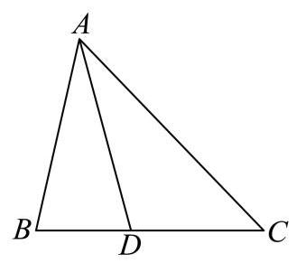

**考点：** 利用角平分线和邻补角关系求周长

**难度依据：** 构造联立方程并筛选长度

**【答案】** $\frac{21}{2}$

**【解析】**

**【分析】**设 ${AC} = x,{BD} = y$ ,由角平分线定理以及 $\cos \angle {ADB} + \cos \angle {ADC} = 0$ 列方程组求解即可.

**【详解】**设 ${AC} = x,{BD} = y$ ,

由角平分线定理得， $\frac{AB}{AC} = \frac{BD}{CD}$ ，即 $\frac{3}{x} = \frac{y}{2}$ ，得 ${xy} = 6$ ，

因为 $\angle {ADB} + \angle {ADC} = \pi$ ，

所以 $\cos \angle {ADB} + \cos \angle {ADC} = \frac{A{D}^{2} + B{D}^{2} - A{B}^{2}}{{2AD} \cdot  {BD}} + \frac{A{D}^{2} + C{D}^{2} - A{C}^{2}}{{2AD} \cdot  {CD}} \; = \frac{9 + {y}^{2} - 9}{6y} + \frac{9 + 4 - {x}^{2}}{12} = \frac{{13} - {x}^{2} + {2y}}{12} = 0,$

得 ${13} - {x}^{2} + {2y} = 0$ ,则 ${x}^{3} - {13x} - {12} = 0$ ,则 $\left( {x + 1}\right) \left( {x + 3}\right) \left( {x - 4}\right)  = 0$ ,

得 $x = 4,\;y = \frac{3}{2}$ ,

则该灯带的长度为 ${AB} + {AC} + {BC} = 3 + x + y + 2 = \frac{21}{2}$ .

### 浦东 · 第4题

在 ${ABC}$ 中,若 $a = 7, b = 8,\cos C = \frac{13}{14}$ ,则 $c =$ ___.

**考点：** 已知两边夹角余弦求第三边

**难度依据：** 直接代余弦定理

**【答案】** 3

**【解析】**

**【详解】**由余弦定理 ${c}^{2} = {a}^{2} + {b}^{2} - {2ab}\cos C$ 得: ${c}^{2} = {49} + {64} - {104} = 9$ ,

所以 $c = 3$

### 虹口 · 第6题

在 ${ABC}$ 中， ${AB} = 1,{BC} = 2$ ， $\overrightarrow{BA} \cdot  \overrightarrow{CA} = \frac{7}{5}$ ，则 $\cos \angle {ABC} =$ ___.

**考点：** 数量积转角度关系；余弦定理解三角形

**难度依据：** 数量积转角度关系；余弦定理解三角形

**【答案】** $- \frac{1}{5}\# \#  - {0.2}$

**【解析】**

**【分析】**根据数量积公式,可得 $\cos A$ 的值,根据余弦定理,可得 ${b}^{2}$ ,代入余弦定理,即可得答案.

**【详解】**设 ${AB} = c = 1,{BC} = a = 2,{AC} = b$ ,

由题意 $\overrightarrow{BA} \cdot  \overrightarrow{CA} = \left| \overrightarrow{BA}\right|  \cdot  \left| \overrightarrow{CA}\right| \cos A = b\cos A = \frac{7}{5}$ ，所以 $\cos A = \frac{7}{5b}$ ，

又 $\cos A = \frac{{b}^{2} + {c}^{2} - {a}^{2}}{2bc} = \frac{{b}^{2} + 1 - 4}{2b} = \frac{7}{5b}$ ，得 ${b}^{2} = \frac{29}{5}$ ，

所以 $\cos \angle {ABC} = \frac{{a}^{2} + {c}^{2} - {b}^{2}}{2ac} = \frac{4 + 1 - \frac{29}{5}}{2 \times  2 \times  1} =  - \frac{1}{5}$ .

### 虹口 · 第10题

已知焦点为 $F$ 的抛物线 $C : {y}^{2} = {4x}$ 上有两点 $A$ 和 $B$ ，且 $\angle {AFB} = {150}^{ \circ  }$ ， $E$ 为 $A$ 和 $B$ 的中点，过点 $E$ 作 $C$ 的准线的垂线，垂足为 $H$ ，则 $\frac{{\left| AB\right| }^{2}}{{\left| EH\right| }^{2}}$ 的最小值为___.

**考点：** 抛物线焦半径及焦点角；基本不等式求长度比最值；余弦定理表达弦长

**难度依据：** 抛物线焦半径及焦点角；基本不等式求长度比最值；余弦定理表达弦长

**【答案】** $2 + \sqrt{3}$

**【解析】**

**【分析】**设 $\left| {AF}\right|  = a,\left| {BF}\right|  = b$ ,根据中位线定理以及抛物线定义可得 $\left| {EH}\right|  = \frac{1}{2}\left( {a + b}\right)$ , 在 $\bigtriangleup {AFB}$ 中,由余弦定理以及基本不等式可得 $\left| {AB}\right|  \geq  \frac{2 - \sqrt{3}}{4}\left( {a + b}\right)$ ,即可求得 $\frac{{\left| AB\right| }^{2}}{{\left| EH\right| }^{2}}$ 的最小值.

**【详解】**设 $\left| {AF}\right|  = a,\left| {BF}\right|  = b$ ,作 ${AQ}$ 垂直抛物线的准线于点 $Q,{BP}$ 垂直抛物线的准线于点 $P$ .

由抛物线的定义,知 $\left| {AF}\right|  = \left| {AQ}\right| ,\left| {BF}\right|  = \left| {BP}\right|$ ,根据中位线定理以及抛物线定义可得 $\left| {EH}\right|  = \frac{1}{2}\left( {a + b}\right) ,$

由余弦定理得 ${\left| AB\right| }^{2} = {a}^{2} + {b}^{2} - {2ab}\cos {150}^{ \circ  } = {a}^{2} + {b}^{2} + \sqrt{3}{ab} = {\left( a + b\right) }^{2} - \left( {2 - \sqrt{3}}\right) {ab}$ ,又 ${ab} \leq  {\left( \frac{a + b}{2}\right) }^{2}$

$\therefore {\left( a + b\right) }^{2} - \left( {2 - \sqrt{3}}\right) {ab} \geq  {\left( a + b\right) }^{2} - \frac{2 - \sqrt{3}}{4}{\left( a + b\right) }^{2} = \frac{2 + \sqrt{3}}{4}{\left( a + b\right) }^{2}$ ,当且仅当 $a = b$ 时, 等号成立,

$\therefore {\left| AB\right| }^{2} \geq  \frac{2 + \sqrt{3}}{4}{\left( a + b\right) }^{2}$ ,

$\therefore \frac{{\left| AB\right| }^{2}}{{\left| EH\right| }^{2}} \geq  \frac{\frac{2 + \sqrt{3}}{4}{\left( a + b\right) }^{2}}{{\left\lbrack  \frac{1}{2}\left( a + b\right) \right\rbrack  }^{2}} = 2 + \sqrt{3}$ ,即 $\frac{{\left| AB\right| }^{2}}{{\left| EH\right| }^{2}}$ 的最小值为 $2 + \sqrt{3}$ .

### 金山 · 第10题

已知在 ${ABC}$ 中, ${AB} = 2,{AC} = 3,\angle {BAC} = {60}^{ \circ  }$ . 若点 $O$ 为 ${ABC}$ 外接圆的圆心, 则 ${BC} \cdot  {BO} =$ ___.

**考点：** 圆心垂径与数量积；余弦定理求边

**难度依据：** 圆心垂径与数量积；余弦定理求边

**【答案】** $\frac{7}{2}$

**【解析】**

**【分析】**利用余弦定理求出 ${BC}$ ,取 ${BC}$ 的中点 $M$ ,连接 ${OM}$ ,由点 $O$ 为 ${ABC}$ 外接圆的圆心,得到 ${OM} \bot  {BC}$ ,利用向量的数量积的定义,结合在直角三角形中的余弦公式求出 ${BC} \cdot  {BO}$ 的值.

**【详解】** $\because {AB} = 2,{AC} = 3,\angle {BAC} = {60}^{ \circ  }$ ,

$\therefore B{C}^{2} = A{B}^{2} + A{C}^{2} - {2AB} \cdot  {AC} \cdot  \cos \angle {BAC} = {2}^{2} + {3}^{2} - 2 \times  2 \times  3\cos {60}^{ \circ  } = 7$ ,

$\therefore {BC} = \sqrt{7}$ ,

取 ${BC}$ 的中点 $M$ ,连接 ${OM}$ ,

$\because$ 点 $O$ 为 ${ABC}$ 外接圆的圆心,

$\therefore {OM}\bot {BC}$ ,

$\therefore {BC} \cdot  {BO} = \left| {BC}\right|  \cdot  \left| {BO}\right| \cos \angle {CBO} = \left| {BC}\right|  \cdot  \left| {BM}\right|  = \frac{1}{2}{\left| BC\right| }^{2} = \frac{1}{2} \times  7 = \frac{7}{2}$ .

### 金山 · 第15题

已知椭圆 ${\Gamma }_{1} : \frac{{x}^{2}}{{a}^{2}} + \frac{{y}^{2}}{{b}^{2}} = 1$ ,双曲线 ${\Gamma }_{2} : \frac{{y}^{2}}{{b}^{2}} - \frac{{x}^{2}}{{a}^{2}} = 1$ ,其中 $\left( {a > b > 0}\right)$ ,点 ${F}_{1}\text{ 、 }{F}_{2}$ 为椭圆 ${\Gamma }_{1}$ 的两个焦点,点 $P$ 是双曲线 ${\Gamma }_{2}$ 上一动点. 若双曲线 ${\Gamma }_{2}$ 的两条渐近线夹角的余弦值等于 $\frac{1}{3}$ ,则使得 $\bigtriangleup  {P{F}_{1}{F}_{2}}$ 为直角三角形的点 $P$ 有( )个

A. 3

B. 4

C. 6

D. 8

**考点：** 椭圆焦点与双曲线渐近线；渐近线夹角及直角点数

**难度依据：** 椭圆焦点与双曲线渐近线；渐近线夹角及直角点数

**【答案】** C

**【解析】**

**【分析】**先根据双曲线的渐近线夹角的余弦值求出 $\frac{b}{a}$ ,得到 $a = \sqrt{2}b$ ,分别按照 $\angle {F}_{1}P{F}_{2} = {90}^{ \circ  },\angle P{F}_{1}{F}_{2} = {90}^{ \circ  },\angle P{F}_{2}{F}_{1} = {90}^{ \circ  }$ 讨论求解.

**【详解】**双曲线 ${\Gamma }_{2} : \frac{{y}^{2}}{{b}^{2}} - \frac{{x}^{2}}{{a}^{2}} = 1$ 的渐近线方程为 $y =  \pm  \frac{b}{a}x$ ,

设渐近线 $y = \frac{b}{a}x$ 的倾斜角为 $\theta$ ,则 $\tan \theta  = \frac{b}{a}$ ,

$\because a > b > 0,\therefore 0 < \frac{b}{a} < 1,\therefore 0 < \tan \theta  < 1,\therefore 0 < \theta  < \frac{\pi }{4}$ ,

$\therefore$ 两条渐近线的夹角为 ${2\theta },\therefore \cos {2\theta } = \frac{1}{3}$ ,

$\because \cos {2\theta } = {\cos }^{2}\theta  - {\sin }^{2}\theta  = \frac{{\cos }^{2}\theta  - {\sin }^{2}\theta }{{\cos }^{2}\theta  + {\sin }^{2}\theta } = \frac{1 - {\tan }^{2}\theta }{1 + {\tan }^{2}\theta }$ ,

$\therefore \frac{1 - {\tan }^{2}\theta }{1 + {\tan }^{2}\theta } = \frac{1}{3},\therefore \frac{1 - {\left( \frac{b}{a}\right) }^{2}}{1 + {\left( \frac{b}{a}\right) }^{2}} = \frac{1}{3},\therefore \frac{b}{a} = \frac{\sqrt{2}}{2},\therefore a = \sqrt{2}b$ ,

椭圆 ${\Gamma }_{1} : \frac{{x}^{2}}{{a}^{2}} + \frac{{y}^{2}}{{b}^{2}} = 1,\;c = \sqrt{{a}^{2} - {b}^{2}} = \sqrt{{\left( \sqrt{2}b\right) }^{2} - {b}^{2}} = b$ ,

$\because$ 点 ${F}_{1}\text{ 、 }{F}_{2}$ 为椭圆 ${\Gamma }_{1}$ 的两个焦点, $\therefore {F}_{1}\left( {-b,0}\right) ,{F}_{2}\left( {b,0}\right)$ ,

当 $\angle {F}_{1}P{F}_{2} = {90}^{ \circ  }$ 时,以 ${F}_{1}{F}_{2}$ 为直径的圆的方程为 ${x}^{2} + {y}^{2} = {c}^{2} = {b}^{2}$ ,

双曲线 ${\Gamma }_{2} : \frac{{y}^{2}}{{b}^{2}} - \frac{{x}^{2}}{{a}^{2}} = 1$ ,将 $a = \sqrt{2}b$ 代入 ${\Gamma }_{2} : \frac{{y}^{2}}{{b}^{2}} - \frac{{x}^{2}}{{a}^{2}} = 1$ ,

得到 $\frac{{y}^{2}}{{b}^{2}} - \frac{{x}^{2}}{2{b}^{2}} = 1$ ,解得 ${y}^{2} = {b}^{2} + \frac{{x}^{2}}{2}$ ,

联立 $\left\{  \begin{array}{l} {x}^{2} + {y}^{2} = {b}^{2} \\  {y}^{2} = {b}^{2} + \frac{{x}^{2}}{2} \end{array}\right.$ ,将 ${y}^{2} = {b}^{2} + \frac{{x}^{2}}{2}$ 代入 ${x}^{2} + {y}^{2} = {b}^{2}$ ,

得到 ${x}^{2} + {b}^{2} + \frac{{x}^{2}}{2} = {b}^{2}$ ,解得 $x = 0$ ,

将 $x = 0$ 代入 ${y}^{2} = {b}^{2} + \frac{{x}^{2}}{2}$ ，解得 $y =  \pm  b$ ，

则有 2 个点 $P$ 满足 $\angle {F}_{1}P{F}_{2} = {90}^{ \circ  }$ ;

当 $\angle P{F}_{1}{F}_{2} = {90}^{ \circ  }$ 时,

过 ${F}_{1}$ 的直线为 $x =  - b$ ,将 $x =  - b$ 代入双曲线 $\frac{{y}^{2}}{{b}^{2}} - \frac{{x}^{2}}{2{b}^{2}} = 1$ ,

得到 $\frac{{y}^{2}}{{b}^{2}} - \frac{{\left( -b\right) }^{2}}{2{b}^{2}} = 1$ ,解得 $y =  \pm  \frac{\sqrt{6}}{2}b$ ,故有 2 个点 $P$ 满足 $\angle P{F}_{1}{F}_{2} = {90}^{ \circ  }$ ;

当 $\angle P{F}_{2}{F}_{1} = {90}^{ \circ  }$ 时,

过 ${F}_{2}$ 的直线为 $\mathrm{x} = \mathrm{b}$ ,将 $\mathrm{x} = \mathrm{b}$ 代入双曲线 $\frac{{y}^{2}}{{b}^{2}} - \frac{{x}^{2}}{2{b}^{2}} = 1$ ,

得到 $\frac{{y}^{2}}{{b}^{2}} - \frac{{b}^{2}}{2{b}^{2}} = 1$ ,解得 $y =  \pm  \frac{\sqrt{6}}{2}b$ ,故有 2 个点 $P$ 满足 $\angle P{F}_{2}{F}_{1} = {90}^{ \circ  }$ ;

综上可知,使得 $\bigtriangleup P{F}_{1}{F}_{2}$ 为直角三角形的点 $P$ 有 6 个,故选项 $\mathrm{C}$ 正确.

### 青浦 · 第9题

已知 ${ABC}$ 为等腰三角形，且 $\sin A = 2\sin B$ ，则 $\cos B =$ ___.

**考点：** 等腰条件与正余弦定理

**难度依据：** 等腰条件与正余弦定理

**【答案】** $\frac{7}{8}$ ##0.875

**【解析】**

**【分析】**利用正弦定理边化角,再利用余弦定理求出 $\cos B$ .

**【详解】**在 ${ABC}$ 中,令内角 $A, B, C$ 所对边分别为 $a, b, c$ , 由 $\sin A = 2\sin B$ 及正弦定理,得 $a = {2b}$ ,显然 ${AC}$ 为底边,否则不能构成三角形, 由余弦定理得 $\cos B = \frac{{a}^{2} + {c}^{2} - {b}^{2}}{2ac} = \frac{{\left( 2b\right) }^{2} + {\left( 2b\right) }^{2} - {b}^{2}}{2 \cdot  {2b} \cdot  {2b}} = \frac{7}{8}$ . 故答案为: $\frac{7}{8}$

### 青浦 · 第10题

已知点 $F$ 是双曲线 $E : \frac{{x}^{2}}{{a}^{2}} - \frac{{y}^{2}}{{b}^{2}} = 1\left( {a > 0, b > 0}\right)$ 的左焦点，经过原点 $O$ 的直线 $l$ 与双曲线 $E$ 交于 $P$ 、 $Q$ 两点，若 $\left| {PF}\right|  = 5\left| {QF}\right|$ 且 $\angle {PFQ} = {60}^{ \circ  }$ ，则双曲线 $E$ 的离心率为___.

**考点：** 双曲线定义和离心率；余弦定理求焦距

**难度依据：** 双曲线定义和离心率；余弦定理求焦距

**【答案】** $\frac{\sqrt{31}}{4}\# \# \frac{1}{4}\sqrt{31}$

**【解析】**

**【分析】**设 ${F}_{2}$ 是右焦点,由双曲线的对称性得 ${PFQ}{F}_{2}$ 是平行四边形,这样结合双曲线的定义可把 $\left| {PF}\right|$ 和 $\left| {P{F}_{2}}\right|$ 用 $a$ 表示,再应用余弦定理可得 $a, c$ 关系,从而得离心率.

设 ${F}_{2}$ 是右焦点,由双曲线的对称性得 ${PFQ}{F}_{2}$ 是平行四边形, $\left| {P{F}_{2}}\right|  = \left| {QF}\right|$ ,

所以 $\left| {PF}\right|  = 5\left| {QF}\right|  = 5\left| {P{F}_{2}}\right|$ ,

又 $\left| {PF}\right|  - \left| {P{F}_{2}}\right|  = {2a}$ ,即 $4\left| {P{F}_{2}}\right|  = {2a},\left| {P{F}_{2}}\right|  = \frac{a}{2}$ ,则 $\left| {PF}\right|  = \frac{5a}{2}$ ,

因为 $\angle {PFQ} = {60}^{ \circ  }$ ,所以 $\angle {FP}{F}_{2} = {120}^{ \circ  }$ ,

由余弦定理得 ${\left| {F}_{1}{F}_{2}\right| }^{2} = {\left| PF\right| }^{2} + {\left| P{F}_{2}\right| }^{2} - 2\left| {PF}\right| \left| {P{F}_{2}}\right| \cos {120}^{ \circ  }$ ,

即 $4{c}^{2} = \frac{{25}{a}^{2}}{4} + \frac{{a}^{2}}{4} - 2 \times  \frac{5a}{2} \times  \frac{a}{2} \times  \left( {-\frac{1}{2}}\right)$ ,

得 $4{c}^{2} = \frac{{31}{a}^{2}}{4}$ ,即 $\frac{{c}^{2}}{{a}^{2}} = \frac{31}{16}$

所以离心率 $e = \frac{c}{a} = \frac{\sqrt{31}}{4}$ .

## 测量、运动、截面与射影建模

先还原几何模型和实际角度，再用三角关系求量或优化。

### 奉贤 · 第11题

如图所示, $A, B, C$ 为山脚两侧共线的三点,在山顶 $P$ 处测得三点的俯角分别为 $a = {29.3}^{ \circ  },\beta  = {38.2}^{ \circ  },\gamma  = {25.1}^{ \circ  }$ . 计划沿直线 ${AC}$ 开通穿山隧道,为了求出隧道 ${DE}$ 的长度,还测得 ${AD} = {277}$ 米, ${BE} = {49}$ 米, ${BC} = {320}$ 米,则根据以上数据,隧道 ${DE}$ 的长度约为___米. (结果精确到 1 米)

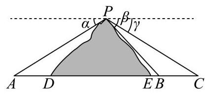

**考点：** 利用正弦定理进行测量

**难度依据：** 利用正弦定理进行测量

**【答案】** 804

**【解析】**

**【详解】**在 $\bigtriangleup  {PBC}$ 中， $\angle {BPC} = \beta  - \gamma  = {38.2}^{ \circ  } - {25.1}^{ \circ  } = {13.1}^{ \circ  }$ ， $\angle {PBC} = {180}^{ \circ  } - \beta$ ， $\angle {PCB} = \gamma$

由正弦定理可得 $\frac{BC}{\sin \angle {BPC}} = \frac{PC}{\sin \angle {PBC}}$ ,整理可得 ${PC} = \frac{{320} \times  \sin {38.2}^{ \circ  }}{\sin {13.1}^{ \circ  }}$ .

在 $\bigtriangleup {PAC}$ 中, $\angle {PAC} = a,\angle {APC} = {180}^{ \circ  } - a - \gamma$ ,

由正弦定理 $\frac{AC}{\sin \angle {APC}} = \frac{PC}{\sin \angle {PAC}}$ ,

整理可得 ${AC} = \frac{{PC} \times  \sin \left( {{29.3}^{ \circ  } + {25.1}^{ \circ  }}\right) }{\sin {29.3}^{ \circ  }} = \frac{{320} \times  \sin {38.2}^{ \circ  } \times  \sin {54.4}^{ \circ  }}{\sin {29.3}^{ \circ  }\sin {13.1}^{ \circ  }}$ .

所以 ${DE} = {AC} - {AD} - {EB} - {CB} = \frac{{320} \times  \sin {38.2}^{ \circ  } \times  \sin {54.4}^{ \circ  }}{\sin {13.1}^{ \circ  }\sin {29.3}^{ \circ  }} - {277} - {49} - {320}$

$= \frac{{320} \times  \sin {38.2}^{ \circ  } \times  \sin {54.4}^{ \circ  }}{\sin {13.1}^{ \circ  }\sin {29.3}^{ \circ  }} - {277} - {49} - {320} = {804}.$

### 崇明 · 第10题

如图,已知圆柱的一个截面边界是椭圆 $\Gamma$ ,其中 $\Gamma$ 的长轴 ${AC}$ 为该圆柱轴截面的对角线, 短轴长等于圆柱底面直径的长. 将圆柱侧面沿母线 ${AB}$ 展开，则椭圆 $\Gamma$ 在展开图中恰好为一个周期的三角函数图像. 若该段曲线是函数 $y = 1 - \sqrt{3}\sin \frac{x}{2}$ 的图像的一部分,则椭圆 $\Gamma$ 的离心率为___.

$B$

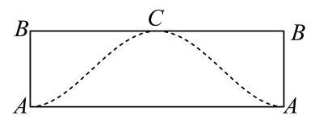

**考点：** 圆柱斜截面与展开；周期振幅确定圆柱尺寸；椭圆离心率

**难度依据：** 圆柱斜截面与展开；周期振幅确定圆柱尺寸；椭圆离心率

**【答案】** $\frac{\sqrt{21}}{7}$

**【解析】**

**【分析】**由正弦函数的最值和周期求得圆柱的高和底面半径, 进而求得椭圆的长轴和短轴, 即可得离心率.

**【详解】**函数 $y = 1 - \sqrt{3}\sin \frac{x}{2}$ 的值域为 $\left\lbrack  {1 - \sqrt{3},1 + \sqrt{3}}\right\rbrack$ ,最小正周期 $T = \frac{2\pi }{\frac{1}{2}} = {4\pi }$ ,

依题意,圆柱的高 $h = \left| {AB}\right|  = 2\sqrt{3}$ ,设圆柱的底面半径为 $r$ ,则 ${2\pi r} = {4\pi }$ ,解得 $r = 2$ ,

椭圆短轴长 ${2b} = {2r} = 4$ ,即 $b = 2$ ,长轴长 ${2a} = \sqrt{{h}^{2} + {\left( 2r\right) }^{2}} = 2\sqrt{7}$ ,即 $a = \sqrt{7}$ , 所以椭圆的离心率 $e = \frac{\sqrt{{a}^{2} - {b}^{2}}}{a} = \sqrt{1 - \frac{{b}^{2}}{{a}^{2}}} = \frac{\sqrt{21}}{7}$ .

### 徐汇 · 第12题

如图为一架农业无人机沿固定航线匀速飞行，并在某时刻向下喷洒农药的示意图. 将种植坡面视为坡角为 $\theta$ 的平面，航线视为直线，无人机视为航线上的点，无人机在任意时刻喷洒农药的雾滴形成的形状均为以铅垂线为轴、母线与轴夹角为 ${45}^{ \circ  }$ 的圆锥及其内部. 若无人机飞行的海拔高度恒定，航线与种植坡面平行且距离为 3 米，假设无人机飞行时农药喷洒不间断且不受风速影响；则飞行过程中会在种植坡面上形成一条宽为 $L\left( \theta \right)$ 米的“农药条带”，当 ${0}^{ \circ  } \leq  \theta  \leq  {15}^{ \circ  }$ 时， $L\left( \theta \right)$ 的最大值为___. (结果精确到 0.01 )

航线 无人机

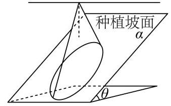

**考点：** 垂直航线截面求喷洒带宽，再求三角函数最值

**难度依据：** 空间截面建模与坡角转化

**【答案】** 6.93

**【解析】**

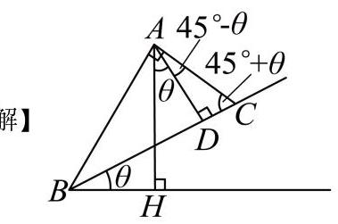

作垂直于无人机航线与平面 $a$ 的平面，与无人机航线交于点 $A$ ,与平面 $a$ 交于直线 ${BC}$ , 线段 ${BC}$ 的长为农药条带的宽度, ${BH}$ 为水平线

作 ${AD} \bot  {BC}$ 于 $D,{AD} \bot  {BH}$ 于 $H$ ,由坡角为 $\theta$ 易得 $\angle {HAD} = \theta$ ,

由题意得 $\angle {BAH} = \angle {CAH} = {45}^{ \circ  },\angle {BAC} = {90}^{ \circ  },{AD} = 3$ ,

则 $\angle {CAD} = {45}^{ \circ  } - \theta ,\angle {DCA} = {45}^{ \circ  } + \theta$ ,

所以 ${AC} = \frac{AD}{\cos \angle {CAD}} = \frac{3}{\cos \left( {{45}^{ \circ  } - \theta }\right) }$ ，

${BC} = \frac{AC}{\cos \angle {ACD}} = \frac{3}{\cos \left( {{45}^{ \circ  } - \theta }\right) \cos \left( {{45}^{ \circ  } + \theta }\right) } = \frac{3}{\sin \left( {{45}^{ \circ  } + \theta }\right) \cos \left( {{45}^{ \circ  } + \theta }\right) }$

$= \frac{6}{\sin \left( {{90}^{ \circ  } + {2\theta }}\right) } = \frac{6}{\cos {2\theta }},$

因为 ${0}^{ \circ  } \leq  \theta  \leq  {15}^{ \circ  }$ ,所以 ${0}^{ \circ  } \leq  {2\theta } \leq  {30}^{ \circ  },\frac{\sqrt{3}}{2} \leq  \cos {2\theta } \leq  1$ ,

$B{C}_{\max } = \frac{6}{\frac{\sqrt{3}}{2}} = 4\sqrt{3} \approx  {6.93}.$

### 虹口 · 第11题

某种健身拉力器的手臂固定支架为 ${BE}$ ,需运动者将肩关节放置于点 $B$ 处,手肘放置于

点 $D$ 处,手掌放置于点 $E$ 处握拳握住弹力绳的一端,弹力绳的另一端连接于点 $C$ 处; 保持 $B\text{ 、 }D\text{ 、 }E\text{ 、 }C$ 四点共线. 将小臂视为线段 ${DE}$ ,长度为 $r$ ,大臂视为线段 ${BD}$ ,长度为 ${1.3r}$ . 在锻炼时要求保持肩关节 $B$ 和手肘 $D$ 不动，运用大臂力量将小臂 ${DE}$ 绕着手肘 $D$ 作圆周运动， 始终与 ${BC}$ 处于同一平面，弹力绳随之以紧绷状态从 ${CE}$ 拉伸至 ${CA}$ . 已知某位运动者健身时 ${CE} = {0.1r}$ ，当弹力绳拉至最长时， $\angle {ABC} = 3\angle {ACB}$ ，则此时 $\angle {ACB} =$ ___度.(结果精确到 0.1 度)

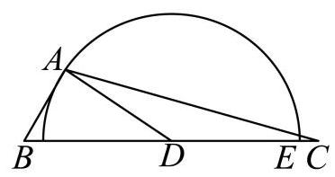

**考点：** 运动模型及正余弦定理解角

**难度依据：** 运动模型及正余弦定理解角

**【答案】** 16.7

**【解析】**

**【分析】**先由题意得出 ${BC} = {2.4r},{CD} = {1.1r}$ ,且 ${AD} = r$ . 再设 $\angle {ACB} = x$ ,则 $\angle {ABC} = {3x}$ ,利用正弦定理表示出 ${AC}$ 的长度,最后在 $\vartriangle  {ACD}$ 中由余弦定理列方程求得 $x$ 的值.

**【详解】**由题意可得 $\mathrm{B},\mathrm{D},\mathrm{E},\mathrm{C}$ 四点共线, ${BD} = {1.3r},{DE} = r,{CE} = {0.1r}$ ,且点 $\mathrm{A}$ 为点 $\mathrm{E}$ 绕点 $\mathrm{D}$ 旋转后的位置,所以 ${AD} = {DE} = r$ .

因此 ${BC} = {BD} + {DE} + {CE} = {1.3r} + r + {0.1r} = {2.4r},{CD} = {DE} + {CE} = r + {0.1r} = {1.1r}$ .

设 $\angle {ACB} = x$ ,则 $\angle {ABC} = {3x}$ ,所以 $\angle {BAC} = {180}^{ \circ  } - {4x}$ .

在 $\bigtriangleup  {ABC}$ 中，由正弦定理可得 $\frac{AC}{\sin {3x}} = \frac{BC}{\sin {4x}}$ ，所以 ${AC} = \frac{{2.4r}\sin {3x}}{\sin {4x}}$ .

在 $\bigtriangleup  {ACD}$ 中，由余弦定理可得 $A{D}^{2} = A{C}^{2} + C{D}^{2} - {2AC} \cdot  {CD}\cos x$ .

将 ${AD} = r$ ， ${CD} = {1.1r}$ ， ${AC} = \frac{{2.4r}\sin {3x}}{\sin {4x}}$ 代入，得 ${r}^{2} = {\left( \frac{{2.4r}\sin {3x}}{\sin {4x}}\right) }^{2} + {\left( {1.1}r\right) }^{2} - 2 \cdot  \frac{{2.4r}\sin {3x}}{\sin {4x}} \cdot  {1.1r}\cos x.$

两边同除以 ${r}^{2}$ ,得 $1 = {\left( \frac{{2.4}\sin {3x}}{\sin {4x}}\right) }^{2} + {1.21} - {5.28} \cdot  \frac{\sin {3x}\cos x}{\sin {4x}}$ .

化简可得 ${12}{\tan }^{6}x - {97}{\tan }^{4}x + {198}{\tan }^{2}x - {17} = 0$ .

令 $t = {\tan }^{2}x$ ,则 ${12}{t}^{3} - {97}{t}^{2} + {198t} - {17} = 0$ .

解得 $t \approx  {0.0898}$ ,或 $t \approx  {3.5588}$ ,或 $t \approx  {4.4348}$ .

因为 $0 < x < {45}^{ \circ  }$ ,所以 $0 < {\tan }^{2}x < 1$ ,故 ${\tan }^{2}x \approx  {0.0898}$ .

于是 $x \approx  {16.678}^{ \circ  }$ . 故此时 $\angle {ACB} \approx  {16.7}^{ \circ  }$ .

### 金山 · 第12题

申辉中学某个数学建模小组发现:人走路时，启动或者停下的瞬间，手中水平拿着的杯子里的水可能会被晃动得溢出杯口. 查询资料后发现: 液面和水平面的夹角 $\theta \left( {0 \leq  \theta  < \frac{\pi }{2}}\right)$ 与人走路的加速度 $a$ 以及重力加速度 $g$ 有关,满足关系: $\tan \theta  = \frac{a}{g}$ ,其中 $g = {10}\left( {\mathrm{\;m}/{\mathrm{s}}^{2}}\right)$ . 若甲同学走路启动瞬间的加速度为 $3\left( {\mathrm{\;m}/{\mathrm{s}}^{2}}\right)$ ，手中水平拿着一个底面边长为 $4\mathrm{\;{cm}}$ 和 $6\mathrm{\;{cm}}$ ， 高为 ${14}\mathrm{\;{cm}}$ 的长方体形状的杯子，则杯中最多装___ ${\mathrm{{cm}}}^{3}$ 的水，存在甲同学走路启动的瞬间杯中水不溢出的可能.

> 本题资料或解析有待核事项，预览不可作为已审定成品。

**考点：** 斜液面与长方体体积优化；倾角正切与高度差

**难度依据：** 斜液面与长方体体积优化；倾角正切与高度差

**核查说明：** 本题具名修复经父agent独立复核；未据此判定全卷终审通过。；原解对任意水平朝向的最优性仅以“向更远的地方爬”直观说明，必要的二维方向范围论证待补。

【答案】$321.6\ \mathrm{cm}^3$。

【解析·任意水平朝向补全】

由题意，液面倾角满足 $\tan\theta=3/10$。设加速度在水平面内的方向与杯底长为 $4\mathrm{cm}$ 的边成角 $\varphi$，沿该方向的杯底投影宽度为

$$w=4|\cos\varphi|+6|\sin\varphi|.$$

因此矩形四角液面最高点与最低点的高度差为 $\Delta h=\frac3{10}w$。同一方向上，以最高点恰好到杯口时可装水最多；液面高度是杯底坐标的一次函数，矩形中心对称，故平均液深是 $14-\frac{\Delta h}{2}$。

这里 $w\le\sqrt{4^2+6^2}=\sqrt{52}$，故 $\Delta h<14$，整个杯底都有水，不存在液面穿过杯底的截断情形。该方向的最大容积为

$$V=4\times6\left(14-\frac3{20}w\right).$$

又

$$w\ge4(|\cos\varphi|+|\sin\varphi|)\ge4,$$

因此

$$V\le24\left(14-\frac3{20}\times4\right)=321.6.$$

沿 $4\mathrm{cm}$ 的边加速时 $w=4$，上述等号成立，故所求为 $321.6\mathrm{cm}^3$。

【补全说明】原解仅比较两条边的朝向，未覆盖任意水平朝向；此处补齐二维投影宽度及平均深度证明，保留原题与答案。教研整理PDF第1—2页题干及第7页简答与此一致，但PDF未提供本题详细证明，本段不冒充原文。

### 长宁 · 第11题

如图，某画框内摆放着三个矩形工艺品，它们的长均为 50cm，宽均为 10cm. 点 $A$ 、 $B$ 、

$C\text{ 、 }D$ 在同一条直线上,点 $F$ 在边 ${BE}$ 上,点 $I$ 在边 ${GH}$ 上,测得 $B\text{ 、 }C$ 两点间距离为 ${10}\mathrm{\;{cm}}$ . 为了使 $\angle {BFC} = \angle {HID}$ ，则 $C$ 、 $D$ 两点间距离为___ $\mathrm{{cm}}$ . (精确到 ${0.1}\mathrm{\;{cm}}$ )

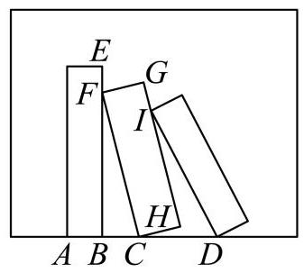

**考点：** 正弦定理与测量

**难度依据：** 正弦定理与测量

**【答案】** 20.4

**【解析】**

**【分析】**在 ${\mathrm{{Rt}}}_{ \bigtriangleup  }{FBC}$ 中，分别求得 $\sin \angle {FCB},\sin \angle {BFC}$ ,再利用三角形相似及正弦定理可求解.

**【详解】** ${\mathrm{{Rt}}}_{ \bigtriangleup  }{FBC}$ 中， ${FC} = {50},{BC} = {10}$ ，所以 ${FB} = \sqrt{{FC}^{2} - {BC}^{2}} = {20}\sqrt{6}$ .

所以 $\sin \angle {FCB} = \frac{{20}\sqrt{6}}{50} = \frac{2\sqrt{6}}{5},\sin \angle {BFC} = \frac{BC}{CF} = \frac{1}{5}$ .

延长 ${GH}$ ，交 ${CD}$ 于点 $P$ ，则 $\bigtriangleup  {FBC}$ 与 $\bigtriangleup  {CHP}$ 相似，所以 $\angle {HPC} = {FCB}$ .

所以 $\sin \angle {HPC} = \sin \angle {FCB} = \frac{2\sqrt{6}}{5}$ ,所以 $\frac{CH}{CP} = \frac{2\sqrt{6}}{5}$ ,

所以 ${CP} = \frac{CH}{\frac{2\sqrt{6}}{5}} = \frac{10}{\frac{2\sqrt{6}}{5}} = \frac{{25}\sqrt{6}}{6}$ .

$\bigtriangleup  {IPD}$ 中，由正弦定理得 $\frac{ID}{\sin \angle {IPD}} = \frac{PD}{\sin \angle {PID}}$ ，即 $\frac{50}{\sin \angle {HPC}} = \frac{PD}{\sin \angle {BFC}}$ ，

所以 ${PD} = \frac{{50} \times  \frac{1}{5}}{\frac{2\sqrt{6}}{5}} = \frac{{25}\sqrt{6}}{6}$ .

所以 ${CD} = {CP} + {PD} = \frac{{25}\sqrt{6}}{3} \approx  {20.4}$

所以 $C$ 、 $D$ 两点间距离为 ${20.4}\mathrm{\;{cm}}$ .

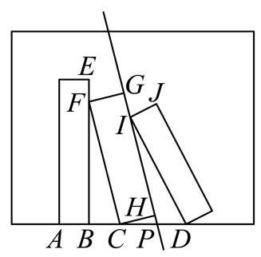

### 闵行 · 第12题

定义:平面内图形 $\Gamma$ 上的所有点在直线 $l$ 上的射影所组成的图形称为 $\Gamma$ 在 $l$ 上的射影. 若存在边长为 $m$ 的正三角形在正方形的四条边所在直线上的射影长度之和为 4,则 $m$ 的取值范围为___.

**考点：** 射影定义与分段最值；射影运算

**难度依据：** 射影定义与分段最值；射影运算

**【答案】** $\left\lbrack  {\sqrt{6} - \sqrt{2},8 - 4\sqrt{3}}\right\rbrack$

**【解析】**

**【分析】**根据题意,转化为正三角形 ${OAB}$ 在 $x$ 轴、 $y$ 轴上投影之和的两倍,设 ${OA}$ 与 $x$ 轴正半轴的夹角为 $a$ ,正三角形在正方形的四条边所在直线上的射影长度之和为 $M$ ,分 $a \in  \left\lbrack  {0,\frac{\pi }{6}}\right\rbrack  \text{ 、 }a \in  \left( {\frac{\pi }{6},\frac{\pi }{3}}\right\rbrack  \text{ 、 }a \in  \left( {\frac{\pi }{3},\frac{\pi }{2}}\right\rbrack$ 三种情况分别计算 $M$ 的最值,再列不等式求解即可.

**【详解】**解: 根据题意,正三角形在正方形的四条边所在直线上的射影长度之和,

等价于正三角形 ${OAB}$ 在 $x$ 轴、 $y$ 轴上投影之和的两倍,

设 ${OA}$ 与 $x$ 轴正半轴的夹角为 $a$ ,

正三角形在正方形的四条边所在直线上的射影长度之和为 $M$ ,

则 $A\left( {m\cos a, m\sin a}\right) , B\left( {m\cos \left( {a + \frac{\pi }{3}}\right) , m\sin \left( {a + \frac{\pi }{3}}\right) }\right)$ ,

当 $a \in  \left\lbrack  {0,\frac{\pi }{6}}\right\rbrack$ 时，正三角形 ${OAB}$ 在 $x$ 轴、 $y$ 轴上投影分别为 $m\cos a\text{ 、 }m\sin \left( {a + \frac{\pi }{3}}\right)$ ,

则 $M = {2m}\cos a + {2m}\sin \left( {a + \frac{\pi }{3}}\right)  = {2m}\left\lbrack  {\cos a + \sin \left( {a + \frac{\pi }{3}}\right) }\right\rbrack$

$= {2m}\left\lbrack  {\cos a + \cos \left( {\frac{\pi }{6} - a}\right) }\right\rbrack   = {4m}\cos \frac{\pi }{12}\cos \left( {a - \frac{\pi }{12}}\right)$ ,

$\therefore a = 0$ 或 $a = \frac{\pi }{6}$ 时, $M$ 取得最小值 $\left( {2 + \sqrt{3}}\right) m$ ,

$a = \frac{\pi }{12}$ 时, $M$ 取得最大值为 ${4m}\cos \frac{\pi }{12} = \left( {\sqrt{6} + \sqrt{2}}\right) m$ ;

当 $a \in  \left( {\frac{\pi }{6},\frac{\pi }{3}}\right\rbrack$ 时,正三角形 ${OAB}$ 在 $x$ 轴、 $y$ 轴上投影分别为 $m\cos a - m\cos \left( {a + \frac{\pi }{3}}\right)$ 、 $m\sin \left( {a + \frac{\pi }{3}}\right)$

$M = {2m}\cos a - {2m}\cos \left( {a + \frac{\pi }{3}}\right)  + {2m}\sin \left( {a + \frac{\pi }{3}}\right)$

$= {2m}\cos a - m\cos a + \sqrt{3}m\sin a + m\sin a + \sqrt{3}m\cos a$

$= \left( {\sqrt{3} + 1}\right) m\left( {\sin a + \cos a}\right)$

$= \left( {\sqrt{6} + \sqrt{2}}\right) \sin \left( {a + \frac{\pi }{4}}\right) ,$

当 $a = \frac{\pi }{3}$ 时， $M$ 取得最小值 $\left( {2 + \sqrt{3}}\right) m$ ，当 $a = \frac{\pi }{4}$ 时， $M$ 取得最大值为 $\left( {\sqrt{6} + \sqrt{2}}\right) m$ ； $a \in  \left( {\frac{\pi }{3},\frac{\pi }{2}}\right\rbrack$ 时,正三角形 ${OAB}$ 在 $x$ 轴、 $y$ 轴上投影分别为 $m\cos a - m\cos \left( {a + \frac{\pi }{3}}\right)$ 、

$m\sin a$ ,

$$
M = {2m}\cos a - {2m}\cos \left( {a + \frac{\pi }{3}}\right)  + {2m}\sin a
$$

$$
= {2m}\cos a - m\cos a + \sqrt{3}m\sin a + {2m}\sin a
$$

$$
= m\cos a + \left( {2 + \sqrt{3}}\right) m\sin a
$$

$$
= \left( {\sqrt{6} + \sqrt{2}}\right) m\left( {\frac{\sqrt{6} - \sqrt{2}}{4}\cos a + \frac{\sqrt{6} + \sqrt{2}}{4}\sin a}\right)
$$

$$
= \left( {\sqrt{6} + \sqrt{2}}\right) m\sin \left( {a + \frac{\pi }{12}}\right)
$$

当 $a = \frac{\pi }{2}$ 时， $M$ 取得最小值 $\left( {2 + \sqrt{3}}\right) m$ ，当 $a = \frac{5\pi }{12}$ 时， $M$ 取得最大值为 $\left( {\sqrt{6} + \sqrt{2}}\right) m$ ； 由对称性可证,其它象限最值情况一样,

综上, $M$ 的最小值为 $\left( {2 + \sqrt{3}}\right) m$ ,最大值为 $\left( {\sqrt{6} + \sqrt{2}}\right) m$ ,

$\therefore \left\{  \begin{array}{l} \left( {2 + \sqrt{3}}\right) m \leq  4 \\  \left( {\sqrt{6} + \sqrt{2}}\right) m \geq  4 \end{array}\right.$ ,解得 $\sqrt{6} - \sqrt{2} \leq  m \leq  8 - 4\sqrt{3}$ ,

则 $m$ 的取值范围为 $\left\lbrack  {\sqrt{6} - \sqrt{2},8 - 4\sqrt{3}}\right\rbrack$ .

## 三角函数与导数、数列的交叉

保留完整综合题，以特殊点求导或序列结构揭示三角表达式作用。

### 金山 · 第11题

已知 ${S}_{n}$ 是数列 $\left\{  {a}_{n}\right\}$ 的前 $n$ 项和,且 ${S}_{n} = {2}^{n - 1} - 1, n \geq  1$ 且 $n \in  \mathrm{N}$ . 若 $f\left( x\right)  = \left( {\sin x + {a}_{1}}\right) \left( {\sin x + {a}_{2}}\right) \cdots \left( {\sin x + {a}_{5}}\right)$ ，则 ${f}^{\prime }\left( \pi \right)  =$ ___.

**考点：** 前n项和求通项；乘积函数在特殊点求导；三角函数的导数

**难度依据：** 前n项和求通项；乘积函数在特殊点求导；三角函数的导数

**【答案】** -64

**【解析】**

**【详解】**因为 ${a}_{1} = {S}_{1} = {2}^{0} - 1 = 0$ ,

${a}_{2} = {S}_{2} - {S}_{1} = \left( {{2}^{1} - 1}\right)  - \left( {{2}^{0} - 1}\right)  = 1,$

${a}_{3} = {S}_{3} - {S}_{2} = \left( {{2}^{2} - 1}\right)  - \left( {{2}^{1} - 1}\right)  = 2,$

${a}_{4} = {S}_{4} - {S}_{3} = \left( {{2}^{3} - 1}\right)  - \left( {{2}^{2} - 1}\right)  = 4,$

${a}_{5} = {S}_{5} - {S}_{4} = \left( {{2}^{4} - 1}\right)  - \left( {{2}^{3} - 1}\right)  = 8.$

所以 $f\left( x\right)  = \sin x\left( {\sin x + 1}\right) \left( {\sin x + 2}\right) \left( {\sin x + 4}\right) \left( {\sin x + 8}\right)$ .

设 $h\left( x\right)  = \left( {\sin x + 1}\right) \left( {\sin x + 2}\right) \left( {\sin x + 4}\right) \left( {\sin x + 8}\right)$ ,

则 $f\left( x\right)  = \sin x \cdot  h\left( x\right)$ .

所以 ${f}^{\prime }\left( x\right)  = {\left( \sin x\right) }^{\prime } \cdot  h\left( x\right)  + \sin x \cdot  {h}^{\prime }\left( x\right)  = \cos x \cdot  h\left( x\right)  + \sin x \cdot  {h}^{\prime }\left( x\right)$ ,

所以 ${f}^{\prime }\left( \pi \right)  = \cos \pi  \cdot  h\left( \pi \right)  + \sin \pi  \cdot  {h}^{\prime }\left( \pi \right)  =  - h\left( \pi \right)  =  - \left( {1 \times  2 \times  4 \times  8}\right)  =  - {64}$ .

