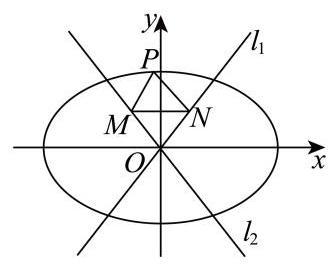

# 2026二模 不等式专题 · 教师版

> 本地预览：题目、答案及分类尚未全部审定。校对使用的PDF为教研整理版，尚未逐区确认区级印刷原卷。

## 基础不等式与解集反求

保留定义域和分段边界，进行符号讨论或由解集反推参数。

### 嘉定 · 第2题

解不等式 $\frac{1}{x} > 1$ ,则不等式的解集是___

> 本题资料或解析有待核事项，预览不可作为已审定成品。

**考点：** 分式不等式与符号讨论

**难度依据：** 分式不等式保留分母条件

**核查说明：** 题干与答案解析尚未逐页对照原卷，数学内容未独立终审。

**【答案】** $\left( {0,1}\right)$

**【解析】**

**【分析】**根据题意, 将分式不等式转化为一元二次不等式, 即可求解.

**【详解】**根据题意,由 $\frac{1}{x} > 1$ ,得 $\frac{1 - x}{x} > 0$ ,即 $x\left( {1 - x}\right)  > 0$ ,解得 $0 < x < 1$ ,故解集为 $\left( {0,1}\right)$ . 故答案为: $\left( {0,1}\right)$ .

### 奉贤 · 第2题

不等式 $\left| {x - 2}\right|  > 1$ 的解集为___.

**考点：** 绝对值不等式分段求解

**难度依据：** 绝对值不等式分段求解

**【答案】** $\left( {-\infty ,1}\right)  \cup  \left( {3, + \infty }\right)$

**【解析】**

**【详解】** $\left| {x - 2}\right|  > 1 \Rightarrow  x - 2 > 1$ 或 $x - 2 <  - 1$ ,

解得 $x > 3$ 或 $x < 1$ ,

所以不等式 $\left| {x - 2}\right|  > 1$ 的解集为 $\left( {-\infty ,1}\right)  \cup  \left( {3, + \infty }\right)$ .

### 崇明 · 第2题

不等式 $\left| {x - 1}\right|  < 2$ 的解为___.

**考点：** 绝对值不等式

**难度依据：** 绝对值不等式

**【答案】** $\{ x \mid   - 1 < x < 3\}$

**【解析】**

**【详解】**解: $\because \left| {x - 1}\right|  < 2$ ,

$\therefore  - 2 < x - 1 < 2$ ,解得 $- 1 < x < 3$ ,

故不等式 $\left| {x - 1}\right|  < 2$ 的解为 $\{ x \mid   - 1 < x < 3\}$ .

### 徐汇 · 第1题

不等式 $\frac{1}{x - 2} > 0$ 的解集为___.

**考点：** 分母为正

**难度依据：** 一次符号判断

**【答案】** $\left( {2, + \infty }\right) \# \# \{ x \mid  x > 2\}$

**【解析】**

**【详解】**因为 $\frac{1}{x - 2} > 0$ ,所以 $x - 2 > 0$ ,即 $x > 2$ ,所以解集为 $\left( {2, + \infty }\right)$

### 普陀 · 第4题

设 $a \in  \mathbf{R}$ ,若关于 $x$ 的不等式 $\frac{a}{x - 1} \leq  1$ 的解集是 $\left( {-\infty ,1}\right)  \cup  \lbrack 2, + \infty )$ ,则 $a$ 的值为___.

**考点：** 由分式不等式解集反求参数

**难度依据：** 由分式不等式解集反求参数

**【答案】** 1

**【解析】**

**【分析】**将分式不等式化为等价的二次不等式, 根据“三个二次”的关系求解.

**【详解】**由不等式 $\frac{a}{x - 1} \leq  1$ 可得 $\frac{a + 1 - x}{x - 1} \leq  0$ ,等价于 $\left\{  \begin{array}{l} \left( {a + 1 - x}\right) \left( {x - 1}\right)  \leq  0 \\  x - 1 \neq  0 \end{array}\right.$ , 因为原不等式的解集是 $\left( {-\infty ,1}\right)  \cup  \lbrack 2, + \infty )$ ,所以1,2是方程 $\left( {a + 1 - x}\right) \left( {x - 1}\right)  = 0$ 的两根, 所以 $a + 1 = 2$ ,解得 $a = 1$ .

### 普陀 · 第10题

设 $a \in  \mathbf{R}$ ,集合 $M = \{  - 1, - 2, - a\} , N = \left\{  {x \mid  {x}^{2} - {ax} \leq  0}\right\}$ ,若集合 $A \subseteq  \left( {M \cap  N}\right)$ ,且满足条件的 $A$ 恰有 2 个，则 $a$ 的取值范围为___.

**考点：** 交集元素个数与子集个数；含参二次不等式解集

**难度依据：** 交集元素个数与子集个数；含参二次不等式解集

**【答案】** $\{ a \mid   - 2 < a \leq   - 1$ 或 $a = 0\}$

**【解析】**

**【分析】**由题意得出 $M \cap  N$ 是一元集,然后按 $a$ 的正负或 0 分类讨论求解.

**【详解】**由题意 $M \cap  N$ 的子集恰有 2 个,所以 $M \cap  N$ 是一元集,

若 $a = 0$ ,则 $N = \{ 0\}$ ,而 $M = \{  - 1, - 2,0\} , M\text{ 、 }{QN} = \{ 0\}$ 满足题意,

若 $a > 0$ ,则 $- a < 0, N = \{ x \mid  0 \leq  x \leq  a\}$ ,此时 $M \cap  N = \varnothing$ ,不合题意;

若 $a < 0$ ,则 $- a > 0, N = \{ x \mid  a \leq  x \leq  0\} , M \cap  N$ 只含一个元素,则 $- 2 < a \leq   - 1$ ,

综上, $a$ 的取值范围是 $\{ a \mid   - 2 < a \leq   - 1$ 或 $a = 0\}$ .

### 松江 · 第2题

不等式 $\left| {3 - x}\right|  < 1$ 的解集为___.

**考点：** 由绝对值界限求区间

**难度依据：** 直接转化双边不等式

**【答案】** $\left( {2,4}\right)$

**【解析】**

**【详解】** $\left| {3 - x}\right|  < 1 \Leftrightarrow   - 1 < 3 - x < 1$ ，解得 $2 < x < 4$ ，

所以不等式 $\left| {3 - x}\right|  < 1$ 的解集为 $\left( {2,4}\right)$ .

### 虹口 · 第1题

设全集为 $U = \{  - 2, - 1,0,1,2,3\}$ ，集合 $A = \left\{  {x\left| {\;\frac{x}{x - 2} \geq  0}\right. , x \in  U}\right\}$ ，则 $\bar{A} =$ ___.

**考点：** 有限全集上的补集；分式不等式及定义域

**难度依据：** 有限全集上的补集；分式不等式及定义域

**【答案】** $\{ 1,2\}$

**【解析】**

**【分析】**根据分式不等式的解法,可求得集合 $A$ ,即可得答案.

**【详解】**由 $\frac{x}{x - 2} \geq  0$ ,得 $\left\{  \begin{array}{l} x\left( {x - 2}\right)  \geq  0 \\  x - 2 \neq  0 \end{array}\right.$ ,解得 $x > 2$ 或 $x \leq  0$ ,

又 $x \in  U$ ,所以 $A = \{  - 2, - 1,0,3\}$ ,则 $\bar{A} = \{ 1,2\}$ .

### 虹口 · 第4题

设 $a : x \leq  m$ ， $\beta  : \left| {x - 2}\right|  \leq  1$ ，若 $a$ 是 $\beta$ 的必要条件，则实数 $m$ 的取值范围是___.

**考点：** 必要条件化集合包含；绝对值不等式解集

**难度依据：** 必要条件化集合包含；绝对值不等式解集

**【答案】** $\{ m \mid  m \geq  3\}$

**【解析】**

**【详解】**由 $\left| {x - 2}\right|  \leq  1$ 得 $- 1 \leq  x - 2 \leq  1$ ,得 $1 \leq  x \leq  3$ ,

因为 $a$ 是 $\beta$ 的必要条件,所以 $\{ x \mid  1 \leq  x \leq  3\}  \subseteq  \{ x \mid  x \leq  m\}$ ,得 $m \geq  3$ ,

故实数 $m$ 的取值范围是 $\{ m \mid  m \geq  3\}$ .

### 金山 · 第1题

不等式 $\left| {x - 1}\right|  < 1$ 的解集为___.

**考点：** 绝对值不等式解集

**难度依据：** 绝对值不等式解集

**【答案】** (0,2)

**【解析】**

**【详解】**由 $\left| {x - 1}\right|  < 1 \Rightarrow   - 1 < x - 1 < 1 \Rightarrow  0 < x < 2$ .

所以原不等式的解集为 $\left( {0,2}\right)$ .

### 闵行 · 第2题

设 $x \in  \mathbf{R}$ ,不等式 ${x}^{2} - {4x} < 0$ 的解集是___.

**考点：** 二次不等式

**难度依据：** 二次不等式

**【答案】** $\left( {0,4}\right)$

**【解析】**

**【分析】**由一元二次不等式的解法求解即可.

**【详解】**因为 ${x}^{2} - {4x} < 0$ ,即 $x\left( {x - 4}\right)  < 0$ ,

令 $x\left( {x - 4}\right)  = 0$ ,

解得 ${x}_{1} = 0,{x}_{2} = 4$ ,

所以 $x\left( {x - 4}\right)  < 0$ 的解集为 $\left( {0,4}\right)$ .

即不等式 ${x}^{2} - {4x} < 0$ 的解集是 $\left( {0,4}\right)$ .

### 静安 · 第14题

已知集合 $A = \left\{  {x\left| {\;{x}^{2} - x - 6 = 0}\right. }\right\}  , B = \left\{  {x\left| {\;\frac{x + 3}{1 - x} > 0}\right. }\right\}$ ，则 $A \cap  B =$ ( ).

A. $\{  - 2,3\}$

B. $\left( {-3,1}\right)$

C. $\{ 3\}$

D. $\{  - 2\}$

**考点：** 集合关系；分式不等式

**难度依据：** 集合关系；分式不等式

**【答案】** D

**【解析】**

**【详解】**由 ${x}^{2} - x - 6 = 0$ 解得 $x =  - 2$ 或 $x = 3$ ,即集合 $A = \{  - 2,3\}$ , 由 $\frac{x + 3}{1 - x} > 0$ 可得 $\left( {x + 3}\right) \left( {1 - x}\right)  > 0$ ,解得 $- 3 < x < 1$ ,即集合 $B = \{ x \mid   - 3 < x < 1\}$ ; 所以 $A \cap  B = \{  - 2\}$ .

### 黄浦 · 第1题

若 $A = \left\lbrack  {-1,1}\right\rbrack$ ， $B = \left\{  {x\left| {\;{x}^{2} - {2x} \leq  0}\right. }\right\}$ ，则 $A \cap  B =$ ___.

**考点：** 集合交集；二次不等式

**难度依据：** 集合交集；二次不等式

**【答案】** $\left\lbrack  {0,1}\right\rbrack$

**【解析】**

**【分析】**解不等式化简集合 $B$ ，进而可求交集.

**【详解】**由题意可知: 集合 $B = \left\{  {x\left| {\;{x}^{2} - {2x} \leq  0}\right. }\right\}   = \left\lbrack  {0,2}\right\rbrack$ ,

且集合 $A = \left\lbrack  {-1,1}\right\rbrack$ ，所以 $A \cap  B = \left\lbrack  {0,1}\right\rbrack$ .

## 基本不等式与定值约束最值

从约束建立可用的定和、定积或凑一结构，同时检验等号能否取得。

### 宝山 · 第7题

设 $a, b > 0, a + \frac{1}{2b} = 1$ ，则 ${2b} + \frac{1}{a}$ 的最小值为___.

**考点：** 基本不等式与凑一求最小值

**难度依据：** 基本不等式与凑一求最小值

**【答案】** 4

**【解析】**

**【分析】**根据给定条件, 利用基本不等式“1”的妙用求出最小值.

**【详解】**由 $a, b > 0, a + \frac{1}{2b} = 1$ ,得 ${2b} + \frac{1}{a} = \left( {{2b} + \frac{1}{a}}\right) \left( {a + \frac{1}{2b}}\right)  = 2 + {2ab} + \frac{1}{2ab} \; \geq  2 + 2\sqrt{{2ab} \cdot  \frac{1}{2ab}} = 4$ ,当且仅当 ${2ab} = 1$ 时取等号,

所以当 $a = \frac{1}{2}, b = 1$ 时, ${2b} + \frac{1}{a}$ 取得最小值 4 .

故答案为:4

### 崇明 · 第5题

若 $x > 0, y > 0$ ，且 ${xy} = 1$ ，则 $x + {2y}$ 的最小值为___.

**考点：** 乘积定值的基本不等式

**难度依据：** 乘积定值的基本不等式

**【答案】** $2\sqrt{2}$

**【解析】**

**【详解】**由基本不等式可得 $x + {2y} \geq  2\sqrt{2xy} = 2\sqrt{2}$ ,

当且仅当 $x = {2y}$ ,即 $x = \sqrt{2}, y = \frac{\sqrt{2}}{2}$ 时等号成立,

所以 $x + {2y}$ 的最小值为 $2\sqrt{2}$ .

### 普陀 · 第21题

已知 $p\text{ 、 }q$ 为实数,设函数 $y = f\left( x\right)$ 的最小值为 $f\left( p\right)$ ,函数 $y = g\left( x\right)$ 的最小值为 $g\left( q\right)$ ,若 $f\left( p\right)  = g\left( q\right)$ 且 $p \neq  q$ ,则称函数 $y = f\left( x\right)$ 和函数 $y = g\left( x\right)$ 是 $T$ 函数.

(1)设函数 $y = f\left( x\right)$ 的表达式为 $f\left( x\right)  = \sin x$ ，函数 $y = g\left( x\right)$ 的表达式为 $g\left( x\right)  = \cos x$ ， 请判断函数 $y = f\left( x\right)$ 和函数 $y = g\left( x\right)$ 是否为 $T$ 函数，并说明理由；

(2)设 $a\text{ 、 }b$ 为正实数，函数 $y = f\left( x\right)$ 的表达式为 $f\left( x\right)  = {x}^{2} + 2\left( {a - 1}\right) x + {a}^{2} - {2a} + 7$ ， 函数 $y = g\left( x\right)$ 的表达式为 $g\left( x\right)  = {bx} + \frac{9}{bx}\left( {x > 0}\right)$ ,若函数 $y = f\left( x\right)$ 和函数 $y = g\left( x\right)$ 不是 $T$ 函数,求 $\frac{1}{a} + b$ 的最小值;

(3) 设 $k\text{ 、 }t\text{ 、 }a$ 为实数，函数 $y = f\left( x\right)$ 的表达式为 $f\left( x\right)  =  - {\mathrm{e}}^{{kt} + x} - {2kt}\left( {x \leq  0}\right)$ ，函数 $y = g\left( x\right)$ 的表达式为 $g\left( x\right)  = \left( {x - 2}\right) \ln x - {ax} - 2$ ,若存在 $t \in  \left( {1,{\mathrm{e}}^{2}}\right)$ ,对任意的 $x \in  \left( {0, + \infty }\right)$ ,皆有 $g\left( x\right)  \geq  g\left( t\right)$ 成立,且函数 $y = f\left( x\right)$ 和函数 $y = g\left( x\right)$ 是 $T$ 函数,求 $k$ 的取值范围.

**考点：** (1) 按定义判断最小值；(2) 最小值点重合与基本不等式；(3) 导数求极值、同构消参求范围

**难度依据：** T函数与最小值点；导数求极值及同构比较；基本不等式求最小值

**【答案】** (1) 函数 $y = f\left( x\right)$ 和函数 $y = g\left( x\right)$ 为 $T$ 函数,理由见解析;

(2) $4 + 2\sqrt{3}$ ；

(3) $\left( {0,\frac{1}{\mathrm{e}}}\right\rbrack$

**【解析】**

**【分析】**(1) 根据 $T$ 函数的定义判断;

(2)由 $T$ 函数的定义求得 $a + \frac{3}{b} = 1$ ，然后由基本不等式求得最小值；

(3) 先求得 $f\left( x\right)$ 和 $g\left( x\right)$ 的最小值和最小值点,根据题意得出 $g\left( t\right)  = f\left( 0\right) ,{g}^{\prime }\left( t\right)  = 0$ , 然后消去 $a$ 得关于 $k, t$ 的等式,构造函数使用同构法得出 $k = \frac{\ln t}{t}, t \in  \left( {1,{\mathrm{e}}^{2}}\right)$ ,再利用导数求得 $k$ 的范围.

**【小问 1 详解】**

$f\left( x\right)  = \sin x,\;f{\left( x\right) }_{\min } = f\left( {{2k\pi } - \frac{\pi }{2}}\right)  =  - 1, k \in  \mathrm{Z},$

$g\left( x\right)  = \cos x,\;g{\left( x\right) }_{\min } = g\left( {{2k\pi } + \pi }\right)  =  - 1, k \in  \mathrm{Z},$

$f{\left( x\right) }_{\min } = g{\left( x\right) }_{\min }$ ,且 $\left\{  {x\left| {\;x = {2k\pi } - \frac{\pi }{2}}\right. , k \in  \mathrm{Z}}\right\}   \cap  \{ x\left| {\;x = {2k\pi } + \pi }\right.$ , $k \in  \mathrm{Z}\}  = \varnothing$ ,

所以函数 $y = f\left( x\right)$ 和函数 $y = g\left( x\right)$ 的最小值相等,且最小值点均不相同,因此它们为 $T$ 函数;

**【小问 2 详解】**

$$
f\left( x\right)  = {x}^{2} + 2\left( {a - 1}\right) x + {a}^{2} - {2a} + 7 = {\left( x + a - 1\right) }^{2} + 6,\;f{\left( x\right) }_{\min } = f\left( {-a + 1}\right)  = 6,
$$

因为 $b > 0, x > 0$ ,

所以 $g\left( x\right)  = {bx} + \frac{9}{bx} \geq  2\sqrt{{bx} \cdot  \frac{9}{bx}} = 6$ ,当且仅当 ${bx} = \frac{9}{bx}$ ,即 $x = \frac{3}{b}$ 时等号成立,

函数 $y = f\left( x\right)$ 和函数 $y = g\left( x\right)$ 不是 $T$ 函数,

所以 $- a + 1 = \frac{3}{b}$ ,即 $a + \frac{3}{b} = 1$ ,

又 $a > 0, b > 0$ ,

所以 $\frac{1}{a} + b = \left( {\frac{1}{a} + b}\right) \left( {a + \frac{3}{b}}\right)  = 4 + {ab} + \frac{3}{ab} \geq  4 + 2\sqrt{{ab} \cdot  \frac{3}{ab}} = 4 + 2\sqrt{3}$ ,当且仅当 ${ab} = \frac{3}{ab}$ ,即 $a = \frac{\sqrt{3} - 1}{2}, b = 3 + \sqrt{3}$ 时等号成立,

所以 $\frac{1}{a} + b$ 的最小值是 $4 + 2\sqrt{3}$ ;

**【小问 3 详解】**

$f\left( x\right)  =  - {\mathrm{e}}^{{kt} + x} - {2kt}$ 是减函数,又 $x \leq  0$ ,所以 $f{\left( x\right) }_{\min } = f\left( 0\right)  =  - {\mathrm{e}}^{kt} - {2kt}$ ,

$g\left( x\right)  = \left( {x - 2}\right) \ln x - {ax} - 2,\;{g}^{\prime }\left( x\right)  = \ln x + \frac{x - 2}{x} - a = \ln x - \frac{2}{x} + 1 - a,$

${g}^{\prime }\left( x\right)$ 是 $\left( {0, + \infty }\right)$ 上的增函数,

依题意,存在 $t \in  \left( {1,{\mathrm{e}}^{2}}\right)$ ,使得 ${g}^{\prime }\left( t\right)  = \ln t - \frac{2}{t} + 1 - a = 0$ ①且

$g\left( t\right)  = \left( {t - 2}\right) \ln t - {at} - 2 =  - {\mathrm{e}}^{kt} - {2kt}$ ②,

由①得 ${at} = t\ln t - 2 + t$ ，代入②得 $\left( {t - 2}\right) \ln t - \left( {t\ln t - 2 + t}\right)  - 2 =  - {\mathrm{e}}^{kt} - {2kt}$ ，

整理得 $2\ln t + t = {\mathrm{e}}^{kt} + {2kt}$ ,即 ${\mathrm{e}}^{\ln t} + 2\ln t = {\mathrm{e}}^{kt} + {2kt}$ ③，

设 $h\left( x\right)  = {\mathrm{e}}^{x} + {2x}$ ,则③式为 $h\left( {\ln t}\right)  = h\left( {kt}\right)$ ,

易知 $h\left( x\right)$ 是增函数,所以 $\ln t = {kt}, k = \frac{\ln t}{t}, t \in  \left( {1,{\mathrm{e}}^{2}}\right)$ ,

设 $\varphi \left( x\right)  = \frac{\ln x}{x}, x \in  \left( {1,{\mathrm{e}}^{2}}\right)$ ,

则 ${\varphi }^{\prime }\left( x\right)  = \frac{1 - \ln x}{{x}^{2}}, x \in  \left( {1,\mathrm{e}}\right)$ 时, ${\varphi }^{\prime }\left( x\right)  > 0,\varphi \left( x\right)$ 递增, $x \in  \left( {\mathrm{e},{\mathrm{e}}^{2}}\right)$ 时, ${\varphi }^{\prime }\left( x\right)  < 0,\varphi \left( x\right)$ 递减，

所以 $\varphi {\left( x\right) }_{\max } = \varphi \left( \mathrm{e}\right)  = \frac{1}{\mathrm{e}}$ ,又 $\varphi \left( 1\right)  = 0,\varphi \left( {\mathrm{e}}^{2}\right)  = \frac{2}{{\mathrm{e}}^{2}}$ ,

所以 $\varphi \left( x\right)$ 的取值范围是 $\left( {0,\frac{1}{\mathrm{e}}}\right\rbrack$ ,

所以 $k$ 的取值范围是 $\left( {0,\frac{1}{\mathrm{e}}}\right\rbrack$ .

### 杨浦 · 第5题

设正实数 $a, b$ 满足 $a + b = 3$ ，则 ${a}^{2} + {b}^{2}$ 的最小值为___.

**考点：** 基本不等式或完全平方确定最小值

**难度依据：** 定和构造基本不等式

**【答案】** $\frac{9}{2}$ ## 4.5

**【解析】**

**【分析】**根据题意,得到 ${a}^{2} + {b}^{2} = {\left( a + b\right) }^{2} - {2ab}$ ,结合基本不等式,即可求解.

**【详解】**因为正实数 $a, b$ 满足 $a + b = 3$ ,

可得 ${a}^{2} + {b}^{2} = {\left( a + b\right) }^{2} - {2ab} \geq  {\left( a + b\right) }^{2} - 2 \times  {\left( \frac{a + b}{2}\right) }^{2} = 9 - 2 \times  \frac{9}{4} = \frac{9}{2}$ ,

当且仅当 $a = b = \frac{3}{2}$ 时,等号成立,所以 ${a}^{2} + {b}^{2}$ 的最小值为 $\frac{9}{2}$ .

### 松江 · 第9题

已知函数 $y = {\log }_{a}\left( {x + 2}\right)  + 1\left( {a > 0\text{ 且 }a \neq  1}\right)$ 的图像过定点 $\left( {s, t}\right)$ ，正实数 $m$ 、 $n$ 满足 ${nt} - {ms} = 1$ ，则 $\frac{1}{m} + \frac{3}{n}$ 的最小值为___.

**考点：** 先求对数图像定点，再利用乘积构造最值

**难度依据：** 组合定点与一的代换

**【答案】** $4 + 2\sqrt{3}$

**【解析】**

**【分析】**由对数函数性质确定 $s =  - 1, t = 1$ ,进而得到 $m + n = 1$ ,再结合基本不等式即可求解.

**【详解】**当 $x + 2 = 1$ 时, $y = 1$ ,所以函数 $y = {\log }_{a}\left( {x + 2}\right)  + 1$ 的图象过定点 $\left( {-1,1}\right)$ ,

所以 $s =  - 1, t = 1$ ,代入 ${nt} - {ms} = 1$ 得 $m + n = 1$ .

所以 $\frac{1}{m} + \frac{3}{n} = \left( {m + n}\right) \left( {\frac{1}{m} + \frac{3}{n}}\right)  = 1 + \frac{n}{m} + \frac{3m}{n} + 3 \geq  4 + 2\sqrt{\frac{n}{m} \cdot  \frac{3m}{n}} = 4 + 2\sqrt{3}$ ,

当且仅当 $\frac{n}{m} = \frac{3m}{n}$ 时等号成立,即 $m = \frac{\sqrt{3} - 1}{2}, n = \frac{3 - \sqrt{3}}{2}$ 时等号成立.

### 浦东 · 第14题

已知实数 $a, b, c$ 满足 $a > b > 1 > c$ ,则下列结论一定正确的是 ( )

A. ${ac} > {bc}$

B. ${b}^{c} < 1$

C. ${\log }_{a}b + {\log }_{b}a > 2$

D. $a + c > b$

**考点：** 换底构造互为倒数并比较等号条件

**难度依据：** 关注等号能否成立

**【答案】** $\mathrm{C}$

**【解析】**

**【详解】**对于选项 $\mathrm{A}$ ,可知 $1 > c$ ,无法判断正负,所以选项 $\mathrm{A}$ 错误;

对于选项 $\mathrm{B}$ ，可知 $0 < c < 1 < b$ 时，所以 ${b}^{c} > 1$ ，所以选项 B 错误；

对于选项 $\mathrm{C}$ ,因为 $a > b > 1$ ,所以 $\ln a > \ln b > 0$ ,

可知 ${\log }_{a}b + {\log }_{b}a = \frac{\ln b}{\ln a} + \frac{\ln a}{\ln b} \geq  2\sqrt{\frac{\ln b}{\ln a} \cdot  \frac{\ln a}{\ln b}} = 2$ ,当且仅当 $\frac{\ln b}{\ln a} = \frac{\ln a}{\ln b}$ ,即 $a = b$ 时取等号, 所以等号取不到,

所以 ${\log }_{a}b + {\log }_{b}a > 2$ ,选项 $\mathrm{C}$ 正确;

对于选项 D，当 $c < 0$ 时，无法判断不等式是否成立，所以选项 D 错误；

### 虹口 · 第10题

已知焦点为 $F$ 的抛物线 $C : {y}^{2} = {4x}$ 上有两点 $A$ 和 $B$ ，且 $\angle {AFB} = {150}^{ \circ  }$ ， $E$ 为 $A$ 和 $B$ 的中点，过点 $E$ 作 $C$ 的准线的垂线，垂足为 $H$ ，则 $\frac{{\left| AB\right| }^{2}}{{\left| EH\right| }^{2}}$ 的最小值为___.

**考点：** 抛物线焦半径及焦点角；基本不等式求长度比最值；余弦定理表达弦长

**难度依据：** 抛物线焦半径及焦点角；基本不等式求长度比最值；余弦定理表达弦长

**【答案】** $2 + \sqrt{3}$

**【解析】**

**【分析】**设 $\left| {AF}\right|  = a,\left| {BF}\right|  = b$ ,根据中位线定理以及抛物线定义可得 $\left| {EH}\right|  = \frac{1}{2}\left( {a + b}\right)$ , 在 $\bigtriangleup {AFB}$ 中,由余弦定理以及基本不等式可得 $\left| {AB}\right|  \geq  \frac{2 - \sqrt{3}}{4}\left( {a + b}\right)$ ,即可求得 $\frac{{\left| AB\right| }^{2}}{{\left| EH\right| }^{2}}$ 的最小值.

**【详解】**设 $\left| {AF}\right|  = a,\left| {BF}\right|  = b$ ,作 ${AQ}$ 垂直抛物线的准线于点 $Q,{BP}$ 垂直抛物线的准线于点 $P$ .

由抛物线的定义,知 $\left| {AF}\right|  = \left| {AQ}\right| ,\left| {BF}\right|  = \left| {BP}\right|$ ,根据中位线定理以及抛物线定义可得 $\left| {EH}\right|  = \frac{1}{2}\left( {a + b}\right) ,$

由余弦定理得 ${\left| AB\right| }^{2} = {a}^{2} + {b}^{2} - {2ab}\cos {150}^{ \circ  } = {a}^{2} + {b}^{2} + \sqrt{3}{ab} = {\left( a + b\right) }^{2} - \left( {2 - \sqrt{3}}\right) {ab}$ ,又 ${ab} \leq  {\left( \frac{a + b}{2}\right) }^{2}$

$\therefore {\left( a + b\right) }^{2} - \left( {2 - \sqrt{3}}\right) {ab} \geq  {\left( a + b\right) }^{2} - \frac{2 - \sqrt{3}}{4}{\left( a + b\right) }^{2} = \frac{2 + \sqrt{3}}{4}{\left( a + b\right) }^{2}$ ,当且仅当 $a = b$ 时, 等号成立,

$\therefore {\left| AB\right| }^{2} \geq  \frac{2 + \sqrt{3}}{4}{\left( a + b\right) }^{2}$ ,

$\therefore \frac{{\left| AB\right| }^{2}}{{\left| EH\right| }^{2}} \geq  \frac{\frac{2 + \sqrt{3}}{4}{\left( a + b\right) }^{2}}{{\left\lbrack  \frac{1}{2}\left( a + b\right) \right\rbrack  }^{2}} = 2 + \sqrt{3}$ ,即 $\frac{{\left| AB\right| }^{2}}{{\left| EH\right| }^{2}}$ 的最小值为 $2 + \sqrt{3}$ .

### 金山 · 第9题

已知关于 $x$ 的一元二次方程 ${x}^{2} - x + a = 0$ 有两个不相等的正根 $m\text{ 、 }n$ ,则 $\frac{1}{m} + \frac{9}{n}$ 的最小值为___.

**考点：** 韦达关系与凑一最值

**难度依据：** 韦达关系与凑一最值

**【答案】** 16

**【解析】**

**【分析】**先根据韦达定理得出 $m + n = 1$ ,再应用常数代换及基本不等式计算求解最小值.

**【详解】**关于 $x$ 的一元二次方程 ${x}^{2} - x + a = 0$ 有两个不相等的正根 $m\text{ 、 }n$ ,

则 $\left\{  \begin{array}{l} \Delta  = 1 - {4a} > 0 \\  {mn} = a > 0 \\  m + n = 1 > 0 \end{array}\right.$ ,所以 $0 < a < \frac{1}{4}$ ,

因为 $m > 0, n > 0, m + n = 1$ ,

所以 $\frac{1}{m} + \frac{9}{n} = \left( {\frac{1}{m} + \frac{9}{n}}\right) \left( {m + n}\right)$

$= 1 + \frac{n}{m} + \frac{9m}{n} + 9 \geq  2\sqrt{\frac{n}{m} \times  \frac{9m}{n}} + {10} = {16}$ ,

当且仅当 $\frac{n}{m} = \frac{9m}{n}$ ,即 $n = \frac{3}{4}, m = \frac{1}{4}$ 时,此时 ${mn} = a = \frac{3}{16} \in  \left( {0,\frac{1}{4}}\right)$ ,符合题意,

所以当 $n = \frac{3}{4}, m = \frac{1}{4}$ 时,取 $\frac{1}{m} + \frac{9}{n}$ 的最小值 16 .

### 长宁 · 第2题

已知正实数 $a\text{ 、 }b$ 满足 ${ab} = 1$ ，则 $a + {4b}$ 的最小值等于___.

**考点：** 基本不等式求最值

**难度依据：** 基本不等式求最值

**【答案】** 4

**【解析】**

**【分析】**直接利用基本不等式计算得到答案.

**【详解】** $a + {4b} \geq  2\sqrt{4ab} = 2\sqrt{4} = 4$ ,当 $a = {4b}$ ,即 $a = 2, b = \frac{1}{2}$ 时等号成立,

则 $a + {4b}$ 的最小值为 4 .

故答案为:4.

### 闵行 · 第15题

若平面直角坐标系 ${xOy}$ 中的点 $P$ 到 $x$ 轴与 $y$ 轴的距离之和为 1,现有以下两个命题:

①存在点 $P$ 到 $x$ 轴与 $y$ 轴的距离之差为 1 ；

②存在点 $P$ 到 $x$ 轴与 $y$ 轴的距离之积为 1 .

则以下选项正确的是 ( )

A. ①不正确，②不正确

B. ①正确，②正确

C. ①正确，②不正确

D. ①不正确，②正确

> 本题资料或解析有待核事项，预览不可作为已审定成品。

**考点：** 点到坐标轴距离；基本不等式

**难度依据：** 点到坐标轴距离；基本不等式

**核查说明：** 底稿B、C选项文字相同，需回核题图。

**【答案】** C

**【解析】**

**【详解】**设 $P\left( {m, n}\right)$ ,则 $\left| m\right|  + \left| n\right|  = 1$ ,

对于①,当 $m = 0$ 时, $\left| n\right|  = 1$ ,故 $\left| n\right|  - \left| m\right|  = 1$ ,满足点 $P$ 到 $x$ 轴与 $y$ 轴的距离之差为 1,① 正确;

对于②，由基本不等式可得 $\left| m\right|  + \left| n\right|  \geq  2\sqrt{\left| m\right|  \cdot  \left| n\right| }$ ，即 $2\sqrt{\left| m\right|  \cdot  \left| n\right| } \leq  1$ ，故 $\left| m\right|  \cdot  \left| n\right|  \leq  \frac{1}{4}$ ，②错误.

### 青浦 · 第12题

已知平面内的三个非零向量 $\overrightarrow{a},\overrightarrow{b},\overrightarrow{c}$ ，满足: $\left\langle  {\overrightarrow{a},\overrightarrow{b}}\right\rangle   = \frac{\pi }{4}$ ， $\left| {\overrightarrow{a} - \overrightarrow{b}}\right|  = 2$ ， $\left| {\overrightarrow{b} - \overrightarrow{c}}\right|  = \left| {\overrightarrow{c} - \overrightarrow{a}}\right|  = \sqrt{17}$ ，则当 $\frac{\overrightarrow{a} \cdot  \overrightarrow{c} - \overrightarrow{b} \cdot  \overrightarrow{c}}{\left| \overrightarrow{c}\right| }$ 取得最大值时， $\left| \overrightarrow{c}\right|  =$ ___.

**考点：** 数量积投影最值及向量终点几何；圆周角轨迹与坐标；基本不等式求最值

**难度依据：** 数量积投影最值及向量终点几何；圆周角轨迹与坐标；基本不等式求最值

**【答案】** $\sqrt{7}$

**【解析】**

**【分析】**先通过题干向量关系和几何法确定过点 $A, B$ 的圆,再通过坐标法将 “投影最值” 转化为 “圆上动点” 的最值问题,再结合一般不等式求解即可.

**【详解】**设 $A, B$ 分别为 $\overrightarrow{a},\overrightarrow{b}$ 的终点, $M$ 为 ${AB}$ 中点,由 $\left| {\overrightarrow{a} - \overrightarrow{b}}\right|  = \left| {AB}\right|  = 2$ ,得 $\left| {AM}\right|  = 1$ , 又 $\left| {\overrightarrow{c} - \overrightarrow{a}}\right|  = \left| {\overrightarrow{c} - \overrightarrow{b}}\right|  = \sqrt{17}$ ,故 $\overrightarrow{c}$ 的终点 $C$ 在 ${AB}$ 的中垂线上,

且由勾股定理得 $\left| {CM}\right|  = \sqrt{{\left| \overrightarrow{AC}\right| }^{2} - {\left| AM\right| }^{2}} = \sqrt{{17} - 1} = 4$ .

如图所示，建立坐标系:

$M\left( {0,0}\right) ,\;A\left( {1,0}\right) ,\;B\left( {-1,0}\right) ,\;C\left( {0, \pm  4}\right) ,$

公共起点 $O\left( {x, y}\right)$ (即 $\overrightarrow{a} = \overrightarrow{OA},\overrightarrow{b} = \overrightarrow{OB},\overrightarrow{c} = \overrightarrow{OC}$ ).

在 $\bigtriangleup {OAB}$ 中,由正弦定理可得 $\frac{AB}{\sin \angle {AOB}} = \frac{2}{\sin \frac{\pi }{4}} = 2\sqrt{2} = {2R}$ ,

$R$ 为 $\bigtriangleup {OAB}$ 外接圆半径,故 $R = \sqrt{2}$ ,

令 $\bigtriangleup {OAB}$ 外接圆圆心为 $G$ ,易知 $G$ 在线段 ${AB}$ 垂直平分线上,可设为 $\left( {0, \pm  1}\right)$ ,

根据对称性,以 $C\left( {0,4}\right) , G\left( {0,1}\right)$ 为例,可得 $O$ 所在圆的方程为 ${x}^{2} + {\left( y - 1\right) }^{2} = 2$ ,

$\overrightarrow{a} - \overrightarrow{b} = \overrightarrow{OA} - \overrightarrow{OB} = \left( {2,0}\right) ,\overrightarrow{c} = \overrightarrow{OC} = \left( {-x,4 - y}\right)$ ,令 $k = \frac{\overrightarrow{a} \cdot  \overrightarrow{c} - \overrightarrow{b} \cdot  \overrightarrow{c}}{\left| \overrightarrow{c}\right| }$ ,

则 $k = \frac{\left( {\overrightarrow{a} - \overrightarrow{b}}\right)  \cdot  \overrightarrow{c}}{\left| \overrightarrow{c}\right| } = \frac{-{2x}}{\sqrt{{x}^{2} + {\left( y - 4\right) }^{2}}}$ ,

代入 ${x}^{2} =  - {y}^{2} + {2y} + 1$ ,得: ${k}^{2} = \frac{4\left( {-{y}^{2} + {2y} + 1}\right) }{-{6y} + {17}}$ ,

令 $t =  - {6y} + {17}\left( {t > 0}\right)$ ,由基本不等式得: ${k}^{2} = \frac{-t - \frac{49}{t} + {22}}{9} \leq  \frac{-{14} + {22}}{9} = \frac{8}{9}$ ,

当且仅当 $t = 7$ 等号成立,即 ${\left| \overrightarrow{c}\right| }^{2} = t = 7$ ,故 $\left| \overrightarrow{c}\right|  = \sqrt{7}$ ,

由对称性可知当 $C\left( {0, - 4}\right)$ ,圆的方程为 ${x}^{2} + {\left( y + 1\right) }^{2} = 2$ 时,同理可得最大值为 $\sqrt{7}$ .

## 大小比较、绝对值与反例

通过作差、三角不等式、单调性或反例比较表达式及判断命题。

### 奉贤 · 第13题

已知 $a > b > 0 > c$ ，则下列不等式成立的是( )

A. $\frac{c}{a} < \frac{c}{b}$

B. $\frac{b}{a} > \frac{a}{b}$

C. $\frac{b - c}{a - c} < \frac{b}{a}$

D. $\frac{2}{a} + b < \frac{2}{b} + a$

**考点：** 利用大小顺序与作差比较分式

**难度依据：** 利用大小顺序与作差比较分式

**【答案】** D

**【解析】**

**【分析】**根据不等式的性质、差比较法等知识对选项进行分析, 从而确定正确答案.

**【详解】**由 $a > b > 0$ ,可得 $\frac{1}{a} < \frac{1}{b}$ ,又 $c < 0$ ,所以 $\frac{c}{a} > \frac{c}{b}$ ,故 $\mathrm{A}$ 错误;

由 $a > b > 0$ ，所以 $\frac{b}{a} < 1 < \frac{a}{b}$ ，故 $\frac{b}{a} < \frac{a}{b}$ ，故 $\mathrm{B}$ 错误；

$\frac{b - c}{a - c} - \frac{b}{a} = \frac{a\left( {b - c}\right)  - b\left( {a - c}\right) }{a\left( {a - c}\right) } = \frac{c\left( {b - a}\right) }{a\left( {a - c}\right) },$

因为 $a > 0, c < 0, b - a < 0, a - c > 0$ ,所以 $\frac{c\left( {b - a}\right) }{a\left( {a - c}\right) } > 0$ ,则 $\frac{b - c}{a - c} > \frac{b}{a}$ ,故 $\mathrm{C}$ 错误;

由 $\frac{1}{a} < \frac{1}{b}$ ，可得 $\frac{2}{a} < \frac{2}{b}$ ，又 $b < a$ ，所以 $\frac{2}{a} + b < \frac{2}{b} + a$ ，故 $\mathrm{D}$ 正确.

故选: D

### 宝山 · 第11题

已知点 $P\text{ 、 }Q$ 分别是椭圆 $\frac{{x}^{2}}{9} + \frac{{y}^{2}}{5} = 1$ 和圆 ${\left( x - 2\right) }^{2} + {y}^{2} = 1$ 上的两个动点,且点 $A\left( {2,1}\right)$ ，则 $\left| {PA}\right|  + \left| {PQ}\right|$ 的最大值为___.

**考点：** 椭圆焦点定义与圆上距离最值；三角不等式及等号条件

**难度依据：** 椭圆焦点定义与圆上距离最值；三角不等式及等号条件

**【答案】** $7 + \sqrt{17}$ ## $\sqrt{17} + 7$

**【解析】**

**【分析】**根据给定条件,利用椭圆的定义将所求最大值转化为求值 $5 + \left| {PA}\right|  - \left| {P{F}^{\prime }}\right|$ 的最大值, 再结合圆的性质求解.

**【详解】**因为 $F\left( {2,0}\right)$ 为椭圆 $\frac{{x}^{2}}{9} + \frac{{y}^{2}}{5} = 1$ 的右焦点,设其左焦点为 ${F}^{\prime }\left( {-2,0}\right)$ ,

圆 ${\left( x - 2\right) }^{2} + {y}^{2} = 1$ 的圆心 $C\left( {2,0}\right)$ ,半径 $r = 1$ ,由椭圆的定义得 $\left| {PF}\right|  = 6 - \left| {P{F}^{\prime }}\right|$ ,

则 $\left| {PQ}\right|  + \left| {PA}\right|  \leq  \left| {PF}\right|  + 1 + \left| {PA}\right|  = 6 - \left| {P{F}^{\prime }}\right|  + 1 + \left| {PA}\right|  = 7 + \left| {PA}\right|  - \left| {P{F}^{\prime }}\right|$ ,

而 $\left| {PA}\right|  - \left| {P{F}^{\prime }}\right|  \leq  \left| {A{F}^{\prime }}\right|  = \sqrt{{16} + 1} = \sqrt{17}$ ,当且仅当点 $P$ 在直线 $A{F}^{\prime }$ 上时取等号, 所以当 $P$ 是线段 $A{F}^{\prime }$ 延长线与椭圆的交点、 $Q$ 是线段 ${PF}$ 延长线与圆的交点时, $\left| {PA}\right|  + \left| {PQ}\right|$ 取得最大值 $7 + \sqrt{17}$ .

### 崇明 · 第12题

已知首项为 1 的等比数列 $\left\{  {a}_{n}\right\}$ 满足对任意的正整数 $m, n$ 都有 $\left| {{a}_{m} - {a}_{n}}\right|  \leq  \frac{1}{3}\left| {m - n}\right|$ ,则等比数列 $\left\{  {a}_{n}\right\}$ 的公比 $q$ 的取值范围是___.

**考点：** 等比数列相邻差与任意两项估计；绝对值差约束

**难度依据：** 等比数列相邻差与任意两项估计；绝对值差约束

**【答案】** $\frac{2}{3} \leq  q \leq  1$

**【解析】**

**【分析】**取特殊情况结合指数函数与一次函数性质可得 $\frac{2}{3} \leq  q \leq  1$ ,再证明 $\frac{2}{3} \leq  q \leq  1$ 时,对任意的正整数 $m, n$ 都有 $\left| {{a}_{m} - {a}_{n}}\right|  \leq  \frac{1}{3}\left| {m - n}\right|$ 恒成立即可得.

**【详解】**由题意可得 ${a}_{n} = {a}_{1}{q}^{n - 1} = {q}^{n - 1}$ ,取 $k = m - 1 \in  \mathbf{N}$ ,

当 $n = 1$ 时,有 $\left| {{a}_{m} - {a}_{n}}\right|  = \left| {{q}^{k} - 1}\right|  \leq  \frac{1}{3}k$ ,

当 $k = 1$ 时，有 $\left| {q - 1}\right|  \leq  \frac{1}{3}$ ，故 $\frac{2}{3} \leq  q \leq  \frac{4}{3}$ ；

若 $\left| q\right|  > 1$ ,则当 $k \rightarrow   + \infty$ 时,指数函数增速会大于一次函数,

故 $\left| {{q}^{k} - 1}\right|  \leq  \frac{1}{3}k$ 不可能恒成立,故 $\left| q\right|  \leq  1$ ;

综上可得 $\frac{2}{3} \leq  q \leq  1$ ；

下证充分性:

当 $\frac{2}{3} \leq  q \leq  1$ 时,不妨设 $m \geq  n$ ,则 ${a}_{m} \leq  {a}_{n}$ ,

故需满足 ${a}_{n} - {a}_{m} \leq  \frac{1}{3}\left( {m - n}\right)$ ,即 ${a}_{n} + \frac{1}{3}n \leq  {a}_{m} + \frac{1}{3}m$ ,

令 ${b}_{n} = {q}^{n - 1} + \frac{1}{3}n$ ，则只需满足数列 $\left\{  {b}_{n}\right\}$ 为非递减数列即可，

${b}_{n + 1} - {b}_{n} = {q}^{n} + \frac{1}{3}n + \frac{1}{3} - {q}^{n - 1} - \frac{1}{3}n = {q}^{n} - {q}^{n - 1} + \frac{1}{3} = {q}^{n - 1}\left( {q - 1}\right)  + \frac{1}{3}$ ,

由 $\frac{2}{3} \leq  q \leq  1$ ,则 $q - 1 \in  \left\lbrack  {-\frac{1}{3},0}\right\rbrack  ,{q}^{n - 1} \leq  1$ ,

则 ${b}_{n + 1} - {b}_{n} = {q}^{n - 1}\left( {q - 1}\right)  + \frac{1}{3} \geq   - \frac{1}{3} + \frac{1}{3} = 0$ ,

故数列 $\left\{  {b}_{n}\right\}$ 为非递减数列,

即 $\frac{2}{3} \leq  q \leq  1$ 时符合题意.

### 普陀 · 第11题

设定义域为 $\mathbf{R}$ 的函数 $y = f\left( x\right)$ 的导函数为 $y = {f}^{\prime }\left( x\right)$ ,令 $g\left( x\right)  = {f}^{\prime }\left( x\right)  + {\left( x + \sqrt{{x}^{2} + 1}\right) }^{2}$ ,若函数 $y = f\left( x\right)$ 和函数 $y = g\left( x\right)$ 皆为偶函数,则不等式 $f\left( {x + 2}\right)  > f\left( {{2x} - 3}\right)$ 的解集为___.

**考点：** 偶函数导数奇偶性与单调比较；绝对值不等式

**难度依据：** 偶函数导数奇偶性与单调比较；绝对值不等式

**【答案】** $\left( {-\infty ,\frac{1}{3}}\right)  \cup  \left( {5, + \infty }\right)$

**【解析】**

**【详解】**若函数 $y = f\left( x\right)$ 为偶函数,则 $y = {f}^{\prime }\left( x\right)$ 为奇函数,

而 $g\left( x\right)  = {f}^{\prime }\left( x\right)  + {\left( x + \sqrt{{x}^{2} + 1}\right) }^{2}$ 为偶函数,则 $g\left( {-x}\right)  = g\left( x\right)$ ,即

${f}^{\prime }\left( {-x}\right)  + {\left( -x + \sqrt{{x}^{2} + 1}\right) }^{2} = {f}^{\prime }\left( x\right)  + {\left( x + \sqrt{{x}^{2} + 1}\right) }^{2},$

$\therefore  - {f}^{\prime }\left( x\right)  + {x}^{2} - {2x}\sqrt{{x}^{2} + 1} + {x}^{2} + 1 = {f}^{\prime }\left( x\right)  + {x}^{2} + {2x}\sqrt{{x}^{2} + 1} + {x}^{2} + 1$ ,故

${f}^{\prime }\left( x\right)  =  - {2x}\sqrt{{x}^{2} + 1}$

当 $x \geq  0$ 时， ${f}^{\prime }\left( x\right)  \leq  0$ ，即函数 $y = f\left( x\right)$ 在 $\lbrack 0, + \infty )$ 单调递减，

由 $y = f\left( x\right)$ 为偶函数,则 $f\left( {x + 2}\right)  > f\left( {{2x} - 3}\right)  \Rightarrow  f\left( \left| {x + 2}\right| \right)  > f\left( \left| {{2x} - 3}\right| \right)$ ,

结合单调性可知 $\left| {x + 2}\right|  < \left| {{2x} - 3}\right|$ ,即 $3{x}^{2} - {16x} + 5 > 0$ ,解得 $x < \frac{1}{3}$ 或 $x > 5$ ,

故不等式 $f\left( {x + 2}\right)  > f\left( {{2x} - 3}\right)$ 的解集为 $\left( {-\infty ,\frac{1}{3}}\right)  \cup  \left( {5, + \infty }\right)$ .

### 杨浦 · 第6题

不等式 ${3}^{x} + {\log }_{2}x < 3$ 的解集为___.

**考点：** 构造单调函数并与特殊值比较

**难度依据：** 识别整体单调与定义域

**【答案】** (0,1)

**【解析】**

**【详解】**令 $f\left( x\right)  = {3}^{x} + {\log }_{2}x$ ,定义域为 $\left( {0, + \infty }\right)$ ,

函数 $y = {3}^{x}$ 和 $y = {\log }_{2}x$ 在 $\left( {0, + \infty }\right)$ 上均为增函数,

所以函数 $f\left( x\right)  = {3}^{x} + {\log }_{2}x$ 在 $\left( {0, + \infty }\right)$ 上为增函数,

又 $f\left( 1\right)  = {3}^{1} + {\log }_{2}1 = 3$ ，则 ${3}^{x} + {\log }_{2}x < 3 \Leftrightarrow  f\left( x\right)  < f\left( 1\right)$ ，

所以不等式 ${3}^{x} + {\log }_{2}x < 3$ 的解集为 $\left( {0,1}\right)$ .

### 杨浦 · 第13题

设 $a > b$ ，下列不等式中恒成立的是( )

A. $\frac{1}{a} < \frac{1}{b}$

B. ${a}^{2} > {b}^{2}$

C. ${a}^{3} > {b}^{3}$

D. $\left| a\right|  > \left| b\right|$

**考点：** 利用单调性判真并以反例排除

**难度依据：** 基本性质判断

**【答案】** C

**【解析】**

**【详解】**对于 $\mathrm{A},\mathrm{B},\mathrm{D}$ ,若 $a > b$ ,可设 $a = 1, b =  - 2$ ,此时 $\frac{1}{a} > \frac{1}{b}$ ,故 $\mathrm{A}$ 不符合题意; 此时 ${a}^{2} = 1,{b}^{2} = 4$ ,得到 ${a}^{2} < {b}^{2}$ ,故 $\mathrm{B}$ 不符合题意;

此时 $\left| \mathbf{b}\right|  = 2$ ,得到 $\left| a\right|  < \left| b\right|$ ,故 $\mathrm{D}$ 不符合题意;

对于 $\mathrm{C}$ ,因为 $y = {x}^{3}$ 在 $\mathbf{R}$ 上单调递增,

所以 $a > b$ ,一定有 ${a}^{3} > {b}^{3}$ 成立,故 $\mathrm{C}$ 符合题意.

### 松江 · 第13题

若实数 $a$ 、 $b$ 满足 ${a}^{2} > {b}^{2}$ ，则下列不等式恒成立的是( )

A. $a > b > 0$

B. $a > 0 > b$

C. $a > \left| b\right|$

D. $\left| a\right|  > \left| b\right|$

**考点：** 平方比较与绝对值等价

**难度依据：** 利用绝对值性质或举反例

**【答案】** D

**【解析】**

**【详解】**对于 $\mathrm{{ABC}}$ ,当 $a =  - 2, b =  - 1$ 时,满足 ${a}^{2} > {b}^{2}$ ,此时 $a < b < 0, a < \left| b\right|$ ,故 A 错误，B 错误，C 错误；

对于 $\mathrm{D}$ ,因为 ${a}^{2} > {b}^{2} \Leftrightarrow  {\left| a\right| }^{2} > {\left| b\right| }^{2} \Leftrightarrow  \left| a\right|  > \left| b\right|$ ,故 $\mathrm{D}$ 正确.

### 青浦 · 第16题

对于数列 $\left\{  {a}_{n}\right\}$ ,若存在 $M > 0$ ,使得对任意 $n \in  {\mathbf{N}}^{ * }$ ,有

$\left| {{a}_{2} - {a}_{1}}\right|  + \left| {{a}_{3} - {a}_{2}}\right|  + \ldots  + \left| {{a}_{n + 1} - {a}_{n}}\right|  < M$ ,则称 $\left\{  {a}_{n}\right\}$ 为 “有界变差数列” 有以下两个结论:

①若各项均为正数的等比数列 $\left\{  {a}_{n}\right\}$ 为“有界变差数列”，则其公比 $q$ 的取值范围是 $\left( {0,1}\right)$ ；

②若数列 $\left\{  {x}_{n}\right\}  ,\left\{  {y}_{n}\right\}$ 均为 “有界变差数列”，且 ${y}_{n} \geq  {y}_{1} > 0$ ，则数列 $\left\{  \frac{{x}_{n}}{{y}_{n}}\right\}$ 是 “有界变差数列”. 则以下选项正确的是 ( )

A. ①是假命题，②是真命题

B. ①是假命题，②是假命题

C. ①是真命题，②是假命题

D. ①是真命题，②是真命题

**考点：** 有界变差数列及等比数列求和；新定义下的命题判断与估计；绝对值三角不等式

**难度依据：** 有界变差数列及等比数列求和；新定义下的命题判断与估计；绝对值三角不等式

**【答案】** A

**【解析】**

**【详解】**对于命题①，因为 $\left\{  {a}_{n}\right\}$ 的各项均为正数，所以 ${a}_{1} > 0, q > 0$ ，

又 $\left| {{a}_{k + 1} - {a}_{k}}\right|  = \left| {{a}_{k}q - {a}_{k}}\right|  = {a}_{k}\left| {q - 1}\right|$ ,

当 $q = 1$ 时， $\left| {{a}_{k + 1} - {a}_{k}}\right|  = 0$ ， $\mathop{\sum }\limits_{{k = 1}}^{n}\left| {{a}_{k + 1} - {a}_{k}}\right|  = 0$ ，

任取 $M > 0$ 即可,所以 $\left\{  {a}_{n}\right\}$ 为有界变差数列.

当 $q \neq  1$ 时, $\mathop{\sum }\limits_{{k = 1}}^{n}\left| {{a}_{k + 1} - {a}_{k}}\right|  = \left( {{a}_{1} + {a}_{2} +  + {a}_{n}}\right) \left| {q - 1}\right|  = \frac{{a}_{1}\left( {1 - {q}^{n}}\right) }{1 - q}\left| {q - 1}\right|$ ,

若 $0 < q < 1$ ,则 $\frac{{a}_{1}\left( {1 - {q}^{n}}\right) }{1 - q}\left| {q - 1}\right|  = {a}_{1}\left( {1 - {q}^{n}}\right)  < {a}_{1}$ ,

令 $M = {a}_{1}$ 即可,所以 $\left\{  {a}_{n}\right\}$ 为有界变差数列,

若 $q > 1$ ,则 $\frac{{a}_{1}\left( {1 - {q}^{n}}\right) }{1 - q}\left| {q - 1}\right|  = {a}_{1}\left( {{q}^{n} - 1}\right)$ ,

当 $n \rightarrow   + \infty$ 时, ${a}_{1}\left( {{q}^{n} - 1}\right)  \rightarrow   + \infty$ ,

显然不存在符合条件的 $M$ ,故 $\left\{  {a}_{n}\right\}$ 不是有界变差数列.

综上, $q$ 的取值范围是 $(0,1\rbrack$ ,故命题①是假命题;

对于命题②，因为

$$
\left| {\frac{{x}_{n + 1}}{{y}_{n + 1}} - \frac{{x}_{n}}{{y}_{n}}}\right|  = \left| \frac{{x}_{n + 1}{y}_{n} - {x}_{n}{y}_{n + 1}}{{y}_{n + 1}{y}_{n}}\right|  = \left| \frac{{x}_{n + 1}{y}_{n} - {x}_{n}{y}_{n} + {x}_{n}{y}_{n} - {x}_{n}{y}_{n + 1}}{{y}_{n + 1}{y}_{n}}\right|  \leq  \left| \frac{{x}_{n + 1} - {x}_{n}}{{y}_{n + 1}}\right|  + \left| {x}_{n}\right|  \cdot  \left| \frac{{y}_{n + 1} - {y}_{n}}{{y}_{n + 1}{y}_{n}}\right|
$$

因为 ${y}_{n} \geq  {y}_{1} > 0$ ,所以 ${y}_{n + 1}{y}_{n} \geq  {y}_{1}^{2} > 0$ ,所以 $\left| {\frac{{x}_{n + 1}}{{y}_{n + 1}} - \frac{{x}_{n}}{{y}_{n}}}\right|  \leq  \frac{\left| {x}_{n + 1} - {x}_{n}\right| }{{y}_{1}} + \frac{\left| {x}_{n}\right|  \cdot  \left| {{y}_{n + 1} - {y}_{n}}\right| }{{y}_{1}^{2}}$ ,

又数列 $\left\{  {x}_{n}\right\}  ,\left\{  {y}_{n}\right\}$ 为 “有界变差数列”，则存在 ${M}_{1},{M}_{2} > 0$ ，使得对任意 $n \in  {\mathbf{N}}^{ * }$ ，有

$\mathop{\sum }\limits_{{k = 1}}^{n}\left| {{x}_{k + 1} - {x}_{k}}\right|  < {M}_{1},\mathop{\sum }\limits_{{k = 1}}^{n}\left| {{y}_{k + 1} - {y}_{k}}\right|  < {M}_{2},$

又 $\left| {x}_{n}\right|  = \left| {{x}_{n} - {x}_{n - 1} + {x}_{n - 1} - {x}_{n - 2} + \cdots  + {x}_{2} - {x}_{1} + {x}_{1}}\right|  \leq  \left| {x}_{1}\right|  + \mathop{\sum }\limits_{{k = 1}}^{{n - 1}}\left| {{x}_{k + 1} - {x}_{k}}\right|  < \left| {x}_{1}\right|  + {M}_{1} = X$ ,

所以 $\mathop{\sum }\limits_{{k = 1}}^{n}\left| {\frac{{x}_{k + 1}}{{y}_{k + 1}} - \frac{{x}_{k}}{{y}_{k}}}\right|  \leq  \mathop{\sum }\limits_{{k = 1}}^{n}\frac{\left| {x}_{k + 1} - {x}_{k}\right| }{{y}_{1}} + \mathop{\sum }\limits_{{k = 1}}^{n}\frac{\left| {x}_{k}\right|  \cdot  \left| {{y}_{k + 1} - {y}_{k}}\right| }{{y}_{1}^{2}} < \frac{{M}_{1}}{{y}_{1}} + \frac{X{M}_{2}}{{y}_{1}^{2}} = M$ ,故命题②是真命题,

综上, ①是假命题, ②是真命题.

## 含参恒成立、根分布与函数不等式

结合定义域、零点、导数或参数分离处理全称约束。

### 奉贤 · 第16题

已知函数 $y = f\left( x\right)$ 的表达式为 $f\left( x\right)  = \left( {x - 1}\right) \left( {x - a}\right) \left( {x - b}\right) , x \in  \mathbf{R}$ ,则下列命题正确的是 ( )

A. 函数 $y = f\left( x\right)$ 的零点的个数一定是 3 个

B. 若集合 $A = \{ x \mid  f\left( x\right)  \geq  0\}$ 的解集是 $\lbrack 0, + \infty )$ ，则实数对 $\left( {a, b}\right)$ 有 2 对

C. 函数 $y = f\left( x\right)$ 必存在极值

D. 函数 $y = f\left( x\right)$ 在 $\left( {b,0}\right)$ 处的切线方程为 $y = 0$ ，则 $b = 1$

**考点：** 三次函数零点重数极值及切线；多项式非负区间与重根

**难度依据：** 三次函数零点重数极值及切线；多项式非负区间与重根

**【答案】** B

**【解析】**

**【详解】**A: 当 $f\left( x\right)  = 0$ 时, $x = 1, x = a, x = b$ ,若当 $a = 1$ 或 $b = 1$ 时,零点个数不为 3, 所以 $\mathrm{A}$ 错.

B: 若满足条件,则 $f\left( x\right)$ 在 $x = 0$ 处为零,且在 $x < 0$ 时 $f\left( x\right)  < 0$ ,

由 $f\left( 0\right)  = 0$ ,得 ${ab} = 0$ ,即 $a = 0$ 或 $b = 0$ ,

当 $a = 0$ 时, $f\left( x\right)  = \left( {x - 1}\right) x\left( {x - b}\right)$ ,为满足条件, $b = 1$ ,

当 $b = 0$ 时,同理可得 $a = 1$ ,

当 $a = b = 0$ 时不满足题意,

所以实数对 $\left( {a, b}\right)$ 有 2 对: $\left( {0,1}\right)$ 和 $\left( {1,0}\right)$ , B 对.

C: 求导 ${f}^{\prime }\left( x\right)  = 3{x}^{2} - 2\left( {a + b + 1}\right) x + {ab} + a + b,\;\Delta  = 4\left( {{a}^{2} + {b}^{2} - {ab} - a - b + 1}\right)$ ,接着判断 $\Delta$ ,

把判别式看作关于 $a$ 的函数,则 $g\left( a\right)  = {a}^{2} - \left( {b + 1}\right) a + \left( {{b}^{2} - b + 1}\right)$ ,

${\Delta }^{\prime } = {\left( -b - 1\right) }^{2} - 4\left( {{b}^{2} - b + 1}\right)  =  - 3{\left( b - 1\right) }^{2},$

当 $b \neq  1$ 时， ${\Delta }^{\prime } < 0$ ， $g\left( a\right)  > 0$ ，所以 ${f}^{\prime }\left( x\right)$ 有两个零点，有极值，

当 $b = 1$ 时， $g\left( a\right)  = {\left( a - 1\right) }^{2}$ ，

此时当 $a \neq  1, g\left( a\right)  > 0,{f}^{\prime }\left( x\right)$ 有两个零点,有极值,

当 $a = 1$ ， $g\left( a\right)  = 0$ ， ${f}^{\prime }\left( x\right)  \geq  0$ 恒成立，函数在定义域上单调递增，

所以当取值 $a = b = 1$ 时， $f\left( x\right)  = {\left( x - 1\right) }^{3}$ ，无极值，所以 C 错.

D: 在 $\left( {b,0}\right)$ 处的切线方程为 $y = {f}^{\prime }\left( b\right) \left( {x - b}\right)$ ,

求导 ${f}^{\prime }\left( x\right)  = 3{x}^{2} - 2\left( {a + b + 1}\right) x + {ab} + a + b$ ,得 ${f}^{\prime }\left( b\right)  = \left( {b - 1}\right) \left( {b - a}\right)  = 0$ ,

得 $b = 1$ 或 $b = a,\mathrm{D}$ 错.

### 宝山 · 第18题

已知 $f\left( x\right)  = {\log }_{a}x, g\left( x\right)  = 2{\log }_{a}\left( {{2x} + t - 2}\right) ,\left( {a > 0, a \neq  1, t \in  \mathbf{R}}\right)$ .

(1) 若 $f\left( 1\right)  = g\left( 2\right)$ ，求 $t$ 的值；

(2)当 $x \in  \left\lbrack  {1,4}\right\rbrack$ 时 $f\left( x\right)  \geq  g\left( x\right)$ 恒成立，求 $t$ 的取值范围.

**考点：** (1) 对数真数和函数值求参数；(2) 按底数分类、分离参数并检验真数

**难度依据：** 含底数对数函数单调性及参数分离；对数不等式恒成立与定义域

**【答案】** (1) $t =  - 1$

(2)当 $a > 1$ 时无解; 当 $0 < a < 1$ 时 $t \in  \lbrack 1, + \infty )$

**【解析】**

**【分析】**(1) 由 $f\left( 1\right)  = g\left( 2\right)$ 直接代入结合对数函数单调性解得 $t =  - 1$ .

(2)通过对底数 $a$ 分类讨论，利用对数函数单调性转化不等式，分离参数后求函数最值， 再结合真数范围确定 $t$ 的取值

**【小问 1 详解】**

已知 $f\left( x\right)  = {\log }_{a}x, g\left( x\right)  = 2{\log }_{a}\left( {{2x} + t - 2}\right) \left( {a > 0, a \neq  1, t \in  R}\right)$ .

由 $f\left( 1\right)  = g\left( 2\right)$ ,代入得: ${\log }_{a}1 = 2{\log }_{a}\left( {2 \times  2 + t - 2}\right)$ .

因为 ${\log }_{a}1 = 0$ ,所以 $2{\log }_{a}\left( {t + 2}\right)  = 0$ ,即 ${\log }_{a}\left( {t + 2}\right)  = 0$ ,得 $t + 2 = 1$ ,解得 $t =  - 1$ .

**【小问 2 详解】**

由 $f\left( x\right)  \geq  g\left( x\right)$ 得 ${\log }_{a}x \geq  2{\log }_{a}\left( {{2x} + t - 2}\right)$ .

当 $a > 1$ 时, ${\log }_{a}x$ 单调递增,不等式等价于 $x \geq  {\left( 2x + t - 2\right) }^{2}$ ,且真数 ${2x} + t - 2 > 0$ .

即 ${\left( 2x + t - 2\right) }^{2} \leq  x$ ,且 ${2x} + t - 2 > 0$ 对 $x \in  \left\lbrack  {1,4}\right\rbrack$ 恒成立.

由 ${\left( 2x + t - 2\right) }^{2} \leq  x$ 得 $- \sqrt{x} \leq  {2x} + t - 2 \leq  \sqrt{x}$ .

结合 ${2x} + t - 2 > 0$ 得 $0 < {2x} + t - 2 \leq  \sqrt{x}$ .

故 $t \leq  \sqrt{x} - {2x} + 2$ 且 $t > 2 - {2x}$ 对 $x \in  \left\lbrack  {1,4}\right\rbrack$ 恒成立.

令 $h\left( x\right)  = \sqrt{x} - {2x} + 2, x \in  \left\lbrack  {1,4}\right\rbrack$ .

令 $\sqrt{x} = u$ ,由 $x \in  \left\lbrack  {1,4}\right\rbrack$ ,得 $u \in  \left\lbrack  {1,2}\right\rbrack$ ,且 $x = {u}^{2}$ .

于是 $h\left( x\right)  = u - 2{u}^{2} + 2 =  - 2{u}^{2} + u + 2$ .

这是关于 $u$ 的二次函数,开口向下,对称轴为 $u =  - \frac{1}{2 \times  \left( {-2}\right) } = \frac{1}{4}$ .

对称轴 $u = \frac{1}{4}$ 在区间 $\left\lbrack  {1,2}\right\rbrack$ 的左侧,因此函数 $- 2{u}^{2} + u + 2$ 在 $u \in  \left\lbrack  {1,2}\right\rbrack$ 上单调递减。 又 $u = \sqrt{x}$ 在 $\left\lbrack  {1,4}\right\rbrack$ 上单调递增,根据 “同增异减” 可得 $h\left( x\right)$ 在 $x \in  \left\lbrack  {1,4}\right\rbrack$ 上单调递减.

所以 $h{\left( x\right) }_{\min } = h\left( 4\right)  = 2 - 8 + 2 =  - 4, h{\left( x\right) }_{\max } = h\left( 1\right)  = 1 - 2 + 2 = 1$ .

故 $t \leq  h{\left( x\right) }_{\min } =  - 4$ 又 $t > 2 - {2x}$ 对一切 $x \in  \left\lbrack  {1,4}\right\rbrack$ 恒成立.

则 $t$ 需大于 $2 - {2x}$ 在 $\left\lbrack  {1,4}\right\rbrack$ 上最大值即 $t > 0$ .

因为 $t \leq   - 4$ 与 $t > 0$ 不能同时成立. 故 $a > 1$ 时无解.

当 $0 < a < 1$ 时, ${\log }_{a}x$ 单调递减,不等式等价于 $x \leq  {\left( 2x + t - 2\right) }^{2}$ ,且真数

${2x} + t - 2 > 0$ .

即 ${\left( 2x + t - 2\right) }^{2} \geq  x$ ,且 ${2x} + t - 2 > 0$ 对 $x \in  \left\lbrack  {1,4}\right\rbrack$ 恒成立.

由 ${\left( 2x + t - 2\right) }^{2} \geq  x$ 得 ${2x} + t - 2 \leq   - \sqrt{x}$ 或 ${2x} + t - 2 \geq  \sqrt{x}$ . 结合 ${2x} + t - 2 > 0$ ,只需 ${2x} + t - 2 \geq  \sqrt{x}$ 恒成立.

故 $t \geq  \sqrt{x} - {2x} + 2$ 对 $x \in  \left\lbrack  {1,4}\right\rbrack$ 恒成立. 由上述分析知 $h\left( x\right)  = \sqrt{x} - {2x} + 2$ 在 $\left\lbrack  {1,4}\right\rbrack$ 上最大值为 $h\left( 1\right)  = 1$ ,所以 $t \geq  1$ .

又需 ${2x} + t - 2 > 0$ 对 $x \in  \left\lbrack  {1,4}\right\rbrack$ 恒成立,即 $t > 2 - {2x}$ ,右边最大值为 0,所以 $t > 0$ , 结合 $t \geq  1$ 得 $t \geq  1$ .

综上所述， $t$ 的取值范围是 $\lbrack 1, + \infty )$ .

### 崇明 · 第19题

设函数 $f\left( x\right)  = {x}^{2} - x + a\ln x, a \in  \mathbf{R}$ .

(1) 若 $a = 1$ ，求 $f\left( x\right)$ 的图象在 $x = 1$ 处的切线方程；

(2)若 $f\left( x\right)  \geq  0$ 在 $\lbrack 1, + \infty )$ 上恒成立，求 $a$ 的取值范围；

**考点：** (1) 求导确定切线；(2) 分类讨论函数恒非负

**难度依据：** 切线与导数分析含参恒成立；对数型函数恒非负

**【答案】** (1) ${2x} - y - 2 = 0$

(2) $\lbrack  - 1, + \infty )$

**【解析】**

**【分析】**(1) 对函数求导, 求出切线斜率和切点坐标, 进而求得切线方程.

(2)对函数求导，判断单调性求出最小值，分 $a \geq   - 1, a <  - 1$ 两种情况讨论求解不等式恒成立时 $a$ 的范围.

**【小问 1 详解】**

$a = 1$ 时, $f\left( x\right)  = {x}^{2} - x + \ln x$ ,对函数求导得 ${f}^{\prime }\left( x\right)  = {2x} - 1 + \frac{1}{x}$ .

所以 ${f}^{\prime }\left( 1\right)  = 2 - 1 + \frac{1}{1} = 2, f\left( 1\right)  = 0$ .

所以 $f\left( x\right)$ 的图象在 $x = 1$ 处的切线方程为 $y - 0 = 2\left( {x - 1}\right)$ ,即 ${2x} - y - 2 = 0$ .

**【小问 2 详解】**

由 $f\left( x\right)  = {x}^{2} - x + a\ln x$ 得 ${f}^{\prime }\left( x\right)  = {2x} - 1 + \frac{a}{x} = \frac{2{x}^{2} - x + a}{x}$ .

因为 $2{x}^{2} - x + a = 2{\left( x - \frac{1}{4}\right) }^{2} - \frac{1}{8} + a$ 在 $\lbrack 1, + \infty )$ 上单调递增,所以 ${\left( 2{x}^{2} - x + a\right) }_{\min } = 1 + a$ .

若 $a \geq   - 1$ ,则 ${f}^{\prime }\left( x\right)  \geq  0$ 在 $\lbrack 1, + \infty )$ 上恒成立,所以 $f\left( x\right)$ 在 $\lbrack 1, + \infty )$ 上单调递增,

又 $f\left( 1\right)  = 0$ ,所以 $f\left( x\right)  \geq  0$ 在 $\lbrack 1, + \infty )$ 上恒成立,

若 $a <  - 1$ ，令 ${f}^{\prime }\left( x\right)  = 0$ 得 $x = \frac{1 - \sqrt{1 - {8a}}}{4}$ 或 $x = \frac{1 + \sqrt{1 - {8a}}}{4}$ ，且 $\frac{1 - \sqrt{1 - {8a}}}{4} < 0,\frac{1 + \sqrt{1 - {8a}}}{4} > 1.$

当 $x \in  \left( {1,\frac{1 + \sqrt{1 - {8a}}}{4}}\right)$ 时, ${f}^{\prime }\left( x\right)  < 0, f\left( x\right)$ 单调递减,

所以 $f\left( x\right)  < f\left( 1\right)  = 0$ ,与 $f\left( x\right)  \geq  0$ 在 $\lbrack 1, + \infty )$ 上恒成立矛盾,

综上所述， $a$ 的取值范围是 $\lbrack  - 1, + \infty )$ .

### 徐汇 · 第21题

已知函数 $y = f\left( x\right)$ 与函数 $y = g\left( x\right)$ 的定义域均为 $\mathbf{R}$ ,且在 $\mathbf{R}$ 上的导函数分别为 ${f}^{\prime }\left( x\right)$ 和 ${g}^{\prime }\left( x\right)$ . 若存在常数 $k$ ,使得对任意实数 $x,{g}^{\prime }\left( x\right)  \geq  k \cdot  \left| {{f}^{\prime }\left( x\right) }\right|$ 恒成立,则称 $y = g\left( x\right)$ 是 $y = f\left( x\right)$ 的“ $k$ -调整函数”，并称 $k$ 为调整系数.

(1)设 $f\left( x\right)  = \cos x, g\left( x\right)  = {2x}$ . 求证: $y = g\left( x\right)$ 是 $y = f\left( x\right)$ 的“2-调整函数”；

(2) 设 $f\left( x\right)  = {x}^{2}, g\left( x\right)  = {\mathrm{e}}^{x} + {bx}$ . 若存在实数 $b \in  \left\lbrack  {-2, - 1}\right\rbrack$ ，使得 $y = g\left( x\right)$ 是 $y = f\left( x\right)$ 的 “ $k$ -调整函数”，求调整系数 $k$ 的取值范围；

(3) 已知 $y = g\left( x\right)$ 是 $y = f\left( x\right)$ 的“1-调整函数”，函数 $y = g\left( x\right)$ 的值域是一个闭区间，记作集合 $P$ ，函数 $y = f\left( x\right)$ 的值域记作集合 $Q$ . 若 $P \subseteq  Q$ ，求证：$y = f\left( x\right)  - g\left( x\right)$ 为常值函数.

> 第（3）问的现有题设与求证结论存在冲突；正式原卷或勘误尚待确认，本题仅供审题讨论。

**考点：** (1)按定义比较导数；(2)将存在参数转化为指数不等式恒成立；(3)结合导数约束和值域构造或证明

**难度依据：** 全称与存在量词及函数反例构造

**核查说明：** 第(3)问按整理PDF题设不成立，已验证反例；保留求证题原貌并注明勘误。尚未独立确认区级印刷原卷。；教研整理PDF第7页第(3)问为求证差为常值函数；合并MD擅改为判断并给出反例，PDF第14-16页证明有疑点，保留原题并独立数学审校，不能直接以任一稿定论。；第(3)问按整理PDF题设不成立，已验证反例；保留求证题原貌并注明勘误。尚未独立确认区级印刷原卷。；教研整理PDF第7页第(3)问为求证差为常值函数；合并MD擅改为判断并给出反例，PDF第14-16页证明有疑点，保留原题并独立数学审校，不能直接以任一稿定论。

**【答案】** (1) 证明见解析

(2) $\left( {-\infty , - \frac{1}{2}}\right\rbrack$

(3)不一定，举出反例即可

**【解析】**

**【分析】**(1) 对 $f\left( x\right) , g\left( x\right)$ 分别求导,并根据 $y = g\left( x\right)$ 是 $y = f\left( x\right)$ 的“ $k$ -调整函数”的定义判断即可;

(2)对 $f\left( x\right) , g\left( x\right)$ 分别求导，根据 $y = g\left( x\right)$ 是 $y = f\left( x\right)$ 的“ $k$ -调整函数”的定义，得 ${\mathrm{e}}^{x} - 1 \geq  {2k}\left| x\right|$ 恒成立, $x = 0$ 时显然成立; 当 $x < 0$ 时,设 $h\left( x\right)  = {\mathrm{e}}^{x} + {2kx} - 1, x < 0$ ,利用导数,分 $k >  - \frac{1}{2}$ 和 $k \leq   - \frac{1}{2}$ 两种情况分析,可得 $k \leq   - \frac{1}{2}$ . 并分析此时 $x > 0$ 时,满足题意, 即可确定 $k$ 的取值范围;

(3)对题意所述函数举出实例说明 $y = f\left( x\right)  - g\left( x\right)$ 不一定是常值函数即可.

**【小问 1 详解】**

因为 $f\left( x\right)  = \cos x, g\left( x\right)  = {2x}$ ,

所以 ${f}^{\prime }\left( x\right)  =  - \sin x,{g}^{\prime }\left( x\right)  = 2$ .

所以 $2 \cdot  \left| {{f}^{\prime }\left( x\right) }\right|  = 2\left| {-\sin x}\right|  \leq  2 = {g}^{\prime }\left( x\right)$

所以 $y = g\left( x\right)$ 是 $y = f\left( x\right)$ 的 “2-调整函数”;

**【小问 2 详解】**

由 $f\left( x\right)  = {x}^{2}, g\left( x\right)  = {\mathrm{e}}^{x} + {bx}$ ,得 ${f}^{\prime }\left( x\right)  = {2x},{g}^{\prime }\left( x\right)  = {\mathrm{e}}^{x} + b$ .

由于 $y = g\left( x\right)$ 是 $y = f\left( x\right)$ 的 “ $k$ -调整函数”,那么存在常数 $k$ ,使得 ${g}^{\prime }\left( x\right)  \geq  k \cdot  \left| {{f}^{\prime }\left( x\right) }\right|$ 恒成立,

即 ${\mathrm{e}}^{x} + b \geq  k\left| {2x}\right|  = {2k}\left| x\right|$ ,即 $b \geq  {2k}\left| x\right|  - {\mathrm{e}}^{x}$ .

因为存在实数 $b \in  \left\lbrack  {-2, - 1}\right\rbrack$ ,满足上式,所以 $- 1 \geq  {2k}\left| x\right|  - {\mathrm{e}}^{x}$ ,即 ${\mathrm{e}}^{x} - 1 \geq  {2k}\left| x\right|$ .

1)若 $x = 0$ ,则 ${\mathrm{e}}^{x} - 1 \geq  {2k}\left| x\right|$ 成立;

2)若 $x < 0$ ,则 ${2k}\left| x\right|  \leq  {\mathrm{e}}^{x} - 1 < 0$ ,所以 $k < 0$ ,且 ${\mathrm{e}}^{x} + {2kx} - 1 \geq  0$ .

设 $h\left( x\right)  = {\mathrm{e}}^{x} + {2kx} - 1, x < 0$ ,则 ${h}^{\prime }\left( x\right)  = {\mathrm{e}}^{x} + {2k}$ 在 $\left( {-\infty ,0}\right)$ 单调递增.

当 $- \frac{1}{2} < k < 0$ 时,因为 ${h}^{\prime }\left( 0\right)  = 1 + {2k} > 0$ ,

所以存在 $\exists \delta  < 0$ ,当 $x \in  \left( {\delta ,0}\right)$ 时, ${h}^{\prime }\left( x\right)  > 0, h\left( x\right)$ 单调递增,

所以当 $x \in  \left( {\delta ,0}\right)$ 时, $h\left( x\right)  < h\left( 0\right)  = 0$ ,不满足题意;

当 $k <  - \frac{1}{2}$ 时, ${2k} <  - 1,0 < {\mathrm{e}}^{x} < 1$ ,所以 ${h}^{\prime }\left( x\right)  < 0, h\left( x\right)$ 在 $\left( {-\infty ,0}\right)$ 上单调递减,

所以 $h\left( x\right)  > h\left( 0\right)  = 0$ 恒成立.

3)当 $k \leq   - \frac{1}{2}$ 时，对 $\forall x > 0,{\mathrm{e}}^{x} - 1 > 0 > {2k}\left| x\right|$ 恒成立.

综上,调整系数 $k$ 的取值范围是 $\left( {-\infty , - \frac{1}{2}}\right\rbrack$ .

**【小问 3 详解】**

$y = f\left( x\right)  - g\left( x\right)$ 不一定是常值函数.

例: 令 $f\left( x\right)  = \left\{  \begin{matrix} 1, x \leq   - \frac{\pi }{2} \\   - \sin x, - \frac{\pi }{2} < x < \frac{\pi }{2} \\   - 1, x \geq  \frac{\pi }{2} \end{matrix}\right. , g\left( x\right)  = \left\{  \begin{matrix}  - 1, x \leq   - \frac{\pi }{2} \\  \sin x, - \frac{\pi }{2} < x < \frac{\pi }{2} \\  1, x \geq  \frac{\pi }{2} \end{matrix}\right.$ ,

${f}^{\prime }\left( x\right)  = \left\{  {\begin{aligned} 0, & x \leq   - \frac{\pi }{2} \\   - \cos x, &  - \frac{\pi }{2} < x < \frac{\pi }{2} \\  0, & x \geq  \frac{\pi }{2} \end{aligned},{g}^{\prime }\left( x\right)  = \begin{cases} 0, & x \leq   - \frac{\pi }{2} \\  \cos x, &  - \frac{\pi }{2} < x < \frac{\pi }{2}. \\  0, & x \geq  \frac{\pi }{2} \end{cases}}\right.$

此时函数 $y = g\left( x\right)$ 的值域是一个闭区间,为集合 $P = \left\lbrack  {-1,1}\right\rbrack$ ,函数 $y = f\left( x\right)$ 的值域为集合 $Q = \left\lbrack  {-1,1}\right\rbrack$ ,满足 $P \subseteq  Q$ .

又 ${g}^{\prime }\left( x\right)  = \left| {{f}^{\prime }\left( x\right) }\right|$ ,满足对任意实数 $x,{g}^{\prime }\left( x\right)  \geq  \left| {{f}^{\prime }\left( x\right) }\right|$ 恒成立,即满足 $y = g\left( x\right)$ 是 $y = f\left( x\right)$ 的 “1 – 调整函数”,

此时 $y = f\left( x\right)  - g\left( x\right)$ 不是常值函数.

### 松江 · 第21题

若函数 $y = M\left( x\right) \text{ 、 }y = N\left( x\right)$ 在区间 $I$ 上满足 $\left| {M\left( x\right) }\right|  \leq  N\left( x\right)$ ,则称函数 $y = N\left( x\right)$ 为 $y = M\left( x\right)$ 在区间 $I$ 上的绝对值上界函数. 设定义在 $\mathbf{R}$ 上的函数 $y = f\left( x\right) \text{ 、 }y = g\left( x\right)$ 的导数为 $y = {f}^{\prime }\left( x\right) \text{ 、 }y = {g}^{\prime }\left( x\right)$ .

(1)判断函数 $y = x$ 是不是函数 $y = \sin x$ 在区间 $\left\lbrack  {0,\pi }\right\rbrack$ 上的绝对值上界函数，并说明理由;

(2)若函数 $y = {g}^{\prime }\left( x\right)$ 为 $y = {f}^{\prime }\left( x\right)$ 在 $\mathbf{R}$ 上的绝对值上界函数，求证:对任意 $h > 0$ ，都有 $\left| {f\left( {x + h}\right)  - f\left( x\right) }\right|  \leq  g\left( {x + h}\right)  - g\left( x\right) ;$

(3)若函数 $y = {g}^{\prime }\left( x\right)$ 为 $y = {f}^{\prime }\left( x\right)$ 在 $\mathbf{R}$ 上的绝对值上界函数，实数 $a, b\left( {a < b}\right)$ 满足 $g{\left( x\right) }_{\min } = g\left( a\right)  = f\left( a\right) , g{\left( x\right) }_{\max } = g\left( b\right)  = f\left( b\right)$ ,确定 $f\left( {x}_{0}\right) , g\left( {x}_{0}\right)$ 在 ${x}_{0} \in  \mathbf{R}$ 时的大小关系 $\left( {g{\left( x\right) }_{\min }\text{ 、 }g{\left( x\right) }_{\max }}\right.$ 分别表示函数 $y = g\left( x\right)$ 的最小值和最大值)

> 本题资料或解析有待核事项，预览不可作为已审定成品。

**考点：** (1)构造辅助函数证明正弦不等式；(2)构造和差函数证明增量不等式；(3)利用单调性与端点等值判断全域关系

**难度依据：** 将导数控制转换为增量控制并进行整体论证

**核查说明：** 教研整理PDF第6页第(2)问视觉核得x+h，合并MD该处出现替换字符，需据图恢复。

**【答案】** (1) 是,证明见解析

(2)证明见解析(3) $\forall {x}_{0} \in  \mathbf{R}, f\left( {x}_{0}\right)  = g\left( {x}_{0}\right)$

**【解析】**

**【分析】**(1) 通过构造函数证明在 $\left\lbrack  {0,\pi }\right\rbrack$ 上 $x \geq  \sin x$ 即可得到结论;

(2)将原不等式转化为两个不等式，构造两个辅助函数并求导，结合绝对值上界函数的定义判断它们的单调性, 最后利用单调性导出结论;

(3)先判断出 $g\left( x\right)$ 在 $\mathbf{R}$ 上单调不减，然后根据最值信息得到 $g\left( x\right)$ 在 $x < a$ 和 $x > b$ 时均为常数,再利用 $f\left( x\right)$ 和 $g\left( x\right)$ 的约束关系得到此时 $f\left( x\right)$ 也为常数,对于 $a \leq  x \leq  b$ 时的情况,则通过构造 $f\left( x\right)$ 和 $g\left( x\right)$ 的差,并利用其单调性以及端点值相等得到其为常数,综合所有情况即可得结论.

**【小问 1 详解】**

在 $\left\lbrack  {0,\pi }\right\rbrack$ 上, $\left| {\sin x}\right|  = \sin x$ ,设 $h\left( x\right)  = x - \sin x$ ,求导得 ${h}^{\prime }\left( x\right)  = 1 - \cos x$ ,

当 $x \in  \left\lbrack  {0,\pi }\right\rbrack$ 时, $\cos x \leq  1$ ,故 ${h}^{\prime }\left( x\right)  \geq  0$ ,故 $h\left( x\right)$ 在 $\left\lbrack  {0,\pi }\right\rbrack$ 上单调递增,因此 $h\left( x\right)  \geq  h\left( 0\right)  = 0$ , 即 $x \geq  \sin x = \left| {\sin x}\right|$ ,满足定义,所以 $y = x$ 是 $y = \sin x$ 在该区间上的绝对值上界函数.

**【小问 2 详解】**

$\left| {f\left( {x + h}\right)  - f\left( x\right) }\right|  \leq  g\left( {x + h}\right)  - g\left( x\right)$ 成立,

等价于 $f\left( {x + h}\right)  - f\left( x\right)  \leq  g\left( {x + h}\right)  - g\left( x\right)$ 和 $- \left( {f\left( {x + h}\right)  - f\left( x\right) }\right)  \leq  g\left( {x + h}\right)  - g\left( x\right)$ 同时成立,

设 $H\left( x\right)  = g\left( x\right)  - f\left( x\right) , P\left( x\right)  = g\left( x\right)  + f\left( x\right)$ ,由题设可知 $\left| {{f}^{\prime }\left( x\right) }\right|  \leq  {g}^{\prime }\left( x\right)$ 即 $- {g}^{\prime }\left( x\right)  \leq  {f}^{\prime }\left( x\right)  \leq  {g}^{\prime }\left( x\right)$

由此可得 ${H}^{\prime }\left( x\right)  = {g}^{\prime }\left( x\right)  - {f}^{\prime }\left( x\right)  \geq  0,{P}^{\prime }\left( x\right)  = {g}^{\prime }\left( x\right)  + {f}^{\prime }\left( x\right)  \geq  0$ ,所以 $H\left( x\right)$ 和 $P\left( x\right)$ 在 $\mathbf{R}$ 上都单调不减,

所以 $\forall h > 0$ ,有 $x + h > x$ ,则 $H\left( {x + h}\right)  \geq  H\left( x\right)$ ,

也即 $g\left( {x + h}\right)  - f\left( {x + h}\right)  \geq  g\left( x\right)  - f\left( x\right)$ 成立,

整理得 $f\left( {x + h}\right)  - f\left( x\right)  \leq  g\left( {x + h}\right)  - g\left( x\right)$ .

同理 $P\left( {x + h}\right)  \geq  P\left( x\right)$ 也即 $g\left( {x + h}\right)  + f\left( {x + h}\right)  \geq  g\left( x\right)  + f\left( x\right)$ 成立,

整理得 $- \left( {f\left( {x + h}\right)  - f\left( x\right) }\right)  \leq  g\left( {x + h}\right)  - g\left( x\right)$ ,于是原不等式得证.

**【小问 3 详解】**

结论: $\forall {x}_{0} \in  \mathbf{R}, f\left( {x}_{0}\right)  = g\left( {x}_{0}\right)$ ,证明如下:

由题设可知 $\forall x \in  \mathbf{R},\left| {{f}^{\prime }\left( x\right) }\right|  \leq  {g}^{\prime }\left( x\right)$ ,因此 ${g}^{\prime }\left( x\right)  \geq  0, g\left( x\right)$ 在 $\mathbf{R}$ 上单调不减,

那么当 $x < a$ 时 $g\left( x\right)  \leq  g\left( a\right)$ ,但是 $g{\left( x\right) }_{\min } = g\left( a\right)$ ,所以 $g\left( x\right)  = g\left( a\right)$ 即为常数,

所以 ${g}^{\prime }\left( x\right)  = 0$ ,又根据 $\left| {{f}^{\prime }\left( x\right) }\right|  \leq  {g}^{\prime }\left( x\right)$ ,必有 ${f}^{\prime }\left( x\right)  = 0$ ,所以

$f\left( x\right)  = f\left( a\right)  = g\left( a\right)  = g\left( x\right) ;$

当 $x > b$ 时 $g\left( x\right)  \geq  g\left( b\right)$ ,但是 $g{\left( x\right) }_{\max } = g\left( b\right)$ ,所以 $g\left( x\right)  = g\left( b\right)$ 即为常数,同理可得 $f\left( x\right)  = f\left( b\right)  = g\left( b\right)  = g\left( x\right) ;$

当 $a \leq  x \leq  b$ 时,利用 (2) 中构造的 $H\left( x\right)$ ,因为 $H\left( x\right)$ 单调不减,

又 $H\left( a\right)  = g\left( a\right)  - f\left( a\right)  = 0, H\left( b\right)  = g\left( b\right)  - f\left( b\right)  = 0$ ,

所以 $H\left( x\right)  = 0$ 也即 $f\left( x\right)  = g\left( x\right)$ 在 $\left\lbrack  {a, b}\right\rbrack$ 上恒成立,

综上所述, $\forall {x}_{0} \in  \mathbf{R}, f\left( {x}_{0}\right)  = g\left( {x}_{0}\right)$ .

### 浦东 · 第18题

已知 $f\left( x\right)  = \sqrt{3}\sin x + 2\cos \left( {x + \varphi }\right)$ ， $\varphi  \in  \left\lbrack  {0,\pi }\right\rbrack$ .

(1)若函数 $y = f\left( x\right)$ 是定义在 $\mathrm{R}$ 上的奇函数，求常数 $\varphi$ 的值；

(2)若 $\varphi  = \frac{\pi }{3}$ ，若关于 $x$ 的不等式 $f\left( x\right)  + \frac{x}{2} - a > 0$ 对任意 $x \in  \left\lbrack  {0,\pi }\right\rbrack$ 恒成立，求实数 $a$ 的取值范围.

**考点：** (1)展开角和判断奇偶性；(2)分离参数，对闭区间函数求导并比较最值

**难度依据：** 三角化简后驻点与端点比较

**【答案】** (1) $\frac{\pi }{2}$

(2) $\left( {-\infty ,\frac{5\pi }{12} - \frac{\sqrt{3}}{2}}\right)$

**【解析】**

**【分析】**(1) 根据奇函数定义进行求解即可;

(2)化简 $f\left( x\right)$ ，分离参数 $a$ ，令 $g\left( x\right)  = \cos x + \frac{1}{2}x$ ，求导，得到函数 $y = g\left( x\right)$ 在 $x \in  \left\lbrack  {0,\pi }\right\rbrack$ 上的最小值，进而求出实数 $a$ 的取值范围.

**【小问 1 详解】**

若函数 $y = f\left( x\right)$ 是定义在 $\mathbf{R}$ 上的奇函数,

则 $f\left( {-x}\right)  =  - f\left( x\right)$ 对任意 $x \in  \mathbf{R}$ 恒成立,

即 $\sqrt{3}\sin x + 2\cos \left( {x + \varphi }\right)  =  - \sqrt{3}\sin \left( {-x}\right)  - 2\cos \left( {-x + \varphi }\right)$

即 $\cos \left( {x + \varphi }\right)  + \cos \left( {-x + \varphi }\right)  = 0$ 对 $x \in  \mathbf{R}$ 恒成立.

即 $2\cos x \cdot  \cos \varphi  = 0$ 对 $x \in  \mathbf{R}$ 恒成立.

因此 $\varphi  = {k\pi } + \frac{\pi }{2}\left( {k \in  \mathbf{Z}}\right)$ . 又 $\varphi  \in  \left\lbrack  {0,\pi }\right\rbrack$ ,故 $\varphi  = \frac{\pi }{2}$ .

因此,若函数 $y = f\left( x\right)$ 是定义在 $\mathbf{R}$ 上的奇函数,常数 $\varphi$ 的值为 $\frac{\pi }{2}$ ;

**【小问 2 详解】**

若 $\varphi  = \frac{\pi }{3}$ ,则 $f\left( x\right)  = \cos x$ ,

由题意,即 $a < \cos x + \frac{1}{2}x$ 对任意 $x \in  \left\lbrack  {0,\pi }\right\rbrack$ 恒成立.

令 $g\left( x\right)  = \cos x + \frac{1}{2}x$ ,即 $a < g{\left( x\right) }_{\min }$ ,

由 ${g}^{\prime }\left( x\right)  = \frac{1}{2} - \sin x$ ,

可知函数 $y = g\left( x\right)$ 在 $x \in  \left\lbrack  {0,\pi }\right\rbrack$ 内的两个驻点为 ${x}_{1} = \frac{\pi }{6},{x}_{2} = \frac{5\pi }{6}$ ,

比较 $g\left( 0\right)  = 1, g\left( \frac{\pi }{6}\right)  = \frac{\pi }{12} + \frac{\sqrt{3}}{2}, g\left( \frac{5\pi }{6}\right)  = \frac{5\pi }{12} - \frac{\sqrt{3}}{2}, g\left( \pi \right)  = \frac{\pi }{2} - 1$ 的大小,

可知函数 $y = g\left( x\right)$ 在 $x \in  \left\lbrack  {0,\pi }\right\rbrack$ 上的最小值为 $g\left( \frac{5\pi }{6}\right)  = \frac{5\pi }{12} - \frac{\sqrt{3}}{2}$ .

因此，实数 $a$ 的取值范围为 $\left( {-\infty ,\frac{5\pi }{12} - \frac{\sqrt{3}}{2}}\right)$ .

### 浦东 · 第21题

对于定义在区间 $D$ 上的函数 $y = f\left( x\right)$ ,定义集合

$\Omega  = \left\{  {f\left( x\right) \begin{Vmatrix}{f\left( {x}_{1}\right)  - f\left( {x}_{2}\right) }\end{Vmatrix} \leq  \left| {{x}_{1} - {x}_{2}}\right| ,\forall {x}_{1},{x}_{2} \in  D}\right\}$ . 对任意闭区间 $I \subseteq  D$ ,设函数 $y = f\left( x\right)$ 在区间 $I$ 上的最大值为 ${M}_{1}$ ,最小值为 ${M}_{2}$ ,记 $M\left( {f, I}\right)  = {M}_{1} - {M}_{2}$ .

(1)若 $f\left( x\right)  = {x}^{2} - x, D = \left\lbrack  {0,1}\right\rbrack$ ，判断函数 $y = f\left( x\right)$ 是否属于集合 $\Omega$ ，并求 $M\left( {f,\left\lbrack  {0,1}\right\rbrack  }\right)$ 的值;

(2)若 $D = \left\lbrack  {0,1}\right\rbrack  , f\left( x\right)  \in  \Omega$ ,且 $f\left( 0\right)  = 0, M\left( {f,\left\lbrack  {0,1}\right\rbrack  }\right)  = 1$ . 求 $f\left( 1\right)$ 的值及函数 $y = f\left( x\right)$ 的解析式;

(3) 若 $D = \lbrack 0, + \infty ), f\left( x\right)  \in  \Omega$ ,令 $g\left( x\right)  = M\left( {f,\left\lbrack  {0, x}\right\rbrack  }\right)$ . 证明: $y = f\left( x\right)$ 是单调函数的充要条件是: 对任意 $0 < {x}_{1} < {x}_{2}, g\left( {x}_{2}\right)  - g\left( {x}_{1}\right)  = M\left( {f,\left\lbrack  {{x}_{1},{x}_{2}}\right\rbrack  }\right)$ 恒成立.

> 本题资料或解析有待核事项，预览不可作为已审定成品。

**考点：** (1)验证差值约束并求振幅；(2)由最大振幅及差值约束夹逼函数；(3)用区间振幅可加性证明单调充要条件

**难度依据：** 函数整体约束与量词证明

**核查说明：** 合并MD集合定义与证明中不等式符号存在OCR畸变，需回看原卷。

**【答案】** (1) 是, $M\left( {f,\left\lbrack  {0,1}\right\rbrack  }\right)  = \frac{1}{4}$

( 2 )当 $f\left( 1\right)  = 1$ 时， $f\left( x\right)  = x$ ，当 $f\left( 1\right)  =  - 1$ 时； $f\left( x\right)  =  - x$

(3)证明见解析

**【解析】**

**【分析】**(1) 先计算二次函数在闭区间上的最值, 再根据题中所给的定义判断计算可得;

(2)先由函数最值之差为 1 可得 $\left| {f\left( 1\right)  - f\left( 0\right) }\right|  = 1$ ,再通过不等式两边夹逼求得函数解析式;

(3)必要性:分单调递增和单调递减结合函数的最值分别证明可得；充分性:采用反证法， 如果函数不单调，则函数在局部的上最值差大于整体上函数最值差，出现矛盾，得证充分性.

**【小问 1 详解】**

对任意 ${x}_{1},{x}_{2} \in  \left\lbrack  {0,1}\right\rbrack$ ,所以 $0 \leq  {x}_{1} + {x}_{2} \leq  2, - 1 \leq  {x}_{1} + {x}_{2} - 1 \leq  1$ ,

又因为

$\left| {f\left( {x}_{1}\right)  - f\left( {x}_{2}\right) }\right|  = \left| {\left( {{x}_{1}^{2} - {x}_{1}}\right)  - \left( {{x}_{2}^{2} - {x}_{2}}\right) }\right|  = \left| {\left( {{x}_{1}^{2} - {x}_{2}^{2}}\right)  - \left( {{x}_{1} - {x}_{2}}\right) }\right|  = \left| {{x}_{1} - {x}_{2}}\right|  \cdot  \left| {{x}_{1} + {x}_{2} - 1}\right|$ ,且 ${x}_{1} + {x}_{2} - 1 \in  \left\lbrack  {-1,1}\right\rbrack$

所以 $\left| {f\left( {x}_{1}\right)  - f\left( {x}_{2}\right) }\right|  \leq  \left| {{x}_{1} - {x}_{2}}\right|$ ,故函数 $y = f\left( x\right)$ 属于集合 $\Omega$ .

由 $f\left( x\right)  = {x}^{2} - x = {\left( x - \frac{1}{2}\right) }^{2} - \frac{1}{4}, x \in  \left\lbrack  {0,1}\right\rbrack$ ,由二次函数的性质可知

${M}_{1} = f\left( 0\right)  = f\left( 1\right)  = 0,\;{M}_{2} = f\left( \frac{1}{2}\right)  =  - \frac{1}{4}.$

故 $M\left( {f,\left\lbrack  {0,1}\right\rbrack  }\right)  = \frac{1}{4}$ .

**【小问 2 详解】**

由 $M\left( {f,\left\lbrack  {0,1}\right\rbrack  }\right)  = 1$ 可知,存在 $u, v \in  \left\lbrack  {0,1}\right\rbrack$ 满足 $\left| {f\left( u\right)  - f\left( v\right) }\right|  = 1$ .

又 $f\left( x\right)  \in  \Omega$ ,故必有 $\left| {f\left( u\right)  - f\left( v\right) }\right|  \leq  \left| {u - v}\right|  \leq  1$ .

因此必有 $\left| {u - v}\right|  = 1$ ,且 $u, v \in  \left\lbrack  {0,1}\right\rbrack$ ,所以 $\{ u, v\}  = \{ 0,1\}$ ,

又 $f\left( 0\right)  = 0,\left| {f\left( 1\right)  - f\left( 0\right) }\right|  = 1$ ,所以 $f\left( 1\right)  = 1$ 或 $f\left( 1\right)  =  - 1$

当 $f\left( 1\right)  = 1$ 时,由题意,对任意 $x \in  \left\lbrack  {0,1}\right\rbrack  ,\left| {f\left( x\right)  - f\left( 0\right) }\right|  \leq  x,\left| {f\left( x\right) }\right|  \leq  x$ ,即 $f\left( x\right)  \leq  x$ .

又因为 $\left| {f\left( 1\right)  - f\left( x\right) }\right|  \leq  1 - x$ ,即 $1 - f\left( x\right)  \leq  1 - x$ ,故 $f\left( \mathrm{x}\right)  \geq  \mathrm{x}$ .

故 $f\left( x\right)  = x$ .

当 $f\left( 1\right)  =  - 1$ 时,由题意,对任意 $x \in  \left\lbrack  {0,1}\right\rbrack  ,\left| {f\left( x\right)  - f\left( 0\right) }\right|  \leq  x,\left| {f\left( x\right) }\right|  \leq  x$ ,即 $f\left( x\right)  \geq   - x$ , 又因为 $\left| {f\left( x\right)  - f\left( 1\right) }\right|  \leq  1 - x,\left| {f\left( x\right)  + 1}\right|  \leq  1 - x$ ,即 $f\left( x\right)  + 1 \leq  1 - x$ ,故 $f\left( x\right)  \leq   - x \; f\left( x\right)  =  - x.$

综上,当 $f\left( 1\right)  = 1$ 时, $f\left( x\right)  = x$ ; 当 $f\left( 1\right)  =  - 1$ 时; $f\left( x\right)  =  - x$ .

**【小问 3 详解】**

先证必要性: 若 $y = f\left( x\right)$ 是定义在 $\lbrack 0, + \infty )$ 上的增函数,

设任意正实数 ${X}_{1}\text{ 、 }{X}_{2}$ 满足 $0 < {x}_{1} < {x}_{2}$ ,

则 $g\left( {x}_{2}\right)  = M\left( {f,\left\lbrack  {0,{x}_{2}}\right\rbrack  }\right)  = f\left( {x}_{2}\right)  - f\left( 0\right) , g\left( {x}_{1}\right)  = f\left( {x}_{1}\right)  - f\left( 0\right)$ ,

$M\left( {f,\left\lbrack  {{x}_{1},{x}_{2}}\right\rbrack  }\right)  = f\left( {x}_{2}\right)  - f\left( {x}_{1}\right) .$

因此 $g\left( {x}_{2}\right)  - g\left( {x}_{1}\right)  = f\left( {x}_{2}\right)  - f\left( {x}_{1}\right)  = M\left( {f,\left\lbrack  {{x}_{1},{x}_{2}}\right\rbrack  }\right)$ ,得证.

若 $y = f\left( x\right)$ 是定义在 $\lbrack 0, + \infty )$ 上的减函数,

设任意正实数 ${X}_{1}\text{ 、 }{X}_{2}$ 满足 $0 < {x}_{1} < {x}_{2}$ ,

则 $g\left( {x}_{2}\right)  = M\left( {f,\left\lbrack  {0,{x}_{2}}\right\rbrack  }\right)  = f\left( 0\right)  - f\left( {x}_{2}\right) , g\left( {x}_{1}\right)  = f\left( 0\right)  - f\left( {x}_{1}\right)$ ,

$M\left( {f,\left\lbrack  {{x}_{1},{x}_{2}}\right\rbrack  }\right)  = f\left( {x}_{1}\right)  - f\left( {x}_{2}\right) .$

因此

$g\left( {x}_{2}\right)  - g\left( {x}_{1}\right)  = \left\lbrack  {f\left( 0\right)  - f\left( {x}_{2}\right) }\right\rbrack   - \left\lbrack  {f\left( 0\right)  - f\left( {x}_{1}\right) }\right\rbrack   = f\left( {x}_{1}\right)  - f\left( {x}_{2}\right)  = M\left( {f,\left\lbrack  {{x}_{1},{x}_{2}}\right\rbrack  }\right)$ ,得证.

综上, 必要性得证.

再证充分性: (反证法) 假设函数 $y = f\left( x\right)$ 在 $\lbrack 0, + \infty )$ 上不单调,

则必存在 ${x}_{1} < {x}_{0} < {x}_{2}$ ,使得 $f\left( {x}_{1}\right) \left\langle  {f\left( {x}_{0}\right) }\right\rangle  f\left( {x}_{2}\right)$ 或 $f\left( {x}_{1}\right)  > f\left( {x}_{0}\right)  < f\left( {x}_{2}\right)$ .

不妨设 $f\left( {x}_{1}\right) \left\langle  {f\left( {x}_{0}\right) }\right\rangle  f\left( {x}_{2}\right)$ ,且 $f\left( {x}_{0}\right)$ 是函数 $y = f\left( x\right)$ 在区间 $\left\lbrack  {{x}_{1},{x}_{2}}\right\rbrack$ 上的最大值.

设函数 $y = f\left( x\right)$ 在区间 $\left\lbrack  {{x}_{1},{x}_{0}}\right\rbrack$ 上的最小值为 ${L}_{1}$ ,在区间 $\left\lbrack  {{x}_{0},{x}_{2}}\right\rbrack$ 上的最小值为 ${L}_{2}$

由题, $M\left( {f,\left\lbrack  {{x}_{1},{x}_{0}}\right\rbrack  }\right)  = g\left( {x}_{0}\right)  - g\left( {x}_{1}\right) , M\left( {f,\left\lbrack  {{x}_{0},{x}_{2}}\right\rbrack  }\right)  = g\left( {x}_{2}\right)  - g\left( {x}_{0}\right)$ ,

故 $M\left( {f,\left\lbrack  {{x}_{1},{x}_{0}}\right\rbrack  }\right)  + M\left( {f,\left\lbrack  {{x}_{0},{x}_{2}}\right\rbrack  }\right)  = g\left( {x}_{2}\right)  - g\left( {x}_{1}\right)$ ,又 $g\left( {x}_{2}\right)  - g\left( {x}_{1}\right)  = M\left( {f,\left\lbrack  {{x}_{1},{x}_{2}}\right\rbrack  }\right)$ ,

故 $M\left( {f,\left\lbrack  {{x}_{1},{x}_{0}}\right\rbrack  }\right)  + M\left( {f,\left\lbrack  {{x}_{0},{x}_{2}}\right\rbrack  }\right)  = M\left( {f,\left\lbrack  {{x}_{1},{x}_{2}}\right\rbrack  }\right)$

即 $f\left( {x}_{0}\right)  - {L}_{1} + f\left( {x}_{0}\right)  - {L}_{2} = f\left( {x}_{0}\right)  - \min \left\{  {{L}_{1},{L}_{2}}\right\}$ ,

即 $f\left( {x}_{0}\right)  = {L}_{1} + {L}_{2} - \min \left\{  {{L}_{1},{L}_{2}}\right\}$ ,即 $f\left( {x}_{0}\right)  = \max \left\{  {{L}_{1},{L}_{2}}\right\}$ ,

$\max \left\{  {{L}_{1},{L}_{2}}\right\}   \leq  \max \left\{  {f\left( {x}_{1}\right) , f\left( {x}_{2}\right) }\right\}   < f\left( {x}_{0}\right)$ ,矛盾.

因此假设不成立. $f\left( x\right)$ 是 $\lbrack 0, + \infty )$ 上的单调函数.

因此, $y = f\left( x\right)$ 是单调函数的充要条件是: 对任意正实数 $0 < {x}_{1} < {x}_{2}$ , $g\left( {x}_{2}\right)  - g\left( {x}_{1}\right)  = M\left( {f,\left\lbrack  {{x}_{1},{x}_{2}}\right\rbrack  }\right)$ 恒成立

### 虹口 · 第19题

设 $f\left( x\right)  = {\mathrm{e}}^{x} - {\mathrm{e}}^{-x}$ .

(1)解不等式: $f\left( {\ln x}\right)  < 2$ ；

(2)设 $g\left( x\right)  = f\left( x\right)  + \sin {2x}$ ，若存在 $x \in  \left\lbrack  {-2,2}\right\rbrack$ ，使得 $g\left( x\right)  + g\left( {{x}^{2} + a}\right)  > 0$ ，求实数 $a$ 的取值范围.

**考点：** (1) 指数对数化简不等式；(2) 奇偶性与导数单调转参数存在问题

**难度依据：** 奇函数单调性与存在性参数；指数与对数复合不等式

**【答案】** (1) $\left\{  {x\left| {\;0 < x < \sqrt{2} + 1}\right. }\right\}$

(2) $\left( {-6, + \infty }\right)$

**【解析】**

**【分析】**(1) 化简 $f\left( {\ln x}\right)  < 2$ ,解一元二次不等式即可;

(2)先求证 $g\left( x\right)$ 的奇偶性和单调性,将问题转化为存在 $x \in  \left\lbrack  {-2,2}\right\rbrack$ ,使得 $a >  - {x}^{2} - x$ ,求一元二次函数的最小值即可.

**【小问 1 详解】**

因为 $f\left( {\ln x}\right)  = {\mathrm{e}}^{\ln x} - {\mathrm{e}}^{-\ln x} = x - \frac{1}{x} < 2, x > 0$ ,

所以 ${x}^{2} - {2x} - 1 < 0$ ,得 $0 < x < \sqrt{2} + 1$ , 故 $f\left( {\ln x}\right)  < 2$ 的解集为 $\left\{  {x\left| {\;0 < x < \sqrt{2} + 1}\right. }\right\}$ ;

**【小问 2 详解】**

$g\left( x\right)  = f\left( x\right)  + \sin {2x} = {\mathrm{e}}^{x} - {\mathrm{e}}^{-x} + \sin {2x}$ ,则 $g\left( {-x}\right)  = {\mathrm{e}}^{-x} - {\mathrm{e}}^{x} - \sin {2x} =  - g\left( x\right)$ ,

因为 $x \in  \left\lbrack  {-2,2}\right\rbrack$ 关于原点对称,所以 $g\left( x\right)$ 在 $x \in  \left\lbrack  {-2,2}\right\rbrack$ 上为奇函数,

易得 ${g}^{\prime }\left( x\right)  = {\mathrm{e}}^{x} + {\mathrm{e}}^{-x} + 2\cos {2x}$ ,

因为 ${\mathrm{e}}^{x} + {\mathrm{e}}^{-x} \geq  2\sqrt{{\mathrm{e}}^{x} \cdot  {\mathrm{e}}^{-x}} = 2$ ,等号成立时 $x = 0$ ,所以 ${g}^{\prime }\left( x\right)  \geq  2\left( {1 + \cos {2x}}\right)  \geq  0$ , 则 $g\left( x\right)$ 在 $x \in  \left\lbrack  {-2,2}\right\rbrack$ 上单调递增,

若存在 $x \in  \left\lbrack  {-2,2}\right\rbrack$ ,使得 $g\left( x\right)  + g\left( {{x}^{2} + a}\right)  > 0$ ,

则存在 $x \in  \left\lbrack  {-2,2}\right\rbrack$ ,使得 $g\left( {{x}^{2} + a}\right)  >  - g\left( x\right)  = g\left( {-x}\right)$ ,

则存在 $x \in  \left\lbrack  {-2,2}\right\rbrack$ ,使得 ${x}^{2} + a >  - x$ ,即 $a >  - {x}^{2} - x$ ,

因为 $y =  - {x}^{2} - x$ 函数图象关于 $x =  - \frac{1}{2}$ 对称,其在 $\left\lbrack  {-2,2}\right\rbrack$ 上的最小值为 ${y}_{\min } =  - 6$ ,则 $a >  - 6$ ,

故实数 $a$ 的取值范围为 $\left( {-6, + \infty }\right)$ .

### 长宁 · 第19题

已知 $f\left( x\right)  = {\log }_{a}x$ (其中 $a > 0, a \neq  1$ ).

(1)若函数 $y = f\left( x\right)$ 的图象过点 $\left( {2, - 1}\right)$ ，求不等式 $f\left( {{2x} - 1}\right)  > f\left( {x + 1}\right)$ 的解集；

( 2 )若恰有两个不同的实数 $x$ ，使得 $f\left( x\right)$ ， $f\left( {x - m}\right)$ ， $f\left( 4\right)$ 成等差数列，求实数 $m$ 的取值范围.

**考点：** （1）对数单调性和定义域；（2）等差中项转二次方程并分析根分布

**难度依据：** 对数函数及等差中项；对数不等式与根分布；等差中项

**【答案】** (1) $\left( {\frac{1}{2},2}\right)$

(2) $\left( {-1,0}\right)$

**【解析】**

**【分析】**(1) 代入点坐标后求得函数的解析式, 根据其单调性和定义域解不等式即可;

(2)先根据等差数列得方程 ${x}^{2} - \left( {{2m} + 4}\right) x + {m}^{2} = 0$ 有两个不同的实数根，且两根都大于 $\max \{ 0, m\}$ ,进而对 $m$ 讨论,结合二次函数根的分布理论可得.

**【小问 1 详解】**

将 $\left( {2, - 1}\right)$ 代入 $f\left( x\right)  = {\log }_{a}x$ ,可得 ${\log }_{a}2 =  - 1$ ,得 $a = \frac{1}{2}$ ,

故 $f\left( x\right)  = {\log }_{\frac{1}{2}}x$ ,该对数函数为定义在 $\left( {0, + \infty }\right)$ 上的减函数,

故由 $f\left( {{2x} - 1}\right)  > f\left( {x + 1}\right)$ 可得 $0 < {2x} - 1 < x + 1$ ,解得 $\frac{1}{2} < x < 2$ ,

故不等式 $f\left( {{2x} - 1}\right)  > f\left( {x + 1}\right)$ 的解集为 $\left( {\frac{1}{2},2}\right)$

**【小问 2 详解】**

由已知可得 ${2f}\left( {x - m}\right)  = f\left( x\right)  + f\left( 4\right)$ ,

即 $2{\log }_{a}\left( {x - m}\right)  = {\log }_{a}x + {\log }_{a}4$ ,故 $x > \max \{ 0, m\}$ ,

整理可得 ${\log }_{a}{\left( x - m\right) }^{2} = {\log }_{a}\left( {4x}\right)$ ,故 ${\left( x - m\right) }^{2} = {4x}$ ,得 ${x}^{2} - \left( {{2m} + 4}\right) x + {m}^{2} = 0$ ,

由题意可知方程 ${x}^{2} - \left( {{2m} + 4}\right) x + {m}^{2} = 0$ 有两个不同的实数根，且两根都大于 $\max \{ 0, m\}$ ，

设 $g\left( x\right)  = {x}^{2} - \left( {{2m} + 4}\right) x + {m}^{2}$ ,

当 $m \leq  0$ 时, $\max \{ 0, m\}  = 0$ ,即函数 $g\left( x\right)$ 在区间 $\left( {0, + \infty }\right)$ 上有两个零点,

故 $\left\{  \begin{array}{l} {\left( 2m + 4\right) }^{2} - 4{m}^{2} > 0 \\  \frac{{2m} + 4}{2} > 0 \\  g\left( 0\right)  = {m}^{2} > 0 \end{array}\right.$ ,解得 $- 1 < m < 0$ ,

当 $m > 0$ 时, $\max \{ 0, m\}  = m$ ,即函数 $g\left( x\right)$ 在区间 $\left( {m, + \infty }\right)$ 上有两个零点,

故 $\left\{  \begin{array}{l} {\left( 2m + 4\right) }^{2} - 4{m}^{2} > 0 \\  \frac{{2m} + 4}{2} > m \\  g\left( m\right)  = {m}^{2} - m\left( {{2m} + 4}\right)  + {m}^{2} > 0 \end{array}\right.$ ,不等式无解,

综上可得实数 $m$ 的取值范围为 $\left( {-1,0}\right)$

### 闵行 · 第11题

已知 $a \in  \mathbf{R}$ ,若不等式 $\left( {\ln x - 1}\right) \left( {\ln x - {ax}}\right)  > 0$ 的解集中有且仅有两个整数，则 $a$ 的最小值为___.

**考点：** 对数不等式整数解；导数研究整数解个数

**难度依据：** 对数不等式整数解；导数研究整数解个数

**【答案】** $\frac{\ln 2}{2}$

**【解析】**

**【分析】**先根据不等式结合符号法计算,再构造函数令 $f\left( x\right)  = \frac{\ln x}{x}$ ,再应用导函数正负得出函数单调性进而得出最值, 最后分类讨论结合有且仅有两个整数列式计算求解.

**【详解】**因为不等式 $\left( {\ln x - 1}\right) \left( {\ln x - {ax}}\right)  > 0$ ,

则 $\left\{  \begin{array}{l} \ln x > 1 \\  \ln x > {ax} \end{array}\right.$ 或 $\left\{  \begin{array}{l} \ln x < 1 \\  \ln x < {ax} \end{array}\right.$ ,

即得 $\left( 1\right) \left\{  {\begin{array}{l} x > \mathrm{e} \\  \frac{\ln x}{x} > a \end{array}\text{ 或 }\left( 2\right) \left\{  \begin{array}{l} 0 < x < \mathrm{e} \\  \frac{\ln x}{x} < a \end{array}\right. }\right.$ ,

令 $f\left( x\right)  = \frac{\ln x}{x},{f}^{\prime }\left( x\right)  = \frac{\frac{1}{x}x - \ln x}{{x}^{2}} = \frac{1 - \ln x}{{x}^{2}}$ ,

所以当 $x \in  \left( {0,\mathrm{e}}\right)$ ， ${f}^{\prime }\left( x\right)  > 0, f\left( x\right)$ 单调递增；当 $x \in  \left( {\mathrm{e}, + \infty }\right)$ ， ${f}^{\prime }\left( x\right)  < 0, f\left( x\right)$ 单调递减； 所以 $f{\left( x\right) }_{\max } = f\left( \mathrm{e}\right)  = \frac{1}{\mathrm{e}}$ ,

因为 $f\left( 2\right)  = \frac{\ln 2}{2} < f\left( 3\right)  = \frac{\ln 3}{3}$ ，且 $f\left( 2\right)  = f\left( 4\right)  = \frac{\ln 2}{2} = \frac{\ln 4}{4}$ ，所以 $x \in  {\mathbf{N}}^{ * }$ 时，

$f{\left( x\right) }_{\max } = f\left( 3\right)  = \frac{\ln 3}{3},$

当 $a \geq  \frac{\ln 3}{3}$ 时，(1)无解，(2)有两个整数解 1 和 2，所以 $a \geq  \frac{\ln 3}{3}$ 满足题意；

当 $\frac{\ln 2}{2} < a < \frac{\ln 3}{3}$ 时，(1)有一个整数解 3,(2)有两个整数解 1 和 2，所以 $a \geq  \frac{\ln 3}{3}$ 时有三个整数解不满足题意；

当 $a = \frac{\ln 2}{2}$ 时，(1)有一个整数解 3,(2)有一个整数解 1，所以 $a = \frac{\ln 2}{2}$ 满足题意；

当 $0 < a < \frac{\ln 2}{2}$ 时，(1)至少有两个解 3 和 4，(2)至少有一个整数解 1，所以 $0 < a < \frac{\ln 2}{2}$ 时有至少三个整数解不满足题意；

当 $a \leq  0$ 时，(1)整数解无限，(2)无解，所以 $a \leq  0$ 时有无数个整数解不满足题意；

综上,符合解集中有且仅有两个整数,则 $a$ 的范围是 $\left\{  \frac{\ln 2}{2}\right\}   \cup  \left\lbrack  {\frac{\ln 3}{3}, + \infty }\right)$ ,

所以 $a$ 的最小值为 $\frac{\ln 2}{2}$ .

### 青浦 · 第21题

函数 $y = f\left( x\right)$ 和 $y = g\left( x\right)$ 有相同的定义域,导函数分别为 $y = {f}^{\prime }\left( x\right)$ , $y = {g}^{\prime }\left( x\right)$ ,若在定义域内均有 ${f}^{\prime }\left( x\right)  \leq  {g}^{\prime }\left( x\right)$ ,则称 $y = f\left( x\right)$ 是 $y = g\left( x\right)$ 的“ $G$ 函数”.

(1)判断 $y =  - {x}^{3} - x$ 是否为 $y = \cos x$ 的“ $G$ 函数”，并说明理由；

(2)已知函数 $y = f\left( x\right)$ 和 $y = g\left( x\right)$ 都是定义在 $\mathbf{R}$ 上的偶函数，且 $y = f\left( x\right)$ 是 $y = g\left( x\right)$ 的“ $G$ 函数”，证明: $g\left( x\right)  - f\left( x\right)  = c$ ( $c$ 为常数)；

(3)若 $- \frac{3}{2} < a < \ln \frac{4}{3} - \frac{3}{2}, f\left( x\right)  = x\ln x - \left( {a + 4}\right) x, g\left( x\right)  = {\mathrm{e}}^{x + a}\left( {x - 3}\right) , x > 0$ ，证明函数 $y = f\left( x\right)$ 是函数 $y = g\left( x\right)$ 的“ $G$ ”函数.

> 本题资料或解析有待核事项，预览不可作为已审定成品。

**考点：** (1) 求导并比较导数；(2) 利用偶函数导数的奇性；(3) 构造导数差及虚设零点证明恒非负

**难度依据：** 导数大小定义的G函数；奇偶导数与虚设零点证明；导数差恒非负

**核查说明：** 本题具名修复经父agent独立复核；未据此判定全卷终审通过。；第(2)原解析出现f″(x)=g(x)错误式；第(3)末尾推导丢失变量项且含负项不能仅凭其他正项断言整体为正，须独立重证。

**【答案】** (1) 是, 理由见解析.

(2) 证明见解析. (3)证明见解析

**【解析】**

**【分析】**(1) 求出两个函数的导数,根据它们的有界性可证 $y =  - {x}^{3} - x$ 是 $y = \cos x$ 的“ $G$ 函数";

(2)根据“ $G$ 函数”的定义可得 $\forall x \in  \mathrm{R},{f}^{\prime }\left( x\right)  \leq  {g}^{\prime }\left( x\right)$ ，再结合偶函数的性质又可得 ${f}^{\prime }\left( x\right)  \geq  {g}^{\prime }\left( x\right)$ ,据此可得 $g\left( x\right)  - f\left( x\right)  = c$ ;

(3)利用虚设零点判断最值符号可证明 $y = f\left( x\right)$ 是函数 $y = g\left( x\right)$ 的“ $G$ ”函数.

**【小问 1 详解】**

$y =  - {x}^{3} - x,{y}^{\prime } =  - 3{x}^{2} - 1.$

$y = \cos x,{y}^{\prime } =  - \sin x.$

$\because {f}^{\prime }\left( x\right)  =  - 3{x}^{2} - 1 \leq   - 1,{g}^{\prime }\left( x\right)  =  - \sin x \geq   - 1,\therefore {f}^{\prime }\left( x\right)  \leq   - 1 \leq  {g}^{\prime }\left( x\right)$ ,

即 ${f}^{\prime }\left( x\right)  \leq  {g}^{\prime }\left( x\right)$ ,

$\therefore y =  - {x}^{3} - x$ 是 $y = \cos x$ 的“ $G$ 函数”.

**【小问 2 详解】**

设 $h\left( x\right)  = g\left( x\right)  - f\left( x\right)$ ,则 ${h}^{\prime }\left( x\right)  = {g}^{\prime }\left( x\right)  - {f}^{\prime }\left( x\right)$ .

$\because y = f\left( x\right)$ 是 $y = g\left( x\right)$ 的“ $G$ 函数”,

$\therefore \forall x \in  \mathrm{R},{f}^{\prime }\left( x\right)  \leq  {g}^{\prime }\left( x\right)$ ,即 ${h}^{\prime }\left( x\right)  \geq  0$ .

已知 $y = f\left( x\right)$ 和 $y = g\left( x\right)$ 都是定义在 $\mathrm{R}$ 上的偶函数, $\therefore f\left( {-x}\right)  = f\left( x\right) , g\left( {-x}\right)  = g\left( x\right)$ ,

$\therefore {f}^{\prime }\left( {-x}\right)  =  - {f}^{\prime }\left( x\right) ,{g}^{\prime }\left( {-x}\right)  =  - {g}^{\prime }\left( x\right)$ .

$\because {f}^{\prime }\left( x\right)  \leq  {g}^{\prime }\left( x\right) \therefore {f}^{\prime }\left( {-x}\right)  \leq  {g}^{\prime }\left( {-x}\right) \therefore  - {f}^{\prime }\left( x\right)  \leq   - {g}^{\prime }\left( x\right)$

两边同乘 -1,得到 ${f}^{\prime }\left( x\right)  \geq  {g}^{\prime }\left( x\right)$

由 ${f}^{\prime }\left( x\right)  \leq  {g}^{\prime }\left( x\right)$ 且 ${f}^{\prime }\left( x\right)  \geq  {g}^{\prime }\left( x\right)$ ,得到 ${f}^{\prime }\left( x\right)={g}^{\prime }\left( x\right)$ ,即 ${h}^{\prime }\left( x\right)  = {g}^{\prime }\left( x\right)  - {f}^{\prime }\left( x\right)  = 0$ .

$\therefore h\left( x\right)  = g\left( x\right)  - f\left( x\right)  = c$ ,得证.

【小问3·按当前MD题设独立复核修订】

本问按当前分区MD与合并MD共同记录的题设 $-\frac32<a<\ln\frac43-\frac32$，$f(x)=x\ln x-(a+4)x$ 证明，不替换为另版PDF的题设。

由 $f'(x)=\ln x-a-3$，$g'(x)=e^{x+a}(x-2)$，令

$$F(x)=g'(x)-f'(x)=e^{x+a}(x-2)-\ln x+a+3,\quad x>0.$$

则

$$F'(x)=e^{x+a}(x-1)-\frac1x,\qquad F''(x)=xe^{x+a}+\frac1{x^2}>0.$$

因此 $F'$ 严格增。由参数范围，

$$F'\left(\frac32\right)=\frac12e^{3/2+a}-\frac23<0,$$

$$F'\left(\frac53\right)=\frac23e^{5/3+a}-\frac35>\frac23e^{1/6}-\frac35>0.$$

故存在唯一 $x_0\in(\frac32,\frac53)$ 使 $F'(x_0)=0$，$F$ 在其左侧严格减、右侧严格增，最小值为 $F(x_0)$。

由 $F'(x_0)=0$，得 $e^{x_0+a}=1/[x_0(x_0-1)]$，从而

$$F(x_0)=\frac{x_0-2}{x_0(x_0-1)}-\ln x_0+a+3.$$

因 $x_0-2>-\frac12$ 且 $x_0(x_0-1)>\frac34$，负分式满足 $\frac{x_0-2}{x_0(x_0-1)}>-\frac23$。再由 $x_0<\frac53$、$a>-\frac32$，得

$$F(x_0)>-\frac23-\ln\frac53+\frac32=\frac56-\ln\frac53>\frac56-\frac23=\frac16>0,$$

其中使用 $\ln t<t-1\ (t>1)$。因此对所有 $x>0$，$g'(x)>f'(x)$，故 $f$ 是 $g$ 的“$G$函数”。

【版本及修订说明】当前分区MD与合并MD题设一致，但本机教研整理PDF第12页另写 $-3/2<a<-1$、$f=x\ln x-(a+3)x$，并要求证明“不是G函数”。这不是同一题设，不以该PDF擅改当前版本。本段为当前MD版独立补写的正确证明；原解末段存在不成立的等式及由一正一负推断总和为正的问题。第（2）问同时更正导数相等处的OCR符号，保留原解析历史。当前题目归属哪一原始印刷版本仍待确认。

## 几何建模中的分段与面积最值

把几何条件转换为代数约束，明确分段和取等构形。

### 嘉定 · 第12题

在包装设计中,常用长度和宽度描述物体体型. 长度 $l\left( V\right)$ 定义为物体上最远两点间的距离,宽度 $t\left( V\right)$ 定义为能夹住物体的两平行平面间的最小距离,即存在一对平行平面,使得物体上的所有点均位于两平面之间 (包括平面上). 现有一圆柱,其底面半径 $R$ 与高 $h$ 可任意调节，则 $\frac{l\left( V\right) }{t\left( V\right) }$ 的最小值为___

> 本题资料或解析有待核事项，预览不可作为已审定成品。

**考点：** 圆柱长度宽度与几何量；新定义及分段讨论；分段比值最小化

**难度依据：** 新定义下立体量分段最优化

**核查说明：** 题干与答案解析尚未逐页对照原卷，数学内容未独立终审。

**【答案】** $\sqrt{2}$

**【解析】**

**【分析】**分 $h \geq  {2R}$ 和 $h < {2R}$ 两种情况进行分析,可得结论.

**【详解】**圆柱体中,最远两点间的距离为 $l\left( V\right)  = \sqrt{{\left( 2R\right) }^{2} + {h}^{2}}$ ,

当 $h \geq  {2R}$ ,即 $\frac{h}{2R} \geq  1$ 时, $t\left( V\right)  = {2R},\frac{l\left( V\right) }{t\left( V\right) } = \frac{\sqrt{{\left( 2R\right) }^{2} + {h}^{2}}}{2R} = \sqrt{1 + {\left( \frac{h}{2R}\right) }^{2}} \geq  \sqrt{2}$ ,

当且仅当 $h = {2R}$ 时，等号成立；

当 $h < {2R}$ ,即 $\frac{2R}{h} > 1$ 时, $t\left( V\right)  = h,\frac{l\left( V\right) }{t\left( V\right) } = \frac{\sqrt{{\left( 2R\right) }^{2} + {h}^{2}}}{h} = \sqrt{1 + {\left( \frac{2R}{h}\right) }^{2}} > \sqrt{2}$ .

所以 $\frac{l\left( V\right) }{t\left( V\right) }$ 的最小值为 $\sqrt{2}$ .

### 嘉定 · 第20题

已知椭圆 $\Gamma  : \frac{{x}^{2}}{{a}^{2}} + \frac{{y}^{2}}{4} = 1\left( {a > 2}\right)$ 与直线 ${l}_{1} : y = \frac{x}{2}\text{ 、 }{l}_{2} : y =  - \frac{x}{2}$ . 过椭圆上一点 $P$ 作 ${l}_{1}$ 的平行线交 ${l}_{2}$ 于点 $M$ ，作 ${l}_{2}$ 的平行线交 ${l}_{1}$ 于点 $N$ .

(1)当 $P$ 为椭圆的上顶点时，求 $\left| {MN}\right|$ 的大小；

(2)若椭圆的离心率 $e = \frac{\sqrt{3}}{2}$ ，求椭圆 $\Gamma$ 的方程，并求 $\left| {\overrightarrow{OM} + \overrightarrow{ON}}\right|$ 的最大值与最小值；

(3)若 $\left| {MN}\right|$ 为定值(与点 $P$ 的位置无关)，求 $a$ 的值，并求此时四边形 ${ONPM}$ 面积的最大值.

> 本题资料或解析有待核事项，预览不可作为已审定成品。

**考点：** (1) 椭圆顶点与平行线关系；(2) 椭圆离心率与向量模的范围；(3) 定值条件与面积最值

**难度依据：** 椭圆与向量定值面积最值

**核查说明：** 题干与答案解析尚未逐页对照原卷，数学内容未独立终审。

**【答案】** (1) 4 (2)最大值为 4，最小值为 2

(3) $a = 8$ ，四边形 ${ONPM}$ 面积的最大值为 16

**【解析】**

**【分析】**(1) 根据条件分别求直线 ${PM}$ 和 ${PN}$ 的方程,再联立直线求交点 $M, N$ 的坐标, 即可求解;

(2)首先根据离心率求椭圆方程，再根据向量的平行四边形法则转化为求 $\left| \overrightarrow{OP}\right|$ 的最值;

(3)首先根据点 $P$ 的坐标求直线 ${PM}$ 和 ${PN}$ 的方程，通过联立直线方程求点 $M$ ， $N$ 的坐标,再代入两点间距离公式,根据定值求 $a$ ,首先角的关系求 $\cos \angle {MON}$ ,再根据 $\left| {MN}\right|$ 为定值 4，分两种情况，结合余弦定理和基本不等式求 $\bigtriangleup  {MON}$ 面积的最大值，再求四边形 ONPM 面积的最大值.

**【小问 1 详解】**

当点 $P$ 在椭圆的上顶点时, $P\left( {0,2}\right) ,{l}_{PM} : y = \frac{x}{2} + 2,{l}_{PN} : y =  - \frac{x}{2} + 2$ ,

联立 $\left\{  \begin{array}{l} y = \frac{x}{2} + 2 \\  y =  - \frac{x}{2} \end{array}\right.$ ,得 $\left\{  \begin{array}{l} x =  - 2 \\  y = 1 \end{array}\right.$ ,即 $M\left( {-2,1}\right)$ ,

联立 $\left\{  \begin{array}{l} y =  - \frac{x}{2} + 2 \\  y = \frac{x}{2} \end{array}\right.$ ，得 $\left\{  \begin{array}{l} x = 2 \\  y = 1 \end{array}\right.$ ，即 $N\left( {2,1}\right)$ ，

所以 $\left| {MN}\right|  = \left| {2 - \left( {-2}\right) }\right|  = 4$ ；

**【小问 2 详解】**

椭圆的离心率 $e = \frac{\sqrt{{a}^{2} - 4}}{a} = \frac{\sqrt{3}}{2}$ ,得 ${a}^{2} = {16}$ ,

所以椭圆方程为 $\frac{{x}^{2}}{16} + \frac{{y}^{2}}{4} = 1$ ;

由条件可知四边形 ${ONPM}$ 是平行四边形,所以 $\overrightarrow{OM} + \overrightarrow{ON} = \overrightarrow{OP}$ ,

设 $P\left( {{x}_{0},{y}_{0}}\right) , - 4 \leq  {x}_{0} \leq  4$ ,

所以 $\left| {\overrightarrow{OM} + \overrightarrow{ON}}\right|  = \left| \overrightarrow{OP}\right|  = \sqrt{{x}_{0}^{2} + {y}_{0}^{2}} = \sqrt{\frac{3}{4}{x}_{0}^{2} + 4} \in  \left\lbrack  {2,4}\right\rbrack$ ,

所以 $\left| {\overrightarrow{OM} + \overrightarrow{ON}}\right|$ 的最大值为 4 ,最小值为 2 ;

**【小问 3 详解】**

设 $P\left( {{x}_{0},{y}_{0}}\right)$ ,则 ${l}_{PM} : y - {y}_{0} = \frac{1}{2}\left( {x - {x}_{0}}\right) ,{l}_{PN} : y - {y}_{0} =  - \frac{1}{2}\left( {x - {x}_{0}}\right)$ ,

联立 $\left\{  \begin{array}{l} y - {y}_{0} = \frac{1}{2}\left( {x - {x}_{0}}\right) \\  y =  - \frac{1}{2}x \end{array}\right.$ ,解得: $x = \frac{{x}_{0}}{2} - {y}_{0}, y =  - \frac{{x}_{0}}{4} + \frac{{y}_{0}}{2}$ ,

即 $M\left( {\frac{{x}_{0}}{2} - {y}_{0}, - \frac{{x}_{0}}{4} + \frac{{y}_{0}}{2}}\right)$ ,

联立 $\left\{  \begin{array}{l} y - {y}_{0} =  - \frac{1}{2}\left( {x - {x}_{0}}\right) \\  y = \frac{1}{2}x \end{array}\right.$ ,解得: $x = \frac{{x}_{0}}{2} + {y}_{0}, y = \frac{{x}_{0}}{4} + \frac{{y}_{0}}{2}$ ,

即 $N\left( {\frac{{x}_{0}}{2} + {y}_{0},\frac{{x}_{0}}{4} + \frac{{y}_{0}}{2}}\right)$ ,

因为点 $P$ 在椭圆上,满足 $\frac{{x}_{0}^{2}}{{a}^{2}} + \frac{{y}_{0}^{2}}{4} = 1$ ,

所以 $\left| {MN}\right|  = \sqrt{4{y}_{0}^{2} + \frac{{x}_{0}^{2}}{4}} = \sqrt{4 \times  4 \times  \left( {1 - \frac{{x}_{0}^{2}}{{a}^{2}}}\right)  + \frac{{x}_{0}^{2}}{4}} = \sqrt{{16} + \left( {\frac{1}{4} - \frac{16}{{a}^{2}}}\right) {x}_{0}^{2}}$

因为 $\left| {MN}\right|$ 为定值，所以与 ${x}_{0}$ 无关，所以 $\frac{1}{4} - \frac{16}{{a}^{2}} = 0$ ，得 ${a}^{2} = {64}$ ，则 $a = 8$ ； 此时 $\left| {MN}\right|  = 4$ ,

如图: 由条件可知, $\tan \angle {NOx} = \frac{1}{2}$ ,则 $\cos \angle {NOx} = \frac{2}{\sqrt{5}} = \frac{2\sqrt{5}}{5}$ ,

$\cos \angle {MON} = \cos \left( {\pi  - 2\angle {NOx}}\right)  =  - \cos 2\angle {NOx} = 1 - 2{\cos }^{2}\angle {NOx} =  - \frac{3}{5}$ ,

则 $\sin \angle {MON} = \frac{4}{5}$ ，且 $\left| {MN}\right|$ 为定值 4 ，

$\bigtriangleup {MON}$ 中根据余弦定理, ${\left| MN\right| }^{2} = {\left| OM\right| }^{2} + {\left| ON\right| }^{2} - 2\left| {OM}\right| \left| {ON}\right| \cos \angle {MON}$ ,

$= {\left| OM\right| }^{2} + {\left| ON\right| }^{2} + \frac{6}{5}\left| {OM}\right| \left| {ON}\right|  \geq  \frac{16}{5}\left| {OM}\right| \left| {ON}\right|$ ,

即 $\left| {OM}\right| \left| {ON}\right|  \leq  5$ ，所以 ${S}_{\bigtriangleup {MON}} = \frac{1}{2}\left| {OM}\right| \left| {ON}\right| \sin \angle {MON} \leq  2$ ，

而四边形 ${ONPM}$ 是平行四边形， ${S}_{\square {ONPM}} = 2{S}_{\bigtriangleup {MON}} \leq  4$ ，当 $\left| {OM}\right|  = \left| {ON}\right|$ 时等号成立，

此时，四边形 ONPM 的最大值为 4 ，

如下图:由以上可知， $\cos \angle {MON} = \frac{3}{5}$ ， $\left| {MN}\right|  = 4$ ，

$\bigtriangleup {MON}$ 中根据余弦定理, ${\left| MN\right| }^{2} = {\left| OM\right| }^{2} + {\left| ON\right| }^{2} - 2\left| {OM}\right| \left| {ON}\right| \cos \angle {MON}$ ,

$= {\left| OM\right| }^{2} + {\left| ON\right| }^{2} - \frac{6}{5}\left| {OM}\right| \left| {ON}\right|  \geq  \frac{4}{5}\left| {OM}\right| \left| {ON}\right|$ ,

即 $\left| {OM}\right| \left| {ON}\right|  \leq  {20}$ ,所以 ${S}_{\bigtriangleup {MON}} = \frac{1}{2}\left| {OM}\right| \left| {ON}\right| \sin \angle {MON} \leq  8$ ,

而四边形 ${ONPM}$ 是平行四边形, ${S}_{\square {ONPM}} = 2{S}_{\bigtriangleup {MON}} \leq  {16}$ ,当 $\left| {OM}\right|  = \left| {ON}\right|$ 时等号成立,

综上两种情况可知,四边形 ${ONPM}$ 的最大值为 16 .

