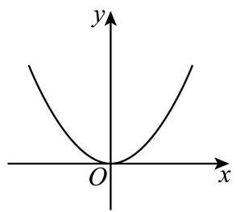
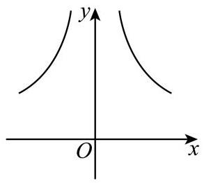
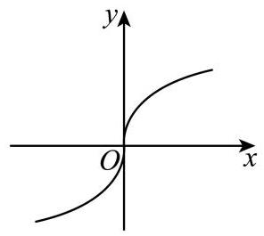

# 2026二模 函数与导数专题 · 学生版

> 本地预览：题目、答案及分类尚未全部审定。校对使用的PDF为教研整理版，尚未逐区确认区级印刷原卷。

## 基本函数、分段求值与参数

从定义域、函数类型和分段条件入手，保留参数约束。

### 奉贤 · 第6题

已知函数 $y = \left\{  \begin{array}{l} x\left( {x - b}\right) , x \geq  0 \\  x\left( {{bx} + 1}\right) , x < 0 \end{array}\right.$ 是奇函数，则 $b =$ ___.

### 宝山 · 第8题

若函数 $y = f\left( x\right)$ 是定义在 $\mathbf{R}$ 上的奇函数,且当 $x \geq  0$ 时, $f\left( x\right)  = {x}^{2} - {2x} + a\left( {a \in  \mathbf{R}}\right)$ , 则 $f\left( {-1}\right)$ 的值为___.

### 崇明 · 第14题

下列函数中，在 $\mathbf{R}$ 上为严格增函数的是( )

A. $y = {x}^{2}$

B. $y = \left| x\right|$

C. $y = \sin x$

D. $y = {x}^{3}$

### 徐汇 · 第2题

函数 $y = {2}^{x} - 1$ 的零点是___.

### 徐汇 · 第5题

若幂函数 $y = {x}^{a}$ 在区间 $\left( {0, + \infty }\right)$ 上是严格减函数，则实数 $a$ 的取值范围是___.

### 徐汇 · 第13题

已知 $a\text{ 、 }b \in  \mathbf{R}$ ，则 “ $\ln a > \ln b$ ” 是 “ ${\mathrm{e}}^{a - b} > 1$ ” 的( )

A. 充分非必要条件

B. 必要非充分条件

C. 充要条件

D. 既非充分又非必要条件

### 普陀 · 第9题

已知向量 $\overrightarrow{a} = \left( {1,2}\right) ,\overrightarrow{b} = \left( {-1,1}\right) ,\overrightarrow{c} = \left( {3,4}\right)$ ，函数 $y = f\left( x\right)$ 的表达式为 $f\left( x\right)  = \left\{  \begin{array}{l} x + 1, x < 2 \\  {2x} - 1, x \geq  2 \end{array}\right.$ ,设 $\overrightarrow{d}\left( x\right)  = f\left( x\right)  \cdot  \overrightarrow{a} + f\left( {x + 2}\right)  \cdot  \overrightarrow{b}$ ,若 $\overrightarrow{d}\left( x\right) //\overrightarrow{c}$ ,则 $x =$

### 普陀 · 第14题

设 $x\text{ 、 }y\text{ 、 }z \in  \mathbf{R}$ ,若 ${10}^{x} = {y}^{-\frac{1}{2}} = {\log }_{3}z$ ,则下列结论中不可能成立的是 ( )

A. $y < x < z$

B. $x < y < z$

C. $x < z < y$

D. $z < y < x$

### 杨浦 · 第3题

若幂函数 $y = {x}^{a}$ 的图像经过点 $\left( {\sqrt{3},3\sqrt{3}}\right)$ ，则实数 $a =$ ___.

### 杨浦 · 第6题

不等式 ${3}^{x} + {\log }_{2}x < 3$ 的解集为___.

### 杨浦 · 第13题

设 $a > b$ ，下列不等式中恒成立的是( )

A. $\frac{1}{a} < \frac{1}{b}$

B. ${a}^{2} > {b}^{2}$

C. ${a}^{3} > {b}^{3}$

D. $\left| a\right|  > \left| b\right|$

### 松江 · 第7题

已知函数 $f\left( x\right)  = \left\{  \begin{matrix} {3}^{x} - a, x \geq  0 \\  b - {\left( \frac{1}{3}\right) }^{x}, x < 0 \end{matrix}\right.$ 为奇函数，则 $a + b$ 的值为___.

### 松江 · 第9题

已知函数 $y = {\log }_{a}\left( {x + 2}\right)  + 1\left( {a > 0\text{ 且 }a \neq  1}\right)$ 的图像过定点 $\left( {s, t}\right)$ ，正实数 $m$ 、 $n$ 满足 ${nt} - {ms} = 1$ ，则 $\frac{1}{m} + \frac{3}{n}$ 的最小值为___.

### 浦东 · 第3题

已知 $f\left( x\right)  = \left\{  \begin{array}{l} {x}^{\frac{1}{3}}, x < 0 \\  x + 1, x \geq  0 \end{array}\right.$ ，若 $f\left( a\right)  =  - 2$ ，则实数 $a$ 的值为___.

> 本题资料或解析有待核事项，预览不可作为已审定成品。

### 浦东 · 第14题

已知实数 $a, b, c$ 满足 $a > b > 1 > c$ ,则下列结论一定正确的是 ( )

A. ${ac} > {bc}$

B. ${b}^{c} < 1$

C. ${\log }_{a}b + {\log }_{b}a > 2$

D. $a + c > b$

### 金山 · 第3题

将 $\sqrt{a\sqrt{a}}\left( {a > 0}\right)$ 化成有理数指数幂的形式为___.

### 闵行 · 第4题

已知 $f\left( x\right)  = \left( {m - 1}\right) {x}^{a}$ ,若 $y = f\left( x\right)$ 是幂函数，且 $f\left( 3\right)  = {27}$ ，则 $f\left( m\right)  =$ ___.

### 静安 · 第13题

函数 $y = {x}^{\frac{4}{3}}$ 的大致图象是( )

A. 

B. 

C. 

D. 

## 奇偶、周期、对称与单调比较

利用结构关系归约自变量范围，注意逻辑方向和反例。

### 嘉定 · 第11题

将函数 $y = {x}^{2}, x \in  \left\lbrack  {0,1}\right\rbrack$ 的图象绕坐标原点逆时针方向旋转角 $\theta \left( {0 \leq  \theta  \leq  a}\right)$ 得到曲线

C. 若对于每一个角 $\theta$ ，曲线 $C$ 都是一个函数的图象，则 $a$ 的最大值为___.

> 本题资料或解析有待核事项，预览不可作为已审定成品。

### 崇明 · 第21题

函数 $y = f\left( x\right) , x \in  \mathbf{R}$ 是减函数,即对于任意的 ${x}_{1},{x}_{2} \in  \mathbf{R}$ ,当 ${x}_{1} < {x}_{2}$ 时,均有 $f\left( {x}_{1}\right)  \geq  f\left( {x}_{2}\right) .$

(1)若 $f\left( x\right)  =  - {x}^{3} + {ax}$ ，求实数 $a$ 的取值范围；

( 2 )是否存在函数 $y = f\left( x\right)$ 是偶函数，且满足 $f\left( {f\left( x\right) }\right)  = x$ 对所有 $x \in  \mathbf{R}$ 成立？若存在， 请举出一个满足条件的函数, 若不存在, 请说明理由;

(3) 设 $g\left( x\right)  = \sin x$ ，已知函数 $h\left( x\right)  = f\left( x\right)  + g\left( x\right)$ 是周期函数，求证: $f\left( x\right)$ 为常值函数.

### 普陀 · 第11题

设定义域为 $\mathbf{R}$ 的函数 $y = f\left( x\right)$ 的导函数为 $y = {f}^{\prime }\left( x\right)$ ,令 $g\left( x\right)  = {f}^{\prime }\left( x\right)  + {\left( x + \sqrt{{x}^{2} + 1}\right) }^{2}$ ,若函数 $y = f\left( x\right)$ 和函数 $y = g\left( x\right)$ 皆为偶函数,则不等式 $f\left( {x + 2}\right)  > f\left( {{2x} - 3}\right)$ 的解集为___.

### 普陀 · 第12题

设 $k \geq  2, n \geq  1, k, n \in  \mathbf{N},{S}_{n}$ 是等比数列 $\left\{  {a}_{n}\right\}$ 的前 $n$ 项和,且 ${a}_{1} > 0$ ,公比为 3,令 ${b}_{n} = {S}_{n} + \frac{1}{{S}_{n}}$ ,若恰存在 2 个 $k$ 的值,对任意的 $n < k$ ,皆有 ${b}_{n} > {b}_{k}$ 成立,则 ${a}_{1}$ 的取值范围为___.

> 本题资料或解析有待核事项，预览不可作为已审定成品。

### 松江 · 第15题

在平面直角坐标系中,如果将函数 $y = f\left( x\right)$ 的图象绕坐标原点逆时针旋转 $a$ 弧度后, 所得曲线仍然是某个函数的图象,那么称函数 $y = f\left( x\right)$ 为 “ $a$ 旋转函数”. 若函数 $y = {ax} - \frac{1}{x}$ 为 “ $\frac{\pi }{4}$ 旋转函数”，则 $a$ 的值为( )

A. -1

B. 0

C. 1

D. 2

### 浦东 · 第16题

定义在 $\mathbf{R}$ 上的非常值函数 $y = f\left( x\right)$ ,若存在一个非零常数 $T$ ,使得对任意 $x \in  \mathbf{R}$ ,都有 $f\left( {x + T}\right)  = T \cdot  f\left( x\right)$ 成立，那么称函数 $y = f\left( x\right)$ 为 $T$ 函数. 则下列说法正确的是 ( )

A. 存在函数 $y = {kx} + b\left( {k \neq  0}\right)$ 为 $T$ 函数

B. 若函数 $y = f\left( x\right)$ 为 $T$ 函数,且当 $T > 1$ 时函数在 $\lbrack 0, T)$ 上是严格增函数,则函数 $y = f\left( x\right)$ 在 $\lbrack 0, + \infty )$ 上是严格增函数

C. 若函数 $y = f\left( x\right)$ 为 $T$ 函数,且在 $x = 0$ 处取得最小值,则 $0 < T < 1$

D. 若函数 $y = f\left( x\right)$ 为 $T$ 函数，且 $\left| {f\left( x\right) }\right|  \leq  1$ 恒成立，则 $y = f\left( x\right)$ 为周期函数

### 虹口 · 第16题

设 $y = f\left( x\right)$ 和 $y = g\left( x\right)$ 是两个不同的函数,且定义域和值域均为 $\mathbf{R}$ ,设 $M = \left\{  {\left( {a, b}\right)  \mid  f\left( a\right) \rangle g\left( b\right) , a, b \in  \mathbf{R}}\right\}$ ,则对于以下两个结论,说法正确的是 ( )

结论①:若当 $\left( {a, b}\right)  \in  M$ ，恒有 $\left( {-a, b}\right)  \in  M$ ，则函数 $y = f\left( x\right)$ 一定是偶函数；

结论②:若当 $\left( {a, b}\right)  \in  M$ ，恒有 $\left( {-a, - b}\right)  \in  M$ ，则函数 $y = g\left( x\right)$ 可以不是偶函数.

A. ①和②都正确

B. ①正确，②错误

C. ①错误，②正确

D. ①和② 都错误

### 虹口 · 第19题

设 $f\left( x\right)  = {\mathrm{e}}^{x} - {\mathrm{e}}^{-x}$ .

(1)解不等式: $f\left( {\ln x}\right)  < 2$ ；

(2)设 $g\left( x\right)  = f\left( x\right)  + \sin {2x}$ ，若存在 $x \in  \left\lbrack  {-2,2}\right\rbrack$ ，使得 $g\left( x\right)  + g\left( {{x}^{2} + a}\right)  > 0$ ，求实数 $a$ 的取值范围.

### 长宁 · 第13题

下列函数中既是奇函数又是增函数的是( )

A. $y = {x}^{2}$

B. $y = {x}^{3}$

C. $y = {2}^{x}$

D. $y = \lg x$

### 闵行 · 第14题

已知定义在 $\mathbf{R}$ 上的偶函数 $y = f\left( x\right)$ 在 $\lbrack 0, + \infty )$ 上是严格减函数,若 $f\left( {x - 1}\right)  > f\left( 1\right)$ , 则 $x$ 的取值范围为( )

A. $\left( {0,2}\right)$

B. $\left( {-2,2}\right)$

C. $\left( {-2,0}\right)$

D. $\left( {-1,1}\right)$

### 闵行 · 第21题

对于定义在 $\mathbf{R}$ 上的函数 $y = f\left( x\right)$ ,若存在实数对 $\left( {a, b}\right)$ ,对于任意的实数 $x$ ,都有 $f\left( {a - x}\right)  \cdot  f\left( {a + x}\right)  = b$ 成立,则称函数 $y = f\left( x\right)$ 为“ $M$ 型函数”,点 $\left( {a, b}\right)$ 称为 $y = f\left( x\right)$ 的“ $M$ ”点.

(1)判断函数 $f\left( x\right)  = x$ 与 $g\left( x\right)  = {\mathrm{e}}^{x}$ 是否为 “ $M$ 型函数” (无须说明理由);

(2)是否存在 “ $M$ 型函数” $y = f\left( x\right)$ ，其图象上的所有点都是 $y = f\left( x\right)$ 的 “ $M$ 点”，如果存在,求出所有满足题意的 $y = f\left( x\right)$ ,如果不存在,说明理由;

(3)设 $f\left( x\right)  > 0, x \in  \mathbf{R}$ ，函数 $y = f\left( x\right)$ 是 “ $M$ 型函数”，且 $y = f\left( x\right)$ 的图象是一条连续曲线. 已知 $p < q$ ，点 $\left( {p, q}\right)$ ， $\left( {q, p}\right)$ 都是 $y = f\left( x\right)$ 的“ $M$ 点”. 证明:“对任意 ${x}_{1}$ 、 ${x}_{2}$ ，当 $p < {x}_{1} < {x}_{2} < q$ 时，均有 $\left\lbrack  {f\left( p\right)  - f\left( {x}_{1}\right) }\right\rbrack   \cdot  \left\lbrack  {f\left( {x}_{1}\right)  - f\left( {x}_{2}\right) }\right\rbrack   \cdot  \left\lbrack  {f\left( {x}_{2}\right)  - f\left( q\right) }\right\rbrack   > 0$ ”是“函数 $y = f\left( x\right)$ 在 $\mathbf{R}$ 上为严格减函数”的充要条件.

### 青浦 · 第14题

设 $f\left( x\right)$ 是定义在 $\mathbf{R}$ 上且周期为 2 的奇函数,当 $2 < x \leq  3$ 时, $f\left( x\right)  = {\log }_{2}\left( {x - 2}\right)$ , 则 $f\left( {-\frac{1}{2}}\right)  =$ (   )

A. -1

B. 1

C. 2

D. 3

### 静安 · 第8题

已知定义在 $\mathbf{R}$ 上的偶函数 $y = f\left( x\right)$ 的最小正周期为 2,当 $0 \leq  x \leq  1$ 时, $f\left( x\right)  = x$ ,则当 $7 \leq  x \leq  8$ 时， $f\left( x\right)  =$ ___.

### 黄浦 · 第15题

设函数 $y = f\left( x\right)$ 的定义域为 $\mathbf{R}$ ,则下列结论: ①若 $y = f\left( x\right)$ 是奇函数或偶函数，且在区间 $\lbrack 0, + \infty )$ 上严格增,则对任意的 ${x}_{1},{x}_{2} \in  \mathbf{R}, f\left( {x}_{1}\right)  > f\left( {x}_{2}\right)  \Rightarrow  {x}_{1}^{2} > {x}_{2}^{2}$ 或 ${x}_{1}^{3} > {x}_{2}^{3}$ ; ② 若对任意的 ${x}_{1},{x}_{2} \in  \mathbf{R},{x}_{1}^{2} = {x}_{2}^{2} \Rightarrow  {\left\lbrack  f\left( {x}_{1}\right) \right\rbrack  }^{2} = {\left\lbrack  f\left( {x}_{2}\right) \right\rbrack  }^{2}$ ,则 $y = f\left( x\right)$ 是奇函数或偶函数. 其中正确的说法是( ).

A. ①和②均正确

B. ①正确，②错误

C. ①错误，②正确

D. ①和② 均错误

## 导数定义、切线与特殊点计算

区分导数定义和几何意义，利用特殊点或系数结构计算。

### 徐汇 · 第4题

若函数 $y = f\left( x\right)$ 在 $x = {x}_{0}$ 处的切线方程为 $y = {2x} - 1$ ,则 $\mathop{\lim }\limits_{{h \rightarrow  0}}\frac{f\left( {{x}_{0} + h}\right)  - f\left( {x}_{0}\right) }{h} =$

### 松江 · 第8题

若 ${\left( 3 - 2x\right) }^{6} = {a}_{0} + {a}_{1}x + {a}_{2}{x}^{2} + \cdots  + {a}_{6}{x}^{6}$ ，则 ${a}_{1} + 2{a}_{2} + 3{a}_{3} + \cdots  + 6{a}_{6} =$ ___.

### 浦东 · 第6题

已知直线 $l$ 是曲线 $y = \frac{3}{x + 1} + \ln x$ 在 $x = 2$ 处的切线，则 $l$ 的斜率为___.

### 金山 · 第11题

已知 ${S}_{n}$ 是数列 $\left\{  {a}_{n}\right\}$ 的前 $n$ 项和,且 ${S}_{n} = {2}^{n - 1} - 1, n \geq  1$ 且 $n \in  \mathrm{N}$ . 若 $f\left( x\right)  = \left( {\sin x + {a}_{1}}\right) \left( {\sin x + {a}_{2}}\right) \cdots \left( {\sin x + {a}_{5}}\right)$ ，则 ${f}^{\prime }\left( \pi \right)  =$ ___.

### 青浦 · 第5题

已知函数 $f\left( x\right)  = \frac{1}{3}{x}^{3} - x + 3$ ，则曲线 $y = f\left( x\right)$ 在点 $\left( {0, f\left( 0\right) }\right)$ 处的切线方程为 ___.

## 零点、极值、最值与含参讨论

用图像及导数定位零点与极值，分清区间端点和最值可达性。

### 嘉定 · 第8题

已知函数 $y = {x}^{3} + {x}^{2} + {ax}$ 有三个不同的零点,则实数 $a$ 的取值范围是___

> 本题资料或解析有待核事项，预览不可作为已审定成品。

### 奉贤 · 第16题

已知函数 $y = f\left( x\right)$ 的表达式为 $f\left( x\right)  = \left( {x - 1}\right) \left( {x - a}\right) \left( {x - b}\right) , x \in  \mathbf{R}$ ,则下列命题正确的是 ( )

A. 函数 $y = f\left( x\right)$ 的零点的个数一定是 3 个

B. 若集合 $A = \{ x \mid  f\left( x\right)  \geq  0\}$ 的解集是 $\lbrack 0, + \infty )$ ，则实数对 $\left( {a, b}\right)$ 有 2 对

C. 函数 $y = f\left( x\right)$ 必存在极值

D. 函数 $y = f\left( x\right)$ 在 $\left( {b,0}\right)$ 处的切线方程为 $y = 0$ ，则 $b = 1$

### 宝山 · 第18题

已知 $f\left( x\right)  = {\log }_{a}x, g\left( x\right)  = 2{\log }_{a}\left( {{2x} + t - 2}\right) ,\left( {a > 0, a \neq  1, t \in  \mathbf{R}}\right)$ .

(1) 若 $f\left( 1\right)  = g\left( 2\right)$ ，求 $t$ 的值；

(2)当 $x \in  \left\lbrack  {1,4}\right\rbrack$ 时 $f\left( x\right)  \geq  g\left( x\right)$ 恒成立，求 $t$ 的取值范围.

### 宝山 · 第20题

将以坐标原点为顶点,以 $x$ 轴为对称轴,并经过点 $P\left( {1,1}\right)$ 的抛物线记为 $C$ . 作两条直线分别与抛物线 $C$ 相交于点 $A\left( {{x}_{1},{y}_{1}}\right) \text{ 、 }B\left( {{x}_{2},{y}_{2}}\right)$ ,设 ${PA}\text{ 、 }{PB}$ 的斜率分别为 ${k}_{PA}\text{ 、 }{k}_{PB}$ ,且满足 ${k}_{PA} + {k}_{PB} = 0.$

(1)求抛物线 $C$ 的标准方程；

(2)证明:直线 ${AB}$ 的斜率 ${k}_{AB} =  - \frac{1}{2}$ ；

(3)若直线 ${AB}$ 在 $y$ 轴上的截距 $b \in  \left\lbrack  {0,1}\right\rbrack$ ，求 $\bigtriangleup  {ABP}$ 面积的最大值.

### 崇明 · 第16题

已知函数 $y = f\left( x\right) , x \in  \mathbf{R}$ . 定义集合 $M = \left\{  {x}_{0}\right|$ 对任意的 $x > {x}_{0}$ ,都有 $f\left( x\right)  \leq  f\left( {x}_{0}\right) \}$ . 对于所有使得 $M = \left\lbrack  {-1,2}\right\rbrack$ 的函数 $y = f\left( x\right)$ ,有以下两个命题: ①存在函数 $y = f\left( x\right)$ 在 $x =  - 2$ 处取极小值；②存在函数 $y = f\left( x\right)$ 图像是连续曲线. 下列判断正确的是 ( )

A. ①②都真

B. ①真②假

C. ①假②真

D. ①②都假

> 本题资料或解析有待核事项，预览不可作为已审定成品。

### 崇明 · 第19题

设函数 $f\left( x\right)  = {x}^{2} - x + a\ln x, a \in  \mathbf{R}$ .

(1) 若 $a = 1$ ，求 $f\left( x\right)$ 的图象在 $x = 1$ 处的切线方程；

(2)若 $f\left( x\right)  \geq  0$ 在 $\lbrack 1, + \infty )$ 上恒成立，求 $a$ 的取值范围；

### 徐汇 · 第15题

设 $\omega  > 0$ ,函数 $y = \frac{\sqrt{3}}{2}\cos {\omega x} + \frac{1}{2}\sin {\omega x}$ 在区间 $\left( {\frac{\pi }{2},\pi }\right)$ 上没有最大值和最小值,则 $\omega$ 的取值范围为( )

A. $\left( {0,\frac{1}{2}}\right\rbrack$

B. $\left\lbrack  {\frac{1}{3},\frac{1}{2}}\right\rbrack$

C. $\left( {0,\frac{1}{6}}\right\rbrack   \cup  \left\lbrack  {\frac{1}{3},\frac{7}{6}}\right\rbrack  \;$

D. $\left( {0,\frac{1}{6}}\right\rbrack   \cup  \left\lbrack  {\frac{1}{3},\frac{1}{2}}\right\rbrack$

### 徐汇 · 第19题

已知函数 $y = f\left( x\right)$ ,其中 $f\left( x\right)  = \frac{{2a} - 1 + g\left( x\right) }{a - g\left( x\right) }, a \in  \mathbf{R}$ 且 $a > 0$ .

(1)设 $g\left( x\right)  = {2}^{x}$ ，写出函数 $y = f\left( x\right)$ 的定义域，并判断是否存在正数 $a$ ，使得函数 $y = f\left( x\right)$ 为奇函数,说明理由;

(2)设 $g\left( x\right)  = {\log }_{2}x$ . 若关于 $x$ 的方程 $f\left( x\right)  = g\left( x\right)$ 的解集为单元素集合,求正数 $a$ 的值.

### 普陀 · 第21题

已知 $p\text{ 、 }q$ 为实数,设函数 $y = f\left( x\right)$ 的最小值为 $f\left( p\right)$ ,函数 $y = g\left( x\right)$ 的最小值为 $g\left( q\right)$ ,若 $f\left( p\right)  = g\left( q\right)$ 且 $p \neq  q$ ,则称函数 $y = f\left( x\right)$ 和函数 $y = g\left( x\right)$ 是 $T$ 函数.

(1)设函数 $y = f\left( x\right)$ 的表达式为 $f\left( x\right)  = \sin x$ ，函数 $y = g\left( x\right)$ 的表达式为 $g\left( x\right)  = \cos x$ ， 请判断函数 $y = f\left( x\right)$ 和函数 $y = g\left( x\right)$ 是否为 $T$ 函数，并说明理由；

(2)设 $a\text{ 、 }b$ 为正实数，函数 $y = f\left( x\right)$ 的表达式为 $f\left( x\right)  = {x}^{2} + 2\left( {a - 1}\right) x + {a}^{2} - {2a} + 7$ ， 函数 $y = g\left( x\right)$ 的表达式为 $g\left( x\right)  = {bx} + \frac{9}{bx}\left( {x > 0}\right)$ ,若函数 $y = f\left( x\right)$ 和函数 $y = g\left( x\right)$ 不是 $T$ 函数,求 $\frac{1}{a} + b$ 的最小值;

(3) 设 $k\text{ 、 }t\text{ 、 }a$ 为实数，函数 $y = f\left( x\right)$ 的表达式为 $f\left( x\right)  =  - {\mathrm{e}}^{{kt} + x} - {2kt}\left( {x \leq  0}\right)$ ，函数 $y = g\left( x\right)$ 的表达式为 $g\left( x\right)  = \left( {x - 2}\right) \ln x - {ax} - 2$ ,若存在 $t \in  \left( {1,{\mathrm{e}}^{2}}\right)$ ,对任意的 $x \in  \left( {0, + \infty }\right)$ ,皆有 $g\left( x\right)  \geq  g\left( t\right)$ 成立,且函数 $y = f\left( x\right)$ 和函数 $y = g\left( x\right)$ 是 $T$ 函数,求 $k$ 的取值范围.

### 杨浦 · 第11题

掷实心球时，将轨迹视为抛物线的一部分，设实心球离手位置在起掷点 $O$ 正上方 2 米, 出手角度 $a$ 即抛物线在该处切线与水平地面所成角,如图所示. 已知实心球轨迹最高点距离地面 3 米,若要成绩不小于 10 米 (实心球落地点到起掷点的距离),则出手角度 $a$ 的最大值为___. (精确到 ${0.1}^{ \circ  }$ ).

### 杨浦 · 第15题

已知函数 $y = f\left( x\right)$ 和 $y = g\left( x\right)$ 的定义域都为 $\mathbf{R}$ 且都存在导函数. 若 $y = f\left( x\right)$ 和 $y = g\left( x\right)$ 的零点均有且仅有 $x = 0$ ,且当 $x \neq  0$ 时恒有 $f\left( x\right)  < g\left( x\right)$ ,则下列情形中不可能的是 ( ) .

A. 0 是 $y = f\left( x\right)$ 的极大值点,也是 $y = g\left( x\right)$ 的极大值点

B. 0 是 $y = f\left( x\right)$ 的极小值点,也是 $y = g\left( x\right)$ 的极小值点

C. 0 是 $y = f\left( x\right)$ 的极大值点,也是 $y = g\left( x\right)$ 的极小值点

D. 0是 $y = f\left( x\right)$ 的极小值点,也是 $y = g\left( x\right)$ 的极大值点

### 浦东 · 第18题

已知 $f\left( x\right)  = \sqrt{3}\sin x + 2\cos \left( {x + \varphi }\right)$ ， $\varphi  \in  \left\lbrack  {0,\pi }\right\rbrack$ .

(1)若函数 $y = f\left( x\right)$ 是定义在 $\mathrm{R}$ 上的奇函数，求常数 $\varphi$ 的值；

(2)若 $\varphi  = \frac{\pi }{3}$ ，若关于 $x$ 的不等式 $f\left( x\right)  + \frac{x}{2} - a > 0$ 对任意 $x \in  \left\lbrack  {0,\pi }\right\rbrack$ 恒成立，求实数 $a$ 的取值范围.

### 金山 · 第19题

已知函数 $y = f\left( x\right)$ ,其中 $f\left( x\right)  = \ln x$ .

(1)若 $f\left( {1 - m}\right)  - f\left( {3 - m}\right)  < 0$ ，求实数 $m$ 的取值范围；

( 2 )若 $g\left( x\right)  = {ax} - \frac{1}{x} - a + 1 - \left( {a + 1}\right) f\left( x\right)$ ，其中 $a > 0$ ，若存在 $b < 0$ ，使得直线 $y = b$ 与函数 $y = g\left( x\right)$ 的图像有 3 个不同的交点,求实数 $a$ 的取值范围.

### 金山 · 第20题

已知抛物线 $\Gamma  : {y}^{2} = {4x}$ 的焦点为 $F$ ,准线为 $l$ ,点 $P\left( {{x}_{0},{y}_{0}}\right)$ 为抛物线上一动点,点 $O$ 为坐标原点.

(1)若 $\left| {OP}\right|  = \left| {PF}\right|$ ，求点 $P$ 的坐标；

(2)若直线 ${l}_{0} : y = {kx} + 4$ 与抛物线 $\Gamma$ 只有一个交点，求直线 ${l}_{0}$ 的方程；

(3)若 ${x}_{0} > 3$ ，过点 $P$ 作圆 $C : {\left( x - 1\right) }^{2} + {y}^{2} = 4$ 的两条切线，交准线 $l$ 于 $A\text{ 、 }B$ 两点，求 $\left| {AB}\right|$ 的取值范围.

### 长宁 · 第16题

已知 $f\left( x\right)  = \left( {1 - a}\right) x + a\sin x$ .

① 存在 $a \in  \left( {0,1}\right)$ ,使得函数 $y = f\left( x\right)$ 在 $\mathbf{R}$ 上严格增;

②对于任意 $a \in  \left( {0,1}\right)$ ,直线 $y = \left( {1 - a}\right) x + a$ 与曲线 $y = f\left( x\right)$ 都相切且有无数个切点,每个切点的横坐标都不是函数 $y = f\left( x\right)$ 的极值点.

对于以上两个结论, 下列判断正确的是 ( )

A. ①正确，②错误；

B. ①错误，②正确；

C. ①正确，②正确；

D. ①错误，②错误.

### 长宁 · 第19题

已知 $f\left( x\right)  = {\log }_{a}x$ (其中 $a > 0, a \neq  1$ ).

(1)若函数 $y = f\left( x\right)$ 的图象过点 $\left( {2, - 1}\right)$ ，求不等式 $f\left( {{2x} - 1}\right)  > f\left( {x + 1}\right)$ 的解集；

( 2 )若恰有两个不同的实数 $x$ ，使得 $f\left( x\right)$ ， $f\left( {x - m}\right)$ ， $f\left( 4\right)$ 成等差数列，求实数 $m$ 的取值范围.

### 闵行 · 第11题

已知 $a \in  \mathbf{R}$ ,若不等式 $\left( {\ln x - 1}\right) \left( {\ln x - {ax}}\right)  > 0$ 的解集中有且仅有两个整数，则 $a$ 的最小值为___.

### 闵行 · 第19题

已知 $m \in  \mathbf{R}, f\left( x\right)  = m\sin x + \left( {1 - m}\right) \cos x$ .

(1) 当 $m = \frac{1}{2}$ 时,解方程 $f\left( x\right)  = 0$ ;

( 2 )若函数 $y = f\left( x\right)$ 在 $\left( {0,\frac{\pi }{2}}\right)$ 上有唯一的极值点，求 $m$ 的取值范围，并判断这个极值点是极大值点还是极小值点.

### 静安 · 第12题

设 $a > 0$ ,函数 $f\left( x\right)  = \left\{  \begin{array}{l} x + 2, x <  - a \\  \sqrt{{a}^{2} - {x}^{2}}, - a \leq  x \leq  a \\   - \sqrt{x} - 1, x > a \end{array}\right.$ ,给出下列三个结论:

① $y = f\left( x\right)$ 在区间 $\left( {a - 1, + \infty }\right)$ 上单调递减；

② 当 $a \geq  1$ 时， $y = f\left( x\right)$ 存在最大值；

③ 设 $M\left( {{x}_{1}, f\left( {x}_{1}\right) }\right) \left( {{x}_{1} \leq  a}\right) , N\left( {{x}_{2}, f\left( {x}_{2}\right) }\right) \left( {{x}_{2} > a}\right)$ ，则 $\left| {MN}\right|  > 1$ .

其中所有正确结论的序号是___.

### 静安 · 第21题

已知函数 $f\left( x\right)  = \frac{a\ln x}{x}\;\left( {a \in  \mathbf{R}\text{ 且 }a \neq  0}\right)$ .

(1)当 $a = 1$ 时，求函数 $y = f\left( x\right)$ 的极值；

(2)若直线 $y = x - 1$ 是曲线 $y = f\left( x\right)$ 的一条切线，求 $a$ 的值和切点的坐标；

(3) 若函数 $g\left( x\right)  = \frac{{a}^{2}}{4x} + x + 2 - a$ 的图像与 $y = f\left( x\right)$ 的图像相交于相异两点 $A$ 和 $B$ ,求 $a$ 的取值范围.

### 黄浦 · 第12题

如图所示，某圆形游乐园的半径为 140 米，其圆心在点 $A$ 处，游乐园内有一圆形广场， 其半径为 20 米,圆心在与点 $A$ 相距 60 米的点 $B$ 处,游客中心位于圆形广场的边界线与 $A$ , $B$ 连线的交点 $O$ 处. 现打算在游乐园的边界线与圆形广场的边界线上各选一点 $C, D$ ,在这两处各建一座游乐设施(其占地大小忽略不计)，将 $\bigtriangleup  {OCD}$ 的内部区域作为游客的休闲区并使其面积最大，则此最大面积为___.

## 抽象函数、迭代与导数不等式证明

把新定义转化为具体函数关系，检验值域、不动点、增量与全域约束。

### 嘉定 · 第21题

已知在神经网络中, $\sigma \left( x\right)  = \frac{1}{1 + {\mathrm{e}}^{-x}}$ 常作为神经元激活函数.

(1)证明:对任意实数 $x$ ，有 $\sigma \left( {-x}\right)  + \sigma \left( x\right)  = 1$ ，并由此写出 $y = \sigma \left( x\right)$ 图像的对称中心；

(2)设交叉熵损失函数 ${L}_{t}\left( \widehat{y}\right)  =  - \left\lbrack  {t\ln \widehat{y} + \left( {1 - t}\right) \ln \left( {1 - \widehat{y}}\right) }\right\rbrack$ ，用于衡量预测值 $\widehat{y}$ 与真实标签 $t$ 之间的差异,其中 $t \in  \{ 0,1\}$ . 试确定 $t$ 的值,使得 $z = {L}_{t}\left( {\sigma \left( x\right) }\right)$ 在 $\left( {-\infty , + \infty }\right)$ 上是减函数;

(3)在深度神经网络中，信号经过多层传播可抽象为一个迭代过程. 设数列 $\left\{  {x}_{n}\right\}$ 满足 ${x}_{n + 1} = \sigma \left( {x}_{n}\right)$ ,其中 $n$ 为正整数. 证明: 存在唯一实数 $A \in  \left( {0,1}\right)$ ,使得 $\sigma \left( A\right)  = A$ ,且对任意实数 ${X}_{1}$ 和任意正整数 $n$ ,都有 $\left| {{x}_{n + 2} - A}\right|  \leq  {\left( \frac{1}{4}\right) }^{n}$ .

> 本题资料或解析有待核事项，预览不可作为已审定成品。

### 奉贤 · 第21题

设定义域为 $\left( {0, + \infty }\right)$ 的函数 $y = f\left( x\right)$ 的表达式为 $f\left( x\right)  = {\mathrm{e}}^{x} - a\left( {a > 0}\right)$ ,我们可以证明函数 $y = f\left( x\right)$ 存在唯一的零点,设该零点为 $r$ . 如图,过点 ${A}_{1}\left( {{x}_{1}, f\left( {x}_{1}\right) }\right)$ 作函数 $y = f\left( x\right)$ 的切线 ${l}_{1}$ 与 $x$ 轴的交点为 ${B}_{2}$ ,设横坐标为 ${x}_{2}$ ,若 ${x}_{2} > r$ ,则过点 ${A}_{2}\left( {{x}_{2}, f\left( {x}_{2}\right) }\right)$ 作函数 $y = f\left( x\right)$ 的切线 ${l}_{2}$ 与 $x$ 轴的交点为 ${B}_{3}$ ,设横坐标为 ${x}_{3}$ ; 若 ${x}_{2} \leq  r$ ,则停止作切线. $\cdots$ 依次类推,得到数列 $\left\{  {x}_{n}\right\}  \left( {n \geq  1, n \in  \mathbf{N}}\right)$ ,记 ${x}_{1} = t, t > r$ .

(1) 若 $a = \mathrm{e}, t = 2$ ，求 ${x}_{2}$ ；

(2)求证:数列 $\left\{  {x}_{n}\right\}$ 是严格递减数列；

(3) 若 $a = 1$ ，比较 ${x}_{n + 1} + 1$ 与 ${x}_{n} - \ln {x}_{n}$ 的大小，并说明理由.

> 原题给定的定义域与零点存在性陈述冲突，后续小问又使用了冲突的参数情形，须核原始版本。

### 宝山 · 第21题

已知 $y = f\left( x\right)$ 和 $y = g\left( x\right)$ 均为定义在 $\mathbf{R}$ 上的可导函数,且函数 $y = f\left( x\right)$ 满足: ${f}_{1}\left( x\right)  = f\left( x\right) ,{f}_{n + 1}\left( x\right)  = {f}_{n}^{\prime }\left( x\right) \;\left( {n\text{ 是正整数 }}\right) .$

(1)若 $f\left( x\right)  = {\mathrm{e}}^{ax} + b\cos x$ 满足 ${f}_{3}\left( x\right)  = {f}_{1}\left( x\right)$ ，求实数 $a$ 、 $b$ 的值；

(2)设数列 $\left\{  {a}_{n}\right\}$ 是无穷数列，若 $f\left( x\right)  = x - \cos x$ ，且 ${a}_{1} = a,{a}_{n + 1} = {f}_{2}\left( {a}_{n}\right)$ ，是否存在实数 $a$ ,使得 $\left\{  {a}_{n}\right\}$ 是常数列,请说明理由:

(3) 若 $y = {f}_{n}\left( x\right) \left( {n \leq  2}\right)$ 是定义域上的增函数,函数 $y = g\left( x\right)$ 是周期函数,且存在 ${x}_{0} \in  \mathbf{R}$ 对任意实数 $x$ ,都有 $g\left( {x}_{0}\right)  \geq  g\left( x\right)  > 0$ ,求证: “ ${f}_{n}\left( x\right)  = 0\left( {n \geq  3}\right)$ 恒成立”的充要条件是 “ $y = {f}_{2}\left( x\right)  \cdot  g\left( x\right)$ 是周期函数”.

> 本题资料或解析有待核事项，预览不可作为已审定成品。

### 徐汇 · 第21题

已知函数 $y = f\left( x\right)$ 与函数 $y = g\left( x\right)$ 的定义域均为 $\mathbf{R}$ ,且在 $\mathbf{R}$ 上的导函数分别为 ${f}^{\prime }\left( x\right)$ 和 ${g}^{\prime }\left( x\right)$ . 若存在常数 $k$ ,使得对任意实数 $x,{g}^{\prime }\left( x\right)  \geq  k \cdot  \left| {{f}^{\prime }\left( x\right) }\right|$ 恒成立,则称 $y = g\left( x\right)$ 是 $y = f\left( x\right)$ 的“ $k$ -调整函数”，并称 $k$ 为调整系数.

(1)设 $f\left( x\right)  = \cos x, g\left( x\right)  = {2x}$ . 求证: $y = g\left( x\right)$ 是 $y = f\left( x\right)$ 的“2-调整函数”；

(2) 设 $f\left( x\right)  = {x}^{2}, g\left( x\right)  = {\mathrm{e}}^{x} + {bx}$ . 若存在实数 $b \in  \left\lbrack  {-2, - 1}\right\rbrack$ ，使得 $y = g\left( x\right)$ 是 $y = f\left( x\right)$ 的 “ $k$ -调整函数”，求调整系数 $k$ 的取值范围；

(3) 已知 $y = g\left( x\right)$ 是 $y = f\left( x\right)$ 的“1-调整函数”，函数 $y = g\left( x\right)$ 的值域是一个闭区间，记作集合 $P$ ，函数 $y = f\left( x\right)$ 的值域记作集合 $Q$ . 若 $P \subseteq  Q$ ，求证：$y = f\left( x\right)  - g\left( x\right)$ 为常值函数.

> 第（3）问的现有题设与求证结论存在冲突；正式原卷或勘误尚待确认，本题仅供审题讨论。

### 杨浦 · 第21题

设函数 $y = f\left( x\right)$ 的定义域为 $D$ ,值域 $A \subseteq  \left\lbrack  {-1,1}\right\rbrack$ . 若 ${x}_{1},{x}_{2} \in  D$ 且满足 $f\left( {x}_{1}\right)  + f\left( {x}_{2}\right)  = f\left( {{x}_{1} + {x}_{2}}\right)$ ,则称 ${X}_{1}$ 与 ${x}_{2}$ 构成 “函数 $y = f\left( x\right)$ 的线性对”.

(1)若 $f\left( x\right)  = \cos x$ ，判断 $\frac{\pi }{3}$ 与 $\pi$ 是否构成函数 $y = f\left( x\right)$ 的线性对，并说明理由；

( 2 )若 $f\left( x\right)  = {2}^{x} - \frac{1}{2}, D = \left( {-\infty ,0}\right)$ . 若对于任意 ${x}_{1} \in  \left( {-\infty , a}\right)$ (常数 $a \leq  0$ )，都存在 ${x}_{2} \in  D$ ,使得 ${x}_{1}$ 与 ${x}_{2}$ 构成函数 $y = f\left( x\right)$ 的线性对,求 $a$ 的取值范围;

(3)函数 $y = f\left( x\right)$ 是定义在 $\mathbf{R}$ 上的奇函数，且满足:若 ${x}_{1}$ 与 ${x}_{2}$ 构成函数 $y = f\left( x\right)$ 的线性对,则 ${X}_{1}$ 与 $- {x}_{2}$ 也构成函数 $y = f\left( x\right)$ 的线性对. 求证: 对任意 $x \in  \mathbf{R}, f\left( x\right)  = 0$ .

### 松江 · 第21题

若函数 $y = M\left( x\right) \text{ 、 }y = N\left( x\right)$ 在区间 $I$ 上满足 $\left| {M\left( x\right) }\right|  \leq  N\left( x\right)$ ,则称函数 $y = N\left( x\right)$ 为 $y = M\left( x\right)$ 在区间 $I$ 上的绝对值上界函数. 设定义在 $\mathbf{R}$ 上的函数 $y = f\left( x\right) \text{ 、 }y = g\left( x\right)$ 的导数为 $y = {f}^{\prime }\left( x\right) \text{ 、 }y = {g}^{\prime }\left( x\right)$ .

(1)判断函数 $y = x$ 是不是函数 $y = \sin x$ 在区间 $\left\lbrack  {0,\pi }\right\rbrack$ 上的绝对值上界函数，并说明理由;

(2)若函数 $y = {g}^{\prime }\left( x\right)$ 为 $y = {f}^{\prime }\left( x\right)$ 在 $\mathbf{R}$ 上的绝对值上界函数，求证:对任意 $h > 0$ ，都有 $\left| {f\left( {x + h}\right)  - f\left( x\right) }\right|  \leq  g\left( {x + h}\right)  - g\left( x\right) ;$

(3)若函数 $y = {g}^{\prime }\left( x\right)$ 为 $y = {f}^{\prime }\left( x\right)$ 在 $\mathbf{R}$ 上的绝对值上界函数，实数 $a, b\left( {a < b}\right)$ 满足 $g{\left( x\right) }_{\min } = g\left( a\right)  = f\left( a\right) , g{\left( x\right) }_{\max } = g\left( b\right)  = f\left( b\right)$ ,确定 $f\left( {x}_{0}\right) , g\left( {x}_{0}\right)$ 在 ${x}_{0} \in  \mathbf{R}$ 时的大小关系 $\left( {g{\left( x\right) }_{\min }\text{ 、 }g{\left( x\right) }_{\max }}\right.$ 分别表示函数 $y = g\left( x\right)$ 的最小值和最大值)

> 本题资料或解析有待核事项，预览不可作为已审定成品。

### 浦东 · 第21题

对于定义在区间 $D$ 上的函数 $y = f\left( x\right)$ ,定义集合

$\Omega  = \left\{  {f\left( x\right) \begin{Vmatrix}{f\left( {x}_{1}\right)  - f\left( {x}_{2}\right) }\end{Vmatrix} \leq  \left| {{x}_{1} - {x}_{2}}\right| ,\forall {x}_{1},{x}_{2} \in  D}\right\}$ . 对任意闭区间 $I \subseteq  D$ ,设函数 $y = f\left( x\right)$ 在区间 $I$ 上的最大值为 ${M}_{1}$ ,最小值为 ${M}_{2}$ ,记 $M\left( {f, I}\right)  = {M}_{1} - {M}_{2}$ .

(1)若 $f\left( x\right)  = {x}^{2} - x, D = \left\lbrack  {0,1}\right\rbrack$ ，判断函数 $y = f\left( x\right)$ 是否属于集合 $\Omega$ ，并求 $M\left( {f,\left\lbrack  {0,1}\right\rbrack  }\right)$ 的值;

(2)若 $D = \left\lbrack  {0,1}\right\rbrack  , f\left( x\right)  \in  \Omega$ ,且 $f\left( 0\right)  = 0, M\left( {f,\left\lbrack  {0,1}\right\rbrack  }\right)  = 1$ . 求 $f\left( 1\right)$ 的值及函数 $y = f\left( x\right)$ 的解析式;

(3) 若 $D = \lbrack 0, + \infty ), f\left( x\right)  \in  \Omega$ ,令 $g\left( x\right)  = M\left( {f,\left\lbrack  {0, x}\right\rbrack  }\right)$ . 证明: $y = f\left( x\right)$ 是单调函数的充要条件是: 对任意 $0 < {x}_{1} < {x}_{2}, g\left( {x}_{2}\right)  - g\left( {x}_{1}\right)  = M\left( {f,\left\lbrack  {{x}_{1},{x}_{2}}\right\rbrack  }\right)$ 恒成立.

> 本题资料或解析有待核事项，预览不可作为已审定成品。

### 虹口 · 第21题

若对于定义在 $\mathbf{R}$ 上的函数 $y = f\left( x\right)$ ,设 $I$ 是 $\mathbf{R}$ 的一个子集， ${X}_{1}$ 和 ${x}_{2}$ 是 $I$ 上任意给定的两个实数,当 ${x}_{1} \neq  {x}_{2}$ 时,恒有 $f\left( {x}_{1}\right)  \neq  f\left( {x}_{2}\right)$ ,则称函数 $y = f\left( x\right)$ 在 $I$ 上具有 “性质 $P$ ”

(1)分别判断函数 $y = {\mathrm{e}}^{x}$ 和 $y = {x}^{\frac{2}{3}}$ 是否在 $\mathbf{R}$ 上具有 “性质 $P$ ” ; (无需说明理由)

(2) 设 $I = \left\lbrack  {-2, - 1}\right\rbrack   \cup  \left\lbrack  {2,3}\right\rbrack$ ,记 $f\left( x\right)  = \left\{  \begin{array}{l}  - x + k, x \leq  k, \\  {\left( x - k\right) }^{2}, x > k \end{array}\right.$ ,若函数 $y = f\left( x\right)$ 在 $I$ 上具有 “性质 $P$ ”,求实数 $k$ 的取值范围;

(3)若函数 $y = f\left( x\right)$ 在 $\mathbf{R}$ 上具有 “性质 $P$ ” ，其图像是连续曲线，且 $f\left( {f\left( x\right) }\right)  = x$ ，求证: 集合 $M = \{ x \mid  f\left( x\right)  = x, x \in  \mathbf{R}\}$ 是无限集或单元素集.

### 金山 · 第21题

若函数 $y = f\left( x\right) , x \in  D$ ,其值域为 $A$ . 若 $A \subseteq  D$ ,则称函数 $y = f\left( x\right)$ 在区间 $D$ 上为封闭函数.

(1)已知 $f\left( x\right)  = \frac{{2x} + 3}{x + 1}$ ，判断函数 $y = f\left( x\right)$ 是否在区间 $\left\lbrack  {2,8}\right\rbrack$ 上为封闭函数，并说明理由;

(2) 已知 $g\left( x\right)  = {x}^{2} + {2x}$ ,若函数 $y = g\left( x\right)$ 在区间 $\left\lbrack  {a, b}\right\rbrack$ 上不为单调函数,但在区间 $\left\lbrack  {a, b}\right\rbrack$ 上为封闭函数,求 $b - a$ 的最大值;

(3) 已知函数 $y = h\left( x\right)$ 在区间 $\left\lbrack  {a, b}\right\rbrack$ 上连续且为封闭函数,且对于任意的 $x\text{ 、 }y \in  \left\lbrack  {a, b}\right\rbrack$ , 都有 $\left| {h\left( x\right)  - h\left( y\right) }\right|  = L\left| {x - y}\right| \left( {0 \leq  L < 1}\right)$ 成立. 若数列 $\left\{  {x}_{n}\right\}$ 满足 ${x}_{n + 1} = h\left( {x}_{n}\right) , n \geq  1$ 且 $n \in  N$ ,证明: 存在唯一常数 $c \in  \left\lbrack  {a, b}\right\rbrack$ ,使得 $h\left( c\right)  = c$ ,且对于任意的 ${x}_{1} \in  \left\lbrack  {a, b}\right\rbrack$ ,都有 $\mathop{\lim }\limits_{{n \rightarrow   + \infty }}{x}_{n} = c.$

### 长宁 · 第21题

设函数 $y = f\left( x\right)$ 定义域为 $I$ ,区间 $D \subseteq  I$ ,记函数 $y = f\left( x\right)$ 在区间 $D$ 上的最大值为 ${M}_{f}\left( D\right)$ ,最小值为 ${m}_{f}\left( D\right)$ .

(1)设 $f\left( x\right)  = {\mathrm{e}}^{x} - {ax}$ ， $D = \left( {-1,1}\right)$ ，若 ${m}_{f}\left( D\right)  = f\left( 0\right)$ ，求实数 $a$ 的值；

(2)设 $f\left( x\right)  = {x}^{3} - 3{x}^{2}, D = \left\lbrack  {t, t + 2}\right\rbrack$ ，若 ${M}_{f}\left( D\right)  - {m}_{f}\left( D\right)  = 4$ ，且 $- 1 \leq  t \leq  1$ ，求 $t$ 的值;

(3)已知 $f\left( 0\right)  = 0, f\left( 1\right)  = 1$ ，且对任意闭区间 $D \subseteq  \left\lbrack  {0,1}\right\rbrack$ ， ${M}_{f}\left( D\right)$ 与 ${m}_{f}\left( D\right)$ 均存在. 求证: “ $y = f\left( x\right)$ 在区间 $\left\lbrack  {0,1}\right\rbrack$ 上严格增”的充要条件是“对于任意闭区间 ${D}_{1}\text{ 、 }{D}_{2} \subseteq  \left\lbrack  {0,1}\right\rbrack$ , 当 ${M}_{f}\left( {D}_{1}\right)  = {M}_{f}\left( {D}_{2}\right)$ ,且 ${m}_{f}\left( {D}_{1}\right)  = {m}_{f}\left( {D}_{2}\right)$ 时,均有 ${D}_{1} = {D}_{2}$ ."

> 本题资料或解析有待核事项，预览不可作为已审定成品。

### 青浦 · 第21题

函数 $y = f\left( x\right)$ 和 $y = g\left( x\right)$ 有相同的定义域,导函数分别为 $y = {f}^{\prime }\left( x\right)$ , $y = {g}^{\prime }\left( x\right)$ ,若在定义域内均有 ${f}^{\prime }\left( x\right)  \leq  {g}^{\prime }\left( x\right)$ ,则称 $y = f\left( x\right)$ 是 $y = g\left( x\right)$ 的“ $G$ 函数”.

(1)判断 $y =  - {x}^{3} - x$ 是否为 $y = \cos x$ 的“ $G$ 函数”，并说明理由；

(2)已知函数 $y = f\left( x\right)$ 和 $y = g\left( x\right)$ 都是定义在 $\mathbf{R}$ 上的偶函数，且 $y = f\left( x\right)$ 是 $y = g\left( x\right)$ 的“ $G$ 函数”，证明: $g\left( x\right)  - f\left( x\right)  = c$ ( $c$ 为常数)；

(3)若 $- \frac{3}{2} < a < \ln \frac{4}{3} - \frac{3}{2}, f\left( x\right)  = x\ln x - \left( {a + 4}\right) x, g\left( x\right)  = {\mathrm{e}}^{x + a}\left( {x - 3}\right) , x > 0$ ，证明函数 $y = f\left( x\right)$ 是函数 $y = g\left( x\right)$ 的“ $G$ ”函数.

> 本题资料或解析有待核事项，预览不可作为已审定成品。

### 黄浦 · 第21题

对于公共定义域为 $D$ 的函数 $y = f\left( x\right)$ 与 $y = g\left( x\right)$ ,定义集合 ${E}_{f - g} = \left\{  {t\left| {\;t = f\left( x\right)  - g\left( x\right) }\right. , x \in  D}\right\}  .$

(1)若 $f\left( x\right)  = {x}^{2} - {x}^{3}, g\left( x\right)  = {2x} - {x}^{3}$ ，求 ${E}_{f - g}$ ；

( 2 )若 $f\left( x\right)  = {\mathrm{e}}^{x}, g\left( x\right)  = \ln \left( {x - p}\right)  + q\left( {p, q \in  \mathbf{R}}\right)$ ，且 ${E}_{f - g} = \lbrack 0, + \infty )$ ，求 $q - p$ 的最小值;

(3)已知 $y = f\left( x\right)$ 是定义在 $\left( {0, + \infty }\right)$ 上的增函数，其图像是连续曲线，且存在正数 ${x}_{0}$ ，使得 $f\left( {x}_{0}\right)  > 0$ . 若 $g\left( x\right)  =  - f\left( x\right) , h\left( x\right)  = \frac{1}{2}f\left( {2x}\right)$ ,且 ${E}_{f - h} = \{ 0\}$ ,求证: ${E}_{f - g} = \left( {0, + \infty }\right)$ .

## 函数变换与数据线性化

解释对数变换如何把模型变成线性关系。

### 嘉定 · 第14题

生物学家在研究动物体重 $W$ (单位: $\mathrm{g}$ ) 与脉搏率 $f$ (单位:次 $\cdot  {\mathrm{{min}}}^{-1}$ ) 的关系时，获得了右表的数据,令 $x = \ln W, y = \ln f$ ,并拟合线性回归方程 $\widehat{y} = \widehat{a}x + \widehat{b}$ . 根据已知数据, 下列说法正确的是 ( )

<table><tr><td>动物名</td><td>体重 $W/\mathrm{g}$</td><td>脉搏率 $f/\left( {\text{ 次 } \cdot  {\text{ min }}^{-1}}\right)$</td></tr><tr><td>鼠</td><td>25</td><td>670</td></tr><tr><td>豚鼠</td><td>300</td><td>300</td></tr><tr><td>兔</td><td>2000</td><td>205</td></tr><tr><td>小狗</td><td>5000</td><td>120</td></tr><tr><td>大狗</td><td>30000</td><td>85</td></tr><tr><td>羊</td><td>50000</td><td>70</td></tr><tr><td>马</td><td>450000</td><td>38</td></tr></table>

A. 变量 $x$ 与 $y$ 成正相关，且 $\widehat{b} > 0$

B. 变量 $x$ 与 $y$ 成负相关，且 $\widehat{b} < 0$

C. 变量 $x$ 与 $y$ 成正相关，且 $\widehat{b} < 0$

D. 变量 $x$ 与 $y$ 成负相关，且 $\widehat{b} > 0$

> 本题资料或解析有待核事项，预览不可作为已审定成品。

