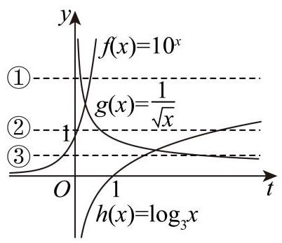
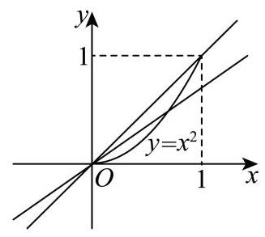
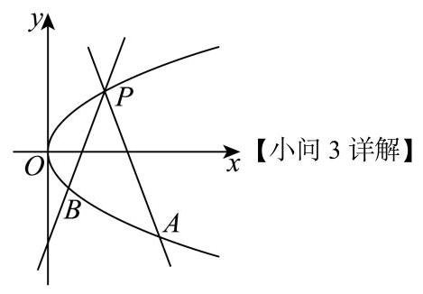
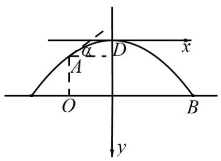

# 2026二模 函数与导数专题 · 教师版

> 本地预览：题目、答案及分类尚未全部审定。校对使用的PDF为教研整理版，尚未逐区确认区级印刷原卷。

## 基本函数、分段求值与参数

从定义域、函数类型和分段条件入手，保留参数约束。

### 奉贤 · 第6题

已知函数 $y = \left\{  \begin{array}{l} x\left( {x - b}\right) , x \geq  0 \\  x\left( {{bx} + 1}\right) , x < 0 \end{array}\right.$ 是奇函数，则 $b =$ ___.

**考点：** 分段函数奇偶性求参数

**难度依据：** 分段函数奇偶性求参数

**【答案】** -1

**【解析】**

**【详解】**解: 设 $f\left( x\right)  = \left\{  \begin{array}{l} x\left( {x - b}\right) , x \geq  0 \\  x\left( {{bx} + 1}\right) , x < 0 \end{array}\right.$ ,

$f\left( {-x}\right)  = \left\{  \begin{array}{l}  - x\left( {-{bx} + 1}\right) , x \geq  0 \\   - x\left( {-x - b}\right) , x < 0 \end{array}\right.$

又函数是奇函数,

$\therefore f\left( {-x}\right)  =  - f\left( x\right)$ ,即 $- x\left( {-{bx} + 1}\right)  =  - x\left( {x - b}\right) , - x\left( {-x - b}\right)  =  - x\left( {{bx} + 1}\right)$ ,

$b{x}^{2} - x =  - {x}^{2} + {bx},\;{x}^{2} + {bx} =  - b{x}^{2} - x,$

解得 $b =  - 1$ .

### 宝山 · 第8题

若函数 $y = f\left( x\right)$ 是定义在 $\mathbf{R}$ 上的奇函数,且当 $x \geq  0$ 时, $f\left( x\right)  = {x}^{2} - {2x} + a\left( {a \in  \mathbf{R}}\right)$ , 则 $f\left( {-1}\right)$ 的值为___.

**考点：** 奇函数的零点和函数值

**难度依据：** 奇函数的零点和函数值

**【答案】** 1

**【解析】**

**【分析】**利用函数奇偶性分析求解即可.

**【详解】**因为函数 $y = f\left( x\right)$ 是定义在 $\mathbf{R}$ 上的奇函数,所以 $f\left( {-x}\right)  =  - f\left( x\right)$ 且 $f\left( 0\right)  = 0$ , 当 $x \geq  0$ 时, $f\left( x\right)  = {x}^{2} - {2x} + a\left( {a \in  \mathbf{R}}\right)$ ,

所以 $f\left( 0\right)  = {0}^{2} - 2 \times  0 + a = 0$ ,解得: $a = 0$ ,

所以当 $x \geq  0$ 时, $f\left( x\right)  = {x}^{2} - {2x}$ ,所以 $f\left( {-1}\right)  =  - f\left( 1\right)  =  - \left( {{1}^{2} - 2 \times  1}\right)  = 1$ .

### 崇明 · 第14题

下列函数中，在 $\mathbf{R}$ 上为严格增函数的是( )

A. $y = {x}^{2}$

B. $y = \left| x\right|$

C. $y = \sin x$

D. $y = {x}^{3}$

**考点：** 基本函数严格单调性判断

**难度依据：** 基本函数严格单调性判断

**【答案】** D

**【解析】**

**【详解】**对于 $\mathrm{A}, y = {x}^{2}$ 是定义在 $\mathbf{R}$ 上的偶函数,

在区间 $\left( {-\infty ,0}\right)$ 上单调递减,在区间 $\left( {0, + \infty }\right)$ 上单调递增,故 $\mathrm{A}$ 不符合题意;

对于 $\mathrm{B}, y = \left| x\right|$ 是定义在 $\mathbf{R}$ 上的偶函数,

在区间 $\left( {-\infty ,0}\right)$ 上单调递减，在区间 $\left( {0, + \infty }\right)$ 上单调递增，故 $\mathrm{B}$ 不符合题意；

对于 $\mathrm{C}, y = \sin x$ 是定义在 $\mathbf{R}$ 上的周期函数,

在区间 $\left\lbrack  {-\frac{\pi }{2} + {2k\pi },\frac{\pi }{2} + {2k\pi }}\right\rbrack  , k \in  \mathbf{Z}$ 上单调递增,在区间 $\left\lbrack  {\frac{\pi }{2} + {2k\pi },\frac{3\pi }{2} + {2k\pi }}\right\rbrack  , k \in  \mathbf{Z}$ 上单调递减，故 C 不符合题意；

对于 $\mathrm{D},\;y = {x}^{3}$ 在 $\mathbf{R}$ 上为严格增函数，故 $\mathrm{D}$ 符合题意.

### 徐汇 · 第2题

函数 $y = {2}^{x} - 1$ 的零点是___.

**考点：** 指数方程直接求零点

**难度依据：** 基本指数方程

**【答案】** 0

**【解析】**

**【详解】**令 $y = {2}^{x} - 1 = 0$ ,即 ${2}^{x} = 1$ ,解得 $x = 0$ ,

所以函数 $y = {2}^{x} - 1$ 的零点是 0 .

### 徐汇 · 第5题

若幂函数 $y = {x}^{a}$ 在区间 $\left( {0, + \infty }\right)$ 上是严格减函数，则实数 $a$ 的取值范围是___.

**考点：** 正半轴幂函数单调性

**难度依据：** 直接应用幂函数性质

**【答案】** $\left( {-\infty ,0}\right)$

**【解析】**

**【分析】**由幂函数的性质进行求解即可.

**【详解】**因为幂函数 $y = {x}^{a}$ 在区间 $\left( {0, + \infty }\right)$ 上是严格减函数,

所以 $a < 0$ ,

故答案为: $\left( {-\infty ,0}\right)$

### 徐汇 · 第13题

已知 $a\text{ 、 }b \in  \mathbf{R}$ ，则 “ $\ln a > \ln b$ ” 是 “ ${\mathrm{e}}^{a - b} > 1$ ” 的( )

A. 充分非必要条件

B. 必要非充分条件

C. 充要条件

D. 既非充分又非必要条件

**考点：** 对数条件有定义域限制，比较蕴含关系

**难度依据：** 结合定义域判断必要性

**【答案】** A

**【解析】**

**【详解】** $\ln a > \ln b$ 等价于 $a > b > 0,{\mathrm{e}}^{a - b} > 1$ 等价于 $a > b$ ,

$a > b > 0$ 可以推出 $a > b$ ,但 $a > b$ 无法推出 $a > b > 0$ ,因为还存在 $0 > a > b$ 这种可能性, 所以“ $\ln a > \ln b$ ” 是 “ ${\mathrm{e}}^{a - b} > 1$ ” 的充分不必要条件.

### 普陀 · 第9题

已知向量 $\overrightarrow{a} = \left( {1,2}\right) ,\overrightarrow{b} = \left( {-1,1}\right) ,\overrightarrow{c} = \left( {3,4}\right)$ ，函数 $y = f\left( x\right)$ 的表达式为 $f\left( x\right)  = \left\{  \begin{array}{l} x + 1, x < 2 \\  {2x} - 1, x \geq  2 \end{array}\right.$ ,设 $\overrightarrow{d}\left( x\right)  = f\left( x\right)  \cdot  \overrightarrow{a} + f\left( {x + 2}\right)  \cdot  \overrightarrow{b}$ ,若 $\overrightarrow{d}\left( x\right) //\overrightarrow{c}$ ,则 $x =$

**考点：** 向量平行的坐标条件；分段函数代入并分类

**难度依据：** 向量平行的坐标条件；分段函数代入并分类

**【答案】** $- \frac{23}{9}$

**【解析】**

**【分析】**由题意可得 $f\left( {x + 2}\right)  =  - \frac{2}{7}f\left( x\right)$ ,分 $x < 0\text{ 、 }0 \leq  x < 2$ 和 $x \geq  2$ 三种情况分别求解即可.

**【详解】**因为 $\overrightarrow{d}\left( x\right)  = f\left( x\right)  \cdot  \overrightarrow{a} + f\left( {x + 2}\right)  \cdot  \overrightarrow{b} = \left( {f\left( x\right)  - f\left( {x + 2}\right) ,{2f}\left( x\right)  + f\left( {x + 2}\right) }\right)$ ,

又因为 $\overrightarrow{c} = \left( {3,4}\right)$ ,且 $\overrightarrow{d}\left( x\right) //\overrightarrow{c}$ ,

所以 $4\left\lbrack  {f\left( x\right)  - f\left( {x + 2}\right) }\right\rbrack   = 3\left\lbrack  {{2f}\left( x\right)  + f\left( {x + 2}\right) }\right\rbrack$ ,

整理得 $f\left( {x + 2}\right)  =  - \frac{2}{7}f\left( x\right)$ ,

当 $x < 0$ 时， $x + 2 < 2$ ，

则有 $x + 2 + 1 =  - \frac{2}{7}\left( {x + 1}\right)$ ,解得 $x =  - \frac{23}{9} < 0$ ,满足题意;

当 $0 \leq  x < 2$ 时, $2 \leq  x + 2 < 4$ ,

则有 $2\left( {x + 2}\right)  - 1 =  - \frac{2}{7}\left( {x + 1}\right)$ ,解得 $x =  - \frac{23}{16} < 0$ ,不满足题意;

当 $x \geq  2$ 时， $x + 2 \geq  4$ ，

则有 $2\left( {x + 2}\right)  - 1 =  - \frac{2}{7}\left( {{2x} - 1}\right)$ ,解得 $x =  - \frac{19}{18} < 0$ ,不满足题意;

综上， $x =  - \frac{23}{9}$ .

### 普陀 · 第14题

设 $x\text{ 、 }y\text{ 、 }z \in  \mathbf{R}$ ,若 ${10}^{x} = {y}^{-\frac{1}{2}} = {\log }_{3}z$ ,则下列结论中不可能成立的是 ( )

A. $y < x < z$

B. $x < y < z$

C. $x < z < y$

D. $z < y < x$

**考点：** 指数对数函数同值下横坐标大小比较

**难度依据：** 指数对数函数同值下横坐标大小比较

**【答案】** D

**【解析】**

**【分析】**在同一坐标系中作出 $f\left( x\right)  = {10}^{x}, g\left( x\right)  = \frac{1}{\sqrt{x}}, h\left( x\right)  = {\log }_{3}x$ 的图象,利用函数零点思想, 结合图象逐一判断即得.

**【详解】**如图在同一坐标系中分别作出函数 $f\left( x\right)  = {10}^{x}, g\left( x\right)  = \frac{1}{\sqrt{x}}, h\left( x\right)  = {\log }_{3}x$ 的图象,

依题意直线 $y = k$ 与三个函数都有交点,设交点的横坐标依次为 $x, y, z$ ,

则需判断这些交点的横坐标之间有怎样的大小关系.

由图知,有三种不同的情况: 当直线 $y = k$ 在①位置时,显然有: $y < x < z$ ;

当直线 $y = k$ 在②位置时，显然有: $x < y < z$ ；

当直线 $y = k$ 在③位置时，显然有: $x < z < y$ ，故 D 错误.

### 杨浦 · 第3题

若幂函数 $y = {x}^{a}$ 的图像经过点 $\left( {\sqrt{3},3\sqrt{3}}\right)$ ，则实数 $a =$ ___.

**考点：** 代入点坐标解指数

**难度依据：** 指数幂运算

**【答案】** 3

**【解析】**

**【详解】**代入 $\left( {\sqrt{3},3\sqrt{3}}\right)$ ，即 $3\sqrt{3} = {\left( \sqrt{3}\right) }^{a}$ ，解得 $a = 3$ .

### 杨浦 · 第6题

不等式 ${3}^{x} + {\log }_{2}x < 3$ 的解集为___.

**考点：** 构造单调函数并与特殊值比较

**难度依据：** 识别整体单调与定义域

**【答案】** (0,1)

**【解析】**

**【详解】**令 $f\left( x\right)  = {3}^{x} + {\log }_{2}x$ ,定义域为 $\left( {0, + \infty }\right)$ ,

函数 $y = {3}^{x}$ 和 $y = {\log }_{2}x$ 在 $\left( {0, + \infty }\right)$ 上均为增函数,

所以函数 $f\left( x\right)  = {3}^{x} + {\log }_{2}x$ 在 $\left( {0, + \infty }\right)$ 上为增函数,

又 $f\left( 1\right)  = {3}^{1} + {\log }_{2}1 = 3$ ，则 ${3}^{x} + {\log }_{2}x < 3 \Leftrightarrow  f\left( x\right)  < f\left( 1\right)$ ，

所以不等式 ${3}^{x} + {\log }_{2}x < 3$ 的解集为 $\left( {0,1}\right)$ .

### 杨浦 · 第13题

设 $a > b$ ，下列不等式中恒成立的是( )

A. $\frac{1}{a} < \frac{1}{b}$

B. ${a}^{2} > {b}^{2}$

C. ${a}^{3} > {b}^{3}$

D. $\left| a\right|  > \left| b\right|$

**考点：** 利用单调性判真并以反例排除

**难度依据：** 基本性质判断

**【答案】** C

**【解析】**

**【详解】**对于 $\mathrm{A},\mathrm{B},\mathrm{D}$ ,若 $a > b$ ,可设 $a = 1, b =  - 2$ ,此时 $\frac{1}{a} > \frac{1}{b}$ ,故 $\mathrm{A}$ 不符合题意; 此时 ${a}^{2} = 1,{b}^{2} = 4$ ,得到 ${a}^{2} < {b}^{2}$ ,故 $\mathrm{B}$ 不符合题意;

此时 $\left| \mathbf{b}\right|  = 2$ ,得到 $\left| a\right|  < \left| b\right|$ ,故 $\mathrm{D}$ 不符合题意;

对于 $\mathrm{C}$ ,因为 $y = {x}^{3}$ 在 $\mathbf{R}$ 上单调递增,

所以 $a > b$ ,一定有 ${a}^{3} > {b}^{3}$ 成立,故 $\mathrm{C}$ 符合题意.

### 松江 · 第7题

已知函数 $f\left( x\right)  = \left\{  \begin{matrix} {3}^{x} - a, x \geq  0 \\  b - {\left( \frac{1}{3}\right) }^{x}, x < 0 \end{matrix}\right.$ 为奇函数，则 $a + b$ 的值为___.

**考点：** 利用零点及奇函数定义求参数并检验

**难度依据：** 在分段条件下用奇函数性质

**【答案】** 2

**【解析】**

**【分析】**根据题意,得到 $f\left( 0\right)  = 0$ ,求得 $a = 1$ ,再由 $f\left( {-1}\right)  =  - f\left( 1\right)$ ,求得 $b = 1$ ,即可求解.

**【详解】**由函数 $f\left( x\right)  = \left\{  \begin{matrix} {3}^{x} - a, x \geq  0 \\  b - {\left( \frac{1}{3}\right) }^{x}, x < 0 \end{matrix}\right.$ 为奇函数,可得 $f\left( 0\right)  = 0$ ,即 ${3}^{0} - a = 0$ ,解得 $a = 1$ ,

又由 $f\left( {-1}\right)  =  - f\left( 1\right)$ ,可得 $b - {\left( \frac{1}{3}\right) }^{-1} =  - \left( {{3}^{1} - 1}\right)$ ,即 $b - 3 =  - 2$ ,解得 $b = 1$ ,

当 $a = 1, b = 1$ 时,函数 $f\left( x\right)  = \left\{  \begin{matrix} {3}^{x} - 1, x \geq  0 \\  1 - {\left( \frac{1}{3}\right) }^{x}, x < 0 \end{matrix}\right.$ ,

当 $x > 0$ 时, $- x < 0, f\left( {-x}\right)  = 1 - {3}^{x} =  - \left( {{3}^{x} - 1}\right)  =  - f\left( x\right)$ ,

当 $x < 0$ 时, $- x > 0, f\left( {-x}\right)  = {3}^{-x} - 1 =  - \left( {1 - {3}^{-x}}\right)  =  - f\left( x\right)$ ,且 $f\left( 0\right)  = 0$ ,

所以函数 $y = f\left( x\right)$ 为奇函数,符合题意,所以 $a + b = 1 + 1 = 2$ .

### 松江 · 第9题

已知函数 $y = {\log }_{a}\left( {x + 2}\right)  + 1\left( {a > 0\text{ 且 }a \neq  1}\right)$ 的图像过定点 $\left( {s, t}\right)$ ，正实数 $m$ 、 $n$ 满足 ${nt} - {ms} = 1$ ，则 $\frac{1}{m} + \frac{3}{n}$ 的最小值为___.

**考点：** 先求对数图像定点，再利用乘积构造最值

**难度依据：** 组合定点与一的代换

**【答案】** $4 + 2\sqrt{3}$

**【解析】**

**【分析】**由对数函数性质确定 $s =  - 1, t = 1$ ,进而得到 $m + n = 1$ ,再结合基本不等式即可求解.

**【详解】**当 $x + 2 = 1$ 时, $y = 1$ ,所以函数 $y = {\log }_{a}\left( {x + 2}\right)  + 1$ 的图象过定点 $\left( {-1,1}\right)$ ,

所以 $s =  - 1, t = 1$ ,代入 ${nt} - {ms} = 1$ 得 $m + n = 1$ .

所以 $\frac{1}{m} + \frac{3}{n} = \left( {m + n}\right) \left( {\frac{1}{m} + \frac{3}{n}}\right)  = 1 + \frac{n}{m} + \frac{3m}{n} + 3 \geq  4 + 2\sqrt{\frac{n}{m} \cdot  \frac{3m}{n}} = 4 + 2\sqrt{3}$ ,

当且仅当 $\frac{n}{m} = \frac{3m}{n}$ 时等号成立,即 $m = \frac{\sqrt{3} - 1}{2}, n = \frac{3 - \sqrt{3}}{2}$ 时等号成立.

### 浦东 · 第3题

已知 $f\left( x\right)  = \left\{  \begin{array}{l} {x}^{\frac{1}{3}}, x < 0 \\  x + 1, x \geq  0 \end{array}\right.$ ，若 $f\left( a\right)  =  - 2$ ，则实数 $a$ 的值为___.

> 本题资料或解析有待核事项，预览不可作为已审定成品。

**考点：** 依据函数值与区间分类求自变量

**难度依据：** 分段条件筛选

**核查说明：** 教研整理PDF第1页视觉核得第一段为x^(1/3)，合并MD误写为1/x³，源解按立方根求得-8；需恢复题干并复核。

**【答案】** -8

**【解析】**

**【详解】**若 $a < 0$ ,则 ${a}^{\frac{1}{3}} =  - 2$ ,解得 $a =  - 8$

若 $a \geq  0$ ,则 $a + 1 =  - 2$ ,解得 $a =  - 3$ ,不满足 $a \geq  0$

综上 $a =  - 8$

### 浦东 · 第14题

已知实数 $a, b, c$ 满足 $a > b > 1 > c$ ,则下列结论一定正确的是 ( )

A. ${ac} > {bc}$

B. ${b}^{c} < 1$

C. ${\log }_{a}b + {\log }_{b}a > 2$

D. $a + c > b$

**考点：** 换底构造互为倒数并比较等号条件

**难度依据：** 关注等号能否成立

**【答案】** $\mathrm{C}$

**【解析】**

**【详解】**对于选项 $\mathrm{A}$ ,可知 $1 > c$ ,无法判断正负,所以选项 $\mathrm{A}$ 错误;

对于选项 $\mathrm{B}$ ，可知 $0 < c < 1 < b$ 时，所以 ${b}^{c} > 1$ ，所以选项 B 错误；

对于选项 $\mathrm{C}$ ,因为 $a > b > 1$ ,所以 $\ln a > \ln b > 0$ ,

可知 ${\log }_{a}b + {\log }_{b}a = \frac{\ln b}{\ln a} + \frac{\ln a}{\ln b} \geq  2\sqrt{\frac{\ln b}{\ln a} \cdot  \frac{\ln a}{\ln b}} = 2$ ,当且仅当 $\frac{\ln b}{\ln a} = \frac{\ln a}{\ln b}$ ,即 $a = b$ 时取等号, 所以等号取不到,

所以 ${\log }_{a}b + {\log }_{b}a > 2$ ,选项 $\mathrm{C}$ 正确;

对于选项 D，当 $c < 0$ 时，无法判断不等式是否成立，所以选项 D 错误；

### 金山 · 第3题

将 $\sqrt{a\sqrt{a}}\left( {a > 0}\right)$ 化成有理数指数幂的形式为___.

**考点：** 根式与有理指数幂转换

**难度依据：** 根式与有理指数幂转换

**【答案】** ${a}^{\frac{3}{4}}$

**【解析】**

**【分析】**由根式与指数幂换算求解.

**【详解】** $\sqrt{a\sqrt{a}} = {\left( a \cdot  {a}^{\frac{1}{2}}\right) }^{\frac{1}{2}} = {\left( {a}^{\frac{3}{2}}\right) }^{\frac{1}{2}} = {a}^{\frac{3}{4}}$ .

故答案为: ${a}^{\frac{3}{4}}$

### 闵行 · 第4题

已知 $f\left( x\right)  = \left( {m - 1}\right) {x}^{a}$ ,若 $y = f\left( x\right)$ 是幂函数，且 $f\left( 3\right)  = {27}$ ，则 $f\left( m\right)  =$ ___.

**考点：** 幂函数

**难度依据：** 幂函数

**【答案】** 8

**【解析】**

**【分析】**先根据幂函数的定义求出参数 $m$ ,再利用已知函数值求出幂指数 $a$ 得到完整解析式,最后代入计算得到 $f\left( m\right)$ 的值.

**【详解】**已知 $f\left( x\right)  = \left( {m - 1}\right) {x}^{a}$ ,且 $y = f\left( x\right)$ 是幂函数:

根据幂函数的定义,可得 $m - 1 = 1$ ,解得 $m = 2$ ;

将条件 $f\left( 3\right)  = {27}$ 代入得 ${3}^{a} = {27} = {3}^{3}$ ，解得 $a = 3$ ，即函数解析式为 $f\left( x\right)  = {x}^{3}$ ；

将 $m = 2$ 代入解析式得 $f\left( m\right)  = f\left( 2\right)  = {2}^{3} = 8$ .

### 静安 · 第13题

函数 $y = {x}^{\frac{4}{3}}$ 的大致图象是( )

A. 

B. 

C. 

D. 

**考点：** 幂函数图像

**难度依据：** 幂函数图像

**【答案】** A

**【解析】**

**【分析】**根据函数的奇偶性和函数值得变化趋势即可判断.

**【详解】**解: $\because y = {x}^{\frac{4}{3}}$

$\therefore$ 定义域为 $R$

故排除 $C$ ,

又 $y = f\left( {-x}\right)  = {\left( -x\right) }^{\frac{4}{3}} = {x}^{\frac{4}{3}} = f\left( x\right)$ ,

$\therefore$ 函数 $y = {x}^{\frac{4}{3}}$ 为偶函数,

$\therefore$ 图象关于 $y$ 轴对称,故排除 $D$ ,

$\because \frac{4}{3} > 1$ ,

$\therefore$ 当 $x > 0$ 时, $y = {x}^{\frac{4}{3}}$ 的变化是越来越快,故排除 $B$

故选: $A$ .

**【点睛】**本题考查了函数图象的识别, 属于基础题.

## 奇偶、周期、对称与单调比较

利用结构关系归约自变量范围，注意逻辑方向和反例。

### 嘉定 · 第11题

将函数 $y = {x}^{2}, x \in  \left\lbrack  {0,1}\right\rbrack$ 的图象绕坐标原点逆时针方向旋转角 $\theta \left( {0 \leq  \theta  \leq  a}\right)$ 得到曲线

C. 若对于每一个角 $\theta$ ，曲线 $C$ 都是一个函数的图象，则 $a$ 的最大值为___.

> 本题资料或解析有待核事项，预览不可作为已审定成品。

**考点：** 旋转图像与函数图像判定；抛物线旋转与切线斜率

**难度依据：** 旋转曲线与函数定义的综合判定

**核查说明：** 题干与答案解析尚未逐页对照原卷，数学内容未独立终审。

**【答案】** $\arctan \frac{1}{2}$

**【解析】**

**【详解】**由函数 $y = {x}^{2}, x \in  \left\lbrack  {0,1}\right\rbrack$ ,知 ${y}^{\prime } = {2x}, x \in  \left\lbrack  {0,1}\right\rbrack$ .

因为 ${y}^{\prime } = {2x}$ 在 $\left\lbrack  {0,1}\right\rbrack$ 上单调递增,所以 ${y}^{\prime } \in  \left\lbrack  {0,2}\right\rbrack$ .

由题可知，当函数 $y = {x}^{2}$ 旋转后得到的函数在点 $\left( {1,1}\right)$ 处的导数小于零,

即曲线 $C$ 在 $x = 1$ 处的切线的斜率小于零,

即曲线 $C$ 在 $x = 1$ 处的切线的倾斜角大于 $\frac{\pi }{2}$ 时,曲线 $C$ 上存在某点处的切线的倾斜角等于 $\frac{\pi }{2}$ .

此时,会出现一个 $x$ 对应两个 $y$ 值的情形,曲线 $C$ 不再是一个函数的图象.

所以 $a$ 的最大值为 $\frac{\pi }{2} - \arctan 2 = \arctan \frac{1}{2}$ .

### 崇明 · 第21题

函数 $y = f\left( x\right) , x \in  \mathbf{R}$ 是减函数,即对于任意的 ${x}_{1},{x}_{2} \in  \mathbf{R}$ ,当 ${x}_{1} < {x}_{2}$ 时,均有 $f\left( {x}_{1}\right)  \geq  f\left( {x}_{2}\right) .$

(1)若 $f\left( x\right)  =  - {x}^{3} + {ax}$ ，求实数 $a$ 的取值范围；

( 2 )是否存在函数 $y = f\left( x\right)$ 是偶函数，且满足 $f\left( {f\left( x\right) }\right)  = x$ 对所有 $x \in  \mathbf{R}$ 成立？若存在， 请举出一个满足条件的函数, 若不存在, 请说明理由;

(3) 设 $g\left( x\right)  = \sin x$ ，已知函数 $h\left( x\right)  = f\left( x\right)  + g\left( x\right)$ 是周期函数，求证: $f\left( x\right)$ 为常值函数.

**考点：** (1) 导数与单调性求参数；(2) 单调偶函数与复合关系；(3) 周期和单调性证明常值

**难度依据：** 单调性偶性复合与周期函数

**【答案】** (1) $( - \infty ,0\rbrack$

(2)不存在，理由见解析___(3)证明见解析

**【解析】**

**【分析】**(1) 利用导数恒小于或等于 0 即可得到 $a$ 取值范围;

(2)结合单调性和奇偶性判断出 $f\left( x\right)$ 为常值函数，进一步判断 $f\left( {f\left( x\right) }\right)  = x$ 不恒成立；

(3)根据周期函数性质构建出等式，根据 $f\left( x\right)$ 的单调性得到 $g\left( x\right)$ 应满足的性质，再结合正弦函数本身的性质进行推导，最后得到 $f\left( x\right)$ 为常数

**【小问 1 详解】**

$f\left( x\right)$ 为减函数，则 ${f}^{\prime }\left( x\right)  =  - 3{x}^{2} + a \leq  0$ 即 $a \leq  3{x}^{2}$ 恒成立，所以 $a \leq  0$ .

**【小问 2 详解】**

因为 $f\left( x\right)$ 为减函数,取任意实数 ${x}_{1},{x}_{2}$ ,设 ${x}_{1} < {x}_{2}$ ,则有 $f\left( {x}_{1}\right)  \geq  f\left( {x}_{2}\right)$ ,

又 $f\left( x\right)$ 为偶函数即有 $f\left( x\right)  = f\left( {-x}\right)$ ,可得 $f\left( {-{x}_{1}}\right)  \geq  f\left( {-{x}_{2}}\right)$ ,

同时根据单调性由 $- {x}_{1} >  - {x}_{2}$ 可得 $f\left( {-{x}_{1}}\right)  \leq  f\left( {-{x}_{2}}\right)$ ,所以 $f\left( {-{x}_{1}}\right)  = f\left( {-{x}_{2}}\right)$

即 $f\left( {x}_{1}\right)  = f\left( {x}_{2}\right)$ 对任意实数 ${x}_{1},{x}_{2}$ 成立,所以 $f\left( x\right)$ 为常值函数,设 $f\left( x\right)  = C$ ,

则 $f\left( {f\left( x\right) }\right)  = f\left( C\right)  = C$ ,

当 $x \neq  C$ 时, $f\left( {f\left( x\right) }\right)  = x$ 不成立,所以不存在满足条件的函数.

**【小问 3 详解】**

设函数 $h\left( x\right)$ 的正周期为 $T$ 即对任意 $x \in  \mathbf{R}$ 都有 $f\left( x\right)  + g\left( x\right)  = f\left( {x + T}\right)  + g\left( {x + T}\right)$ , 因为 $x < x + T$ ,根据 $f\left( x\right)$ 为减函数可知 $f\left( x\right)  \geq  f\left( {x + T}\right)$ ,所以 $g\left( x\right)  \leq  g\left( {x + T}\right)$ , 那么有 $g\left( {x + \pi }\right)  \leq  g\left( {x + \pi  + T}\right)$ ,因为 $g\left( {x + \pi }\right)  = \sin \left( {x + \pi }\right)  =  - \sin x =  - g\left( x\right)$ , 所以 $- g\left( x\right)  \leq   - g\left( {x + T}\right)$ 即 $g\left( x\right)  \geq  g\left( {x + T}\right)$ ,于是可得 $g\left( x\right)  = g\left( {x + T}\right)$ ,从而 $f\left( x\right)  = f\left( {x + T}\right) ,$

而 $f\left( x\right)$ 为减函数,所以 $f\left( x\right)$ 在 $\left\lbrack  {a, a + T}\right\rbrack$ 上为常值函数,其中 $a$ 为任意实数, 所以 $f\left( x\right)$ 在 $\mathbf{R}$ 上为常值函数.

### 普陀 · 第11题

设定义域为 $\mathbf{R}$ 的函数 $y = f\left( x\right)$ 的导函数为 $y = {f}^{\prime }\left( x\right)$ ,令 $g\left( x\right)  = {f}^{\prime }\left( x\right)  + {\left( x + \sqrt{{x}^{2} + 1}\right) }^{2}$ ,若函数 $y = f\left( x\right)$ 和函数 $y = g\left( x\right)$ 皆为偶函数,则不等式 $f\left( {x + 2}\right)  > f\left( {{2x} - 3}\right)$ 的解集为___.

**考点：** 偶函数导数奇偶性与单调比较；绝对值不等式

**难度依据：** 偶函数导数奇偶性与单调比较；绝对值不等式

**【答案】** $\left( {-\infty ,\frac{1}{3}}\right)  \cup  \left( {5, + \infty }\right)$

**【解析】**

**【详解】**若函数 $y = f\left( x\right)$ 为偶函数,则 $y = {f}^{\prime }\left( x\right)$ 为奇函数,

而 $g\left( x\right)  = {f}^{\prime }\left( x\right)  + {\left( x + \sqrt{{x}^{2} + 1}\right) }^{2}$ 为偶函数,则 $g\left( {-x}\right)  = g\left( x\right)$ ,即

${f}^{\prime }\left( {-x}\right)  + {\left( -x + \sqrt{{x}^{2} + 1}\right) }^{2} = {f}^{\prime }\left( x\right)  + {\left( x + \sqrt{{x}^{2} + 1}\right) }^{2},$

$\therefore  - {f}^{\prime }\left( x\right)  + {x}^{2} - {2x}\sqrt{{x}^{2} + 1} + {x}^{2} + 1 = {f}^{\prime }\left( x\right)  + {x}^{2} + {2x}\sqrt{{x}^{2} + 1} + {x}^{2} + 1$ ,故

${f}^{\prime }\left( x\right)  =  - {2x}\sqrt{{x}^{2} + 1}$

当 $x \geq  0$ 时， ${f}^{\prime }\left( x\right)  \leq  0$ ，即函数 $y = f\left( x\right)$ 在 $\lbrack 0, + \infty )$ 单调递减，

由 $y = f\left( x\right)$ 为偶函数,则 $f\left( {x + 2}\right)  > f\left( {{2x} - 3}\right)  \Rightarrow  f\left( \left| {x + 2}\right| \right)  > f\left( \left| {{2x} - 3}\right| \right)$ ,

结合单调性可知 $\left| {x + 2}\right|  < \left| {{2x} - 3}\right|$ ,即 $3{x}^{2} - {16x} + 5 > 0$ ,解得 $x < \frac{1}{3}$ 或 $x > 5$ ,

故不等式 $f\left( {x + 2}\right)  > f\left( {{2x} - 3}\right)$ 的解集为 $\left( {-\infty ,\frac{1}{3}}\right)  \cup  \left( {5, + \infty }\right)$ .

### 普陀 · 第12题

设 $k \geq  2, n \geq  1, k, n \in  \mathbf{N},{S}_{n}$ 是等比数列 $\left\{  {a}_{n}\right\}$ 的前 $n$ 项和,且 ${a}_{1} > 0$ ,公比为 3,令 ${b}_{n} = {S}_{n} + \frac{1}{{S}_{n}}$ ,若恰存在 2 个 $k$ 的值,对任意的 $n < k$ ,皆有 ${b}_{n} > {b}_{k}$ 成立,则 ${a}_{1}$ 的取值范围为___.

> 本题资料或解析有待核事项，预览不可作为已审定成品。

**考点：** 等比前n项和与连续新低的计数；正数范围内x加倒数的比较

**难度依据：** 等比前n项和与连续新低的计数；正数范围内x加倒数的比较

**核查说明：** 合并稿解析中混入其他题的f(k)公式且不等式串错乱，须校对重建。

**【答案】** $\left\lbrack  {\frac{1}{2\sqrt{130}},\frac{1}{2\sqrt{13}}}\right)$ .

**【解析】**

**【分析】**由 ${b}_{n} = {S}_{n} + \frac{1}{{S}_{n}}$ 的结构,可先研究函数 $f\left( x\right)  = x + \frac{1}{x}$ 在正数范围内的大小变化规律, 再结合等比数列前 $n$ 项和公式把题意转化为关于 ${a}_{1}$ 的不等式组求解.

**【详解】**由题意知,等比数列 $\left\{  {a}_{n}\right\}$ 的首项为 ${a}_{1}$ ,公比为 3,所以 ${S}_{n} = \frac{{a}_{1}\left( {{3}^{n} - 1}\right) }{2}$ ,

从而 ${S}_{1} = {a}_{1},{S}_{2} = 4{a}_{1},{S}_{3} = {13}{a}_{1},{S}_{4} = {40}{a}_{1}$ ,

设 $f\left( x\right)  = x + \frac{1}{x},\left( {x > 0}\right)$ ,因为 ${S}_{n} > 0$ ,且 ${S}_{n}$ 随 $n$ 的增大而增大,

所以数列 $\left\{  {b}_{n}\right\}$ 的变化只与函数 $f\left( x\right)$ 在正数范围内的比较性质有关.

对任意 $0 < x < y, f\left( y\right)  < f\left( x\right)  \Leftrightarrow  y + \frac{1}{y} < x + \frac{1}{x} \Leftrightarrow  y - x < \frac{1}{x} - \frac{1}{y} \Leftrightarrow  y - x < \frac{y - x}{xy} \Leftrightarrow  {xy} < 1$ , 因此对任意正整数 $n$ ,有 ${b}_{n + 1} < {b}_{n} \Leftrightarrow  {S}_{n}{S}_{n + 1} < 1$ .

又因为 ${S}_{n}$ 单调递增,所以 ${S}_{n}{S}_{n + 1}$ 也随 $n$ 的增大而增大.

题意“恰存在 2 个 $k$ 的值，使得对任意 $n<k$，皆有 $b_n>b_k$”表示数列 $\{b_n\}$ 恰好连续下降两次；因为 $S_nS_{n+1}$ 随 $n$ 严格增大，一旦不再下降，其后便严格上升。

即 ${b}_{2} < {b}_{1},{b}_{3} < {b}_{2},{b}_{4} \geq  {b}_{3}$ ,等价于 ${S}_{1}{S}_{2} < 1,{S}_{2}{S}_{3} < 1,{S}_{3}{S}_{4} \geq  1$ ,

代入上式，得 ${a}_{1} \cdot  4{a}_{1} < 1,4{a}_{1} \cdot  {13}{a}_{1} < 1,{13}{a}_{1} \cdot  {40}{a}_{1} \geq  1$ ，

即 $4a_1^2<1$，$52a_1^2<1$，$520a_1^2\geq 1$。 解得 ${a}_{1} < \frac{1}{2},{a}_{1} < \frac{1}{2\sqrt{13}},{a}_{1} \geq  \frac{1}{2\sqrt{130}}$ ,

综合可得 ${a}_{1} \in  \left\lbrack  {\frac{1}{2\sqrt{130}},\frac{1}{2\sqrt{13}}}\right)$ .

### 松江 · 第15题

在平面直角坐标系中,如果将函数 $y = f\left( x\right)$ 的图象绕坐标原点逆时针旋转 $a$ 弧度后, 所得曲线仍然是某个函数的图象,那么称函数 $y = f\left( x\right)$ 为 “ $a$ 旋转函数”. 若函数 $y = {ax} - \frac{1}{x}$ 为 “ $\frac{\pi }{4}$ 旋转函数”，则 $a$ 的值为( )

A. -1

B. 0

C. 1

D. 2

**考点：** 旋转后函数判定转化为直线交点至多一个

**难度依据：** 建立坐标旋转与单射的联系

**【答案】** C

**【解析】**

**【分析】**等价转化为 $h\left( x\right)  = \left( {a - 1}\right) x - \frac{1}{x}$ 的任意函数值有且仅有一个自变量与之对应,分类讨论参数并结合对勾函数的性质分析 $h\left( x\right)$ 性质,即可得.

**【详解】**因为函数 $y = {ax} - \frac{1}{x}$ 为 “ $\frac{\pi }{4}$ 旋转函数”,且定义域为 $\{ x \mid  x \neq  0\}$ ,

旋转后曲线仍是某个函数图象,意味着这个函数对于任意一个横坐标 $x$ ,至多只有一个 $y$ 与之对应,

由于旋转了整个曲线,等价于原始曲线在旋转后没有两个点具有相同的 $x$ 坐标,

所以关于 $x$ 的方程 ${ax} - \frac{1}{x} = x + t$ 对任意的 $t \in  \mathbf{R}$ 至多只有一个解,

所以方程 $\left( {a - 1}\right) x - \frac{1}{x} = t$ 至多只有一个解,

即曲线 $h\left( x\right)  = \left( {a - 1}\right) x - \frac{1}{x}$ 与直线 $y = t$ 至多只有一个交点,

只需 $h\left( x\right)  = \left( {a - 1}\right) x - \frac{1}{x}$ 的任意函数值有且仅有一个自变量与之对应 (单射函数),

当 $a > 1$ 时, $h\left( x\right)  = \left( {a - 1}\right) x - \frac{1}{x}$ 在 $\left( {-\infty ,0}\right) ,\left( {0, + \infty }\right)$ 上都单调递增,且值域都为 $\mathbf{R}$ ,

此时 $h\left( x\right)$ 与 $y = t$ 恒有两个交点,不合题意;

当 $a = 1$ 时, $h\left( x\right)  =  - \frac{1}{x}$ 在 $\left( {-\infty ,0}\right) ,\left( {0, + \infty }\right)$ 上都单调递增,值域分别为 $\left( {0, + \infty }\right) ,\left( {-\infty ,0}\right)$ ,

此时 $h\left( x\right)$ 与 $y = t$ 至多有一个交点,符合题意;

当 $a < 1$ 时, $h\left( x\right)  = \left( {1 - a}\right) \left( {-x}\right)  + \left( {-\frac{1}{x}}\right)  =  - \left\lbrack  {\left( {1 - a}\right) x + \frac{1}{x}}\right\rbrack$ ,

若 $x \in  \left( {-\infty ,0}\right)$ 时,则 $\left( {1 - a}\right) \left( {-x}\right)  + \left( {-\frac{1}{x}}\right)  \geq  2\sqrt{\left( {1 - a}\right) \left( {-x}\right)  \cdot  \left( {-\frac{1}{x}}\right) } = 2\sqrt{1 - a}$ ,

当且仅当 $\left( {1 - a}\right) \left( {-x}\right)  =  - \frac{1}{x}$ ,即 $x =  - \frac{1}{\sqrt{1 - a}}$ 时取等号,

所以 $h\left( x\right)$ 在 $\left( {-\infty , - \frac{1}{\sqrt{1 - a}}}\right)$ 上单调递减,在 $\left( {-\frac{1}{\sqrt{1 - a}},0}\right)$ 上单调递增,

若 $x \in  \left( {0, + \infty }\right)$ 时,则 $- \left\lbrack  {\left( {1 - a}\right) x + \frac{1}{x}}\right\rbrack   \leq   - 2\sqrt{\left( {1 - a}\right) x \cdot  \frac{1}{x}} =  - 2\sqrt{1 - a}$ ,

当且仅当 $\left( {1 - a}\right) x = \frac{1}{x}$ ,即 $x = \frac{1}{\sqrt{1 - a}}$ 时取等号,

所以 $h\left( x\right)$ 在 $\left( {0,\frac{1}{\sqrt{1 - a}}}\right)$ 上单调递增,在 $\left( {\frac{1}{\sqrt{1 - a}}, + \infty }\right)$ 上单调递减,

此时 $h\left( x\right)$ 与 $y = t$ 的交点可能有0,1,2个,不合题意,

综上 $a = 1$ .

### 浦东 · 第16题

定义在 $\mathbf{R}$ 上的非常值函数 $y = f\left( x\right)$ ,若存在一个非零常数 $T$ ,使得对任意 $x \in  \mathbf{R}$ ,都有 $f\left( {x + T}\right)  = T \cdot  f\left( x\right)$ 成立，那么称函数 $y = f\left( x\right)$ 为 $T$ 函数. 则下列说法正确的是 ( )

A. 存在函数 $y = {kx} + b\left( {k \neq  0}\right)$ 为 $T$ 函数

B. 若函数 $y = f\left( x\right)$ 为 $T$ 函数,且当 $T > 1$ 时函数在 $\lbrack 0, T)$ 上是严格增函数,则函数 $y = f\left( x\right)$ 在 $\lbrack 0, + \infty )$ 上是严格增函数

C. 若函数 $y = f\left( x\right)$ 为 $T$ 函数,且在 $x = 0$ 处取得最小值,则 $0 < T < 1$

D. 若函数 $y = f\left( x\right)$ 为 $T$ 函数，且 $\left| {f\left( x\right) }\right|  \leq  1$ 恒成立，则 $y = f\left( x\right)$ 为周期函数

**考点：** 迭代平移关系，结合有界性与反例判断命题

**难度依据：** 正负平移迭代及反例构造

**【答案】** D

**【解析】**

**【分析】**利用定义计算可得 $\mathrm{A}$ ; 举出反例可得 $\mathrm{B}\text{ 、 }\mathrm{C}$ ; 利用定义计算可得 $f\left( {x + {nT}}\right)  = {T}^{n}f\left( x\right) ,\;f\left( {x - {nT}}\right)  = \frac{1}{{T}^{n}}f\left( x\right)$ ,再利用 $\left| {f\left( x\right) }\right|  \leq  1$ 可得 $T$ 的值,最后利用周期性定义即可得 D.

**【详解】**对 A: 存在一个非零常数 $T$ ,使得对任意 $x \in  \mathbf{R}$ ,都有 $f\left( {x + T}\right)  = T \cdot  f\left( x\right)$ 成立,

则 $k\left( {x + T}\right)  + b = T\left( {{kx} + b}\right)$ ,整理得 ${kx} + {kT} + b = {kTx} + {Tb}$ ,

则有 $k = {kT}$ 且 ${kT} + b = {Tb}$ 恒成立,由 $k \neq  0$ ,则由 $k = {kT}$ 可得 $T = 1$ ,

此时有 $k + b = b$ ,则 $k = 0$ ,矛盾,故不存在这样的非零常数 $T$ ,故 A 错误;

对 $\mathrm{B}$ : 假设 $T = 2$ ,当 $x \in  \lbrack 0,2)$ 时, $f\left( x\right)  = x - 1$ ,

且函数 $y = f\left( x\right)$ 为定义在 $\mathbf{R}$ 上的 $T$ 函数,则 $y = f\left( x\right)$ 在 $\lbrack 0,2)$ 上是严格增函数,

但 $f\left( 2\right)  = f\left( {0 + 2}\right)  = 2 \cdot  f\left( 0\right)  =  - 2$ ,不满足在 $\lbrack 0, + \infty )$ 上严格递增,故 $\mathrm{B}$ 错误;

对 $\mathrm{C}$ : 假设 $T = 2$ ,当 $x \in  \lbrack 0,2)$ 时, $f\left( x\right)  = x$ ,

且函数 $y = f\left( x\right)$ 为定义在 $\mathbf{R}$ 上的 $T$ 函数,则 $f\left( {x + 2}\right)  = 2 \cdot  f\left( x\right)$ ,

当 $x = {2k}\left( {k \in  \mathbf{Z}}\right)$ 时， $f\left( {{2k} + 2}\right)  = {2f}\left( {2k}\right)  = {2}^{2}f\left( {{2k} - 2}\right)  = \cdots  = {2}^{k + 1}f\left( 0\right)  = 0$ ，

即对任意整数 $k$ ,都有 $f\left( {2k}\right)  = 0$ ,

当 $x = {2k} + t, k \in  \mathbf{Z}, t \in  \left( {0,2}\right)$ 时,

$f\left( {{2k} + t}\right)  = {2f}\left( {{2k} - 2 + t}\right)  = \cdots  = {2}^{k}f\left( t\right)  > 0,$

故当 $x \neq  {2k}\left( {k \in  \mathbf{Z}}\right)$ 时， $f\left( x\right)  > 0$ ，

故满足 $y = f\left( x\right)$ 在 $x = 0$ 处取得最小值，但 $T = 2$ ，故 C 错误；

对 $\mathrm{D}$ : 由题意可得 $f\left( {x + {nT}}\right)  = {Tf}\left( {x + \left( {n - 1}\right) T}\right)  = \cdots  = {T}^{n}f\left( x\right)$ ,

$f\left( {x - {nT}}\right)  = \frac{f\left( {x - \left( {n - 1}\right) T}\right) }{T} = \cdots  = \frac{1}{{T}^{n}}f\left( x\right) ,$

因为 $f\left( x\right)$ 为非常值函数,所以存在 ${x}_{0}$ 使得 $f\left( {x}_{0}\right)  \neq  0$ ,

由 $\left| {f\left( x\right) }\right|  \leq  1$ 恒成立,可得 $\left| {{T}^{n}f\left( {x}_{0}\right) }\right|  \leq  1$ 和 $\left| {\frac{1}{{T}^{n}}f\left( {x}_{0}\right) }\right|  \leq  1$ 对任意正整数 $n$ 成立,

若 $\left| T\right|  > 1$ 或 $\left| T\right|  < 1$ ,则当 $n$ 足够大时,上述不等式至少有一个不成立,

故必有 $\left| T\right|  = 1$ ,即 $T = 1$ 或 $T =  - 1$ ,

若 $T = 1$ ,则 $f\left( {x + 1}\right)  = f\left( x\right)$ ,则 $y = f\left( x\right)$ 为周期函数,且周期为 1 ;

若 $T =  - 1$ ,则 $f\left( {x - 1}\right)  =  - f\left( x\right)$ ,故 $f\left( {x - 2}\right)  =  - f\left( {x - 1}\right)  = f\left( x\right)$ ,

则 $y = f\left( x\right)$ 为周期函数,且周期为 2 ;

综上可得 $y = f\left( x\right)$ 为周期函数,故 $\mathrm{D}$ 正确.

### 虹口 · 第16题

设 $y = f\left( x\right)$ 和 $y = g\left( x\right)$ 是两个不同的函数,且定义域和值域均为 $\mathbf{R}$ ,设 $M = \left\{  {\left( {a, b}\right)  \mid  f\left( a\right) \rangle g\left( b\right) , a, b \in  \mathbf{R}}\right\}$ ,则对于以下两个结论,说法正确的是 ( )

结论①:若当 $\left( {a, b}\right)  \in  M$ ，恒有 $\left( {-a, b}\right)  \in  M$ ，则函数 $y = f\left( x\right)$ 一定是偶函数；

结论②:若当 $\left( {a, b}\right)  \in  M$ ，恒有 $\left( {-a, - b}\right)  \in  M$ ，则函数 $y = g\left( x\right)$ 可以不是偶函数.

A. ①和②都正确

B. ①正确，②错误

C. ①错误，②正确

D. ①和② 都错误

**考点：** 量词条件及函数奇偶性；函数值域与对称推理；二元点集映射条件

**难度依据：** 量词条件及函数奇偶性；函数值域与对称推理；二元点集映射条件

**【答案】** B

**【解析】**

**【分析】**对于结论①,利用反证法假设存在 $f\left( a\right)  > f\left( {-a}\right)$ ,找到 $g\left( b\right)$ 满足 $f\left( a\right)  > g\left( b\right)  > f\left( {-a}\right)$ ,引出矛盾即可证明正确; 对于结论②,采用类似的分析找到 $f\left( a\right)$ 满足 $g\left( b\right)  > f\left( a\right)  > g\left( {-b}\right)$ ,利用 $f\left( a\right)  > g\left( {-b}\right)$ 推出 $f\left( {-a}\right)  > g\left( b\right)  > g\left( {-b}\right)$ ,再利用 $f\left( {-a}\right)  > g\left( {-b}\right)$ 推出 $f\left( a\right)  > g\left( b\right)$ ,引出矛盾即可证明错误.

**【详解】**对于结论①,若函数 $y = f\left( x\right)$ 不是偶函数,则存在 $f\left( a\right)  \neq  f\left( {-a}\right)$ ,

不妨设 $f\left( a\right)  > f\left( {-a}\right)$ (否则用 $- a$ 取代 $a$ ),因为 $y = f\left( x\right)$ 和 $y = g\left( x\right)$ 值域均为 $\mathbf{R}$ ,

则存在 $b \in  \mathbf{R}$ 使得 $g\left( b\right)  = \frac{f\left( a\right)  + f\left( {-a}\right) }{2}$ ,此时有 $f\left( a\right)  > g\left( b\right)  > f\left( {-a}\right)$ ,

根据 $f\left( a\right)  > g\left( b\right)$ ,依题意有 $f\left( {-a}\right)  > g\left( b\right)$ ,这与 $g\left( b\right)  > f\left( {-a}\right)$ 矛盾,

故函数 $y = f\left( x\right)$ 一定是偶函数，结论①正确；

对于结论②，若函数 $y = g\left( x\right)$ 不是偶函数，则存在 $g\left( b\right)  \neq  g\left( {-b}\right)$ ，

不妨设 $g\left( b\right)  > g\left( {-b}\right)$ (否则用 $- b$ 取代 $b$ ),因为 $y = f\left( x\right)$ 和 $y = g\left( x\right)$ 值域均为 $\mathbf{R}$ ,

则存在 $a \in  \mathbf{R}$ 使得 $f\left( a\right)  = \frac{g\left( b\right)  + g\left( {-b}\right) }{2}$ ,此时 $g\left( b\right)  > f\left( a\right)  > g\left( {-b}\right)$ ,

依题意,由 $f\left( a\right)  > g\left( {-b}\right)$ 有 $f\left( {-a}\right)  > g\left( {-\left( {-b}\right) }\right)$ ,即 $f\left( {-a}\right)  > g\left( b\right)$ ,所以

$f\left( {-a}\right)  > g\left( {-b}\right) ,$

而 $f\left( {-a}\right)  > g\left( {-b}\right)$ 可推出 $f\left( {-\left( {-a}\right) }\right)  > g\left( {-\left( {-b}\right) }\right)$ 即 $f\left( a\right)  > g\left( b\right)$ ,与 $g\left( b\right)  > f\left( a\right)$ 矛盾,

故函数 $y = g\left( x\right)$ 一定是偶函数,结论②错误.

**【点睛】**本题采用了反证法证明奇偶性, 通过灵活利用已知条件得到矛盾的结果, 并利用了两个实数之间总能找到一个实数这一结论.

### 虹口 · 第19题

设 $f\left( x\right)  = {\mathrm{e}}^{x} - {\mathrm{e}}^{-x}$ .

(1)解不等式: $f\left( {\ln x}\right)  < 2$ ；

(2)设 $g\left( x\right)  = f\left( x\right)  + \sin {2x}$ ，若存在 $x \in  \left\lbrack  {-2,2}\right\rbrack$ ，使得 $g\left( x\right)  + g\left( {{x}^{2} + a}\right)  > 0$ ，求实数 $a$ 的取值范围.

**考点：** (1) 指数对数化简不等式；(2) 奇偶性与导数单调转参数存在问题

**难度依据：** 奇函数单调性与存在性参数；指数与对数复合不等式

**【答案】** (1) $\left\{  {x\left| {\;0 < x < \sqrt{2} + 1}\right. }\right\}$

(2) $\left( {-6, + \infty }\right)$

**【解析】**

**【分析】**(1) 化简 $f\left( {\ln x}\right)  < 2$ ,解一元二次不等式即可;

(2)先求证 $g\left( x\right)$ 的奇偶性和单调性,将问题转化为存在 $x \in  \left\lbrack  {-2,2}\right\rbrack$ ,使得 $a >  - {x}^{2} - x$ ,求一元二次函数的最小值即可.

**【小问 1 详解】**

因为 $f\left( {\ln x}\right)  = {\mathrm{e}}^{\ln x} - {\mathrm{e}}^{-\ln x} = x - \frac{1}{x} < 2, x > 0$ ,

所以 ${x}^{2} - {2x} - 1 < 0$ ,得 $0 < x < \sqrt{2} + 1$ , 故 $f\left( {\ln x}\right)  < 2$ 的解集为 $\left\{  {x\left| {\;0 < x < \sqrt{2} + 1}\right. }\right\}$ ;

**【小问 2 详解】**

$g\left( x\right)  = f\left( x\right)  + \sin {2x} = {\mathrm{e}}^{x} - {\mathrm{e}}^{-x} + \sin {2x}$ ,则 $g\left( {-x}\right)  = {\mathrm{e}}^{-x} - {\mathrm{e}}^{x} - \sin {2x} =  - g\left( x\right)$ ,

因为 $x \in  \left\lbrack  {-2,2}\right\rbrack$ 关于原点对称,所以 $g\left( x\right)$ 在 $x \in  \left\lbrack  {-2,2}\right\rbrack$ 上为奇函数,

易得 ${g}^{\prime }\left( x\right)  = {\mathrm{e}}^{x} + {\mathrm{e}}^{-x} + 2\cos {2x}$ ,

因为 ${\mathrm{e}}^{x} + {\mathrm{e}}^{-x} \geq  2\sqrt{{\mathrm{e}}^{x} \cdot  {\mathrm{e}}^{-x}} = 2$ ,等号成立时 $x = 0$ ,所以 ${g}^{\prime }\left( x\right)  \geq  2\left( {1 + \cos {2x}}\right)  \geq  0$ , 则 $g\left( x\right)$ 在 $x \in  \left\lbrack  {-2,2}\right\rbrack$ 上单调递增,

若存在 $x \in  \left\lbrack  {-2,2}\right\rbrack$ ,使得 $g\left( x\right)  + g\left( {{x}^{2} + a}\right)  > 0$ ,

则存在 $x \in  \left\lbrack  {-2,2}\right\rbrack$ ,使得 $g\left( {{x}^{2} + a}\right)  >  - g\left( x\right)  = g\left( {-x}\right)$ ,

则存在 $x \in  \left\lbrack  {-2,2}\right\rbrack$ ,使得 ${x}^{2} + a >  - x$ ,即 $a >  - {x}^{2} - x$ ,

因为 $y =  - {x}^{2} - x$ 函数图象关于 $x =  - \frac{1}{2}$ 对称,其在 $\left\lbrack  {-2,2}\right\rbrack$ 上的最小值为 ${y}_{\min } =  - 6$ ,则 $a >  - 6$ ,

故实数 $a$ 的取值范围为 $\left( {-6, + \infty }\right)$ .

### 长宁 · 第13题

下列函数中既是奇函数又是增函数的是( )

A. $y = {x}^{2}$

B. $y = {x}^{3}$

C. $y = {2}^{x}$

D. $y = \lg x$

**考点：** 奇偶性与单调性

**难度依据：** 奇偶性与单调性

**【答案】** B

**【解析】**

**【分析】**逐一分析四个选项的奇偶性和单调性即可得出答案.

**【详解】**A 选项,因为 $y = {x}^{2}$ 是偶函数,且在 $\left( {-\infty ,0}\right)$ 上递减,故 A 错误;

B 选项,因为 $y = {x}^{3}$ 是奇函数,在 $R$ 上是增函数,故 B 正确;

$\mathrm{C}$ 选项,因为 $y = {2}^{x}$ 是非奇非偶函数,故 $\mathrm{C}$ 错误;

D 选项，因为函数 $y = \lg x$ 的定义域为 $\left( {0, + \infty }\right)$ ，不关于原点对称，所以函数 $y = \lg x$ 不具有奇偶性，故 D 错误.

故选: B.

### 闵行 · 第14题

已知定义在 $\mathbf{R}$ 上的偶函数 $y = f\left( x\right)$ 在 $\lbrack 0, + \infty )$ 上是严格减函数,若 $f\left( {x - 1}\right)  > f\left( 1\right)$ , 则 $x$ 的取值范围为( )

A. $\left( {0,2}\right)$

B. $\left( {-2,2}\right)$

C. $\left( {-2,0}\right)$

D. $\left( {-1,1}\right)$

**考点：** 偶函数单调性比较

**难度依据：** 偶函数单调性比较

**【答案】** A

**【解析】**

**【详解】**定义在 $\mathbf{R}$ 上的偶函数 $y = f\left( x\right)$ 在 $\lbrack 0, + \infty )$ 上是严格减函数,

若 $f\left( {x - 1}\right)  > f\left( 1\right)$ ,则有 $f\left( \left| {x - 1}\right| \right)  > f\left( 1\right)$ ,所以 $\left| {x - 1}\right|  < 1$ ,解得 $0 < x < 2$

### 闵行 · 第21题

对于定义在 $\mathbf{R}$ 上的函数 $y = f\left( x\right)$ ,若存在实数对 $\left( {a, b}\right)$ ,对于任意的实数 $x$ ,都有 $f\left( {a - x}\right)  \cdot  f\left( {a + x}\right)  = b$ 成立,则称函数 $y = f\left( x\right)$ 为“ $M$ 型函数”,点 $\left( {a, b}\right)$ 称为 $y = f\left( x\right)$ 的“ $M$ ”点.

(1)判断函数 $f\left( x\right)  = x$ 与 $g\left( x\right)  = {\mathrm{e}}^{x}$ 是否为 “ $M$ 型函数” (无须说明理由);

(2)是否存在 “ $M$ 型函数” $y = f\left( x\right)$ ，其图象上的所有点都是 $y = f\left( x\right)$ 的 “ $M$ 点”，如果存在,求出所有满足题意的 $y = f\left( x\right)$ ,如果不存在,说明理由;

(3)设 $f\left( x\right)  > 0, x \in  \mathbf{R}$ ，函数 $y = f\left( x\right)$ 是 “ $M$ 型函数”，且 $y = f\left( x\right)$ 的图象是一条连续曲线. 已知 $p < q$ ，点 $\left( {p, q}\right)$ ， $\left( {q, p}\right)$ 都是 $y = f\left( x\right)$ 的“ $M$ 点”. 证明:“对任意 ${x}_{1}$ 、 ${x}_{2}$ ，当 $p < {x}_{1} < {x}_{2} < q$ 时，均有 $\left\lbrack  {f\left( p\right)  - f\left( {x}_{1}\right) }\right\rbrack   \cdot  \left\lbrack  {f\left( {x}_{1}\right)  - f\left( {x}_{2}\right) }\right\rbrack   \cdot  \left\lbrack  {f\left( {x}_{2}\right)  - f\left( q\right) }\right\rbrack   > 0$ ”是“函数 $y = f\left( x\right)$ 在 $\mathbf{R}$ 上为严格减函数”的充要条件.

**考点：** （1）按定义判断M型；（2）函数方程求全部函数；（3）对数对称与严格单调充要性

**难度依据：** M型函数与函数方程；对数对称与单调性

**【答案】** (1) $f\left( x\right)  = x$ 不是 “ $M$ 型函数”, $g\left( x\right)  = {\mathrm{e}}^{x}$ 是 “ $M$ 型函数”

(2) $f\left( x\right)  = 1, f\left( x\right)  = 0$ (3)证明见解析

**【解析】**

**【分析】**(1) 根据“ $M$ 型函数”定义直接验证等式能否恒成立即可;

(2)通过条件隐含的恒等式，得到 $f\left( x\right)$ 只有两种取值，然后分情况讨论即可；

(3)必要性的证明只需要利用单调性证明不等式成立即可，充分性的证明则需要先证明 $f\left( x\right)$ 在 $\left( {p, q}\right)$ 上的单调性,再通过对数变换转化为中心对称函数,进而利用连续性不断扩展得到整个实数集上的单调性.

**【小问 1 详解】**

对于 $f\left( x\right)  = x$ ,考查 $f\left( {a - x}\right)  \cdot  f\left( {a + x}\right)  = \left( {a - x}\right) \left( {a + x}\right)  = {a}^{2} - {x}^{2}$ ,为随 $x$ 变化的变量, 不可能恒等于某个常数 $b$ ,所以 $f\left( x\right)  = x$ 不是 “ $M$ 型函数”;

对于 $g\left( x\right)  = {\mathrm{e}}^{x}$ ,考查 $g\left( {a - x}\right)  \cdot  g\left( {a + x}\right)  = {\mathrm{e}}^{a - x} \cdot  {\mathrm{e}}^{a + x} = {\mathrm{e}}^{2a}$ ,取 $b = {\mathrm{e}}^{2a}$

即可满足 $g\left( {a - x}\right)  \cdot  g\left( {a + x}\right)  = b$ 恒成立,所以 $g\left( x\right)  = {\mathrm{e}}^{x}$ 是 “ $M$ 型函数”

**【小问 2 详解】**

依题意这样的函数意味着对于任意实数 $a$ 和 $x$ ,都有 $f\left( {a - x}\right)  \cdot  f\left( {a + x}\right)  = f\left( a\right)$ ,

令 $x = 0$ ,可得 $f\left( a\right)  \cdot  f\left( a\right)  = f\left( a\right)$ ,所以对任意实数 $a, f\left( a\right)$ 只能取 0 或 1,

若存在 ${a}_{0}$ 使得 $f\left( {a}_{0}\right)  = 1$ ,由 $\left( {{a}_{0},1}\right)$ 是 “ $M$ 点”可知 $f\left( {{a}_{0} - x}\right)  \cdot  f\left( {{a}_{0} + x}\right)  = f\left( {a}_{0}\right)  = 1$ 对任意实数 $x$ 成立,

又因为 $f\left( x\right)$ 只能取 0 或 1，所以 $f\left( {{a}_{0} - x}\right)  = 1$ 且 $f\left( {{a}_{0} + x}\right)  = 1$ 对任意实数 $x$ 成立，

也即 $f\left( x\right)  = 1$ 对任意实数 $x$ 成立,反过来函数 $f\left( x\right)  = 1$ 确实满足

$f\left( {a - x}\right)  \cdot  f\left( {a + x}\right)  = f\left( a\right)$ 恒成立;

若对任意实数 $a$ 都有 $f\left( a\right)  = 0$ ,此时函数 $f\left( x\right)  = 0$ 也满足 $f\left( {a - x}\right)  \cdot  f\left( {a + x}\right)  = f\left( a\right)$ 恒成立,

综上所述,满足题意的 $y = f\left( x\right)$ 有 $f\left( x\right)  = 1$ 和 $f\left( x\right)  = 0$ .

**【小问 3 详解】**

由点 $\left( {p, q}\right)$ 是 $y = f\left( x\right)$ 的“ $M$ 点”可知 $f\left( {p - x}\right) f\left( {p + x}\right)  = q$ 恒成立,取 $x = 0$ 得 $f{\left( p\right) }^{2} = q$ ,同理可得 $f{\left( q\right) }^{2} = p$ ,

因为 $f\left( x\right)  > 0$ ,所以 $p, q > 0$ ,所以有 $f\left( p\right)  = \sqrt{q}, f\left( q\right)  = \sqrt{p}$ ,已知 $p < q$ ,所以 $\sqrt{p} < \sqrt{q}$ 即 $f\left( q\right)  < f\left( p\right)$ ,

必要性,若函数 $y = f\left( x\right)$ 在 $\mathbf{R}$ 上为严格减函数,当 $p < {x}_{1} < {x}_{2} < q$ 时,有 $f\left( p\right)  > f\left( {x}_{1}\right)  > f\left( {x}_{2}\right)  > f\left( q\right) ,$

所以 $f\left( p\right)  - f\left( {x}_{1}\right)  > 0, f\left( {x}_{1}\right)  - f\left( {x}_{2}\right)  > 0, f\left( {x}_{2}\right)  - f\left( q\right)  > 0$ ,所以

$\left\lbrack  {f\left( p\right)  - f\left( {x}_{1}\right) }\right\rbrack   \cdot  \left\lbrack  {f\left( {x}_{1}\right)  - f\left( {x}_{2}\right) }\right\rbrack   \cdot  \left\lbrack  {f\left( {x}_{2}\right)  - f\left( q\right) }\right\rbrack   > 0,$

充分性,对任意 ${x}_{1},{x}_{2}, p < {x}_{1} < {x}_{2} < q$ 时,均有

$\left\lbrack  {f\left( p\right)  - f\left( {x}_{1}\right) }\right\rbrack   \cdot  \left\lbrack  {f\left( {x}_{1}\right)  - f\left( {x}_{2}\right) }\right\rbrack   \cdot  \left\lbrack  {f\left( {x}_{2}\right)  - f\left( q\right) }\right\rbrack   > 0,$

可知在 $\left( {p, q}\right)$ 上 $f\left( {x}_{1}\right)  \neq  f\left( {x}_{2}\right)$ ,所以 $f\left( x\right)$ 在 $\left( {p, q}\right)$ 上严格单调,又因为 $f\left( q\right)  < f\left( p\right)$ , 所以 $f\left( x\right)$ 在 $\left( {p, q}\right)$ 上严格递减,

设 $h\left( x\right)  = \ln f\left( x\right)$ ,则有 $h\left( {p - x}\right)  + h\left( {p + x}\right)  = \ln \left\lbrack  {f\left( {p - x}\right) f\left( {p + x}\right) }\right\rbrack   = \ln q$ 即 $h\left( x\right)$ 关于 $\left( {p,\frac{1}{2}\ln q}\right)$ 中心对称,

同理有 $h\left( {q - x}\right)  + h\left( {q + x}\right)  = \ln p$ 即 $h\left( x\right)$ 关于 $\left( {q,\frac{1}{2}\ln p}\right)$ 中心对称,因为 $\ln x$ 严格递增, 所以根据复合函数单调性可知 $h\left( x\right)$ 在 $\left( {p, q}\right)$ 上严格递减,同时因为 $f\left( x\right)$ 连续且 $f\left( x\right)  > 0$ ,所以 $h\left( x\right)$ 也连续,

于是可以通过中心对称得到 $h\left( x\right)$ 在 $\left( {{2p} - q, p}\right)$ 和 $\left( {q,{2q} - p}\right)$ 上严格递减,不断往两边扩

展,

即可得到 $h\left( x\right)$ 在 $\mathbf{R}$ 上严格递减，所以 $f\left( x\right)$ 在 $\mathbf{R}$ 上严格递减，

所以“对任意 ${x}_{1}\text{ 、 }{x}_{2}$ ,当 $p < {x}_{1} < {x}_{2} < q$ 时,均有

$$
\left\lbrack  {f\left( p\right)  - f\left( {x}_{1}\right) }\right\rbrack   \cdot  \left\lbrack  {f\left( {x}_{1}\right)  - f\left( {x}_{2}\right) }\right\rbrack   \cdot  \left\lbrack  {f\left( {x}_{2}\right)  - f\left( q\right) }\right\rbrack   > 0\text{ " }
$$

是 “函数 $y = f\left( x\right)$ 在 $\mathbf{R}$ 上为严格减函数” 的充要条件.

### 青浦 · 第14题

设 $f\left( x\right)$ 是定义在 $\mathbf{R}$ 上且周期为 2 的奇函数,当 $2 < x \leq  3$ 时, $f\left( x\right)  = {\log }_{2}\left( {x - 2}\right)$ , 则 $f\left( {-\frac{1}{2}}\right)  =$ (   )

A. -1

B. 1

C. 2

D. 3

**考点：** 奇偶性与周期性递推求值

**难度依据：** 奇偶性与周期性递推求值

**【答案】** B

**【解析】**

**【详解】**因为 $f\left( x\right)$ 是定义在 $\mathbf{R}$ 上的奇函数,所以 $f\left( {-x}\right)  =  - f\left( x\right)$ ,所以 $f\left( {-\frac{1}{2}}\right)  =  - f\left( \frac{1}{2}\right) ,$

又 $f\left( x\right)$ 周期为 2,故 $f\left( {x + 2}\right)  = f\left( x\right)$ ,所以 $f\left( \frac{1}{2}\right)  = f\left( {\frac{1}{2} + 2}\right)  = f\left( \frac{5}{2}\right)$ ,

又 $2 < \frac{5}{2} \leq  3$ ，所以 $f\left( \frac{5}{2}\right)  = {\log }_{2}\left( {\frac{5}{2} - 2}\right)  = {\log }_{2}\frac{1}{2} =  - 1$ ，

所以 $f\left( \frac{1}{2}\right)  =  - 1$ ,所以 $f\left( {-\frac{1}{2}}\right)  =  - f\left( \frac{1}{2}\right)  =  - \left( {-1}\right)  = 1$ .

### 静安 · 第8题

已知定义在 $\mathbf{R}$ 上的偶函数 $y = f\left( x\right)$ 的最小正周期为 2,当 $0 \leq  x \leq  1$ 时, $f\left( x\right)  = x$ ,则当 $7 \leq  x \leq  8$ 时， $f\left( x\right)  =$ ___.

**考点：** 奇偶性与周期性

**难度依据：** 奇偶性与周期性

**【答案】** $8 - x$

**【解析】**

**【详解】**当 $7 \leq  x \leq  8$ 时, $0 \leq  8 - x \leq  1$ ,

$\therefore f\left( {8 - x}\right)  = 8 - x$ ,

又 $y = f\left( x\right)$ 定义在 $\mathbf{R}$ 上的偶函数,且最小正周期为 2,

$\therefore f\left( {8 - x}\right)  = f\left( {-x}\right)  = f\left( x\right)$ ,

$\therefore f\left( x\right)  = 8 - x$ .

### 黄浦 · 第15题

设函数 $y = f\left( x\right)$ 的定义域为 $\mathbf{R}$ ,则下列结论: ①若 $y = f\left( x\right)$ 是奇函数或偶函数，且在区间 $\lbrack 0, + \infty )$ 上严格增,则对任意的 ${x}_{1},{x}_{2} \in  \mathbf{R}, f\left( {x}_{1}\right)  > f\left( {x}_{2}\right)  \Rightarrow  {x}_{1}^{2} > {x}_{2}^{2}$ 或 ${x}_{1}^{3} > {x}_{2}^{3}$ ; ② 若对任意的 ${x}_{1},{x}_{2} \in  \mathbf{R},{x}_{1}^{2} = {x}_{2}^{2} \Rightarrow  {\left\lbrack  f\left( {x}_{1}\right) \right\rbrack  }^{2} = {\left\lbrack  f\left( {x}_{2}\right) \right\rbrack  }^{2}$ ,则 $y = f\left( x\right)$ 是奇函数或偶函数. 其中正确的说法是( ).

A. ①和②均正确

B. ①正确，②错误

C. ①错误，②正确

D. ①和② 均错误

**考点：** 奇偶性；逻辑反例

**难度依据：** 奇偶性；逻辑反例

**【答案】** B

**【解析】**

**【分析】**对于①:根据函数奇偶性和单调性的性质分析判断；对于②:举反例说明即可.

**【详解】**对于①:若 $y = f\left( x\right)$ 是奇函数且在区间 $\lbrack 0, + \infty )$ 上严格增，

则 $y = f\left( x\right)$ 在区间 $( - \infty ,0\rbrack$ 上严格增,可知 $y = f\left( x\right)$ 在定义域 $\mathbf{R}$ 上严格增,

因为 $f\left( {x}_{1}\right)  > f\left( {x}_{2}\right)$ ,则 ${x}_{1} > {x}_{2}$ ,可得 ${x}_{1}^{3} > {x}_{2}^{3}$ ;

若 $y = f\left( x\right)$ 是偶函数且在区间 $\lbrack 0, + \infty )$ 上严格增,且 $f\left( {x}_{1}\right)  > f\left( {x}_{2}\right)$ ,

则 $f\left( \left| {x}_{1}\right| \right)  > f\left( \left| {x}_{2}\right| \right)$ ,且 $\left| {x}_{1}\right|  \geq  0,\left| {x}_{2}\right|  \geq  0$ ,

可得 $\left| {x}_{1}\right|  > \left| {x}_{2}\right|$ ,所以 ${x}_{1}^{2} > {x}_{2}^{2}$ ;

综上所述: ①正确;

对于②: 例如 $f\left( x\right)  = \left\{  \begin{array}{l} x, x \neq   - 1 \\  1, x =  - 1 \end{array}\right.$ ,

可知对任意的 ${x}_{1},{x}_{2} \in  \mathbf{R},{x}_{1}^{2} = {x}_{2}^{2} \Rightarrow  {\left\lbrack  f\left( {x}_{1}\right) \right\rbrack  }^{2} = {\left\lbrack  f\left( {x}_{2}\right) \right\rbrack  }^{2}$ ,

但 $f\left( 1\right)  = f\left( {-1}\right)  = 1, f\left( 2\right)  =  - f\left( {-2}\right)  = 2$ ,所以 $y = f\left( x\right)$ 既不是奇函数也不是偶函数, 故②错误.

## 导数定义、切线与特殊点计算

区分导数定义和几何意义，利用特殊点或系数结构计算。

### 徐汇 · 第4题

若函数 $y = f\left( x\right)$ 在 $x = {x}_{0}$ 处的切线方程为 $y = {2x} - 1$ ,则 $\mathop{\lim }\limits_{{h \rightarrow  0}}\frac{f\left( {{x}_{0} + h}\right)  - f\left( {x}_{0}\right) }{h} =$

**考点：** 差商极限与导数几何意义

**难度依据：** 辨认导数定义

**【答案】** 2

**【解析】**

**【详解】**根据导数的定义,函数 $y = f\left( x\right)$ 在 $x = {x}_{0}$ 处的导数为: ${f}^{\prime }\left( {x}_{0}\right)  = \mathop{\lim }\limits_{{h \rightarrow  0}}\frac{f\left( {{x}_{0} + h}\right)  - f\left( {x}_{0}\right) }{h},$

根据导数的几何意义, 就是函数在该点处切线的斜率,

因为 $y = f\left( x\right)$ 在 $x = {x}_{0}$ 处的切线方程为 $y = {2x} - 1$ ,所以切线斜率为 2, 所以 $\mathop{\lim }\limits_{{h \rightarrow  0}}\frac{f\left( {{x}_{0} + h}\right)  - f\left( {x}_{0}\right) }{h} = 2$ .

### 松江 · 第8题

若 ${\left( 3 - 2x\right) }^{6} = {a}_{0} + {a}_{1}x + {a}_{2}{x}^{2} + \cdots  + {a}_{6}{x}^{6}$ ，则 ${a}_{1} + 2{a}_{2} + 3{a}_{3} + \cdots  + 6{a}_{6} =$ ___.

**考点：** 对展开式求导并赋值

**难度依据：** 识别加权系数和的导数表示

**【答案】** -12

**【解析】**

**【详解】**将原式左右两侧同时求导,得 $- {12}{\left( 3 - 2x\right) }^{5} = {a}_{1} + 2{a}_{2}x + \cdots  + 6{a}_{6}{x}^{5}$ , 令 $x = 1$ ,则 ${a}_{1} + 2{a}_{2} + 3{a}_{3} + \cdots  + 6{a}_{6} =  - {12}$ .

### 浦东 · 第6题

已知直线 $l$ 是曲线 $y = \frac{3}{x + 1} + \ln x$ 在 $x = 2$ 处的切线，则 $l$ 的斜率为___.

**考点：** 求导并代入切点

**难度依据：** 基本导数运算

**【答案】** $\frac{1}{6}$

**【解析】**

**【分析】**根据函数导数求出函数在某点处切线斜率即可.

**【详解】**由 $y = \frac{3}{x + 1} + \ln x$ ,所以 ${y}^{\prime } =  - \frac{3}{{\left( x + 1\right) }^{2}} + \frac{1}{x}$ ,

所以曲线在 $x = 2$ 处的切线斜率为: $k = {\left. {y}^{\prime }\right| }_{x = 2} =  - \frac{3}{{\left( 2 + 1\right) }^{2}} + \frac{1}{2} =  - \frac{1}{3} + \frac{1}{2} = \frac{1}{6}$ .

### 金山 · 第11题

已知 ${S}_{n}$ 是数列 $\left\{  {a}_{n}\right\}$ 的前 $n$ 项和,且 ${S}_{n} = {2}^{n - 1} - 1, n \geq  1$ 且 $n \in  \mathrm{N}$ . 若 $f\left( x\right)  = \left( {\sin x + {a}_{1}}\right) \left( {\sin x + {a}_{2}}\right) \cdots \left( {\sin x + {a}_{5}}\right)$ ，则 ${f}^{\prime }\left( \pi \right)  =$ ___.

**考点：** 前n项和求通项；乘积函数在特殊点求导；三角函数的导数

**难度依据：** 前n项和求通项；乘积函数在特殊点求导；三角函数的导数

**【答案】** -64

**【解析】**

**【详解】**因为 ${a}_{1} = {S}_{1} = {2}^{0} - 1 = 0$ ,

${a}_{2} = {S}_{2} - {S}_{1} = \left( {{2}^{1} - 1}\right)  - \left( {{2}^{0} - 1}\right)  = 1,$

${a}_{3} = {S}_{3} - {S}_{2} = \left( {{2}^{2} - 1}\right)  - \left( {{2}^{1} - 1}\right)  = 2,$

${a}_{4} = {S}_{4} - {S}_{3} = \left( {{2}^{3} - 1}\right)  - \left( {{2}^{2} - 1}\right)  = 4,$

${a}_{5} = {S}_{5} - {S}_{4} = \left( {{2}^{4} - 1}\right)  - \left( {{2}^{3} - 1}\right)  = 8.$

所以 $f\left( x\right)  = \sin x\left( {\sin x + 1}\right) \left( {\sin x + 2}\right) \left( {\sin x + 4}\right) \left( {\sin x + 8}\right)$ .

设 $h\left( x\right)  = \left( {\sin x + 1}\right) \left( {\sin x + 2}\right) \left( {\sin x + 4}\right) \left( {\sin x + 8}\right)$ ,

则 $f\left( x\right)  = \sin x \cdot  h\left( x\right)$ .

所以 ${f}^{\prime }\left( x\right)  = {\left( \sin x\right) }^{\prime } \cdot  h\left( x\right)  + \sin x \cdot  {h}^{\prime }\left( x\right)  = \cos x \cdot  h\left( x\right)  + \sin x \cdot  {h}^{\prime }\left( x\right)$ ,

所以 ${f}^{\prime }\left( \pi \right)  = \cos \pi  \cdot  h\left( \pi \right)  + \sin \pi  \cdot  {h}^{\prime }\left( \pi \right)  =  - h\left( \pi \right)  =  - \left( {1 \times  2 \times  4 \times  8}\right)  =  - {64}$ .

### 青浦 · 第5题

已知函数 $f\left( x\right)  = \frac{1}{3}{x}^{3} - x + 3$ ，则曲线 $y = f\left( x\right)$ 在点 $\left( {0, f\left( 0\right) }\right)$ 处的切线方程为 ___.

**考点：** 导数几何意义与切线

**难度依据：** 导数几何意义与切线

**【答案】** $x + y - 3 = 0$

**【解析】**

**【详解】**由题设 ${f}^{\prime }\left( x\right)  = {x}^{2} - 1,{f}^{\prime }\left( 0\right)  =  - 1, f\left( 0\right)  = 3$ ,

所以函数 $f\left( x\right)$ 在点 $\left( {0, f\left( 0\right) }\right)$ 处的切线方程为 $y - 3 =  - \left( {x - 0}\right)$ ,即 $x + y - 3 = 0$ .

## 零点、极值、最值与含参讨论

用图像及导数定位零点与极值，分清区间端点和最值可达性。

### 嘉定 · 第8题

已知函数 $y = {x}^{3} + {x}^{2} + {ax}$ 有三个不同的零点,则实数 $a$ 的取值范围是___

> 本题资料或解析有待核事项，预览不可作为已审定成品。

**考点：** 三次函数零点与判别式

**难度依据：** 三次函数零点与判别式

**核查说明：** 题干与答案解析尚未逐页对照原卷，数学内容未独立终审。

**【答案】** $\left( {-\infty ,0}\right)  \cup  \left( {0,\frac{1}{4}}\right)$

**【解析】**

**【详解】**由 ${x}^{3} + {x}^{2} + {ax} = 0$ ,得 $x = 0$ 或 ${x}^{2} + x + a = 0$ ,

由函数 $y = {x}^{3} + {x}^{2} + {ax}$ 有三个不同的零点,得方程 ${x}^{2} + x + a = 0$ 有两个不等的非零根,

则 $\left\{  \begin{array}{l} \Delta  = 1 - {4a} > 0 \\  a \neq  0 \end{array}\right.$ ，解得 $a < \frac{1}{4}$ 且 $a \neq  0$ ，

所以实数 $a$ 的取值范围是 $\left( {-\infty ,0}\right)  \cup  \left( {0,\frac{1}{4}}\right)$ .

### 奉贤 · 第16题

已知函数 $y = f\left( x\right)$ 的表达式为 $f\left( x\right)  = \left( {x - 1}\right) \left( {x - a}\right) \left( {x - b}\right) , x \in  \mathbf{R}$ ,则下列命题正确的是 ( )

A. 函数 $y = f\left( x\right)$ 的零点的个数一定是 3 个

B. 若集合 $A = \{ x \mid  f\left( x\right)  \geq  0\}$ 的解集是 $\lbrack 0, + \infty )$ ，则实数对 $\left( {a, b}\right)$ 有 2 对

C. 函数 $y = f\left( x\right)$ 必存在极值

D. 函数 $y = f\left( x\right)$ 在 $\left( {b,0}\right)$ 处的切线方程为 $y = 0$ ，则 $b = 1$

**考点：** 三次函数零点重数极值及切线；多项式非负区间与重根

**难度依据：** 三次函数零点重数极值及切线；多项式非负区间与重根

**【答案】** B

**【解析】**

**【详解】**A: 当 $f\left( x\right)  = 0$ 时, $x = 1, x = a, x = b$ ,若当 $a = 1$ 或 $b = 1$ 时,零点个数不为 3, 所以 $\mathrm{A}$ 错.

B: 若满足条件,则 $f\left( x\right)$ 在 $x = 0$ 处为零,且在 $x < 0$ 时 $f\left( x\right)  < 0$ ,

由 $f\left( 0\right)  = 0$ ,得 ${ab} = 0$ ,即 $a = 0$ 或 $b = 0$ ,

当 $a = 0$ 时, $f\left( x\right)  = \left( {x - 1}\right) x\left( {x - b}\right)$ ,为满足条件, $b = 1$ ,

当 $b = 0$ 时,同理可得 $a = 1$ ,

当 $a = b = 0$ 时不满足题意,

所以实数对 $\left( {a, b}\right)$ 有 2 对: $\left( {0,1}\right)$ 和 $\left( {1,0}\right)$ , B 对.

C: 求导 ${f}^{\prime }\left( x\right)  = 3{x}^{2} - 2\left( {a + b + 1}\right) x + {ab} + a + b,\;\Delta  = 4\left( {{a}^{2} + {b}^{2} - {ab} - a - b + 1}\right)$ ,接着判断 $\Delta$ ,

把判别式看作关于 $a$ 的函数,则 $g\left( a\right)  = {a}^{2} - \left( {b + 1}\right) a + \left( {{b}^{2} - b + 1}\right)$ ,

${\Delta }^{\prime } = {\left( -b - 1\right) }^{2} - 4\left( {{b}^{2} - b + 1}\right)  =  - 3{\left( b - 1\right) }^{2},$

当 $b \neq  1$ 时， ${\Delta }^{\prime } < 0$ ， $g\left( a\right)  > 0$ ，所以 ${f}^{\prime }\left( x\right)$ 有两个零点，有极值，

当 $b = 1$ 时， $g\left( a\right)  = {\left( a - 1\right) }^{2}$ ，

此时当 $a \neq  1, g\left( a\right)  > 0,{f}^{\prime }\left( x\right)$ 有两个零点,有极值,

当 $a = 1$ ， $g\left( a\right)  = 0$ ， ${f}^{\prime }\left( x\right)  \geq  0$ 恒成立，函数在定义域上单调递增，

所以当取值 $a = b = 1$ 时， $f\left( x\right)  = {\left( x - 1\right) }^{3}$ ，无极值，所以 C 错.

D: 在 $\left( {b,0}\right)$ 处的切线方程为 $y = {f}^{\prime }\left( b\right) \left( {x - b}\right)$ ,

求导 ${f}^{\prime }\left( x\right)  = 3{x}^{2} - 2\left( {a + b + 1}\right) x + {ab} + a + b$ ,得 ${f}^{\prime }\left( b\right)  = \left( {b - 1}\right) \left( {b - a}\right)  = 0$ ,

得 $b = 1$ 或 $b = a,\mathrm{D}$ 错.

### 宝山 · 第18题

已知 $f\left( x\right)  = {\log }_{a}x, g\left( x\right)  = 2{\log }_{a}\left( {{2x} + t - 2}\right) ,\left( {a > 0, a \neq  1, t \in  \mathbf{R}}\right)$ .

(1) 若 $f\left( 1\right)  = g\left( 2\right)$ ，求 $t$ 的值；

(2)当 $x \in  \left\lbrack  {1,4}\right\rbrack$ 时 $f\left( x\right)  \geq  g\left( x\right)$ 恒成立，求 $t$ 的取值范围.

**考点：** (1) 对数真数和函数值求参数；(2) 按底数分类、分离参数并检验真数

**难度依据：** 含底数对数函数单调性及参数分离；对数不等式恒成立与定义域

**【答案】** (1) $t =  - 1$

(2)当 $a > 1$ 时无解; 当 $0 < a < 1$ 时 $t \in  \lbrack 1, + \infty )$

**【解析】**

**【分析】**(1) 由 $f\left( 1\right)  = g\left( 2\right)$ 直接代入结合对数函数单调性解得 $t =  - 1$ .

(2)通过对底数 $a$ 分类讨论，利用对数函数单调性转化不等式，分离参数后求函数最值， 再结合真数范围确定 $t$ 的取值

**【小问 1 详解】**

已知 $f\left( x\right)  = {\log }_{a}x, g\left( x\right)  = 2{\log }_{a}\left( {{2x} + t - 2}\right) \left( {a > 0, a \neq  1, t \in  R}\right)$ .

由 $f\left( 1\right)  = g\left( 2\right)$ ,代入得: ${\log }_{a}1 = 2{\log }_{a}\left( {2 \times  2 + t - 2}\right)$ .

因为 ${\log }_{a}1 = 0$ ,所以 $2{\log }_{a}\left( {t + 2}\right)  = 0$ ,即 ${\log }_{a}\left( {t + 2}\right)  = 0$ ,得 $t + 2 = 1$ ,解得 $t =  - 1$ .

**【小问 2 详解】**

由 $f\left( x\right)  \geq  g\left( x\right)$ 得 ${\log }_{a}x \geq  2{\log }_{a}\left( {{2x} + t - 2}\right)$ .

当 $a > 1$ 时, ${\log }_{a}x$ 单调递增,不等式等价于 $x \geq  {\left( 2x + t - 2\right) }^{2}$ ,且真数 ${2x} + t - 2 > 0$ .

即 ${\left( 2x + t - 2\right) }^{2} \leq  x$ ,且 ${2x} + t - 2 > 0$ 对 $x \in  \left\lbrack  {1,4}\right\rbrack$ 恒成立.

由 ${\left( 2x + t - 2\right) }^{2} \leq  x$ 得 $- \sqrt{x} \leq  {2x} + t - 2 \leq  \sqrt{x}$ .

结合 ${2x} + t - 2 > 0$ 得 $0 < {2x} + t - 2 \leq  \sqrt{x}$ .

故 $t \leq  \sqrt{x} - {2x} + 2$ 且 $t > 2 - {2x}$ 对 $x \in  \left\lbrack  {1,4}\right\rbrack$ 恒成立.

令 $h\left( x\right)  = \sqrt{x} - {2x} + 2, x \in  \left\lbrack  {1,4}\right\rbrack$ .

令 $\sqrt{x} = u$ ,由 $x \in  \left\lbrack  {1,4}\right\rbrack$ ,得 $u \in  \left\lbrack  {1,2}\right\rbrack$ ,且 $x = {u}^{2}$ .

于是 $h\left( x\right)  = u - 2{u}^{2} + 2 =  - 2{u}^{2} + u + 2$ .

这是关于 $u$ 的二次函数,开口向下,对称轴为 $u =  - \frac{1}{2 \times  \left( {-2}\right) } = \frac{1}{4}$ .

对称轴 $u = \frac{1}{4}$ 在区间 $\left\lbrack  {1,2}\right\rbrack$ 的左侧,因此函数 $- 2{u}^{2} + u + 2$ 在 $u \in  \left\lbrack  {1,2}\right\rbrack$ 上单调递减。 又 $u = \sqrt{x}$ 在 $\left\lbrack  {1,4}\right\rbrack$ 上单调递增,根据 “同增异减” 可得 $h\left( x\right)$ 在 $x \in  \left\lbrack  {1,4}\right\rbrack$ 上单调递减.

所以 $h{\left( x\right) }_{\min } = h\left( 4\right)  = 2 - 8 + 2 =  - 4, h{\left( x\right) }_{\max } = h\left( 1\right)  = 1 - 2 + 2 = 1$ .

故 $t \leq  h{\left( x\right) }_{\min } =  - 4$ 又 $t > 2 - {2x}$ 对一切 $x \in  \left\lbrack  {1,4}\right\rbrack$ 恒成立.

则 $t$ 需大于 $2 - {2x}$ 在 $\left\lbrack  {1,4}\right\rbrack$ 上最大值即 $t > 0$ .

因为 $t \leq   - 4$ 与 $t > 0$ 不能同时成立. 故 $a > 1$ 时无解.

当 $0 < a < 1$ 时, ${\log }_{a}x$ 单调递减,不等式等价于 $x \leq  {\left( 2x + t - 2\right) }^{2}$ ,且真数

${2x} + t - 2 > 0$ .

即 ${\left( 2x + t - 2\right) }^{2} \geq  x$ ,且 ${2x} + t - 2 > 0$ 对 $x \in  \left\lbrack  {1,4}\right\rbrack$ 恒成立.

由 ${\left( 2x + t - 2\right) }^{2} \geq  x$ 得 ${2x} + t - 2 \leq   - \sqrt{x}$ 或 ${2x} + t - 2 \geq  \sqrt{x}$ . 结合 ${2x} + t - 2 > 0$ ,只需 ${2x} + t - 2 \geq  \sqrt{x}$ 恒成立.

故 $t \geq  \sqrt{x} - {2x} + 2$ 对 $x \in  \left\lbrack  {1,4}\right\rbrack$ 恒成立. 由上述分析知 $h\left( x\right)  = \sqrt{x} - {2x} + 2$ 在 $\left\lbrack  {1,4}\right\rbrack$ 上最大值为 $h\left( 1\right)  = 1$ ,所以 $t \geq  1$ .

又需 ${2x} + t - 2 > 0$ 对 $x \in  \left\lbrack  {1,4}\right\rbrack$ 恒成立,即 $t > 2 - {2x}$ ,右边最大值为 0,所以 $t > 0$ , 结合 $t \geq  1$ 得 $t \geq  1$ .

综上所述， $t$ 的取值范围是 $\lbrack 1, + \infty )$ .

### 宝山 · 第20题

将以坐标原点为顶点,以 $x$ 轴为对称轴,并经过点 $P\left( {1,1}\right)$ 的抛物线记为 $C$ . 作两条直线分别与抛物线 $C$ 相交于点 $A\left( {{x}_{1},{y}_{1}}\right) \text{ 、 }B\left( {{x}_{2},{y}_{2}}\right)$ ,设 ${PA}\text{ 、 }{PB}$ 的斜率分别为 ${k}_{PA}\text{ 、 }{k}_{PB}$ ,且满足 ${k}_{PA} + {k}_{PB} = 0.$

(1)求抛物线 $C$ 的标准方程；

(2)证明:直线 ${AB}$ 的斜率 ${k}_{AB} =  - \frac{1}{2}$ ；

(3)若直线 ${AB}$ 在 $y$ 轴上的截距 $b \in  \left\lbrack  {0,1}\right\rbrack$ ，求 $\bigtriangleup  {ABP}$ 面积的最大值.

**考点：** (1) 代点求抛物线方程；(2) 联立及韦达关系证明弦斜率定值；(3) 弦长与点线距离建立面积函数

**难度依据：** 抛物线弦斜率定值与面积最值；构造函数求弦面积最大值

**【答案】** (1) ${y}^{2} = x$ ； (2) 证明见解析;

(3) $\frac{{16}\sqrt{3}}{9}$ .

**【解析】**

**【分析】**(1) 待定系数法设出抛物线的表达式,代入点 $P$ 的坐标求解即可;

(2)联立 ${PA}\text{ 、 }{PB}$ 与抛物线方程，求出 $A\text{ 、 }B$ 的坐标，利用斜率公式求解即可；

(3)用含 $b$ 的式子表示弦长 $\left| {AB}\right|$ 及点 $P$ 到直线 ${AB}$ 的距离，进而表示 $\bigtriangleup  {ABP}$ 面积，利用函数求最值即可.

**【小问 1 详解】**

由题意,设所求抛物线 $C$ 的方程为: ${y}^{2} = {mx}$ ,

点 $P\left( {1,1}\right)$ 代入抛物线 $C$ 的方程得: $m = 1$ ,

所以抛物线 $C$ 的标准方程为: ${y}^{2} = x$ .

**【小问 2 详解】**

由题意直线 ${PA}$ 的方程可设为 $y - 1 = {k}_{PA}\left( {x - 1}\right)$ ,

联立 $\left\{  \begin{array}{l} y - 1 = {k}_{PA}\left( {x - 1}\right) \\  {y}^{2} = x \end{array}\right.$ ,代入化简得 ${k}_{PA}{y}^{2} - y + 1 - {k}_{PA} = 0$ ,

由题意 $\Delta  > 0$ ,从而 ${y}_{1} \times  {y}_{P} = \frac{1 - {k}_{PA}}{{k}_{PA}}$ ,即 ${y}_{1} = \frac{1 - {k}_{PA}}{{k}_{PA}}$ ,

从而 ${x}_{1} = {y}_{1}^{2} = {\left( \frac{1 - {k}_{PA}}{{k}_{PA}}\right) }^{2}$ ,即 $A\left( {{\left( \frac{1 - {k}_{PA}}{{k}_{PA}}\right) }^{2},\frac{1 - {k}_{PA}}{{k}_{PA}}}\right)$ ;

同理可得 ${y}_{2} = \frac{1 - {k}_{PB}}{{k}_{PB}}, B\left( {{\left( \frac{1 - {k}_{PB}}{{k}_{PB}}\right) }^{2},\frac{1 - {k}_{PB}}{{k}_{PB}}}\right)$ ,

${y}_{1} + {y}_{2} = \frac{1 - {k}_{PA}}{{k}_{PA}} + \frac{1 - {k}_{PB}}{{k}_{PB}} = \frac{1}{{k}_{PA}} - 1 + \frac{1}{{k}_{PB}} - 1 = \frac{{k}_{PA} + {k}_{PB}}{{k}_{PA} \cdot  {k}_{PB}} - 2,$

又 ${k}_{PA} + {k}_{PB} = 0$ ，所以 ${y}_{1} + {y}_{2} = \frac{{k}_{PA} + {k}_{PB}}{{k}_{PA} \cdot  {k}_{PB}} - 2 =  - 2$ ，

所以 ${k}_{AB} = \frac{{y}_{1} - {y}_{2}}{{x}_{1} - {x}_{2}} = \frac{{y}_{1} - {y}_{2}}{{y}_{1}^{2} - {y}_{2}^{2}} = \frac{{y}_{1} - {y}_{2}}{\left( {{y}_{1} - {y}_{2}}\right) \left( {{y}_{1} + {y}_{2}}\right) } = \frac{1}{{y}_{1} + {y}_{2}} =  - \frac{1}{2}$ .

由(2)可知 ${k}_{AB} =  - \frac{1}{2}$ ，

设直线 ${AB}$ 的表达式为 $y =  - \frac{1}{2}x + b$ ,即 $x + {2y} - {2b} = 0$

联立 $\left\{  \begin{array}{l} {y}^{2} = x \\  x + {2y} - {2b} = 0 \end{array}\right.$ ,代入化简整理得: ${y}^{2} + {2y} - {2b} = 0$ ,

由 $b \in  \left\lbrack  {0,1}\right\rbrack$ 故 $\Delta  = {2}^{2} - 4 \times  1 \times  \left( {-{2b}}\right)  = 4 + {8b} > 0$ ,

从而 ${y}_{1} + {y}_{2} =  - 2,{y}_{1}{y}_{2} =  - {2b}$ ,

$\left| {AB}\right|  = \sqrt{1 + {\left( \frac{1}{{k}_{AB}}\right) }^{2}}\left| {{y}_{1} - {y}_{2}}\right|  = \sqrt{5} \times  \sqrt{{\left( {y}_{1} + {y}_{2}\right) }^{2} - 4{y}_{1}{y}_{2}} = \sqrt{{20} + {40b}}$

点 $P$ 到直线 ${AB}$ 的距离 $d = \frac{\left| 1 + 2 \times  1 - 2b\right| }{\sqrt{{1}^{2} + {2}^{2}}} = \frac{\left| 3 - 2b\right| }{\sqrt{5}}$ ，

${S}_{\bigtriangleup {ABP}} = \frac{1}{2}\left| {AB}\right|  \cdot  d = \frac{1}{2} \times  \sqrt{{20} + {40b}} \times  \frac{\left| 3 - 2b\right| }{\sqrt{5}} = \left( {3 - {2b}}\right) \sqrt{1 + {2b}},$

令 $t = \sqrt{1 + {2b}}$ ,则 $t \in  \left\lbrack  {1,\sqrt{3}}\right\rbrack  ,{S}_{\bigtriangleup {ABP}} = \left( {4 - {t}^{2}}\right) t = {4t} - {t}^{3}$ ,

设 $h\left( t\right)  = {4t} - {t}^{3}$ ,则 ${h}^{\prime }\left( t\right)  = 4 - 3{t}^{2}$ , 令 ${h}^{\prime }\left( t\right)  = 0$ ,解得 $t = \frac{2}{\sqrt{3}} = \frac{2\sqrt{3}}{3}$ (负值舍去)

则当 $t \in  \left\lbrack  {1,\frac{2\sqrt{3}}{3}}\right\rbrack$ 时, ${h}^{\prime }\left( t\right)  > 0, h\left( t\right)  = {4t} - {t}^{3}$ 单调递增;

当 $t \in  \left\lbrack  {\frac{2\sqrt{3}}{3},\sqrt{3}}\right\rbrack$ 时, ${h}^{\prime }\left( t\right)  < 0, h\left( t\right)  = {4t} - {t}^{3}$ 单调递减;

从而 $h{\left( t\right) }_{\max } = 4 \times  \frac{2\sqrt{3}}{3} - {\left( \frac{2\sqrt{3}}{3}\right) }^{3} = \frac{16}{9}\sqrt{3}$ ,

即 $\bigtriangleup  {ABP}$ 面积的最大值为 $\frac{16}{9}\sqrt{3}$ .

### 崇明 · 第16题

已知函数 $y = f\left( x\right) , x \in  \mathbf{R}$ . 定义集合 $M = \left\{  {x}_{0}\right|$ 对任意的 $x > {x}_{0}$ ,都有 $f\left( x\right)  \leq  f\left( {x}_{0}\right) \}$ . 对于所有使得 $M = \left\lbrack  {-1,2}\right\rbrack$ 的函数 $y = f\left( x\right)$ ,有以下两个命题: ①存在函数 $y = f\left( x\right)$ 在 $x =  - 2$ 处取极小值；②存在函数 $y = f\left( x\right)$ 图像是连续曲线. 下列判断正确的是 ( )

A. ①②都真

B. ①真②假

C. ①假②真

D. ①②都假

> 本题资料或解析有待核事项，预览不可作为已审定成品。

**考点：** 后续最大值点集的存在性命题；连续性和局部极值构造

**难度依据：** 后续最大值点集的存在性命题；连续性和局部极值构造

**核查说明：** 具名整理PDF物理第2页题面为 M={x₀|对任意x>x₀均有f(x)≤f(x₀)}、M=[−1,2]；源解把M误当单调区间，构造的三次函数在−1后一直递减，故M包含(2,+∞)，并非题设。答案A和命题本身须独立复核，不沿用为定论。

**【答案】** A

**【解析】**

**【详解】**根据题意可知集合 $M$ 为函数 $y = f\left( x\right)$ 的非严格单调递增区间,

不妨令函数 $f\left( x\right)  =  - \frac{1}{3}{x}^{3} - \frac{3}{2}{x}^{2} - {2x}$ ,易知 ${f}^{\prime }\left( x\right)  =  - {x}^{2} - {3x} - 2 =  - \left( {x + 1}\right) \left( {x + 2}\right)$ ,

因此当 $x \in  \left( {-2, - 1}\right)$ 时， ${f}^{\prime }\left( x\right)  > 0$ ，当 $x \in  \left( {-\infty , - 2}\right)$ 或 $\left( {-1, + \infty }\right)$ 时， ${f}^{\prime }\left( x\right)  < 0$ ，

可知 $f\left( x\right)$ 在 $\left( {-2, - 1}\right)$ 上单调递增,在 $\left( {-\infty , - 2}\right)$ 和 $\left( {-1, + \infty }\right)$ 上单调递减,

此时函数 $f\left( x\right)  =  - \frac{1}{3}{x}^{3} - \frac{3}{2}{x}^{2} - {2x}$ 满足在 $M = \left\lbrack  {-1,2}\right\rbrack$ 上单调递减,满足题意,

即存在函数 $y = f\left( x\right)$ 在 $x =  - 2$ 处取极小值,且是连续曲线,因此①②都真.

### 崇明 · 第19题

设函数 $f\left( x\right)  = {x}^{2} - x + a\ln x, a \in  \mathbf{R}$ .

(1) 若 $a = 1$ ，求 $f\left( x\right)$ 的图象在 $x = 1$ 处的切线方程；

(2)若 $f\left( x\right)  \geq  0$ 在 $\lbrack 1, + \infty )$ 上恒成立，求 $a$ 的取值范围；

**考点：** (1) 求导确定切线；(2) 分类讨论函数恒非负

**难度依据：** 切线与导数分析含参恒成立；对数型函数恒非负

**【答案】** (1) ${2x} - y - 2 = 0$

(2) $\lbrack  - 1, + \infty )$

**【解析】**

**【分析】**(1) 对函数求导, 求出切线斜率和切点坐标, 进而求得切线方程.

(2)对函数求导，判断单调性求出最小值，分 $a \geq   - 1, a <  - 1$ 两种情况讨论求解不等式恒成立时 $a$ 的范围.

**【小问 1 详解】**

$a = 1$ 时, $f\left( x\right)  = {x}^{2} - x + \ln x$ ,对函数求导得 ${f}^{\prime }\left( x\right)  = {2x} - 1 + \frac{1}{x}$ .

所以 ${f}^{\prime }\left( 1\right)  = 2 - 1 + \frac{1}{1} = 2, f\left( 1\right)  = 0$ .

所以 $f\left( x\right)$ 的图象在 $x = 1$ 处的切线方程为 $y - 0 = 2\left( {x - 1}\right)$ ,即 ${2x} - y - 2 = 0$ .

**【小问 2 详解】**

由 $f\left( x\right)  = {x}^{2} - x + a\ln x$ 得 ${f}^{\prime }\left( x\right)  = {2x} - 1 + \frac{a}{x} = \frac{2{x}^{2} - x + a}{x}$ .

因为 $2{x}^{2} - x + a = 2{\left( x - \frac{1}{4}\right) }^{2} - \frac{1}{8} + a$ 在 $\lbrack 1, + \infty )$ 上单调递增,所以 ${\left( 2{x}^{2} - x + a\right) }_{\min } = 1 + a$ .

若 $a \geq   - 1$ ,则 ${f}^{\prime }\left( x\right)  \geq  0$ 在 $\lbrack 1, + \infty )$ 上恒成立,所以 $f\left( x\right)$ 在 $\lbrack 1, + \infty )$ 上单调递增,

又 $f\left( 1\right)  = 0$ ,所以 $f\left( x\right)  \geq  0$ 在 $\lbrack 1, + \infty )$ 上恒成立,

若 $a <  - 1$ ，令 ${f}^{\prime }\left( x\right)  = 0$ 得 $x = \frac{1 - \sqrt{1 - {8a}}}{4}$ 或 $x = \frac{1 + \sqrt{1 - {8a}}}{4}$ ，且 $\frac{1 - \sqrt{1 - {8a}}}{4} < 0,\frac{1 + \sqrt{1 - {8a}}}{4} > 1.$

当 $x \in  \left( {1,\frac{1 + \sqrt{1 - {8a}}}{4}}\right)$ 时, ${f}^{\prime }\left( x\right)  < 0, f\left( x\right)$ 单调递减,

所以 $f\left( x\right)  < f\left( 1\right)  = 0$ ,与 $f\left( x\right)  \geq  0$ 在 $\lbrack 1, + \infty )$ 上恒成立矛盾,

综上所述， $a$ 的取值范围是 $\lbrack  - 1, + \infty )$ .

### 徐汇 · 第15题

设 $\omega  > 0$ ,函数 $y = \frac{\sqrt{3}}{2}\cos {\omega x} + \frac{1}{2}\sin {\omega x}$ 在区间 $\left( {\frac{\pi }{2},\pi }\right)$ 上没有最大值和最小值,则 $\omega$ 的取值范围为( )

A. $\left( {0,\frac{1}{2}}\right\rbrack$

B. $\left\lbrack  {\frac{1}{3},\frac{1}{2}}\right\rbrack$

C. $\left( {0,\frac{1}{6}}\right\rbrack   \cup  \left\lbrack  {\frac{1}{3},\frac{7}{6}}\right\rbrack  \;$

D. $\left( {0,\frac{1}{6}}\right\rbrack   \cup  \left\lbrack  {\frac{1}{3},\frac{1}{2}}\right\rbrack$

**考点：** 相位区间避开正弦极值点，注意端点

**难度依据：** 需分类相位区间并判断端点

**【答案】** C

**【解析】**

**【详解】**因为 $y = \frac{\sqrt{3}}{2}\cos {\omega x} + \frac{1}{2}\sin {\omega x} = \sin \left( {{\omega x} + \frac{\pi }{3}}\right)$ ,

由 $\frac{\pi }{2} < x < \pi ,\omega  > 0 \Rightarrow  \frac{\omega \pi }{2} + \frac{\pi }{3} < {\omega x} + \frac{\pi }{3} < {\omega \pi } + \frac{\pi }{3}$ .

因为函数 $y = \sin \left( {{\omega x} + \frac{\pi }{3}}\right)$ 在 $\left( {\frac{\pi }{2},\pi }\right)$ 上没有最大值和最小值,

所以函数的半个周期的区间长度不小于 $\frac{\pi }{2}$ ,即 $\frac{\pi }{\omega } \geq  \frac{\pi }{2} \Rightarrow  0 < \omega  \leq  2$ .

结合正弦函数性质，则有 $0 < \frac{\omega \pi }{2} + \frac{\pi }{3} < {\omega \pi } + \frac{\pi }{3} \leq  \frac{\pi }{2}$ 或 $\frac{\pi }{2} \leq  \frac{\omega \pi }{2} + \frac{\pi }{3} < {\omega \pi } + \frac{\pi }{3} \leq  \frac{3\pi }{2}$ ，

解得 $0 < \omega  \leq  \frac{1}{6}$ 或 $\frac{1}{3} \leq  \omega  \leq  \frac{7}{6}$ . 即 $\omega$ 的取值范围为: $\left( {0,\frac{1}{6}}\right\rbrack   \cup  \left\lbrack  {\frac{1}{3},\frac{7}{6}}\right\rbrack$ .

### 徐汇 · 第19题

已知函数 $y = f\left( x\right)$ ,其中 $f\left( x\right)  = \frac{{2a} - 1 + g\left( x\right) }{a - g\left( x\right) }, a \in  \mathbf{R}$ 且 $a > 0$ .

(1)设 $g\left( x\right)  = {2}^{x}$ ，写出函数 $y = f\left( x\right)$ 的定义域，并判断是否存在正数 $a$ ，使得函数 $y = f\left( x\right)$ 为奇函数,说明理由;

(2)设 $g\left( x\right)  = {\log }_{2}x$ . 若关于 $x$ 的方程 $f\left( x\right)  = g\left( x\right)$ 的解集为单元素集合,求正数 $a$ 的值.

**考点：** (1)定义域对称与奇函数验证；(2)换元化二次方程并排除分母零点

**难度依据：** 既需判别式又需剔除不合法根

**【答案】** (1) $\left\{  {x \mid  x \neq  {\log }_{2}a}\right\}  , a = 1$ ;

(2) $a = \frac{1}{3}$ 或 $a = 5 - 2\sqrt{5}$ 或 $a = 5 + 2\sqrt{5}$

**【解析】**

**【分析】**(1) 由分母不等于 0 解出定义域,由奇函数的定义域关于原点对称求出 $a$ 的值,再利用奇函数的定义检验即可;

(2)令 $t = {\log }_{2}x$ ，则原命题可等价于方程 ${t}^{2} + \left( {1 - a}\right) t + {2a} - 1 = 0, t \neq  a$ 的解集为单元素集合,分一元二次方程有两相等实根且不等于 $a$ 与一元二次方程有两不相等实根且有一个根等于 $a$ ,分别求出 $a$ 的值即可.

**【小问 1 详解】**

由题意知: $f\left( x\right)  = \frac{{2a} - 1 + {2}^{x}}{a - {2}^{x}}, a > 0$ ,

分母不等于 0 得: $a - {2}^{x} \neq  0$ ,

解得: $x \neq  {\log }_{2}a$ ,

所以函数 $y = f\left( x\right)$ 的定义域为 $\{ x \mid  x \neq  {\log }_{2}a\}$ ,

要使函数 $y = f\left( x\right)$ 为奇函数,则定义域关于原点对称,

则 ${\log }_{2}a = 0$ ,解得 $a = 1$ ,

当 $a = 1$ 时， $f\left( x\right)  = \frac{1 + {2}^{x}}{1 - {2}^{x}}$ ，定义域为 $\{ x \mid  x \neq  0\}$ ，

此时 $f\left( {-x}\right)  = \frac{1 + {2}^{-x}}{1 - {2}^{-x}} = \frac{{2}^{x} + 1}{{2}^{x} - 1} =  - f\left( x\right)$ ,满足奇函数的定义,

所以存在正数 $a = 1$ ,使得函数 $y = f\left( x\right)$ 为奇函数.

**【小问 2 详解】**

由题意知: $f\left( x\right)  = \frac{{2a} - 1 + {\log }_{2}x}{a - {\log }_{2}x}, a > 0$ ,

则 $f\left( x\right)  = g\left( x\right)$ 等价于 $\frac{{2a} - 1 + {\log }_{2}x}{a - {\log }_{2}x} = {\log }_{2}x$ ,其中 $x > 0$ 且 $x \neq  {2}^{a}$ ,

化简得: ${\left( {\log }_{2}x\right) }^{2} + \left( {1 - a}\right) {\log }_{2}x + {2a} - 1 = 0$ ,

令 $t = {\log }_{2}x, t \neq  a$ ,

原命题等价于: ${t}^{2} + \left( {1 - a}\right) t + {2a} - 1 = 0, t \neq  a$ 的解集为单元素集合,

① 方程有两相等实根，且不等于 $a$ ，

所以 $\Delta  = {\left( 1 - a\right) }^{2} - 4\left( {{2a} - 1}\right)  = 0$ ,

化简得: ${a}^{2} - {10a} + 5 = 0 \Rightarrow  {\left( a - 5\right) }^{2} = {20}$ ,

解得: $a = 5 \pm  2\sqrt{5}$ ，

验证根是否等于 $a$ ,

当 $a = 5 + 2\sqrt{5}$ 时,根 $t =  - \frac{1 - a}{2} = 2 + \sqrt{5} \neq  a$ ,满足题意,

当 $a = 5 - 2\sqrt{5}$ 时,根 $t =  - \frac{1 - a}{2} = 2 - \sqrt{5} \neq  a$ ,满足题意,

② 方程有两不等实根，且其中一个根为 $a$ ，

则将 $t = a$ 代入方程: ${a}^{2} + \left( {1 - a}\right) a + {2a} - 1 = 0 \Rightarrow  {3a} - 1 = 0 \Rightarrow  a = \frac{1}{3}$ ，

当 $a = \frac{1}{3}$ 时，此时方程为 ${t}^{2} + \frac{2}{3}t - \frac{1}{3} = 0 \Rightarrow  3{t}^{2} + {2t} - 1 = 0 \Rightarrow  \left( {{3t} - 1}\right) \left( {t + 1}\right)  = 0$ ，

解得: $t = \frac{1}{3}$ (舍)或 $t =  - 1$ ，满足题意.

综上所述: 正数 $a$ 的取值为 $a = \frac{1}{3}$ 或 $a = 5 - 2\sqrt{5}$ 或 $a = 5 + 2\sqrt{5}$ .

### 普陀 · 第21题

已知 $p\text{ 、 }q$ 为实数,设函数 $y = f\left( x\right)$ 的最小值为 $f\left( p\right)$ ,函数 $y = g\left( x\right)$ 的最小值为 $g\left( q\right)$ ,若 $f\left( p\right)  = g\left( q\right)$ 且 $p \neq  q$ ,则称函数 $y = f\left( x\right)$ 和函数 $y = g\left( x\right)$ 是 $T$ 函数.

(1)设函数 $y = f\left( x\right)$ 的表达式为 $f\left( x\right)  = \sin x$ ，函数 $y = g\left( x\right)$ 的表达式为 $g\left( x\right)  = \cos x$ ， 请判断函数 $y = f\left( x\right)$ 和函数 $y = g\left( x\right)$ 是否为 $T$ 函数，并说明理由；

(2)设 $a\text{ 、 }b$ 为正实数，函数 $y = f\left( x\right)$ 的表达式为 $f\left( x\right)  = {x}^{2} + 2\left( {a - 1}\right) x + {a}^{2} - {2a} + 7$ ， 函数 $y = g\left( x\right)$ 的表达式为 $g\left( x\right)  = {bx} + \frac{9}{bx}\left( {x > 0}\right)$ ,若函数 $y = f\left( x\right)$ 和函数 $y = g\left( x\right)$ 不是 $T$ 函数,求 $\frac{1}{a} + b$ 的最小值;

(3) 设 $k\text{ 、 }t\text{ 、 }a$ 为实数，函数 $y = f\left( x\right)$ 的表达式为 $f\left( x\right)  =  - {\mathrm{e}}^{{kt} + x} - {2kt}\left( {x \leq  0}\right)$ ，函数 $y = g\left( x\right)$ 的表达式为 $g\left( x\right)  = \left( {x - 2}\right) \ln x - {ax} - 2$ ,若存在 $t \in  \left( {1,{\mathrm{e}}^{2}}\right)$ ,对任意的 $x \in  \left( {0, + \infty }\right)$ ,皆有 $g\left( x\right)  \geq  g\left( t\right)$ 成立,且函数 $y = f\left( x\right)$ 和函数 $y = g\left( x\right)$ 是 $T$ 函数,求 $k$ 的取值范围.

**考点：** (1) 按定义判断最小值；(2) 最小值点重合与基本不等式；(3) 导数求极值、同构消参求范围

**难度依据：** T函数与最小值点；导数求极值及同构比较；基本不等式求最小值

**【答案】** (1) 函数 $y = f\left( x\right)$ 和函数 $y = g\left( x\right)$ 为 $T$ 函数,理由见解析;

(2) $4 + 2\sqrt{3}$ ；

(3) $\left( {0,\frac{1}{\mathrm{e}}}\right\rbrack$

**【解析】**

**【分析】**(1) 根据 $T$ 函数的定义判断;

(2)由 $T$ 函数的定义求得 $a + \frac{3}{b} = 1$ ，然后由基本不等式求得最小值；

(3) 先求得 $f\left( x\right)$ 和 $g\left( x\right)$ 的最小值和最小值点,根据题意得出 $g\left( t\right)  = f\left( 0\right) ,{g}^{\prime }\left( t\right)  = 0$ , 然后消去 $a$ 得关于 $k, t$ 的等式,构造函数使用同构法得出 $k = \frac{\ln t}{t}, t \in  \left( {1,{\mathrm{e}}^{2}}\right)$ ,再利用导数求得 $k$ 的范围.

**【小问 1 详解】**

$f\left( x\right)  = \sin x,\;f{\left( x\right) }_{\min } = f\left( {{2k\pi } - \frac{\pi }{2}}\right)  =  - 1, k \in  \mathrm{Z},$

$g\left( x\right)  = \cos x,\;g{\left( x\right) }_{\min } = g\left( {{2k\pi } + \pi }\right)  =  - 1, k \in  \mathrm{Z},$

$f{\left( x\right) }_{\min } = g{\left( x\right) }_{\min }$ ,且 $\left\{  {x\left| {\;x = {2k\pi } - \frac{\pi }{2}}\right. , k \in  \mathrm{Z}}\right\}   \cap  \{ x\left| {\;x = {2k\pi } + \pi }\right.$ , $k \in  \mathrm{Z}\}  = \varnothing$ ,

所以函数 $y = f\left( x\right)$ 和函数 $y = g\left( x\right)$ 的最小值相等,且最小值点均不相同,因此它们为 $T$ 函数;

**【小问 2 详解】**

$$
f\left( x\right)  = {x}^{2} + 2\left( {a - 1}\right) x + {a}^{2} - {2a} + 7 = {\left( x + a - 1\right) }^{2} + 6,\;f{\left( x\right) }_{\min } = f\left( {-a + 1}\right)  = 6,
$$

因为 $b > 0, x > 0$ ,

所以 $g\left( x\right)  = {bx} + \frac{9}{bx} \geq  2\sqrt{{bx} \cdot  \frac{9}{bx}} = 6$ ,当且仅当 ${bx} = \frac{9}{bx}$ ,即 $x = \frac{3}{b}$ 时等号成立,

函数 $y = f\left( x\right)$ 和函数 $y = g\left( x\right)$ 不是 $T$ 函数,

所以 $- a + 1 = \frac{3}{b}$ ,即 $a + \frac{3}{b} = 1$ ,

又 $a > 0, b > 0$ ,

所以 $\frac{1}{a} + b = \left( {\frac{1}{a} + b}\right) \left( {a + \frac{3}{b}}\right)  = 4 + {ab} + \frac{3}{ab} \geq  4 + 2\sqrt{{ab} \cdot  \frac{3}{ab}} = 4 + 2\sqrt{3}$ ,当且仅当 ${ab} = \frac{3}{ab}$ ,即 $a = \frac{\sqrt{3} - 1}{2}, b = 3 + \sqrt{3}$ 时等号成立,

所以 $\frac{1}{a} + b$ 的最小值是 $4 + 2\sqrt{3}$ ;

**【小问 3 详解】**

$f\left( x\right)  =  - {\mathrm{e}}^{{kt} + x} - {2kt}$ 是减函数,又 $x \leq  0$ ,所以 $f{\left( x\right) }_{\min } = f\left( 0\right)  =  - {\mathrm{e}}^{kt} - {2kt}$ ,

$g\left( x\right)  = \left( {x - 2}\right) \ln x - {ax} - 2,\;{g}^{\prime }\left( x\right)  = \ln x + \frac{x - 2}{x} - a = \ln x - \frac{2}{x} + 1 - a,$

${g}^{\prime }\left( x\right)$ 是 $\left( {0, + \infty }\right)$ 上的增函数,

依题意,存在 $t \in  \left( {1,{\mathrm{e}}^{2}}\right)$ ,使得 ${g}^{\prime }\left( t\right)  = \ln t - \frac{2}{t} + 1 - a = 0$ ①且

$g\left( t\right)  = \left( {t - 2}\right) \ln t - {at} - 2 =  - {\mathrm{e}}^{kt} - {2kt}$ ②,

由①得 ${at} = t\ln t - 2 + t$ ，代入②得 $\left( {t - 2}\right) \ln t - \left( {t\ln t - 2 + t}\right)  - 2 =  - {\mathrm{e}}^{kt} - {2kt}$ ，

整理得 $2\ln t + t = {\mathrm{e}}^{kt} + {2kt}$ ,即 ${\mathrm{e}}^{\ln t} + 2\ln t = {\mathrm{e}}^{kt} + {2kt}$ ③，

设 $h\left( x\right)  = {\mathrm{e}}^{x} + {2x}$ ,则③式为 $h\left( {\ln t}\right)  = h\left( {kt}\right)$ ,

易知 $h\left( x\right)$ 是增函数,所以 $\ln t = {kt}, k = \frac{\ln t}{t}, t \in  \left( {1,{\mathrm{e}}^{2}}\right)$ ,

设 $\varphi \left( x\right)  = \frac{\ln x}{x}, x \in  \left( {1,{\mathrm{e}}^{2}}\right)$ ,

则 ${\varphi }^{\prime }\left( x\right)  = \frac{1 - \ln x}{{x}^{2}}, x \in  \left( {1,\mathrm{e}}\right)$ 时, ${\varphi }^{\prime }\left( x\right)  > 0,\varphi \left( x\right)$ 递增, $x \in  \left( {\mathrm{e},{\mathrm{e}}^{2}}\right)$ 时, ${\varphi }^{\prime }\left( x\right)  < 0,\varphi \left( x\right)$ 递减，

所以 $\varphi {\left( x\right) }_{\max } = \varphi \left( \mathrm{e}\right)  = \frac{1}{\mathrm{e}}$ ,又 $\varphi \left( 1\right)  = 0,\varphi \left( {\mathrm{e}}^{2}\right)  = \frac{2}{{\mathrm{e}}^{2}}$ ,

所以 $\varphi \left( x\right)$ 的取值范围是 $\left( {0,\frac{1}{\mathrm{e}}}\right\rbrack$ ,

所以 $k$ 的取值范围是 $\left( {0,\frac{1}{\mathrm{e}}}\right\rbrack$ .

### 杨浦 · 第11题

掷实心球时，将轨迹视为抛物线的一部分，设实心球离手位置在起掷点 $O$ 正上方 2 米, 出手角度 $a$ 即抛物线在该处切线与水平地面所成角,如图所示. 已知实心球轨迹最高点距离地面 3 米,若要成绩不小于 10 米 (实心球落地点到起掷点的距离),则出手角度 $a$ 的最大值为___. (精确到 ${0.1}^{ \circ  }$ ).

**考点：** 建立抛物线轨迹，利用高度和射程约束求切线角

**难度依据：** 建模并转化为参数取值

**【答案】** ${28.7}^{ \circ  }$

**【解析】**

**【分析】**建立平面直角坐标系,设抛物线方程 $y = a{x}^{2}$ ,利用已知点坐标结合已知条件,求出 $a$ 的范围; 对抛物线方程求导得到斜率表达式,结合条件得到 $\tan a$ ,进而求出 $a$ 即可.

**【详解】**

以最高点 $D$ 为坐标原点,以水平向右为 $x$ 轴正方向,以竖直向下为 $y$ 轴正方向,建立平面直角坐标系,

设抛物线方程为 $f\left( x\right)  = a{x}^{2}\left( {a > 0}\right)$ .

则 $A\left( {-\sqrt{\frac{1}{a}},1}\right) , B\left( {\sqrt{\frac{3}{a}},3}\right)$ .

由题意得 $\sqrt{\frac{3}{a}} - \left( {-\sqrt{\frac{1}{a}}}\right)  \geq  {10}$ ,即 $\frac{1 + \sqrt{3}}{\sqrt{a}} \geq  {10}$ ,所以 $a \leq  {\left( \frac{1 + \sqrt{3}}{10}\right) }^{2}$ ,取 $a = {\left( \frac{1 + \sqrt{3}}{10}\right) }^{2}$ .

又 ${f}^{\prime }\left( x\right)  = {2ax}$ ,则 ${f}^{\prime }\left( {-\sqrt{\frac{1}{a}}}\right)  = {2a}\left( {-\sqrt{\frac{1}{a}}}\right)  =  - 2\sqrt{a}$ .

易知 $a$ 为锐角,所以 $\tan a = 2 \times  \frac{1 + \sqrt{3}}{10} = \frac{1 + \sqrt{3}}{5}$ ,

所以 $a = \arctan \frac{1 + \sqrt{3}}{5} \approx  {28.7}^{ \circ  }$ .

故出手角度 $a$ 的最大值为 ${28.7}^{ \circ  }$ .

### 杨浦 · 第15题

已知函数 $y = f\left( x\right)$ 和 $y = g\left( x\right)$ 的定义域都为 $\mathbf{R}$ 且都存在导函数. 若 $y = f\left( x\right)$ 和 $y = g\left( x\right)$ 的零点均有且仅有 $x = 0$ ,且当 $x \neq  0$ 时恒有 $f\left( x\right)  < g\left( x\right)$ ,则下列情形中不可能的是 ( ) .

A. 0 是 $y = f\left( x\right)$ 的极大值点,也是 $y = g\left( x\right)$ 的极大值点

B. 0 是 $y = f\left( x\right)$ 的极小值点,也是 $y = g\left( x\right)$ 的极小值点

C. 0 是 $y = f\left( x\right)$ 的极大值点,也是 $y = g\left( x\right)$ 的极小值点

D. 0是 $y = f\left( x\right)$ 的极小值点,也是 $y = g\left( x\right)$ 的极大值点

**考点：** 构造实例并结合邻域大小判断极值可能性

**难度依据：** 区分极值定义与全局符号结论

**【答案】** D

**【解析】**

**【详解】**对 $\mathrm{A}$ ,若取 $f\left( x\right)  =  - {x}^{2}, g\left( x\right)  =  - \frac{1}{2}{x}^{2}$ ,两个函数的零点只有 $x = 0, x \neq  0$ 时恒有 $- {x}^{2} <  - \frac{1}{2}{x}^{2}$ ,且 $x = 0$ 是两个函数的极大值点,故 $\mathrm{A}$ 可能;

对 $\mathrm{B}$ ,若取 $f\left( x\right)  = {x}^{2}, g\left( x\right)  = 2{x}^{2}$ ,两个函数的零点只有 $x = 0, x \neq  0$ 时 ${x}^{2} < 2{x}^{2}$ ,且 $x = 0$ 是两个函数的极小值点,故 $\mathrm{B}$ 可能;

对 $\mathrm{C}, f\left( x\right)  =  - {x}^{2}, g\left( x\right)  = {x}^{2}$ ,两个函数的零点只有 $x = 0, x \neq  0$ 时, $- {x}^{2} < {x}^{2}$ 且 $x = 0$ 是 $y = f\left( x\right)$ 的极大值点,也是 $y = g\left( x\right)$ 的极小值点,故 $\mathrm{C}$ 可能;

对 $\mathrm{D}$ ,若 $x = 0$ 是 $f\left( x\right)$ 的极小值点,结合 $f\left( 0\right)  = 0$ 且只有 $x = 0$ 是零点,可知对任意 $x \neq  0$ , $f\left( x\right)  > 0$

又若 $x = 0$ 是 $g\left( x\right)$ 的极大值点,结合 $g\left( 0\right)  = 0$ 且只有 $x = 0$ 是零点,可知对任意 $x \neq  0$ , $g\left( x\right)  < 0$ ;

此时必有 $f\left( x\right)  > 0 > g\left( x\right)$ ,即 $f\left( x\right)  > g\left( x\right)$ ,与题设 $x \neq  0$ 时 $f\left( x\right)  < g\left( x\right)$ 不符,故 $\mathrm{D}$ 不可能.

### 浦东 · 第18题

已知 $f\left( x\right)  = \sqrt{3}\sin x + 2\cos \left( {x + \varphi }\right)$ ， $\varphi  \in  \left\lbrack  {0,\pi }\right\rbrack$ .

(1)若函数 $y = f\left( x\right)$ 是定义在 $\mathrm{R}$ 上的奇函数，求常数 $\varphi$ 的值；

(2)若 $\varphi  = \frac{\pi }{3}$ ，若关于 $x$ 的不等式 $f\left( x\right)  + \frac{x}{2} - a > 0$ 对任意 $x \in  \left\lbrack  {0,\pi }\right\rbrack$ 恒成立，求实数 $a$ 的取值范围.

**考点：** (1)展开角和判断奇偶性；(2)分离参数，对闭区间函数求导并比较最值

**难度依据：** 三角化简后驻点与端点比较

**【答案】** (1) $\frac{\pi }{2}$

(2) $\left( {-\infty ,\frac{5\pi }{12} - \frac{\sqrt{3}}{2}}\right)$

**【解析】**

**【分析】**(1) 根据奇函数定义进行求解即可;

(2)化简 $f\left( x\right)$ ，分离参数 $a$ ，令 $g\left( x\right)  = \cos x + \frac{1}{2}x$ ，求导，得到函数 $y = g\left( x\right)$ 在 $x \in  \left\lbrack  {0,\pi }\right\rbrack$ 上的最小值，进而求出实数 $a$ 的取值范围.

**【小问 1 详解】**

若函数 $y = f\left( x\right)$ 是定义在 $\mathbf{R}$ 上的奇函数,

则 $f\left( {-x}\right)  =  - f\left( x\right)$ 对任意 $x \in  \mathbf{R}$ 恒成立,

即 $\sqrt{3}\sin x + 2\cos \left( {x + \varphi }\right)  =  - \sqrt{3}\sin \left( {-x}\right)  - 2\cos \left( {-x + \varphi }\right)$

即 $\cos \left( {x + \varphi }\right)  + \cos \left( {-x + \varphi }\right)  = 0$ 对 $x \in  \mathbf{R}$ 恒成立.

即 $2\cos x \cdot  \cos \varphi  = 0$ 对 $x \in  \mathbf{R}$ 恒成立.

因此 $\varphi  = {k\pi } + \frac{\pi }{2}\left( {k \in  \mathbf{Z}}\right)$ . 又 $\varphi  \in  \left\lbrack  {0,\pi }\right\rbrack$ ,故 $\varphi  = \frac{\pi }{2}$ .

因此,若函数 $y = f\left( x\right)$ 是定义在 $\mathbf{R}$ 上的奇函数,常数 $\varphi$ 的值为 $\frac{\pi }{2}$ ;

**【小问 2 详解】**

若 $\varphi  = \frac{\pi }{3}$ ,则 $f\left( x\right)  = \cos x$ ,

由题意,即 $a < \cos x + \frac{1}{2}x$ 对任意 $x \in  \left\lbrack  {0,\pi }\right\rbrack$ 恒成立.

令 $g\left( x\right)  = \cos x + \frac{1}{2}x$ ,即 $a < g{\left( x\right) }_{\min }$ ,

由 ${g}^{\prime }\left( x\right)  = \frac{1}{2} - \sin x$ ,

可知函数 $y = g\left( x\right)$ 在 $x \in  \left\lbrack  {0,\pi }\right\rbrack$ 内的两个驻点为 ${x}_{1} = \frac{\pi }{6},{x}_{2} = \frac{5\pi }{6}$ ,

比较 $g\left( 0\right)  = 1, g\left( \frac{\pi }{6}\right)  = \frac{\pi }{12} + \frac{\sqrt{3}}{2}, g\left( \frac{5\pi }{6}\right)  = \frac{5\pi }{12} - \frac{\sqrt{3}}{2}, g\left( \pi \right)  = \frac{\pi }{2} - 1$ 的大小,

可知函数 $y = g\left( x\right)$ 在 $x \in  \left\lbrack  {0,\pi }\right\rbrack$ 上的最小值为 $g\left( \frac{5\pi }{6}\right)  = \frac{5\pi }{12} - \frac{\sqrt{3}}{2}$ .

因此，实数 $a$ 的取值范围为 $\left( {-\infty ,\frac{5\pi }{12} - \frac{\sqrt{3}}{2}}\right)$ .

### 金山 · 第19题

已知函数 $y = f\left( x\right)$ ,其中 $f\left( x\right)  = \ln x$ .

(1)若 $f\left( {1 - m}\right)  - f\left( {3 - m}\right)  < 0$ ，求实数 $m$ 的取值范围；

( 2 )若 $g\left( x\right)  = {ax} - \frac{1}{x} - a + 1 - \left( {a + 1}\right) f\left( x\right)$ ，其中 $a > 0$ ，若存在 $b < 0$ ，使得直线 $y = b$ 与函数 $y = g\left( x\right)$ 的图像有 3 个不同的交点,求实数 $a$ 的取值范围.

**考点：** (1) 对数定义域与单调比较；(2) 导数极值及水平线交点数

**难度依据：** 对数定义域与导数极值及交点个数

**【答案】** ( 1 ) $\left( {-\infty ,1}\right)$

(2) $\left( {0,1}\right)$

**【解析】**

**【分析】**(1) 根据函数的单调性及函数的定义域列出不等式组求解即可;

(2)求出函数导数，分类讨论，利用导数可得函数的单调性及极值，结合单调性及极值即可得解.

**【小问 1 详解】**

由 $f\left( {1 - m}\right)  - f\left( {3 - m}\right)  < 0$ 可得 $f\left( {1 - m}\right)  < f\left( {3 - m}\right)$ ,

又 $f\left( x\right)  = \ln x$ 为严格单调递增函数,且 $x > 0$ ,

所以 $\left\{  \begin{array}{l} 1 - m > 0 \\  3 - m > 0 \\  1 - m < 3 - m \end{array}\right.$ ,解得 $m < 1$ ,

所以实数 $m$ 的取值范围为 $\left( {-\infty ,1}\right)$ .

**【小问 2 详解】**

因为 $g\left( x\right)  = {ax} - \frac{1}{x} - a + 1 - \left( {a + 1}\right) \ln x$ ,

所以 ${g}^{\prime }\left( x\right)  = a + \frac{1}{{x}^{2}} - \frac{a + 1}{x} = \frac{a{x}^{2} - \left( {a + 1}\right) x + 1}{{x}^{2}} = \frac{\left( {x - 1}\right) \left( {{ax} - 1}\right) }{{x}^{2}},\left( {x > 0}\right)$ ,

由 ${g}^{\prime }\left( x\right)  = 0$ 可得 ${x}_{1} = \frac{1}{a},{x}_{2} = 1, a > 0$ ,

当 $a = 1$ 时, ${g}^{\prime }\left( x\right)  = \frac{{\left( x - 1\right) }^{2}}{{x}^{2}} \geq  0, g\left( x\right)$ 在 $\left( {0, + \infty }\right)$ 上单调递增,不合题意;

当 $a > 1$ 时, $\frac{1}{a} < 1$ ,故当 $0 < x < \frac{1}{a}$ 或 $x > 1$ 时, ${g}^{\prime }\left( x\right)  > 0$ ,

当 $\frac{1}{a} < x < 1$ 时, ${g}^{\prime }\left( x\right)  < 0$ ,

$g\left( x\right)$ 在 $\left( {0,\frac{1}{a}}\right) ,\left( {1, + \infty }\right)$ 上单调递增,在 $\left( {\frac{1}{a},1}\right)$ 上单调递减,所以 $g\left( x\right)$ 的极小值 $g\left( 1\right)  = 0$ ,

此时,不存在 $b < 0$ ,使得直线 $y = b$ 与函数 $y = g\left( x\right)$ 的图像有 3 个不同的交点;

当 $0 < a < 1$ 时， $\frac{1}{a} > 1$ ，故当 $0 < x < 1$ 或 $x > \frac{1}{a}$ 时， ${g}^{\prime }\left( x\right)  > 0$ ，

当 $1 < x < \frac{1}{a}$ 时， ${g}^{\prime }\left( x\right)  < 0$ ，

$g\left( x\right)$ 在 $\left( {0,1}\right)$ ， $\left( {\frac{1}{a}, + \infty }\right)$ 上单调递增，在 $\left( {1,\frac{1}{a}}\right)$ 上单调递减，所以 $g\left( x\right)$ 的极大值 $g\left( 1\right)  = 0$ ，

故 $g\left( x\right)$ 的极小值 $g\left( \frac{1}{a}\right)  < g\left( 1\right)  = 0$ ，又当 $x \rightarrow  0$ 时， $g\left( x\right)  \rightarrow   - \infty$ ，

所以存在 $b < 0$ ,使得直线 $y = b$ 与函数 $y = g\left( x\right)$ 的图像有 3 个不同的交点.

综上,实数 $a$ 的取值范围 $\left( {0,1}\right)$ .

### 金山 · 第20题

已知抛物线 $\Gamma  : {y}^{2} = {4x}$ 的焦点为 $F$ ,准线为 $l$ ,点 $P\left( {{x}_{0},{y}_{0}}\right)$ 为抛物线上一动点,点 $O$ 为坐标原点.

(1)若 $\left| {OP}\right|  = \left| {PF}\right|$ ，求点 $P$ 的坐标；

(2)若直线 ${l}_{0} : y = {kx} + 4$ 与抛物线 $\Gamma$ 只有一个交点，求直线 ${l}_{0}$ 的方程；

(3)若 ${x}_{0} > 3$ ，过点 $P$ 作圆 $C : {\left( x - 1\right) }^{2} + {y}^{2} = 4$ 的两条切线，交准线 $l$ 于 $A\text{ 、 }B$ 两点，求 $\left| {AB}\right|$ 的取值范围.

**考点：** (1) 点距焦点和原点相等；(2) 方程一次情形及判别式；(3) 圆切线斜率方程与交点距离范围

**难度依据：** 抛物线与圆切线焦准关系；换元求切线交点距离范围

**【答案】** (1) $\left( {\frac{1}{2},\sqrt{2}}\right)$ 或 $\left( {\frac{1}{2}, - \sqrt{2}}\right)$

(2) $y = \frac{1}{4}x + 4$ 和 $y = 4$

(3) $\left( {4, + \infty }\right)$

**【解析】**

**【分析】**(1) 根据条件列出方程即可求解;

(2)联立抛物线方程，消元后得方程，分类讨论，根据方程有一根求解即可；

(3)设过 $P$ 点的切线方程，利用圆心到直线的距离等于半径求出关于直线斜率 $k$ 的方程， 再由切线与准线交点的纵坐标表示 $\left| {AB}\right|$ ,利用韦达定理化简,换元求取值范围即可.

**【小问 1 详解】**

由 ${y}^{2} = {4x}$ 可知 $F\left( {1,0}\right)$ ,

因为 $\left| {OP}\right|  = \left| {PF}\right|$ ,所以 ${x}_{0}^{2} + {y}_{0}^{2} = {\left( {x}_{0} - 1\right) }^{2} + {y}_{0}^{2}$ ,

即 ${x}_{0}^{2} = {\left( {x}_{0} - 1\right) }^{2} = {x}_{0}^{2} - 2{x}_{0} + 1$ ,解得 ${x}_{0} = \frac{1}{2}$ ,

代入抛物线方程， ${y}_{0}^{2} = 4{x}_{0} = 2 \Rightarrow  {y}_{0} =  \pm  \sqrt{2}$ ，

所以点 $P$ 的坐标为 $\left( {\frac{1}{2},\sqrt{2}}\right)$ 或 $\left( {\frac{1}{2}, - \sqrt{2}}\right)$ .

**【小问 2 详解】**

联立方程 $\left\{  \begin{array}{l} y = {kx} + 4 \\  {y}^{2} = {4x} \end{array}\right.$ ,可得 ${\left( kx + 4\right) }^{2} = {4x}$ ,即 ${k}^{2}{x}^{2} + \left( {{8k} - 4}\right) x + {16} = 0$ ,

因为只有一个交点,

所以 ${k}^{2} = 0$ ,即 $k = 0$ 时,方程只有一解,满足题意,此时 ${l}_{0} : y = 4$ ;

当 ${k}^{2} \neq  0$ 时,则需 $\Delta  = {\left( 8k - 4\right) }^{2} - 4 \times  {16}{k}^{2} = 0$ ,解得 $k = \frac{1}{4}$ ,

此时 ${l}_{0} : y = \frac{1}{4}x + 4$ .

综上,直线 ${l}_{0}$ 的方程为 $y = \frac{1}{4}x + 4$ 和 $y = 4$ .

**【小问 3 详解】**

设 $P\left( {{t}^{2},{2t}}\right) ,{t}^{2} > 3$ ,

由题意,切线与准线相交,故切线的斜率存在,设切线方程为 $y - {2t} = k\left( {x - {t}^{2}}\right)$ , 即 $y = {kx} - k{t}^{2} + {2t}$ ,

由圆 $C : {\left( x - 1\right) }^{2} + {y}^{2} = 4$ 知,圆心 $C\left( {1,0}\right)$ ,半径 $r = 2$ ,

所以 $\frac{\left| k \cdot  1 - k{t}^{2} + 2t - 0\right| }{\sqrt{{k}^{2} + 1}} = 2$ ,即 ${k}^{2}\left\lbrack  {{\left( 1 - {t}^{2}\right) }^{2} - 4}\right\rbrack   + k\left\lbrack  {{4t}\left( {1 - {t}^{2}}\right) }\right\rbrack   + 4{t}^{2} - 4 = 0$ ,

设 $A\left( {-1,{y}_{1}}\right) , B\left( {-1,{y}_{2}}\right)$ ,

$x =  - 1$ 代入切线方程可得, $y = k\left( {-1}\right)  - k{t}^{2} + {2t} =  - k\left( {{t}^{2} + 1}\right)  + {2t}$ ,

所以 ${y}_{1} =  - {k}_{1}\left( {{t}^{2} + 1}\right)  + {2t},{y}_{2} =  - {k}_{2}\left( {{t}^{2} + 1}\right)  + {2t}$ ,(其中 ${k}_{1},{k}_{2}$ 分别是 ${PA},{PB}$ 的斜率) 所以 $\left| {AB}\right|  = \left| {{y}_{1} - {y}_{2}}\right|  = \left| {{k}_{1} - {k}_{2}}\right|  \cdot  \left( {{t}^{2} + 1}\right)$ ,

又 ${k}_{1} + {k}_{2} =  - \frac{{4t}\left( {1 - {t}^{2}}\right) }{{\left( 1 - {t}^{2}\right) }^{2} - 4},{k}_{1} \cdot  {k}_{2} = \frac{4{t}^{2} - 4}{{\left( 1 - {t}^{2}\right) }^{2} - 4}$ ,

令 $u = {t}^{2} > 3$ ,则

$$
\left| {AB}\right|  = \sqrt{{\left( {k}_{1} + {k}_{2}\right) }^{2} - 4{k}_{1}{k2}} \cdot  \left( {u + 1}\right)  = \frac{\sqrt{{16}\left( {u - 1}\right) \left( {u + 3}\right) }}{\left| \left( u - 3\right) \left( u + 1\right) \right| } \cdot  \left( {u + 1}\right)  = \frac{\sqrt{{16}\left( {u - 1}\right) \left( {u + 3}\right) }}{u - 3},
$$

令 $s = u - 3 > 0$ ,则 $u = s + 3$ ,

所以 $\left| {AB}\right|  = \frac{4\sqrt{\left( {s + 2}\right) \left( {s + 6}\right) }}{s} = 4\sqrt{\frac{\left( {s + 2}\right) \left( {s + 6}\right) }{{s}^{2}}} = 4\sqrt{1 + \frac{8}{s} + \frac{12}{{s}^{2}}} = 4\sqrt{{12}{\left( \frac{1}{s} + \frac{1}{3}\right) }^{2} - \frac{1}{3}}$ , 因为 $\frac{1}{s} > 0$ ,所以 ${12}{\left( \frac{1}{s} + \frac{1}{3}\right) }^{2} - \frac{1}{3} > {12} \times  \frac{1}{9} - \frac{1}{3} = 1$ ,所以 $\left| {AB}\right|  > 4$ , 故求 $\left| {AB}\right|$ 的取值范围为 $\left( {4, + \infty }\right)$ .

### 长宁 · 第16题

已知 $f\left( x\right)  = \left( {1 - a}\right) x + a\sin x$ .

① 存在 $a \in  \left( {0,1}\right)$ ,使得函数 $y = f\left( x\right)$ 在 $\mathbf{R}$ 上严格增;

②对于任意 $a \in  \left( {0,1}\right)$ ,直线 $y = \left( {1 - a}\right) x + a$ 与曲线 $y = f\left( x\right)$ 都相切且有无数个切点,每个切点的横坐标都不是函数 $y = f\left( x\right)$ 的极值点.

对于以上两个结论, 下列判断正确的是 ( )

A. ①正确，②错误；

B. ①错误，②正确；

C. ①正确，②正确；

D. ①错误，②错误.

**考点：** 导数单调性与公共切线

**难度依据：** 导数单调性与公共切线

**【答案】** C

**【解析】**

**【分析】**利用导数的正负分析单调性, 利用导数的几何意义来求切线斜率即可得到判断.

**【详解】**对 $f\left( x\right)  = \left( {1 - a}\right) x + a\sin x$ 求导得: ${f}^{\prime }\left( x\right)  = \left( {1 - a}\right)  + a\cos x = 1 - a\left( {1 - \cos x}\right)$ 因为 $1 - \cos x \in  \left\lbrack  {0,2}\right\rbrack$ ,对 $a \in  \left( {0,1}\right) ,{f}^{\prime }\left( x\right)$ 的最小值为 $1 - {2a}$ ,

若取 $a = \frac{1}{3} \in  \left( {0,1}\right)$ ,则 $1 - {2a} = \frac{1}{3} > 0$ ,即 ${f}^{\prime }\left( x\right)  > 0$ 对任意 $x \in  \mathrm{R}$ 恒成立,

此时 $f\left( x\right)$ 在 $\mathrm{R}$ 上严格递增,结论①正确；

设直线 $y = \left( {1 - a}\right) x + a$ 与曲线的切点为 $\left( {{x}_{0}, f\left( {x}_{0}\right) }\right)$ ,

切线斜率等于直线斜率: ${f}^{\prime }\left( {x}_{0}\right)  = 1 - a$ ,

代入导数得 $1 - a + a\cos {x}_{0} = 1 - a \Rightarrow  a\cos {x}_{0} = 0$ ,

因为 $a \in  \left( {0,1}\right)$ ,故 $a \neq  0$ ,得 $\cos {x}_{0} = 0$ ,

切点同时在曲线和直线上: $f\left( {x}_{0}\right)  = \left( {1 - a}\right) {x}_{0} + a\sin {x}_{0} = \left( {1 - a}\right) {x}_{0} + a$ ,

得 $\sin {x}_{0} = 1$ ,同时满足 $\left\{  \begin{array}{l} \cos {x}_{0} = 0 \\  \sin {x}_{0} = 1 \end{array}\right.$ 的解为 ${x}_{0} = \frac{\pi }{2} + {2k\pi }\left( {k \in  \mathrm{Z}}\right)$ ,

对任意 $a \in  \left( {0,1}\right)$ ,都有无数个这样的切点,因此直线恒与曲线相切且有无数切点,

当 ${x}_{0} = \frac{\pi }{2} + {2k\pi }\left( {k \in  \mathrm{Z}}\right)$ 时, ${f}^{\prime }\left( {x}_{0}\right)  = \left( {1 - a}\right)  + a\cos {x}_{0} = 1 - a \neq  0$ ,

所以每个切点的横坐标都不是函数 $y = f\left( x\right)$ 的极值点,故结论②正确.

### 长宁 · 第19题

已知 $f\left( x\right)  = {\log }_{a}x$ (其中 $a > 0, a \neq  1$ ).

(1)若函数 $y = f\left( x\right)$ 的图象过点 $\left( {2, - 1}\right)$ ，求不等式 $f\left( {{2x} - 1}\right)  > f\left( {x + 1}\right)$ 的解集；

( 2 )若恰有两个不同的实数 $x$ ，使得 $f\left( x\right)$ ， $f\left( {x - m}\right)$ ， $f\left( 4\right)$ 成等差数列，求实数 $m$ 的取值范围.

**考点：** （1）对数单调性和定义域；（2）等差中项转二次方程并分析根分布

**难度依据：** 对数函数及等差中项；对数不等式与根分布；等差中项

**【答案】** (1) $\left( {\frac{1}{2},2}\right)$

(2) $\left( {-1,0}\right)$

**【解析】**

**【分析】**(1) 代入点坐标后求得函数的解析式, 根据其单调性和定义域解不等式即可;

(2)先根据等差数列得方程 ${x}^{2} - \left( {{2m} + 4}\right) x + {m}^{2} = 0$ 有两个不同的实数根，且两根都大于 $\max \{ 0, m\}$ ,进而对 $m$ 讨论,结合二次函数根的分布理论可得.

**【小问 1 详解】**

将 $\left( {2, - 1}\right)$ 代入 $f\left( x\right)  = {\log }_{a}x$ ,可得 ${\log }_{a}2 =  - 1$ ,得 $a = \frac{1}{2}$ ,

故 $f\left( x\right)  = {\log }_{\frac{1}{2}}x$ ,该对数函数为定义在 $\left( {0, + \infty }\right)$ 上的减函数,

故由 $f\left( {{2x} - 1}\right)  > f\left( {x + 1}\right)$ 可得 $0 < {2x} - 1 < x + 1$ ,解得 $\frac{1}{2} < x < 2$ ,

故不等式 $f\left( {{2x} - 1}\right)  > f\left( {x + 1}\right)$ 的解集为 $\left( {\frac{1}{2},2}\right)$

**【小问 2 详解】**

由已知可得 ${2f}\left( {x - m}\right)  = f\left( x\right)  + f\left( 4\right)$ ,

即 $2{\log }_{a}\left( {x - m}\right)  = {\log }_{a}x + {\log }_{a}4$ ,故 $x > \max \{ 0, m\}$ ,

整理可得 ${\log }_{a}{\left( x - m\right) }^{2} = {\log }_{a}\left( {4x}\right)$ ,故 ${\left( x - m\right) }^{2} = {4x}$ ,得 ${x}^{2} - \left( {{2m} + 4}\right) x + {m}^{2} = 0$ ,

由题意可知方程 ${x}^{2} - \left( {{2m} + 4}\right) x + {m}^{2} = 0$ 有两个不同的实数根，且两根都大于 $\max \{ 0, m\}$ ，

设 $g\left( x\right)  = {x}^{2} - \left( {{2m} + 4}\right) x + {m}^{2}$ ,

当 $m \leq  0$ 时, $\max \{ 0, m\}  = 0$ ,即函数 $g\left( x\right)$ 在区间 $\left( {0, + \infty }\right)$ 上有两个零点,

故 $\left\{  \begin{array}{l} {\left( 2m + 4\right) }^{2} - 4{m}^{2} > 0 \\  \frac{{2m} + 4}{2} > 0 \\  g\left( 0\right)  = {m}^{2} > 0 \end{array}\right.$ ,解得 $- 1 < m < 0$ ,

当 $m > 0$ 时, $\max \{ 0, m\}  = m$ ,即函数 $g\left( x\right)$ 在区间 $\left( {m, + \infty }\right)$ 上有两个零点,

故 $\left\{  \begin{array}{l} {\left( 2m + 4\right) }^{2} - 4{m}^{2} > 0 \\  \frac{{2m} + 4}{2} > m \\  g\left( m\right)  = {m}^{2} - m\left( {{2m} + 4}\right)  + {m}^{2} > 0 \end{array}\right.$ ,不等式无解,

综上可得实数 $m$ 的取值范围为 $\left( {-1,0}\right)$

### 闵行 · 第11题

已知 $a \in  \mathbf{R}$ ,若不等式 $\left( {\ln x - 1}\right) \left( {\ln x - {ax}}\right)  > 0$ 的解集中有且仅有两个整数，则 $a$ 的最小值为___.

**考点：** 对数不等式整数解；导数研究整数解个数

**难度依据：** 对数不等式整数解；导数研究整数解个数

**【答案】** $\frac{\ln 2}{2}$

**【解析】**

**【分析】**先根据不等式结合符号法计算,再构造函数令 $f\left( x\right)  = \frac{\ln x}{x}$ ,再应用导函数正负得出函数单调性进而得出最值, 最后分类讨论结合有且仅有两个整数列式计算求解.

**【详解】**因为不等式 $\left( {\ln x - 1}\right) \left( {\ln x - {ax}}\right)  > 0$ ,

则 $\left\{  \begin{array}{l} \ln x > 1 \\  \ln x > {ax} \end{array}\right.$ 或 $\left\{  \begin{array}{l} \ln x < 1 \\  \ln x < {ax} \end{array}\right.$ ,

即得 $\left( 1\right) \left\{  {\begin{array}{l} x > \mathrm{e} \\  \frac{\ln x}{x} > a \end{array}\text{ 或 }\left( 2\right) \left\{  \begin{array}{l} 0 < x < \mathrm{e} \\  \frac{\ln x}{x} < a \end{array}\right. }\right.$ ,

令 $f\left( x\right)  = \frac{\ln x}{x},{f}^{\prime }\left( x\right)  = \frac{\frac{1}{x}x - \ln x}{{x}^{2}} = \frac{1 - \ln x}{{x}^{2}}$ ,

所以当 $x \in  \left( {0,\mathrm{e}}\right)$ ， ${f}^{\prime }\left( x\right)  > 0, f\left( x\right)$ 单调递增；当 $x \in  \left( {\mathrm{e}, + \infty }\right)$ ， ${f}^{\prime }\left( x\right)  < 0, f\left( x\right)$ 单调递减； 所以 $f{\left( x\right) }_{\max } = f\left( \mathrm{e}\right)  = \frac{1}{\mathrm{e}}$ ,

因为 $f\left( 2\right)  = \frac{\ln 2}{2} < f\left( 3\right)  = \frac{\ln 3}{3}$ ，且 $f\left( 2\right)  = f\left( 4\right)  = \frac{\ln 2}{2} = \frac{\ln 4}{4}$ ，所以 $x \in  {\mathbf{N}}^{ * }$ 时，

$f{\left( x\right) }_{\max } = f\left( 3\right)  = \frac{\ln 3}{3},$

当 $a \geq  \frac{\ln 3}{3}$ 时，(1)无解，(2)有两个整数解 1 和 2，所以 $a \geq  \frac{\ln 3}{3}$ 满足题意；

当 $\frac{\ln 2}{2} < a < \frac{\ln 3}{3}$ 时，(1)有一个整数解 3,(2)有两个整数解 1 和 2，所以 $a \geq  \frac{\ln 3}{3}$ 时有三个整数解不满足题意；

当 $a = \frac{\ln 2}{2}$ 时，(1)有一个整数解 3,(2)有一个整数解 1，所以 $a = \frac{\ln 2}{2}$ 满足题意；

当 $0 < a < \frac{\ln 2}{2}$ 时，(1)至少有两个解 3 和 4，(2)至少有一个整数解 1，所以 $0 < a < \frac{\ln 2}{2}$ 时有至少三个整数解不满足题意；

当 $a \leq  0$ 时，(1)整数解无限，(2)无解，所以 $a \leq  0$ 时有无数个整数解不满足题意；

综上,符合解集中有且仅有两个整数,则 $a$ 的范围是 $\left\{  \frac{\ln 2}{2}\right\}   \cup  \left\lbrack  {\frac{\ln 3}{3}, + \infty }\right)$ ,

所以 $a$ 的最小值为 $\frac{\ln 2}{2}$ .

### 闵行 · 第19题

已知 $m \in  \mathbf{R}, f\left( x\right)  = m\sin x + \left( {1 - m}\right) \cos x$ .

(1) 当 $m = \frac{1}{2}$ 时,解方程 $f\left( x\right)  = 0$ ;

( 2 )若函数 $y = f\left( x\right)$ 在 $\left( {0,\frac{\pi }{2}}\right)$ 上有唯一的极值点，求 $m$ 的取值范围，并判断这个极值点是极大值点还是极小值点.

**考点：** （1）三角方程；（2）导数零点存在唯一性及极值

**难度依据：** 三角方程与极值；导数研究极值点

**【答案】** (1) 方程的解集为 $\left\{  {x\left| {\;x = {k\pi } - \frac{\pi }{4}}\right. , k \in  Z}\right\}$

(2) $m \in  \left( {0,1}\right)$ ,极值点为极大值点.

**【解析】**

**【分析】**(1) 利用辅助角公式化简, 再利用正弦函数的性质即可求出;

(2)先对 $f\left( x\right)$ 进行求导，令 $g\left( x\right)  = \frac{\sin x}{\sin x + \cos x}$ 并求导即可求出 $m$ 的取值范围.

**【小问 1 详解】**

当 $m = \frac{1}{2}$ 时, $f\left( x\right)  = \frac{1}{2}\sin x + \frac{1}{2}\cos x = \frac{\sqrt{2}}{2}\sin \left( {x + \frac{\pi }{4}}\right)$ ,

令 $f\left( x\right)  = 0$ ,得 $\frac{\sqrt{2}}{2}\sin \left( {x + \frac{\pi }{4}}\right)  = 0$ ,即 $\sin \left( {x + \frac{\pi }{4}}\right)  = 0,\therefore x + \frac{\pi }{4} = {k\pi }, k \in  \mathrm{Z}$ ,解得 $x = {k\pi } - \frac{\pi }{4}, k \in  \mathrm{Z},$

故方程的解集为 $\left\{  {x\left| {\;x = {k\pi } - \frac{\pi }{4}}\right. , k \in  \mathrm{Z}}\right\}$ .

**【小问 2 详解】**

由题意得 ${f}^{\prime }\left( x\right)  = m\cos x - \left( {1 - m}\right) \sin x = m\left( {\sin x + \cos x}\right)  - \sin x$ ,

在区间 $\left( {0,\frac{\pi }{2}}\right)$ 上, $\sin x + \cos x > 0,\therefore {f}^{\prime }\left( x\right)  = \left( {\sin x + \cos x}\right) \left( {m - \frac{\sin x}{\sin x + \cos x}}\right)$ ,

令 $g\left( x\right)  = \frac{\sin x}{\sin x + \cos x}$ ,则 ${g}^{\prime }\left( x\right)  = \frac{1}{{\left( \sin x + \cos x\right) }^{2}} > 0$ ,

$\therefore g\left( x\right)$ 在 $\left( {0,\frac{\pi }{2}}\right)$ 上单调递增,且 $g\left( x\right)  \in  \left( {0,1}\right)$ ,

若函数 $y = f\left( x\right)$ 在 $\left( {0,\frac{\pi }{2}}\right)$ 上有唯一的极值点,则 ${f}^{\prime }\left( x\right)  = 0$ 在该区间有唯一解,

即 $m = g\left( x\right)$ 有唯一解,故 $m$ 的取值范围为 $\left( {0,1}\right)$ ,

设 ${x}_{0}$ 为该极值点,

当 $x \in  \left( {0,{x}_{0}}\right)$ 时, $g\left( x\right) \left\langle  {m,{f}^{\prime }\left( x\right) }\right\rangle  0, f\left( x\right)$ 单调递增; 当 $x \in  \left( {{x}_{0},\frac{\pi }{2}}\right)$ 时,

$g\left( x\right)  > m,{f}^{\prime }\left( x\right)  < 0, f\left( x\right)$ 单调递减,

所以极值点为极大值点.

### 静安 · 第12题

设 $a > 0$ ,函数 $f\left( x\right)  = \left\{  \begin{array}{l} x + 2, x <  - a \\  \sqrt{{a}^{2} - {x}^{2}}, - a \leq  x \leq  a \\   - \sqrt{x} - 1, x > a \end{array}\right.$ ,给出下列三个结论:

① $y = f\left( x\right)$ 在区间 $\left( {a - 1, + \infty }\right)$ 上单调递减；

② 当 $a \geq  1$ 时， $y = f\left( x\right)$ 存在最大值；

③ 设 $M\left( {{x}_{1}, f\left( {x}_{1}\right) }\right) \left( {{x}_{1} \leq  a}\right) , N\left( {{x}_{2}, f\left( {x}_{2}\right) }\right) \left( {{x}_{2} > a}\right)$ ，则 $\left| {MN}\right|  > 1$ .

其中所有正确结论的序号是___.

**考点：** 分段函数最值；点间距离

**难度依据：** 分段函数最值；点间距离

**【答案】** ②③

**【解析】**

**【分析】**对①: 结合 $f\left( x\right)  = x + 2, x <  - a$ 的单调性,令 $a - 1 <  - a$ 即可得反例; 对②: 利用函数性质判断 $y = f\left( x\right)$ 的单调性,则可求出各段的上界,再令 $\left\{  \begin{array}{l} a \geq   - a + 2 \\  a \geq   - \sqrt{a} - 1 \end{array}\right.$ 计算即可得; 对③:分 ${x}_{1} <  - a$ 及 $- a \leq  {x}_{1} \leq  a$ 进行讨论，当 ${x}_{1} <  - a$ 时，利用点到直线的距离公式计算即可得解; 当 $- a \leq  {x}_{1} \leq  a$ 时,计算出 ${y}_{M} - {y}_{N}$ 即可得解.

**【详解】**对①:若 $a - 1 <  - a$ ，即 $0 < a < \frac{1}{2}$ 时，有 $f\left( x\right)  = x + 2, x <  - a$ ，

则 $y = f\left( x\right)$ 在区间 $\left( {a - 1, - a}\right)$ 上单调递增，故①错误；

对②:由 $f\left( x\right)  = \left\{  \begin{matrix} x + 2, x <  - a \\  \sqrt{{a}^{2} - {x}^{2}}, - a \leq  x \leq  a \\   - \sqrt{x} - 1, x > a \end{matrix}\right.$ ，

则当 $x <  - a$ 时， $f\left( x\right)$ 单调递增，当 $- a \leq  x \leq  0$ 时， $f\left( x\right)$ 单调递增，

当 $0 < x \leq  a$ 时， $f\left( x\right)$ 单调递减，当 $x > a$ 时， $f\left( x\right)$ 单调递减，

则 $x <  - a$ 时, $f\left( x\right)  = x + 2 <  - a + 2$ ,当 $- a \leq  x \leq  a$ 时, $f\left( x\right)  = \sqrt{{a}^{2} - {x}^{2}} \leq  a$ ,

当 $x > a$ 时, $f\left( x\right)  =  - \sqrt{x} - 1 <  - \sqrt{a} - 1$ ,

要使得 $y = f\left( x\right)$ 存在最大值,则 $\left\{  \begin{array}{l} a \geq   - a + 2 \\  a \geq   - \sqrt{a} - 1 \end{array}\right.$ ,解得 $a \geq  1$ ,故②正确；

对③:由题意可得 $N\left( {{x}_{2}, - \sqrt{{x}_{2}} - 1}\right)$ ，若 ${x}_{1} <  - a$ ，则 $M$ 在 $y = x + 2\left( {x <  - a}\right)$ 上，

则 $\left| {MN}\right|  \geq  \frac{\left| {x}_{2} + \sqrt{{x}_{2}} + 1 + 2\right| }{\sqrt{2}} = \frac{\left| {x}_{2} + \sqrt{{x}_{2}} + 3\right| }{\sqrt{2}}$ ,

由 ${x}_{2} > a > 0$ ,则 $\left| {MN}\right|  \geq  \frac{\left| {x}_{2} + \sqrt{{x}_{2}} + 3\right| }{\sqrt{2}} > \frac{3}{\sqrt{2}} > 1$ ;

若 $- a \leq  {x}_{1} \leq  a$ ,则 $M\left( {{x}_{1},\sqrt{{a}^{2} - {x}_{1}^{2}}}\right)$ ,

有 ${y}_{M} - {y}_{N} = \sqrt{{a}^{2} - {x}_{1}^{2}} - \left( {-\sqrt{{x}_{2}} - 1}\right)  > 0 + \sqrt{a} + 1 > 1$ ,故 $\left| {MN}\right|  > 1$ ;

综上可得: $\left| {MN}\right|  > 1$ 恒成立，故③正确.

### 静安 · 第21题

已知函数 $f\left( x\right)  = \frac{a\ln x}{x}\;\left( {a \in  \mathbf{R}\text{ 且 }a \neq  0}\right)$ .

(1)当 $a = 1$ 时，求函数 $y = f\left( x\right)$ 的极值；

(2)若直线 $y = x - 1$ 是曲线 $y = f\left( x\right)$ 的一条切线，求 $a$ 的值和切点的坐标；

(3) 若函数 $g\left( x\right)  = \frac{{a}^{2}}{4x} + x + 2 - a$ 的图像与 $y = f\left( x\right)$ 的图像相交于相异两点 $A$ 和 $B$ ,求 $a$ 的取值范围.

**考点：** （1）导数求极值；（2）切线条件求参数；（3）函数交点个数与参数

**难度依据：** 导数极值切线及交点

**【答案】** (1) 极大值 $f\left( \mathrm{e}\right)  = \frac{\ln \mathrm{e}}{\mathrm{e}} = \frac{1}{\mathrm{e}}$ ,无极小值

(2) $a = 1$ ，切点坐标为 $\left( {1,0}\right)$

(3)a的取值范围(2e,+∞)

**【解析】**

**【分析】**(1) 求导找单调性变化点, 进而确定极值;

(2)先求导得到切线斜率公式，再根据 “切点在曲线、切线上，且切线斜率等于导数” 列三个方程，联立消元求解，试根得到切点横坐标，最终算出 $a$ 和切点坐标；

(3)将两函数交点问题转化为方程根的问题，用导数分析函数单调性，再根据零点存在性求参数范围.

**【小问 1 详解】**

当 $a = 1$ 时, $f\left( x\right)  = \frac{\ln x}{x}, f\left( x\right)$ 的定义域为 $\left( {0, + \infty }\right)$ ,

${f}^{\prime }\left( x\right)  = \frac{\frac{1}{x} \cdot  x - \left( {\ln x}\right)  \cdot  1}{{x}^{2}} = \frac{1 - \ln x}{{x}^{2}},$

令 ${f}^{\prime }\left( x\right)  = 0$ ,得 $x = \mathrm{e}$ ,

当 $0 < x < \mathrm{e}$ 时, ${f}^{\prime }\left( x\right)  > 0, f\left( x\right)$ 单调递增;

当 $x > \mathrm{e}$ 时, ${f}^{\prime }\left( x\right)  < 0, f\left( x\right)$ 单调递减.

所以 $f\left( x\right)$ 在 $x = \mathrm{e}$ 处取极大值 $f\left( \mathrm{e}\right)  = \frac{\ln \mathrm{e}}{\mathrm{e}} = \frac{1}{\mathrm{e}}$ ,无极小值.

**【小问 2 详解】**

${f}^{\prime }\left( x\right)  = \frac{a\left( {1 - \ln x}\right) }{{x}^{2}},$

设切点为 $\left( {{x}_{0},{y}_{0}}\right)$ ,切线 $y = x - 1$ 的斜率为 1,所以 ${f}^{\prime }\left( {x}_{0}\right)  = \frac{a\left( {1 - \ln {x}_{0}}\right) }{{x}_{0}^{2}} = 1$ ①,

因为切点同时在曲线和切线上,所以 ${y}_{0} = \frac{a\ln {x}_{0}}{{x}_{0}} = {x}_{0} - 1$ ②,

由①得 $a\left( {1 - \ln {x}_{0}}\right)  = {x}_{0}^{2}$ ③，由②得 $a\ln {x}_{0} = {x}_{0}\left( {{x}_{0} - 1}\right)$ ④，

③ + ④得 $a = {x}_{0}^{2} + {x}_{0}\left( {{x}_{0} - 1}\right)  = 2{x}_{0}^{2} - {x}_{0}$ ⑤，

将⑤代入②中得 $\frac{\left( {2{x}_{0}^{2} - {x}_{0}}\right) \ln {x}_{0}}{{x}_{0}} = {x}_{0} - 1$ ，即 $\left( {2{x}_{0} - 1}\right) \ln {x}_{0} = {x}_{0} - 1$ ⑥，

设 $m\left( x\right)  = \left( {{2x} - 1}\right) \ln x - \left( {x - 1}\right) ,{m}^{\prime }\left( x\right)  = 2\ln x + 1 - \frac{1}{x}$ ,

令 $n\left( x\right)  = {m}^{\prime }\left( x\right)  = 2\ln x + 1 - \frac{1}{x}$ ,

由 $x > 0$ ,得 ${n}^{\prime }\left( x\right)  = \frac{2}{x} + \frac{1}{{x}^{2}} = \frac{{2x} + 1}{{x}^{2}} > 0, n\left( x\right)  = {m}^{\prime }\left( x\right)  = 2\ln x + 1 - \frac{1}{x}$ 单调递增,

又 $n\left( 1\right)  = {m}^{\prime }\left( 1\right)  = 2\ln 1 + 1 - \frac{1}{1} = 0$ ,

所以 $0 < x < 1$ 时, $n\left( x\right)  = {m}^{\prime }\left( x\right)  < 0, m\left( x\right)$ 单调递减,

$x > 1$ 时, $n\left( x\right)  = {m}^{\prime }\left( x\right)  > 0, m\left( x\right)$ 单调递增,

又 $m\left( 1\right)  = \left( {2 \times  1 - 1}\right) \ln 1 - \left( {1 - 1}\right)  = 0$ ,

所以 $x = 1$ 是 $m\left( x\right)  = \left( {{2x} - 1}\right) \ln x - \left( {x - 1}\right)$ 的唯一零点,

即 ${x}_{0} = 1$ 方程⑥的根，代入⑤得 $a = 1$ ，切点坐标为 $\left( {1,0}\right)$ .

**【小问 3 详解】**

令 $f\left( x\right)  = g\left( x\right)$ ,即 $\frac{a\ln x}{x} = \frac{{a}^{2}}{4x} + x + 2 - a$ ,整理得 ${x}^{2} + \left( {2 - a}\right) x + \frac{{a}^{2}}{4} - a\ln x = 0$ ,

问题转化为 ${x}^{2} + \left( {2 - a}\right) x + \frac{{a}^{2}}{4} - a\ln x = 0$ 在 $x > 0$ 有 2 个不同正根,

令 $h\left( x\right)  = {x}^{2} + \left( {2 - a}\right) x + \frac{{a}^{2}}{4} - a\ln x\left( {x > 0}\right)$ ,

${h}^{\prime }\left( x\right)  = {2x} + \left( {2 - a}\right)  - \frac{a}{x} = \frac{\left( {{2x} - a}\right) \left( {x + 1}\right) }{x},$

若 $a < 0$ ,则 ${h}^{\prime }\left( x\right)  > 0, h\left( x\right)$ 在 $\left( {0, + \infty }\right)$ 单调递增,最多 1 个零点,不符合题意,

若 $a > 0$ ,令 ${h}^{\prime }\left( x\right)  = 0$ ,得 $x = \frac{a}{2}$ ,

当 $0 < x < \frac{a}{2}$ 时, ${h}^{\prime }\left( x\right)  < 0, h\left( x\right)$ 单调递减,

当 $x > \frac{a}{2}$ 时, ${h}^{\prime }\left( x\right)  > 0, h\left( x\right)$ 单调递增,

要使 $h\left( x\right)$ 有 2 个不同零点,需满足极小值小于 0 (当 $x \rightarrow  {0}^{ + }$ 和 $x \rightarrow   + \infty$ 时, $h\left( x\right)  \rightarrow   + \infty$ 满足题意),

所以 $h\left( \frac{a}{2}\right)  = {\left( \frac{a}{2}\right) }^{2} + \left( {2 - a}\right)  \times  \frac{a}{2} + \frac{{a}^{2}}{4} - a\ln \frac{a}{2} < 0$ ,解得 $a > 2\mathrm{e}$ ,

所以 $a$ 的取值范围 $\left( {2\mathrm{e}, + \infty }\right)$ .

### 黄浦 · 第12题

如图所示，某圆形游乐园的半径为 140 米，其圆心在点 $A$ 处，游乐园内有一圆形广场， 其半径为 20 米,圆心在与点 $A$ 相距 60 米的点 $B$ 处,游客中心位于圆形广场的边界线与 $A$ , $B$ 连线的交点 $O$ 处. 现打算在游乐园的边界线与圆形广场的边界线上各选一点 $C, D$ ,在这两处各建一座游乐设施(其占地大小忽略不计)，将 $\bigtriangleup  {OCD}$ 的内部区域作为游客的休闲区并使其面积最大，则此最大面积为___.

**考点：** 圆与三角形面积最值；导数求最值

**难度依据：** 圆与三角形面积最值；导数求最值

**【答案】** ${750}\sqrt{15}$ 平方米

**【解析】**

**【分析】**过点 $B$ 作 ${BE} \bot  {OD}$ ,垂足为 $E$ ,则 $\left| {OD}\right|  = 2\sqrt{B{D}^{2} - B{E}^{2}}$ . 记点 $A$ 到直线 ${OD}$ 的距离为 $d$ ,则点 $C$ 到直线 ${OD}$ 的距离的最大值为 $\left| {CA}\right|  + d = {140} + d$ . 以 $O$ 为坐标原点直线 ${OB}$ 为 $x$ 轴,过 $O$ 垂直于 ${OB}$ 的直线为 $y$ 轴,建立平面直角坐标系,设直线 ${OD}$ 的方程为 $y = {kx}$ ,根据点到直线的距离公式,将 $\bigtriangleup  {OCD}$ 的面积表示为 $k$ 的函数，利用导数分析其单调性, 并求得最大值.

**【详解】**由题意知, $\left| {AB}\right|  = {60},\left| {OB}\right|  = {20},\left| {AC}\right|  = {140},\left| {BD}\right|  = {20}$ ,

所以 $\left| {AO}\right|  = {40}$ .

过点 $B$ 作 ${BE} \bot  {OD}$ ,垂足为 $E$ ,则 $\left| {OD}\right|  = 2\sqrt{B{D}^{2} - B{E}^{2}}$ .

记点 $A$ 到直线 ${OD}$ 的距离为 $d$ ,则点 $C$ 到直线 ${OD}$ 的距离的最大值为 $\left| {CA}\right|  + d = {140} + d$ . 如图所示,以 $O$ 为坐标原点,直线 ${OB}$ 为 $x$ 轴,过 $O$ 垂直于 ${OB}$ 的直线为 $y$ 轴,建立平面直角坐标系,

则 $O\left( {0,0}\right) , A\left( {-{40},0}\right) , B\left( {{20},0}\right)$ .

易知,直线 ${OD}$ 的斜率存在,设直线 ${OD}$ 的方程为 $y = {kx}$ ,即 ${kx} - y = 0$ ,

则 $\left| {BE}\right|  = \frac{\left| {20}k\right| }{\sqrt{{k}^{2} + 1}},\;d = \frac{\left| {40}k\right| }{\sqrt{{k}^{2} + 1}}$ ,

所以 $\left| {OD}\right|  = 2\sqrt{{400} - \frac{{400}{k}^{2}}{{k}^{2} + 1}} = \frac{40}{\sqrt{{k}^{2} + 1}}$ .

$\bigtriangleup  {OCD}$ 的最大面积为

$$
\frac{1}{2}\left| {OD}\right| \left( {{140} + d}\right)  = \frac{1}{2} \cdot  \frac{40}{\sqrt{{k}^{2} + 1}} \cdot  \left( {{140} + \frac{\left| {40}k\right| }{\sqrt{{k}^{2} + 1}}}\right)  = \frac{2800}{\sqrt{{k}^{2} + 1}} + \frac{{800}\left| k\right| }{{k}^{2} + 1} = {400}\left( {\frac{7}{\sqrt{{k}^{2} + 1}} + \frac{2\left| k\right| }{{k}^{2} + 1}}\right)
$$

由圆的对称性,不妨令 $k \geq  0$ .

设 $f\left( k\right)  = {400}\left( {\frac{7}{\sqrt{{k}^{2} + 1}} + \frac{2k}{{k}^{2} + 1}}\right) , k \geq  0$ ,则

${f}^{\prime }\left( k\right)  = {400}\left\lbrack  {\frac{7 \times  \left( {-\frac{1}{2}}\right)  \times  {2k}}{\left( {{k}^{2} + 1}\right) \sqrt{{k}^{2} + 1}} + \frac{2\left( {{k}^{2} + 1}\right)  - {2k} \cdot  {2k}}{{\left( {k}^{2} + 1\right) }^{2}}}\right\rbrack   = {400} \times  \frac{-{7k}\sqrt{{k}^{2} + 1} - 2{k}^{2} + 2}{{\left( {k}^{2} + 1\right) }^{2}},$

令 $g\left( k\right)  =  - {7k}\sqrt{{k}^{2} + 1} - 2{k}^{2} + 2$ ,则 ${g}^{\prime }\left( k\right)  =  - 7\left( {\sqrt{{k}^{2} + 1} + \frac{{k}^{2}}{\sqrt{{k}^{2} + 1}}}\right)  - {4k} < 0$ 恒成立,

所以 $g\left( k\right)$ 在 $\lbrack 0, + \infty )$ 上单调递减.

令 $g\left( k\right)  = 0$ ,得 $- {7k}\sqrt{{k}^{2} + 1} - 2{k}^{2} + 2 = 0$ ,

即 ${7k}\sqrt{{k}^{2} + 1} =  - 2{k}^{2} + 2$ ,化简得 $\left( {{15}{k}^{2} - 1}\right) \left( {3{k}^{2} + 4}\right)  = 0$ .

因为 $3{k}^{2} + 4 > 0$ ,所以 ${k}^{2} = \frac{1}{15}$ ,所以 $k = \frac{\sqrt{15}}{15}$ .

所以当 $0 \leq  k < \frac{\sqrt{15}}{15}$ 时, $g\left( k\right)  > 0,{f}^{\prime }\left( k\right)  > 0$ ; 当 $k \geq  \frac{\sqrt{15}}{15}$ 时, $g\left( k\right)  < 0,{f}^{\prime }\left( k\right)  < 0$ .

所以 $f\left( k\right)$ 在 $\left\lbrack  {0,\frac{\sqrt{15}}{15}}\right)$ 上单调递增,在 $\left( {\frac{\sqrt{15}}{15}, + \infty }\right)$ 上单调递减.

所以 $f\left( k\right)$ 在 $k = \frac{\sqrt{15}}{15}$ 处取得极大值,即最大值,最大值为

$f\left( \frac{\sqrt{15}}{15}\right)  = {400} \times  \frac{{15}\sqrt{15}}{8} = {750}\sqrt{15}.$

所以 $\bigtriangleup  {OCD}$ 的最大面积为 ${750}\sqrt{15}$ 平方米.

## 抽象函数、迭代与导数不等式证明

把新定义转化为具体函数关系，检验值域、不动点、增量与全域约束。

### 嘉定 · 第21题

已知在神经网络中, $\sigma \left( x\right)  = \frac{1}{1 + {\mathrm{e}}^{-x}}$ 常作为神经元激活函数.

(1)证明:对任意实数 $x$ ，有 $\sigma \left( {-x}\right)  + \sigma \left( x\right)  = 1$ ，并由此写出 $y = \sigma \left( x\right)$ 图像的对称中心；

(2)设交叉熵损失函数 ${L}_{t}\left( \widehat{y}\right)  =  - \left\lbrack  {t\ln \widehat{y} + \left( {1 - t}\right) \ln \left( {1 - \widehat{y}}\right) }\right\rbrack$ ，用于衡量预测值 $\widehat{y}$ 与真实标签 $t$ 之间的差异,其中 $t \in  \{ 0,1\}$ . 试确定 $t$ 的值,使得 $z = {L}_{t}\left( {\sigma \left( x\right) }\right)$ 在 $\left( {-\infty , + \infty }\right)$ 上是减函数;

(3)在深度神经网络中，信号经过多层传播可抽象为一个迭代过程. 设数列 $\left\{  {x}_{n}\right\}$ 满足 ${x}_{n + 1} = \sigma \left( {x}_{n}\right)$ ,其中 $n$ 为正整数. 证明: 存在唯一实数 $A \in  \left( {0,1}\right)$ ,使得 $\sigma \left( A\right)  = A$ ,且对任意实数 ${X}_{1}$ 和任意正整数 $n$ ,都有 $\left| {{x}_{n + 2} - A}\right|  \leq  {\left( \frac{1}{4}\right) }^{n}$ .

> 本题资料或解析有待核事项，预览不可作为已审定成品。

**考点：** (1) 函数对称性；(2) 复合函数单调性；(3) 不动点唯一性与迭代误差估计

**难度依据：** 不动点唯一性与迭代误差证明

**核查说明：** 题干与答案解析尚未逐页对照原卷，数学内容未独立终审。；原解使用拉格朗日中值定理，教学适用性待评；源题末 x₁ 字母大小写不一致需核原卷。；原解采用拉格朗日中值定理，教学适用性待评。；题干与答案解析尚未逐页对照原卷，数学内容未独立终审。；原解使用拉格朗日中值定理，教学适用性待评；源题末 x₁ 字母大小写不一致需核原卷。；原解采用拉格朗日中值定理，教学适用性待评。

**【答案】** (1) 证明见解析, $\left( {0,\frac{1}{2}}\right)$

(2) $t = 1$

(3) 证明见解析.

**【解析】**

**【分析】**(1) 利用中心对称性恒等式进行证明即可;

(2)利用求导, 结合不等式恒成立可确定参数取值;

(3)利用拉格朗日中值定理，构造递推数列关系，结合迭代法可证明不等式.

**【小问 1 详解】**

由 $\sigma \left( x\right)  = \frac{1}{1 + {\mathrm{e}}^{-x}}$ ,得 $\sigma \left( {-x}\right)  = \frac{1}{1 + {\mathrm{e}}^{x}}$ ,求和可得:

$\sigma \left( x\right)  + \sigma \left( {-x}\right)  = \frac{1}{1 + {\mathrm{e}}^{-x}} + \frac{1}{1 + {\mathrm{e}}^{x}} = \frac{{\mathrm{e}}^{x}}{{\mathrm{e}}^{x} + 1} + \frac{1}{1 + {\mathrm{e}}^{x}} = \frac{{\mathrm{e}}^{x} + 1}{{\mathrm{e}}^{x} + 1} = 1,$

则对任意实数 $x$ ,有 $\sigma \left( {-x}\right)  + \sigma \left( x\right)  = 1$ ,

即 $y = \sigma \left( x\right)$ 图像的对称中心为: $\left( {0,\frac{1}{2}}\right)$ ;

**【小问 2 详解】**

由题意可得:

$$
z = {L}_{t}\left( {\sigma \left( x\right) }\right)  =  - \left\lbrack  {t\ln \frac{1}{1 + {\mathrm{e}}^{-x}} + \left( {1 - t}\right) \ln \left( {1 - \frac{1}{1 + {\mathrm{e}}^{-x}}}\right) }\right\rbrack   =  - \left\lbrack  {t\ln \frac{{\mathrm{e}}^{x}}{{\mathrm{e}}^{x} + 1} + \left( {1 - t}\right) \ln \frac{1}{{\mathrm{e}}^{x} + 1}}\right\rbrack
$$

$$
=  - \left\lbrack  {{tx} - t\ln \left( {{\mathrm{e}}^{x} + 1}\right)  - \left( {1 - t}\right) \ln \left( {{\mathrm{e}}^{x} + 1}\right) }\right\rbrack   =  - \left\lbrack  {{tx} - \ln \left( {{\mathrm{e}}^{x} + 1}\right) }\right\rbrack  \text{ , }
$$

求导得: ${z}^{\prime } =  - \left( {t - \frac{{\mathrm{e}}^{x}}{{\mathrm{e}}^{x} + 1}}\right)  =  - t + \frac{{\mathrm{e}}^{x}}{{\mathrm{e}}^{x} + 1} = 1 - t - \frac{1}{{\mathrm{e}}^{x} + 1}$ ,

要使得 $z = {L}_{t}\left( {\sigma \left( x\right) }\right)$ 在 $\left( {-\infty , + \infty }\right)$ 上是减函数,则 ${z}^{\prime } = 1 - t - \frac{1}{{\mathrm{e}}^{x} + 1} \leq  0 \Rightarrow  1 - t \leq  \frac{1}{{\mathrm{e}}^{x} + 1}$ ,

因为 ${\mathrm{e}}^{x} \in  \left( {0, + \infty }\right)$ ,所以 $\frac{1}{{\mathrm{e}}^{x} + 1} \in  \left( {0,1}\right)$ ,即 $1 - t \leq  0 \Rightarrow  t \geq  1$ ,

又因为 $t \in  \{ 0,1\}$ ,所以 $t = 1$ ;

**【小问 3 详解】**

构造 $f\left( x\right)  = \sigma \left( x\right)  - x = \frac{1}{1 + {\mathrm{e}}^{-x}} - x,\;x \in  \left\lbrack  {0,1}\right\rbrack$ ,

则 ${f}^{\prime }\left( x\right)  = \frac{{\mathrm{e}}^{x}\left( {{\mathrm{e}}^{x} + 1}\right)  - {\mathrm{e}}^{2x}}{{\left( {\mathrm{e}}^{x} + 1\right) }^{2}} - 1 = \frac{{\mathrm{e}}^{x}}{{\left( {\mathrm{e}}^{x} + 1\right) }^{2}} - 1 = \frac{-{\mathrm{e}}^{2x} - {\mathrm{e}}^{x} - 1}{{\left( {\mathrm{e}}^{x} + 1\right) }^{2}} < 0$ ,

所以 $f\left( x\right)  = \frac{1}{1 + {\mathrm{e}}^{-x}} - x$ 在 $x \in  \left\lbrack  {0,1}\right\rbrack$ 上单调递减,

又因为 $f\left( 0\right)  = \frac{1}{2} > 0, f\left( 1\right)  = \frac{1}{1 + {\mathrm{e}}^{-1}} - 1 = \frac{\mathrm{e}}{\mathrm{e} + 1} - 1 = \frac{-1}{\mathrm{e} + 1} < 0$ ,

且 $f\left( x\right)$ 在 $x \in  \left\lbrack  {0,1}\right\rbrack$ 上连续递减，结合零点存在定理,

可知存在唯一实数 $A \in  \left( {0,1}\right)$ ,使得 $\sigma \left( A\right)  = A$ ,

再由 ${\sigma }^{\prime }\left( x\right)  = \frac{{\mathrm{e}}^{x}\left( {{\mathrm{e}}^{x} + 1}\right)  - {\mathrm{e}}^{2x}}{{\left( {\mathrm{e}}^{x} + 1\right) }^{2}} = \frac{{\mathrm{e}}^{x}}{{\left( {\mathrm{e}}^{x} + 1\right) }^{2}} = \frac{1}{{\mathrm{e}}^{x} + \frac{1}{{\mathrm{e}}^{x}} + 2} \leq  \frac{1}{2 + 2} = \frac{1}{4}$ ,当且仅当 $x = 0$ 时取等号,

根据拉格朗日中值定理,对任意 $x$ 有: $\left| {\sigma \left( x\right)  - \sigma \left( A\right) }\right|  = \left| {{\sigma }^{\prime }\left( \xi \right) }\right| \left| {x - A}\right|  \leq  \frac{1}{4}\left| {x - A}\right|$ ,

又因为 ${x}_{n + 1} = \sigma \left( {x}_{n}\right) ,\sigma \left( A\right)  = A$ ,所以对任意 $n$ ,恒有不等式 $\left| {{x}_{n + 1} - A}\right|  \leq  \frac{1}{4}\left| {{x}_{n} - A}\right|$ 成立, 则由迭代法, 结合不等式性质可得:

$\left| {{x}_{n + 2} - A}\right|  \leq  \frac{1}{4}\left| {{x}_{n + 1} - A}\right|  \leq  {\left( \frac{1}{4}\right) }^{2}\left| {{x}_{n} - A}\right|  \leq  {\left( \frac{1}{4}\right) }^{3}\left| {{x}_{n - 1} - A}\right|  \leq  \cdots  \leq  {\left( \frac{1}{4}\right) }^{n}\left| {{x}_{2} - A}\right|$ ,

因为 $\sigma \left( x\right)  = \frac{1}{1 + {\mathrm{e}}^{-x}} = \frac{{\mathrm{e}}^{x}}{{\mathrm{e}}^{x} + 1} \in  \left( {0,1}\right)$ ,即 ${x}_{2} = \sigma \left( {x}_{1}\right)  \in  \left( {0,1}\right) , A \in  \left( {0,1}\right)$ ,

所以 ${x}_{2} - A \in  \left( {-1,1}\right)  \Rightarrow  \left| {{x}_{2} - A}\right|  < 1$ ,

因此 $\left| {{x}_{n + 2} - A}\right|  \leq  {\left( \frac{1}{4}\right) }^{n}\left| {{x}_{2} - A}\right|  \leq  {\left( \frac{1}{4}\right) }^{n}$ ,即问题得证.

### 奉贤 · 第21题

设定义域为 $\left( {0, + \infty }\right)$ 的函数 $y = f\left( x\right)$ 的表达式为 $f\left( x\right)  = {\mathrm{e}}^{x} - a\left( {a > 0}\right)$ ,我们可以证明函数 $y = f\left( x\right)$ 存在唯一的零点,设该零点为 $r$ . 如图,过点 ${A}_{1}\left( {{x}_{1}, f\left( {x}_{1}\right) }\right)$ 作函数 $y = f\left( x\right)$ 的切线 ${l}_{1}$ 与 $x$ 轴的交点为 ${B}_{2}$ ,设横坐标为 ${x}_{2}$ ,若 ${x}_{2} > r$ ,则过点 ${A}_{2}\left( {{x}_{2}, f\left( {x}_{2}\right) }\right)$ 作函数 $y = f\left( x\right)$ 的切线 ${l}_{2}$ 与 $x$ 轴的交点为 ${B}_{3}$ ,设横坐标为 ${x}_{3}$ ; 若 ${x}_{2} \leq  r$ ,则停止作切线. $\cdots$ 依次类推,得到数列 $\left\{  {x}_{n}\right\}  \left( {n \geq  1, n \in  \mathbf{N}}\right)$ ,记 ${x}_{1} = t, t > r$ .

(1) 若 $a = \mathrm{e}, t = 2$ ，求 ${x}_{2}$ ；

(2)求证:数列 $\left\{  {x}_{n}\right\}$ 是严格递减数列；

(3) 若 $a = 1$ ，比较 ${x}_{n + 1} + 1$ 与 ${x}_{n} - \ln {x}_{n}$ 的大小，并说明理由.

> 原题给定的定义域与零点存在性陈述冲突，后续小问又使用了冲突的参数情形，须核原始版本。

**考点：** (1) 导数几何意义求切线与横轴交点；(2) 递推作差证明单调；(3) 构造函数分析不等式

**难度依据：** 切线迭代与导数比较；切线构造递推及单调性；迭代停止条件

**核查说明：** 定义域为(0,+∞)、f(x)=e^x-a时，仅a>1存在零点r=ln a；0<a≤1在该定义域无零点。第(3)问取a=1，与题设声称存在零点r冲突。不得擅自将定义域改为R或改参数以套原解。；具名PDFPDF物理第7页及合并稿均称定义域(0,+∞)、a>0时存在零点，但a≤1时不存在；第(3)又取a=1。该矛盾须回原始卷核对，不应按现稿定稿。

**【答案】** (1) $1 + \frac{1}{\mathrm{e}}$

(3)对于 ${x}_{0} \in  \left( {\frac{1}{2},1}\right)$ ，当 ${x}_{n} > {x}_{0}$ ， ${x}_{n + 1} + 1 > {x}_{n} - \ln {x}_{n}$ ；当 ${x}_{n} = {x}_{0}$ ， ${x}_{n + 1} + 1 = {x}_{n} - \ln {x}_{n};$ 当 $0 < {x}_{n} < {x}_{0},{x}_{n + 1} + 1 < {x}_{n} - \ln {x}_{n}$

**【解析】**

**【分析】**(1) 根据导数的几何意义建立切线方程,直接代入 $a, t$ 即可.

(2)根据切线方程构造递推公式作差, 再通过零点与交点横坐标的关系化简即可证明.

(3)先将条件作差，再将递推公式代入化简，构造函数，通过求导分析函数单调性，最后确定零点, 可判断大小.

**【小问 1 详解】**

已知 $f\left( x\right)  = {\mathrm{e}}^{x} - \mathrm{e},{f}^{\prime }\left( x\right)  = {\mathrm{e}}^{x}$ ,

当 ${x}_{1} = 2,{A}_{1}\left( {2,{\mathrm{e}}^{2} - \mathrm{e}}\right)$ ,设切线斜率为 ${k}_{1} = {f}^{\prime }\left( {x}_{1}\right)$ ,

则 ${k}_{1} = {\mathrm{e}}^{2}$ ,直线 ${l}_{1}$ 为 $y = {\mathrm{e}}^{2}\left( {x - 2}\right)  + {\mathrm{e}}^{2} - \mathrm{e} \Rightarrow  y = {\mathrm{e}}^{2}x - {\mathrm{e}}^{2} - \mathrm{e}$ ,

令 ${y}_{2} = 0,{x}_{2} = 1 + \frac{1}{\mathrm{e}}$ .

**【小问 2 详解】**

设 ${x}_{n - 1} = m, m \in  \left( {0, + \infty }\right) , n \geq  2, f\left( {x}_{n - 1}\right)  = f\left( m\right)  = {\mathrm{e}}^{m} - a$ ,所以 ${A}_{n - 1}\left( {m,{\mathrm{e}}^{m} - a}\right)$ , ${f}^{\prime }\left( {x}_{n - 1}\right)  = {f}^{\prime }\left( m\right)  = {\mathrm{e}}^{m},$

则直线 ${l}_{n - 1}$ 为 $y = {\mathrm{e}}^{m}\left( {x - m}\right)  + {\mathrm{e}}^{m} - a \Rightarrow  y = {\mathrm{e}}^{m}x + \left( {1 - m}\right) {\mathrm{e}}^{m} - a$ .

令 ${y}_{n} = 0$ ,则 ${x}_{n} = \frac{a}{{\mathrm{e}}^{m}} + m - 1$ .

${x}_{n} - {x}_{n - 1} = \frac{a}{{\mathrm{e}}^{m}} + m - 1 - m = \frac{a}{{\mathrm{e}}^{m}} - 1,$

因为 $m > r \Rightarrow  {\mathrm{e}}^{m} > {\mathrm{e}}^{r}$ ,且 ${\mathrm{e}}^{r} - a = 0 \Rightarrow  {\mathrm{e}}^{r} = a$ ,

所以 ${x}_{n} - {x}_{n - 1} = \frac{{\mathrm{e}}^{r}}{{\mathrm{e}}^{m}} - 1 < 0 \Rightarrow  {x}_{n} < {x}_{n - 1}$ ,

所以数列 $\left\{  {x}_{n}\right\}$ 是严格递减数列.

**【小问 3 详解】**

当 $a = 1$ 时， $f\left( x\right)  = {\mathrm{e}}^{x} - 1$ ， ${f}^{\prime }\left( x\right)  = {\mathrm{e}}^{x}$ ，令 $x = {x}_{n}$ ， ${A}_{n}\left( {{x}_{n},{\mathrm{e}}^{{x}_{n}} - 1}\right)$

则 $y = {\mathrm{e}}^{{x}_{n}}\left( {x - {x}_{n}}\right)  + {\mathrm{e}}^{{x}_{n}} - 1 \Rightarrow  y = {\mathrm{e}}^{{x}_{n}}x + \left( {1 - {x}_{n}}\right) {\mathrm{e}}^{{x}_{n}} - 1$ ,

令 ${y}_{n + 1} = 0 \Rightarrow  0 = {\mathrm{e}}^{{x}_{n}}{x}_{n + 1} + {\mathrm{e}}^{{x}_{n}} - {\mathrm{e}}^{{x}_{n}}{x}_{n} - 1 \Rightarrow  {x}_{n + 1} - {x}_{n} = \frac{1}{{\mathrm{e}}^{{x}_{n}}} - 1$ .

所以 ${x}_{n + 1} + 1 - {x}_{n} + \ln {x}_{n} = \frac{1}{{\mathrm{e}}^{{x}_{n}}} - 1 + 1 + \ln {x}_{n} = \frac{1}{{\mathrm{e}}^{{x}_{n}}} + \ln {x}_{n}$ .

构造函数,令 $g\left( x\right)  = \frac{1}{{\mathrm{e}}^{x}} + \ln x, x > 0$ ,

求导 ${g}^{\prime }\left( x\right)  =  - \frac{1}{{\mathrm{e}}^{x}} + \frac{1}{x} = \frac{{\mathrm{e}}^{x} - x}{x{\mathrm{e}}^{x}}$ ,

构造函数 $m\left( x\right)  = {\mathrm{e}}^{x} - x,\left( {x > 0}\right) ,{m}^{\prime }\left( x\right)  = {\mathrm{e}}^{x} - 1 > 0$ ,所以 $m\left( x\right)$ 单调递增,且 $m\left( x\right)  > 0$ ,

所以 ${g}^{\prime }\left( x\right)  > 0$ ,所以函数 $g\left( x\right)$ 在 $\left( {0, + \infty }\right)$ 上单调递增,

当 $g\left( \frac{1}{2}\right)  = {\mathrm{e}}^{-\frac{1}{2}} - \ln 2 = \frac{1}{\sqrt{\mathrm{e}}} - \ln 2 < 0, g\left( 1\right)  = {\mathrm{e}}^{-1} + 0 > 0$ ,

根据零点存在定理,存在唯一的 ${x}_{0} \in  \left( {\frac{1}{2},1}\right)$ 使得 $g\left( {x}_{0}\right)  = 0$ ,

所以结合数列 $\left\{  {x}_{n}\right\}$ 的单调递减性,

当 ${x}_{n} > {x}_{0}, g\left( {x}_{n}\right)  > 0$ ,此时 ${x}_{n + 1} + 1 > {x}_{n} - \ln {x}_{n}$ ;

当 ${x}_{n} = {x}_{0}, g\left( {x}_{n}\right)  = 0$ ,此时 ${x}_{n + 1} + 1 = {x}_{n} - \ln {x}_{n}$ ;

当 $0 < {x}_{n} < {x}_{0}, g\left( {x}_{n}\right)  < 0$ ,此时 ${x}_{n + 1} + 1 < {x}_{n} - \ln {x}_{n}$ .

### 宝山 · 第21题

已知 $y = f\left( x\right)$ 和 $y = g\left( x\right)$ 均为定义在 $\mathbf{R}$ 上的可导函数,且函数 $y = f\left( x\right)$ 满足: ${f}_{1}\left( x\right)  = f\left( x\right) ,{f}_{n + 1}\left( x\right)  = {f}_{n}^{\prime }\left( x\right) \;\left( {n\text{ 是正整数 }}\right) .$

(1)若 $f\left( x\right)  = {\mathrm{e}}^{ax} + b\cos x$ 满足 ${f}_{3}\left( x\right)  = {f}_{1}\left( x\right)$ ，求实数 $a$ 、 $b$ 的值；

(2)设数列 $\left\{  {a}_{n}\right\}$ 是无穷数列，若 $f\left( x\right)  = x - \cos x$ ，且 ${a}_{1} = a,{a}_{n + 1} = {f}_{2}\left( {a}_{n}\right)$ ，是否存在实数 $a$ ,使得 $\left\{  {a}_{n}\right\}$ 是常数列,请说明理由:

(3) 若 $y = {f}_{n}\left( x\right) \left( {n \leq  2}\right)$ 是定义域上的增函数,函数 $y = g\left( x\right)$ 是周期函数,且存在 ${x}_{0} \in  \mathbf{R}$ 对任意实数 $x$ ,都有 $g\left( {x}_{0}\right)  \geq  g\left( x\right)  > 0$ ,求证: “ ${f}_{n}\left( x\right)  = 0\left( {n \geq  3}\right)$ 恒成立”的充要条件是 “ $y = {f}_{2}\left( x\right)  \cdot  g\left( x\right)$ 是周期函数”.

> 本题资料或解析有待核事项，预览不可作为已审定成品。

**考点：** (1) 高阶导数恒等式求参数；(2) 递推不动点与零点存在；(3) 单调函数与周期乘积的充要性

**难度依据：** 高阶导函数与周期性乘积；高阶导数及周期单调性证明；迭代不动点与常数列

**核查说明：** 第(3)“f_n(n≤2)是增函数”与结论f₂为常值在严格单调约定下有歧义，需核原卷和增函数约定；题目要求高阶导数存在的前提亦需留意。

**【答案】** (1) $\left\{  \begin{array}{l} a = 1 \\  b = 0 \end{array}\right.$ 或 $\left\{  \begin{array}{l} a =  - 1 \\  b = 0 \end{array}\right.$

(2)存在，证明见解析

(3)证明见解析

**【解析】**

**【分析】**(1) 先根据已知条件求出 ${f}_{1}\left( x\right) ,{f}_{2}\left( x\right) ,{f}_{3}\left( x\right)$ ,再结合 ${f}_{1}\left( x\right)  = {f}_{3}\left( x\right)$ 列方程组即可求出;

(2)先求出 ${f}_{2}\left( x\right)$ ，再根据 ${a}_{n + 1} = {f}_{2}\left( {a}_{n}\right)$ 得到 ${a}_{n + 1}$ 与 ${a}_{n}$ 的关系，然后假设 $\left\{  {a}_{n}\right\}$ 是常数列， 即可求出实数 $a$ ；

(3)先根据已知条件得到 ${f}_{n}\left( x\right)$ 的性质，再分别证明充分性和必要性.

**【小问 1 详解】**

对 $f\left( x\right)  = {f}_{1}\left( x\right)  = {e}^{ax} + b\cos x$ 求导 ${f}_{2}\left( x\right)  = {f}_{1}^{\prime }\left( x\right)  = a{e}^{ax} - b\sin x$ ,

${f}_{3}\left( x\right)  = {f}_{2}^{\prime }\left( x\right)  = {a}^{2}{e}^{ax} - b\cos x,$

$\because {f}_{3}\left( x\right)  = {f}_{1}\left( x\right) ,\;\therefore {a}^{2}{\mathrm{e}}^{ax} - b\cos x = {\mathrm{e}}^{ax} + b\cos x$ ,

则 $\left\{  \begin{array}{l} {a}^{2} = 1 \\  b =  - b \end{array}\right.$ ,解得 $\left\{  \begin{array}{l} a = 1 \\  b = 0 \end{array}\right.$ 或 $\left\{  \begin{array}{l} a =  - 1 \\  b = 0 \end{array}\right.$ .

**【小问 2 详解】**

已知 ${f}_{1}\left( x\right)  = f\left( x\right)  = x - \cos x$ ,则 ${f}_{2}\left( x\right)  = {f}_{1}^{\prime }\left( x\right)  = 1 + \sin x$ ,

故 ${a}_{n + 1} = 1 + \sin {a}_{n}$ ,

若 $\left\{  {a}_{n}\right\}$ 是常数列,则 ${a}_{n} = {a}_{1} = a$ ,

则 $a = 1 + \sin a$ ,即 $a - 1 - \sin a = 0$ ,

令 $F\left( a\right)  = a - 1 - \sin a$ ,则 ${F}^{\prime }\left( a\right)  = 1 - \cos a \geq  0$ ,即 $F\left( a\right)$ 在 $\mathbf{R}$ 上单调递增,

又 $F\left( 0\right)  = 0 - 1 - \sin 0 =  - 1 < 0, F\left( \pi \right)  = \pi  - 1 - \sin \pi  = \pi  - 1 > 0$ ,

且 $F\left( a\right)$ 是连续函数，由零点存在性定理可得，

存在唯一的 ${a}_{0} \in  \left( {0,\pi }\right)$ ,使得 $F\left( {a}_{0}\right)  = 0$ ,即 ${a}_{0} = 1 + \sin {a}_{0}$ ,

故当 $a = {a}_{0}$ 时， $\left\{  {a}_{n}\right\}$ 是常数列，

综上,存在实数 $a$ 使得 $\left\{  {a}_{n}\right\}$ 是常数列.

**【小问 3 详解】**

证明充分性:

若 ${f}_{n}\left( x\right)  = 0\left( {n \geq  3}\right)$ 恒成立,

则 ${f}_{3}\left( x\right)  = {f}_{2}^{\prime }\left( x\right)  = 0$ ,故 ${f}_{2}\left( x\right)  = k$ ( $k$ 为常数),

则 ${f}_{2}\left( x\right)  = {f}_{1}^{\prime }\left( x\right)  = k$ ,则 ${f}_{1}\left( x\right)  = {kx} + c$ ( $c$ 为常数),

$\because y = {f}_{n}\left( x\right) \left( {n \leq  2}\right)$ 是定义域上的增函数,

$\therefore {f}_{2}\left( x\right)$ 是增函数, $\therefore k \geq  0$ ,

又函数 $y = g\left( x\right)$ 是周期函数,设其周期为 $T$ ,即 $g\left( {x + T}\right)  = g\left( x\right)$ ,

而 ${f}_{2}\left( {x + T}\right)  = {f}_{2}\left( x\right)  = k \geq  0$ ,故 ${f}_{2}\left( {x + T}\right)  \cdot  g\left( {x + T}\right)  = {f}_{2}\left( x\right)  \cdot  g\left( x\right)$ ,

即 $y = {f}_{2}\left( x\right)  \cdot  g\left( x\right)$ 是周期函数,周期也为 $T$ .

证明必要性:

设 $h\left( x\right)  = {f}_{2}\left( x\right)  \cdot  g\left( x\right)$ ,设 $h\left( x\right)$ 的一个正周期为 ${T}_{h}, g\left( x\right)$ 的一个正周期为 ${T}_{g}$ .

由题意,存在 ${x}_{0} \in  \mathbf{R}$ 对任意实数 $x$ ,都有 $g\left( {x}_{0}\right)  \geq  g\left( x\right)  > 0$ ,

则 $g\left( x\right)$ 有最大值 $g\left( {x}_{0}\right)$ ,记 $M = g\left( {x}_{0}\right) , M \geq  g\left( x\right)  > 0$ .

记集合 $A = \left\{  {x \mid  x = {x}_{0} + k{T}_{g}, k \in  \mathbf{Z}}\right\}$ ，由 ${T}_{g}$ 为 $g\left( x\right)$ 的一个正周期，

则对任意的 $x \in  A$ ，均有 $g\left( x\right)  = g\left( {{x}_{0} + k{T}_{g}}\right)  = g\left( {x}_{0}\right)  = M$ .

下面用反证法证明 ${f}_{2}\left( x\right)$ 是常值函数.

假设 ${f}_{2}\left( x\right)$ 不是常值函数,则存在实数 ${x}_{1} \neq  {x}_{2},{f}_{2}\left( {x}_{1}\right)  \neq  {f}_{2}\left( {x}_{2}\right)$ ,

不妨假设 ${x}_{1} < {x}_{2}$ ,又由已知 ${f}_{2}\left( x\right)$ 是增函数,可得 ${f}_{2}\left( {x}_{1}\right)  \leq  {f}_{2}\left( {x}_{2}\right)$ ,

又因为 ${f}_{1}\left( x\right)$ 是 $\mathbf{R}$ 上的增函数,所以 ${f}_{2}\left( x\right)  = {f}_{1}^{\prime }\left( x\right)  \geq  0$ ,则 ${f}_{2}\left( {x}_{2}\right)  \geq  {f}_{2}\left( {x}_{1}\right)  \geq  0$ ;

可在集合 $A$ 中取一个元素 $a$ ,满足 $a > {x}_{2}$ ,且 $g\left( a\right)  = M$ ,

再取足够大的正整数 $n$ ,使得 $a - n{T}_{h} < {x}_{1} < {x}_{2} < a$ ,

则 $0 \leq  {f}_{2}\left( {a - n{T}_{h}}\right)  \leq  {f}_{2}\left( {x}_{1}\right)  \leq  {f}_{2}\left( {x}_{2}\right)  \leq  {f}_{2}\left( a\right)$ ,则 ${f}_{2}\left( a\right)  \geq  {f}_{2}\left( {a - n{T}_{h}}\right)  \geq  0$ ,

由 ${T}_{h}$ 的 $h\left( x\right)$ 的一个正周期,则 $h\left( {a - n{T}_{h}}\right)  = h\left( a\right)$ ,

即 ${f}_{2}\left( {a - n{T}_{h}}\right) g\left( {a - n{T}_{h}}\right)  = {f}_{2}\left( a\right) g\left( a\right)$ ,即 ${f}_{2}\left( {a - n{T}_{h}}\right) g\left( {a - n{T}_{h}}\right)  = M{f}_{2}\left( a\right)$ ①,

由 ${f}_{2}\left( x\right)$ 是 $\mathbf{R}$ 上的增函数,则 ${f}_{2}\left( a\right)  \geq  {f}_{2}\left( {a - n{T}_{h}}\right)  \geq  0$ ,

若 ${f}_{2}\left( a\right)  > {f}_{2}\left( {a - n{T}_{h}}\right)$ ,又由 $M \geq  g\left( {a - n{T}_{h}}\right)  > 0$ ,

可得 $M{f}_{2}\left( a\right)  > {f}_{2}\left( {a - n{T}_{h}}\right) g\left( {a - n{T}_{h}}\right)  \geq  0$ ,这与①式矛盾,

故 ${f}_{2}\left( a\right)  = {f}_{2}\left( {a - n{T}_{h}}\right)  \geq  0$ ,又由 ${f}_{2}\left( x\right)$ 是 $\mathbf{R}$ 上可导 (必连续) 的增函数,

所以对任意 $x \in  \left\lbrack  {a - n{T}_{h}, a}\right\rbrack  ,{f}_{2}\left( x\right)  = {f}_{2}\left( a\right)$ .

由 $a - n{T}_{h} < {x}_{1} < {x}_{2} < a$ ,则任意 $x \in  \left\lbrack  {{x}_{1},{x}_{2}}\right\rbrack  ,{f}_{2}\left( x\right)  = {f}_{2}\left( a\right)$ ;

则 ${x}_{1} \neq  {x}_{2},{f}_{2}\left( {x}_{1}\right)  = {f}_{2}\left( {x}_{2}\right)  = {f}_{2}\left( a\right)$ ,这与 ${f}_{2}\left( {x}_{1}\right)  \neq  {f}_{2}\left( {x}_{2}\right)$ 矛盾,

故假设不成立, $f\left( x\right)$ 是常值函数,且 ${f}_{2}\left( x\right)  = {f}_{2}\left( a\right)$ .

故 ${f}_{3}\left( x\right)  = {f}_{2}^{\prime }\left( x\right)  = 0,{f}_{4}\left( x\right)  = {f}_{3}^{\prime }\left( x\right)  = 0,\cdots ,{f}_{n}\left( x\right)  = 0\left( {n \geq  3}\right)$

$\therefore {f}_{n}\left( x\right)  = 0\left( {n \geq  3}\right)$ 恒成立,必要性证毕.

综上,“ ${f}_{n}\left( x\right)  = 0\left( {n \geq  3}\right)$ 恒成立”的充要条件是 “ $y = {f}_{2}\left( x\right)  \cdot  g\left( x\right)$ 是周期函数”.

### 徐汇 · 第21题

已知函数 $y = f\left( x\right)$ 与函数 $y = g\left( x\right)$ 的定义域均为 $\mathbf{R}$ ,且在 $\mathbf{R}$ 上的导函数分别为 ${f}^{\prime }\left( x\right)$ 和 ${g}^{\prime }\left( x\right)$ . 若存在常数 $k$ ,使得对任意实数 $x,{g}^{\prime }\left( x\right)  \geq  k \cdot  \left| {{f}^{\prime }\left( x\right) }\right|$ 恒成立,则称 $y = g\left( x\right)$ 是 $y = f\left( x\right)$ 的“ $k$ -调整函数”，并称 $k$ 为调整系数.

(1)设 $f\left( x\right)  = \cos x, g\left( x\right)  = {2x}$ . 求证: $y = g\left( x\right)$ 是 $y = f\left( x\right)$ 的“2-调整函数”；

(2) 设 $f\left( x\right)  = {x}^{2}, g\left( x\right)  = {\mathrm{e}}^{x} + {bx}$ . 若存在实数 $b \in  \left\lbrack  {-2, - 1}\right\rbrack$ ，使得 $y = g\left( x\right)$ 是 $y = f\left( x\right)$ 的 “ $k$ -调整函数”，求调整系数 $k$ 的取值范围；

(3) 已知 $y = g\left( x\right)$ 是 $y = f\left( x\right)$ 的“1-调整函数”，函数 $y = g\left( x\right)$ 的值域是一个闭区间，记作集合 $P$ ，函数 $y = f\left( x\right)$ 的值域记作集合 $Q$ . 若 $P \subseteq  Q$ ，求证：$y = f\left( x\right)  - g\left( x\right)$ 为常值函数.

> 第（3）问的现有题设与求证结论存在冲突；正式原卷或勘误尚待确认，本题仅供审题讨论。

**考点：** (1)按定义比较导数；(2)将存在参数转化为指数不等式恒成立；(3)结合导数约束和值域构造或证明

**难度依据：** 全称与存在量词及函数反例构造

**核查说明：** 第(3)问按整理PDF题设不成立，已验证反例；保留求证题原貌并注明勘误。尚未独立确认区级印刷原卷。；教研整理PDF第7页第(3)问为求证差为常值函数；合并MD擅改为判断并给出反例，PDF第14-16页证明有疑点，保留原题并独立数学审校，不能直接以任一稿定论。；第(3)问按整理PDF题设不成立，已验证反例；保留求证题原貌并注明勘误。尚未独立确认区级印刷原卷。；教研整理PDF第7页第(3)问为求证差为常值函数；合并MD擅改为判断并给出反例，PDF第14-16页证明有疑点，保留原题并独立数学审校，不能直接以任一稿定论。

**【答案】** (1) 证明见解析

(2) $\left( {-\infty , - \frac{1}{2}}\right\rbrack$

(3)不一定，举出反例即可

**【解析】**

**【分析】**(1) 对 $f\left( x\right) , g\left( x\right)$ 分别求导,并根据 $y = g\left( x\right)$ 是 $y = f\left( x\right)$ 的“ $k$ -调整函数”的定义判断即可;

(2)对 $f\left( x\right) , g\left( x\right)$ 分别求导，根据 $y = g\left( x\right)$ 是 $y = f\left( x\right)$ 的“ $k$ -调整函数”的定义，得 ${\mathrm{e}}^{x} - 1 \geq  {2k}\left| x\right|$ 恒成立, $x = 0$ 时显然成立; 当 $x < 0$ 时,设 $h\left( x\right)  = {\mathrm{e}}^{x} + {2kx} - 1, x < 0$ ,利用导数,分 $k >  - \frac{1}{2}$ 和 $k \leq   - \frac{1}{2}$ 两种情况分析,可得 $k \leq   - \frac{1}{2}$ . 并分析此时 $x > 0$ 时,满足题意, 即可确定 $k$ 的取值范围;

(3)对题意所述函数举出实例说明 $y = f\left( x\right)  - g\left( x\right)$ 不一定是常值函数即可.

**【小问 1 详解】**

因为 $f\left( x\right)  = \cos x, g\left( x\right)  = {2x}$ ,

所以 ${f}^{\prime }\left( x\right)  =  - \sin x,{g}^{\prime }\left( x\right)  = 2$ .

所以 $2 \cdot  \left| {{f}^{\prime }\left( x\right) }\right|  = 2\left| {-\sin x}\right|  \leq  2 = {g}^{\prime }\left( x\right)$

所以 $y = g\left( x\right)$ 是 $y = f\left( x\right)$ 的 “2-调整函数”;

**【小问 2 详解】**

由 $f\left( x\right)  = {x}^{2}, g\left( x\right)  = {\mathrm{e}}^{x} + {bx}$ ,得 ${f}^{\prime }\left( x\right)  = {2x},{g}^{\prime }\left( x\right)  = {\mathrm{e}}^{x} + b$ .

由于 $y = g\left( x\right)$ 是 $y = f\left( x\right)$ 的 “ $k$ -调整函数”,那么存在常数 $k$ ,使得 ${g}^{\prime }\left( x\right)  \geq  k \cdot  \left| {{f}^{\prime }\left( x\right) }\right|$ 恒成立,

即 ${\mathrm{e}}^{x} + b \geq  k\left| {2x}\right|  = {2k}\left| x\right|$ ,即 $b \geq  {2k}\left| x\right|  - {\mathrm{e}}^{x}$ .

因为存在实数 $b \in  \left\lbrack  {-2, - 1}\right\rbrack$ ,满足上式,所以 $- 1 \geq  {2k}\left| x\right|  - {\mathrm{e}}^{x}$ ,即 ${\mathrm{e}}^{x} - 1 \geq  {2k}\left| x\right|$ .

1)若 $x = 0$ ,则 ${\mathrm{e}}^{x} - 1 \geq  {2k}\left| x\right|$ 成立;

2)若 $x < 0$ ,则 ${2k}\left| x\right|  \leq  {\mathrm{e}}^{x} - 1 < 0$ ,所以 $k < 0$ ,且 ${\mathrm{e}}^{x} + {2kx} - 1 \geq  0$ .

设 $h\left( x\right)  = {\mathrm{e}}^{x} + {2kx} - 1, x < 0$ ,则 ${h}^{\prime }\left( x\right)  = {\mathrm{e}}^{x} + {2k}$ 在 $\left( {-\infty ,0}\right)$ 单调递增.

当 $- \frac{1}{2} < k < 0$ 时,因为 ${h}^{\prime }\left( 0\right)  = 1 + {2k} > 0$ ,

所以存在 $\exists \delta  < 0$ ,当 $x \in  \left( {\delta ,0}\right)$ 时, ${h}^{\prime }\left( x\right)  > 0, h\left( x\right)$ 单调递增,

所以当 $x \in  \left( {\delta ,0}\right)$ 时, $h\left( x\right)  < h\left( 0\right)  = 0$ ,不满足题意;

当 $k <  - \frac{1}{2}$ 时, ${2k} <  - 1,0 < {\mathrm{e}}^{x} < 1$ ,所以 ${h}^{\prime }\left( x\right)  < 0, h\left( x\right)$ 在 $\left( {-\infty ,0}\right)$ 上单调递减,

所以 $h\left( x\right)  > h\left( 0\right)  = 0$ 恒成立.

3)当 $k \leq   - \frac{1}{2}$ 时，对 $\forall x > 0,{\mathrm{e}}^{x} - 1 > 0 > {2k}\left| x\right|$ 恒成立.

综上,调整系数 $k$ 的取值范围是 $\left( {-\infty , - \frac{1}{2}}\right\rbrack$ .

**【小问 3 详解】**

$y = f\left( x\right)  - g\left( x\right)$ 不一定是常值函数.

例: 令 $f\left( x\right)  = \left\{  \begin{matrix} 1, x \leq   - \frac{\pi }{2} \\   - \sin x, - \frac{\pi }{2} < x < \frac{\pi }{2} \\   - 1, x \geq  \frac{\pi }{2} \end{matrix}\right. , g\left( x\right)  = \left\{  \begin{matrix}  - 1, x \leq   - \frac{\pi }{2} \\  \sin x, - \frac{\pi }{2} < x < \frac{\pi }{2} \\  1, x \geq  \frac{\pi }{2} \end{matrix}\right.$ ,

${f}^{\prime }\left( x\right)  = \left\{  {\begin{aligned} 0, & x \leq   - \frac{\pi }{2} \\   - \cos x, &  - \frac{\pi }{2} < x < \frac{\pi }{2} \\  0, & x \geq  \frac{\pi }{2} \end{aligned},{g}^{\prime }\left( x\right)  = \begin{cases} 0, & x \leq   - \frac{\pi }{2} \\  \cos x, &  - \frac{\pi }{2} < x < \frac{\pi }{2}. \\  0, & x \geq  \frac{\pi }{2} \end{cases}}\right.$

此时函数 $y = g\left( x\right)$ 的值域是一个闭区间,为集合 $P = \left\lbrack  {-1,1}\right\rbrack$ ,函数 $y = f\left( x\right)$ 的值域为集合 $Q = \left\lbrack  {-1,1}\right\rbrack$ ,满足 $P \subseteq  Q$ .

又 ${g}^{\prime }\left( x\right)  = \left| {{f}^{\prime }\left( x\right) }\right|$ ,满足对任意实数 $x,{g}^{\prime }\left( x\right)  \geq  \left| {{f}^{\prime }\left( x\right) }\right|$ 恒成立,即满足 $y = g\left( x\right)$ 是 $y = f\left( x\right)$ 的 “1 – 调整函数”,

此时 $y = f\left( x\right)  - g\left( x\right)$ 不是常值函数.

### 杨浦 · 第21题

设函数 $y = f\left( x\right)$ 的定义域为 $D$ ,值域 $A \subseteq  \left\lbrack  {-1,1}\right\rbrack$ . 若 ${x}_{1},{x}_{2} \in  D$ 且满足 $f\left( {x}_{1}\right)  + f\left( {x}_{2}\right)  = f\left( {{x}_{1} + {x}_{2}}\right)$ ,则称 ${X}_{1}$ 与 ${x}_{2}$ 构成 “函数 $y = f\left( x\right)$ 的线性对”.

(1)若 $f\left( x\right)  = \cos x$ ，判断 $\frac{\pi }{3}$ 与 $\pi$ 是否构成函数 $y = f\left( x\right)$ 的线性对，并说明理由；

( 2 )若 $f\left( x\right)  = {2}^{x} - \frac{1}{2}, D = \left( {-\infty ,0}\right)$ . 若对于任意 ${x}_{1} \in  \left( {-\infty , a}\right)$ (常数 $a \leq  0$ )，都存在 ${x}_{2} \in  D$ ,使得 ${x}_{1}$ 与 ${x}_{2}$ 构成函数 $y = f\left( x\right)$ 的线性对,求 $a$ 的取值范围;

(3)函数 $y = f\left( x\right)$ 是定义在 $\mathbf{R}$ 上的奇函数，且满足:若 ${x}_{1}$ 与 ${x}_{2}$ 构成函数 $y = f\left( x\right)$ 的线性对,则 ${X}_{1}$ 与 $- {x}_{2}$ 也构成函数 $y = f\left( x\right)$ 的线性对. 求证: 对任意 $x \in  \mathbf{R}, f\left( x\right)  = 0$ .

**考点：** (1)代入检验线性对；(2)分离指数变量并处理存在量词；(3)奇偶性构造倍角迭代，利用有界性证零函数

**难度依据：** 量词转化和有界函数方程迭代

**【答案】** (1) 是, 理由见解析;

(2) $( - \infty , - 1\rbrack$ ；

(3)证明见解析

**【解析】**

**【分析】**利用赋值即可求证;

利用分离变量求值域, 即可求得参数范围;

利用恒等式变形, 结合值域分析, 即可得证.

**【小问 1 详解】**

因为 $f\left( \frac{\pi }{3}\right)  + f\left( \pi \right)  = \cos \frac{\pi }{3} + \cos \pi  = \frac{1}{2} - 1 =  - \frac{1}{2}, f\left( {\frac{\pi }{3} + \pi }\right)  = \cos \frac{4\pi }{3} =  - \frac{1}{2}$ ,

所以 $f\left( \frac{\pi }{3}\right)  + f\left( \pi \right)  = f\left( {\frac{\pi }{3} + \pi }\right)$ ,满足值域 $A \subseteq  \left\lbrack  {-1,1}\right\rbrack$ 且 $f\left( {x}_{1}\right)  + f\left( {x}_{2}\right)  = f\left( {{x}_{1} + {x}_{2}}\right)$ , 即 $\frac{\pi }{3}$ 与 $\pi$ 是构成函数 $y = f\left( x\right)$ 的线性对;

**【小问 2 详解】**

由题意, ${x}_{1} \in  \left( {-\infty , a}\right) ,{x}_{2} \in  \left( {-\infty ,0}\right)$ ,需满足 $f\left( {x}_{1}\right)  + f\left( {x}_{2}\right)  = f\left( {{x}_{1} + {x}_{2}}\right)$ ,

代入 $f\left( x\right)  = {2}^{x} - \frac{1}{2}$ 整理

得: $\left( {{2}^{{x}_{1}} - \frac{1}{2}}\right)  + \left( {{2}^{{x}_{2}} - \frac{1}{2}}\right)  = {2}^{{x}_{1} + {x}_{2}} - \frac{1}{2} \Rightarrow  {2}^{{x}_{2}}\left( {1 - {2}^{{x}_{1}}}\right)  = \frac{1}{2} - {2}^{{x}_{1}} \Rightarrow  {2}^{{x}_{2}} = \frac{\frac{1}{2} - {2}^{{x}_{1}}}{1 - {2}^{{x}_{1}}}$ ,

因为 ${x}_{2} < 0$ ,所以要求 $0 < {2}^{{x}_{2}} < 1$ ,

又 ${x}_{1} < a \leq  0$ ，故 ${2}^{{x}_{1}} \in  \left( {0,1}\right)$ ，由等式可得:

$0 < \frac{\frac{1}{2} - {2}^{{x}_{1}}}{1 - {2}^{{x}_{1}}} < 1 \Rightarrow  \frac{1}{2} - {2}^{{x}_{1}} > 0 \Rightarrow  {2}^{{x}_{1}} < \frac{1}{2} \Rightarrow  {x}_{1} <  - 1$ ,

对任意 ${x}_{1} \in  \left( {-\infty , a}\right)$ 都存在满足条件的 ${x}_{2}$ ,故 $a \leq   - 1$ ,

所以 $a$ 的取值范围 $( - \infty , - 1\rbrack$ ;

**【小问 3 详解】**

由 $f\left( x\right)$ 是 $\mathbf{R}$ 上的奇函数,可得 $f\left( 0\right)  = 0, f\left( {-x}\right)  =  - f\left( x\right)$ ;

则 $f\left( x\right)  + f\left( {-x}\right)  = f\left( {x + \left( {-x}\right) }\right)$ ,即 $x, - x$ 是线性对,

由 ${x}_{1},{x}_{2}$ 是线性对,则 ${x}_{1}, - {x}_{2}$ 也是线性对,可得 $x, x$ 也是线性对,

所以有 $f\left( x\right)  + f\left( x\right)  = f\left( {x + x}\right)  \Rightarrow  {2f}\left( x\right)  = f\left( {2x}\right)$ ,

因为 $f\left( x\right)$ 定义在 $\mathbf{R}$ 上,所以通过迭代可得:

${2}^{n}f\left( x\right)  = {2}^{n - 1}f\left( {2x}\right)  = {2}^{n - 2}f\left( {{2}^{2}x}\right)  = \cdots  = f\left( {{2}^{n}x}\right) ,$

又由题设大前提, $f\left( x\right)$ 的值域 $A \subseteq  \left\lbrack  {-1,1}\right\rbrack$ ,

若值域内存在正数 $a$ ,必存在 $n \in  \mathbf{N}$ ,使得 ${2}^{n}a > 1$ ,

此时 ${2}^{n}f\left( x\right)  > 1$ ,而 $f\left( {{2}^{n}x}\right)  \in  \left\lbrack  {-1,1}\right\rbrack$ ,显然 ${2}^{n}f\left( x\right)  \neq  f\left( {{2}^{n}x}\right)$ ,

即值域内不存在正数 $a$ ；

若值域内存在负数 $a$ ,必存在 $n \in  \mathbf{N}$ ,使得 ${2}^{n}a <  - 1$ ,

此时 ${2}^{n}f\left( x\right)  <  - 1$ ,而 $f\left( {{2}^{n}x}\right)  \in  \left\lbrack  {-1,1}\right\rbrack$ ,显然 ${2}^{n}f\left( x\right)  \neq  f\left( {{2}^{n}x}\right)$ ,

即值域不存在负数 $a$ ,

因此对任意 $x \in  \mathbf{R}, f\left( x\right)  = 0$ ,问题得证.

### 松江 · 第21题

若函数 $y = M\left( x\right) \text{ 、 }y = N\left( x\right)$ 在区间 $I$ 上满足 $\left| {M\left( x\right) }\right|  \leq  N\left( x\right)$ ,则称函数 $y = N\left( x\right)$ 为 $y = M\left( x\right)$ 在区间 $I$ 上的绝对值上界函数. 设定义在 $\mathbf{R}$ 上的函数 $y = f\left( x\right) \text{ 、 }y = g\left( x\right)$ 的导数为 $y = {f}^{\prime }\left( x\right) \text{ 、 }y = {g}^{\prime }\left( x\right)$ .

(1)判断函数 $y = x$ 是不是函数 $y = \sin x$ 在区间 $\left\lbrack  {0,\pi }\right\rbrack$ 上的绝对值上界函数，并说明理由;

(2)若函数 $y = {g}^{\prime }\left( x\right)$ 为 $y = {f}^{\prime }\left( x\right)$ 在 $\mathbf{R}$ 上的绝对值上界函数，求证:对任意 $h > 0$ ，都有 $\left| {f\left( {x + h}\right)  - f\left( x\right) }\right|  \leq  g\left( {x + h}\right)  - g\left( x\right) ;$

(3)若函数 $y = {g}^{\prime }\left( x\right)$ 为 $y = {f}^{\prime }\left( x\right)$ 在 $\mathbf{R}$ 上的绝对值上界函数，实数 $a, b\left( {a < b}\right)$ 满足 $g{\left( x\right) }_{\min } = g\left( a\right)  = f\left( a\right) , g{\left( x\right) }_{\max } = g\left( b\right)  = f\left( b\right)$ ,确定 $f\left( {x}_{0}\right) , g\left( {x}_{0}\right)$ 在 ${x}_{0} \in  \mathbf{R}$ 时的大小关系 $\left( {g{\left( x\right) }_{\min }\text{ 、 }g{\left( x\right) }_{\max }}\right.$ 分别表示函数 $y = g\left( x\right)$ 的最小值和最大值)

> 本题资料或解析有待核事项，预览不可作为已审定成品。

**考点：** (1)构造辅助函数证明正弦不等式；(2)构造和差函数证明增量不等式；(3)利用单调性与端点等值判断全域关系

**难度依据：** 将导数控制转换为增量控制并进行整体论证

**核查说明：** 教研整理PDF第6页第(2)问视觉核得x+h，合并MD该处出现替换字符，需据图恢复。

**【答案】** (1) 是,证明见解析

(2)证明见解析(3) $\forall {x}_{0} \in  \mathbf{R}, f\left( {x}_{0}\right)  = g\left( {x}_{0}\right)$

**【解析】**

**【分析】**(1) 通过构造函数证明在 $\left\lbrack  {0,\pi }\right\rbrack$ 上 $x \geq  \sin x$ 即可得到结论;

(2)将原不等式转化为两个不等式，构造两个辅助函数并求导，结合绝对值上界函数的定义判断它们的单调性, 最后利用单调性导出结论;

(3)先判断出 $g\left( x\right)$ 在 $\mathbf{R}$ 上单调不减，然后根据最值信息得到 $g\left( x\right)$ 在 $x < a$ 和 $x > b$ 时均为常数,再利用 $f\left( x\right)$ 和 $g\left( x\right)$ 的约束关系得到此时 $f\left( x\right)$ 也为常数,对于 $a \leq  x \leq  b$ 时的情况,则通过构造 $f\left( x\right)$ 和 $g\left( x\right)$ 的差,并利用其单调性以及端点值相等得到其为常数,综合所有情况即可得结论.

**【小问 1 详解】**

在 $\left\lbrack  {0,\pi }\right\rbrack$ 上, $\left| {\sin x}\right|  = \sin x$ ,设 $h\left( x\right)  = x - \sin x$ ,求导得 ${h}^{\prime }\left( x\right)  = 1 - \cos x$ ,

当 $x \in  \left\lbrack  {0,\pi }\right\rbrack$ 时, $\cos x \leq  1$ ,故 ${h}^{\prime }\left( x\right)  \geq  0$ ,故 $h\left( x\right)$ 在 $\left\lbrack  {0,\pi }\right\rbrack$ 上单调递增,因此 $h\left( x\right)  \geq  h\left( 0\right)  = 0$ , 即 $x \geq  \sin x = \left| {\sin x}\right|$ ,满足定义,所以 $y = x$ 是 $y = \sin x$ 在该区间上的绝对值上界函数.

**【小问 2 详解】**

$\left| {f\left( {x + h}\right)  - f\left( x\right) }\right|  \leq  g\left( {x + h}\right)  - g\left( x\right)$ 成立,

等价于 $f\left( {x + h}\right)  - f\left( x\right)  \leq  g\left( {x + h}\right)  - g\left( x\right)$ 和 $- \left( {f\left( {x + h}\right)  - f\left( x\right) }\right)  \leq  g\left( {x + h}\right)  - g\left( x\right)$ 同时成立,

设 $H\left( x\right)  = g\left( x\right)  - f\left( x\right) , P\left( x\right)  = g\left( x\right)  + f\left( x\right)$ ,由题设可知 $\left| {{f}^{\prime }\left( x\right) }\right|  \leq  {g}^{\prime }\left( x\right)$ 即 $- {g}^{\prime }\left( x\right)  \leq  {f}^{\prime }\left( x\right)  \leq  {g}^{\prime }\left( x\right)$

由此可得 ${H}^{\prime }\left( x\right)  = {g}^{\prime }\left( x\right)  - {f}^{\prime }\left( x\right)  \geq  0,{P}^{\prime }\left( x\right)  = {g}^{\prime }\left( x\right)  + {f}^{\prime }\left( x\right)  \geq  0$ ,所以 $H\left( x\right)$ 和 $P\left( x\right)$ 在 $\mathbf{R}$ 上都单调不减,

所以 $\forall h > 0$ ,有 $x + h > x$ ,则 $H\left( {x + h}\right)  \geq  H\left( x\right)$ ,

也即 $g\left( {x + h}\right)  - f\left( {x + h}\right)  \geq  g\left( x\right)  - f\left( x\right)$ 成立,

整理得 $f\left( {x + h}\right)  - f\left( x\right)  \leq  g\left( {x + h}\right)  - g\left( x\right)$ .

同理 $P\left( {x + h}\right)  \geq  P\left( x\right)$ 也即 $g\left( {x + h}\right)  + f\left( {x + h}\right)  \geq  g\left( x\right)  + f\left( x\right)$ 成立,

整理得 $- \left( {f\left( {x + h}\right)  - f\left( x\right) }\right)  \leq  g\left( {x + h}\right)  - g\left( x\right)$ ,于是原不等式得证.

**【小问 3 详解】**

结论: $\forall {x}_{0} \in  \mathbf{R}, f\left( {x}_{0}\right)  = g\left( {x}_{0}\right)$ ,证明如下:

由题设可知 $\forall x \in  \mathbf{R},\left| {{f}^{\prime }\left( x\right) }\right|  \leq  {g}^{\prime }\left( x\right)$ ,因此 ${g}^{\prime }\left( x\right)  \geq  0, g\left( x\right)$ 在 $\mathbf{R}$ 上单调不减,

那么当 $x < a$ 时 $g\left( x\right)  \leq  g\left( a\right)$ ,但是 $g{\left( x\right) }_{\min } = g\left( a\right)$ ,所以 $g\left( x\right)  = g\left( a\right)$ 即为常数,

所以 ${g}^{\prime }\left( x\right)  = 0$ ,又根据 $\left| {{f}^{\prime }\left( x\right) }\right|  \leq  {g}^{\prime }\left( x\right)$ ,必有 ${f}^{\prime }\left( x\right)  = 0$ ,所以

$f\left( x\right)  = f\left( a\right)  = g\left( a\right)  = g\left( x\right) ;$

当 $x > b$ 时 $g\left( x\right)  \geq  g\left( b\right)$ ,但是 $g{\left( x\right) }_{\max } = g\left( b\right)$ ,所以 $g\left( x\right)  = g\left( b\right)$ 即为常数,同理可得 $f\left( x\right)  = f\left( b\right)  = g\left( b\right)  = g\left( x\right) ;$

当 $a \leq  x \leq  b$ 时,利用 (2) 中构造的 $H\left( x\right)$ ,因为 $H\left( x\right)$ 单调不减,

又 $H\left( a\right)  = g\left( a\right)  - f\left( a\right)  = 0, H\left( b\right)  = g\left( b\right)  - f\left( b\right)  = 0$ ,

所以 $H\left( x\right)  = 0$ 也即 $f\left( x\right)  = g\left( x\right)$ 在 $\left\lbrack  {a, b}\right\rbrack$ 上恒成立,

综上所述, $\forall {x}_{0} \in  \mathbf{R}, f\left( {x}_{0}\right)  = g\left( {x}_{0}\right)$ .

### 浦东 · 第21题

对于定义在区间 $D$ 上的函数 $y = f\left( x\right)$ ,定义集合

$\Omega  = \left\{  {f\left( x\right) \begin{Vmatrix}{f\left( {x}_{1}\right)  - f\left( {x}_{2}\right) }\end{Vmatrix} \leq  \left| {{x}_{1} - {x}_{2}}\right| ,\forall {x}_{1},{x}_{2} \in  D}\right\}$ . 对任意闭区间 $I \subseteq  D$ ,设函数 $y = f\left( x\right)$ 在区间 $I$ 上的最大值为 ${M}_{1}$ ,最小值为 ${M}_{2}$ ,记 $M\left( {f, I}\right)  = {M}_{1} - {M}_{2}$ .

(1)若 $f\left( x\right)  = {x}^{2} - x, D = \left\lbrack  {0,1}\right\rbrack$ ，判断函数 $y = f\left( x\right)$ 是否属于集合 $\Omega$ ，并求 $M\left( {f,\left\lbrack  {0,1}\right\rbrack  }\right)$ 的值;

(2)若 $D = \left\lbrack  {0,1}\right\rbrack  , f\left( x\right)  \in  \Omega$ ,且 $f\left( 0\right)  = 0, M\left( {f,\left\lbrack  {0,1}\right\rbrack  }\right)  = 1$ . 求 $f\left( 1\right)$ 的值及函数 $y = f\left( x\right)$ 的解析式;

(3) 若 $D = \lbrack 0, + \infty ), f\left( x\right)  \in  \Omega$ ,令 $g\left( x\right)  = M\left( {f,\left\lbrack  {0, x}\right\rbrack  }\right)$ . 证明: $y = f\left( x\right)$ 是单调函数的充要条件是: 对任意 $0 < {x}_{1} < {x}_{2}, g\left( {x}_{2}\right)  - g\left( {x}_{1}\right)  = M\left( {f,\left\lbrack  {{x}_{1},{x}_{2}}\right\rbrack  }\right)$ 恒成立.

> 本题资料或解析有待核事项，预览不可作为已审定成品。

**考点：** (1)验证差值约束并求振幅；(2)由最大振幅及差值约束夹逼函数；(3)用区间振幅可加性证明单调充要条件

**难度依据：** 函数整体约束与量词证明

**核查说明：** 合并MD集合定义与证明中不等式符号存在OCR畸变，需回看原卷。

**【答案】** (1) 是, $M\left( {f,\left\lbrack  {0,1}\right\rbrack  }\right)  = \frac{1}{4}$

( 2 )当 $f\left( 1\right)  = 1$ 时， $f\left( x\right)  = x$ ，当 $f\left( 1\right)  =  - 1$ 时； $f\left( x\right)  =  - x$

(3)证明见解析

**【解析】**

**【分析】**(1) 先计算二次函数在闭区间上的最值, 再根据题中所给的定义判断计算可得;

(2)先由函数最值之差为 1 可得 $\left| {f\left( 1\right)  - f\left( 0\right) }\right|  = 1$ ,再通过不等式两边夹逼求得函数解析式;

(3)必要性:分单调递增和单调递减结合函数的最值分别证明可得；充分性:采用反证法， 如果函数不单调，则函数在局部的上最值差大于整体上函数最值差，出现矛盾，得证充分性.

**【小问 1 详解】**

对任意 ${x}_{1},{x}_{2} \in  \left\lbrack  {0,1}\right\rbrack$ ,所以 $0 \leq  {x}_{1} + {x}_{2} \leq  2, - 1 \leq  {x}_{1} + {x}_{2} - 1 \leq  1$ ,

又因为

$\left| {f\left( {x}_{1}\right)  - f\left( {x}_{2}\right) }\right|  = \left| {\left( {{x}_{1}^{2} - {x}_{1}}\right)  - \left( {{x}_{2}^{2} - {x}_{2}}\right) }\right|  = \left| {\left( {{x}_{1}^{2} - {x}_{2}^{2}}\right)  - \left( {{x}_{1} - {x}_{2}}\right) }\right|  = \left| {{x}_{1} - {x}_{2}}\right|  \cdot  \left| {{x}_{1} + {x}_{2} - 1}\right|$ ,且 ${x}_{1} + {x}_{2} - 1 \in  \left\lbrack  {-1,1}\right\rbrack$

所以 $\left| {f\left( {x}_{1}\right)  - f\left( {x}_{2}\right) }\right|  \leq  \left| {{x}_{1} - {x}_{2}}\right|$ ,故函数 $y = f\left( x\right)$ 属于集合 $\Omega$ .

由 $f\left( x\right)  = {x}^{2} - x = {\left( x - \frac{1}{2}\right) }^{2} - \frac{1}{4}, x \in  \left\lbrack  {0,1}\right\rbrack$ ,由二次函数的性质可知

${M}_{1} = f\left( 0\right)  = f\left( 1\right)  = 0,\;{M}_{2} = f\left( \frac{1}{2}\right)  =  - \frac{1}{4}.$

故 $M\left( {f,\left\lbrack  {0,1}\right\rbrack  }\right)  = \frac{1}{4}$ .

**【小问 2 详解】**

由 $M\left( {f,\left\lbrack  {0,1}\right\rbrack  }\right)  = 1$ 可知,存在 $u, v \in  \left\lbrack  {0,1}\right\rbrack$ 满足 $\left| {f\left( u\right)  - f\left( v\right) }\right|  = 1$ .

又 $f\left( x\right)  \in  \Omega$ ,故必有 $\left| {f\left( u\right)  - f\left( v\right) }\right|  \leq  \left| {u - v}\right|  \leq  1$ .

因此必有 $\left| {u - v}\right|  = 1$ ,且 $u, v \in  \left\lbrack  {0,1}\right\rbrack$ ,所以 $\{ u, v\}  = \{ 0,1\}$ ,

又 $f\left( 0\right)  = 0,\left| {f\left( 1\right)  - f\left( 0\right) }\right|  = 1$ ,所以 $f\left( 1\right)  = 1$ 或 $f\left( 1\right)  =  - 1$

当 $f\left( 1\right)  = 1$ 时,由题意,对任意 $x \in  \left\lbrack  {0,1}\right\rbrack  ,\left| {f\left( x\right)  - f\left( 0\right) }\right|  \leq  x,\left| {f\left( x\right) }\right|  \leq  x$ ,即 $f\left( x\right)  \leq  x$ .

又因为 $\left| {f\left( 1\right)  - f\left( x\right) }\right|  \leq  1 - x$ ,即 $1 - f\left( x\right)  \leq  1 - x$ ,故 $f\left( \mathrm{x}\right)  \geq  \mathrm{x}$ .

故 $f\left( x\right)  = x$ .

当 $f\left( 1\right)  =  - 1$ 时,由题意,对任意 $x \in  \left\lbrack  {0,1}\right\rbrack  ,\left| {f\left( x\right)  - f\left( 0\right) }\right|  \leq  x,\left| {f\left( x\right) }\right|  \leq  x$ ,即 $f\left( x\right)  \geq   - x$ , 又因为 $\left| {f\left( x\right)  - f\left( 1\right) }\right|  \leq  1 - x,\left| {f\left( x\right)  + 1}\right|  \leq  1 - x$ ,即 $f\left( x\right)  + 1 \leq  1 - x$ ,故 $f\left( x\right)  \leq   - x \; f\left( x\right)  =  - x.$

综上,当 $f\left( 1\right)  = 1$ 时, $f\left( x\right)  = x$ ; 当 $f\left( 1\right)  =  - 1$ 时; $f\left( x\right)  =  - x$ .

**【小问 3 详解】**

先证必要性: 若 $y = f\left( x\right)$ 是定义在 $\lbrack 0, + \infty )$ 上的增函数,

设任意正实数 ${X}_{1}\text{ 、 }{X}_{2}$ 满足 $0 < {x}_{1} < {x}_{2}$ ,

则 $g\left( {x}_{2}\right)  = M\left( {f,\left\lbrack  {0,{x}_{2}}\right\rbrack  }\right)  = f\left( {x}_{2}\right)  - f\left( 0\right) , g\left( {x}_{1}\right)  = f\left( {x}_{1}\right)  - f\left( 0\right)$ ,

$M\left( {f,\left\lbrack  {{x}_{1},{x}_{2}}\right\rbrack  }\right)  = f\left( {x}_{2}\right)  - f\left( {x}_{1}\right) .$

因此 $g\left( {x}_{2}\right)  - g\left( {x}_{1}\right)  = f\left( {x}_{2}\right)  - f\left( {x}_{1}\right)  = M\left( {f,\left\lbrack  {{x}_{1},{x}_{2}}\right\rbrack  }\right)$ ,得证.

若 $y = f\left( x\right)$ 是定义在 $\lbrack 0, + \infty )$ 上的减函数,

设任意正实数 ${X}_{1}\text{ 、 }{X}_{2}$ 满足 $0 < {x}_{1} < {x}_{2}$ ,

则 $g\left( {x}_{2}\right)  = M\left( {f,\left\lbrack  {0,{x}_{2}}\right\rbrack  }\right)  = f\left( 0\right)  - f\left( {x}_{2}\right) , g\left( {x}_{1}\right)  = f\left( 0\right)  - f\left( {x}_{1}\right)$ ,

$M\left( {f,\left\lbrack  {{x}_{1},{x}_{2}}\right\rbrack  }\right)  = f\left( {x}_{1}\right)  - f\left( {x}_{2}\right) .$

因此

$g\left( {x}_{2}\right)  - g\left( {x}_{1}\right)  = \left\lbrack  {f\left( 0\right)  - f\left( {x}_{2}\right) }\right\rbrack   - \left\lbrack  {f\left( 0\right)  - f\left( {x}_{1}\right) }\right\rbrack   = f\left( {x}_{1}\right)  - f\left( {x}_{2}\right)  = M\left( {f,\left\lbrack  {{x}_{1},{x}_{2}}\right\rbrack  }\right)$ ,得证.

综上, 必要性得证.

再证充分性: (反证法) 假设函数 $y = f\left( x\right)$ 在 $\lbrack 0, + \infty )$ 上不单调,

则必存在 ${x}_{1} < {x}_{0} < {x}_{2}$ ,使得 $f\left( {x}_{1}\right) \left\langle  {f\left( {x}_{0}\right) }\right\rangle  f\left( {x}_{2}\right)$ 或 $f\left( {x}_{1}\right)  > f\left( {x}_{0}\right)  < f\left( {x}_{2}\right)$ .

不妨设 $f\left( {x}_{1}\right) \left\langle  {f\left( {x}_{0}\right) }\right\rangle  f\left( {x}_{2}\right)$ ,且 $f\left( {x}_{0}\right)$ 是函数 $y = f\left( x\right)$ 在区间 $\left\lbrack  {{x}_{1},{x}_{2}}\right\rbrack$ 上的最大值.

设函数 $y = f\left( x\right)$ 在区间 $\left\lbrack  {{x}_{1},{x}_{0}}\right\rbrack$ 上的最小值为 ${L}_{1}$ ,在区间 $\left\lbrack  {{x}_{0},{x}_{2}}\right\rbrack$ 上的最小值为 ${L}_{2}$

由题, $M\left( {f,\left\lbrack  {{x}_{1},{x}_{0}}\right\rbrack  }\right)  = g\left( {x}_{0}\right)  - g\left( {x}_{1}\right) , M\left( {f,\left\lbrack  {{x}_{0},{x}_{2}}\right\rbrack  }\right)  = g\left( {x}_{2}\right)  - g\left( {x}_{0}\right)$ ,

故 $M\left( {f,\left\lbrack  {{x}_{1},{x}_{0}}\right\rbrack  }\right)  + M\left( {f,\left\lbrack  {{x}_{0},{x}_{2}}\right\rbrack  }\right)  = g\left( {x}_{2}\right)  - g\left( {x}_{1}\right)$ ,又 $g\left( {x}_{2}\right)  - g\left( {x}_{1}\right)  = M\left( {f,\left\lbrack  {{x}_{1},{x}_{2}}\right\rbrack  }\right)$ ,

故 $M\left( {f,\left\lbrack  {{x}_{1},{x}_{0}}\right\rbrack  }\right)  + M\left( {f,\left\lbrack  {{x}_{0},{x}_{2}}\right\rbrack  }\right)  = M\left( {f,\left\lbrack  {{x}_{1},{x}_{2}}\right\rbrack  }\right)$

即 $f\left( {x}_{0}\right)  - {L}_{1} + f\left( {x}_{0}\right)  - {L}_{2} = f\left( {x}_{0}\right)  - \min \left\{  {{L}_{1},{L}_{2}}\right\}$ ,

即 $f\left( {x}_{0}\right)  = {L}_{1} + {L}_{2} - \min \left\{  {{L}_{1},{L}_{2}}\right\}$ ,即 $f\left( {x}_{0}\right)  = \max \left\{  {{L}_{1},{L}_{2}}\right\}$ ,

$\max \left\{  {{L}_{1},{L}_{2}}\right\}   \leq  \max \left\{  {f\left( {x}_{1}\right) , f\left( {x}_{2}\right) }\right\}   < f\left( {x}_{0}\right)$ ,矛盾.

因此假设不成立. $f\left( x\right)$ 是 $\lbrack 0, + \infty )$ 上的单调函数.

因此, $y = f\left( x\right)$ 是单调函数的充要条件是: 对任意正实数 $0 < {x}_{1} < {x}_{2}$ , $g\left( {x}_{2}\right)  - g\left( {x}_{1}\right)  = M\left( {f,\left\lbrack  {{x}_{1},{x}_{2}}\right\rbrack  }\right)$ 恒成立

### 虹口 · 第21题

若对于定义在 $\mathbf{R}$ 上的函数 $y = f\left( x\right)$ ,设 $I$ 是 $\mathbf{R}$ 的一个子集， ${X}_{1}$ 和 ${x}_{2}$ 是 $I$ 上任意给定的两个实数,当 ${x}_{1} \neq  {x}_{2}$ 时,恒有 $f\left( {x}_{1}\right)  \neq  f\left( {x}_{2}\right)$ ,则称函数 $y = f\left( x\right)$ 在 $I$ 上具有 “性质 $P$ ”

(1)分别判断函数 $y = {\mathrm{e}}^{x}$ 和 $y = {x}^{\frac{2}{3}}$ 是否在 $\mathbf{R}$ 上具有 “性质 $P$ ” ; (无需说明理由)

(2) 设 $I = \left\lbrack  {-2, - 1}\right\rbrack   \cup  \left\lbrack  {2,3}\right\rbrack$ ,记 $f\left( x\right)  = \left\{  \begin{array}{l}  - x + k, x \leq  k, \\  {\left( x - k\right) }^{2}, x > k \end{array}\right.$ ,若函数 $y = f\left( x\right)$ 在 $I$ 上具有 “性质 $P$ ”,求实数 $k$ 的取值范围;

(3)若函数 $y = f\left( x\right)$ 在 $\mathbf{R}$ 上具有 “性质 $P$ ” ，其图像是连续曲线，且 $f\left( {f\left( x\right) }\right)  = x$ ，求证: 集合 $M = \{ x \mid  f\left( x\right)  = x, x \in  \mathbf{R}\}$ 是无限集或单元素集.

**考点：** (1) 单射定义判定；(2) 分段函数值域交叠与分类讨论；(3) 连续单射及复合恒等推断不动点

**难度依据：** 函数单射性质与不动点；分段函数值域交叠及连续单射

**【答案】** (1) $y = {\mathrm{e}}^{x}$ 在 $\mathrm{R}$ 上具有 “性质 $P$ ”; $y = {x}^{\frac{2}{3}}$ 在 $\mathrm{R}$ 上不具有 “性质 $P$ ”.

(2) $\left( {-\infty , - 2\rbrack \cup \lbrack  - 1,\frac{5 - \sqrt{17}}{2}}\right)  \cup  \left( {\frac{7 - \sqrt{17}}{2},2\rbrack \cup \lbrack 3, + \infty }\right)$

(3)见解析

**【解析】**

**【分析】**(1) 根据 “性质 $P$ ” 的定义,判断函数 $y = {\mathrm{e}}^{x}$ 和 $y = {x}^{\frac{2}{3}}$ 在 $\mathrm{R}$ 上是否满足 “性质 $P$ ”.

(2)分情况讨论函数 $f\left( x\right)$ 在不同区间上的单调性，结合 “性质 $P$ ” 的定义确定 $k$ 的取值范围.

(3)先证明集合 $M$ 非空，再通过反证法证明集合 $M$ 是无限集或单元素集.

**【小问 1 详解】**

因为 $y = {\mathrm{e}}^{x}$ 是严格增函数,则根据 “性质 $P$ ” 的定义可知,函数 $y = {\mathrm{e}}^{x}$ 在 $\mathrm{R}$ 上具有 “性质 $P$ ”;

因为 ${\left( -1\right) }^{\frac{2}{3}} = {1}^{\frac{2}{3}}$ ,则函数 $y = {x}^{\frac{2}{3}}$ 在 $\mathbf{R}$ 上不具有 “性质 $P$ ”.

**【小问 2 详解】**

当 $k \leq   - 2$ 时,此时 $f\left( x\right)  = {\left( x - k\right) }^{2}$ 在 $\left\lbrack  {-2, - 1}\right\rbrack$ 和 $\left\lbrack  {2,3}\right\rbrack$ 上单调递增,函数 $y = f\left( x\right)$ 在 $I$ 上具有“性质 $P$ ”.

当 $k \geq  3$ 时,此时 $f\left( x\right)  =  - x + k$ 在 $\left\lbrack  {-2, - 1}\right\rbrack$ 和 $\left\lbrack  {2,3}\right\rbrack$ 上单调递减,函数 $y = f\left( x\right)$ 在 $I$ 上具有 “性质 $P$ ”.

当 $- 2 < k <  - 1$ 时,函数 $f\left( x\right)$ 在区间 $\left\lbrack  {-2, - 1}\right\rbrack$ 不单调, $\therefore y = f\left( x\right)$ 在 $I$ 不具有 “性质 $P$ ”. 当 $- 1 \leq  k \leq  2$ 时,此时 $f\left( x\right)$ 在 $\left\lbrack  {-2, - 1}\right\rbrack$ 上单调递减,在 $\left\lbrack  {2,3}\right\rbrack$ 上单调递增,

要使函数 $y = f\left( x\right)$ 在 $I$ 上具有 “性质 $P$ ”,

则需满足 $f\left( {-1}\right)  > f\left( 3\right)$ 或 $f\left( {-2}\right)  < f\left( 2\right)$ ,即 $1 + k > {\left( 3 - k\right) }^{2}$ 或 $2 + k < {\left( 2 - k\right) }^{2}$ ,

整理得 ${k}^{2} - {7k} + 8 < 0$ 或 ${k}^{2} - {5k} + 2 > 0$ ,解得 $\frac{7 - \sqrt{17}}{2} < k < \frac{7 + \sqrt{17}}{2}$ 或 $k < \frac{5 - \sqrt{17}}{2}$ 或 $k > \frac{5 + \sqrt{17}}{2}$

又 $- 1 \leq  k \leq  2$ ,得 $- 1 \leq  k < \frac{5 - \sqrt{17}}{2}$ 或 $\frac{7 - \sqrt{17}}{2} < k \leq  2$ .

当 $2 < k < 3$ 时，函数 $f\left( x\right)$ 在区间 $\left\lbrack  {2,3}\right\rbrack$ 不单调， $\therefore f\left( x\right)$ 在 $I$ 上不具有“性质 $P$ ”.

综上,实数 $k$ 的取值范围是 $\left( {-\infty , - 2\rbrack \cup \lbrack  - 1,\frac{5 - \sqrt{17}}{2}}\right)  \cup  \left( {\frac{7 - \sqrt{17}}{2},2\rbrack \cup \lbrack 3, + \infty }\right)$ .

**【小问 3 详解】**

证明: 因为函数 $y = f\left( x\right)$ 在 $\mathbf{R}$ 上具有 “性质 $P$ ”,其图像是连续曲线, $\therefore f\left( x\right)$ 在 $\mathrm{R}$ 上单调.

若 $f\left( x\right)$ 单调递减,假设 $M$ 中至少有 2 个元素 $a < b$ ,则 $f\left( a\right)  = a, f\left( b\right)  = b,\because f\left( x\right)$ 单调递减,

$\therefore a\langle b \Rightarrow  f\left( a\right) \rangle f\left( b\right)  \Rightarrow  a > b$ ,矛盾,因此 $M$ 最多一个元素.

若 $f\left( x\right)$ 单调递增,假设 $M$ 中至少有 2 个元素 $a < b$ ,则 $f\left( a\right)  = a, f\left( b\right)  = b$ .

对 $\forall x \in  \left( {a, b}\right)$ ,若 $f\left( x\right)  > x$ ,由于 $f\left( x\right)$ 单调递增, $f\left( {f\left( x\right) }\right)  > f\left( x\right)  \Rightarrow  x > f\left( x\right)$ ,矛盾若 $f\left( x\right)  < x$ ,由于 $f\left( x\right)$ 单调递增, $f\left( {f\left( x\right) }\right)  < f\left( x\right)  \Rightarrow  x < f\left( x\right)$ ,矛盾.

因此对 $\forall x \in  \left( {a, b}\right)$ ,必有 $f\left( x\right)  = x$ ,即 $\left( {a, b}\right)  \subseteq  M, M$ 是无限集.

令 $g\left( x\right)  = f\left( x\right)  - x, g\left( x\right)$ 是连续函数,若 $f\left( x\right)$ 单调递增:

若 $f\left( x\right)  > x$ 对所有 $x$ 都成立,则 $f\left( {f\left( x\right) }\right)  > f\left( x\right)  > x$ ,与 $f\left( {f\left( x\right) }\right)  = x$ 矛盾.

若 $f\left( x\right)  < x$ 对所有 $x$ 都成立,则 $f\left( {f\left( x\right) }\right)  < f\left( x\right)  < x$ ,与 $f\left( {f\left( x\right) }\right)  = x$ 矛盾.

故存在 ${x}_{1} < {x}_{2}$ ,使 $\mathrm{g}\left( {x}_{1}\right)  > 0,\mathrm{\;g}\left( {x}_{2}\right)  < 0$ ,由零点存在定理, $\exists c \in  \left( {{x}_{1},{x}_{2}}\right)$ ,使 $g\left( c\right)  = 0$ ,即 $f\left( c\right)  = c, M$ 非空.

若 $f\left( x\right)$ 单调递减:

当 $x \rightarrow   + \infty , f\left( x\right)  \rightarrow   - \infty , x \rightarrow   - \infty , f\left( x\right)  \rightarrow   + \infty$ ,

$\therefore x \rightarrow   + \infty , g\left( x\right)  \rightarrow   - \infty , x \rightarrow   - \infty , g\left( x\right)  \rightarrow   + \infty$ ,

由零点存在定理, $\exists c$ 使 $g\left( c\right)  = 0, M$ 非空.

综上, $M$ 要么是单元素集,要么是无限集,命题得证.

### 金山 · 第21题

若函数 $y = f\left( x\right) , x \in  D$ ,其值域为 $A$ . 若 $A \subseteq  D$ ,则称函数 $y = f\left( x\right)$ 在区间 $D$ 上为封闭函数.

(1)已知 $f\left( x\right)  = \frac{{2x} + 3}{x + 1}$ ，判断函数 $y = f\left( x\right)$ 是否在区间 $\left\lbrack  {2,8}\right\rbrack$ 上为封闭函数，并说明理由;

(2) 已知 $g\left( x\right)  = {x}^{2} + {2x}$ ,若函数 $y = g\left( x\right)$ 在区间 $\left\lbrack  {a, b}\right\rbrack$ 上不为单调函数,但在区间 $\left\lbrack  {a, b}\right\rbrack$ 上为封闭函数,求 $b - a$ 的最大值;

(3) 已知函数 $y = h\left( x\right)$ 在区间 $\left\lbrack  {a, b}\right\rbrack$ 上连续且为封闭函数,且对于任意的 $x\text{ 、 }y \in  \left\lbrack  {a, b}\right\rbrack$ , 都有 $\left| {h\left( x\right)  - h\left( y\right) }\right|  = L\left| {x - y}\right| \left( {0 \leq  L < 1}\right)$ 成立. 若数列 $\left\{  {x}_{n}\right\}$ 满足 ${x}_{n + 1} = h\left( {x}_{n}\right) , n \geq  1$ 且 $n \in  N$ ,证明: 存在唯一常数 $c \in  \left\lbrack  {a, b}\right\rbrack$ ,使得 $h\left( c\right)  = c$ ,且对于任意的 ${x}_{1} \in  \left\lbrack  {a, b}\right\rbrack$ ,都有 $\mathop{\lim }\limits_{{n \rightarrow   + \infty }}{x}_{n} = c.$

**考点：** (1) 值域包含与封闭性；(2) 二次函数闭区间极值约束；(3) 不动点存在唯一性及迭代收敛

**难度依据：** 区间封闭函数与迭代不动点；闭区间值域与不动点证明；收缩迭代与极限

**【答案】** (1) 是, 理由见解析; (2) 2; (3) 证明见解析.

**【解析】**

**【分析】**(1) 利用不等式性质求出函数 $f\left( x\right)$ 的值域,利用定义判断即可;

(2)二次函数在闭区间的最值在顶点或端点取得，只需保证 $g\left( {-1}\right) , g\left( a\right) , g\left( b\right)  \in  \left\lbrack  {a, b}\right\rbrack$ 即可;

(3)可先利用零点存在性定理证明存在性，再用反证法证明唯一性，最后根据 $\mathop{\lim }\limits_{{n \rightarrow   + \infty }}{L}^{n} = 0$ 证明 $\mathop{\lim }\limits_{{n \rightarrow   + \infty }}{x}_{n} = c$ .

**【小问 1 详解】**

由 $f\left( x\right)  = \frac{{2x} + 3}{x + 1} = 2 + \frac{1}{x + 1}, x \in  \left\lbrack  {2.8}\right\rbrack$

由 $2 \leq  x \leq  8$ ,得 $3 \leq  x + 1 \leq  9$ ,从而有 $\frac{1}{9} \leq  \frac{1}{x + 1} \leq  \frac{1}{3}$ ,即得 $\frac{19}{9} \leq  2 + \frac{1}{x + 1} \leq  \frac{7}{3}$ ,

即 $f\left( x\right)  = \frac{{2x} + 3}{x + 1} = 2 + \frac{1}{x + 1} \in  \left\lbrack  {\frac{19}{9},\frac{7}{3}}\right\rbrack   \subseteq  \left\lbrack  {2,8}\right\rbrack$ ,

从而函数 $y = f\left( x\right)$ 在区间 $\left\lbrack  {2,8}\right\rbrack$ 上为封闭函数;

**【小问 2 详解】**

由 $g\left( x\right)  = {x}^{2} + {2x} = {\left( x + 1\right) }^{2} - 1, x \in  \left\lbrack  {a, b}\right\rbrack$ ,

函数 $y = g\left( x\right)$ 的图象为开口向上的抛物线,其对称轴为直线 $x =  - 1$ ,

根据题意 $y = g\left( x\right)$ 在区间 $\left\lbrack  {a, b}\right\rbrack$ 上不为单调函数,得 $a <  - 1 < b$ ,

从而函数 $y = g\left( x\right)$ 在区间 $\left\lbrack  {a, - 1}\right\rbrack$ 单调递减,在区间 $\left\lbrack  {-1, b}\right\rbrack$ 单调递增,

从而 $g{\left( x\right) }_{\min } = g\left( {-1}\right)  =  - 1, g{\left( x\right) }_{\max } = \max \{ g\left( a\right) , g\left( b\right) \}  = \max \left\{  {{a}^{2} + {2a},{b}^{2} + {2b}}\right\}$ ,

由函数 $y = g\left( x\right)$ 在区间 $\left\lbrack  {a, b}\right\rbrack$ 上为封闭函数,即有 $\left\{  \begin{matrix} a <  - 1 \\  b \geq  {a}^{2} + {2a}, \\  b \geq  {b}^{2} + {2b} \end{matrix}\right.$

从而 $a <  - 1, - 1 < b \leq  0,{a}^{2} + {2a} \leq  b \leq  0$ ,即 $- 2 \leq  a <  - 1, - 1 < b \leq  0$ ,

那么 $1 <  - a \leq  2, - 1 < b \leq  0$ ,即得 $0 < b - a \leq  2$ ,

即 $b - a$ 的最大值为 2 ;

**【小问 3 详解】**

由函数 $y = h\left( x\right)$ 在区间 $\left\lbrack  {a, b}\right\rbrack$ 上连续且为封闭函数,令 $F\left( x\right)  = h\left( x\right)  - x$ ,

从而函数 $F\left( x\right)$ 在区间 $\left\lbrack  {a, b}\right\rbrack$ 上连续,

函数 $y = h\left( x\right)$ 在区间 $\left\lbrack  {a, b}\right\rbrack$ 上为封闭函数,

从而 $h\left( a\right)  \geq  a, h\left( b\right)  \leq  b$ ,即有 $F\left( a\right)  = h\left( a\right)  - a \geq  0, F\left( b\right)  = h\left( b\right)  - b \leq  0$ ,

由函数 $F\left( x\right)$ 在区间 $\left\lbrack  {a, b}\right\rbrack$ 上连续,且 $F\left( a\right)  \cdot  F\left( b\right)  \leq  0$ ,

故存在 $c \in  \left\lbrack  {a, b}\right\rbrack$ ,使得 $F\left( c\right)  = h\left( c\right)  - c = 0$ ,即 $h\left( c\right)  = c$ ,

假设存在 ${c}_{1},{c}_{2} \in  \left\lbrack  {a, b}\right\rbrack$ ,且 ${c}_{1} \neq  {c}_{2}$ ,使得 $h\left( {c}_{1}\right)  = {c}_{1}, h\left( {c}_{2}\right)  = {c}_{2}$ ,

则 $\left| {h\left( {c}_{1}\right)  - h\left( {c}_{2}\right) }\right|  = \left| {{c}_{1} - {c}_{2}}\right|$ ,

又因为任意的 $x\text{ 、 }y \in  \left\lbrack  {a, b}\right\rbrack$ ,都有 $\left| {h\left( x\right)  - h\left( y\right) }\right|  = L\left| {x - y}\right| \left( {0 \leq  L < 1}\right)$ 成立,

所以 $\left| {h\left( {c}_{1}\right)  - h\left( {c}_{2}\right) }\right|  = L\left| {{c}_{1} - {c}_{2}}\right|  < \left| {{c}_{1} - {c}_{2}}\right|$ 矛盾,

所以存在唯一的常数 $c \in  \left\lbrack  {a, b}\right\rbrack$ ,使得 $h\left( c\right)  = c$ ,

数列 $\left\{  {x}_{n}\right\}$ 满足 ${x}_{n + 1} = h\left( {x}_{n}\right) , n \geq  1$ 且 $n \in  \mathbf{N}$ ,

当 ${x}_{1} \in  \left\lbrack  {a, b}\right\rbrack$ ,那么 ${x}_{2} = h\left( {x}_{1}\right)  \in  \left\lbrack  {a, b}\right\rbrack$ ,那么 ${x}_{3} = h\left( {x}_{2}\right)  \in  \left\lbrack  {a, b}\right\rbrack$ ,

可知数列 $\left\{  {x}_{n}\right\}$ 中的 ${x}_{n} \in  \left\lbrack  {a, b}\right\rbrack  , n \geq  1$ 且 $n \in  \mathbf{N}$ ,

那么由 ${x}_{n}, c \in  \left\lbrack  {a, b}\right\rbrack$ ,则 $\left| {{x}_{n + 1} - c}\right|  = \left| {h\left( {x}_{n}\right)  - h\left( c\right) }\right|  = L\left| {{x}_{n} - c}\right| ,\left( {0 \leq  L < 1}\right)$ ,

$\left| {{x}_{n + 1} - c}\right|  = L\left| {{x}_{n} - c}\right|  = {L}^{2}\left| {{x}_{n - 1} - c}\right|  = \cdots  = {L}^{n}\left| {{x}_{1} - c}\right| ,\left( {0 \leq  L < 1}\right) ,$

由 $0 \leq  L < 1$ ,所以 $\mathop{\lim }\limits_{{n \rightarrow   + \infty }}{L}^{n} = 0$ ,

则 $\mathop{\lim }\limits_{{n \rightarrow   + \infty }}\left| {{x}_{n} - c}\right|  = \mathop{\lim }\limits_{{n \rightarrow   + \infty }}{L}^{n - 1}\left| {{x}_{1} - c}\right|  = 0$ ,即有 $\mathop{\lim }\limits_{{n \rightarrow   + \infty }}{x}_{n} = c$ .

故存在唯一常数 $c \in  \left\lbrack  {a, b}\right\rbrack$ ,使得 $h\left( c\right)  = c$ ,且对于任意的 ${x}_{1} \in  \left\lbrack  {a, b}\right\rbrack$ ,都有 $\mathop{\lim }\limits_{{n \rightarrow   + \infty }}{x}_{n} = c$ .

### 长宁 · 第21题

设函数 $y = f\left( x\right)$ 定义域为 $I$ ,区间 $D \subseteq  I$ ,记函数 $y = f\left( x\right)$ 在区间 $D$ 上的最大值为 ${M}_{f}\left( D\right)$ ,最小值为 ${m}_{f}\left( D\right)$ .

(1)设 $f\left( x\right)  = {\mathrm{e}}^{x} - {ax}$ ， $D = \left( {-1,1}\right)$ ，若 ${m}_{f}\left( D\right)  = f\left( 0\right)$ ，求实数 $a$ 的值；

(2)设 $f\left( x\right)  = {x}^{3} - 3{x}^{2}, D = \left\lbrack  {t, t + 2}\right\rbrack$ ，若 ${M}_{f}\left( D\right)  - {m}_{f}\left( D\right)  = 4$ ，且 $- 1 \leq  t \leq  1$ ，求 $t$ 的值;

(3)已知 $f\left( 0\right)  = 0, f\left( 1\right)  = 1$ ，且对任意闭区间 $D \subseteq  \left\lbrack  {0,1}\right\rbrack$ ， ${M}_{f}\left( D\right)$ 与 ${m}_{f}\left( D\right)$ 均存在. 求证: “ $y = f\left( x\right)$ 在区间 $\left\lbrack  {0,1}\right\rbrack$ 上严格增”的充要条件是“对于任意闭区间 ${D}_{1}\text{ 、 }{D}_{2} \subseteq  \left\lbrack  {0,1}\right\rbrack$ , 当 ${M}_{f}\left( {D}_{1}\right)  = {M}_{f}\left( {D}_{2}\right)$ ,且 ${m}_{f}\left( {D}_{1}\right)  = {m}_{f}\left( {D}_{2}\right)$ 时,均有 ${D}_{1} = {D}_{2}$ ."

> 本题资料或解析有待核事项，预览不可作为已审定成品。

**考点：** （1）导数与极小值；（2）闭区间极值及分类；（3）区间最值对与严格单调性的充要性

**难度依据：** 闭区间最值与单调性；区间最值对与充要性

**核查说明：** 本题具名修复经父agent独立复核；未据此判定全卷终审通过。；第（3）问原解使用未给出的连续性及单调性推理，需独立复核。

**【答案】** (1) 1

(2) $t =  - 1$ 或 $t = 0$ 或 $t = 1$

(3) 证明见解析

**【解析】**

**【分析】**(1) 讨论 $y = f\left( x\right)$ 在区间 $\left( {-1,1}\right)$ 上的单调性,则可找到其最小值,即可求出答案;

(2)讨论 $- 1 \leq  t < 0, t = 0,0 < t \leq  1$ ，分别求出 ${M}_{f}\left( D\right)$ 、 ${m}_{f}\left( D\right)$ ，即可求出答案；

(3)必要性直接证明即可，利用反证法再证明充分性.

**【小问 1 详解】**

由题意知函数 $f\left( x\right)  = {\mathrm{e}}^{x} - {ax}$ ,在区间 $\left( {-1,1}\right)$ 上的最小值为 $f\left( 0\right)$ ,

由题意得 ${f}^{\prime }\left( x\right)  = {\mathrm{e}}^{x} - a,\;x \in  \left( {-1,1}\right)$

① 当 $a \leq  \frac{1}{\mathrm{e}}$ 时， ${f}^{\prime }\left( x\right)  = {\mathrm{e}}^{x} - a > 0$ 恒成立，

$y = f\left( x\right)$ 在区间 $\left( {-1,1}\right)$ 上单调递增,无最小值,不满足题意;

② 当 $\frac{1}{\mathrm{e}} < a < \mathrm{e}$ 时,当 $x \in  \left( {-1,\ln a}\right)$ 时， ${f}^{\prime }\left( x\right)  = {\mathrm{e}}^{x} - a < 0$ ，

$y = f\left( x\right)$ 在区间 $\left( {-1,\ln a}\right)$ 上单调递减，

当 $x \in  \left( {\ln a,1}\right)$ 时， ${f}^{\prime }\left( x\right)  = {\mathrm{e}}^{x} - a > 0$ ，

此时 $y = f\left( x\right)$ 在区间 $\left( {\ln a,1}\right)$ 上单调递增,

此时 $\ln a = 0 \Rightarrow  a = 1$ ,满足题意;

③ 当 $a \geq  \mathrm{e}$ 时， ${f}^{\prime }\left( x\right)  = {\mathrm{e}}^{x} - a < 0$ 恒成立，

$y = f\left( x\right)$ 在区间 $\left( {-1,1}\right)$ 上单调递减,无最小值,不满足题意;

综上所述， $a = 1$ .

**【小问 2 详解】**

由题意得 ${f}^{\prime }\left( x\right)  = 3{x}^{2} - {6x} = {3x}\left( {x - 2}\right)$ ,

当 $x < 0$ 或 $x > 2$ 时, ${f}^{\prime }\left( x\right)  > 0$ ,函数 $y = f\left( x\right)$ 单调递增,

当 $0 < x < 2$ 时, ${f}^{\prime }\left( x\right)  < 0$ ,函数 $y = f\left( x\right)$ 单调递减,

又 $f\left( {-1}\right)  =  - 4, f\left( 0\right)  = 0, f\left( 2\right)  =  - 4, f\left( 3\right)  = 0$ ,

① 当 $- 1 \leq  t < 0$ 时， $y = f\left( x\right)$ 在区间 $\lbrack t,0)$ 上单调递增，在区间 $\left\lbrack  {0, t + 2}\right\rbrack$ 上单调递减，

此时 ${M}_{f}\left( D\right)  = f\left( 0\right)  = 0,{m}_{f}\left( D\right)  = \min \{ f\left( t\right) , f\left( {t + 2}\right) \}  =  - 4$ ,

因为 $- 1 \leq  t < 0$ ,所以 $1 \leq  t + 2 < 2$ ,

又 $y = f\left( x\right)$ 在区间 $\left\lbrack  {1,2}\right\rbrack$ 上单调递减,即 $f\left( {t + 2}\right)  > f\left( 2\right)  =  - 4$ ,

所以 $f\left( t\right)  =  - 4$ ,故 $t =  - 1$ ;

② 当 $t = 0$ 时， $y = f\left( x\right)$ 在区间 $\left\lbrack  {0,2}\right\rbrack$ 上单调递减，

此时 ${M}_{f}\left( D\right)  = f\left( 0\right)  = 0,{m}_{f}\left( D\right)  = f\left( 2\right)  =  - 4$ ,满足 ${M}_{f}\left( D\right)  - {m}_{f}\left( D\right)  = 4$ ;

③ 当 $0 < t \leq  1$ 时， $y = f\left( x\right)$ 在区间 $\lbrack t,2)$ 上单调递减，在区间 $\left\lbrack  {2, t + 2}\right\rbrack$ 上单调递增，

此时 ${m}_{f}\left( D\right)  = f\left( 2\right)  =  - 4,{M}_{f}\left( D\right)  = \max \{ f\left( t\right) , f\left( {t + 2}\right) \}  = 0$ ,

因为 $0 < t \leq  1, y = f\left( x\right)$ 在区间 $\left\lbrack  {0,1}\right\rbrack$ 上单调递减,

所以 $f\left( t\right)  < f\left( 0\right)  = 0$ ,则 $f\left( {t + 2}\right)  = 0$ ,得到 $t + 2 = 3$ ,解得 $t = 1$ ,

综上所述: $t =  - 1$ 或 $t = 0$ 或 $t = 1$ .

【小问3·独立复核修订】

先证明必要性。若 $f$ 严格增，对闭区间 $[a,b]$，其最小值为 $f(a)$，最大值为 $f(b)$。两区间的极值分别相同，由严格增得其左右端点分别相同，故两区间相同。

再证明充分性。设题设的“极值对相同则区间相同”成立。证明中只使用每个闭区间极值均存在，不假设连续性。

首先，$f$ 不可能在任何非退化闭区间上为常数，否则该区间和它的一半具有相同极值对，违反唯一性。

任取 $a<b$，在 $[a,b]$ 内分别取最大值点 $c$、最小值点 $d$。函数不为常数，故 $c\ne d$。区间 $[\min(c,d),\max(c,d)]$ 的极值对与 $[a,b]$ 相同，因此由唯一性，它必须就是 $[a,b]$。所以 $\{c,d\}=\{a,b\}$，即最大值和最小值只能分别在两端取得。这里的极值点可以任意选取，故内点不能与端点同取极值。

由此也得 $f(a)\ne f(b)$：若两端同值，则最大值与最小值相同，整个区间为常数，矛盾。因此 $f$ 为单射。

在 $[0,1]$ 上，因 $f(0)=0<f(1)=1$，最小值为0，最大值为1。利用单射，对 $0<x<1$ 有 $0<f(x)<1$。

现任取 $0<x<y\le1$。在区间 $[0,y]$ 上，因 $f(0)=0<f(y)$，极小值是0，极大值是 $f(y)$。故 $f(x)\le f(y)$；再由单射得 $f(x)<f(y)$。若 $x=0<y$，同样有 $f(x)=0<f(y)$。

因此 $f$ 在 $[0,1]$ 上严格增，充分性成立，命题得证。

【修订说明】教研整理PDF第13—14页原解使用题设未给出的连续性，并将“不严格增”误当成“极值不能同时在两端取得”，该推理不成立。本段保留题设，重新证明充分性；第（1）（2）问未据此重写。原文及字段历史保留于补丁。

### 青浦 · 第21题

函数 $y = f\left( x\right)$ 和 $y = g\left( x\right)$ 有相同的定义域,导函数分别为 $y = {f}^{\prime }\left( x\right)$ , $y = {g}^{\prime }\left( x\right)$ ,若在定义域内均有 ${f}^{\prime }\left( x\right)  \leq  {g}^{\prime }\left( x\right)$ ,则称 $y = f\left( x\right)$ 是 $y = g\left( x\right)$ 的“ $G$ 函数”.

(1)判断 $y =  - {x}^{3} - x$ 是否为 $y = \cos x$ 的“ $G$ 函数”，并说明理由；

(2)已知函数 $y = f\left( x\right)$ 和 $y = g\left( x\right)$ 都是定义在 $\mathbf{R}$ 上的偶函数，且 $y = f\left( x\right)$ 是 $y = g\left( x\right)$ 的“ $G$ 函数”，证明: $g\left( x\right)  - f\left( x\right)  = c$ ( $c$ 为常数)；

(3)若 $- \frac{3}{2} < a < \ln \frac{4}{3} - \frac{3}{2}, f\left( x\right)  = x\ln x - \left( {a + 4}\right) x, g\left( x\right)  = {\mathrm{e}}^{x + a}\left( {x - 3}\right) , x > 0$ ，证明函数 $y = f\left( x\right)$ 是函数 $y = g\left( x\right)$ 的“ $G$ ”函数.

> 本题资料或解析有待核事项，预览不可作为已审定成品。

**考点：** (1) 求导并比较导数；(2) 利用偶函数导数的奇性；(3) 构造导数差及虚设零点证明恒非负

**难度依据：** 导数大小定义的G函数；奇偶导数与虚设零点证明；导数差恒非负

**核查说明：** 本题具名修复经父agent独立复核；未据此判定全卷终审通过。；第(2)原解析出现f″(x)=g(x)错误式；第(3)末尾推导丢失变量项且含负项不能仅凭其他正项断言整体为正，须独立重证。

**【答案】** (1) 是, 理由见解析.

(2) 证明见解析. (3)证明见解析

**【解析】**

**【分析】**(1) 求出两个函数的导数,根据它们的有界性可证 $y =  - {x}^{3} - x$ 是 $y = \cos x$ 的“ $G$ 函数";

(2)根据“ $G$ 函数”的定义可得 $\forall x \in  \mathrm{R},{f}^{\prime }\left( x\right)  \leq  {g}^{\prime }\left( x\right)$ ，再结合偶函数的性质又可得 ${f}^{\prime }\left( x\right)  \geq  {g}^{\prime }\left( x\right)$ ,据此可得 $g\left( x\right)  - f\left( x\right)  = c$ ;

(3)利用虚设零点判断最值符号可证明 $y = f\left( x\right)$ 是函数 $y = g\left( x\right)$ 的“ $G$ ”函数.

**【小问 1 详解】**

$y =  - {x}^{3} - x,{y}^{\prime } =  - 3{x}^{2} - 1.$

$y = \cos x,{y}^{\prime } =  - \sin x.$

$\because {f}^{\prime }\left( x\right)  =  - 3{x}^{2} - 1 \leq   - 1,{g}^{\prime }\left( x\right)  =  - \sin x \geq   - 1,\therefore {f}^{\prime }\left( x\right)  \leq   - 1 \leq  {g}^{\prime }\left( x\right)$ ,

即 ${f}^{\prime }\left( x\right)  \leq  {g}^{\prime }\left( x\right)$ ,

$\therefore y =  - {x}^{3} - x$ 是 $y = \cos x$ 的“ $G$ 函数”.

**【小问 2 详解】**

设 $h\left( x\right)  = g\left( x\right)  - f\left( x\right)$ ,则 ${h}^{\prime }\left( x\right)  = {g}^{\prime }\left( x\right)  - {f}^{\prime }\left( x\right)$ .

$\because y = f\left( x\right)$ 是 $y = g\left( x\right)$ 的“ $G$ 函数”,

$\therefore \forall x \in  \mathrm{R},{f}^{\prime }\left( x\right)  \leq  {g}^{\prime }\left( x\right)$ ,即 ${h}^{\prime }\left( x\right)  \geq  0$ .

已知 $y = f\left( x\right)$ 和 $y = g\left( x\right)$ 都是定义在 $\mathrm{R}$ 上的偶函数, $\therefore f\left( {-x}\right)  = f\left( x\right) , g\left( {-x}\right)  = g\left( x\right)$ ,

$\therefore {f}^{\prime }\left( {-x}\right)  =  - {f}^{\prime }\left( x\right) ,{g}^{\prime }\left( {-x}\right)  =  - {g}^{\prime }\left( x\right)$ .

$\because {f}^{\prime }\left( x\right)  \leq  {g}^{\prime }\left( x\right) \therefore {f}^{\prime }\left( {-x}\right)  \leq  {g}^{\prime }\left( {-x}\right) \therefore  - {f}^{\prime }\left( x\right)  \leq   - {g}^{\prime }\left( x\right)$

两边同乘 -1,得到 ${f}^{\prime }\left( x\right)  \geq  {g}^{\prime }\left( x\right)$

由 ${f}^{\prime }\left( x\right)  \leq  {g}^{\prime }\left( x\right)$ 且 ${f}^{\prime }\left( x\right)  \geq  {g}^{\prime }\left( x\right)$ ,得到 ${f}^{\prime }\left( x\right)={g}^{\prime }\left( x\right)$ ,即 ${h}^{\prime }\left( x\right)  = {g}^{\prime }\left( x\right)  - {f}^{\prime }\left( x\right)  = 0$ .

$\therefore h\left( x\right)  = g\left( x\right)  - f\left( x\right)  = c$ ,得证.

【小问3·按当前MD题设独立复核修订】

本问按当前分区MD与合并MD共同记录的题设 $-\frac32<a<\ln\frac43-\frac32$，$f(x)=x\ln x-(a+4)x$ 证明，不替换为另版PDF的题设。

由 $f'(x)=\ln x-a-3$，$g'(x)=e^{x+a}(x-2)$，令

$$F(x)=g'(x)-f'(x)=e^{x+a}(x-2)-\ln x+a+3,\quad x>0.$$

则

$$F'(x)=e^{x+a}(x-1)-\frac1x,\qquad F''(x)=xe^{x+a}+\frac1{x^2}>0.$$

因此 $F'$ 严格增。由参数范围，

$$F'\left(\frac32\right)=\frac12e^{3/2+a}-\frac23<0,$$

$$F'\left(\frac53\right)=\frac23e^{5/3+a}-\frac35>\frac23e^{1/6}-\frac35>0.$$

故存在唯一 $x_0\in(\frac32,\frac53)$ 使 $F'(x_0)=0$，$F$ 在其左侧严格减、右侧严格增，最小值为 $F(x_0)$。

由 $F'(x_0)=0$，得 $e^{x_0+a}=1/[x_0(x_0-1)]$，从而

$$F(x_0)=\frac{x_0-2}{x_0(x_0-1)}-\ln x_0+a+3.$$

因 $x_0-2>-\frac12$ 且 $x_0(x_0-1)>\frac34$，负分式满足 $\frac{x_0-2}{x_0(x_0-1)}>-\frac23$。再由 $x_0<\frac53$、$a>-\frac32$，得

$$F(x_0)>-\frac23-\ln\frac53+\frac32=\frac56-\ln\frac53>\frac56-\frac23=\frac16>0,$$

其中使用 $\ln t<t-1\ (t>1)$。因此对所有 $x>0$，$g'(x)>f'(x)$，故 $f$ 是 $g$ 的“$G$函数”。

【版本及修订说明】当前分区MD与合并MD题设一致，但本机教研整理PDF第12页另写 $-3/2<a<-1$、$f=x\ln x-(a+3)x$，并要求证明“不是G函数”。这不是同一题设，不以该PDF擅改当前版本。本段为当前MD版独立补写的正确证明；原解末段存在不成立的等式及由一正一负推断总和为正的问题。第（2）问同时更正导数相等处的OCR符号，保留原解析历史。当前题目归属哪一原始印刷版本仍待确认。

### 黄浦 · 第21题

对于公共定义域为 $D$ 的函数 $y = f\left( x\right)$ 与 $y = g\left( x\right)$ ,定义集合 ${E}_{f - g} = \left\{  {t\left| {\;t = f\left( x\right)  - g\left( x\right) }\right. , x \in  D}\right\}  .$

(1)若 $f\left( x\right)  = {x}^{2} - {x}^{3}, g\left( x\right)  = {2x} - {x}^{3}$ ，求 ${E}_{f - g}$ ；

( 2 )若 $f\left( x\right)  = {\mathrm{e}}^{x}, g\left( x\right)  = \ln \left( {x - p}\right)  + q\left( {p, q \in  \mathbf{R}}\right)$ ，且 ${E}_{f - g} = \lbrack 0, + \infty )$ ，求 $q - p$ 的最小值;

(3)已知 $y = f\left( x\right)$ 是定义在 $\left( {0, + \infty }\right)$ 上的增函数，其图像是连续曲线，且存在正数 ${x}_{0}$ ，使得 $f\left( {x}_{0}\right)  > 0$ . 若 $g\left( x\right)  =  - f\left( x\right) , h\left( x\right)  = \frac{1}{2}f\left( {2x}\right)$ ,且 ${E}_{f - h} = \{ 0\}$ ,求证: ${E}_{f - g} = \left( {0, + \infty }\right)$ .

**考点：** （1）差函数值域；（2）导数与参数最小值；（3）倍增关系和连续单调函数值域

**难度依据：** 差值集；导数与函数倍增

**【答案】** (1) $\lbrack  - 1, + \infty )$ .

(2) 2 .

(3)证明见详解.

**【解析】**

**【分析】**(1) 先求出 $f\left( x\right)  - g\left( x\right)$ 的解析式,再转化为二次函数值域问题求解.

(2)由题设可知函数 ${\mathrm{e}}^{x} - \ln \left( {x - p}\right)  - q$ 的值域为非负实数集，从而其最小值为 0，再据此构造极值点并结合基本不等式求最小值.

(3) 法一: 由 ${E}_{f - h} = \{ 0\}$ 得 $f\left( {2x}\right)  = {2f}\left( x\right)$ . 取 $f\left( {x}_{0}\right)  > 0$ ,构造 $l\left( k\right)  = \frac{1}{{2}^{k}}f\left( {{2}^{k}{x}_{0}}\right)$ , 证明其为常量,从而得到 $f\left( {{2}^{k}{x}_{0}}\right)  = {2}^{k}f\left( {x}_{0}\right)$ . 再结合单调性与连续性,求出 $f\left( \left( {0, + \infty }\right) \right)  = \left( {0, + \infty }\right)$ ,进而求得 ${E}_{f - g}$ .

法二: 由 ${E}_{f - h} = \{ 0\}$ 得 $f\left( {2x}\right)  = {2f}\left( x\right)$ . 再分正整数、零、负整数三种情况迭代,证明 $f\left( {{2}^{n}{x}_{0}}\right)  = {2}^{n}f\left( {x}_{0}\right)$ . 结合单调递增与图像连续,得到 $f\left( \left( {0, + \infty }\right) \right)  = \left( {0, + \infty }\right)$ ,从而求得 ${E}_{f - g}$ .

法三: 先由 ${E}_{f - h} = \{ 0\}$ 推出 $f\left( {2x}\right)  - {2f}\left( x\right)  = 0$ . 再对正整数、负整数分别迭代,得到对任意 $n \in  \mathbf{Z}$ ,都有 $f\left( {{2}^{n}{x}_{0}}\right)  = {2}^{n}f\left( {x}_{0}\right)$ . 最后结合连续性与单调性确定 $f$ 的值域,进而求得 ${E}_{f - g}$ .

**【小问 1 详解】**

由题意， $f\left( x\right)  - g\left( x\right)  = {x}^{2} - {x}^{3} - \left( {{2x} - {x}^{3}}\right)  = {x}^{2} - {2x} = {\left( x - 1\right) }^{2} - 1$ .

因为 ${\left( x - 1\right) }^{2} \geq  0$ ,所以 $f\left( x\right)  - g\left( x\right)  \geq   - 1$ .

当 $x = 1$ 时,等号成立. 故 ${E}_{f - g} = \lbrack  - 1, + \infty )$ .

**【小问 2 详解】**

令 $\varphi \left( x\right)  = {\mathrm{e}}^{x} - \ln \left( {x - p}\right)  - q\quad\left( {x > p}\right)$ .

由题设可知, $\varphi \left( x\right)$ 的值域为非负实数集,从而其最小值为 0 .

设 $x = t$ 时取到最小值,则 $t > p$ ,且 $\varphi \left( t\right)  = 0,{\varphi }^{\prime }\left( t\right)  = 0$

因为 ${\varphi }^{\prime }\left( x\right)  = {\mathrm{e}}^{x} - \frac{1}{x - p}$ ,所以 ${\mathrm{e}}^{t} = \frac{1}{t - p}$ .

又由 $\varphi \left( t\right)  = 0$ ,得 ${\mathrm{e}}^{t} - \ln \left( {t - p}\right)  - q = 0$ ,即 $q = {\mathrm{e}}^{t} - \ln \left( {t - p}\right)$ .

从而 $q - p = {\mathrm{e}}^{t} - \ln \left( {t - p}\right)  - p$ .

由 ${\mathrm{e}}^{t} = \frac{1}{t - p}$ 可得 $t =  - \ln \left( {t - p}\right)$ ,故 $q - p = {\mathrm{e}}^{t} + t - p = \frac{1}{t - p} + t - p$

令 $u = t - p > 0$ ,则 $q - p = u + \frac{1}{u} \geq  2$ . 当且仅当 $u = 1$ 时,等号成立.

此时 $t - p = 1$ ,由 ${\mathrm{e}}^{t} = \frac{1}{t - p}$ 得 $t = 0$ ,于是 $p =  - 1$ ,又 $q = {\mathrm{e}}^{0} - \ln 1 = 1$ ,故 $q - p = 2$ . 所以 $q - p$ 的最小值为 2 .

**【小问 3 详解】**

法一: 由 ${E}_{f - h} = \{ 0\}$ 可知,对任意 $x \in  \left( {0, + \infty }\right)$ ,都有 $f\left( x\right)  - h\left( x\right)  = 0$ .

而 $h\left( x\right)  = \frac{1}{2}f\left( {2x}\right)$ ,所以 $f\left( {2x}\right)  = {2f}\left( x\right) \left( {x > 0}\right)$ .(1)

已知存在正数 ${x}_{0}$ ,使得 $f\left( {x}_{0}\right)  > 0$ .

对任意整数 $k$ ,令 $l\left( k\right)  = \frac{1}{{2}^{k}}f\left( {{2}^{k}{x}_{0}}\right)$ .

由式 (1) 可得 $\frac{1}{{2}^{k + 1}}f\left( {{2}^{k + 1}{x}_{0}}\right)  = \frac{1}{{2}^{k}}f\left( {{2}^{k}{x}_{0}}\right)$ ,即 $l\left( {k + 1}\right)  = l\left( k\right)$ .

所以 $l\left( k\right)$ 为常量,即对任意 $k \in  \mathbf{Z}$ ,都有 $l\left( k\right)  = l\left( 0\right)  = f\left( {x}_{0}\right)$ .

于是 $f\left( {{2}^{k}{x}_{0}}\right)  = {2}^{k}f\left( {x}_{0}\right) \left( {k \in  \mathbf{Z}}\right)$ .(2)

下面证明 $f\left( \left( {0, + \infty }\right) \right)  = \left( {0, + \infty }\right)$ .

先证 $f\left( x\right)  > 0$ 对任意 $x > 0$ 都成立.

任取 $x > 0$ ,必存在 $k \in  \mathbf{Z}$ ,使 ${2}^{k}{x}_{0} \leq  x < {2}^{k + 1}{x}_{0}$ .

因为 $f$ 在 $\left( {0, + \infty }\right)$ 上为增函数,所以 $f\left( x\right)  \geq  f\left( {{2}^{k}{x}_{0}}\right)  = {2}^{k}f\left( {x}_{0}\right)  > 0$ .

故对任意 $x > 0$ ，都有 $f\left( x\right)  > 0$ .(3)

再由式 (2) 知 $f\left( \frac{{x}_{0}}{{2}^{n}}\right)  = \frac{f\left( {x}_{0}\right) }{{2}^{n}} \rightarrow  {0}^{ + }\left( {n \rightarrow   + \infty }\right)$ ,且

$f\left( {{2}^{n}{x}_{0}}\right)  = {2}^{n}f\left( {x}_{0}\right)  \rightarrow   + \infty \;\left( {n \rightarrow   + \infty }\right) .$

由于 $f$ 的图像是连续曲线,且 $f$ 在 $\left( {0, + \infty }\right)$ 上单调递增,因此 $f$ 的值域为 $\left( {0, + \infty }\right)$ .

又因为 $g\left( x\right)  =  - f\left( x\right)$ ,所以 $f\left( x\right)  - g\left( x\right)  = {2f}\left( x\right)$ .

当 $f\left( x\right)$ 取遍 $\left( {0, + \infty }\right)$ 时, ${2f}\left( x\right)$ 也取遍 $\left( {0, + \infty }\right)$ .

故 ${E}_{f - g} = \left( {0, + \infty }\right)$ .

法二:

由 ${E}_{f - h} = \{ 0\}$ 可知,对任意 $x > 0$ ,都有 $f\left( x\right)  - h\left( x\right)  = 0$ .

而 $h\left( x\right)  = \frac{1}{2}f\left( {2x}\right)$ ,所以 $f\left( {2x}\right)  = {2f}\left( x\right)$ .(1)

已知存在正数 ${x}_{0}$ ,使得 $f\left( {x}_{0}\right)  > 0$ .

先证明: 对任意整数 $n$ ,都有 $f\left( {{2}^{n}{x}_{0}}\right)  = {2}^{n}f\left( {x}_{0}\right)$ .

当 $n \in  {\mathbf{N}}^{ * }$ 时,由式 (1) 反复应用可得

$f\left( {{2}^{n}{x}_{0}}\right)  = {2f}\left( {{2}^{n - 1}{x}_{0}}\right)  = {2}^{2}f\left( {{2}^{n - 2}{x}_{0}}\right)  = \cdots  = {2}^{n}f\left( {x}_{0}\right) .$

当 $n = 0$ 时,显然 $f\left( {{2}^{0}{x}_{0}}\right)  = f\left( {x}_{0}\right)  = {2}^{0}f\left( {x}_{0}\right)$ .

当 $n < 0$ 时,设 $n =  - m\left( {m \in  {\mathbf{N}}^{ * }}\right)$ ,则由式 (1) 得 $f\left( {{2}^{-m + 1}{x}_{0}}\right)  = {2f}\left( {{2}^{-m}{x}_{0}}\right)$ ,

故 $f\left( {{2}^{-m}{x}_{0}}\right)  = \frac{1}{2}f\left( {{2}^{-m + 1}{x}_{0}}\right)$ .

反复使用上式可得 $f\left( {{2}^{-m}{x}_{0}}\right)  = {2}^{-m}f\left( {x}_{0}\right)$ .

所以式 (2) 对任意整数 $n$ 都成立.

由式 (2) 知 $f\left( \frac{{x}_{0}}{{2}^{n}}\right)  = \frac{f\left( {x}_{0}\right) }{{2}^{n}} \rightarrow  {0}^{ + }\;\left( {n \rightarrow   + \infty }\right)$ ,且

$f\left( {{2}^{n}{x}_{0}}\right)  = {2}^{n}f\left( {x}_{0}\right)  \rightarrow   + \infty \;\left( {n \rightarrow   + \infty }\right) .$

又因为 $f$ 在 $\left( {0, + \infty }\right)$ 上单调递增,且图像连续,所以 $f\left( \left( {0, + \infty }\right) \right)  = \left( {0, + \infty }\right)$ .

由 $g\left( x\right)  =  - f\left( x\right)$ ,可得 $f\left( x\right)  - g\left( x\right)  = {2f}\left( x\right)$ .

于是 ${E}_{f - g} = \{ {2f}\left( x\right)  \mid  x \in  \left( {0, + \infty }\right) \}  = \left( {0, + \infty }\right)$ .

法三:

由 ${E}_{f - h} = \{ 0\}$ 可知,对任意 $x > 0$ ,都有 $f\left( x\right)  - h\left( x\right)  = 0$ .

而 $h\left( x\right)  = \frac{1}{2}f\left( {2x}\right)$ ,所以 $f\left( {2x}\right)  - {2f}\left( x\right)  = 0$ .

已知存在正数 ${x}_{0}$ ，使得 $f\left( {x}_{0}\right)  > 0$ .

由式 (1) 对正整数 $n$ 反复迭代，可得

$f\left( {{2}^{n}{x}_{0}}\right)  - {2f}\left( {{2}^{n - 1}{x}_{0}}\right)  = 0, f\left( {{2}^{n - 1}{x}_{0}}\right)  - {2f}\left( {{2}^{n - 2}{x}_{0}}\right)  = 0,\cdots \cdots , f\left( {2{x}_{0}}\right)  - {2f}\left( {x}_{0}\right)  = 0.$

从而 $f\left( {{2}^{n}{x}_{0}}\right)  = {2}^{n}f\left( {x}_{0}\right) \;\left( {n \in  {\mathbf{N}}^{ * }}\right)$ .

同理,对负整数部分可得 $f\left( {{2}^{-1}{x}_{0}}\right)  = {2}^{-1}f\left( {x}_{0}\right) , f\left( {{2}^{-2}{x}_{0}}\right)  = {2}^{-2}f\left( {x}_{0}\right) ,\cdots \cdots$ ,

于是对任意 $n \in  \mathbf{Z}$ ,都有 $f\left( {{2}^{n}{x}_{0}}\right)  = {2}^{n}f\left( {x}_{0}\right)$ .(2)

由式 (2) 知 $f\left( \frac{{x}_{0}}{{2}^{n}}\right)  = \frac{f\left( {x}_{0}\right) }{{2}^{n}} \rightarrow  {0}^{ + }\left( {n \rightarrow   + \infty }\right)$ ,且 $f\left( {{2}^{n}{x}_{0}}\right)  = {2}^{n}f\left( {x}_{0}\right)  \rightarrow   + \infty \;\left( {n \rightarrow   + \infty }\right)$ .

又因为 $f$ 在 $\left( {0, + \infty }\right)$ 上连续且单调递增,所以 $f\left( \left( {0, + \infty }\right) \right)  = \left( {0, + \infty }\right)$ .

再由 $g\left( x\right)  =  - f\left( x\right)$ 可得 $f\left( x\right)  - g\left( x\right)  = {2f}\left( x\right)$ .

故 ${E}_{f - g} = \{ {2f}\left( x\right)  \mid  x \in  \left( {0, + \infty }\right) \}  = \left( {0, + \infty }\right)$ .

## 函数变换与数据线性化

解释对数变换如何把模型变成线性关系。

### 嘉定 · 第14题

生物学家在研究动物体重 $W$ (单位: $\mathrm{g}$ ) 与脉搏率 $f$ (单位:次 $\cdot  {\mathrm{{min}}}^{-1}$ ) 的关系时，获得了右表的数据,令 $x = \ln W, y = \ln f$ ,并拟合线性回归方程 $\widehat{y} = \widehat{a}x + \widehat{b}$ . 根据已知数据, 下列说法正确的是 ( )

<table><tr><td>动物名</td><td>体重 $W/\mathrm{g}$</td><td>脉搏率 $f/\left( {\text{ 次 } \cdot  {\text{ min }}^{-1}}\right)$</td></tr><tr><td>鼠</td><td>25</td><td>670</td></tr><tr><td>豚鼠</td><td>300</td><td>300</td></tr><tr><td>兔</td><td>2000</td><td>205</td></tr><tr><td>小狗</td><td>5000</td><td>120</td></tr><tr><td>大狗</td><td>30000</td><td>85</td></tr><tr><td>羊</td><td>50000</td><td>70</td></tr><tr><td>马</td><td>450000</td><td>38</td></tr></table>

A. 变量 $x$ 与 $y$ 成正相关，且 $\widehat{b} > 0$

B. 变量 $x$ 与 $y$ 成负相关，且 $\widehat{b} < 0$

C. 变量 $x$ 与 $y$ 成正相关，且 $\widehat{b} < 0$

D. 变量 $x$ 与 $y$ 成负相关，且 $\widehat{b} > 0$

> 本题资料或解析有待核事项，预览不可作为已审定成品。

**考点：** 线性回归与相关方向；对数变换与线性关系

**难度依据：** 回归中对数变换与截距

**核查说明：** 题干与答案解析尚未逐页对照原卷，数学内容未独立终审。

**【答案】** D

**【解析】**

**【分析】**由表格数据变化情况可得 $x$ 与 $y$ 负相关,然后由 $\widehat{b} = \bar{y} - \widehat{a}\bar{x}$ 可判断 $\widehat{b}$ 的符号.

**【详解】**由表格数据可得随着动物体重增加,脉搏率逐渐减小,即随着 $W$ 增加, $f$ 逐渐减小.

又函数 $y = \ln x$ 在 $\left( {0, + \infty }\right)$ 上单调递增,则随着 $x = \ln W$ 增加, $y = \ln f$ 逐渐减小,

从而 $x$ 与 $y$ 负相关， $\widehat{a} < 0$ . 注意到 $\widehat{b} = \bar{y} - \widehat{a}\bar{x}$ ,

又由题可得 $\bar{y} > 0,\bar{x} > 0$ ,结合 $\widehat{a} < 0$ ,

可得 $\widehat{b} > 0$ .

