# 2026二模 向量专题 · 教师版

> 本地预览：题目、答案及分类尚未全部审定。校对使用的PDF为教研整理版，尚未逐区确认区级印刷原卷。

## 坐标运算、数量积与夹角

由坐标或基底关系求数量积、投影和夹角。

### 嘉定 · 第9题

已知向量 $\overrightarrow{a} = \left( {\cos x,\sin x}\right) ,\overrightarrow{b} = \left( {3,\sqrt{3}}\right)$ ，且 $x \in  \left\lbrack  {0,\frac{\pi }{2}}\right\rbrack$ ，则 $\overrightarrow{a}$ 在 $\overrightarrow{b}$ 方向上的数量投影的取值范围为___

> 本题资料或解析有待核事项，预览不可作为已审定成品。

**考点：** 数量投影与三角函数值域；有限区间三角函数值域

**难度依据：** 向量投影转三角函数区间值域

**核查说明：** 题干与答案解析尚未逐页对照原卷，数学内容未独立终审。

**【答案】** $\left\lbrack  {\frac{1}{2},1}\right\rbrack$

**【解析】**

**【分析】**代入数量投影公式,转化为三角函数值域问题求解.

**【详解】** $\overrightarrow{a}$ 在 $\overrightarrow{b}$ 方向上的数量投影为

$\frac{\overrightarrow{a} \cdot  \overrightarrow{b}}{\left| \overrightarrow{b}\right| } = \frac{3\cos x + \sqrt{3}\sin x}{2\sqrt{3}} = \frac{2\sqrt{3}\cos \left( {x - \frac{\pi }{6}}\right) }{2\sqrt{3}} = \cos \left( {x - \frac{\pi }{6}}\right) ,$

$x \in  \left\lbrack  {0,\frac{\pi }{2}}\right\rbrack  ,\;x - \frac{\pi }{6} \in  \left\lbrack  {-\frac{\pi }{6},\frac{\pi }{3}}\right\rbrack  ,\;\cos \left( {x - \frac{\pi }{6}}\right)  \in  \left\lbrack  {\frac{1}{2},1}\right\rbrack  .$

### 嘉定 · 第17题

在复平面内,已知点 $A\text{ 、 }B\text{ 、 }C$ 对应的复数分别为 ${z}_{A} = 0\text{ 、 }{z}_{B} = 6\text{ 、 }{z}_{C} = 4 + 3\mathrm{i}$ ,其中 $i$ 是虚数单位.

(1)求 $\cos \angle {ACB}$ 的值；

(2)若复数 $z$ 满足 $\left| {z - {z}_{A}}\right|  = \left| {z - {z}_{B}}\right|  = \left| {{z}_{B} - {z}_{C}}\right|$ ，求 $z$ .

> 本题资料或解析有待核事项，预览不可作为已审定成品。

**考点：** (1) 数量积求夹角余弦；(2) 复数模的几何意义与圆的交点

**难度依据：** 复平面几何与数量积

**核查说明：** 题干与答案解析尚未逐页对照原卷，数学内容未独立终审。

**【答案】** (1) $\frac{\sqrt{13}}{65}$ ;

(2) $z = 3 + {2\mathrm{i}}$ 或 $z = 3 - {2\mathrm{i}}$ .

**【解析】**

**【分析】**(1) 由已知写出点 $A\text{ 、 }B\text{ 、 }C$ 的坐标,写出向量 $\overrightarrow{CA},\overrightarrow{CB}$ ,即可求 $\cos \angle {ACB}$ ;

(2)由已知可得复数 $z$ 对应的点到点 $A\left( {0,0}\right)$ 和点 $B\left( {6,0}\right)$ 距离相等，可知复数 $z$ 对应的点在 ${AB}$ 的垂直平分线上,即 $z$ 的实部为 3,再计算 $B$ 到 $C$ 的距离,由复数 $z$ 对应的点到原点的距离等于该值,即可解出 $z$ .

**【小问 1 详解】**

由已知可得, $A\left( {0,0}\right) , B\left( {6,0}\right) , C\left( {4,3}\right)$ ,所以 $\overrightarrow{CA} = \left( {-4, - 3}\right) ,\overrightarrow{CB} = \left( {2, - 3}\right)$ ,

所以 $\cos \angle {ACB} = \frac{\overrightarrow{CA} \cdot  \overrightarrow{CB}}{\left| \overrightarrow{CA}\right|  \cdot  \left| \overrightarrow{CB}\right| } = \frac{-4 \times  2 + \left( {-3}\right)  \times  \left( {-3}\right) }{\sqrt{{\left( -4\right) }^{2} + {\left( -3\right) }^{2}} \cdot  \sqrt{{2}^{2} + {\left( -3\right) }^{2}}} = \frac{\sqrt{13}}{65}$ ;

**【小问 2 详解】**

因为 $\left| {z - {z}_{A}}\right|  = \left| {z - {z}_{B}}\right| ,{z}_{A} = 0,{z}_{B} = 6$ ,所以 $\left| {z - 0}\right|  = \left| {z - 6}\right|$ ,

所以复数 $z$ 对应的点到点 $A\left( {0,0}\right)$ 到和点 $B\left( {6,0}\right)$ 距离相等,

所以这两点的中垂线是直线 $x = 3$ ,即复数 $z$ 的实部为 3,设 $z = 3 + y\mathrm{i},\;y \in  \mathbf{R}$ .

所以 $\left| {z - {z}_{A}}\right|  = \left| z\right|  = \left| {6 - \left( {4 + 3\mathrm{i}}\right) }\right|  = \left| {2 - 3\mathrm{i}}\right|  = \sqrt{13}$ ,

所以 $\left| z\right|  = \sqrt{{3}^{2} + {y}^{2}} = \sqrt{13}$ ,解得 $y =  \pm  2$ ,

所以 $z = 3 + 2\mathrm{i}$ 或 $z = 3 - 2\mathrm{i}$ .

### 奉贤 · 第12题

在平面直角坐标系 ${xOy}$ 中,点 $A\left( {\cos \theta ,\sin \theta }\right) , B\left( {-\sin \theta ,\cos \theta }\right) ,\theta  \in  \lbrack 0,{2\pi })$ . 若点 $P\left( {x, y}\right)$ 满足: $\overrightarrow{OP} \cdot  \overrightarrow{OA} = 1,\overrightarrow{OP} \cdot  \overrightarrow{OB} = 2$ ，则 ${xy}$ 的最大值是___.

**考点：** 坐标数量积确定旋转坐标；倍角与辅助角求积的最大值

**难度依据：** 坐标数量积确定旋转坐标；倍角与辅助角求积的最大值

**【答案】** $\frac{5}{2}$

**【解析】**

**【分析】**通过条件建立关于 $x$ 与 $y$ 的二元一次方程组,解出 $x, y$ ,并使用辅助角公式变形求解.

**【详解】** $\overrightarrow{OP} = \left( {x, y}\right) ,\overrightarrow{OA} = \left( {\cos \theta ,\sin \theta }\right) ,\overrightarrow{OB} = \left( {-\sin \theta ,\cos \theta }\right)$ ,

由题意得 $\left\{  \begin{array}{l} \overrightarrow{OP} \cdot  \overrightarrow{OA} = x\cos \theta  + y\sin \theta  = 1 \\  \overrightarrow{OP} \cdot  \overrightarrow{OB} =  - x\sin \theta  + y\cos \theta  = 2 \end{array}\right.$ 解得 $\left\{  \begin{array}{l} x = \cos \theta  - 2\sin \theta \\  y = \sin \theta  + 2\cos \theta  \end{array}\right.$ ,

${xy} = 2{\cos }^{2}\theta  - 2{\sin }^{2}\theta  - 3\sin \theta \cos \theta  = 2\cos {2\theta } - \frac{3}{2}\sin {2\theta } = \frac{5}{2}\sin \left( {{2\theta } + \varphi }\right) ,\theta  \in  \lbrack 0,{2\pi })$ , 当 $\sin \left( {{2\theta } + \varphi }\right)  = 1$ 时， $y$ 取最大值为 $\frac{5}{2}$ ，

所以 $y$ 的最大值是 $\frac{5}{2}$ .

### 宝山 · 第10题

如图，平行四边形 ${ABCD}$ 中， ${AB} = 6,{AD} = 2, F$ 是 ${BC}$ 的中点， $G$ 、 $E$ 是 ${DC}$ 的三等分点,若 $\overrightarrow{AE} \cdot  \overrightarrow{FG} =  - {15}$ ,则 $\angle {BAD} =$ ___.

**考点：** 平行四边形基底与数量积求夹角

**难度依据：** 平行四边形基底与数量积求夹角

**【答案】** $\arccos \frac{1}{4}$

**【解析】**

**【分析】**以 $\overrightarrow{AB}$ 、 $\overrightarrow{AD}$ 为基底将目标向量线性表示,通过向量数量积运算建立关于 $\cos \angle {BAD}$ 的方程, 求解得到角度.

**【详解】** $\overrightarrow{AE} = \overrightarrow{AD} + \overrightarrow{DE} = \overrightarrow{AD} + \frac{2}{3}\overrightarrow{AB}$ ,

$\overrightarrow{FG} = \overrightarrow{AG} - \overrightarrow{AF} = \overrightarrow{AD} + \overrightarrow{DG} - \overrightarrow{AB} - \overrightarrow{BF} = \overrightarrow{AD} + \frac{1}{3}\overrightarrow{AB} - \overrightarrow{AB} - \frac{1}{2}\overrightarrow{AD} = \frac{1}{2}\overrightarrow{AD} - \frac{2}{3}\overrightarrow{AB}$ ,

所以 $\overrightarrow{AE} \cdot  \overrightarrow{FG} = \left( {\overrightarrow{AD} + \frac{2}{3}\overrightarrow{AB}}\right)  \cdot  \left( {\frac{1}{2}\overrightarrow{AD} - \frac{2}{3}\overrightarrow{AB}}\right)  = \frac{1}{2}{\overrightarrow{AD}}^{2} - \frac{4}{9}{\overrightarrow{AB}}^{2} - \frac{1}{3}\overrightarrow{AB} \cdot  \overrightarrow{AD}$

$= \frac{1}{2} \times  4 - \frac{4}{9} \times  {36} - \frac{1}{3}\overrightarrow{AB} \cdot  \overrightarrow{AD} =  - {14} - \frac{1}{3}\overrightarrow{AB} \cdot  \overrightarrow{AD}$ ,又 $\overrightarrow{AE} \cdot  \overrightarrow{FG} =  - {15}$ ,

所以 $- {14} - \frac{1}{3}\overrightarrow{AB} \cdot  \overrightarrow{AD} =  - {15}$ ,解得 $\overrightarrow{AB} \cdot  \overrightarrow{AD} = 3$ ,

所以 $\cos \angle {BAD} = \frac{\overrightarrow{AB} \cdot  \overrightarrow{AD}}{\left| \overrightarrow{AB}\right|  \cdot  \left| \overrightarrow{AD}\right| } = \frac{3}{6 \times  2} = \frac{1}{4}$ ，所以 $\angle {BAD} = \arccos \frac{1}{4}$ .

### 崇明 · 第4题

已知向量 $\overrightarrow{a} = \left( {k,2}\right) ,\overrightarrow{b} = \left( {2,1}\right)$ ，若 $\overrightarrow{a}\bot \overrightarrow{b}$ ，则实数 $k =$ ___.

**考点：** 垂直坐标与数量积

**难度依据：** 垂直坐标与数量积

**【答案】** -1

**【解析】**

**【分析】**根据向量垂直的坐标表示,由 $\overrightarrow{a}\bot \overrightarrow{b}$ 可得 $\overrightarrow{a} \cdot  \overrightarrow{b} = {2k} + 2 = 0$ 即可得解.

**【详解】**由 $\overrightarrow{a}\bot \overrightarrow{b}$ 得 $\overrightarrow{a} \cdot  \overrightarrow{b} = 0$ ,

$\therefore {2k} + 2 = 0,\therefore k =  - 1$ .

故答案为: -1

### 徐汇 · 第8题

已知向量 $\overrightarrow{a}\text{ 、 }\overrightarrow{b}$ ，其中 $\left| \overrightarrow{b}\right|  = 3$ ， $\overrightarrow{a}$ 在 $\overrightarrow{b}$ 方向上的投影向量是 $\frac{2}{9}\overrightarrow{b}$ ，则 $\overrightarrow{a} \cdot  \overrightarrow{b} =$ ___.

**考点：** 由投影向量还原数量积

**难度依据：** 区分向量投影与数量积

**【答案】** 2

**【解析】**

**【详解】**因为 $\overrightarrow{a}$ 在 $\overrightarrow{b}$ 方向上的投影向量是 $\frac{\overrightarrow{a} \cdot  \overrightarrow{b}}{\left| \overrightarrow{b}\right| }\frac{\overrightarrow{b}}{\left| \overrightarrow{b}\right| } = \frac{2}{9}\overrightarrow{b}$ ，且 $\left| \overrightarrow{b}\right|  = 3$ ，所以 $\overrightarrow{a} \cdot  \overrightarrow{b} = 2$

### 松江 · 第5题

若 $\overrightarrow{a}$ 、 $\overrightarrow{b}$ 都是单位向量， $\overrightarrow{a} \cdot  \overrightarrow{b} = 0$ ，则向量 $\overrightarrow{b}$ 与 $\overrightarrow{a} - \overrightarrow{b}$ 的夹角大小为___.

**考点：** 垂直单位向量的差向量夹角

**难度依据：** 运用数量积和模长公式

**【答案】** $\frac{3\pi }{4}$

**【解析】**

**【详解】** $\overrightarrow{a},\overrightarrow{b}$ 都是单位向量,故 $\left| \overrightarrow{a}\right|  = \left| \overrightarrow{b}\right|  = 1$ ,且 $\overrightarrow{a} \cdot  \overrightarrow{b} = 0$ ,

设夹角为 $\theta ,\theta  \in  \left\lbrack  {0,\pi }\right\rbrack$ ,

$\overrightarrow{b} \cdot  \left( {\overrightarrow{a} - \overrightarrow{b}}\right)  = \overrightarrow{a} \cdot  \overrightarrow{b} - {\left| \overrightarrow{b}\right| }^{2} = {0 - 1}^{2} =  - 1,$

$\left| {\overrightarrow{a} - \overrightarrow{b}}\right|  = \sqrt{{\left| \overrightarrow{a} - \overrightarrow{b}\right| }^{2}} = \sqrt{{\left| \overrightarrow{a}\right| }^{2} - 2\overrightarrow{a} \cdot  \overrightarrow{b} + {\left| \overrightarrow{b}\right| }^{2}} = \sqrt{1 - 0 + 1} = \sqrt{2},$

$\cos \theta  = \frac{\overrightarrow{b} \cdot  \left( {\overrightarrow{a} - \overrightarrow{b}}\right) }{\left| \overrightarrow{b}\right|  \cdot  \left| {\overrightarrow{a} - \overrightarrow{b}}\right| } = \frac{-1}{1 \times  \sqrt{2}} =  - \frac{\sqrt{2}}{2},$

又 $\theta  \in  \left\lbrack  {0,\pi }\right\rbrack$ ,故 $\theta  = \frac{3\pi }{4}$ .

### 虹口 · 第6题

在 ${ABC}$ 中， ${AB} = 1,{BC} = 2$ ， $\overrightarrow{BA} \cdot  \overrightarrow{CA} = \frac{7}{5}$ ，则 $\cos \angle {ABC} =$ ___.

**考点：** 数量积转角度关系；余弦定理解三角形

**难度依据：** 数量积转角度关系；余弦定理解三角形

**【答案】** $- \frac{1}{5}\# \#  - {0.2}$

**【解析】**

**【分析】**根据数量积公式,可得 $\cos A$ 的值,根据余弦定理,可得 ${b}^{2}$ ,代入余弦定理,即可得答案.

**【详解】**设 ${AB} = c = 1,{BC} = a = 2,{AC} = b$ ,

由题意 $\overrightarrow{BA} \cdot  \overrightarrow{CA} = \left| \overrightarrow{BA}\right|  \cdot  \left| \overrightarrow{CA}\right| \cos A = b\cos A = \frac{7}{5}$ ，所以 $\cos A = \frac{7}{5b}$ ，

又 $\cos A = \frac{{b}^{2} + {c}^{2} - {a}^{2}}{2bc} = \frac{{b}^{2} + 1 - 4}{2b} = \frac{7}{5b}$ ，得 ${b}^{2} = \frac{29}{5}$ ，

所以 $\cos \angle {ABC} = \frac{{a}^{2} + {c}^{2} - {b}^{2}}{2ac} = \frac{4 + 1 - \frac{29}{5}}{2 \times  2 \times  1} =  - \frac{1}{5}$ .

### 金山 · 第10题

已知在 ${ABC}$ 中, ${AB} = 2,{AC} = 3,\angle {BAC} = {60}^{ \circ  }$ . 若点 $O$ 为 ${ABC}$ 外接圆的圆心, 则 ${BC} \cdot  {BO} =$ ___.

**考点：** 圆心垂径与数量积；余弦定理求边

**难度依据：** 圆心垂径与数量积；余弦定理求边

**【答案】** $\frac{7}{2}$

**【解析】**

**【分析】**利用余弦定理求出 ${BC}$ ,取 ${BC}$ 的中点 $M$ ,连接 ${OM}$ ,由点 $O$ 为 ${ABC}$ 外接圆的圆心,得到 ${OM} \bot  {BC}$ ,利用向量的数量积的定义,结合在直角三角形中的余弦公式求出 ${BC} \cdot  {BO}$ 的值.

**【详解】** $\because {AB} = 2,{AC} = 3,\angle {BAC} = {60}^{ \circ  }$ ,

$\therefore B{C}^{2} = A{B}^{2} + A{C}^{2} - {2AB} \cdot  {AC} \cdot  \cos \angle {BAC} = {2}^{2} + {3}^{2} - 2 \times  2 \times  3\cos {60}^{ \circ  } = 7$ ,

$\therefore {BC} = \sqrt{7}$ ,

取 ${BC}$ 的中点 $M$ ,连接 ${OM}$ ,

$\because$ 点 $O$ 为 ${ABC}$ 外接圆的圆心,

$\therefore {OM}\bot {BC}$ ,

$\therefore {BC} \cdot  {BO} = \left| {BC}\right|  \cdot  \left| {BO}\right| \cos \angle {CBO} = \left| {BC}\right|  \cdot  \left| {BM}\right|  = \frac{1}{2}{\left| BC\right| }^{2} = \frac{1}{2} \times  7 = \frac{7}{2}$ .

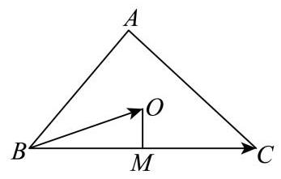

### 长宁 · 第3题

已知向量 $\overrightarrow{a} = \left( {x,2,3}\right)$ ， $\overrightarrow{b} = \left( {2, y,6}\right)$ ，若 $\overrightarrow{a}\bot \overrightarrow{b}$ ，则实数 $x + y =$ ___.

**考点：** 空间向量垂直与数量积；空间线线垂直

**难度依据：** 空间向量垂直与数量积；空间线线垂直

**【答案】** -9

**【解析】**

**【详解】**因为 $\overrightarrow{a} = \left( {x,2,3}\right) ,\overrightarrow{b} = \left( {2, y,6}\right)$ ,又 $\overrightarrow{a} \bot  \overrightarrow{b}$ ,

所以 $\overrightarrow{a} \cdot  \overrightarrow{b} = {2x} + {2y} + 3 \times  6 = 0$ ,

则 $x + y =  - 9$ .

### 长宁 · 第8题

在 ${ABC}$ 中， $D$ 是 ${BC}$ 的中点， $\left| \overrightarrow{AD}\right|  = 4$ ， $\left| \overrightarrow{BC}\right|  = 6$ ，则 $\overrightarrow{AB} \cdot  \overrightarrow{AC} =$ ___.

**考点：** 中线向量与数量积

**难度依据：** 中线向量与数量积

**【答案】** 7

**【解析】**

**【详解】**因为在 ${ABC}$ 中, $D$ 是 ${BC}$ 的中点,所以 $\overrightarrow{AB} + \overrightarrow{AC} = 2\overrightarrow{AD}$ ,所以

${\overrightarrow{AB}}^{2} + {\overrightarrow{AC}}^{2} + 2\overrightarrow{AB} \cdot  \overrightarrow{AC} = 4{\overrightarrow{AD}}^{2} = {64}$ .

又 $\left| \overrightarrow{BC}\right|  = 6$ ,所以 $\left| {\overrightarrow{AC} - \overrightarrow{AB}}\right|  = 6$ ,所以 ${\overrightarrow{AB}}^{2} + {\overrightarrow{AC}}^{2} - 2\overrightarrow{AB} \cdot  \overrightarrow{AC} = {36}$ .

所以 $4\overrightarrow{AB} \cdot  \overrightarrow{AC} = {28},\overrightarrow{AB} \cdot  \overrightarrow{AC} = 7$ .

### 黄浦 · 第8题

在复平面内,点 $P, Q, O$ 分别表示复数 $z, w,0$ ,已知 $\left| z\right|  = 3,\left| w\right|  = 5, u = z + w$ ,且 $\left| u\right|  = 7$ ，则向量 $\overrightarrow{OP}$ 与 $\overrightarrow{OQ}$ 的夹角为___.

> 本题资料或解析有待核事项，预览不可作为已审定成品。

**考点：** 复数加法；向量夹角

**难度依据：** 复数加法；向量夹角

**核查说明：** 仅本题解析局部回核；其他题未据此判定终审通过。

【答案】$\frac\pi3$

【解析·向量记号复核修订】

设复数 $u$ 对应点 $A$。复数加法对应向量加法，故 $\overrightarrow{OA}=\overrightarrow{OP}+\overrightarrow{OQ}$，且 $|\overrightarrow{OP}|=3$，$|\overrightarrow{OQ}|=5$，$|\overrightarrow{OA}|=7$。

两边取模平方，得

$$|\overrightarrow{OA}|^2=|\overrightarrow{OP}|^2+|\overrightarrow{OQ}|^2+2\overrightarrow{OP}\cdot\overrightarrow{OQ}.$$

因此 $49=9+25+2\overrightarrow{OP}\cdot\overrightarrow{OQ}$，即 $\overrightarrow{OP}\cdot\overrightarrow{OQ}=\frac{15}{2}$。

设两向量夹角为 $\theta\in[0,\pi]$，则

$$\cos\theta=\frac{\overrightarrow{OP}\cdot\overrightarrow{OQ}}{|\overrightarrow{OP}|\,|\overrightarrow{OQ}|}=\frac{15/2}{3\times5}=\frac12.$$

故 $\theta=\frac\pi3$。

【复核修订说明】教研整理PDF第1页题干保留向量箭头，第7页简答为 $\pi/3$。原合并稿解析丢失箭头，将向量和及数量积混写为线段长度的等式；此处按原题独立复算并规范化记号，保留原答案。该PDF未提供本题详细解析，本段不冒充PDF逐字原解。

## 共线、分点与平面几何综合

用向量比例、分点或数量积表达几何约束，综合大题不拆失小问。

### 嘉定 · 第20题

已知椭圆 $\Gamma  : \frac{{x}^{2}}{{a}^{2}} + \frac{{y}^{2}}{4} = 1\left( {a > 2}\right)$ 与直线 ${l}_{1} : y = \frac{x}{2}\text{ 、 }{l}_{2} : y =  - \frac{x}{2}$ . 过椭圆上一点 $P$ 作 ${l}_{1}$ 的平行线交 ${l}_{2}$ 于点 $M$ ，作 ${l}_{2}$ 的平行线交 ${l}_{1}$ 于点 $N$ .

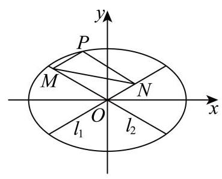

(1)当 $P$ 为椭圆的上顶点时，求 $\left| {MN}\right|$ 的大小；

(2)若椭圆的离心率 $e = \frac{\sqrt{3}}{2}$ ，求椭圆 $\Gamma$ 的方程，并求 $\left| {\overrightarrow{OM} + \overrightarrow{ON}}\right|$ 的最大值与最小值；

(3)若 $\left| {MN}\right|$ 为定值(与点 $P$ 的位置无关)，求 $a$ 的值，并求此时四边形 ${ONPM}$ 面积的最大值.

> 本题资料或解析有待核事项，预览不可作为已审定成品。

**考点：** (1) 椭圆顶点与平行线关系；(2) 椭圆离心率与向量模的范围；(3) 定值条件与面积最值

**难度依据：** 椭圆与向量定值面积最值

**核查说明：** 题干与答案解析尚未逐页对照原卷，数学内容未独立终审。

**【答案】** (1) 4 (2)最大值为 4，最小值为 2

(3) $a = 8$ ，四边形 ${ONPM}$ 面积的最大值为 16

**【解析】**

**【分析】**(1) 根据条件分别求直线 ${PM}$ 和 ${PN}$ 的方程,再联立直线求交点 $M, N$ 的坐标, 即可求解;

(2)首先根据离心率求椭圆方程，再根据向量的平行四边形法则转化为求 $\left| \overrightarrow{OP}\right|$ 的最值;

(3)首先根据点 $P$ 的坐标求直线 ${PM}$ 和 ${PN}$ 的方程，通过联立直线方程求点 $M$ ， $N$ 的坐标,再代入两点间距离公式,根据定值求 $a$ ,首先角的关系求 $\cos \angle {MON}$ ,再根据 $\left| {MN}\right|$ 为定值 4，分两种情况，结合余弦定理和基本不等式求 $\bigtriangleup  {MON}$ 面积的最大值，再求四边形 ONPM 面积的最大值.

**【小问 1 详解】**

当点 $P$ 在椭圆的上顶点时, $P\left( {0,2}\right) ,{l}_{PM} : y = \frac{x}{2} + 2,{l}_{PN} : y =  - \frac{x}{2} + 2$ ,

联立 $\left\{  \begin{array}{l} y = \frac{x}{2} + 2 \\  y =  - \frac{x}{2} \end{array}\right.$ ,得 $\left\{  \begin{array}{l} x =  - 2 \\  y = 1 \end{array}\right.$ ,即 $M\left( {-2,1}\right)$ ,

联立 $\left\{  \begin{array}{l} y =  - \frac{x}{2} + 2 \\  y = \frac{x}{2} \end{array}\right.$ ，得 $\left\{  \begin{array}{l} x = 2 \\  y = 1 \end{array}\right.$ ，即 $N\left( {2,1}\right)$ ，

所以 $\left| {MN}\right|  = \left| {2 - \left( {-2}\right) }\right|  = 4$ ；

**【小问 2 详解】**

椭圆的离心率 $e = \frac{\sqrt{{a}^{2} - 4}}{a} = \frac{\sqrt{3}}{2}$ ,得 ${a}^{2} = {16}$ ,

所以椭圆方程为 $\frac{{x}^{2}}{16} + \frac{{y}^{2}}{4} = 1$ ;

由条件可知四边形 ${ONPM}$ 是平行四边形,所以 $\overrightarrow{OM} + \overrightarrow{ON} = \overrightarrow{OP}$ ,

设 $P\left( {{x}_{0},{y}_{0}}\right) , - 4 \leq  {x}_{0} \leq  4$ ,

所以 $\left| {\overrightarrow{OM} + \overrightarrow{ON}}\right|  = \left| \overrightarrow{OP}\right|  = \sqrt{{x}_{0}^{2} + {y}_{0}^{2}} = \sqrt{\frac{3}{4}{x}_{0}^{2} + 4} \in  \left\lbrack  {2,4}\right\rbrack$ ,

所以 $\left| {\overrightarrow{OM} + \overrightarrow{ON}}\right|$ 的最大值为 4 ,最小值为 2 ;

**【小问 3 详解】**

设 $P\left( {{x}_{0},{y}_{0}}\right)$ ,则 ${l}_{PM} : y - {y}_{0} = \frac{1}{2}\left( {x - {x}_{0}}\right) ,{l}_{PN} : y - {y}_{0} =  - \frac{1}{2}\left( {x - {x}_{0}}\right)$ ,

联立 $\left\{  \begin{array}{l} y - {y}_{0} = \frac{1}{2}\left( {x - {x}_{0}}\right) \\  y =  - \frac{1}{2}x \end{array}\right.$ ,解得: $x = \frac{{x}_{0}}{2} - {y}_{0}, y =  - \frac{{x}_{0}}{4} + \frac{{y}_{0}}{2}$ ,

即 $M\left( {\frac{{x}_{0}}{2} - {y}_{0}, - \frac{{x}_{0}}{4} + \frac{{y}_{0}}{2}}\right)$ ,

联立 $\left\{  \begin{array}{l} y - {y}_{0} =  - \frac{1}{2}\left( {x - {x}_{0}}\right) \\  y = \frac{1}{2}x \end{array}\right.$ ,解得: $x = \frac{{x}_{0}}{2} + {y}_{0}, y = \frac{{x}_{0}}{4} + \frac{{y}_{0}}{2}$ ,

即 $N\left( {\frac{{x}_{0}}{2} + {y}_{0},\frac{{x}_{0}}{4} + \frac{{y}_{0}}{2}}\right)$ ,

因为点 $P$ 在椭圆上,满足 $\frac{{x}_{0}^{2}}{{a}^{2}} + \frac{{y}_{0}^{2}}{4} = 1$ ,

所以 $\left| {MN}\right|  = \sqrt{4{y}_{0}^{2} + \frac{{x}_{0}^{2}}{4}} = \sqrt{4 \times  4 \times  \left( {1 - \frac{{x}_{0}^{2}}{{a}^{2}}}\right)  + \frac{{x}_{0}^{2}}{4}} = \sqrt{{16} + \left( {\frac{1}{4} - \frac{16}{{a}^{2}}}\right) {x}_{0}^{2}}$

因为 $\left| {MN}\right|$ 为定值，所以与 ${x}_{0}$ 无关，所以 $\frac{1}{4} - \frac{16}{{a}^{2}} = 0$ ，得 ${a}^{2} = {64}$ ，则 $a = 8$ ； 此时 $\left| {MN}\right|  = 4$ ,

如图: 由条件可知, $\tan \angle {NOx} = \frac{1}{2}$ ,则 $\cos \angle {NOx} = \frac{2}{\sqrt{5}} = \frac{2\sqrt{5}}{5}$ ,

$\cos \angle {MON} = \cos \left( {\pi  - 2\angle {NOx}}\right)  =  - \cos 2\angle {NOx} = 1 - 2{\cos }^{2}\angle {NOx} =  - \frac{3}{5}$ ,

则 $\sin \angle {MON} = \frac{4}{5}$ ，且 $\left| {MN}\right|$ 为定值 4 ，

$\bigtriangleup {MON}$ 中根据余弦定理, ${\left| MN\right| }^{2} = {\left| OM\right| }^{2} + {\left| ON\right| }^{2} - 2\left| {OM}\right| \left| {ON}\right| \cos \angle {MON}$ ,

$= {\left| OM\right| }^{2} + {\left| ON\right| }^{2} + \frac{6}{5}\left| {OM}\right| \left| {ON}\right|  \geq  \frac{16}{5}\left| {OM}\right| \left| {ON}\right|$ ,

即 $\left| {OM}\right| \left| {ON}\right|  \leq  5$ ，所以 ${S}_{\bigtriangleup {MON}} = \frac{1}{2}\left| {OM}\right| \left| {ON}\right| \sin \angle {MON} \leq  2$ ，

而四边形 ${ONPM}$ 是平行四边形， ${S}_{\square {ONPM}} = 2{S}_{\bigtriangleup {MON}} \leq  4$ ，当 $\left| {OM}\right|  = \left| {ON}\right|$ 时等号成立，

此时，四边形 ONPM 的最大值为 4 ，

如下图:由以上可知， $\cos \angle {MON} = \frac{3}{5}$ ， $\left| {MN}\right|  = 4$ ，

$\bigtriangleup {MON}$ 中根据余弦定理, ${\left| MN\right| }^{2} = {\left| OM\right| }^{2} + {\left| ON\right| }^{2} - 2\left| {OM}\right| \left| {ON}\right| \cos \angle {MON}$ ,

$= {\left| OM\right| }^{2} + {\left| ON\right| }^{2} - \frac{6}{5}\left| {OM}\right| \left| {ON}\right|  \geq  \frac{4}{5}\left| {OM}\right| \left| {ON}\right|$ ,

即 $\left| {OM}\right| \left| {ON}\right|  \leq  {20}$ ,所以 ${S}_{\bigtriangleup {MON}} = \frac{1}{2}\left| {OM}\right| \left| {ON}\right| \sin \angle {MON} \leq  8$ ,

而四边形 ${ONPM}$ 是平行四边形, ${S}_{\square {ONPM}} = 2{S}_{\bigtriangleup {MON}} \leq  {16}$ ,当 $\left| {OM}\right|  = \left| {ON}\right|$ 时等号成立,

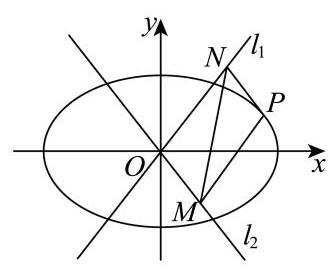

综上两种情况可知,四边形 ${ONPM}$ 的最大值为 16 .

### 奉贤 · 第20题

已知椭圆 $\Gamma  : \frac{{x}^{2}}{{a}^{2}} + \frac{{y}^{2}}{{b}^{2}} = 1\left( {a > b > 0}\right)$ 经过点 $\left( {0,1}\right)$ ,离心率为 $\frac{\sqrt{2}}{2}$ . 过点 $M\left( {0, - m}\right)$ , $m > 0$ 的动直线 $l$ 交椭圆 $\Gamma$ 于 $C, D$ 两点.

(1)求椭圆下的方程；

(2)若直线 $l$ 与 ${x}^{2} + {y}^{2} = \frac{2}{3}$ 相切,求当 $m = 2$ 时, ${CD}$ 的长;

(3)若以 ${CD}$ 为直径的圆经过 $x$ 轴上方的定点 $P$ ，求点 $P$ 的坐标.

**考点：** (1) 离心率求椭圆方程；(2) 切线条件及弦长；(3) 数量积建立直径圆定点

**难度依据：** 椭圆方程弦长和直径圆定点；数量积表示圆周角

**【答案】** (1) $\frac{{x}^{2}}{2} + {y}^{2} = 1$

(2) $\frac{4\sqrt{21}}{11}$

(3) $P\left( {0,1}\right)$

**【解析】**

**【分析】**(1) 利用离心率及所过点计算即可得;

(2)设出直线 $l$ 后,利用圆的切线的性质计算可得 ${k}^{2}$ ，联立直线与曲线方程，消去 $y$ 可得与横坐标相关韦达定理, 再利用弦长公式计算即可得;

(3) 设 $l : y = {kx} - m, P\left( {s, t}\right) \left( {t > 0}\right)$ ,联立直线与曲线方程,消去 $y$ 可得与横坐标相关韦达定理,再利用圆上的点的性质,借助向量有 $\overrightarrow{PC} \cdot  \overrightarrow{PD} = 0$ ,计算后可得与 $s\text{ 、 }t\text{ 、 }k\text{ 、 }m$ 有关等式,再利用定点性质计算即可得解.

**【小问 1 详解】**

由题意可得 $\left\{  \begin{array}{l} \frac{c}{a} = \frac{\sqrt{2}}{2} \\  \frac{1}{{b}^{2}} = 1 \\  {a}^{2} = {b}^{2} + {c}^{2} \end{array}\right.$ ,解得 $\left\{  \begin{array}{l} a = \sqrt{2} \\  b = 1 \\  c = 1 \end{array}\right.$ ,

故椭圆 $\Gamma$ 的方程为 $\frac{{x}^{2}}{2} + {y}^{2} = 1$ ;

**【小问 2 详解】**

由 $m = 2$ ,则 $M\left( {0, - 2}\right)$ ,可设 $l : y = {kx} - 2, C\left( {{x}_{1},{y}_{1}}\right) \text{ 、 }D\left( {{x}_{2},{y}_{2}}\right)$ ,

则由直线 $l$ 与 ${x}^{2} + {y}^{2} = \frac{2}{3}$ 相切,可得 $\frac{\left| -2\right| }{\sqrt{{k}^{2} + 1}} = \sqrt{\frac{2}{3}}$ ,化简得 ${k}^{2} = 5$ ,

联立 $\left\{  \begin{array}{l} y = {kx} - 2 \\  \frac{{x}^{2}}{2} + {y}^{2} = 1 \end{array}\right.$ ，消去 $y$ 可得 $\left( {2{k}^{2} + 1}\right) {x}^{2} - {8kx} + 6 = 0$ ，

$\Delta  = {\left( -8k\right) }^{2} - 4\left( {2{k}^{2} + 1}\right)  \times  6 = {16}{k}^{2} - {24} = {16} \times  5 - {24} = {56} > 0,$

则 ${x}_{1} + {x}_{2} = \frac{8k}{2{k}^{2} + 1},\;{x}_{1}{x}_{2} = \frac{6}{2{k}^{2} + 1}$ ,

则 $\left| {CD}\right|  = \sqrt{{k}^{2} + 1} \cdot  \sqrt{{\left( {x}_{1} + {x}_{2}\right) }^{2} - 4{x}_{1}{x}_{2}} = \sqrt{{k}^{2} + 1} \cdot  \sqrt{{\left( \frac{8k}{2{k}^{2} + 1}\right) }^{2} - 4 \times  \frac{6}{2{k}^{2} + 1}} \; = \frac{\sqrt{{k}^{2} + 1}}{2{k}^{2} + 1} \cdot  \sqrt{{16}{k}^{2} - {24}} = \frac{2\sqrt{2} \cdot  \sqrt{{k}^{2} + 1} \cdot  \sqrt{2{k}^{2} - 3}}{2{k}^{2} + 1} \; = \frac{2\sqrt{2} \times  \sqrt{5 + 1} \times  \sqrt{2 \times  5 - 3}}{2 \times  5 + 1} = \frac{4\sqrt{21}}{11};$

设 $l : y = {kx} - m, C\left( {{x}_{1},{y}_{1}}\right) \text{ 、 }D\left( {{x}_{2},{y}_{2}}\right) , P\left( {s, t}\right) \left( {t > 0}\right)$ ,

联立 $\left\{  \begin{array}{l} y = {kx} - m \\  \frac{{x}^{2}}{2} + {y}^{2} = 1 \end{array}\right.$ ,消去 $y$ 可得 $\left( {2{k}^{2} + 1}\right) {x}^{2} - {4kmx} + 2{m}^{2} - 2 = 0$ ,

$\Delta  = {\left( -4km\right) }^{2} - 4\left( {2{k}^{2} + 1}\right) \left( {2{m}^{2} - 2}\right)  = {16}{m}^{2}{k}^{2} - {16}{m}^{2}{k}^{2} + 8 - 8{m}^{2} + {16}{k}^{2}$

$= 8 - 8{m}^{2} + {16}{k}^{2} > 0$ ,即 $2{k}^{2} - {m}^{2} + 1 > 0$ ,

${x}_{1} + {x}_{2} = \frac{4km}{2{k}^{2} + 1},\;{x}_{1}{x}_{2} = \frac{2{m}^{2} - 2}{2{k}^{2} + 1},$

由点 $P$ 在以 ${CD}$ 为直径的圆上,则 $\overrightarrow{PC} \cdot  \overrightarrow{PD} = 0$ ,

由 $\overrightarrow{PC} = \left( {{x}_{1} - s,{y}_{1} - t}\right) ,\overrightarrow{PD} = \left( {{x}_{2} - s,{y}_{2} - t}\right)$ ,

则 $\overrightarrow{PC} \cdot  \overrightarrow{PD} = \left( {{x}_{1} - s}\right) \left( {{x}_{2} - s}\right)  + \left( {{y}_{1} - t}\right) \left( {{y}_{2} - t}\right)$

$= {x}_{1}{x}_{2} - s\left( {{x}_{1} + {x}_{2}}\right)  + {s}^{2} + {y}_{1}{y}_{2} - t\left( {{y}_{1} + {y}_{2}}\right)  + {t}^{2}$

$= {x}_{1}{x}_{2} - s\left( {{x}_{1} + {x}_{2}}\right)  + {s}^{2} + \left( {k{x}_{1} - m}\right) \left( {k{x}_{2} - m}\right)  - t\left( {k{x}_{1} - m + k{x}_{2} - m}\right)  + {t}^{2}$

$= \left( {{k}^{2} + 1}\right) {x}_{1}{x}_{2} - \left( {s + {km} + {tk}}\right) \left( {{x}_{1} + {x}_{2}}\right)  + {s}^{2} + {t}^{2} + {m}^{2} + {2tm}$

$$
= \frac{\left( {2{m}^{2} - 2}\right) \left( {{k}^{2} + 1}\right) }{2{k}^{2} + 1} - \frac{{4km}\left( {s + {km} + {tk}}\right) }{2{k}^{2} + 1} + \frac{\left( {{s}^{2} + {t}^{2} + {m}^{2} + {2tm}}\right) \left( {2{k}^{2} + 1}\right) }{2{k}^{2} + 1}
$$

$$
= \frac{-2{k}^{2} + 3{m}^{2} - 2 - {4kms} + 2{k}^{2}{s}^{2} + 2{k}^{2}{t}^{2} + {s}^{2} + {t}^{2} + {2tm}}{2{k}^{2} + 1}
$$

$$
= \frac{\left( {2{t}^{2} + 2{s}^{2} - 2}\right) {k}^{2} - {4msk} + 3{m}^{2} + {s}^{2} + {t}^{2} + {2tm} - 2}{2{k}^{2} + 1} = 0,
$$

即 $\left( {2{t}^{2} + 2{s}^{2} - 2}\right) {k}^{2} - {4msk} + 3{m}^{2} + {s}^{2} + {t}^{2} + {2tm} - 2 = 0$

故 $\left\{  \begin{array}{l} 2{t}^{2} + 2{s}^{2} - 2 = 0 \\   - {4s} = 0 \\  3{m}^{2} + {s}^{2} + {t}^{2} + {2tm} - 2 = 0 \end{array}\right.$ ,则有 $\left\{  \begin{array}{l} s = 0 \\  {t}^{2} = 1 \\  3{m}^{2} + {2tm} - 1 = 0 \end{array}\right.$ ,

由 $t > 0$ ,故 $t = 1$ ,则有 $3{m}^{2} + {2m} - 1 = \left( {{3m} - 1}\right) \left( {m + 1}\right)  = 0$ ,

即 $m = \frac{1}{3}$ 或 $m =  - 1$ ,由 $m > 0$ ,故 $m = \frac{1}{3}$ ,

即当且仅当 $m = \frac{1}{3}$ 时，以 ${CD}$ 为直径的圆经过 $x$ 轴上方的定点 $P$ ， 且 $P$ 点坐标为 $\left( {0,1}\right)$ .

### 宝山 · 第4题

若 $\overrightarrow{n} = \left( {1,2}\right)$ 是直线 $l : {ax} + y - 1 = 0$ 的一个法向量，则实数 $a$ 的值为___.

**考点：** 直线法向量与平行坐标比例；直线一般式及法向量

**难度依据：** 直线法向量与平行坐标比例；直线一般式及法向量

**【答案】** $\frac{1}{2}\# \# {0.5}$

**【解析】**

**【分析】**利用直线一般式的法向量形式, 结合已知法向量与该法向量平行的性质列比例式求解 $a$ 的值.

**【详解】**已知直线 $l$ 的方程为 ${ax} + y - 1 = 0$ ,

根据直线一般式 ${Ax} + {By} + C = 0$ 的法向量性质, $l$ 的法向量可表示为 $\left( {a,1}\right)$ ,

因为 $\overrightarrow{n} = \left( {1,2}\right)$ 是 $l$ 的一个法向量,故 $\left( {a,1}\right)$ 与 $\left( {1,2}\right)$ 平行,

由向量平行的坐标关系得: ${2a} = 1 \times  1$ ，解得 $a = \frac{1}{2}$ .

**【点睛】**本题考查直线法向量的概念和向量平行的坐标运算, 记住直线一般式 ${Ax} + {By} + C = 0$ 的法向量为 $\left( {A, B}\right)$ 可快速解题.

### 崇明 · 第20题

已知椭圆 $C : \frac{{x}^{2}}{4} + \frac{{y}^{2}}{3} = 1$ .

(1)求椭圆 $C$ 的离心率 $e$ ；

(2)已知椭圆右顶点为 $A$ ，设点 $M$ 为 $y$ 轴正半轴上一点，点 $P$ 为椭圆 $C$ 上的一点. 若 $\overrightarrow{AP} = 2\overrightarrow{PM}$ ,求点 $M$ 的坐标;

(3)已知 $G\left( {\frac{5}{2},0}\right)$ ，过点 $R\left( {4,0}\right)$ 的直线交椭圆 $C$ 于 $D$ ， $E$ 两点，直线 ${DG}$ 交直线 $x = 1$ 于点 $H$ ,证明: ${EH} \bot  y$ 轴.

**考点：** (1) 椭圆离心率；(2) 向量分点及椭圆坐标；(3) 直线与椭圆联立、韦达及坐标证明

**难度依据：** 椭圆离心率分点及直线定向；分点坐标和共线条件

**【答案】** (1) $\frac{1}{2}$ ;

(2) $\left( {0,\sqrt{6}}\right)$ ；

(3) 证明见详解.

**【解析】**

**【分析】**(1) 根据离心率定义直接计算可得;

(2)设 $M\left( {0, m}\right) , m > 0$ 利用向量关系表示出点 $P$ 坐标，代入椭圆方程即可得解；

(3)利用韦达定理表示出点 $E$ 的纵坐标，利用向量共线表示出点 $H$ 的纵坐标，证明 $E$ 和 $H$ 的纵坐标相等即可得证.

**【小问 1 详解】**

记椭圆 $C : \frac{{x}^{2}}{4} + \frac{{y}^{2}}{3} = 1$ 的长轴长为 ${2a}$ ,短轴长为 ${2b}$ ,焦距为 ${2c}$ ,

则 $a = 2, b = \sqrt{3}, c = \sqrt{{a}^{2} - {b}^{2}} = 1$ ,所以离心率 $e = \frac{c}{a} = \frac{1}{2}$ .

**【小问 2 详解】**

由题知, $A\left( {2,0}\right)$ ,设 $M\left( {0, m}\right) , m > 0, P\left( {{x}_{P},{y}_{P}}\right)$ ,

因为 $\overrightarrow{AP} = \left( {{x}_{P} - 2,{y}_{P}}\right) ,\overrightarrow{PM} = \left( {-{x}_{P}, m - {y}_{P}}\right) ,\overrightarrow{AP} = 2\overrightarrow{PM}$ ,

所以 $\left( {{x}_{P} - 2,{y}_{P}}\right)  = 2\left( {-{x}_{P}, m - {y}_{P}}\right)$ ,得 ${x}_{P} = \frac{2}{3},{y}_{P} = \frac{2m}{3}$ ,

代入椭圆方程得 $\frac{1}{9} + \frac{4{m}^{2}}{27} = 1$ ,解得 $m = \sqrt{6}$ (负根舍去)

**【小问 3 详解】**

易知,当直线 ${DE}$ 斜率为 0 时, $D, E$ 为长轴端点, $H$ 与右焦点重合,满足题意;

设直线 ${DE}$ 的方程为 $x = {ny} + 4, D\left( {{x}_{1},{y}_{1}}\right) , E\left( {{x}_{2},{y}_{2}}\right)$ ,

联立 $\left\{  \begin{array}{l} \frac{{x}^{2}}{4} + \frac{{y}^{2}}{3} = 1 \\  x = {ny} + 4 \end{array}\right.$ 得: $\left( {3{n}^{2} + 4}\right) {y}^{2} + {24ny} + {36} = 0$ ,

由 $\Delta  = {\left( {24}n\right) }^{2} - 4\left( {3{n}^{2} + 4}\right)  \times  {36} = {144}\left( {{n}^{2} - 4}\right)  > 0$ 得 $n <  - 2$ 或 $n > 2$ ,

则 ${y}_{1} + {y}_{2} = \frac{-{24n}}{3{n}^{2} + 4},{y}_{1}{y}_{2} = \frac{36}{3{n}^{2} + 4}$ ,

所以 $3\left( {{y}_{1} + {y}_{2}}\right)  =  - {2n}{y}_{1}{y}_{2}$ ,则 ${y}_{2} = \frac{-3{y}_{1}}{3 + {2n}{y}_{1}}$ ,

设 $H\left( {1, h}\right)$ ，因为 $D, H, G$ 三点共线，则 $\overrightarrow{DH}//\overrightarrow{HG}$ ， $\overrightarrow{DH} = \left( {1 - {x}_{1}, h - {y}_{1}}\right) ,\overrightarrow{HG} = \left( {\frac{3}{2}, - h}\right)$ ，

所以 $- h\left( {1 - {x}_{1}}\right)  = \frac{3}{2}\left( {h - {y}_{1}}\right)$ ,则 $h = \frac{3{y}_{1}}{5 - 2{x}_{1}} = \frac{3{y}_{1}}{5 - 2\left( {n{y}_{1} + 4}\right) } = \frac{-3{y}_{1}}{3 + {2n}{y}_{1}}$ ,

所以 $h = {y}_{2}$ ,所以 ${EH} \bot  y$ 轴.

### 普陀 · 第9题

已知向量 $\overrightarrow{a} = \left( {1,2}\right) ,\overrightarrow{b} = \left( {-1,1}\right) ,\overrightarrow{c} = \left( {3,4}\right)$ ，函数 $y = f\left( x\right)$ 的表达式为 $f\left( x\right)  = \left\{  \begin{array}{l} x + 1, x < 2 \\  {2x} - 1, x \geq  2 \end{array}\right.$ ,设 $\overrightarrow{d}\left( x\right)  = f\left( x\right)  \cdot  \overrightarrow{a} + f\left( {x + 2}\right)  \cdot  \overrightarrow{b}$ ,若 $\overrightarrow{d}\left( x\right) //\overrightarrow{c}$ ,则 $x =$

**考点：** 向量平行的坐标条件；分段函数代入并分类

**难度依据：** 向量平行的坐标条件；分段函数代入并分类

**【答案】** $- \frac{23}{9}$

**【解析】**

**【分析】**由题意可得 $f\left( {x + 2}\right)  =  - \frac{2}{7}f\left( x\right)$ ,分 $x < 0\text{ 、 }0 \leq  x < 2$ 和 $x \geq  2$ 三种情况分别求解即可.

**【详解】**因为 $\overrightarrow{d}\left( x\right)  = f\left( x\right)  \cdot  \overrightarrow{a} + f\left( {x + 2}\right)  \cdot  \overrightarrow{b} = \left( {f\left( x\right)  - f\left( {x + 2}\right) ,{2f}\left( x\right)  + f\left( {x + 2}\right) }\right)$ ,

又因为 $\overrightarrow{c} = \left( {3,4}\right)$ ,且 $\overrightarrow{d}\left( x\right) //\overrightarrow{c}$ ,

所以 $4\left\lbrack  {f\left( x\right)  - f\left( {x + 2}\right) }\right\rbrack   = 3\left\lbrack  {{2f}\left( x\right)  + f\left( {x + 2}\right) }\right\rbrack$ ,

整理得 $f\left( {x + 2}\right)  =  - \frac{2}{7}f\left( x\right)$ ,

当 $x < 0$ 时， $x + 2 < 2$ ，

则有 $x + 2 + 1 =  - \frac{2}{7}\left( {x + 1}\right)$ ,解得 $x =  - \frac{23}{9} < 0$ ,满足题意;

当 $0 \leq  x < 2$ 时, $2 \leq  x + 2 < 4$ ,

则有 $2\left( {x + 2}\right)  - 1 =  - \frac{2}{7}\left( {x + 1}\right)$ ,解得 $x =  - \frac{23}{16} < 0$ ,不满足题意;

当 $x \geq  2$ 时， $x + 2 \geq  4$ ，

则有 $2\left( {x + 2}\right)  - 1 =  - \frac{2}{7}\left( {{2x} - 1}\right)$ ,解得 $x =  - \frac{19}{18} < 0$ ,不满足题意;

综上， $x =  - \frac{23}{9}$ .

### 普陀 · 第18题

设 ${ABC}$ 的内角 $A, B, C$ 的对边分别为 $a, b, c$ ,且 $b\sin \left( {A + \frac{5\pi }{6}}\right)  = a\cos A\cos C + c{\cos }^{2}A.$

(1)求角 $A$ 的大小；

(2)点 $O$ 、 $D$ 分别满足 $\left( {\overrightarrow{OA} + \overrightarrow{OB}}\right)  \cdot  \overrightarrow{AB} = 0$ ， $\left( {\overrightarrow{OA} + \overrightarrow{OC}}\right)  \cdot  \overrightarrow{AC} = 0$ ， $\overrightarrow{BD} = 2\overrightarrow{DC}$ ， ${AB} \cdot  {AD} = 0$ ,求 $\frac{\overrightarrow{CO} \cdot  \overrightarrow{AB}}{\overrightarrow{CO} \cdot  \overrightarrow{CB} + \overrightarrow{CO} \cdot  \overrightarrow{CA}}$ 的值.

**考点：** (1) 正弦定理化简解角；(2) 外心向量与分点数量积

**难度依据：** 正弦定理及三角恒等变换；外心数量积及分点关系

**【答案】** (1) $\frac{5\pi }{6}$ ;

(2) $\frac{3}{4}$ .

**【解析】**

**【分析】**(1) 利用正弦定理将边化为角,化简得 $\sin \left( {A + \frac{5\pi }{6}}\right)  = \cos A$ ,即可解得 $A$ ;

(2)由向量条件推出 $O$ 为外心，将目标式用外心向量转化为

$\frac{\cos 2\angle {ABC} - \cos 2\angle {BAC}}{2 - \cos 2\angle {BAC} - \cos 2\angle {ABC}}$ ,再利用 $\overrightarrow{BD} = 2\overrightarrow{DC}$ 和 ${AB} \cdot  {AD} = 0$ 推导出边的关系,结合正弦定理求得 $\cos 2\angle {ABC}$ 后代入即得结果.

**【小问 1 详解】**

因为 $b\sin \left( {A + \frac{5\pi }{6}}\right)  = a\cos A\cos C + c{\cos }^{2}A$ ,

设 ${ABC}$ 外接圆半径为 $R$ ,由正弦定理 $a = {2R}\sin A, b = {2R}\sin B, c = {2R}\sin C$ ,

代入可得 $\sin B\sin \left( {A + \frac{5\pi }{6}}\right)  = \sin A\cos A\cos C + \sin C{\cos }^{2}A$ ,

所以 $\sin B\sin \left( {A + \frac{5\pi }{6}}\right)  = \left( {\sin A\cos C + \cos A\sin C}\right) \cos A$ ,

即 $\sin B\sin \left( {A + \frac{5\pi }{6}}\right)  = \sin \left( {A + C}\right) \cos A$ ,

因为在 ${ABC}$ 中, $A + C = \pi  - B$ ,所以 $\sin \left( {A + C}\right)  = \sin B$ ,

即 $\sin B\sin \left( {A + \frac{5\pi }{6}}\right)  = \sin B\cos A$ ,

因为 $B \in  \left( {0,\pi }\right)$ ,所以 $\sin B \neq  0$ ,所以 $\sin \left( {A + \frac{5\pi }{6}}\right)  = \cos A$ ,

化简得: $\sin A\cos \frac{5\pi }{6} + \cos A\sin \frac{5\pi }{6} = \cos A$ ,

解得 $\sin A =  - \frac{\sqrt{3}}{3}\cos A$ ,即 $\tan A =  - \frac{\sqrt{3}}{3}$ ,

因为 $A \in  \left( {0,\pi }\right)$ ,所以 $A = \frac{5\pi }{6}$ .

**【小问 2 详解】**

由 $\left( {\overrightarrow{OA} + \overrightarrow{OB}}\right)  \cdot  \overrightarrow{AB} = 0$ ,所以 $\left( {\overrightarrow{OA} + \overrightarrow{OB}}\right)  \cdot  \left( {\overrightarrow{OB} - \overrightarrow{OA}}\right)  = 0$ ,

所以 ${\overrightarrow{OA}}^{2} = {\overrightarrow{OB}}^{2}$ ,即 $\left| \overrightarrow{OA}\right|  = \left| \overrightarrow{OB}\right|$ ,同理由 $\left( {\overrightarrow{OA} + \overrightarrow{OC}}\right)  \cdot  \overrightarrow{AC} = 0$ 得 $\left| \overrightarrow{OC}\right|  = \left| \overrightarrow{OB}\right|$ ,

所以 $O$ 是 ${ABC}$ 的外心,所以 $\left| \overrightarrow{OC}\right|  = \left| \overrightarrow{OB}\right|  = \left| \overrightarrow{OA}\right|  = R$ ,

因为同弧所对的圆周角是圆心角的一半,

所以 $\angle {AOB} = 2\angle {ACB}$ ， $\angle {AOC} = 2\angle {ABC}$ ，所以 $\angle {BOC} = {2\pi } - 2\angle {BAC}$ ，

所以 $\overrightarrow{CO} \cdot  \overrightarrow{AB} =  - \overrightarrow{OC} \cdot  \left( {\overrightarrow{OB} - \overrightarrow{OA}}\right)  =  - \left| \overrightarrow{OC}\right|  \cdot  \left| \overrightarrow{OB}\right| \cos \angle {BOC} + \left| \overrightarrow{OC}\right|  \cdot  \left| \overrightarrow{OA}\right| \cos \angle {AOC} \; =  - {R}^{2}\cos 2\angle {BAC} + {R}^{2}\cos 2\angle {ABC}$ ，

$\overrightarrow{CO} \cdot  \overrightarrow{CB} =  - \overrightarrow{OC} \cdot  \left( {\overrightarrow{OB} - \overrightarrow{OC}}\right)  =  - \left| \overrightarrow{OC}\right|  \cdot  \left| \overrightarrow{OB}\right| \cos \angle {BOC} + {\left| \overrightarrow{OC}\right| }^{2} =  - {R}^{2}\cos 2\angle {BAC} + {R}^{2}$ ,

$\overrightarrow{CO} \cdot  \overrightarrow{CA} =  - \overrightarrow{OC} \cdot  \left( {\overrightarrow{OA} - \overrightarrow{OC}}\right)  =  - \left| \overrightarrow{OC}\right|  \cdot  \left| \overrightarrow{OA}\right| \cos \angle {AOC} + {\left| \overrightarrow{OC}\right| }^{2} =  - {R}^{2}\cos 2\angle {ABC} + {R}^{2}$ ,

得到

$\frac{\overrightarrow{CO} \cdot  \overrightarrow{AB}}{\overrightarrow{CO} \cdot  \overrightarrow{CB} + \overrightarrow{CO} \cdot  \overrightarrow{CA}} = \frac{-{R}^{2}\cos 2\angle {BAC} + {R}^{2}\cos 2\angle {ABC}}{-{R}^{2}\cos 2\angle {BAC} + {R}^{2} - {R}^{2}\cos 2\angle {ABC} + {R}^{2}}$

$= \frac{\cos 2\angle {ABC} - \cos 2\angle {BAC}}{2 - \cos 2\angle {BAC} - \cos 2\angle {ABC}},$

而 $\overrightarrow{BD} = 2\overrightarrow{DC}$ ,所以 $\overrightarrow{AD} = \frac{1}{3}\overrightarrow{AB} + \frac{2}{3}\overrightarrow{AC}$ ,

因为 ${AB} \cdot  {AD} = 0$ ,所以 ${AB} \cdot  \left( {\frac{1}{3}{AB} + \frac{2}{3}{AC}}\right)  = 0$ ,得 $A{B}^{2} + {2AB} \cdot  {AC} = 0$ ,

而 $\overrightarrow{AB} \cdot  \overrightarrow{AC} = \left| \overrightarrow{AB}\right|  \cdot  \left| \overrightarrow{AC}\right| \cos \angle {BAC} =  - \frac{\sqrt{3}}{2} \cdot  \left| \overrightarrow{AB}\right|  \cdot  \left| \overrightarrow{AC}\right|$ ，所以 $\left| \overrightarrow{AB}\right|  = \sqrt{3}\left| {AC}\right|$ ，

由正弦定理 $\frac{\left| \overrightarrow{AB}\right| }{\sin \angle {ACB}} = \frac{\left| \overrightarrow{AC}\right| }{\sin \angle {ABC}}$ ，所以 $\sin \angle {ACB} = \sqrt{3}\sin \angle {ABC}$ ，

又因为 $\angle {ACB} + \angle {ABC} = \frac{\pi }{6}$ ,所以 $\sin \left( {\frac{\pi }{6} - \angle {ABC}}\right)  = \sqrt{3}\sin \angle {ABC}$ ,

化简得 $\cos \angle {ABC} = 3\sqrt{3}\sin \angle {ABC}$ ,所以 $\tan \angle {ABC} = \frac{\sqrt{3}}{9}$ ,

所以 $\cos 2\angle {ABC} = \frac{1 - {\tan }^{2}\angle {ABC}}{1 + {\tan }^{2}\angle {ABC}} = \frac{13}{14}$ ,

因为 $\angle {BAC} = \frac{5\pi }{6}$ ，所以 $\cos {2\angle {BAC}} = \cos \frac{5\pi }{3} = \frac{1}{2}$ ，

代入计算 $\frac{\cos 2\angle {ABC} - \cos 2\angle {BAC}}{2 - \cos 2\angle {BAC} - \cos 2\angle {ABC}} = \frac{\frac{13}{14} - \frac{1}{2}}{2 - \frac{1}{2} - \frac{13}{14}} = \frac{3}{4}$ ，所以 $\frac{\overrightarrow{CO} \cdot  \overrightarrow{AB}}{\overrightarrow{CO} \cdot  \overrightarrow{CB} + \overrightarrow{CO} \cdot  \overrightarrow{CA}} = \frac{3}{4}$ .

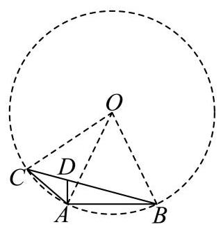

### 杨浦 · 第8题

直线 $l : \left( {a - 3}\right) x + \left( {{2a} + 1}\right) y - 3 = 0$ 的一个法向量是 $\overrightarrow{n} = \left( {3,2}\right)$ ，则实数 $a =$ ___.

**考点：** 直线系数向量与给定法向量共线

**难度依据：** 运用法向量坐标关系

**【答案】** $- \frac{9}{4}$

**【解析】**

**【详解】**易知直线 $l : \left( {a - 3}\right) x + \left( {{2a} + 1}\right) y - 3 = 0$ 的一个法向量可以表示为 $\left( {a - 3,{2a} + 1}\right)$ , 又直线 $l$ 的一个法向量是 $\overrightarrow{n} = \left( {3,2}\right)$ ,所以两向量共线,

根据向量共线的坐标表示得 $2\left( {a - 3}\right)  - 3\left( {{2a} + 1}\right)  = 0$ ,解得 $a =  - \frac{9}{4}$ .

### 浦东 · 第20题

已知双曲线 $C : {x}^{2} - \frac{{y}^{2}}{{b}^{2}} = 1\left( {b > 0}\right)$ 的左顶点为 $A$ ,过点 $D\left( {2,0}\right)$ 的直线 $l$ 交双曲线 $C$ 于 $M$ 、 $N$ 两点,点 $M$ 在第一象限.

(1)若双曲线 $C$ 的焦距为 $2\sqrt{5}$ ，求该双曲线 $C$ 的离心率 $e$ ；

(2)若 $b = \sqrt{3}$ ， $\bigtriangleup  {MAD}$ 为直角三角形，求点 $M$ 的坐标；

(3)若双曲线 $C$ 的一条渐近线方程为 $x + \sqrt{2}y = 0$ ，点 $M$ 、 $N$ 均在双曲线 $C$ 的右支，且存在实数 $\lambda \left( {\lambda  < \frac{4}{3}}\right)$ ,使得 $\overrightarrow{MN} = \lambda \overrightarrow{MD}$ 成立,求直线 $l$ 的倾斜角的取值范围.

**考点：** (1)焦距求离心率；(2)分类讨论直角并排除渐近线平行；(3)韦达与弦上向量比例求倾斜角范围

**难度依据：** 直角分类、双交点限制及比例范围

**【答案】** (1) $\sqrt{5}$

(2) $\left( {2,3}\right)$

(3) $\left( {\arctan \frac{\sqrt{2}}{2},\arctan \frac{\sqrt{10}}{2}}\right)$

**【解析】**

**【分析】**(1) 根据焦距和离心率公式求解即可;

(2)分 $\angle {ADM} = \frac{\pi }{2}$ ， $\angle {DMA} = \frac{\pi }{2}$ 两种情况讨论，根据垂直条件代入双曲线方程求解；

(3)根据渐近线方程得双曲线的方程，设直线 $l$ 的方程为 $x = {my} + 2$ ，联立方程，根据韦达定理求出 ${y}_{1} + {y}_{2},{y}_{1}{y}_{2}$ ,根据 $\overrightarrow{MN} = \lambda \overrightarrow{MD}$ 得到 $\frac{{y}_{2}}{{y}_{1}}$ 的范围,构造 $\frac{{\left( {y}_{1} + {y}_{2}\right) }^{2}}{{y}_{1}{y}_{2}}$ 的不等式, 解出 $m$ 的范围,进而求出倾斜角的范围.

**【小问 1 详解】**

由题， ${2c} = 2\sqrt{5}$ ，得 $c = \sqrt{5}$

故 $e = \frac{c}{a} = \sqrt{5}$

**【小问 2 详解】**

因为点 $M$ 在第一象限,故 $\angle {MAD}$ 不可能为直角;

若 $\angle {ADM} = \frac{\pi }{2}$ ，将 $x = 2$ 代入曲线 $C : {x}^{2} - \frac{{y}^{2}}{3} = 1$ ，得 $M\left( {2,3}\right)$ 符合题意，；

若 $\angle {DMA} = \frac{\pi }{2}$ ，设点 $M\left( {{x}_{0},{y}_{0}}\right)$ ，则 $\overrightarrow{MD} = \left( {2 - {x}_{0}, - {y}_{0}}\right) ,\overrightarrow{MA} = \left( {-1 - {x}_{0}, - {y}_{0}}\right)$ ，

则 $\overrightarrow{MD} \cdot  \overrightarrow{MA} = {x}_{0}^{2} - {x}_{0} - 2 + {y}_{0}^{2} = 0$

又因为点 $M$ 满足 ${x}_{0}^{2} - \frac{{y}_{0}^{2}}{3} = 1$ ,可得 $M\left( {\frac{5}{4},\frac{3\sqrt{3}}{4}}\right)$ ,此时 ${k}_{DM} = \frac{\frac{3\sqrt{3}}{4}}{\frac{5}{4} - 2} =  - \sqrt{3}$ ,

${DM}$ 与双曲线渐近线平行,不满足两个交点,舍去.

综上,点 $M$ 的坐标 $\left( {2,3}\right)$ ;

**【小问 3 详解】** 由题可得,双曲线 $C : {x}^{2} - 2{y}^{2} = 1$ ,

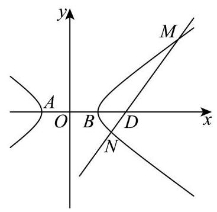

当直线 $l$ 的斜率不存在时,根据双曲线的对称性, $\overrightarrow{MN} = 2\overrightarrow{MD}$ ,不满足 $\lambda  < \frac{4}{3}$ ,

所以直线 $l$ 的斜率一定存在,

又 $\overrightarrow{MN} = \lambda \overrightarrow{MD}$ ,说明 $M, D, N$ 三点共线,且 $M, N$ 都在双曲线的右支上,所以直线 $l$ 的斜率不为 $0,1 < \lambda  < \frac{4}{3}$ ,

设直线 $l$ 的方程为 $x = {my} + 2, M\left( {{x}_{1},{y}_{1}}\right) \text{ 、 }N\left( {{x}_{2},{y}_{2}}\right)$ ,且 ${y}_{1} > 0,{y}_{2} < 0$ ,

联立方程 $\left\{  \begin{array}{l} x = {my} + 2 \\  {x}^{2} - 2{y}^{2} = 1 \end{array}\right.$ ,可得 $\left( {{m}^{2} - 2}\right) {y}^{2} + {4my} + 3 = 0$

显然 ${m}^{2} - 2 \neq  0,\Delta  = {\left( 4m\right) }^{2} - 4\left( {{m}^{2} - 2}\right)  \times  3 = 4{m}^{2} + {24} > 0$ ,

${y}_{1} + {y}_{2} = \frac{-{4m}}{{m}^{2} - 2} > 0,\;{y}_{1}{y}_{2} = \frac{3}{{m}^{2} - 2} < 0$ ,故 $0 < m < \sqrt{2}$

由 $\overrightarrow{MN} = \lambda \overrightarrow{MD}$ ,可得 ${y}_{2} - {y}_{1} =  - \lambda {y}_{1}$ ,且 $1 < \lambda  < \frac{4}{3}$ .

故 $\frac{{y}_{2}}{{y}_{1}} = 1 - \lambda  \in  \left( {-\frac{1}{3},0}\right)$

因此 $\frac{{\left( {y}_{1} + {y}_{2}\right) }^{2}}{{y}_{1}{y}_{2}} = \frac{{y}_{2}}{{y}_{1}} + \frac{{y}_{1}}{{y}_{2}} + 2$ ,

根据对勾函数 $y = x + \frac{1}{x}$ 的性质: $y$ 在 $\left( {-1,0}\right)$ 上单调递减，

可知 $\frac{{\left( {y}_{1} + {y}_{2}\right) }^{2}}{{y}_{1}{y}_{2}} = \frac{{y}_{2}}{{y}_{1}} + \frac{{y}_{1}}{{y}_{2}} + 2 <  - \frac{1}{3} + \left( {-3}\right)  + 2 =  - \frac{4}{3}$ ,

又 $\frac{{\left( {y}_{1} + {y}_{2}\right) }^{2}}{{y}_{1}{y}_{2}} = {\left( -\frac{4m}{{m}^{2} - 2}\right) }^{2} \cdot  \frac{{m}^{2} - 2}{3} = \frac{16}{3} \cdot  \frac{{m}^{2}}{{m}^{2} - 2}$ ,

故 $\frac{16}{3} \cdot  \frac{{m}^{2}}{{m}^{2} - 2} <  - \frac{4}{3}$ ,可得 $\frac{2}{\sqrt{10}} < m < \sqrt{2}$ .

所以，直线 $l$ 斜率的取值范围为 $\left( {\frac{\sqrt{2}}{2},\frac{\sqrt{10}}{2}}\right)$ ，

直线 $l$ 倾斜角的取值范围为 $\left( {\arctan \frac{\sqrt{2}}{2},\arctan \frac{\sqrt{10}}{2}}\right)$ .

### 虹口 · 第20题

设椭圆 $\Gamma  : \frac{{x}^{2}}{4} + {y}^{2} = 1$ 的左顶点为 $A$ .

(1)求 $\Gamma$ 的离心率；

(2)设 $\Gamma$ 的左焦点为 $F$ ，上顶点为 $B$ ，若点 $P$ 在 $\Gamma$ 上且位于 $y$ 轴右侧. $\overrightarrow{AB}//\overrightarrow{FP}$ ，求点 $P$ 的横坐标;

(3)设直线 $l : x - y + m = 0$ ， $l$ 与 $\Gamma$ 交于不同的两点 $C$ 和 $D$ ，若点 $A$ 在以 ${CD}$ 为直径的圆外,求实数 $m$ 的取值范围.

**考点：** (1) 椭圆离心率；(2) 向量平行转直线与椭圆交点；(3) 点在直径圆外转数量积及参数范围

**难度依据：** 椭圆离心率焦点弦和直径圆；平行坐标与点在圆外的数量积

**【答案】** (1) $\frac{\sqrt{3}}{2}$

(2) $x = \frac{\sqrt{5} - \sqrt{3}}{2}$

(3) $m \in  \left( {-\sqrt{5},\frac{6}{5}}\right)  \cup  \left( {2,\sqrt{5}}\right)$

**【解析】**

**【小问 1 详解】**

由椭圆方程可得 $a = 2, b = 1, c = \sqrt{{a}^{2} - {b}^{2}} = \sqrt{3}$ ,所以 $e = \frac{c}{a} = \frac{\sqrt{3}}{2}$ .

**【小问 2 详解】**

由条件可知 $A\left( {-2,0}\right) , B\left( {0,1}\right) , F\left( {-\sqrt{3},0}\right)$ ,

设直线 ${AB}$ 的斜率为 ${k}_{AB}$ ,直线 ${FP}$ 的斜率为 ${k}_{FP}$ ,

${k}_{AB} = \frac{1 - 0}{0 + 2} = \frac{1}{2}$ ,因为 $\overrightarrow{AB}//\overrightarrow{FP}$ ,所以 ${k}_{FP} = \frac{1}{2}$ ,

所以直线 ${FP}$ 的方程为 $y = \frac{1}{2}\left( {x + \sqrt{3}}\right)$ ,

联立椭圆: $\left\{  {\begin{matrix} \frac{{x}^{2}}{4} + {y}^{2} = 1 \\  y = \frac{1}{2}\left( {x + \sqrt{3}}\right)  \end{matrix} \Rightarrow  {x}^{2} + {\left( x + \sqrt{3}\right) }^{2} = 4 \Rightarrow  2{x}^{2} + 2\sqrt{3}x - 1 = 0}\right.$ ,

所以 $x = \frac{\sqrt{5} - \sqrt{3}}{2}$ 或 $x = \frac{-\sqrt{3} - \sqrt{5}}{2}$ ,

又因为点 $P$ 位于 $y$ 轴右侧,所以 $P$ 的横坐标为 $x = \frac{\sqrt{5} - \sqrt{3}}{2}$ .

**【小问 3 详解】**

设 $C\left( {{x}_{1},{y}_{1}}\right) , D\left( {{x}_{2},{y}_{2}}\right)$ ,联立椭圆

$\left\{  {\begin{array}{l} x - y + m = 0 \\  \frac{{x}^{2}}{4} + {y}^{2} = 1 \end{array} \Rightarrow  \frac{{\left( y - m\right) }^{2}}{4} + {y}^{2} = 1 \Rightarrow  5{y}^{2} - {2my} + {m}^{2} - 4 = 0,}\right.$

先确定有两个交点,即 $\Delta  = {\left( -2m\right) }^{2} - 4 \times  5 \times  \left( {{m}^{2} - 4}\right)  > 0$ ,

即 $4{m}^{2} - {20}{m}^{2} + {80} > 0 \Rightarrow   - {16}{m}^{2} + {80} > 0 \Rightarrow  {m}^{2} < 5$ ,

所以 $- \sqrt{5} < m < \sqrt{5}$ .

因为圆上任意一点与直径两端点连线所成的角为直角,

而点 $A$ 在以 ${CD}$ 为直径的圆外,所以 $\angle {CAD} < {90}^{ \circ  }$ ,等价于 $\overrightarrow{AC} \cdot  \overrightarrow{AD} > 0$ ,

由 $\overrightarrow{AC} = \left( {{x}_{1} + 2,{y}_{1}}\right) ,\overrightarrow{AD} = \left( {{x}_{2} + 2,{y}_{2}}\right)$ ,

所以 $\overrightarrow{AC} \cdot  \overrightarrow{AD} = \left( {{x}_{1} + 2}\right) \left( {{x}_{2} + 2}\right)  + {y}_{1}{y}_{2} > 0$ ,

即 $2{y}_{1}{y}_{2} - \left( {m - 2}\right) \left( {{y}_{1} + {y}_{2}}\right)  + {\left( m - 2\right) }^{2} > 0$ .

将 ${y}_{1} + {y}_{2} = \frac{2m}{5},{y}_{1}{y}_{2} = \frac{{m}^{2} - 4}{5}$ 代入可得,

$2 \cdot  \frac{{m}^{2} - 4}{5} - \left( {m - 2}\right)  \cdot  \frac{2m}{5} + {\left( m - 2\right) }^{2} > 0 \Rightarrow  2\left( {{m}^{2} - 4}\right)  - {2m}\left( {m - 2}\right)  + 5{\left( m - 2\right) }^{2} > 0$ ,

$2{m}^{2} - 8 - 2{m}^{2} + {4m} + 5\left( {{m}^{2} - {4m} + 4}\right)  > 0 \Rightarrow  5{m}^{2} - {16m} + {12} > 0 \Rightarrow  \left( {{5m} - 6}\right) \left( {m - 2}\right)  > 0$ ,

解得 $m < \frac{6}{5}$ 或 $m > 2$ ,结合 $- \sqrt{5} < m < \sqrt{5}$ ,

所以 $m \in  \left( {-\sqrt{5},\frac{6}{5}}\right)  \cup  \left( {2,\sqrt{5}}\right)$ .

### 长宁 · 第20题

双曲线 $\Gamma  : \frac{{x}^{2}}{3} - \frac{{y}^{2}}{{b}^{2}} = 1\left( {b > 0}\right)$ 经过点 $P\left( {2,1}\right)$ ，不垂直 $x$ 轴的直线与 $\Gamma$ 交于不同于 $P$ 的 $A$ 、 $B$ 两点，直线 ${PA}$ 、 ${PB}$ 分别与 $y$ 轴交于点 $M$ 、 $N$ .

(1)求 $\Gamma$ 的离心率；

(2)设直线 ${PA}$ 与 $x$ 轴交于点 $Q$ ，且 $\overrightarrow{MQ} = 2\overrightarrow{QP}$ ，求点 $A$ 的横坐标；

(3) 若 $M$ 、 $N$ 关于原点对称，证明:直线 ${AB}$ 经过定点.

> 本题资料或解析有待核事项，预览不可作为已审定成品。

**考点：** （1）双曲线离心率；（2）向量分点及直线与双曲线交点；（3）对称截距和直线定点

**难度依据：** 双曲线离心率与直线定点；分点坐标

**核查说明：** 分析与详解的定点参数表达不一致，需回核并数学验证。

**【答案】** (1) $e = \sqrt{2}$

(2) $\frac{14}{5}$

(3)证明见解析

**【解析】**

**【分析】**(1) 将点的坐标代入双曲线方程求得 ${b}^{2} = 3$ ,进而利用公式可得离心率;

(2)设出点的坐标，利用坐标运算，结合向量关系，联立求解即可；

(3)先求得 ${k}_{PA} + {k}_{PB} = 1$ ，设直线 ${AB} : y = {kx} + s$ ，与双曲线方程联立 ${x}^{2} - {y}^{2} = 3$ ，由韦达定理得 $s = 1 - {2k}$ ,即可求解定点.

**【小问 1 详解】**

将 $P\left( {2,1}\right)$ 代入双曲线方程 $\frac{{x}^{2}}{3} - \frac{{y}^{2}}{{b}^{2}} = 1\left( {b > 0}\right)$ 可得: $\frac{4}{3} - \frac{1}{{b}^{2}} = 1 \Rightarrow  {b}^{2} = 3$ ,

因为双曲线中 ${a}^{2} = 3$ ,所以 ${c}^{2} = {a}^{2} + {b}^{2} = 6$ ,

即离心率: $e = \frac{c}{a} = \frac{\sqrt{6}}{\sqrt{3}} = \sqrt{2}$ ;

**【小问 2 详解】**

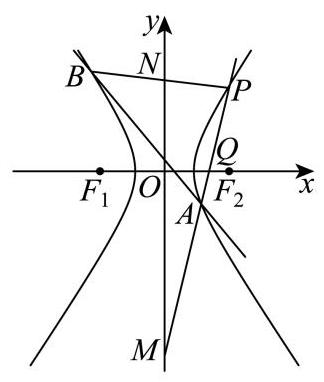

设 $A\left( {{x}_{1},{y}_{1}}\right)$ ,直线 ${PA}$ 方程为 $y - 1 = \frac{{y}_{1} - 1}{{x}_{1} - 2}\left( {x - 2}\right)$ ,

令 $x = 0$ ,得 $y = \frac{-2{y}_{1} + 2}{{x}_{1} - 2} + 1 = \frac{{x}_{1} - 2{y}_{1}}{{x}_{1} - 2}$ ,即可知 $M\left( {0,\frac{{x}_{1} - 2{y}_{1}}{{x}_{1} - 2}}\right)$ ,

令 $y = 0$ ,得 $- 1 = \frac{{y}_{1} - 1}{{x}_{1} - 2}\left( {x - 2}\right)  \Rightarrow  x = 2 - \frac{{x}_{1} - 2}{{y}_{1} - 1} = \frac{2{y}_{1} - {x}_{1}}{{y}_{1} - 1}$ ,即可知 $Q\left( {\frac{2{y}_{1} - {x}_{1}}{{y}_{1} - 1},0}\right)$ ,

由 $\overrightarrow{MQ} = 2\overrightarrow{QP}$ ,可得: $\left( {\frac{2{y}_{1} - {x}_{1}}{{y}_{1} - 1}, - \frac{{x}_{1} - 2{y}_{1}}{{x}_{1} - 2}}\right)  = 2\left( {2 - \frac{2{y}_{1} - {x}_{1}}{{y}_{1} - 1},1}\right)$ ,

则由纵坐标对应相等可得 $- \frac{{x}_{1} - 2{y}_{1}}{{x}_{1} - 2} = 2 \Rightarrow  {y}_{1} = \frac{3{x}_{1} - 4}{2}$ ,

由 (1) 知双曲线化简为 ${x}^{2} - {y}^{2} = 3$ ,代入得 ${x}_{1}^{2} - {\left( \frac{3{x}_{1} - 4}{2}\right) }^{2} = 3 \Rightarrow  5{x}_{1}^{2} - {24}{x}_{1} + {28} = 0$ ,

解得 ${x}_{1} = \frac{14}{5}$ 或 ${x}_{1} = 2$ (因为此时与点 $P$ 重合故舍去),即 ${x}_{1} = \frac{14}{5}$ ;

**【小问 3 详解】**

设 $M\left( {0, m}\right)$ ,由 $M, N$ 关于原点对称得 $N\left( {0, - m}\right)$ ,

计算得直线 ${PA},{PB}$ 的斜率可得 ${k}_{PA} = \frac{1 + m}{2},{k}_{PB} = \frac{1 - m}{2}$ ,

所以有 ${k}_{PA} + {k}_{PB} = \frac{1 - m}{2} + \frac{1 + m}{2} = 1$ ,

设直线 ${AB} : y = {kx} + s$ ,联立 ${x}^{2} - {y}^{2} = 3$ ,

可得: ${x}^{2} - {\left( kx + s\right) }^{2} = 3 \Rightarrow  \left( {1 - {k}^{2}}\right) {x}^{2} - {2ksx} - {s}^{2} - 3 = 0$ ,

设 $A\left( {{x}_{A},{y}_{A}}\right) , B\left( {{x}_{B},{y}_{B}}\right)$ ,

由韦达定理得 ${x}_{A} + {x}_{B} = \frac{2ks}{1 - {k}^{2}},{x}_{A}{x}_{B} =  - \frac{{s}^{2} + 3}{1 - {k}^{2}}$ ,

由 ${k}_{PA} + {k}_{PB} = 1$ ,可得: $\frac{{y}_{A} - 1}{{x}_{A} - 2} + \frac{{y}_{B} - 1}{{x}_{B} - 2} = 1 \Rightarrow  \frac{k{x}_{A} + s - 1}{{x}_{A} - 2} + \frac{k{x}_{B} + s - 1}{{x}_{B} - 2} = 1$ ,

整理得: $\left( {k{x}_{A} + s - 1}\right) \left( {{x}_{B} - 2}\right)  + \left( {k{x}_{B} + s - 1}\right) \left( {{x}_{A} - 2}\right)  = \left( {{x}_{A} - 2}\right) \left( {{x}_{B} - 2}\right)$ ,

所以 ${2k}{x}_{A}{x}_{B} + \left( {s - 1 - {2k}}\right) \left( {{x}_{A} + {x}_{B}}\right)  - 4\left( {s - 1}\right)  = {x}_{A}{x}_{B} - 2\left( {{x}_{A} + {x}_{B}}\right)  + 4$ ,

所以 $\left( {{2k} - 1}\right) {x}_{A}{x}_{B} + \left( {s + 1 - {2k}}\right) \left( {{x}_{A} + {x}_{B}}\right)  - {4s} = 0$ ,

代入韦达定理可得: $\left( {{2k} - 1}\right) \left( {-\frac{{s}^{2} + 3}{1 - {k}^{2}}}\right)  + \left( {s + 1 - {2k}}\right) \frac{2ks}{1 - {k}^{2}} - {4s} = 0$ ,

所以 $- \left( {{2k} - 1}\right) \left( {{s}^{2} + 3}\right)  + \left( {s + 1 - {2k}}\right) {2ks} - {4s}\left( {1 - {k}^{2}}\right)  = 0$ ,

所以 $- {2k}{s}^{2} - {6k} + {s}^{2} + 3 + {2k}{s}^{2} + {2ks} - 4{k}^{2}s - {4s} + 4{k}^{2}s = 0$ ,

所以 $- {6k} + {s}^{2} + 3 + {2ks} - {4s} = 0$ ,

所以 ${2k}\left( {s - 3}\right)  + \left( {s - 3}\right) \left( {s - 1}\right)  = 0 \Rightarrow  \left( {s - 3}\right) \left( {{2k} + s - 1}\right)  = 0$ ,则 $s = 3$ 或 $s = 1 - {2k}$ , 当 $s = 1 - {2k}$ 时,直线 ${AB} : y = {kx} + 1 - {2k} = k\left( {x - 2}\right)  + 1$ 恒过点 $P\left( {2,1}\right)$ ,不符合题意, 故 $s = 3$ ,此时直线 ${AB} : y = {kx} + 3$ 恒过点 $\left( {0,3}\right)$ .

### 静安 · 第10题

如图所示，在 ${ABC}$ 中， $\angle {BAC} = \frac{\pi }{3}$ ， $\left| {AC}\right|  = 2\left| {AB}\right|$ ， $\left| {AB}\right|  = 1$ ， $P$ 为边 ${AC}$ 的中点， $D$ 在边 ${AB}$ 上，且 $\left| {AD}\right|  = 2\left| {DB}\right|$ ， ${CD}$ 交 ${BP}$ 于点 $R$ ，则 $\left| {CR}\right|  =$ ___.

**考点：** 三角形分点与坐标

**难度依据：** 三角形分点与坐标

**【答案】** $\frac{\sqrt{7}}{2}$

**【解析】**

**【分析】**建立平面直角坐标系,求出直线 ${PB}\text{ 、 }{CD}$ 的方程,联立求解得到点 $R$ 坐标,根据两点间的距离公式即可求出 $\left| {CR}\right|$ .

**【详解】**因为 $\left| {AC}\right|  = 2\left| {AB}\right| ,\left| {AB}\right|  = 1$ ,所以 $\left| {AC}\right|  = 2$ .

以点 $A$ 为原点,以 ${AB}$ 为 $x$ 轴建立平面直角坐标系,如图,

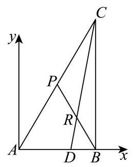

则 $A\left( {0,0}\right) , B\left( {1,0}\right) , C\left( {2\cos \frac{\pi }{3},2\sin \frac{\pi }{3}}\right)$ ,即 $C\left( {1,\sqrt{3}}\right)$ .

因为 $P$ 为边 ${AC}$ 的中点,所以 $P\left( {\frac{1}{2},\frac{\sqrt{3}}{2}}\right)$ .

因为 $\left| {AD}\right|  = 2\left| {DB}\right|$ ,所以 $D\left( {\frac{2}{3},0}\right)$ .

直线 ${PB} : y = \frac{\frac{\sqrt{3}}{2} - 0}{\frac{1}{2} - 1}\left( {x - 1}\right)$ ,即 $y =  - \sqrt{3}\left( {x - 1}\right)$ .

直线 ${CD} : \;y = \frac{\sqrt{3} - 0}{1 - \frac{2}{3}}\left( {x - \frac{2}{3}}\right)$ ，即 $y = 3\sqrt{3}\left( {x - \frac{2}{3}}\right)$ .

联立 $\left\{  \begin{array}{l} y =  - \sqrt{3}\left( {x - 1}\right) \\  y = 3\sqrt{3}\left( {x - \frac{2}{3}}\right)  \end{array}\right.$ ,解得 $\left\{  \begin{array}{l} x = \frac{3}{4} \\  y = \frac{\sqrt{3}}{4} \end{array}\right.$ ,即 $R\left( {\frac{3}{4},\frac{\sqrt{3}}{4}}\right)$ .

故 $\left| {CR}\right|  = \sqrt{{\left( \frac{3}{4} - 1\right) }^{2} + {\left( \frac{\sqrt{3}}{4} - \sqrt{3}\right) }^{2}} = \frac{\sqrt{7}}{2}$ .

### 黄浦 · 第20题

已知点 ${F}_{1}\text{ 、 }{F}_{2}$ 分别是曲线 $\Gamma  : \frac{{x}^{2}}{6} + \frac{{y}^{2}}{2} = 1$ 的左、右焦点,动直线 $l$ 过点 ${F}_{1}$ 且不过点 ${F}_{2}$ , 它与 $\Gamma$ 交于点 $P\text{ 、 }Q$ .

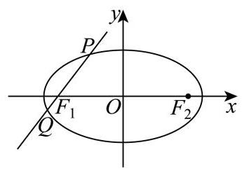

(1)求点 ${F}_{1}\text{ 、 }{F}_{2}$ 的坐标；

(2)若 $\overrightarrow{{F}_{2}P} \cdot  \overrightarrow{{F}_{2}Q} = {11}$ ，求直线 $l$ 的方程；

(3)设直线 ${l}_{1}$ 过点 ${F}_{1}$ 且与 $l$ 垂直，直线 ${l}_{2} : x = m$ 与 ${l}_{1}$ 的交点为 $T$ ，求证:存在唯一的常数 $m$ ,使得点 $T$ 与 $\Gamma$ 的中心的连线平分线段 ${PQ}$ ,并求此时 $\frac{\left| PQ\right| }{\left| T{F}_{1}\right| }$ 的最大值.

> 本题资料或解析有待核事项，预览不可作为已审定成品。

**考点：** （1）椭圆焦点坐标；（2）向量数量积与弦；（3）弦中点定点及长度比最值

**难度依据：** 椭圆焦点弦与定点最值；数量积与弦

**核查说明：** 解析末尾均值不等式表达疑有OCR错误，需核原解。

**【答案】** (1) ${F}_{1}\left( {-2,0}\right) \text{ 、 }{F}_{2}\left( {2,0}\right)$

(2) $x + y + 2 = 0$ 或 $x - y + 2 = 0$ .

(3) $\sqrt{3}$

**【解析】**

**【分析】**(1) 求出椭圆 $\Gamma$ 的半焦距,可得出点 ${F}_{1}\text{ 、 }{F}_{2}$ 的坐标;

(2)设直线 $l$ 的方程为 $x = {ty} - 2$ ，设 $P\left( {{x}_{1},{y}_{1}}\right)$ 、 $Q\left( {{x}_{2},{y}_{2}}\right)$ ，将该直线方程与椭圆的方程联立,列出韦达定理,利用平面向量数量积的坐标运算以及韦达定理可求得 $t$ 的值,即可得出直线 $l$ 的方程；

(3)求出线段 ${PQ}$ 的中点 $N$ 的坐标，可得出直线 ${ON}$ 的斜率，将 $x = m$ 代入直线 $T{F}_{1}$ 的方程， 可得出点 $T$ 的坐标,即可求出直线 ${OT}$ 的斜率,结合题意可知直线 ${ON}\text{ 、 }{OT}$ 的斜率相等, 可求出 $m$ 的值,再求出 $\left| {PQ}\right| \text{ 、 }\left| {T{F}_{1}}\right|$ ,即可求得 $\frac{\left| PQ\right| }{\left| T{F}_{1}\right| }$ 的最大值.

**【小问 1 详解】**

椭圆 $\Gamma$ 的半焦距 $c = \sqrt{6 - 2} = 2$ ,故 ${F}_{1}\left( {-2,0}\right) \text{ 、 }{F}_{2}\left( {2,0}\right)$ .

**【小问 2 详解】**

由题意可知直线 $l$ 不与 $x$ 轴重合,设直线 $l$ 的方程为 $x = {ty} - 2$ ,设 $P\left( {{x}_{1},{y}_{1}}\right) \text{ 、 }Q\left( {{x}_{2},{y}_{2}}\right)$ ,

将 $x = {ty} - 2$ 代 入 $\frac{{x}^{2}}{6} + \frac{{y}^{2}}{2} = 1$ ，得 $\left( {{t}^{2} + 3}\right) {y}^{2} - {4ty} - 2 = 0$ ，则 $\Delta  = {16}{t}^{2} + 8\left( {{t}^{2} + 3}\right)  = {24}\left( {{t}^{2} + 1}\right)  > 0,$

故 ${y}_{1} + {y}_{2} = \frac{4t}{{t}^{2} + 3},{y}_{1} \cdot  {y}_{2} = \frac{-2}{{t}^{2} + 3}$ ,

又 $\overrightarrow{{F}_{2}P} = \left( {{x}_{1} - 2,{y}_{1}}\right) ,\overrightarrow{{F}_{2}Q} = \left( {{x}_{2} - 2,{y}_{2}}\right)$ ,

$\overrightarrow{{F}_{2}P} \cdot  \overrightarrow{{F}_{2}Q} = \left( {{x}_{1} - 2}\right) \left( {{x}_{2} - 2}\right)  + {y}_{1}{y}_{2} = \left( {t{y}_{1} - 4}\right) \left( {t{y}_{2} - 4}\right)  + {y}_{1}{y}_{2} = \left( {{t}^{2} + 1}\right) {y}_{1}{y}_{2} - {4t}\left( {{y}_{1} + {y}_{2}}\right)  + {16} \; = \frac{{t}^{2} + 1}{{t}^{2} + 3}\left( {-2}\right)  - {4t} \cdot  \frac{4t}{{t}^{2} + 3} + {16} = \frac{-{18}{t}^{2} - 2}{{t}^{2} + 3} + {16} = {11}$ ,解得 $t =  \pm  1$ ,

所以直线 $l$ 的方程为 $x + y + 2 = 0$ 或 $x - y + 2 = 0$ .

**【小问 3 详解】**

设线段 ${PQ}$ 的中点为 $N\left( {{x}_{0},{y}_{0}}\right)$ ,由 (2) 知 ${y}_{0} = \frac{2t}{{t}^{2} + 3},{x}_{0} = t{y}_{0} - 2 = \frac{-6}{{t}^{2} + 3}$ , 直线 ${ON}$ 的斜率 ${k}_{1} =  - \frac{t}{3}$ ,

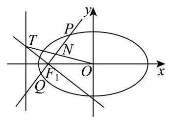

易知直线 $T{F}_{1}$ 的方程为 $t\left( {x + 2}\right)  + y = 0$ ,

将 $x = m$ 代入直线 $T{F}_{1}$ 的方程 $t\left( {x + 2}\right)  + y = 0$ ,可得 $T\left( {m, - \left( {m + 2}\right) t}\right)$ ,

直线 ${OT}$ 的斜率 ${k}_{2} =  - \frac{\left( {m + 2}\right) t}{m}$ ,

因为直线 ${OT}$ 平分线段 ${PQ}$ ,则 ${k}_{1} = {k}_{2}$ ,所以 $- \frac{\left( {m + 2}\right) t}{m} =  - \frac{t}{3}$ 对任意的实数 $t$ 恒成立,

则 $\frac{m + 2}{m} = \frac{1}{3}$ ,解得 $m =  - 3$ ,

故存在唯一的常数 $m$ ,使得 ${OT}$ 平分线段 ${PQ}$ .

此时 $\left| {PQ}\right|  = \sqrt{1 + {t}^{2}}\left| {{y}_{1} - {y}_{2}}\right|  = \sqrt{1 + {t}^{2}} \cdot  \sqrt{{\left( \frac{4t}{{t}^{2} + 3}\right) }^{2} + \frac{8}{{t}^{2} + 3}} = \frac{2\sqrt{6}\left( {1 + {t}^{2}}\right) }{{t}^{2} + 3}$ ,

$\left| {T{F}_{1}}\right|  = \sqrt{1 + {t}^{2}}$ ,所以 $\frac{\left| PQ\right| }{\left| T{F}_{1}\right| } = 2\sqrt{6} \cdot  \frac{\sqrt{1 + {t}^{2}}}{{t}^{2} + 3}$ ,

令 $\sqrt{1 + {t}^{2}} = z$ ,则 $z \in  \lbrack 1, + \infty )$ ,故 $\frac{\left| PQ\right| }{\left| T{F}_{1}\right| } = \frac{2\sqrt{6}z}{{z}^{2} + 2} \leq  \frac{2\sqrt{6}z}{2\sqrt{2z}} = \sqrt{3}$ (当且仅当 $z = \sqrt{2} \in  \lbrack 1, + \infty )$

时， $\frac{\left| PQ\right| }{\left| T{F}_{1}\right| } = \sqrt{3}$ )，

所以 $\frac{\left| PQ\right| }{\left| T{F}_{1}\right| }$ 的最大值为 $\sqrt{3}$ .

## 空间坐标、法向量与角距

明确建系依据，以法向量及投影求线面角、距离和数量积。

### 嘉定 · 第18题

如图，在 ${ABC}$ 中， $\angle {ACB} = {90}^{ \circ  }$ ， ${DA}\bot$ 平面 ${ABC}$ ， $M$ ， $N$ 分别是线段 ${AC}$ 、 ${DB}$ 的中点.

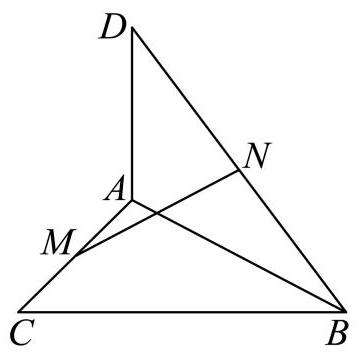

(1)求证: ${MN}\bot {AC}$ ；

(2)若 ${AC} = {BC} = {AD} = 2$ ，求直线 ${MN}$ 与平面 ${ABD}$ 所成角的大小.

> 本题资料或解析有待核事项，预览不可作为已审定成品。

**考点：** (1) 空间垂直关系证明；(2) 建系求直线与平面所成角

**难度依据：** 空间建系求线面角

**核查说明：** 题干与答案解析尚未逐页对照原卷，数学内容未独立终审。

**【答案】** (1) 证明见解析

(2) $\frac{\pi }{6}$

**【解析】**

**【分析】**(1) 建立适当空间直角坐标系,设 ${AC} = a,{BC} = b,{AD} = c$ ,求出 $\overrightarrow{MN},\overrightarrow{AC}$ ,利用 $\overrightarrow{MN} \cdot  \overrightarrow{AC} = 0$ 证明 ${MN} \bot  {AC}$ .

(2)求出平面 ${ABD}$ 的一个法向量 $\overrightarrow{n}$ ，利用 $\sin \theta  = \left| {\cos \langle \overrightarrow{MN},\overrightarrow{n}\rangle }\right|$ 即可求出直线 ${MN}$ 与平面 ${ABD}$ 所成角 $\theta$ 的大小.

**【小问 1 详解】**

由题可建立如图所示的空间直角坐标系. 设 ${AC} = a,{BC} = b,{AD} = c$ .

则 $C\left( {0,0,0}\right) , A\left( {-a,0,0}\right) , B\left( {0, b,0}\right) , D\left( {-a,0, c}\right) , M\left( {-\frac{a}{2},0,0}\right) , N\left( {-\frac{a}{2},\frac{b}{2},\frac{c}{2}}\right)$ .

所以 $\overrightarrow{MN} = \left( {0,\frac{b}{2},\frac{c}{2}}\right) ,\overrightarrow{AC} = \left( {a,0,0}\right)$

所以 $\overrightarrow{MN} \cdot  \overrightarrow{AC} = 0 \times  a + \frac{b}{2} \times  0 + \frac{c}{2} \times  0 = 0,\therefore {MN} \bot  {AC}$ ;

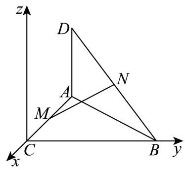

**【小问 2 详解】**

$\because {AC} = {BC} = {AD} = 2$ ,

$\therefore C\left( {0,0,0}\right) , A\left( {-2,0,0}\right) , B\left( {0,2,0}\right) , D\left( {-2,0,2}\right) , M\left( {-1,0,0}\right) , N\left( {-1,1,1}\right)$ .

$\therefore \overrightarrow{MN} = \left( {0,1,1}\right) ,\left| \overrightarrow{MN}\right|  = \sqrt{{0}^{2} + {1}^{2} + {1}^{2}} = \sqrt{2},\overrightarrow{AB} = \left( {2,2,0}\right) ,\overrightarrow{AD} = \left( {0,0,2}\right)$ .

记平面 ${ABD}$ 的一个法向量为 $\overrightarrow{n} = \left( {x, y, z}\right)$ ,

则 $\left\{  \begin{matrix} \overrightarrow{n} \cdot  \overrightarrow{AD} = {2z} = 0 \\  \overrightarrow{n} \cdot  \overrightarrow{AB} = {2x} + {2y} = 0 \end{matrix}\right.$ ,令 $x = 1$ ,则 $y =  - 1, z = 0$ .

$\therefore \overrightarrow{n} = \left( {1, - 1,0}\right) ,\left| \overrightarrow{n}\right|  = \sqrt{{1}^{2} + {\left( -1\right) }^{2} + {0}^{2}} = \sqrt{2}$ .

记直线 ${MN}$ 与平面 ${ABD}$ 所成角为 $\theta$ .

则 $\sin \theta  = \left| {\cos \langle \overrightarrow{MN},\overrightarrow{n}\rangle }\right|  = \frac{\left| \overrightarrow{MN} \cdot  \overrightarrow{n}\right| }{\left| \overrightarrow{MN}\right| \left| \overrightarrow{n}\right| } = \frac{\left| 0 \times  1 + 1 \times  \left( -1\right)  + 1 \times  0\right| }{\sqrt{2} \times  \sqrt{2}} = \frac{1}{2}$ .

又 $\because \theta  \in  \left\lbrack  {0,\frac{\pi }{2}}\right\rbrack  ,\therefore \theta  = \frac{\pi }{6}$ .

### 奉贤 · 第19题

在四棱锥 $P - {ABCD}$ 中,四边形 ${ABCD}$ 是菱形, ${PA} = {PC} = 5,{PB} = {PD} = 2\sqrt{5}$ , ${AC} = 6$ ,点 $F$ 为 ${PD}$ 的中点,点 $E$ 为 ${PB}$ 上的点, $\overrightarrow{PE} = \lambda \overrightarrow{PB},\lambda  \in  \left( {0,1}\right)$ ,平面 ${AFE}$ 与棱 ${PC}$ 交于点 $G$ .

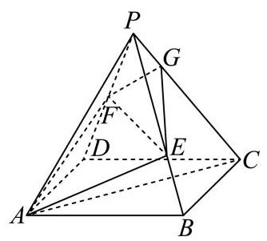

图1

图2

(1)求证:异面直线 ${EF}$ 与 ${AC}$ 垂直；

(2)当 $\lambda  = \frac{2}{3}$ 时，求 ${AG}$ 与底面 ${ABCD}$ 所成的线面角大小.

**考点：** (1) 异面直线垂直证明；(2) 空间坐标及截面交点求线面角

**难度依据：** 空间垂直与线面角；空间坐标和法向量

**【答案】** (1) 证明见解析

(2) $\arcsin \frac{4\sqrt{65}}{65}$

**【解析】**

**【分析】**(1) 建立空间直角坐标系,求出 $\overrightarrow{EF},\overrightarrow{AC}$ ,计算求出 $\overrightarrow{EF} \cdot  \overrightarrow{AC} = 0$ ,从而证明结论;

(2)求出 $\overrightarrow{AE}$ ，进而求出点 $G$ ，进而求出 $\overrightarrow{AG}$ ，利用向量夹角的余弦公式求出线面角的大小.

**【小问 1 详解】**

已知四边形 ${ABCD}$ 是菱形,则 ${AC} \bot  {BD}$ ,设 ${AC} \cap  {BD} = O$ ,则 $O$ 是 ${AC},{BD}$ 的中点,

$\because {PA} = {PC} = 5,{PB} = {PD} = 2\sqrt{5}$ ,

$\therefore {PO} \bot  {AC},{PO} \bot  {BD}$ ,

$\because {AC} \cap  {BD} = O$ ，且 ${AC},{BD} \subset$ 平面 ${ABCD}$ ，

$\therefore {PO} \bot$ 平面 ${ABCD}$ ，

以 $O$ 为坐标原点， ${OA}$ 为 $x$ 轴， ${OB}$ 为 $y$ 轴， ${OP}$ 为 $z$ 轴，建立下图所示空间直角坐标系，

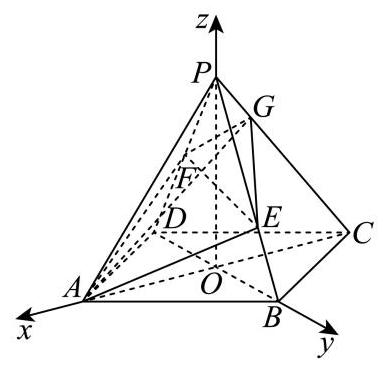

$\because {AC} = 6,\therefore {OA} = 3,{OP} = \sqrt{A{P}^{2} - O{A}^{2}} = \sqrt{{5}^{2} - {3}^{2}} = 4$ ,

${OB} = \sqrt{P{B}^{2} - O{P}^{2}} = \sqrt{{\left( 2\sqrt{5}\right) }^{2} - {4}^{2}} = 2,$

$\therefore A\left( {3,0,0}\right) , B\left( {0,2,0}\right) , C\left( {-3,0,0}\right) , D\left( {0, - 2,0}\right) , P\left( {0,0,4}\right)$ ,

$\because F$ 为 ${PD}$ 的中点,

$\therefore F\left( {0, - 1,2}\right)$ ,

$\because$ 点 $E$ 为 ${PB}$ 上的点， $\overrightarrow{PE} = \lambda \overrightarrow{PB},\overrightarrow{PB} = \left( {0,2, - 4}\right)$ ,

$\therefore \overrightarrow{PE} = \left( {0,{2\lambda }, - {4\lambda }}\right)$ ,则 $E\left( {0,{2\lambda },4 - {4\lambda }}\right)$ ,

$\therefore \overrightarrow{EF} = \left( {0, - 1 - {2\lambda }, - 2 + {4\lambda }}\right)$ ,

$\because \overrightarrow{AC} = \left( {-6,0,0}\right)$ ,

$\therefore \overrightarrow{EF} \cdot  \overrightarrow{AC} = 0 \times  \left( {-6}\right)  + \left( {-1 - {2\lambda }}\right)  \times  0 + \left( {-2 + {4\lambda }}\right)  \times  0 = 0$ ,故 $\overrightarrow{EF} \bot  \overrightarrow{AC}$ ,

$\therefore$ 异面直线 ${EF}$ 与 ${AC}$ 垂直.

**【小问 2 详解】**

当 $\lambda  = \frac{2}{3}$ 时, $E\left( {0,\frac{4}{3},\frac{4}{3}}\right) ,\overrightarrow{AE} = \left( {-3,\frac{4}{3},\frac{4}{3}}\right) ,\overrightarrow{AF} = \left( {-3, - 1,2}\right)$ ,

设 $\overrightarrow{n} = \left( {a, b, c}\right)$ 为平面 ${AEF}$ 的法向量,则 $\left\{  \begin{array}{l}  - {3a} + \frac{4}{3}b + \frac{4}{3}c = 0 \\   - {3a} - b + {2c} = 0 \end{array}\right.$ ,令 $a =  - 4$ , 则 $\overrightarrow{n} = \left( {-4, - 2, - 7}\right)$ ,

$\because A\left( {3,0,0}\right)$ ,

$\therefore$ 平面 ${AEF}$ 方程为: $- 4\left( {x - 3}\right)  - {2y} - {7z} = 0$ ,即 ${4x} + {2y} + {7z} = {12}$ ,

$\because P\left( {0,0,4}\right) , C\left( {-3,0,0}\right)$ ,

$\therefore \overrightarrow{PC} = \left( {-3,0, - 4}\right)$ ,直线 ${PC}$ 参数方程为: $\left\{  {\begin{array}{l} x =  - {3t} \\  y = 0 \\  z = 4 - {4t} \end{array}, t \in  \left\lbrack  {0,1}\right\rbrack  }\right.$ , 参数方程代入平面方程得 $4\left( {-{3t}}\right)  + 2 \times  0 + 7\left( {4 - {4t}}\right)  = {12}$ ,解得 $t = \frac{2}{5}$ ,

$\therefore G\left( {-\frac{6}{5},0,\frac{12}{5}}\right)$ ,故 $\overrightarrow{AG} = \left( {-\frac{21}{5},0,\frac{12}{5}}\right)$ ,

底面 ${ABCD}$ 的法向量为 $\overrightarrow{m} = \left( {0,0,1}\right)$ ,

设 ${AG}$ 与底面 ${ABCD}$ 所成角为 $\theta$ ，则

$\sin \theta  = \left| {\cos \overrightarrow{AG},\overrightarrow{m}}\right|  = \frac{\left| \overrightarrow{AG} \cdot  \overrightarrow{m}\right| }{\left| \overrightarrow{AG}\right|  \cdot  \left| \overrightarrow{m}\right| } = \frac{\frac{12}{5}}{\sqrt{{\left( -\frac{21}{5}\right) }^{2} + {\left( \frac{12}{5}\right) }^{2}} \times  1} = \frac{4\sqrt{65}}{65}$ ,

$\therefore {AG}$ 与底面 ${ABCD}$ 所成的线面角为 $\arcsin \frac{4\sqrt{65}}{65}$ .

### 宝山 · 第17题

如图，在四棱锥 $P - {ABCD}$ 中， ${ABCD}$ 是边长为 1 的正方形， ${PA}\bot$ 平面 ${ABCD}$ ， $E$ 是 ${PA}$ 的中点.

(1)求证: ${BD} \bot$ 平面 ${PAC}$ ；

(2)若直线 ${BE}$ 与平面 ${PAC}$ 所成角的正弦值为 $\frac{\sqrt{10}}{5}$ ，求三棱锥 $B - {PCD}$ 的体积.

**考点：** (1) 线线垂直推出线面垂直；(2) 空间向量求高再计算棱锥体积

**难度依据：** 线面垂直和棱锥体积；空间坐标法求线面角

**【答案】** (1)证明见解析

(2) $\frac{1}{6}$

**【解析】**

**【分析】**(1) 利用线面垂直判定定理,通过证明 ${BD}$ 垂直于平面 ${PAC}$ 内的两条相交直线 ${PA}$ 和 ${AC}$ ,从而证得 ${BD} \bot$ 平面 ${PAC}$ ;

(2)建立空间直角坐标系，求出直线方向向量与平面法向量，利用线面角的正弦值公式列方程,求解得到 ${PA}$ 的长度,再由棱锥体积公式得解.

**【小问 1 详解】**

如图,连接 ${AC},{BD}$ 交于点 $O$ ,可得点 $O$ 是 ${AC}$ 的中点,

因为四边形 ${ABCD}$ 是边长为 1 的正方形,所以 ${AC} \bot  {BD}$ ,

又因为 ${PA} \bot$ 平面 ${ABCD},{BD} \subset$ 平面 ${ABCD}$ ,

所以 ${PA} \bot  {BD}$ ,

由 ${PA} \cap  {AC} = A,{PA},{AC} \subset$ 平面 ${PAC}$ ,

得 ${BD} \bot$ 平面 ${PAC}$ ;

**【小问 2 详解】**

设 ${PA} = b\;\left( {b > 0}\right)$ ,

以 $A$ 为原点， ${AD}$ 为 $x$ 轴， ${AP}$ 为 $y$ 轴， ${AB}$ 为 $z$ 轴，建立空间直角坐标系，

则 $A\left( {0,0,0}\right)$ ， $D\left( {1,0,0}\right)$ ， $P\left( {0, b,0}\right)$ ， $B\left( {0,0,1}\right)$ ， $C\left( {1,0,1}\right)$ ， $E\left( {0,\frac{b}{2},0}\right)$ ，

$\overrightarrow{BE} = \left( {0,\frac{b}{2}, - 1}\right) ,\overrightarrow{AP} = \left( {0, b,0}\right) ,\overrightarrow{PC} = \left( {1, - b,1}\right) ,$

设平面 ${PAC}$ 的一个法向量为 $\overrightarrow{n} = \left( {x, y, z}\right)$ ,

则 $\left\{  \begin{array}{l} \overrightarrow{n} \cdot  \overrightarrow{PC} = x - {by} + z = 0 \\  \overrightarrow{n} \cdot  \overrightarrow{AP} = {by} = 0 \end{array}\right.$ ,令 $x = 1$ ,可取 $\overrightarrow{n} = \left( {1,0, - 1}\right)$ ,

设直线 ${BE}$ 与平面 ${PAC}$ 所成角为 $\theta$ ，

则 $\sin \theta  = \frac{\left| \overrightarrow{BE} \cdot  \overrightarrow{n}\right| }{\left| \overrightarrow{BE}\right|  \cdot  \left| \overrightarrow{n}\right| } = \frac{\left| 0 \times  1 + \frac{b}{2} \times  0 + \left( -1\right)  \cdot  \left( -1\right) \right| }{\sqrt{2} \cdot  \sqrt{\frac{{b}^{2}}{4} + 1}} = \frac{1}{\sqrt{\frac{{b}^{2}}{2} + 2}} = \frac{\sqrt{10}}{5}$ ,

整理可得 ${b}^{2} = 1$ ,解得 $b = 1$ 或 $b =  - 1$ (舍去),即 ${PA} = 1$ ,

故 ${V}_{B - {PCD}} = {V}_{P - {BCD}} = \frac{1}{3} \cdot  {S}_{\bigtriangleup {BCD}} \cdot  {PA} = \frac{1}{3} \times  \frac{1}{2} \times  {1}^{2} \times  1 = \frac{1}{6}$ .

### 徐汇 · 第17题

如图，在四棱锥 $P - {ABCD}$ 中， $\bigtriangleup  {PCD}$ 为等边三角形，底面 ${ABCD}$ 为直角梯形， ${AB}//{CD},{CD} \bot  {AD},{CD} = 4,{AB} = {AD} = 2$ .

(1)求证: ${PB}\bot {CD}$ ；

(2)若四棱锥 $P - {ABCD}$ 的体积为 $4\sqrt{3}$ ，求直线 ${PD}$ 与平面 ${PBC}$ 所成角的大小.

**考点：** (1)利用中点和线面垂直证明线线垂直；(2)由体积确定高，建系用法向量求线面角

**难度依据：** 几何证明后建系计算空间角

**【答案】** (1) 证明见解析

(2) $\arcsin \frac{\sqrt{21}}{7}$

**【解析】**

**【分析】**(1) 取 ${CD}$ 的中点 $E$ ,利用等边三角形性质和直角梯形的性质证明 ${CD} \bot$ 面 ${PBE}$ ,

进而证明 ${PB} \bot  {CD}$ ;

(2)首先利用体积公式求出四棱锥的高，结合几何特征得到 ${PE}\bot$ 面 ${ABCD}$ ，然后建立空间直角坐标系, 求出面的法向量, 利用向量夹角公式求出线面角的正弦值.

**【小问 1 详解】**

取 ${CD}$ 的中点 $E$ ,连接 ${PE},{BE}$ ,

因为 ${AB}//{CD},{CD} = {2AB} = 4$ ，

则 ${DE} = {AB} = 2$ ，所以四边形 ${ABED}$ 是平行四边形，

又 ${CD} \bot  {AD}$ ，四边形 ${ABED}$ 是矩形，

所以 ${BE} \bot  {CD}$ ,

$\bigtriangleup {PCD}$ 为等边三角形, $E$ 为 ${CD}$ 的中点,

所以 ${PE} \bot  {CD}$ ,

${BE} \cap  {PE} = E,{BE},{PE} \subset$ 平面 ${PBE}$ ,

所以 ${CD} \bot$ 平面 ${PBE}$ ,

${PB} \subset$ 平面 ${PBE}$ ,所以 ${CD} \bot  {PB}$ .

**【小问 2 详解】**

梯形 ${ABCD}$ 的面积为 $\frac{1}{2}\left( {2 + 4}\right)  \times  2 = 6$ ,

设四棱锥 $P - {ABCD}$ 的高为 $h$ ,体积为 $\frac{1}{3} \times  6 \times  h = 4\sqrt{3}$ ,

得 $h = 2\sqrt{3} = {PE}$ ,

所以 ${PE} \bot$ 平面 ${ABCD}$ ,

以 ${EB},{EC},{EP}$ 所在直线分别为 $x$ 轴、 $y$ 轴、 $z$ 轴建立空间直角坐标系 $E - {xyz}$ ,

$B\left( {2,0,0}\right) ,\;C\left( {0,2,0}\right) ,\;D\left( {0, - 2,0}\right) ,\;P\left( {0,0,2\sqrt{3}}\right) ,$

设面 ${PBC}$ 的法向量为 $\mathbf{n} = \left( {x, y, z}\right)$ ，

$\overrightarrow{PB} = \left( {2,0, - 2\sqrt{3}}\right) ,\overrightarrow{BC} = \left( {-2,2,0}\right)$ ,

$\left\{  {\begin{array}{l} \overrightarrow{n} \cdot  \overrightarrow{PB} = 0 \\  \overrightarrow{n} \cdot  \overrightarrow{BC} = 0 \end{array},\left\{  {\begin{array}{l} {2x} - 2\sqrt{3}z = 0 \\   - {2x} + {2y} = 0 \end{array},}\right. }\right.$

取 $z = 1, x = \sqrt{3}, y = \sqrt{3}$ ,

则 $n = \left( {\sqrt{3},\sqrt{3},1}\right) ,\overrightarrow{PD} = \left( {0, - 2, - 2\sqrt{3}}\right)$ ,

设直线 ${PD}$ 与平面 ${PBC}$ 所成角为 $\theta$ ,

$\sin \theta  = \left| {\cos \overrightarrow{PD},\overrightarrow{n}}\right|  = \frac{\left| \overrightarrow{PD} \cdot  \overrightarrow{n}\right| }{\left| \overrightarrow{PD}\right| \left| \overrightarrow{n}\right| } = \frac{4\sqrt{3}}{4 \times  \sqrt{7}} = \frac{\sqrt{21}}{7}.$

直线 ${PD}$ 与平面 ${PBC}$ 所成角的大小为 $\arcsin \frac{\sqrt{21}}{7}$ .

### 普陀 · 第17题

如图，在正三棱柱 ${ABC} - {A}_{1}{B}_{1}{C}_{1}$ 中， $D$ 、 $E$ 分别是棱 ${A}_{1}{B}_{1}$ 、 ${A}_{1}A$ 的中点，且 ${A}_{1}A = {A}_{1}{B}_{1} = 2.$

(1)求证:直线 ${A}_{1}B \bot$ 平面 ${C}_{1}{DE}$ ；

(2)求点 $A$ 到平面 ${A}_{1}{CB}$ 的距离.

**考点：** (1) 线线与线面垂直证明；(2) 等体积法或空间向量求点面距离

**难度依据：** 正棱柱线面垂直与点面距离；空间坐标与法向量求距离

**【答案】** (1)证明见解析

(2) $\frac{2\sqrt{21}}{7}$

**【解析】**

**【分析】**(1) 根据正三棱柱的结构可判断四边形 ${AB}{B}_{1}{A}_{1}$ 的形状,进行面面垂直、线面垂直、 线线垂直之间的转化; (2) 根据三棱锥 $C - {AB}{A}_{1}$ 的体积相等可求距离，也可利用空间向量求解距离问题.

**【小问 1 详解】**

如图 1,连接 $A{B}_{1}$ ,

图1

由正三棱柱的结构特征可知,

在正三棱柱 ${ABC} - {{A}_{1}{B}_{1}{C}_{1}}$ 中 $\bigtriangleup  {A}_{1}{B}_{1}{C}_{1}$ 是正三角形，侧面均为矩形， $B{B}_{1} \bot$ 平面 ${A}_{1}{B}_{1}{C}_{1}$ . 因为 $D$ 是棱 ${A}_{1}{B}_{1}$ 的中点,所以 ${C}_{1}D \bot  {A}_{1}{B}_{1}$ ,

因为 $B{B}_{1} \subset$ 平面 ${AB}{B}_{1}{A}_{1}$ ,所以平面 ${A}_{1}{B}_{1}{C}_{1} \bot$ 平面 ${AB}{B}_{1}{A}_{1}$ .

又平面 ${A}_{1}{B}_{1}{C}_{1}\mathrm{Q}$ 平面 ${AB}{B}_{1}{A}_{1} = {A}_{1}{B}_{1}$ ，所以 ${C}_{1}D \bot$ 平面 ${AB}{B}_{1}{A}_{1}$ .

又 ${A}_{1}B \subset$ 平面 ${AB}{B}_{1}{A}_{1}$ ，所以 ${C}_{1}D \bot  {A}_{1}B$ .

因为 ${A}_{1}A = {A}_{1}{B}_{1} = 2$ ,所以矩形 ${AB}{B}_{1}{A}_{1}$ 为正方形,所以 $A{B}_{1} \bot  {A}_{1}B$ ,

又 ${DE}//A{B}_{1}$ ,所以 ${DE} \bot  {A}_{1}B$ ,

因为 ${C}_{1}D,{DE} \subset$ 平面 ${C}_{1}{DE},{C}_{1}D \cap  {DE} = D$ ,所以直线 ${A}_{1}B \bot$ 平面 ${C}_{1}{DE}$ .

**【小问 2 详解】**

方法一: 设点 $A$ 到平面 ${A}_{1}{CB}$ 的距离为 $h$ ,

因为 $C{C}_{1}//$ 平面 ${AB}{B}_{1}{A}_{1}$ ，所以 $C,{C}_{1}$ 到平面 ${AB}{B}_{1}{A}_{1}$ 的距离相等，都为 ${C}_{1}D = \sqrt{3}$ .

由 (1) 知,侧面均为正方形,所以 ${S}_{\bigtriangleup {A}_{1}{AB}} = \frac{1}{2} \times  2 \times  2 = 2,{A}_{1}C = {A}_{1}B = 2\sqrt{2}$ ,

又 ${BC} = 2$ ，所以 $\bigtriangleup  {A}_{1}{BC}$ 为等腰三角形，所以

${S}_{\bigtriangleup {A}_{1}{BC}} = \frac{1}{2}{BC} \cdot  \sqrt{{A}_{1}{C}^{2} - {\left( \frac{BC}{2}\right) }^{2}} = \frac{1}{2} \times  2 \times  \sqrt{7} = \sqrt{7}$ .

又 ${V}_{C - {A}_{1}{AB}} = {V}_{A - {A}_{1}{CB}}$ ,即 $\frac{1}{3}{S}_{\bigtriangleup {A}_{1}{AB}} \times  \sqrt{3} = \frac{1}{3}{S}_{\bigtriangleup {A}_{1}{BC}}h$ ,

所以 $\frac{1}{3} \times  2 \times  \sqrt{3} = \frac{1}{3} \times  \sqrt{7}h$ ,解得 $h = \frac{2\sqrt{21}}{7}$ ,即点 $A$ 到平面 ${A}_{1}{CB}$ 的距离为 $\frac{2\sqrt{21}}{7}$ .

方法二: 取 ${AB}$ 的中点 $F$ ,连接 ${DF}$ ,由 (1) 可知 $D{A}_{1},{DF}, D{C}_{1}$ 两两互相垂直, 所以以 D 为原点, 建立如图 2 所示的空间直角坐标系,

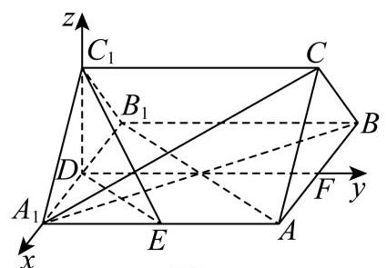

图2

则 ${A}_{1}\left( {1,0,0}\right) , A\left( {1,2,0}\right) , B\left( {-1,2,0}\right) , C\left( {0,2,\sqrt{3}}\right)$ ,

所以 $\overrightarrow{{A}_{1}A} = \left( {0,2,0}\right) ,\overrightarrow{{A}_{1}B} = \left( {-2,2,0}\right) ,\overrightarrow{{A}_{1}C} = \left( {-1,2,\sqrt{3}}\right)$ ,

设平面 ${A}_{1}{CB}$ 的法向量为 $\overrightarrow{n} = \left( {x, y, z}\right)$ ,

则 $\left\{  \begin{array}{l} \overrightarrow{n} \cdot  \overrightarrow{{A}_{1}B} = 0 \\  \overrightarrow{n} \cdot  \overrightarrow{{A}_{1}C} = 0 \end{array}\right.$ ,即 $\left\{  \begin{array}{l}  - {2x} + {2y} = 0 \\   - x + {2y} + \sqrt{3}z = 0 \end{array}\right.$ ,令 $x = 1$ ,则 $y = 1, z =  - \frac{\sqrt{3}}{3}$ ,

即 $\overrightarrow{n} = \left( {1,1, - \frac{\sqrt{3}}{3}}\right)$ ,所以点 $A$ 到平面 ${A}_{1}{CB}$ 的距离为 $\left| \frac{\overrightarrow{n} \cdot  \overrightarrow{{A}_{1}A}}{\left| \overrightarrow{n}\right| }\right|  = \frac{2}{\sqrt{\frac{7}{3}}} = \frac{2\sqrt{21}}{7}$ .

### 松江 · 第10题

在四棱柱 ${ABCD} - {A}_{1}{B}_{1}{C}_{1}{D}_{1}$ 中，底面 ${ABCD}$ 为平行四边形， $\left| \overrightarrow{A{A}_{1}}\right|  = 2$ ，异面直线 $A{A}_{1}$ 与 ${BD}$ 的夹角为 $\arccos \frac{2}{5},\overrightarrow{AD} \cdot  \overrightarrow{D{C}_{1}} - \overrightarrow{AB} \cdot  \overrightarrow{B{C}_{1}} = 4$ ，则 $\left| \overrightarrow{B{D}_{1}}\right|  =$ ___.

**考点：** 向量分解得到数量积，再求对角线长度

**难度依据：** 通过数量积消元并处理空间夹角

**【答案】** $\sqrt{37}$

**【解析】**

**【分析】**利用向量的运算法则将已知条件进行转化,进而求出 $\left| \overrightarrow{B{D}_{1}}\right|$ .

**【详解】**在四棱柱 ${ABCD} - {A}_{1}{B}_{1}{C}_{1}{D}_{1}$ 中,

$\overrightarrow{D{C}_{1}} = \overrightarrow{DC} + \overrightarrow{C{C}_{1}} = \overrightarrow{AB} + \overrightarrow{A{A}_{1}},\overrightarrow{B{C}_{1}} = \overrightarrow{BC} + \overrightarrow{C{C}_{1}} = \overrightarrow{AD} + \overrightarrow{A{A}_{1}}$ .

则 $\overrightarrow{AD} \cdot  \overrightarrow{D{C}_{1}} - \overrightarrow{AB} \cdot  \overrightarrow{B{C}_{1}} = \overrightarrow{AD} \cdot  \left( {\overrightarrow{AB} + \overrightarrow{A{A}_{1}}}\right)  - \overrightarrow{AB} \cdot  \left( {\overrightarrow{AD} + \overrightarrow{A{A}_{1}}}\right)$ .

根据向量乘法分配律展开可得:

$\overrightarrow{AD} \cdot  \overrightarrow{AB} + \overrightarrow{AD} \cdot  \overrightarrow{A{A}_{1}} - \overrightarrow{AB} \cdot  \overrightarrow{AD} - \overrightarrow{AB} \cdot  \overrightarrow{A{A}_{1}} = \overrightarrow{AD} \cdot  \overrightarrow{A{A}_{1}} - \overrightarrow{AB} \cdot  \overrightarrow{A{A}_{1}} = \left( {\overrightarrow{AD} - \overrightarrow{AB}}\right)  \cdot  \overrightarrow{A{A}_{1}}$ .

因为 $\overrightarrow{AD} - \overrightarrow{AB} = \overrightarrow{BD}$ ,所以 $\left( {\overrightarrow{AD} - \overrightarrow{AB}}\right)  \cdot  \overrightarrow{A{A}_{1}} = \overrightarrow{BD} \cdot  \overrightarrow{A{A}_{1}}$ .

已知 $\overrightarrow{AD} \cdot  \overrightarrow{D{C}_{1}} - \overrightarrow{AB} \cdot  \overrightarrow{B{C}_{1}} = 4$ ，即 $\overrightarrow{BD} \cdot  \overrightarrow{A{A}_{1}} = 4$ .

又已知异面直线 $A{A}_{1}$ 与 ${BD}$ 的夹角为 $\arccos \frac{2}{5}$ ，且 $\left| \overrightarrow{A{A}_{1}}\right|  = 2$ ，

设 $\overrightarrow{BD}$ 与 $\overrightarrow{A{A}_{1}}$ 的夹角为 $\theta$ ，则 $\cos \theta  = \frac{2}{5}$ .

根据向量点积公式 $\overrightarrow{a} \cdot  \overrightarrow{b} = \left| \overrightarrow{a}\right| \left| \overrightarrow{b}\right| \cos \theta$ ,可得 $\overrightarrow{BD} \cdot  \overrightarrow{A{A}_{1}} = \left| \overrightarrow{BD}\right| \left| \overrightarrow{A{A}_{1}}\right| \cos \theta$ ,

即 $4 = \left| \overrightarrow{BD}\right|  \times  2 \times  \frac{2}{5}$ ，解得 $\left| \overrightarrow{BD}\right|  = 5$ .

因为 $\overrightarrow{B{D}_{1}} = \overrightarrow{BD} + \overrightarrow{D{D}_{1}} = \overrightarrow{BD} + \overrightarrow{A{A}_{1}}$ ,根据向量模长公式可得

${\left| \overrightarrow{B{D}_{1}}\right| }^{2} = {\left( \overrightarrow{BD} + \overrightarrow{A{A}_{1}}\right) }^{2} = {\overrightarrow{BD}}^{2} + 2\overrightarrow{BD} \cdot  \overrightarrow{A{A}_{1}} + {\overrightarrow{A{A}_{1}}}^{2}.$

将 $\left| \overrightarrow{BD}\right|  = 5,\overrightarrow{BD} \cdot  \overrightarrow{A{A}_{1}} = 4,\left| \overrightarrow{A{A}_{1}}\right|  = 2$ 代入上式可得 ${\left| \overrightarrow{B{D}_{1}}\right| }^{2} = {5}^{2} + 2 \times  4 + {2}^{2} = {25} + 8 + 4 = {37}$ . 所以 $\left| \overrightarrow{B{D}_{1}}\right|  = \sqrt{37}$ .

### 松江 · 第17题

在如图所示的多面体中,已知四边形 ${ABCD}$ 是菱形, $\angle {ABC} = {60}^{ \circ  },{FA} \bot$ 平面 ${ABCD},{ED} \bot$ 平面 ${ABCD},{AB} = {FA} = {2ED} = 2$ ，点 $G$ 为线段 ${AF}$ 的中点.

(1)求证:平面 ${BDG}//$ 平面 ${CEF}$ ；

(2)求直线 ${BC}$ 与平面 ${BDG}$ 所成角的正弦值.

> 本题资料或解析有待核事项，预览不可作为已审定成品。

**考点：** (1)借助中点和两组平行线证明面面平行；(2)建空间坐标求平面法向量与线面角

**难度依据：** 几何证明与向量计算结合

**核查说明：** 答案解析第477字符附近：损坏字符或字体覆盖风险，需回源并视觉检查（底稿扫描记录）；答案解析第710字符附近：损坏字符或字体覆盖风险，需回源并视觉检查（底稿扫描记录）

**【答案】** (1)证明见解析

(2) $\frac{\sqrt{2}}{4}$

**【解析】**

**【分析】**(1)连接 ${AC}$ 与 ${BD}$ ,相交于点 $O$ ,连接 ${OG},{DG}$ ,分别证明 ${OG}//{CF},{DG}//{EF}$ , 再由面面平行判定定理即可得证;

(2)以 $A$ 为坐标原点建立空间直角坐标系，确定直线 ${BC}$ 的方向向量与平面 ${BDG}$ 的法向量， 根据线面夹角的坐标运算求解即可.

**【小问 1 详解】**

连接 ${AC}$ 与 ${BD}$ ,相交于点 $O$ ,连接 ${OG},{DG}$ ,

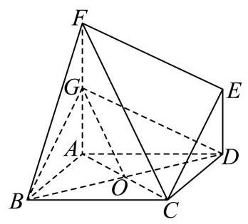

因为菱形 ${ABCD}$ ,所以点 $O$ 是 ${AC}$ 的中点,

所以 ${OG}//{CF}$ ,

又 ${OG} \text{ ⊄ }$ 平面 ${CEF},{FC} \subset$ 平面 ${CEF}$ ,

所以 ${OG}//$ 平面 ${CEF}$ ,

因为 ${FA} \bot$ 平面 ${ABCD},{ED} \bot$ 平面 ${ABCD}$ ,

所以 ${FA}//{DE}$ ,

又 ${FA} = {2ED} = 2,{FA} = {2FG}$ ,所以四边形 ${DEFG}$ 是平行四边形,

所以 ${DG}//{EF}$ ，

又 ${DG} \text{ ⊄ }$ 平面 ${CEF},{EF} \subset$ 平面 ${CEF}$ ,

所以 ${DG}//$ 平面 ${CEF}$ ,

因为 ${OG} \cap  {DG} = G,{OG}\text{ 、 }{DG} \subset$ 平面 ${BDG}$ ,

所以平面 ${BDG}//$ 平面 ${CEF}$ ;

**【小问 2 详解】**

取 ${BC}$ 的中点 $M$ ,连接 ${AM}$ ,

因为 $\angle {ABC} = {60}^{ \circ  }$ ,四边形 ${ABCD}$ 是菱形,

所以 ${ABC}$ 是等边三角形,则 ${AM} \bot  {BC}$ ,

则建立以 $A$ 为原点,以 ${AM}\text{ 、 }{AD}\text{ 、 }{AF}$ 所在直线分别为 $x$ 轴、 $y$ 轴、 $z$ 轴的空间直角坐标系 $A - {xyz}$ ,如图所示:

则 $B\left( {\sqrt{3}, - 1,0}\right) , C\left( {\sqrt{3},1,0}\right) , D\left( {0,2,0}\right) , G\left( {0,0,1}\right)$ ,

所以 $\overrightarrow{BC} = \left( {0,2,0}\right) ,\overrightarrow{BD} = \left( {-\sqrt{3},3,0}\right) ,\overrightarrow{DG} = \left( {0, - 2,1}\right)$ ,

设平面 ${BDG}$ 的法向量为 $\overrightarrow{n} = \left( {x, y, z}\right)$ ,

则 $\left\{  {\begin{array}{l} \overrightarrow{n} \cdot  \overrightarrow{BD} =  - \sqrt{3}x + {3y} = 0 \\  \overrightarrow{n} \cdot  \overrightarrow{DG} =  - {2y} + z = 0 \end{array} \Rightarrow  \left\{  \begin{array}{l} x = \sqrt{3}y \\  z = {2y} \end{array}\right. }\right.$ ,取 $y = 1$ ,则 $x = \sqrt{3}, z = 2$ ,所以 $\overrightarrow{n} = \left( {\sqrt{3},1,2}\right)$ ,

所以 $\cos \langle \overrightarrow{BC},\overrightarrow{n}\rangle  = \frac{\overrightarrow{BC} \cdot  \overrightarrow{n}}{\left| \overrightarrow{BC}\right|  \cdot  \left| \overrightarrow{n}\right| } = \frac{2}{2 \times  2\sqrt{2}} = \frac{\sqrt{2}}{4}$ ,

直线 ${BC}$ 与平面 ${BDG}$ 所成角的正弦值为 $\frac{\sqrt{2}}{4}$ .

### 浦东 · 第11题

某光影科技实验室为长方体空间, 底面是边长为 4 米的正方形, 高为 3 米. 为营造动态光影效果，在底面一个顶点处安装射灯 $A$ ，在与该顶点相对的侧棱上、距底面 1 米处安装射灯 $I$ ,两盏射灯的光束方向由智能系统自动控制，始终使两束光线相互垂直，且它们的交汇点 $G$ 始终落在实验室天花板上. 则交汇点 $G$ 形成的轨迹长度为___米.

**考点：** 建立空间坐标，用垂直数量积确定天花板圆轨迹

**难度依据：** 将空间垂直转化轨迹方程

**【答案】** $2\sqrt{2}\pi$

**【解析】**

**【详解】**如图建立空间直角坐标系:

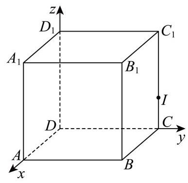

则 $A\left( {4,0,0}\right) , I\left( {0,4,1}\right)$ ,设交点 $G\left( {x, y,3}\right)$ ,

所以 $\overrightarrow{AG} = \left( {x - 4, y,3}\right) ,\overrightarrow{IG} = \left( {x, y - 4,2}\right)$ ,

因为 ${AG} \bot  {IG}$ ,所以 $\overrightarrow{AG} \cdot  \overrightarrow{IG} = \left( {x - 4}\right) x + \left( {y - 4}\right) y + 3 \times  2 = 0$ ,

整理得 ${\left( x - 2\right) }^{2} + {\left( y - 2\right) }^{2} = 2$ ,

所以交点 $G$ 在天花板上的轨迹是以 $\left( {2,2,3}\right)$ 为圆心,半径为 $\sqrt{2}$ 的圆,

所以交汇点 $G$ 形成的轨迹长度为 $2\sqrt{2}\pi$ .

### 浦东 · 第15题

已知 $\overrightarrow{{e}_{1}},\overrightarrow{{e}_{2}}$ 与 $\overrightarrow{{e}_{3}}$ 是不共面的向量,则以下向量组中,一定不共面的是 ( )

A. $\overrightarrow{{e}_{1}} + \overrightarrow{{e}_{2}}\text{ 、 }\overrightarrow{{e}_{3}}\text{ 、 }\overrightarrow{{e}_{1}} + \overrightarrow{{e}_{2}} + \overrightarrow{{e}_{3}}$

B. $\overrightarrow{{e}_{1}}\text{ 、 }\overrightarrow{{e}_{2}} + \overrightarrow{{e}_{3}}\text{ 、 }3\overrightarrow{{e}_{1}} + 4\overrightarrow{{e}_{2}} + 3\overrightarrow{{e}_{3}}$

C. $\overrightarrow{{e}_{1}}\text{ 、 }2\overrightarrow{{e}_{2}} - \overrightarrow{{e}_{3}}\text{ 、 }\overrightarrow{{e}_{1}} - 2\overrightarrow{{e}_{2}} + \overrightarrow{{e}_{3}}$

D. $\overrightarrow{{e}_{1}} + \overrightarrow{{e}_{2}}\text{ 、 }\overrightarrow{{e}_{2}} + \overrightarrow{{e}_{3}}\text{ 、 }\overrightarrow{{e}_{1}} + k\overrightarrow{{e}_{3}}$ (其中 $k$ 为实数)

**考点：** 根据不共面基底系数判线性相关

**难度依据：** 建立线性表示并比较系数

**【答案】** B

**【解析】**

**【分析】**根据向量共面的定义逐项分析即可.

**【详解】**对于 $\mathrm{A}$ ,设 $\overrightarrow{{e}_{1}} + \overrightarrow{{e}_{2}} = x\overrightarrow{{e}_{3}} + y\left( {\overrightarrow{{e}_{1}} + \overrightarrow{{e}_{2}} + \overrightarrow{{e}_{3}}}\right)  = y\overrightarrow{{e}_{1}} + y\overrightarrow{{e}_{2}} + \left( {x + y}\right) \overrightarrow{{e}_{3}}$ ,

由 $\overrightarrow{{e}_{1}},\overrightarrow{{e}_{2}}$ 与 $\overrightarrow{{e}_{3}}$ 是不共面的向量,则 $\left\{  {\begin{array}{l} y = 1 \\  x + y = 0 \end{array} \Rightarrow  \left\{  \begin{array}{l} y = 1 \\  x =  - 1 \end{array}\right. }\right.$ ,即方程组有解,

所以向量 $\overrightarrow{{e}_{1}} + \overrightarrow{{e}_{2}}\text{ 、 }\overrightarrow{{e}_{3}}\text{ 、 }\overrightarrow{{e}_{1}} + \overrightarrow{{e}_{2}} + \overrightarrow{{e}_{3}}$ 共面,故 A 错误;

对于 $\mathrm{B}$ ,设 $\overrightarrow{{e}_{1}} = x\left( {\overrightarrow{{e}_{2}} + \overrightarrow{{e}_{3}}}\right)  + y\left( {3\overrightarrow{{e}_{1}} + 4\overrightarrow{{e}_{2}} + 3\overrightarrow{{e}_{3}}}\right)  = {3y}\overrightarrow{{e}_{1}} + \left( {x + {4y}}\right) \overrightarrow{{e}_{2}} + \left( {x + {3y}}\right) \overrightarrow{{e}_{3}}$ ,

由 $\overrightarrow{{e}_{1}},\overrightarrow{{e}_{2}}$ 与 $\overrightarrow{{e}_{3}}$ 是不共面的向量,则 $\left\{  \begin{array}{l} {3y} = 1 \\  x + {4y} = 0 \\  x + {3y} = 0 \end{array}\right.$ ,方程组无解,

所以向量 $\overrightarrow{{e}_{1}}\text{ 、 }\overrightarrow{{e}_{2}} + \overrightarrow{{e}_{3}}\text{ 、 }3\overrightarrow{{e}_{1}} + 4\overrightarrow{{e}_{2}} + 3\overrightarrow{{e}_{3}}$ 不共面,故 $\mathrm{B}$ 正确;

对于 $\mathrm{C}$ ,设 $\overrightarrow{{e}_{1}} = x\left( {2\overrightarrow{{e}_{2}} - \overrightarrow{{e}_{3}}}\right)  + y\left( {\overrightarrow{{e}_{1}} - 2\overrightarrow{{e}_{2}} + \overrightarrow{{e}_{3}}}\right)  = y\overrightarrow{{e}_{1}} + \left( {{2x} - {2y}}\right) \overrightarrow{{e}_{2}} + \left( {-x + y}\right) \overrightarrow{{e}_{3}}$ ,

由 $\overrightarrow{{e}_{1}},\overrightarrow{{e}_{2}}$ 与 $\overrightarrow{{e}_{3}}$ 是不共面的向量,则 $\left\{  {\begin{array}{l} y = 1 \\  {2x} - {2y} = 0 \\   - x + y = 0 \end{array} \Rightarrow  \left\{  \begin{array}{l} y = 1 \\  x = 1 \end{array}\right. }\right.$ ,即方程组有解,

所以向量 $\overrightarrow{{e}_{1}}\text{ 、 }2\overrightarrow{{e}_{2}} - \overrightarrow{{e}_{3}}\text{ 、 }\overrightarrow{{e}_{1}} - 2\overrightarrow{{e}_{2}} + \overrightarrow{{e}_{3}}$ 共面,故 $\mathrm{C}$ 错误;

对于 $\mathrm{D}$ ,设 $\overrightarrow{{e}_{1}} + \overrightarrow{{e}_{2}} = x\left( {\overrightarrow{{e}_{2}} + \overrightarrow{{e}_{3}}}\right)  + y\left( {\overrightarrow{{e}_{1}} + k\overrightarrow{{e}_{3}}}\right)  = y\overrightarrow{{e}_{1}} + x\overrightarrow{{e}_{2}} + \left( {x + {ky}}\right) \overrightarrow{{e}_{3}}$ ,

由 $\overrightarrow{{e}_{1}},\overrightarrow{{e}_{2}}$ 与 $\overrightarrow{{e}_{3}}$ 是不共面的向量,则 $\left\{  \begin{array}{l} y = 1 \\  x = 1 \\  x + {ky} = 0 \end{array}\right.$ ,

当 $k =  - 1$ 时,方程组有解为 $\left\{  \begin{array}{l} y = 1 \\  x = 1 \end{array}\right.$ ,此时向量 $\overrightarrow{{e}_{1}} + \overrightarrow{{e}_{2}}\text{ 、 }\overrightarrow{{e}_{2}} + \overrightarrow{{e}_{3}}\text{ 、 }\overrightarrow{{e}_{1}} + k\overrightarrow{{e}_{3}}$ 共面,

当 $k \neq   - 1$ 时,方程组无解,此时向量 $\overrightarrow{{e}_{1}} + \overrightarrow{{e}_{2}}\text{ 、 }\overrightarrow{{e}_{2}} + \overrightarrow{{e}_{3}}\text{ 、 }\overrightarrow{{e}_{1}} + k\overrightarrow{{e}_{3}}$ 不共面,

所以向量 $\overrightarrow{{e}_{1}} + \overrightarrow{{e}_{2}}\text{ 、 }\overrightarrow{{e}_{2}} + \overrightarrow{{e}_{3}}\text{ 、 }\overrightarrow{{e}_{1}} + k\overrightarrow{{e}_{3}}$ 不一定共面,故 $\mathrm{D}$ 错误.

### 虹口 · 第17题

如图,在底面半径为 2,侧面积为 $4\sqrt{5}\pi$ 的圆锥

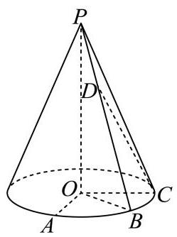

$\mathrm{P} - \mathrm{O}$ 中, $A\text{ 、 }B\text{ 、 }C$ 为底面圆周上不同的三个点, $\angle {AOB} = \angle {BOC} = {45}^{ \circ  }$ .

(1)求直线 ${OB}$ 与平面 ${PAC}$ 所成角的正弦值

(2)设点 $D$ 为线段 ${PB}$ 上的动点(不含端点 $P$ 和 $B$ )，求证直线 ${OA}$ 与 ${CD}$ 不垂直

> 本题资料或解析有待核事项，预览不可作为已审定成品。

**考点：** (1) 圆锥高度与空间法向量求线面角；(2) 动点参数化、数量积证明不垂直

**难度依据：** 圆锥线面角和动线不垂直；空间坐标与数量积

**核查说明：** 题面∠AOB=∠BOC=45°，原解据图取AOC=90°；依赖A、C异侧位置，需核图以确认。

**【答案】** (1) $\frac{2\sqrt{2}}{3}$

(2)证明见解析

**【解析】**

**【分析】**(1) 利用侧面积求解出圆锥的高,再利用建系的方法,求出直线 ${OB}$ 与平面 ${PAC}$ 所成角的正弦值.

(2)利用向量的方法，将点 $D$ 在线段 ${PB}$ 上刻画为 $\overrightarrow{PD} = \lambda \overrightarrow{PB}$ . 接着证明直线 $\overrightarrow{OA}$ 与 $\overrightarrow{CD}$ 的数量积不为零.

**【小问 1 详解】**

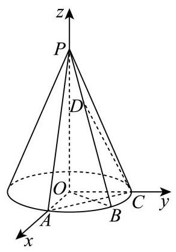

$\because \angle {AOB} = \angle {BOC} = {45}^{ \circ  }$ ,

$\therefore \angle {AOC} = {90}^{ \circ  }$ ,

所以可以建立如右图所示的空间直角坐标系,

所以 $B\left( {\sqrt{2},\sqrt{2},0}\right) ,\overrightarrow{OB} = \left( {\sqrt{2},\sqrt{2},0}\right)$ ,设 ${OP} = a$ ,

则母线长为 $\sqrt{4 + {a}^{2}}$

则侧面积为 $\frac{1}{2}\sqrt{4 + {a}^{2}} \times  {2\pi } \times  2 = 2\sqrt{4 + {a}^{2}}\pi  = 4\sqrt{5}\pi$ ,

解得: $a = 4$ ，

所以 $P\left( {0,0,4}\right)$ ,

$A\left( {2,0,0}\right) , C\left( {0,2,0}\right) ,\overrightarrow{AC} = \left( {-2,2,0}\right) ,\overrightarrow{PA} = \left( {2,0, - 4}\right)$

设面 ${PAC}$ 的法向量为 $\overrightarrow{m} = \left( {{x}_{1},{y}_{1},{z}_{1}}\right)$

所以 $\overrightarrow{m} \cdot  \overrightarrow{AC} =  - 2{x}_{1} + 2{y}_{1} = 0,\overrightarrow{m} \cdot  \overrightarrow{PA} = 2{x}_{1} - 4{z}_{1} = 0$ ,

不妨令 ${x}_{1} = {y}_{1} = 1$ ,则 ${z}_{1} = \frac{1}{2}$ ,

所以 $\overrightarrow{m} = \left( {1,1,\frac{1}{2}}\right)$ ,设直线 ${OB}$ 与平面 ${PAC}$ 所成角为 $\theta$ ,

所以 $\sin \theta  = \left| {\cos \langle \overrightarrow{OB},\overrightarrow{m}\rangle }\right|  = \frac{\left| \overrightarrow{OB} \cdot  \overrightarrow{m}\right| }{\left| \overrightarrow{OB}\right|  \cdot  \left| \overrightarrow{m}\right| } = \frac{2\sqrt{2}}{2 \times  \sqrt{{1}^{2} + {1}^{2} + {\left( \frac{1}{2}\right) }^{2}}} = \frac{2\sqrt{2}}{3}$ .

**【小问 2 详解】**

因为 $D$ 为线段 ${PB}$ 上的动点,所以设 $\overrightarrow{PD} = \lambda \overrightarrow{PB},\lambda  \in  \left( {0,1}\right)$ ,

$\overrightarrow{CD} = \overrightarrow{CP} + \overrightarrow{PD}$ ,由 (1) 知 $\overrightarrow{PD} = \lambda \overrightarrow{PB} = \lambda \left( {\sqrt{2},\sqrt{2}, - 4}\right)  = \left( {\sqrt{2}\lambda ,\sqrt{2}\lambda , - {4\lambda }}\right)$ ,

$\overrightarrow{CP} = \left( {0, - 2,4}\right) ,\overrightarrow{CD} = \overrightarrow{CP} + \overrightarrow{PD} = \left( {\sqrt{2}\lambda ,\sqrt{2}\lambda  - 2,4 - {4\lambda }}\right) ,$

$\overrightarrow{OA} = \left( {2,0,0}\right) ,$

$\overrightarrow{OA} \cdot  \overrightarrow{CD} = 2\sqrt{2}\lambda  \neq  0,$

所以直线 ${OA}$ 与 ${CD}$ 不垂直.

### 闵行 · 第18题

如图,圆柱 $O{O}_{1}$ 的轴截面 ${AB}{B}_{1}{A}_{1}$ 是边长为 4 的正方形, ${MN}$ 为底面圆 $O$ 的一条直径, 且 $\angle {BOM} = \frac{\pi }{3}$ .

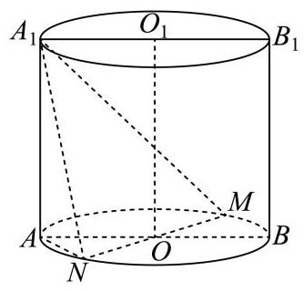

(1)求异面直线 ${A}_{1}N$ 与 $B{B}_{1}$ 所成角的大小(用反三角表示)；

(2)求点 $A$ 到平面 ${A}_{1}{MN}$ 的距离.

> 本题资料或解析有待核事项，预览不可作为已审定成品。

**考点：** （1）空间向量求异面直线夹角；（2）点到平面的距离

**难度依据：** 圆柱异面角与点面距；空间向量求角与距离

**核查说明：** 原解坐标差的纵坐标疑似符号错误，需核PDF并复算。

**【答案】** (1) $\arccos \frac{2\sqrt{5}}{5}$

(2) $\frac{4\sqrt{57}}{19}$

**【解析】**

**【分析】**(1) 建立空间直角坐标系, 把异面直线所成角转化为两条异面直线的方向向量的夹角求解

(2)通过(1)空间直角坐标系利用向量运算求点到平面距离

**【小问 1 详解】**

根据题意建立以底面圆心 $O$ 为原点, ${AB}$ 所在直线为 $y$ 轴, $O{O}_{1}$ 所在直线为 $z$ 轴,垂直于 ${AB}$ 方向为 $x$ 轴的空间直角坐标系,

则 $A\left( {0, - 2,0}\right) , B\left( {0,2,0}\right) ,{A}_{1}\left( {0, - 2,4}\right) ,{B}_{1}\left( {0,2,4}\right) , O\left( {0,0,0}\right) ,{O}_{1}\left( {0,0,4}\right)$

因为 $\angle {BOM} = \frac{\pi }{3}$ ，所以 $M\left( {-{\sqrt{3},1},0}\right)$ ， $N\left( {\sqrt{3}, - 1,0}\right)$

所以 $\overrightarrow{{A}_{1}N} = \left( {\sqrt{3}, - 1, - 4}\right) ,\overrightarrow{B{B}_{1}} = \left( {0,0,4}\right) ,\overrightarrow{{A}_{1}N} \cdot  \overrightarrow{B{B}_{1}} =  - {16}$ ，

$\left| \overrightarrow{{A}_{1}N}\right|  = \sqrt{{\left( \sqrt{3}\right) }^{2} + {\left( -1\right) }^{2} + {\left( -4\right) }^{2}} = \sqrt{20} = 2\sqrt{5},\left| \overrightarrow{B{B}_{1}}\right|  = 4$

设异面直线所成角为 $\theta$ ，则 $\cos \theta  = \frac{\left| \overrightarrow{{A}_{1}N} \cdot  \overrightarrow{B{B}_{1}}\right| }{\left| \overrightarrow{{A}_{1}N}\right|  \cdot  \left| \overrightarrow{B{B}_{1}}\right| } = \frac{16}{2\sqrt{5} \times  4} = \frac{2\sqrt{5}}{5}$ 所以异面直线 ${A}_{1}N$ 与 $B{B}_{1}$ 所成角为 $\arccos \frac{2\sqrt{5}}{5}$

**【小问 2 详解】**

$\overrightarrow{{A}_{1}M} = \left( {-\sqrt{3},3, - 4}\right) ,\overrightarrow{{A}_{1}N} = \left( {\sqrt{3},1, - 4}\right) ,\overrightarrow{NA} = \left( {-\sqrt{3}, - 1,0}\right) ,$

设平面 ${A}_{1}{MN}$ 的法向量为 $\overrightarrow{n} = \left( {x, y, z}\right)$ ,

则由 $\overrightarrow{{A}_{1}M} \cdot  \overrightarrow{n} = 0,\overrightarrow{{A}_{1}N} \cdot  \overrightarrow{n} = 0$ ,得 $\left\{  \begin{matrix}  - \sqrt{3}x + {3y} - {4z} = 0 \\  \sqrt{3}x + y - {4z} = 0 \end{matrix}\right.$ ,令 $y = 2$ ,则 $z = 1, x = \frac{2\sqrt{3}}{3}$ 所以 $\overrightarrow{n} = \left( {\frac{2\sqrt{3}}{3},2,1}\right)$

设点 $A$ 到平面 ${A}_{1}{MN}$ 的距离为 $d$ ,则 $d = \frac{\left| \overrightarrow{NA} \cdot  \overrightarrow{n}\right| }{\left| \overrightarrow{n}\right| } = \frac{\left| \left( -\sqrt{3}, - 1,0\right)  \cdot  \left( \frac{2\sqrt{3}}{3},2,1\right) \right| }{\sqrt{{\left( \frac{2\sqrt{3}}{3}\right) }^{2} + {2}^{2} + {1}^{2}}} = \frac{4\sqrt{57}}{19}$

### 青浦 · 第19题

如图,在三棱锥 $P - {ABC}$ 中, ${AB}$ 是 ${ABC}$ 外接圆的直径, $\bigtriangleup {PAC}$ 是边长为 2 的等边三角形， $E$ ， $F$ 分别是 ${PC}$ ， ${PB}$ 的中点， ${PB} = {AB}$ ， ${BC} = 4$ .

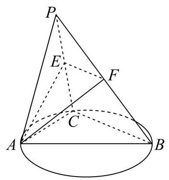

(1)求证:平面 ${PAC} \bot$ 平面 ${ABC}$ ；

(2)求直线 ${AB}$ 与平面 ${AEF}$ 所成角的正弦值.

**考点：** (1) 线面垂直推出面面垂直；(2) 空间坐标和法向量求线面角

**难度依据：** 面面垂直与线面角；空间坐标及法向量

**【答案】** (1) 证明见解析

(2) $\frac{\sqrt{5}}{10}$

**【解析】**

**【分析】**(1) 先利用直径所对圆周角为直角和勾股定理得到线线垂直, 再利用线面垂直和面面垂直的判定定理进行证明;

(2)建立空间坐标系，写出相关点的坐标，求出直线的方向向量和平面的法向量，再利用线面角的向量法进行求解.

**【小问 1 详解】**

证明: 由题意知 ${BC} \bot  {AC}$ ,

则 ${AB} = \sqrt{A{C}^{2} + B{C}^{2}} = 2\sqrt{5}$ ，所以 ${PB} = {AB} = 2\sqrt{5}$ .

又 ${BC} = 4,{PC} = 2$ ,所以 $P{B}^{2} = P{C}^{2} + B{C}^{2}$ ,所以 ${PC} \bot  {BC}$ ,

又 ${PC} \cap  {AC} = C$ ,所以 ${BC} \bot$ 平面 ${PAC}$ ,

又 ${BC} \subset$ 平面 ${ABC}$ ,所以平面 ${PAC} \bot$ 平面 ${ABC}$ .

**【小问 2 详解】**

解: 以 $C$ 为坐标原点, ${CA},{CB}$ 在直线分别为 $x$ 轴, $y$ 轴, 过 $C$ 且垂直于平面 ${ABC}$ 的直线为 $z$ 轴,建立如图所示的空间直角坐标系,

则 $A\left( {2,0,0}\right) , B\left( {0,4,0}\right) , P\left( {1,0,\sqrt{3}}\right) , E\left( {\frac{1}{2},0,\frac{\sqrt{3}}{2}}\right) , F\left( {\frac{1}{2},2,\frac{\sqrt{3}}{2}}\right)$ ,

所以 $\overrightarrow{AE} = \left( {-\frac{3}{2},0,\frac{\sqrt{3}}{2}}\right) ,\overrightarrow{EF} = \left( {0,2,0}\right) ,\overrightarrow{AB} = \left( {-2,4,0}\right)$ .

设平面 ${AEF}$ 的法向量为 $\overrightarrow{m} = \left( {x, y, z}\right)$ ,则 $\left\{  \begin{matrix} \overrightarrow{AE} \cdot  \overrightarrow{m} =  - \frac{3x}{2} + \frac{\sqrt{3}z}{2} = 0, \\  \overrightarrow{EF} \cdot  \overrightarrow{m} = {2y} = 0, \end{matrix}\right.$

则 $y = 0$ ,取 $z = \sqrt{3}$ ,得 $\overrightarrow{m} = \left( {1,0,\sqrt{3}}\right)$ .

设直线 ${AB}$ 与平面 ${AEF}$ 所成的角为 $\theta$ ,则 $\sin \theta  = \left| {\cos \theta \overrightarrow{AB},\overrightarrow{m}\theta }\right|  = \left| \frac{\overrightarrow{AB} \cdot  \overrightarrow{m}}{\left| \overrightarrow{AB}\right|  \cdot  \left| \overrightarrow{m}\right| }\right|  = \frac{\sqrt{5}}{10}$ ,

所以直线 ${AB}$ 与平面 ${AEF}$ 所成角的正弦值为 $\frac{\sqrt{5}}{10}$ .

## 新约束、动点与最值

先解读运算或方向条件，再以几何或代数方式讨论范围与构造。

### 嘉定 · 第16题

对任意平面向量 $\overrightarrow{a}\text{ 、 }\overrightarrow{b}\text{ 、 }\overrightarrow{c}$ 及任意实数 $\lambda$ ,已知运算 $\odot$ 满足以下三条性质: (I)

$\overrightarrow{a} \odot  \overrightarrow{b} = \overrightarrow{b} \odot  \overrightarrow{a};$ ( II ) $\left( {\overrightarrow{a} + \overrightarrow{b}}\right)  \odot  \overrightarrow{c} = \overrightarrow{a} \odot  \overrightarrow{c} + \overrightarrow{b} \odot  \overrightarrow{c};$ (III) $\left( {\lambda \overrightarrow{a}}\right)  \odot  \overrightarrow{b} = \lambda \left( {\overrightarrow{a} \odot  \overrightarrow{b}}\right)$ . 则下列选项中一定成立的是( )

A. 若 $\overrightarrow{a} \odot  \overrightarrow{b} = 0$ ,则 $\overrightarrow{a} = \overrightarrow{0}$ 或 $\overrightarrow{b} = \overrightarrow{0}$

B. $\left| {\overrightarrow{a} \odot  \overrightarrow{b}}\right|  = \left| \overrightarrow{a}\right|  \cdot  \left| \overrightarrow{b}\right|$

C. $\left( {\overrightarrow{a} - \overrightarrow{b}}\right)  \odot  \left( {\overrightarrow{a} - \overrightarrow{b}}\right)  = \overrightarrow{a} \odot  \overrightarrow{a} - 2\overrightarrow{a} \odot  \overrightarrow{b} + \overrightarrow{b} \odot  \overrightarrow{b}$

D. $\overrightarrow{a} \odot  \overrightarrow{a} \geq  0$

> 本题资料或解析有待核事项，预览不可作为已审定成品。

**考点：** 向量新运算的性质；对称双线性运算与反例

**难度依据：** 用性质推理并构造反例

**核查说明：** 题干与答案解析尚未逐页对照原卷，数学内容未独立终审。

**【答案】** C

**【解析】**

**【分析】**对于新定义运算判断题, 一般通过选择特定函数验证性质, 再根据选项利用特值代入排除或通过推理得到结论.

**【详解】**设 $\overrightarrow{a}\text{ 、 }\overrightarrow{b}\text{ 、 }\overrightarrow{c}$ 的坐标分别为 $\overrightarrow{a} = \left( {{a}_{1},{a}_{2}}\right) ,\overrightarrow{b} = \left( {{b}_{1},{b}_{2}}\right) ,\overrightarrow{c} = \left( {{c}_{1},{c}_{2}}\right)$ ,

对于 $\mathrm{A}$ ,若定义 $\overrightarrow{a} \odot  \overrightarrow{b} = {a}_{1}{b}_{1} - {a}_{2}{b}_{2}$ ,运算 $\odot$ 显然满足 (I);

因 $\left( {\overrightarrow{a} + \overrightarrow{b}}\right)  \odot  \overrightarrow{c} = \left( {{a}_{1} + {b}_{1}}\right) {c}_{1} - \left( {{a}_{2} + {b}_{2}}\right) {c}_{2} = {a}_{1}{c}_{1} + {b}_{1}{c}_{1} - {a}_{2}{c}_{2} - {b}_{2}{c}_{2}$ ,

而 $\overrightarrow{a} \odot  \overrightarrow{c} + \overrightarrow{b} \odot  \overrightarrow{c} = {a}_{1}{c}_{1} - {a}_{2}{c}_{2} + {b}_{1}{c}_{1} - {b}_{2}{c}_{2}$ ,即满足 (II);

又 $\left( {\lambda \overrightarrow{a}}\right)  \odot  \overrightarrow{b} = \left( {\lambda {a}_{1},\lambda {a}_{2}}\right)  \odot  \left( {{b}_{1},{b}_{2}}\right)  = \lambda {a}_{1}{b}_{1} - \lambda {a}_{2}{b}_{2}$ ,而 $\lambda \left( {\overrightarrow{a} \odot  \overrightarrow{b}}\right)  = \lambda \left( {{a}_{1}{b}_{1} - {a}_{2}{b}_{2}}\right)$ ,即满足 (III) .

若取 $\overrightarrow{a} = \overrightarrow{b} = \left( {1,1}\right) ,\overrightarrow{a} \odot  \overrightarrow{b} = 1 \times  1 - 1 \times  1 = 0$ ,但 $\overrightarrow{a},\overrightarrow{b}$ 都不是零向量,故 A 错误;

对于 $\mathrm{B}$ ,若定义 $\overrightarrow{a} \odot  \overrightarrow{b} = \overrightarrow{a} \cdot  \overrightarrow{b} = {a}_{1}{b}_{1} + {a}_{2}{b}_{2}$ ,显然满足三条性质.

若取 $\overrightarrow{a} = \left( {0,1}\right) ,\overrightarrow{b} = \left( {1,0}\right)$ ,则 $\left| {\overrightarrow{a} \odot  \overrightarrow{b}}\right|  = \left| {0 \times  1 + 1 \times  0}\right|  = 0$ 而 $\left| \overrightarrow{a}\right|  \cdot  \left| \overrightarrow{b}\right|  = 1 \times  1 = 1$ ,故 B 错误;

对于 $\mathrm{C}$ ,利用以上三条性质,可得: $\left( {\overrightarrow{a} - \overrightarrow{b}}\right)  \odot  \left( {\overrightarrow{a} - \overrightarrow{b}}\right)  = (\left( {\overrightarrow{a} + \left( {-\overrightarrow{b}}\right) }\right)  \odot  \left( {\overrightarrow{a} - \overrightarrow{b}}\right)$

$= \overrightarrow{a} \odot  \left( {\overrightarrow{a} - \overrightarrow{b}}\right)  + \left( {-\overrightarrow{b}}\right)  \odot  \left( {\overrightarrow{a} - \overrightarrow{b}}\right)  = \overrightarrow{a} \odot  \overrightarrow{a} - \overrightarrow{a} \odot  \overrightarrow{b} + \left( {-1}\right) \left( {\overrightarrow{b} \odot  \overrightarrow{a} - \overrightarrow{b} \odot  \overrightarrow{b}}\right)$

$= \overrightarrow{a} \odot  \overrightarrow{a} - \overrightarrow{a} \odot  \overrightarrow{b} - \overrightarrow{a} \odot  \overrightarrow{b} + \overrightarrow{b} \odot  \overrightarrow{b} = \overrightarrow{a} \odot  \overrightarrow{a} - 2\overrightarrow{a} \odot  \overrightarrow{b} + \overrightarrow{b} \odot  \overrightarrow{b}$ ,故 C 正确;

对于 $\mathrm{D}$ ,若定义 $\overrightarrow{a} \odot  \overrightarrow{b} =  - \overrightarrow{a} \cdot  \overrightarrow{b} =  - {a}_{1}{b}_{1} - {a}_{2}{b}_{2}$ ,显然满足三条性质,

但 $\overrightarrow{a} \odot  \overrightarrow{a} =  - {a}_{1}^{2} - {a}_{2}^{2} =  - \left( {{a}_{1}^{2} + {a}_{2}^{2}}\right)  \leq  0$ ,当 $\overrightarrow{a} \neq  \overrightarrow{0}$ 时, $\overrightarrow{a} \odot  \overrightarrow{a} < 0$ ,故 D 错误.

### 普陀 · 第16题

在直角坐标平面中,方程 $\left( {x + \sqrt{9 - {y}^{2}}}\right) \left( {x - \sqrt{{18} - 2{y}^{2}}}\right)  = 0$ 表示的曲线称为 “ $G$ 圆". 点 $P, Q$ 是 “ $G$ 圆”上的任意两点, $O$ 为坐标原点. 对如下两个命题:

①若点 $A\left( {-3,0}\right) \text{ 、 }B\left( {3,0}\right)$ ，则 $\left| {PA}\right|  + \left| {PB}\right|$ 的值不可能等于 8 ；

②若 ${OP} \bot  {OQ}$ ，则 $\frac{1}{{\left| OP\right| }^{2}} + \frac{1}{{\left| OQ\right| }^{2}}$ 的取值范围为 $\left\lbrack  {\frac{1}{6},\frac{2}{9}}\right\rbrack$ .

则下列结论中正确的是 ( )

A. ①为真②为真

B. ①为真②为假

C. ①为假②为真

D. ①为假 ②为假

**考点：** 半圆半椭圆拼接曲线及距离范围；新定义曲线与命题真假；垂直向量坐标关系

**难度依据：** 半圆半椭圆拼接曲线及距离范围；新定义曲线与命题真假；垂直向量坐标关系

**【答案】** C

**【解析】**

**【分析】**先根据方程可得曲线是由半个圆和半个椭圆组成的一条曲线, 再对条件①判断, 根据椭圆的定义及计算圆的一点到两个定点的距离和范围可得命题的真假; 对条件②根据 $P, Q$ 两点的位置关系分四种情况分别讨论可得所求式子的范围,进而可得结果.

**【详解】**因为方程 $\left( {x + \sqrt{9 - {y}^{2}}}\right) \left( {x - \sqrt{{18} - 2{y}^{2}}}\right)  = 0$ 等价于: $x + \sqrt{9 - {y}^{2}} = 0\left( {x \leq  0}\right)$ 或 $x - \sqrt{{18} - 2{y}^{2}} = 0\left( {x \geq  0}\right) .$

若 $x + \sqrt{9 - {y}^{2}} = 0\left( {x \leq  0}\right)$ ,则 ${x}^{2} + {y}^{2} = 9\left( {x \leq  0}\right)$ ,表示圆心在原点 $O$ ,半径为 $r = 3$ 的左半个圆;

若 $x - \sqrt{{18} - 2{y}^{2}} = 0\left( {x \geq  0}\right)$ ,则 $\frac{{x}^{2}}{18} + \frac{{y}^{2}}{9} = 1\left( {x \geq  0}\right)$ ,表示长半轴为 $a = 3\sqrt{2}$ ,短半轴为 $b = 3$ 的右半个椭圆; 如图:

对于①，若点 $P$ 在右半个椭圆上，点 $A\left( {-3,0}\right)$ 、 $B\left( {3,0}\right)$ 是椭圆 $\frac{{x}^{2}}{18} + \frac{{y}^{2}}{9} = 1$ 的焦点， 根据椭圆的定义: $\left| {PA}\right|  + \left| {PB}\right|  = {2a} = 6\sqrt{2} > 8$ ,所以在右半个椭圆上不存在点 $P$ 满足 $\left| {PA}\right|  + \left| {PB}\right|  = 8$

若点 $P$ 在左半个圆上,点 $A\left( {-3,0}\right) \text{ 、 }B\left( {3,0}\right)$ 是圆 ${x}^{2} + {y}^{2} = 9$ 的一条直径的两个端点, 设 $P\left( {x, y}\right)$ ,则 $\left| {PA}\right|  + \left| {PB}\right|  = \sqrt{{\left( x + 3\right) }^{2} + {y}^{2}} + \sqrt{{\left( x - 3\right) }^{2} + {y}^{2}} = \sqrt{{18} + {6x}} + \sqrt{{18} - {6x}}$ 所以 ${\left( \left| PA\right|  + \left| PB\right| \right) }^{2} = {36} + 2\sqrt{\left( {{18} + {6x}}\right) \left( {{18} - {6x}}\right) } = {36} + {12}\sqrt{9 - {x}^{2}}$ ,

因为 $- 3 \leq  x \leq  0$ ,所以 $0 \leq  9 - {x}^{2} \leq  9,0 \leq  \sqrt{9 - {x}^{2}} \leq  3,{36} \leq  {\left( \left| PA\right|  + \left| PB\right| \right) }^{2} \leq  {36} + {36}$ , 即 $6 \leq  \left| {PA}\right|  + \left| {PB}\right|  \leq  6\sqrt{2}$ ,而 $8 \in  \left\lbrack  {6,6\sqrt{2}}\right\rbrack$ ,所以存在点 $P$ 满足 $\left| {PA}\right|  + \left| {PB}\right|  = 8$ ; 所以命题①为假命题.

对于②，若 $P$ 点在左半个圆上， $\left| {OP}\right|  = 3$ ， $\frac{1}{{\left| OP\right| }^{2}} = \frac{1}{9}$ ；

若 $P$ 点在右半个椭圆上,则 ${\left| OP\right| }^{2} = {x}^{2} + {y}^{2} = {18} - 2{y}^{2} + {y}^{2} = {18} - {y}^{2}$ ,因为 $- 3 \leq  y \leq  3$ , 所以 $9 \leq  {18} - {y}^{2} \leq  {18}$ ,即 $9 \leq  {\left| OP\right| }^{2} \leq  {18},\frac{1}{{\left| OP\right| }^{2}} \in  \left\lbrack  {\frac{1}{18},\frac{1}{9}}\right\rbrack$ . 下面对 $P, Q$ 的位置分四种情况讨论:

(i) 若 $P, Q$ 都在左半个圆上时, $\left| {OP}\right|  = 3,\left| {OQ}\right|  = 3,\frac{1}{{\left| OP\right| }^{2}} = \frac{1}{9},\frac{1}{{\left| OQ\right| }^{2}} = \frac{1}{9}$ , 所以 $\frac{1}{{\left| OP\right| }^{2}} + \frac{1}{{\left| OQ\right| }^{2}} = \frac{1}{9} + \frac{1}{9} = \frac{2}{9}$ ;

(ii) 若 $P$ 在左半个圆上, $Q$ 在右半个椭圆上时, $\frac{1}{{\left| OP\right| }^{2}} = \frac{1}{9},\frac{1}{{\left| OQ\right| }^{2}} \in  \left\lbrack  {\frac{1}{18},\frac{1}{9}}\right\rbrack$ , 所以 $\frac{1}{9} + \frac{1}{18} \leq  \frac{1}{{\left| OP\right| }^{2}} + \frac{1}{{\left| OQ\right| }^{2}} \leq  \frac{1}{9} + \frac{1}{9}$ ,即 $\frac{1}{{\left| OP\right| }^{2}} + \frac{1}{{\left| OQ\right| }^{2}} \in  \left\lbrack  {\frac{1}{6},\frac{2}{9}}\right\rbrack$ ;

(iii) 若 $Q$ 在左半个圆上, $P$ 在右半个椭圆上时, $\frac{1}{{\left| OQ\right| }^{2}} = \frac{1}{9},\frac{1}{{\left| OP\right| }^{2}} \in  \left\lbrack  {\frac{1}{18},\frac{1}{9}}\right\rbrack$ , 所以 $\frac{1}{9} + \frac{1}{18} \leq  \frac{1}{{\left| OQ\right| }^{2}} + \frac{1}{{\left| OP\right| }^{2}} \leq  \frac{1}{9} + \frac{1}{9}$ ,即 $\frac{1}{{\left| OP\right| }^{2}} + \frac{1}{{\left| OQ\right| }^{2}} \in  \left\lbrack  {\frac{1}{6},\frac{2}{9}}\right\rbrack$ ;

(iv) 若 $P, Q$ 都在右半个椭圆上时,设 $P\left( {3\sqrt{2}\cos a,3\sin a}\right) , Q\left( {3\sqrt{2}\cos \beta ,3\sin \beta }\right)$ , 且 $a,\beta  \in  \left\lbrack  {-\frac{\pi }{2},\frac{\pi }{2}}\right\rbrack$ ,因为 ${OP} \bot  {OQ}$ ,所以 $\overrightarrow{OP} \cdot  \overrightarrow{OQ} = 0$ ,

即 ${18}\cos a\cos \beta  + 9\sin a\sin \beta  = 0,2\cos a\cos \beta  =  - \sin a\sin \beta$ .

所以 $\frac{1}{{\left| OP\right| }^{2}} = \frac{1}{{18}{\cos }^{2}a + 9{\sin }^{2}a} = \frac{1}{9\left( {{\cos }^{2}a + 1}\right) }$ ,

$\frac{1}{{\left| OQ\right| }^{2}} = \frac{1}{{18}{\cos }^{2}\beta  + 9{\sin }^{2}\beta } = \frac{1}{9\left( {{\cos }^{2}\beta  + 1}\right) },$

所以 $\frac{1}{{\left| OP\right| }^{2}} + \frac{1}{{\left| OQ\right| }^{2}} = \frac{1}{9\left( {{\cos }^{2}a + 1}\right) } + \frac{1}{9\left( {{\cos }^{2}\beta  + 1}\right) } = \frac{1}{9}\left( {\frac{1}{{\cos }^{2}a + 1} + \frac{1}{{\cos }^{2}\beta  + 1}}\right) \; = \frac{{\cos }^{2}a + {\cos }^{2}\beta  + 2}{9\left( {{\cos }^{2}a \cdot  {\cos }^{2}\beta  + {\cos }^{2}a + {\cos }^{2}\beta  + 1}\right) },$

又因为 $2\cos a\cos \beta  =  - \sin a\sin \beta$ ,两边平方得 $4{\cos }^{2}a{\cos }^{2}\beta  = {\sin }^{2}a{\sin }^{2}\beta$ , $4{\cos }^{2}a{\cos }^{2}\beta  = \left( {1 - {\cos }^{2}a}\right) \left( {1 - {\cos }^{2}\beta }\right)$ ,化简整理得

$3{\cos }^{2}a{\cos }^{2}\beta  = 1 - {\cos }^{2}a - {\cos }^{2}\beta ,$

所以

$$
\frac{1}{{\left| OP\right| }^{2}} + \frac{1}{{\left| OQ\right| }^{2}} = \frac{{\cos }^{2}a + {\cos }^{2}\beta  + 2}{3\left( {1 - {\cos }^{2}a - {\cos }^{2}\beta }\right)  + 9{\cos }^{2}a + 9{\cos }^{2}\beta  + 9}
$$

$$
\frac{{\cos }^{2}a + {\cos }^{2}\beta  + 2}{6\left( {{\cos }^{2}a + {\cos }^{2}\beta  + 2}\right) } = \frac{1}{6}.
$$

综上所述， $\frac{1}{{\left| OP\right| }^{2}} + \frac{1}{{\left| OQ\right| }^{2}}$ 的取值范围为 $\left\lbrack  {\frac{1}{6},\frac{2}{9}}\right\rbrack$ ，故②正确；

### 杨浦 · 第12题

记 $\overrightarrow{{a}_{1}},\overrightarrow{{a}_{2}}\ldots ,\overrightarrow{{a}_{m}}$ 是空间中的 $m\left( {m \in  \mathbf{N}, m \geq  1}\right)$ 个不同的非零向量,满足: ①其中任意向量在其它向量方向上的投影均为其本身或零向量; ②其中任意三个向量 $\overrightarrow{{a}_{i}}\text{ 、 }\overrightarrow{{a}_{j}}\text{ 、 }\overrightarrow{{a}_{k}}$ 均不能使 $\frac{1}{\left| \overrightarrow{{a}_{k}}\right| }\overrightarrow{{a}_{k}} = \frac{1}{2}\left( {\frac{1}{\left| \overrightarrow{{a}_{i}}\right| }\overrightarrow{{a}_{i}} + \frac{1}{\left| \overrightarrow{{a}_{j}}\right| }\overrightarrow{{a}_{j}}}\right)$ 成立，则 $m$ 的最大值为___.

**考点：** 投影条件确定三条互相垂直方向及每方向容纳数

**难度依据：** 须证明上界与给出可取构造

**【答案】** 12

**【解析】**

**【分析】**根据已知条件利用向量投影、共线性质结合条件①②分析即可得.

**【详解】**设 $\overrightarrow{{a}_{i}},\overrightarrow{{a}_{j}}$ 是这 $m$ 个向量中的任意两个向量,

根据投影的定义，向量 $\overrightarrow{{a}_{i}}$ 在向量 $\overrightarrow{{a}_{j}}$ 方向上的投影为: $\frac{\overrightarrow{{a}_{i}} \cdot  \overrightarrow{{a}_{j}}}{\left| \overrightarrow{{a}_{j}}\right| } \cdot  \frac{\overrightarrow{{a}_{j}}}{\left| \overrightarrow{{a}_{j}}\right| } = \frac{\overrightarrow{{a}_{i}} \cdot  \overrightarrow{{a}_{j}}}{{\left| \overrightarrow{{a}_{j}}\right| }^{2}} \cdot  \overrightarrow{{a}_{j}}$ ,

由条件①可知, $\frac{\overrightarrow{{a}_{i}} \cdot  \overrightarrow{{a}_{j}}}{{\left| \overrightarrow{{a}_{j}}\right| }^{2}} \cdot  \overrightarrow{{a}_{j}} = \overrightarrow{{a}_{i}}$ 或 $\frac{\overrightarrow{{a}_{i}} \cdot  \overrightarrow{{a}_{j}}}{{\left| \overrightarrow{{a}_{j}}\right| }^{2}} \cdot  \overrightarrow{{a}_{j}} = \overrightarrow{0}$ ,

当 $\frac{\overrightarrow{{a}_{i}} \cdot  \overrightarrow{{a}_{j}}}{{\left| \overrightarrow{{a}_{j}}\right| }^{2}} \cdot  \overrightarrow{{a}_{j}} = \overrightarrow{{a}_{i}}$ 时,向量 $\overrightarrow{{a}_{i}},\overrightarrow{{a}_{j}}$ 共线,当 $\frac{\overrightarrow{{a}_{i}} \cdot  \overrightarrow{{a}_{j}}}{{\left| \overrightarrow{{a}_{j}}\right| }^{2}} \cdot  \overrightarrow{{a}_{j}} = \overrightarrow{0}$ 时,向量 $\overrightarrow{{a}_{i}},\overrightarrow{{a}_{j}}$ 垂直;

$\frac{1}{\left| \overrightarrow{{a}_{k}}\right| }\overrightarrow{{a}_{k}},\frac{1}{\left| \overrightarrow{{a}_{i}}\right| }\overrightarrow{{a}_{i}},\frac{1}{\left| \overrightarrow{{a}_{j}}\right| }\overrightarrow{{a}_{j}}$ 表示三个单位向量,

当 $\overrightarrow{{a}_{i}}\text{ 、 }\overrightarrow{{a}_{j}}$ 不同向时, $\cos \overrightarrow{{a}_{i}},\overrightarrow{{a}_{j}} \neq  1$ ,

则 ${\left( \frac{1}{\left| \overrightarrow{{a}_{i}}\right| }\overrightarrow{{a}_{i}} + \frac{1}{\left| \overrightarrow{{a}_{j}}\right| }\overrightarrow{{a}_{j}}\right) }^{2} = \sqrt{2 + 2\cos \overrightarrow{{a}_{i}},\overrightarrow{{a}_{j}}} \neq  2$ ,

则 $\frac{1}{2}\left| \left( {\frac{1}{\left| \overrightarrow{{\alpha }_{i}}\right| }\overrightarrow{{\alpha }_{i}} + \frac{1}{\left| \overrightarrow{{\alpha }_{j}}\right| }\overrightarrow{{\alpha }_{j}}}\right) \right|  \neq  1$ ,又 $\left| {\frac{1}{\left| \overrightarrow{{\alpha }_{k}}\right| }\overrightarrow{{\alpha }_{k}}}\right|  = 1$ ,

故不符合 $\frac{1}{\left| \overrightarrow{{a}_{k}}\right| }\overrightarrow{{a}_{k}} = \frac{1}{2}\left( {\frac{1}{\left| \overrightarrow{{a}_{i}}\right| }\overrightarrow{{a}_{i}} + \frac{1}{\left| \overrightarrow{{a}_{j}}\right| }\overrightarrow{{a}_{j}}}\right)$ ,

则 $\overrightarrow{{a}_{i}}\text{ 、 }\overrightarrow{{a}_{j}}$ 同向，则由 $\frac{1}{\left| \overrightarrow{{a}_{k}}\right| }\overrightarrow{{a}_{k}} = \frac{1}{2}\left( {\frac{1}{\left| \overrightarrow{{a}_{i}}\right| }\overrightarrow{{a}_{i}} + \frac{1}{\left| \overrightarrow{{a}_{j}}\right| }\overrightarrow{{a}_{j}}}\right)$ ,可得 $\overrightarrow{{a}_{k}}\text{ 、 }\overrightarrow{{a}_{i}}\text{ 、 }\overrightarrow{{a}_{j}}$ 同向，

由其中任意三个向量 $\overrightarrow{{a}_{i}}\text{ 、 }\overrightarrow{{a}_{j}}\text{ 、 }\overrightarrow{{a}_{k}}$ 均不能使 $\frac{1}{\left| \overrightarrow{{a}_{k}}\right| }\overrightarrow{{a}_{k}} = \frac{1}{2}\left( {\frac{1}{\left| \overrightarrow{{a}_{i}}\right| }\overrightarrow{{a}_{i}} + \frac{1}{\left| \overrightarrow{{a}_{j}}\right| }\overrightarrow{{a}_{j}}}\right)$ 成立,

则其中任意三个向量 $\overrightarrow{{a}_{k}}$ 、 $\overrightarrow{{a}_{i}}$ 、 $\overrightarrow{{a}_{j}}$ 不同向，即同一方向最多两个不等向量；

故结合①②可得:这些向量中任意两个向量要么共线，要么垂直，且同一方向最多两个不等向量,

例如可取空间中三个两两互相垂直的单位向量 $\overrightarrow{{e}_{1}},\overrightarrow{{e}_{2}},\overrightarrow{{e}_{3}}$ 及其相反向量 $- \overrightarrow{{e}_{1}}, - \overrightarrow{{e}_{2}}, - \overrightarrow{{e}_{3}}$ ,

再取 $2\overrightarrow{{e}_{1}},2\overrightarrow{{e}_{2}},2\overrightarrow{{e}_{3}}, - 2\overrightarrow{{e}_{1}}, - 2\overrightarrow{{e}_{2}}, - 2\overrightarrow{{e}_{3}}$ ,这 12 个不同向量满足条件①②;

若存在第 13 个向量 $\overrightarrow{{a}_{13}}$ ,则 $\overrightarrow{{a}_{13}}$ 必须与另外 12 个向量中的任一共线或垂直,

由于已有的向量中包含三个互相垂直的方向,

则 $\overrightarrow{{a}_{13}}$ 必须与其中一个向量共线才能符合要求,

但此时任一方向都有两不同向量,故不存在 $\overrightarrow{{a}_{13}}$ 符合题意,

所以满足条件的 $m$ 的最大值为 12 .

### 虹口 · 第12题

在以 $O$ 为原点的空间直角坐标系中,设 $\overrightarrow{i} = \left( {1,0,0}\right) ,\overrightarrow{j} = \left( {0,1,0}\right) , A$ 和 $B$ 是两个点集, 设 $A = \left\{  {P\left| {\;\overrightarrow{OP} \cdot  \overrightarrow{j} = 1}\right. ,\left\langle  {\overrightarrow{OP},\overrightarrow{j}}\right\rangle   = \frac{\pi }{4}}\right\}$ ,对任意的 $Q \in  B$ ,总存在 $P \in  A$ ,使得 $\overrightarrow{OP} \cdot  \overrightarrow{OQ} = 2$ . 若 $T \in  B,\overrightarrow{OT} = x\overrightarrow{i} + y\overrightarrow{j}\left( {x\text{ 、 }y \in  \mathbf{R}}\right)$ 且 $\left| {\overrightarrow{OT} - \overrightarrow{j}}\right|  = 2$ ,则 $\overrightarrow{OT} \cdot  \overrightarrow{i}$ 的取值范围是___.

> 原题对点集只给出单向限制，尚不能唯一确定完整取值范围；源答案与条件的对称性也存在冲突。

**考点：** 空间数量积及向量夹角；圆与直线交点存在性；存在量词与点集条件

**难度依据：** 空间数量积及向量夹角；圆与直线交点存在性；存在量词与点集条件

**核查说明：** 题设仅说Q属于B时满足存在P的条件，并未说B等于所有满足条件的点构成的最大集合。即使按最大集合理解，T=(x,y,0)的存在条件为|2-y|≤|x|，与x²+(y-1)²=4联立关于x对称，源答案区间不关于x对称，不能作为字面题设已确定的完整范围。

**【答案】** $\left\lbrack  {-2,\frac{-1 - \sqrt{7}}{2}}\right\rbrack   \cup  \left\lbrack  {\frac{-1 + \sqrt{7}}{2},2}\right\rbrack$

**【解析】**

**【分析】**根据空间向量数量积的坐标表示公式, 结合直线与圆的位置关系进行求解即可.

**【详解】**设 $P\left( {{x}_{1},{y}_{1},{z}_{1}}\right)$ ,因为 $\overrightarrow{OP} \cdot  \overrightarrow{j} = 1,\overrightarrow{OP},\overrightarrow{j} = \frac{\pi }{4}$ ,

所以 ${y}_{1} = 1$ ,且 $\sqrt{{x}_{1}^{2} + 1 + {z}_{1}^{2}} \cdot  1 \cdot  \frac{\sqrt{2}}{2} = 1 \Rightarrow  {x}_{1}^{2} + 1 + {z}_{1}^{2} = 2 \Rightarrow  {x}_{1}^{2} + {z}_{1}^{2} = 1$ ,

即 $P\left( {{x}_{1},1,{z}_{1}}\right)$ ,且 ${x}_{1}^{2} + {z}_{1}^{2} = 1$ ,显然 $- 1 \leq  {x}_{1} \leq  1$ ,

设 $Q\left( {a, b, c}\right)$ ,因为 $\overrightarrow{OP} \cdot  \overrightarrow{OQ} = 2$ ,所以 $a{x}_{1} + b + c{z}_{1} = 2$ ,

因为 $\overrightarrow{OT} = x\overrightarrow{i} + y\overrightarrow{j}\left( {x\text{ 、 }y \in  \mathbf{R}}\right)$ ,

所以 $\overrightarrow{OT} = \left( {x, y,0}\right)$ ,

因为 $\left| {\overrightarrow{OT} - \overrightarrow{j}}\right|  = 2$ ,

所以 $\sqrt{{x}^{2} + {\left( y - 1\right) }^{2}} = 2 \Rightarrow  {x}^{2} + {\left( y - 1\right) }^{2} = 4$ ,

因为 $T \in  B$ ,所以 $x{x}_{1} + y = 2 \Rightarrow  y = 2 - x{x}_{1}$ ,代入 ${x}^{2} + {\left( y - 1\right) }^{2} = 4$ 中,

得 ${x}^{2} + {\left( 2 - x{x}_{1} - 1\right) }^{2} = 4 \Rightarrow  \left( {1 + {x}_{1}^{2}}\right) {x}^{2} - 2{x}_{1}x - 3 = 0$ ,

$\Delta  = 4{x}_{1}^{2} + {12}\left( {1 + {x}_{1}^{2}}\right)  = {12} + {16}{x}_{1}^{2} > 0,$

因此直线 $x{x}_{1} + y - 2 = 0$ 与圆 ${x}^{2} + {\left( y - 1\right) }^{2} = 4$ 有两个不同的交点,

因为 $- 1 \leq  {x}_{1} \leq  1$ ,所以直线 $y = 2 - x{x}_{1}$ 的斜率 $- {x}_{1}$ 的取值范围为 $- 1 \leq   - {x}_{1} \leq  1$ , 如下图所示:

由 $\left\{  {\begin{array}{l} {x}^{2} + {\left( y - 1\right) }^{2} = 4 \\  y = x + 2 \end{array} \Rightarrow  2{x}^{2} + {2x} - 3 = 0 \Rightarrow  x = \frac{-1 \pm  \sqrt{7}}{2}}\right.$

直线 $y = x + 2$ 与圆 ${x}^{2} + {\left( y - 1\right) }^{2} = 4$ 的交点坐标为 $A\left( {\frac{-1 - \sqrt{7}}{2},0}\right) , B\left( {\frac{-1 + \sqrt{7}}{2},0}\right)$ , 又因为直线 $y = x + 2$ 、直线 $y =  - x + 2$ 斜率互为相反数,且过同一点 $\left( {0,2}\right)$ ,与圆 ${x}^{2} + {\left( y - 1\right) }^{2} = 4$ 都是关于纵轴对称,

所以当 $- 1 \leq   - {x}_{1} \leq  1$ 时, $x \in  \left\lbrack  {-2,\frac{-1 - \sqrt{7}}{2}}\right\rbrack   \cup  \left\lbrack  {\frac{-1 + \sqrt{7}}{2},2}\right\rbrack$

因为 $\overrightarrow{OT} \cdot  \overrightarrow{i} = x$ ,

所以 $\overrightarrow{OT} \cdot  \overrightarrow{i}$ 的取值范围是 $\left\lbrack  {-2,\frac{-1 - \sqrt{7}}{2}}\right\rbrack   \cup  \left\lbrack  {\frac{-1 + \sqrt{7}}{2},2}\right\rbrack$ .

### 闵行 · 第16题

已知平面上 13 个向量 $\overrightarrow{{a}_{1}} \cdot  \overrightarrow{{a}_{2}}\text{ 、 }\cdots .\overrightarrow{{a}_{13}}$ ，其中 $\left| \overrightarrow{{a}_{1}}\right|  = 1$ ，若对任意 $n \in  \mathbf{N},1 \leq  n \leq  {12}$ ，总有 $\left| \overrightarrow{{a}_{n + 1}}\right|  = \sqrt{2}\left| \overrightarrow{{a}_{n}}\right|$ 且 $\overrightarrow{{a}_{n}} \cdot  \overrightarrow{{a}_{n + 1}} = 0$ ，则 $\left| {\overrightarrow{{a}_{1}} + \overrightarrow{{a}_{2}} + \cdots  + \overrightarrow{{a}_{13}}}\right|$ 的最小值为( )

A. 0

B. $\sqrt{3}$

C. ${16}\sqrt{6}$

D. ${63}\sqrt{2}$

**考点：** 相邻垂直向量和的模；等比求和

**难度依据：** 相邻垂直向量和的模；等比求和

**【答案】** B

**【解析】**

**【分析】**由题意可得 $\left| \overrightarrow{{a}_{1}}\right|  = 1,\left| \overrightarrow{{a}_{n}}\right|$ 构成一个等比数列,其首项为 1,公比为 $\sqrt{2}$ ,且相邻向量垂直,从而可得以 $\overrightarrow{{a}_{1}},\overrightarrow{{a}_{3}},\overrightarrow{{a}_{5}},\overrightarrow{{a}_{7}},\overrightarrow{{a}_{9}},\overrightarrow{{a}_{11}},\overrightarrow{{a}_{13}}$ 共线, $\overrightarrow{{a}_{2}},\overrightarrow{{a}_{4}},\overrightarrow{{a}_{6}},\overrightarrow{{a}_{8}},\overrightarrow{{a}_{10}},\overrightarrow{{a}_{12}}$ 共线,要使 $\left| {\overrightarrow{{a}_{1}} + \overrightarrow{{a}_{2}} + \cdots  + \overrightarrow{{a}_{13}}}\right|$ 小,只需 $\overrightarrow{{a}_{1}},\overrightarrow{{a}_{3}},\overrightarrow{{a}_{5}},\overrightarrow{{a}_{7}},\overrightarrow{{a}_{9}},\overrightarrow{{a}_{11}}$ 共线且与 $\overrightarrow{{a}_{13}}$ 反向, $\overrightarrow{{a}_{2}},\overrightarrow{{a}_{4}},\overrightarrow{{a}_{6}},\overrightarrow{{a}_{8}},\overrightarrow{{a}_{10}}$ 共线且与 $\overrightarrow{{a}_{12}}$ 反向即可,据此求解即可.

**【详解】**因为 $\left| \overrightarrow{{a}_{1}}\right|  = 1$ ,

且对任意 $n \in  \mathbf{N},1 \leq  n \leq  {12}$ ,总有 $\left| \overrightarrow{{a}_{n + 1}}\right|  = \sqrt{2}\left| \overrightarrow{{a}_{n}}\right|$

所以 $\left| \overrightarrow{{a}_{n}}\right|$ 构成一个等比数列,其首项为 1,公比为 $\sqrt{2}$ ,

所以 $\left| \overrightarrow{{a}_{n}}\right|  = {\left( \sqrt{2}\right) }^{n - 1}$ ,

又因为 $\overrightarrow{{a}_{n}} \cdot  \overrightarrow{{a}_{n + 1}} = 0$ ,

即相邻向量垂直,

即 $\overrightarrow{{a}_{1}} \bot  \overrightarrow{{a}_{2}},\overrightarrow{{a}_{2}} \bot  \overrightarrow{{a}_{3}},\cdots ,\overrightarrow{{a}_{12}} \bot  \overrightarrow{{a}_{13}}$ ,

所以 $\overrightarrow{{a}_{1}},\overrightarrow{{a}_{3}},\overrightarrow{{a}_{5}},\overrightarrow{{a}_{7}},\overrightarrow{{a}_{9}},\overrightarrow{{a}_{11}},\overrightarrow{{a}_{13}}$ 共线, $\overrightarrow{{a}_{2}},\overrightarrow{{a}_{4}},\overrightarrow{{a}_{6}},\overrightarrow{{a}_{8}},\overrightarrow{{a}_{10}},\overrightarrow{{a}_{12}}$ 共线,

要使 $\left| {\overrightarrow{{a}_{1}} + \overrightarrow{{a}_{2}} + \cdots  + \overrightarrow{{a}_{13}}}\right|$ 最小,

设 $\overrightarrow{{S}_{1}} = \overrightarrow{{a}_{1}} + \overrightarrow{{a}_{3}} + \overrightarrow{{a}_{5}} + \overrightarrow{{a}_{7}} + \overrightarrow{{a}_{9}} + \overrightarrow{{a}_{11}} + \overrightarrow{{a}_{13}},\overrightarrow{{S}_{2}} = \overrightarrow{{a}_{2}} + \overrightarrow{{a}_{4}} + \overrightarrow{{a}_{6}} + \overrightarrow{{a}_{8}} + \overrightarrow{{a}_{10}} + \overrightarrow{{a}_{12}}$ ,

则有 $\overrightarrow{{S}_{1}} \bot  \overrightarrow{{S}_{2}}$ ,

即求 $\left| {\overrightarrow{{S}_{1}} + \overrightarrow{{S}_{2}}}\right|$ 的最小值,

当 $\overrightarrow{{a}_{1}},\overrightarrow{{a}_{3}},\overrightarrow{{a}_{5}},\overrightarrow{{a}_{7}},\overrightarrow{{a}_{9}},\overrightarrow{{a}_{11}}$ 共线且与 $\overrightarrow{{a}_{13}}$ 反向时, $\left| \overrightarrow{{S}_{1}}\right|$ 最小,

且 ${\left| \overrightarrow{{S}_{1}}\right| }_{\min } = \left| \overrightarrow{{a}_{13}}\right|  - \left( {\left| \overrightarrow{{a}_{1}}\right|  + \left| \overrightarrow{{a}_{3}}\right|  + \left| \overrightarrow{{a}_{5}}\right|  + \left| \overrightarrow{{a}_{7}}\right|  + \left| \overrightarrow{{a}_{9}}\right|  + \left| \overrightarrow{{a}_{11}}\right| }\right)$

$= {2}^{6} - \left( {{2}^{6} - 1}\right)  = 1$ ,

当 $\overrightarrow{{a}_{2}},\overrightarrow{{a}_{4}},\overrightarrow{{a}_{6}},\overrightarrow{{a}_{8}},\overrightarrow{{a}_{10}}$ 共线且与 $\overrightarrow{{a}_{12}}$ 反向时, $\left| \overrightarrow{{S}_{2}}\right|$ 最小,

且 ${\left| \overrightarrow{{S}_{2}}\right| }_{\min } = \left| \overrightarrow{{a}_{12}}\right|  - \left( {\left| \overrightarrow{{a}_{2}}\right|  + \left| \overrightarrow{{a}_{4}}\right|  + \left| \overrightarrow{{a}_{6}}\right|  + \left| \overrightarrow{{a}_{8}}\right|  + \left| \overrightarrow{{a}_{10}}\right| }\right)$

$= {32}\sqrt{2} - \frac{\sqrt{2}\left( {1 - {2}^{5}}\right) }{1 - 2} = {32}\sqrt{2} + \sqrt{2} - {32}\sqrt{2} = \sqrt{2}$ ,

所以 ${\left| \overrightarrow{{S}_{1}} + \overrightarrow{{S}_{2}}\right| }_{\min } = \sqrt{{\left( \overrightarrow{{S}_{1}} + \overrightarrow{{S}_{2}}\right) }^{2}} = \sqrt{{\overrightarrow{{S}_{1}}}^{2} + 2\overrightarrow{{S}_{1}} \cdot  \overrightarrow{{S}_{2}} + {\overrightarrow{{S}_{2}}}^{2}} = \sqrt{3}$ .

即 $\left| {\overrightarrow{{a}_{1}} + \overrightarrow{{a}_{2}} + \cdots  + \overrightarrow{{a}_{13}}}\right|$ 的最小值为 $\sqrt{3}$ .

### 青浦 · 第12题

已知平面内的三个非零向量 $\overrightarrow{a},\overrightarrow{b},\overrightarrow{c}$ ，满足: $\left\langle  {\overrightarrow{a},\overrightarrow{b}}\right\rangle   = \frac{\pi }{4}$ ， $\left| {\overrightarrow{a} - \overrightarrow{b}}\right|  = 2$ ， $\left| {\overrightarrow{b} - \overrightarrow{c}}\right|  = \left| {\overrightarrow{c} - \overrightarrow{a}}\right|  = \sqrt{17}$ ，则当 $\frac{\overrightarrow{a} \cdot  \overrightarrow{c} - \overrightarrow{b} \cdot  \overrightarrow{c}}{\left| \overrightarrow{c}\right| }$ 取得最大值时， $\left| \overrightarrow{c}\right|  =$ ___.

**考点：** 数量积投影最值及向量终点几何；圆周角轨迹与坐标；基本不等式求最值

**难度依据：** 数量积投影最值及向量终点几何；圆周角轨迹与坐标；基本不等式求最值

**【答案】** $\sqrt{7}$

**【解析】**

**【分析】**先通过题干向量关系和几何法确定过点 $A, B$ 的圆,再通过坐标法将 “投影最值” 转化为 “圆上动点” 的最值问题,再结合一般不等式求解即可.

**【详解】**设 $A, B$ 分别为 $\overrightarrow{a},\overrightarrow{b}$ 的终点, $M$ 为 ${AB}$ 中点,由 $\left| {\overrightarrow{a} - \overrightarrow{b}}\right|  = \left| {AB}\right|  = 2$ ,得 $\left| {AM}\right|  = 1$ , 又 $\left| {\overrightarrow{c} - \overrightarrow{a}}\right|  = \left| {\overrightarrow{c} - \overrightarrow{b}}\right|  = \sqrt{17}$ ,故 $\overrightarrow{c}$ 的终点 $C$ 在 ${AB}$ 的中垂线上,

且由勾股定理得 $\left| {CM}\right|  = \sqrt{{\left| \overrightarrow{AC}\right| }^{2} - {\left| AM\right| }^{2}} = \sqrt{{17} - 1} = 4$ .

如图所示，建立坐标系:

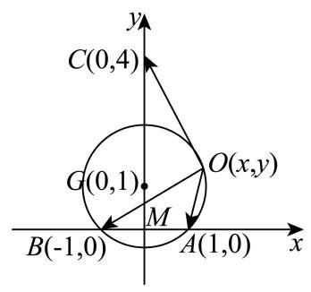

$M\left( {0,0}\right) ,\;A\left( {1,0}\right) ,\;B\left( {-1,0}\right) ,\;C\left( {0, \pm  4}\right) ,$

公共起点 $O\left( {x, y}\right)$ (即 $\overrightarrow{a} = \overrightarrow{OA},\overrightarrow{b} = \overrightarrow{OB},\overrightarrow{c} = \overrightarrow{OC}$ ).

在 $\bigtriangleup {OAB}$ 中,由正弦定理可得 $\frac{AB}{\sin \angle {AOB}} = \frac{2}{\sin \frac{\pi }{4}} = 2\sqrt{2} = {2R}$ ,

$R$ 为 $\bigtriangleup {OAB}$ 外接圆半径,故 $R = \sqrt{2}$ ,

令 $\bigtriangleup {OAB}$ 外接圆圆心为 $G$ ,易知 $G$ 在线段 ${AB}$ 垂直平分线上,可设为 $\left( {0, \pm  1}\right)$ ,

根据对称性,以 $C\left( {0,4}\right) , G\left( {0,1}\right)$ 为例,可得 $O$ 所在圆的方程为 ${x}^{2} + {\left( y - 1\right) }^{2} = 2$ ,

$\overrightarrow{a} - \overrightarrow{b} = \overrightarrow{OA} - \overrightarrow{OB} = \left( {2,0}\right) ,\overrightarrow{c} = \overrightarrow{OC} = \left( {-x,4 - y}\right)$ ,令 $k = \frac{\overrightarrow{a} \cdot  \overrightarrow{c} - \overrightarrow{b} \cdot  \overrightarrow{c}}{\left| \overrightarrow{c}\right| }$ ,

则 $k = \frac{\left( {\overrightarrow{a} - \overrightarrow{b}}\right)  \cdot  \overrightarrow{c}}{\left| \overrightarrow{c}\right| } = \frac{-{2x}}{\sqrt{{x}^{2} + {\left( y - 4\right) }^{2}}}$ ,

代入 ${x}^{2} =  - {y}^{2} + {2y} + 1$ ,得: ${k}^{2} = \frac{4\left( {-{y}^{2} + {2y} + 1}\right) }{-{6y} + {17}}$ ,

令 $t =  - {6y} + {17}\left( {t > 0}\right)$ ,由基本不等式得: ${k}^{2} = \frac{-t - \frac{49}{t} + {22}}{9} \leq  \frac{-{14} + {22}}{9} = \frac{8}{9}$ ,

当且仅当 $t = 7$ 等号成立,即 ${\left| \overrightarrow{c}\right| }^{2} = t = 7$ ,故 $\left| \overrightarrow{c}\right|  = \sqrt{7}$ ,

由对称性可知当 $C\left( {0, - 4}\right)$ ,圆的方程为 ${x}^{2} + {\left( y + 1\right) }^{2} = 2$ 时,同理可得最大值为 $\sqrt{7}$ .

### 静安 · 第16题

设 $M\text{ 、 }N$ 分别是棱长为 1 的正方体的两个不同顶点,点 $P$ 在该正方体的表面上 (含棱和顶点) 运动,且不与 $M\text{ 、 }N$ 两点重合. 关于 $\overrightarrow{PM} \cdot  \overrightarrow{PN}$ ,给出下列两个结论:

① $\overrightarrow{PM} \cdot  \overrightarrow{PN}$ 存在最小值，且最小值小于零；

② $\overrightarrow{PM} \cdot  \overrightarrow{PN}$ 存在最大值，且最大值大于零.

则下列判断正确的选项是 ( ).

A. ①正确，②错误

B. ①错误，②正确

C. ①和②都错误

D. ①和②都正确

**考点：** 正方体数量积最值；正方体动点

**难度依据：** 正方体数量积最值；正方体动点

**【答案】** A

**【解析】**

**【分析】**分 $M\text{ 、 }N$ 为同一平面的相邻顶点、 $M\text{ 、 }N$ 为同一平面的不相邻顶点及 $M\text{ 、 }N$ 为体对角线上两顶点进行讨论,可求出对应的 $\left| {MN}\right|$ 长度,取 ${MN}$ 中点为 $O$ ,利用空间向量线性运算与数量积公式可得 $\overrightarrow{PM} \cdot  \overrightarrow{PN} = {\left| \overrightarrow{PO}\right| }^{2} - \frac{1}{4}{\left| \overrightarrow{MN}\right| }^{2}$ ,再求出对应 $\left| {OP}\right|$ 范围即可得解.

**【详解】**设 ${MN}$ 中点为 $O$ ,

若 $M\text{ 、 }N$ 为同一平面的相邻顶点,则 $\left| {MN}\right|  = 1$ ,

则 $0 \leq  \left| {OP}\right|  \leq  \sqrt{{\left( \frac{1}{2}\right) }^{2} + {1}^{2} + {1}^{2}}$ ,即 $\left| {OP}\right|  \in  \left\lbrack  {0,\frac{3}{2}}\right\rbrack$ ,

$\overrightarrow{PM} \cdot  \overrightarrow{PN} = \left( {\overrightarrow{PO} + \overrightarrow{OM}}\right)  \cdot  \left( {\overrightarrow{PO} + \overrightarrow{ON}}\right)  = {\left| \overrightarrow{PO}\right| }^{2} - \frac{1}{4}{\left| \overrightarrow{MN}\right| }^{2} \in  \left\lbrack  {-\frac{1}{4},2}\right\rbrack$ ,

此时 $\overrightarrow{PM} \cdot  \overrightarrow{PN}$ 存在最小值,且最小值小于零,存在最大值,且最大值大于零;

若 $M\text{ 、 }N$ 为同一平面的不相邻顶点,则 $\left| {MN}\right|  = \sqrt{2}$ ,

则 $0 \leq  \left| {OP}\right|  \leq  \sqrt{{\left( \frac{\sqrt{2}}{2}\right) }^{2} + {1}^{2}}$ ,即 $\left| {OP}\right|  \in  \left\lbrack  {0,\frac{\sqrt{6}}{2}}\right\rbrack$ ,

$\overrightarrow{PM} \cdot  \overrightarrow{PN} = {\left| \overrightarrow{PO}\right| }^{2} - \frac{1}{4}{\left| \overrightarrow{MN}\right| }^{2} \in  \left\lbrack  {-\frac{1}{2},1}\right\rbrack$

此时 $\overrightarrow{PM} \cdot  \overrightarrow{PN}$ 存在最小值,且最小值小于零,存在最大值,且最大值大于零;

若 $M\text{ 、 }N$ 为体对角线上两顶点,则 $\left| {MN}\right|  = \sqrt{3}$ ,

则 $\frac{1}{2} \leq  \left| {OP}\right|  \leq  \frac{\sqrt{3}}{2}$ ，即 $\left| {OP}\right|  \in  \left\lbrack  {\frac{1}{2},\frac{\sqrt{3}}{2}}\right\rbrack$ ，

则 $\overrightarrow{PM} \cdot  \overrightarrow{PN} = {\left| \overrightarrow{PO}\right| }^{2} - \frac{1}{4}{\left| \overrightarrow{MN}\right| }^{2} \leq  \frac{3}{4} - \frac{3}{4} = 0$ ,

此时 $\overrightarrow{PM} \cdot  \overrightarrow{PN}$ 存在最小值,且最小值小于零,存在最大值,最大值等于零;

综上可得:①正确；②错误.

