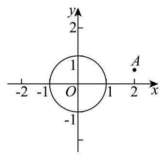

# 2026二模 复数专题 · 教师版

> 本地预览：题目、答案及分类尚未全部审定。校对使用的PDF为教研整理版，尚未逐区确认区级印刷原卷。

## 复数运算、共轭与模

先化简复数等式，注意除法的分母非零；结合共轭、模的性质或纯虚数条件求值。

### 崇明 · 第3题

若复数 $z$ 满足 $\frac{z}{1 + \mathrm{i}} = \mathrm{i}$ ( $\mathrm{i}$ 为虚数单位),则 $z =$ ___.

**考点：** 复数乘法求值

**难度依据：** 复数乘法求值

**【答案】** $- 1 + \mathrm{i}$

**【解析】**

**【分析】**利用复数的乘法运算化简求值.

**【详解】**因为 $\frac{z}{1 + \mathrm{i}} = \mathrm{i}$ ,所以 $z = \left( {1 + \mathrm{i}}\right) \mathrm{i} = \mathrm{i} + {\mathrm{i}}^{2} = \mathrm{i} - 1$ ,

所以 $z =  - 1 + \mathrm{i}$ ；

故答案为: $- 1 + \mathrm{i}$

### 浦东 · 第2题

若复数 $z$ 满足 $\left( {1 + \mathrm{i}}\right) z = {2\mathrm{i}}$ ，则复数 $z =$ ___.

**考点：** 利用共轭化简复数商

**难度依据：** 直接复数运算

**【答案】** $1 + \mathrm{i}$

**【解析】**

**【分析】**利用复数的运算法则即可得出.

**【详解】**解: $\because \left( {1 + \mathrm{i}}\right) z = 2\mathrm{i},\therefore z = \frac{2\mathrm{i}}{1 + \mathrm{i}} = \frac{2\mathrm{i}\left( {1 - \mathrm{i}}\right) }{\left( {1 + \mathrm{i}}\right) \left( {1 - \mathrm{i}}\right) } = 1 + \mathrm{i}$ , 故答案为: $1 + \mathrm{i}$ .

### 静安 · 第2题

设 $\mathrm{i}$ 是虚数单位,计算: ${\left( \frac{1 + \mathrm{i}}{1 - \mathrm{i}}\right) }^{3} =$ ___.

**考点：** 复数除法与乘方

**难度依据：** 复数除法与乘方

**【答案】** $- \mathrm{i}$

**【解析】**

**【分析】**根据复数的除法及复数的乘方求解即可.

**【详解】** $\frac{1 + i}{1 - i} = \frac{\left( {1 + i}\right) \left( {1 + i}\right) }{\left( {1 - i}\right) \left( {1 + i}\right) } = \frac{1 + {2i} + {i}^{2}}{1 - {i}^{2}} = \frac{2i}{2} = i$ ,

所以 ${\left( \frac{1 + \mathrm{i}}{1 - \mathrm{i}}\right) }^{3} = {\mathrm{i}}^{3} =  - \mathrm{i}$ .

### 松江 · 第3题

已知复数 $z$ 满足 $\left( {1 + \mathrm{i}}\right)  \cdot  z = 1 - \mathrm{i}$ (其中 $\mathrm{i}$ 为虚数单位), 则 $z \cdot  \bar{z} =$ ___.

**考点：** 解复数方程并求模平方

**难度依据：** 共轭及复数运算

**【答案】** 1

**【解析】**

**【分析】**根据题意,利用复数的运算法则,求得 $z =  - \mathrm{i}$ ,得到 $\bar{z} = \mathrm{i}$ ,进而得到答案.

**【详解】**由复数 $z$ 满足 $\left( {1 + \mathrm{i}}\right)  \cdot  z = 1 - \mathrm{i}$ ,可得 $z = \frac{1 - \mathrm{i}}{1 + \mathrm{i}} = \frac{{\left( 1 - \mathrm{i}\right) }^{2}}{\left( {1 + \mathrm{i}}\right) \left( {1 - \mathrm{i}}\right) } = \frac{-2\mathrm{i}}{2} =  - \mathrm{i}$ , 则 $\bar{z} = \mathrm{i}$ ,所以 $z \cdot  \bar{z} =  - \mathrm{i} \cdot  \mathrm{i} =  - {\mathrm{i}}^{2} = 1$ .

### 普陀 · 第2题

已知复数 $z$ 满足 $\left( {\mathrm{i} - 1}\right) \left( {z - 3\mathrm{i}}\right)  = 3 + \mathrm{i}$ ，其中 $\mathrm{i}$ 为虚数单位，则 $\bar{z} =$ ___.

**考点：** 复数除法与共轭

**难度依据：** 复数除法与共轭

**【答案】** $- 1 - \mathrm{i}$

**【解析】**

**【分析】**先根据复数的除法运算化简, 再应用共轭复数定义求解.

**【详解】**复数 $z$ 满足 $\left( {\mathrm{i} - 1}\right) \left( {z - 3\mathrm{i}}\right)  = 3 + \mathrm{i}$ ,

则 $z = \frac{3 + \mathrm{i}}{\mathrm{i} - 1} + 3\mathrm{i} = \frac{\left( {3 + \mathrm{i}}\right) \left( {\mathrm{i} + 1}\right) }{\left( {\mathrm{i} - 1}\right) \left( {\mathrm{i} + 1}\right) } + 3\mathrm{i} = \frac{3\mathrm{i} + 3 - 1 + \mathrm{i}}{-1 - 1} + 3\mathrm{i}$ ,

则 $z =  - 1 - 2\mathrm{i} + 3\mathrm{i} =  - 1 + \mathrm{i}$ ,

则 $\bar{z} =  - 1 - \mathrm{i}$ .

### 闵行 · 第7题

已知 $z \in  \mathrm{C}$ ,若 $\frac{{\left| z\right| }^{2}}{z} = 1 + \mathrm{i}$ (其中 $\mathrm{i}$ 为虚数单位),则 $z =$ ___.

**考点：** 共轭复数

**难度依据：** 共轭复数

**【答案】** $1 - \mathrm{i}$

**【解析】**

**【详解】**设 $z = a + b\mathrm{i}\left( {a, b \in  \mathbf{R}}\right)$ ,则 ${\left| z\right| }^{2} = {a}^{2} + {b}^{2}$ ,

由 $\frac{{\left| z\right| }^{2}}{z} = 1 + \mathrm{i}$ 可得 $\frac{{a}^{2} + {b}^{2}}{a + b\mathrm{i}} = \frac{\left( {{a}^{2} + {b}^{2}}\right) \left( {a - b\mathrm{i}}\right) }{\left( {a + b\mathrm{i}}\right) \left( {a - b\mathrm{i}}\right) } = \frac{\left( {{a}^{2} + {b}^{2}}\right) \left( {a - b\mathrm{i}}\right) }{{a}^{2} + {b}^{2}} = a - b\mathrm{i} = 1 + \mathrm{i}$ ,

则 $a = 1, b =  - 1$ ,故 $z = 1 - \mathrm{i}$ .

### 金山 · 第2题

已知复数 $z = \left( {m + 2}\right)  + \left( {m - 1}\right) \mathrm{i}$ ( $\mathrm{i}$ 为虚数单位)为纯虚数，则实数 $m =$ ___.

**考点：** 纯虚数实部零虚部非零

**难度依据：** 纯虚数实部零虚部非零

**【答案】** -2

**【解析】**

**【详解】**由复数 $z = \left( {m + 2}\right)  + \left( {m - 1}\right) \mathrm{i}$ 为纯虚数,

则 $\left\{  \begin{array}{l} m + 2 = 0 \\  m - 1 \neq  0 \end{array}\right.$ ，解得 $m =  - 2$ .

### 宝山 · 第3题

已知 $i$ 是虚数单位，且复数 $z$ 满足 $\left( {1 + i}\right) z = 2$ ，则 $\left| z\right|  =$ ___.

**考点：** 复数除法及模的运算

**难度依据：** 复数除法及模的运算

**【答案】** $\sqrt{2}$ ；

**【解析】**

**【详解】**解: 由题意可知: $z = \frac{2}{1 + \mathrm{i}}$ ,则 $\left| z\right|  = \frac{\left| 2\right| }{\left| 1 + i\right| } = \frac{2}{\sqrt{2}} = \sqrt{2}$ .

### 青浦 · 第4题

已知复数 $z = \frac{1 + 3\mathrm{i}}{1 - 2\mathrm{i}}$ ，则 $\left| z\right|  =$ ___.

**考点：** 复数除法与模

**难度依据：** 复数除法与模

**【答案】** $\sqrt{2}$

**【解析】**

**【分析】**先化简复数, 再结合复数运算法则计算模.

**【详解】**由题意得 $z = \frac{\left( {1 + 3\mathrm{i}}\right) \left( {1 + 2\mathrm{i}}\right) }{\left( {1 - 2\mathrm{i}}\right) \left( {1 + 2\mathrm{i}}\right) } = \frac{1 + 5\mathrm{i} + 6{\mathrm{i}}^{2}}{{1}^{2} - {\left( 2\mathrm{i}\right) }^{2}} = \frac{-5 + 5\mathrm{i}}{5} =  - 1 + \mathrm{i}$ ,

所以 $\left| z\right|  = \sqrt{{\left( -1\right) }^{2} + {1}^{2}} = \sqrt{2}$

## 复平面中的点、向量与轨迹交点

将复数模和差转化为点的距离、向量夹角或轨迹，结合圆、双曲线、垂直平分线等几何条件求解；综合大题保留全部小问。

### 黄浦 · 第8题

在复平面内,点 $P, Q, O$ 分别表示复数 $z, w,0$ ,已知 $\left| z\right|  = 3,\left| w\right|  = 5, u = z + w$ ,且 $\left| u\right|  = 7$ ，则向量 $\overrightarrow{OP}$ 与 $\overrightarrow{OQ}$ 的夹角为___.

> 本题资料或解析有待核事项，预览不可作为已审定成品。

**考点：** 复数加法；向量夹角

**难度依据：** 复数加法；向量夹角

**核查说明：** 仅本题解析局部回核；其他题未据此判定终审通过。；原解析向量箭头丢失，标量平方与数量积表示混乱，需恢复向量记号。

【答案】$\frac\pi3$

【解析·向量记号复核修订】

设复数 $u$ 对应点 $A$。复数加法对应向量加法，故 $\overrightarrow{OA}=\overrightarrow{OP}+\overrightarrow{OQ}$，且 $|\overrightarrow{OP}|=3$，$|\overrightarrow{OQ}|=5$，$|\overrightarrow{OA}|=7$。

两边取模平方，得

$$|\overrightarrow{OA}|^2=|\overrightarrow{OP}|^2+|\overrightarrow{OQ}|^2+2\overrightarrow{OP}\cdot\overrightarrow{OQ}.$$

因此 $49=9+25+2\overrightarrow{OP}\cdot\overrightarrow{OQ}$，即 $\overrightarrow{OP}\cdot\overrightarrow{OQ}=\frac{15}{2}$。

设两向量夹角为 $\theta\in[0,\pi]$，则

$$\cos\theta=\frac{\overrightarrow{OP}\cdot\overrightarrow{OQ}}{|\overrightarrow{OP}|\,|\overrightarrow{OQ}|}=\frac{15/2}{3\times5}=\frac12.$$

故 $\theta=\frac\pi3$。

【复核修订说明】教研整理PDF第1页题干保留向量箭头，第7页简答为 $\pi/3$。原合并稿解析丢失箭头，将向量和及数量积混写为线段长度的等式；此处按原题独立复算并规范化记号，保留原答案。该PDF未提供本题详细解析，本段不冒充PDF逐字原解。

### 嘉定 · 第17题

在复平面内,已知点 $A\text{ 、 }B\text{ 、 }C$ 对应的复数分别为 ${z}_{A} = 0\text{ 、 }{z}_{B} = 6\text{ 、 }{z}_{C} = 4 + 3\mathrm{i}$ ,其中 $i$ 是虚数单位.

(1)求 $\cos \angle {ACB}$ 的值；

(2)若复数 $z$ 满足 $\left| {z - {z}_{A}}\right|  = \left| {z - {z}_{B}}\right|  = \left| {{z}_{B} - {z}_{C}}\right|$ ，求 $z$ .

**考点：** (1) 数量积求夹角余弦；(2) 复数模的几何意义与圆的交点

**难度依据：** 复平面几何与数量积

**核查说明：** 题干与答案解析尚未逐页对照原卷，数学内容未独立终审。

**【答案】** (1) $\frac{\sqrt{13}}{65}$ ;

(2) $z = 3 + {2\mathrm{i}}$ 或 $z = 3 - {2\mathrm{i}}$ .

**【解析】**

**【分析】**(1) 由已知写出点 $A\text{ 、 }B\text{ 、 }C$ 的坐标,写出向量 $\overrightarrow{CA},\overrightarrow{CB}$ ,即可求 $\cos \angle {ACB}$ ;

(2)由已知可得复数 $z$ 对应的点到点 $A\left( {0,0}\right)$ 和点 $B\left( {6,0}\right)$ 距离相等，可知复数 $z$ 对应的点在 ${AB}$ 的垂直平分线上,即 $z$ 的实部为 3,再计算 $B$ 到 $C$ 的距离,由复数 $z$ 对应的点到原点的距离等于该值,即可解出 $z$ .

**【小问 1 详解】**

由已知可得, $A\left( {0,0}\right) , B\left( {6,0}\right) , C\left( {4,3}\right)$ ,所以 $\overrightarrow{CA} = \left( {-4, - 3}\right) ,\overrightarrow{CB} = \left( {2, - 3}\right)$ ,

所以 $\cos \angle {ACB} = \frac{\overrightarrow{CA} \cdot  \overrightarrow{CB}}{\left| \overrightarrow{CA}\right|  \cdot  \left| \overrightarrow{CB}\right| } = \frac{-4 \times  2 + \left( {-3}\right)  \times  \left( {-3}\right) }{\sqrt{{\left( -4\right) }^{2} + {\left( -3\right) }^{2}} \cdot  \sqrt{{2}^{2} + {\left( -3\right) }^{2}}} = \frac{\sqrt{13}}{65}$ ;

**【小问 2 详解】**

因为 $\left| {z - {z}_{A}}\right|  = \left| {z - {z}_{B}}\right| ,{z}_{A} = 0,{z}_{B} = 6$ ,所以 $\left| {z - 0}\right|  = \left| {z - 6}\right|$ ,

所以复数 $z$ 对应的点到点 $A\left( {0,0}\right)$ 到和点 $B\left( {6,0}\right)$ 距离相等,

所以这两点的中垂线是直线 $x = 3$ ,即复数 $z$ 的实部为 3,设 $z = 3 + y\mathrm{i},\;y \in  \mathbf{R}$ .

所以 $\left| {z - {z}_{A}}\right|  = \left| z\right|  = \left| {6 - \left( {4 + 3\mathrm{i}}\right) }\right|  = \left| {2 - 3\mathrm{i}}\right|  = \sqrt{13}$ ,

所以 $\left| z\right|  = \sqrt{{3}^{2} + {y}^{2}} = \sqrt{13}$ ,解得 $y =  \pm  2$ ,

所以 $z = 3 + 2\mathrm{i}$ 或 $z = 3 - 2\mathrm{i}$ .

### 杨浦 · 第10题

设集合 $A = \{ z\parallel z + 1 \mid   = \left| {z - a}\right| , z \in  \mathbf{C}\} , B = \{ z\parallel z \mid   = 1, z \in  \mathbf{C}\}$ ，若 $A \cap  B \neq  \varnothing$ ，则实数 $a$ 的取值范围是___.

> 本题资料或解析有待核事项，预览不可作为已审定成品。

**考点：** 模的几何意义转化圆与直线相交，讨论退化

**难度依据：** 需处理两定点重合的退化情形

**核查说明：** 合并MD集合定义中绝对值与条件分隔符错乱，需对原卷修复。；题干集合及模符号OCR错乱，须按原卷或可靠回源恢复；a=-1应单独处理。

**【答案】** $\left\lbrack  {-1,3}\right\rbrack$

**【解析】**

**【分析】**由 $\left| {z + 1}\right|  = \left| {z - a}\right|$ 知 $z$ 到 $\left( {-1,0}\right)$ 与 $\left( {a,0}\right)$ 距离相等,其轨迹是这两点的垂直平分线, $B = \{ z\parallel z \mid   = 1, z \in  \mathbf{C}\}$ 表示的轨迹是一个单位圆,两者有交点,等价于原点到直线的距离不大于 1,通过计算可得实数 $a$ 的取值范围.

**【详解】**集合 $A = \left\{  {z\begin{Vmatrix}{z + 1}\end{Vmatrix} = \left| {z - a}\right| , z \in  \mathbf{C}}\right\}$ ,由 $\left| {z + 1}\right|  = \left| {z - a}\right|$ ,即 $z$ 到 $\left( {-1,0}\right)$ 与 $\left( {a,0}\right)$ 距离相等,

即 $z$ 的轨迹为 $\left( {-1,0}\right)$ 与 $\left( {a,0}\right)$ 两点连线的垂直平分线,

设 $z = x + y\mathrm{i}$ ,所以 $\left| {x + 1 + y\mathrm{i}}\right|  = \left| {x - a - y\mathrm{i}}\right|$ ,所以 ${\left( x + 1\right) }^{2} + {y}^{2} = {\left( x - a\right) }^{2} + {y}^{2}$ ,化简得 $2\left( {a + 1}\right) x = {a}^{2} - 1,$

若 $a =  - 1$ ,等式化为 $0 = 0$ ,任何 $z$ 都满足,此时 $A$ 为整个复平面,满足 $A \cap  B \neq  \varnothing$ ;

若 $a \neq   - 1$ ,则 $x = \frac{a - 1}{2}$ ,即 $z$ 的轨迹为直线 $x = \frac{a - 1}{2}, B = \{ z\parallel z \mid   = 1, z \in  \mathbf{C}\}$ 表示的为圆: ${x}^{2} + {y}^{2} = 1$

$A \cap  B \neq  \varnothing$ 即直线 $x = \frac{a - 1}{2}$ 与圆 ${x}^{2} + {y}^{2} = 1$ 有交点，所以 $\left| \frac{a - 1}{2}\right|  \leq  1$ ，解得 $- 1 \leq  a \leq  3$ ，所以实数 $a$ 的取值范围是 $\left\lbrack  {-1,3}\right\rbrack$ .

### 静安 · 第11题

若满足 $\left| z\right|  = 5$ ，且 $\left| {z + 5}\right|  - \left| {z - 5}\right|  = 6$ 的复数 $z$ 有两个，分别设为 ${z}_{1}\text{ 、 }{z}_{2}$ ，则 $\left| {{z}_{1} - {z}_{2}}\right|  =$ ___.

> 本题资料或解析有待核事项，预览不可作为已审定成品。

**考点：** 复数对应点与轨迹；圆与双曲线交点

**难度依据：** 复数对应点与轨迹；圆与双曲线交点

**核查说明：** 仅本题解析局部回核；其他题未据此判定终审通过。；源解析曾误写y²=±16/5；已回源并独立复核修订为y=±16/5。；原解析将y²误写为±16/5，应为y=±16/5；原答案32/5不受该笔误影响。

**【答案】** $\frac{32}{5}$

**【解析】**

**【分析】**设 $Z\left( {x, y}\right)$ ,根据复数的几何意义分析可得 ${x}^{2} + {y}^{2} = {25},\frac{{x}^{2}}{9} - \frac{{y}^{2}}{16} = 1\left( {x > 0}\right)$ , 联立方程运算求解即可.

**【详解】**设 $Z\left( {x, y}\right) , O\left( {0,0}\right) ,{F}_{1}\left( {-5,0}\right) ,{F}_{2}\left( {5,0}\right)$ ,

因为 $\left| z\right|  = 5$ ,则 $\left| {OZ}\right|  = 5$ ,可知点 $Z$ 的轨迹是以 $O\left( {0,0}\right)$ 为圆心,半径为 5 的圆,

可得 ${x}^{2} + {y}^{2} = {25}$ ；

且 $\left| {z + 5}\right|  - \left| {z - 5}\right|  = 6$ ,则 $\left| {Z{F}_{1}}\right|  - \left| {Z{F}_{2}}\right|  = 6 < {10}$ ,可知点 $Z$ 的轨迹是以 ${F}_{1},{F}_{2}$ 为焦点的双曲线的右支,

则 $a = 3, c = 5, b = \sqrt{{c}^{2} - {a}^{2}} = 4$ ,可得 $\frac{{x}^{2}}{9} - \frac{{y}^{2}}{16} = 1\left( {x > 0}\right)$ ,

联立方程 $\left\{  \begin{array}{l} {x}^{2} + {y}^{2} = {25} \\  \frac{{x}^{2}}{9} - \frac{{y}^{2}}{16} = 1 \end{array}\right.$ ,解得 $\left\{  \begin{array}{l} {x}^{2} = \frac{369}{25} \\  {y}^{2} = \frac{256}{25} \end{array}\right.$ ,

且 $x > 0$ ,则 $\left\{  \begin{array}{l} x = \frac{3\sqrt{41}}{5} \\  y =  \pm  \frac{16}{5} \end{array}\right.$ ,可得 ${Z}_{1}\left( {\frac{3\sqrt{41}}{5},\frac{16}{5}}\right) ,{Z}_{2}\left( {\frac{3\sqrt{41}}{5}, - \frac{16}{5}}\right)$ ,

所以 $\left| {{z}_{1} - {z}_{2}}\right|  = \left| {{Z}_{1} - {Z}_{2}}\right|  = \frac{32}{5}$ .

【复核修订说明】上述开平方后的变量由原合并稿误写的 $y^2$ 更正为 $y$。独立联立方程得 $y^2=256/25$，故 $y=\pm16/5$；两交点纵坐标之差为 $32/5$，与教研整理PDF第8页答案一致。该PDF仅提供本题简答，局部解析修订属于独立复算，不冒充PDF原文。

## 模的约束与距离范围、最值

把复数条件转化为单位圆、圆弧或圆环交集；通过参数化或距离几何求目标表达式的最值及取值范围，特别检查取等和可达性。

### 奉贤 · 第10题

已知复数 $z = \cos \theta  + \mathrm{i}\sin \theta ,\theta  \in  \lbrack 0,{2\pi }),\mathrm{i}$ 是虚数单位,则 ${\left| z + 6\right| }^{2} + {\left| z - 8\mathrm{i}\right| }^{2}$ 的取值范围是___.

**考点：** 复数模的坐标展开；辅助角公式求范围

**难度依据：** 复数模的坐标展开；辅助角公式求范围

**【答案】** [82,122]

**【解析】**

**【详解】** $\because {\mathrm{i}}^{2} =  - 1$ ,

$\therefore {\left| z + 6\right| }^{2} + {\left| z - 8\mathrm{i}\right| }^{2} = {\left| \left( \cos \theta  + 6\right)  + \mathrm{i}\sin \theta \right| }^{2} + {\left| \cos \theta  + \mathrm{i}\left( \sin \theta  - 8\right) \right| }^{2}$

$= \left( {{\cos }^{2}\theta  + {12}\cos \theta  + {36} + {\sin }^{2}\theta }\right)  + \left( {{\cos }^{2}\theta  + {\sin }^{2}\theta  - {16}\sin \theta  + {64}}\right)$

$= {37} + {12}\cos \theta  + {65} - {16}\sin \theta  = {102} + {12}\cos \theta  - {16}\sin \theta$ ,

$= {102} + {20}\left( {\frac{3}{5}\cos \theta  - \frac{4}{5}\sin \theta }\right)$ ,设 $\cos \varphi  = \frac{3}{5},\sin \varphi  = \frac{4}{5}$ ,

则 ${\left| z + 6\right| }^{2} + {\left| z - 8\mathrm{i}\right| }^{2} = {102} + {20}\cos \left( {\theta  + \varphi }\right)$ ,

当 $\theta  + \varphi  = {2k\pi }, k \in  \mathbf{Z}$ ,即 $\cos \theta  = \frac{3}{5},\sin \theta  =  - \frac{4}{5}$ 时, $\cos \left( {\theta  + \varphi }\right)  = 1$ ,

此时 ${\left| z + 6\right| }^{2} + {\left| z - 8\mathrm{i}\right| }^{2}$ 取最大值 122,

当 $\theta  + \varphi  = {2k\pi } + \pi , k \in  \mathbf{Z}$ ,即 $\cos \theta  =  - \frac{3}{5},\sin \theta  = \frac{4}{5}$ 时, $\cos \left( {\theta  + \varphi }\right)  =  - 1$ ,

此时 ${\left| z + 6\right| }^{2} + {\left| z - 8\mathrm{i}\right| }^{2}$ 取最小值 82 ,

$\therefore {\left| z + 6\right| }^{2} + {\left| z - 8\mathrm{i}\right| }^{2} = {102} + {12}\cos \theta  - {16}\sin \theta  \in  \left\lbrack  {{82},{122}}\right\rbrack$ .

### 长宁 · 第10题

已知复数 $z$ 满足: $\left| z\right|  = 1$ ，且 $\left| {z - \mathrm{i}}\right|  \leq  1$ ，则 $\left| {z\mathrm{i} - 1}\right|$ 的最小值为___.

**考点：** 复数模与圆弧最值；圆弧距离最值

**难度依据：** 复数模与圆弧最值；圆弧距离最值

**【答案】** $\sqrt{3}$

**【解析】**

**【分析】**设 $z = a + b\mathrm{i}, a \in  \mathbf{R}, b \in  \mathbf{R}$ ,由题意易得 ${a}^{2} + {b}^{2} = 1,\frac{1}{2} \leq  b \leq  1$ ,表示出 $\left| {z\mathrm{i} - 1}\right|$ 即可求出答案.

**【详解】**设 $z = a + b\mathrm{i}, a \in  \mathbf{R}, b \in  \mathbf{R}$ ,

则 $\left| z\right|  = \sqrt{{a}^{2} + {b}^{2}} = 1 \Rightarrow  {a}^{2} + {b}^{2} = 1$ ,

$\left| {z - \mathrm{i}}\right|  = \left| {a + \left( {b - 1}\right) \mathrm{i}}\right|  = \sqrt{{a}^{2} + {\left( b - 1\right) }^{2}} \leq  1 \Rightarrow  {a}^{2} + {\left( b - 1\right) }^{2} \leq  1$

化简得: ${a}^{2} + {b}^{2} - {2b} + 1 \leq  1 \Rightarrow  \frac{1}{2} \leq  b \leq  1$ ,

$\left| {z\mathrm{i} - 1}\right|  = \left| {a\mathrm{i} - b - 1}\right|  = \sqrt{{\left( -b - 1\right) }^{2} + {a}^{2}} = \sqrt{{a}^{2} + {b}^{2} + {2b} + 1} = \sqrt{{2b} + 2}$ ,

又 $\frac{1}{2} \leq  b \leq  1$

所以 $3 \leq  {2b} + 2 \leq  4$

所以 $\sqrt{3} \leq  \sqrt{{2b} + 2} \leq  2$

所以 $\left| {z\mathrm{i} - 1}\right|$ 的最小值为 $\sqrt{3}$ .

### 虹口 · 第9题

已知复数 $z$ 满足 $z + \frac{1}{z}$ 是实数，则 $\left| {z - 2 - \frac{\mathrm{i}}{2}}\right|$ 的最小值为___.

> 本题资料或解析有待核事项，预览不可作为已审定成品。

**考点：** 实数条件与模的几何最值；实轴与单位圆上的距离最值

**难度依据：** 实数条件与模的几何最值；实轴与单位圆上的距离最值

**核查说明：** 仅本题解析局部回核；其他题未据此判定终审通过。；答案含OCR尾串##0.5，呈现时去除；z不为0且两种轨迹需分别讨论。

**【答案】** $\frac{1}{2}$

**【解析】**

**【分析】**设 $z = a + b\mathrm{i}$ ,代入 $z + \frac{1}{z}$ 中化简,由 $z + \frac{1}{z}$ 是实数,得 $b = 0$ 或 ${a}^{2} + {b}^{2} = 1$ ,利用复数模的几何意义求 $\left| {z - 2 - \frac{\mathrm{i}}{2}}\right|$ 的最小值

**【详解】**设 $z = a + b\mathrm{i}$ ,则 $z + \frac{1}{z} = a + b\mathrm{i} + \frac{1}{a + b\mathrm{i}} = a + b\mathrm{i} + \frac{a - b\mathrm{i}}{\left( {a + b\mathrm{i}}\right) \left( {a - b\mathrm{i}}\right) } \; = a + \frac{a}{{a}^{2} + {b}^{2}} + \left( {b - \frac{b}{{a}^{2} + {b}^{2}}}\right) \mathrm{i},$

因为 $z + \frac{1}{z}$ 是实数,所以 $b - \frac{b}{{a}^{2} + {b}^{2}} = \frac{b\left( {{a}^{2} + {b}^{2} - 1}\right) }{{a}^{2} + {b}^{2}} = 0$ ,

所以 $b = 0$ 或 ${a}^{2} + {b}^{2} = 1$ ,

当 $b = 0$ 时, $z$ 的轨迹是 $x$ 轴 (除原点外),

此时 $\left| {z - 2 - \frac{\mathrm{i}}{2}}\right|$ 的几何意义表示 $x$ 轴上的点 (除原点) 和 $\left( {2,\frac{1}{2}}\right)$ 的距离,此时 $\left| {z - 2 - \frac{\mathrm{i}}{2}}\right|  \geq  \frac{1}{2}$ ,

当 ${a}^{2} + {b}^{2} = 1$ 时,复数 $z$ 的轨迹是以原点为圆心,1为半径的圆,如图,

根据复数模的几何意义可知, $\left| {z - 2 - \frac{\mathrm{i}}{2}}\right|$ 的几何意义是圆上的点到 $\left( {2,\frac{1}{2}}\right)$ 的距离,

由图可知, $\left| {z - 2 - \frac{\mathrm{i}}{2}}\right|$ 的最小值为 $\left| {OA}\right|  - 1 = \sqrt{{2}^{2} + {\left( \frac{1}{2}\right) }^{2}} - 1 = \frac{\sqrt{17}}{2} - 1$ .

因为 $\frac{\sqrt{17}}{2} - 1 > \frac{1}{2}$ ,所以 $\left| {z - 2 - \frac{\mathrm{i}}{2}}\right|$ 的最小值为 $\frac{1}{2}$ .

【复核修订说明】依据教研整理PDF第7页答案，去除合并稿答案后的OCR脏串。另独立验证：$z\ne0$，实数条件给出实轴去原点与单位圆两种轨迹；实轴分支在 $z=2$ 时取到 $1/2$，单位圆分支的最小距离为 $\sqrt{17}/2-1>1/2$，故全局最小值为 $1/2$。

### 徐汇 · 第11题

已知复数 ${w}_{1},{w}_{2}$ 满足 $\overline{{w}_{1}} - \overline{{w}_{2}} = \frac{4}{{w}_{1} - {w}_{2}}$ ,记满足 $\left| {z - {w}_{i}}\right|  \in  \left\lbrack  {1,3}\right\rbrack  \left( {i = 1,2}\right)$ 的复数 $z$ 组成的集合为 $A$ . 若 ${z}_{1} \in  A$ 且 ${z}_{2} \in  A$ ，则 $\left| {{z}_{1} - {z}_{2}}\right|$ 的取值范围是___.

> 本题资料或解析有待核事项，预览不可作为已审定成品。

**考点：** 模约束确定圆环交集与最远点距离

**难度依据：** 需辨认两个约束同时成立并优化距离

**核查说明：** 教研整理PDF第1页题面同时满足两圆环，第8页答案为[0,4√2]；合并MD答案[0,8]与两圆环交集条件不符，原解析把两个点分别放在不同圆环上，须整体重写并独立复核。；底稿已有独立复核修订为[0,4√2]；原合并稿[0,8]及其解析错误，展示修订版并保留来源。

**【答案】** $[0,4\sqrt{2}]$

**【解析·独立复核修订】**

由题设分式有意义，$w_1\ne w_2$。两边同乘 $w_1-w_2$，得

$$
|w_1-w_2|^2=4,\qquad |w_1-w_2|=2.
$$

设两圆心的中点为 $m=(w_1+w_2)/2$。根据平行四边形公式，对任意 $z\in A$，有

$$
|z-w_1|^2+|z-w_2|^2
=2|z-m|^2+\frac12|w_1-w_2|^2
=2|z-m|^2+2.
$$

因为两个距离都不超过 $3$，所以 $2|z-m|^2+2\le18$，即 $|z-m|\le2\sqrt2$。于是

$$
|z_1-z_2|\le |z_1-m|+|z_2-m|\le4\sqrt2.
$$

还需证明每个值可以达到。令 $u=(w_1-w_2)/2$，则 $|u|=1$。对任意 $t\in[0,2\sqrt2]$，取

$$
z_1=m+\mathrm{i}tu,\qquad z_2=m-\mathrm{i}tu.
$$

由于 $u$ 与 $\mathrm{i}u$ 在复平面内垂直，四个距离均等于 $\sqrt{1+t^2}$，属于 $[1,3]$，故 $z_1,z_2\in A$；此时 $|z_1-z_2|=2t$。当 $t$ 取遍 $[0,2\sqrt2]$，距离取遍 $[0,4\sqrt2]$。

因此答案为 **$[0,4\sqrt2]$**。PDF第8页答案与此一致；合并MD写 $[0,8]$，其解析把 $z_1,z_2$ 分别放在不同圆心的圆上，未保证每点同时属于两个圆环交集，不能成立。

