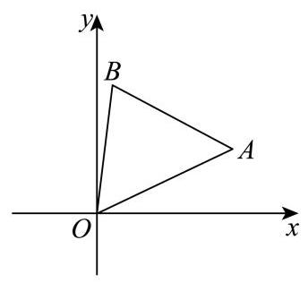
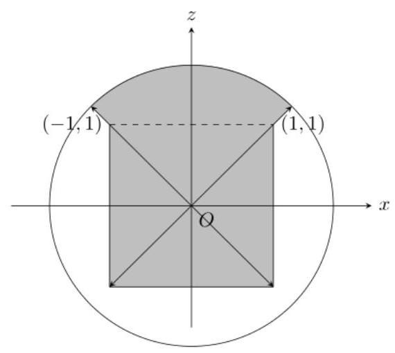
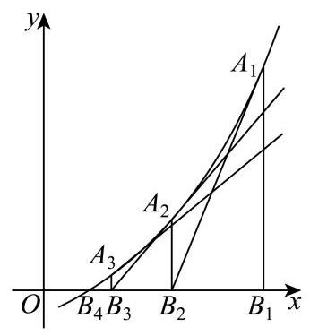

# 2026二模 新定义与综合专题 · 教师版

> 本地预览：题目、答案及分类尚未全部审定。校对使用的PDF为教研整理版，尚未逐区确认区级印刷原卷。

## 几何点集、新距离与运算

用坐标或几何模型翻译定义，核对方向条件、点集及构造可达性。

### 嘉定 · 第12题

在包装设计中,常用长度和宽度描述物体体型. 长度 $l\left( V\right)$ 定义为物体上最远两点间的距离,宽度 $t\left( V\right)$ 定义为能夹住物体的两平行平面间的最小距离,即存在一对平行平面,使得物体上的所有点均位于两平面之间 (包括平面上). 现有一圆柱,其底面半径 $R$ 与高 $h$ 可任意调节，则 $\frac{l\left( V\right) }{t\left( V\right) }$ 的最小值为___

> 本题资料或解析有待核事项，预览不可作为已审定成品。

**考点：** 圆柱长度宽度与几何量；新定义及分段讨论；分段比值最小化

**难度依据：** 新定义下立体量分段最优化

**核查说明：** 题干与答案解析尚未逐页对照原卷，数学内容未独立终审。

**【答案】** $\sqrt{2}$

**【解析】**

**【分析】**分 $h \geq  {2R}$ 和 $h < {2R}$ 两种情况进行分析,可得结论.

**【详解】**圆柱体中,最远两点间的距离为 $l\left( V\right)  = \sqrt{{\left( 2R\right) }^{2} + {h}^{2}}$ ,

当 $h \geq  {2R}$ ,即 $\frac{h}{2R} \geq  1$ 时, $t\left( V\right)  = {2R},\frac{l\left( V\right) }{t\left( V\right) } = \frac{\sqrt{{\left( 2R\right) }^{2} + {h}^{2}}}{2R} = \sqrt{1 + {\left( \frac{h}{2R}\right) }^{2}} \geq  \sqrt{2}$ ,

当且仅当 $h = {2R}$ 时，等号成立；

当 $h < {2R}$ ,即 $\frac{2R}{h} > 1$ 时, $t\left( V\right)  = h,\frac{l\left( V\right) }{t\left( V\right) } = \frac{\sqrt{{\left( 2R\right) }^{2} + {h}^{2}}}{h} = \sqrt{1 + {\left( \frac{2R}{h}\right) }^{2}} > \sqrt{2}$ .

所以 $\frac{l\left( V\right) }{t\left( V\right) }$ 的最小值为 $\sqrt{2}$ .

### 嘉定 · 第16题

对任意平面向量 $\overrightarrow{a}\text{ 、 }\overrightarrow{b}\text{ 、 }\overrightarrow{c}$ 及任意实数 $\lambda$ ,已知运算 $\odot$ 满足以下三条性质: (I)

$\overrightarrow{a} \odot  \overrightarrow{b} = \overrightarrow{b} \odot  \overrightarrow{a};$ ( II ) $\left( {\overrightarrow{a} + \overrightarrow{b}}\right)  \odot  \overrightarrow{c} = \overrightarrow{a} \odot  \overrightarrow{c} + \overrightarrow{b} \odot  \overrightarrow{c};$ (III) $\left( {\lambda \overrightarrow{a}}\right)  \odot  \overrightarrow{b} = \lambda \left( {\overrightarrow{a} \odot  \overrightarrow{b}}\right)$ . 则下列选项中一定成立的是( )

A. 若 $\overrightarrow{a} \odot  \overrightarrow{b} = 0$ ,则 $\overrightarrow{a} = \overrightarrow{0}$ 或 $\overrightarrow{b} = \overrightarrow{0}$

B. $\left| {\overrightarrow{a} \odot  \overrightarrow{b}}\right|  = \left| \overrightarrow{a}\right|  \cdot  \left| \overrightarrow{b}\right|$

C. $\left( {\overrightarrow{a} - \overrightarrow{b}}\right)  \odot  \left( {\overrightarrow{a} - \overrightarrow{b}}\right)  = \overrightarrow{a} \odot  \overrightarrow{a} - 2\overrightarrow{a} \odot  \overrightarrow{b} + \overrightarrow{b} \odot  \overrightarrow{b}$

D. $\overrightarrow{a} \odot  \overrightarrow{a} \geq  0$

> 本题资料或解析有待核事项，预览不可作为已审定成品。

**考点：** 向量新运算的性质；对称双线性运算与反例

**难度依据：** 用性质推理并构造反例

**核查说明：** 题干与答案解析尚未逐页对照原卷，数学内容未独立终审。

**【答案】** C

**【解析】**

**【分析】**对于新定义运算判断题, 一般通过选择特定函数验证性质, 再根据选项利用特值代入排除或通过推理得到结论.

**【详解】**设 $\overrightarrow{a}\text{ 、 }\overrightarrow{b}\text{ 、 }\overrightarrow{c}$ 的坐标分别为 $\overrightarrow{a} = \left( {{a}_{1},{a}_{2}}\right) ,\overrightarrow{b} = \left( {{b}_{1},{b}_{2}}\right) ,\overrightarrow{c} = \left( {{c}_{1},{c}_{2}}\right)$ ,

对于 $\mathrm{A}$ ,若定义 $\overrightarrow{a} \odot  \overrightarrow{b} = {a}_{1}{b}_{1} - {a}_{2}{b}_{2}$ ,运算 $\odot$ 显然满足 (I);

因 $\left( {\overrightarrow{a} + \overrightarrow{b}}\right)  \odot  \overrightarrow{c} = \left( {{a}_{1} + {b}_{1}}\right) {c}_{1} - \left( {{a}_{2} + {b}_{2}}\right) {c}_{2} = {a}_{1}{c}_{1} + {b}_{1}{c}_{1} - {a}_{2}{c}_{2} - {b}_{2}{c}_{2}$ ,

而 $\overrightarrow{a} \odot  \overrightarrow{c} + \overrightarrow{b} \odot  \overrightarrow{c} = {a}_{1}{c}_{1} - {a}_{2}{c}_{2} + {b}_{1}{c}_{1} - {b}_{2}{c}_{2}$ ,即满足 (II);

又 $\left( {\lambda \overrightarrow{a}}\right)  \odot  \overrightarrow{b} = \left( {\lambda {a}_{1},\lambda {a}_{2}}\right)  \odot  \left( {{b}_{1},{b}_{2}}\right)  = \lambda {a}_{1}{b}_{1} - \lambda {a}_{2}{b}_{2}$ ,而 $\lambda \left( {\overrightarrow{a} \odot  \overrightarrow{b}}\right)  = \lambda \left( {{a}_{1}{b}_{1} - {a}_{2}{b}_{2}}\right)$ ,即满足 (III) .

若取 $\overrightarrow{a} = \overrightarrow{b} = \left( {1,1}\right) ,\overrightarrow{a} \odot  \overrightarrow{b} = 1 \times  1 - 1 \times  1 = 0$ ,但 $\overrightarrow{a},\overrightarrow{b}$ 都不是零向量,故 A 错误;

对于 $\mathrm{B}$ ,若定义 $\overrightarrow{a} \odot  \overrightarrow{b} = \overrightarrow{a} \cdot  \overrightarrow{b} = {a}_{1}{b}_{1} + {a}_{2}{b}_{2}$ ,显然满足三条性质.

若取 $\overrightarrow{a} = \left( {0,1}\right) ,\overrightarrow{b} = \left( {1,0}\right)$ ,则 $\left| {\overrightarrow{a} \odot  \overrightarrow{b}}\right|  = \left| {0 \times  1 + 1 \times  0}\right|  = 0$ 而 $\left| \overrightarrow{a}\right|  \cdot  \left| \overrightarrow{b}\right|  = 1 \times  1 = 1$ ,故 B 错误;

对于 $\mathrm{C}$ ,利用以上三条性质,可得: $\left( {\overrightarrow{a} - \overrightarrow{b}}\right)  \odot  \left( {\overrightarrow{a} - \overrightarrow{b}}\right)  = (\left( {\overrightarrow{a} + \left( {-\overrightarrow{b}}\right) }\right)  \odot  \left( {\overrightarrow{a} - \overrightarrow{b}}\right)$

$= \overrightarrow{a} \odot  \left( {\overrightarrow{a} - \overrightarrow{b}}\right)  + \left( {-\overrightarrow{b}}\right)  \odot  \left( {\overrightarrow{a} - \overrightarrow{b}}\right)  = \overrightarrow{a} \odot  \overrightarrow{a} - \overrightarrow{a} \odot  \overrightarrow{b} + \left( {-1}\right) \left( {\overrightarrow{b} \odot  \overrightarrow{a} - \overrightarrow{b} \odot  \overrightarrow{b}}\right)$

$= \overrightarrow{a} \odot  \overrightarrow{a} - \overrightarrow{a} \odot  \overrightarrow{b} - \overrightarrow{a} \odot  \overrightarrow{b} + \overrightarrow{b} \odot  \overrightarrow{b} = \overrightarrow{a} \odot  \overrightarrow{a} - 2\overrightarrow{a} \odot  \overrightarrow{b} + \overrightarrow{b} \odot  \overrightarrow{b}$ ,故 C 正确;

对于 $\mathrm{D}$ ,若定义 $\overrightarrow{a} \odot  \overrightarrow{b} =  - \overrightarrow{a} \cdot  \overrightarrow{b} =  - {a}_{1}{b}_{1} - {a}_{2}{b}_{2}$ ,显然满足三条性质,

但 $\overrightarrow{a} \odot  \overrightarrow{a} =  - {a}_{1}^{2} - {a}_{2}^{2} =  - \left( {{a}_{1}^{2} + {a}_{2}^{2}}\right)  \leq  0$ ,当 $\overrightarrow{a} \neq  \overrightarrow{0}$ 时, $\overrightarrow{a} \odot  \overrightarrow{a} < 0$ ,故 D 错误.

### 徐汇 · 第16题

设 $m \in  \mathbf{R}$ . 定义点 $P\left( {m,\frac{1}{2}m - 1}\right)$ 的 $t -$ 相伴集合为 ${A}_{P - t} = \{ \left( {x, y}\right) \parallel x - m \mid   \leq  t$ 且 $\left. {\left| {y - \left( {\frac{1}{2}m - 1}\right) }\right|  \leq  t}\right\}$ ,其中 $t$ 为正实数. 给出以下两个命题:

① 若 $m = 0$ ，则其 1-相伴集合 ${A}_{P - 1}$ 所对应平面图形的面积为 2;

② 设 ${t}_{0} > 0$ ，若对任意实数 $m$ 及任意 $t \leq  {t}_{0}$ ，集合 ${A}_{P - t}$ 所对应平面图形与抛物线 ${x}^{2} = {2y}$ 均无公共点,则 ${t}_{0} < \frac{7}{12}$ .

则正确的选项是 ( )

A. ①是真命题，②是真命题

B. ①是假命题，②是假命题

C. ①是真命题，②是假命题

D. ①是假命题，②是真命题

> 本题资料或解析有待核事项，预览不可作为已审定成品。

**考点：** 由绝对值定义识别正方形，对中心位置分类判断无交点

**难度依据：** 双重量词和几何位置分类

**核查说明：** 合并MD集合定义的绝对值符号错乱，需回看PDF恢复。

**【答案】** D

**【解析】**

**【分析】**对于①，先判断出相伴集合的对应平面图形为正方形，即可得到面积；对于②，根据无交点的限制得出正方形的点应满足 $y < \frac{1}{2}{x}^{2}$ ,然后对不同的自变量范围分类讨论,综合得到 $t$ 的范围,进而得到 ${t}_{0}$ 的范围.

**【详解】**根据定义点 $P$ 的 $t$ -相伴集合即为以 $P$ 为中心的边长为 ${2t}$ 的正方形,

若 $m = 0$ ,则其 1- 相伴集合 ${A}_{P - 1}$ 对应平面图形的面积为 ${2}^{2} = 4$ ,①是假命题;

集合 ${A}_{P - t}$ 对应一系列正方形,它们与抛物线 ${x}^{2} = {2y}$ 即 $y = \frac{1}{2}{x}^{2}$ 均无公共点,

则意味着这些正方形都在抛物线下方即正方形内的点均满足 $y < \frac{1}{2}{x}^{2}$ ,对每一个正方形内的点,

有 ${y}_{\max } = \frac{1}{2}m - 1 + t$ ,则需满足 $\forall x \in  \left\lbrack  {m - t, m + t}\right\rbrack$ ,有 $\frac{1}{2}{x}^{2} > \frac{1}{2}m - 1 + t$ ,

设 $f\left( x\right)  = \frac{1}{2}{x}^{2}, f\left( x\right)$ 在 $\left\lbrack  {m - t, m + t}\right\rbrack$ 上的最小值记为 $h\left( m\right)$ ,

当 $m > t$ 时, $h\left( m\right)  = f\left( {m - t}\right)  = \frac{1}{2}{\left( m - t\right) }^{2}$ ,此时应有 $\frac{1}{2}{\left( m - t\right) }^{2} > \frac{1}{2}m - 1 + t$ ,

设 $u = m - t$ ,则 $u > 0$ ,不等式变为 $\frac{1}{2}{u}^{2} > \frac{1}{2}\left( {u + t}\right)  - 1 + t$ 即 $\frac{1}{2}{u}^{2} - \frac{1}{2}u + 1 - \frac{3}{2}t > 0$ , 令 $g\left( u\right)  = \frac{1}{2}{u}^{2} - \frac{1}{2}u + 1 - \frac{3}{2}t$ ,则 $g{\left( u\right) }_{\min } = g\left( \frac{1}{2}\right)  = \frac{1}{8} - \frac{1}{4} + 1 - \frac{3}{2}t = \frac{7}{8} - \frac{3}{2}t > 0$ ,所以 $t < \frac{7}{12}$

当 $- t < m \leq  t$ 时, $h\left( m\right)  = f\left( 0\right)  = 0$ ,此时应有 $0 > \frac{1}{2}m - 1 + t$ ,以 $m$ 为变量,

$\frac{1}{2}m - 1 + t$ 的最大值为 $\frac{1}{2}t - 1 + t = \frac{3}{2}t - 1 < 0$ ,所以 $t < \frac{2}{3}$ ;

当 $m \leq   - t$ 时, $h\left( m\right)  = f\left( {m + t}\right)  = \frac{1}{2}{\left( m + t\right) }^{2}$ ,此时应有 $\frac{1}{2}{\left( m + t\right) }^{2} > \frac{1}{2}m - 1 + t$ ,

设 $v = m + t$ ,则 $v \leq  0$ ,不等式变为 $\frac{1}{2}{v}^{2} > \frac{1}{2}\left( {v - t}\right)  - 1 + t$ 即 $\frac{1}{2}{v}^{2} - \frac{1}{2}v + 1 - \frac{1}{2}t > 0$ ,

令 $p\left( v\right)  = \frac{1}{2}{v}^{2} - \frac{1}{2}v + 1 - \frac{1}{2}t$ ,则 $p{\left( v\right) }_{\min } = p\left( 0\right)  = 1 - \frac{1}{2}t > 0$ ,所以 $t < 2$ ,

综上所述 $t < \frac{7}{12}$ ，要使对任意实数 $m$ 及任意 $t \leq  {t}_{0}$ 均满足无交点条件，则 ${t}_{0} < \frac{7}{12}$ ，②是真命题.

### 普陀 · 第16题

在直角坐标平面中,方程 $\left( {x + \sqrt{9 - {y}^{2}}}\right) \left( {x - \sqrt{{18} - 2{y}^{2}}}\right)  = 0$ 表示的曲线称为 “ $G$ 圆". 点 $P, Q$ 是 “ $G$ 圆”上的任意两点, $O$ 为坐标原点. 对如下两个命题:

①若点 $A\left( {-3,0}\right) \text{ 、 }B\left( {3,0}\right)$ ，则 $\left| {PA}\right|  + \left| {PB}\right|$ 的值不可能等于 8 ；

②若 ${OP} \bot  {OQ}$ ，则 $\frac{1}{{\left| OP\right| }^{2}} + \frac{1}{{\left| OQ\right| }^{2}}$ 的取值范围为 $\left\lbrack  {\frac{1}{6},\frac{2}{9}}\right\rbrack$ .

则下列结论中正确的是 ( )

A. ①为真②为真

B. ①为真②为假

C. ①为假②为真

D. ①为假 ②为假

**考点：** 半圆半椭圆拼接曲线及距离范围；新定义曲线与命题真假；垂直向量坐标关系

**难度依据：** 半圆半椭圆拼接曲线及距离范围；新定义曲线与命题真假；垂直向量坐标关系

**【答案】** C

**【解析】**

**【分析】**先根据方程可得曲线是由半个圆和半个椭圆组成的一条曲线, 再对条件①判断, 根据椭圆的定义及计算圆的一点到两个定点的距离和范围可得命题的真假; 对条件②根据 $P, Q$ 两点的位置关系分四种情况分别讨论可得所求式子的范围,进而可得结果.

**【详解】**因为方程 $\left( {x + \sqrt{9 - {y}^{2}}}\right) \left( {x - \sqrt{{18} - 2{y}^{2}}}\right)  = 0$ 等价于: $x + \sqrt{9 - {y}^{2}} = 0\left( {x \leq  0}\right)$ 或 $x - \sqrt{{18} - 2{y}^{2}} = 0\left( {x \geq  0}\right) .$

若 $x + \sqrt{9 - {y}^{2}} = 0\left( {x \leq  0}\right)$ ,则 ${x}^{2} + {y}^{2} = 9\left( {x \leq  0}\right)$ ,表示圆心在原点 $O$ ,半径为 $r = 3$ 的左半个圆;

若 $x - \sqrt{{18} - 2{y}^{2}} = 0\left( {x \geq  0}\right)$ ,则 $\frac{{x}^{2}}{18} + \frac{{y}^{2}}{9} = 1\left( {x \geq  0}\right)$ ,表示长半轴为 $a = 3\sqrt{2}$ ,短半轴为 $b = 3$ 的右半个椭圆; 如图:

对于①，若点 $P$ 在右半个椭圆上，点 $A\left( {-3,0}\right)$ 、 $B\left( {3,0}\right)$ 是椭圆 $\frac{{x}^{2}}{18} + \frac{{y}^{2}}{9} = 1$ 的焦点， 根据椭圆的定义: $\left| {PA}\right|  + \left| {PB}\right|  = {2a} = 6\sqrt{2} > 8$ ,所以在右半个椭圆上不存在点 $P$ 满足 $\left| {PA}\right|  + \left| {PB}\right|  = 8$

若点 $P$ 在左半个圆上,点 $A\left( {-3,0}\right) \text{ 、 }B\left( {3,0}\right)$ 是圆 ${x}^{2} + {y}^{2} = 9$ 的一条直径的两个端点, 设 $P\left( {x, y}\right)$ ,则 $\left| {PA}\right|  + \left| {PB}\right|  = \sqrt{{\left( x + 3\right) }^{2} + {y}^{2}} + \sqrt{{\left( x - 3\right) }^{2} + {y}^{2}} = \sqrt{{18} + {6x}} + \sqrt{{18} - {6x}}$ 所以 ${\left( \left| PA\right|  + \left| PB\right| \right) }^{2} = {36} + 2\sqrt{\left( {{18} + {6x}}\right) \left( {{18} - {6x}}\right) } = {36} + {12}\sqrt{9 - {x}^{2}}$ ,

因为 $- 3 \leq  x \leq  0$ ,所以 $0 \leq  9 - {x}^{2} \leq  9,0 \leq  \sqrt{9 - {x}^{2}} \leq  3,{36} \leq  {\left( \left| PA\right|  + \left| PB\right| \right) }^{2} \leq  {36} + {36}$ , 即 $6 \leq  \left| {PA}\right|  + \left| {PB}\right|  \leq  6\sqrt{2}$ ,而 $8 \in  \left\lbrack  {6,6\sqrt{2}}\right\rbrack$ ,所以存在点 $P$ 满足 $\left| {PA}\right|  + \left| {PB}\right|  = 8$ ; 所以命题①为假命题.

对于②，若 $P$ 点在左半个圆上， $\left| {OP}\right|  = 3$ ， $\frac{1}{{\left| OP\right| }^{2}} = \frac{1}{9}$ ；

若 $P$ 点在右半个椭圆上,则 ${\left| OP\right| }^{2} = {x}^{2} + {y}^{2} = {18} - 2{y}^{2} + {y}^{2} = {18} - {y}^{2}$ ,因为 $- 3 \leq  y \leq  3$ , 所以 $9 \leq  {18} - {y}^{2} \leq  {18}$ ,即 $9 \leq  {\left| OP\right| }^{2} \leq  {18},\frac{1}{{\left| OP\right| }^{2}} \in  \left\lbrack  {\frac{1}{18},\frac{1}{9}}\right\rbrack$ . 下面对 $P, Q$ 的位置分四种情况讨论:

(i) 若 $P, Q$ 都在左半个圆上时, $\left| {OP}\right|  = 3,\left| {OQ}\right|  = 3,\frac{1}{{\left| OP\right| }^{2}} = \frac{1}{9},\frac{1}{{\left| OQ\right| }^{2}} = \frac{1}{9}$ , 所以 $\frac{1}{{\left| OP\right| }^{2}} + \frac{1}{{\left| OQ\right| }^{2}} = \frac{1}{9} + \frac{1}{9} = \frac{2}{9}$ ;

(ii) 若 $P$ 在左半个圆上, $Q$ 在右半个椭圆上时, $\frac{1}{{\left| OP\right| }^{2}} = \frac{1}{9},\frac{1}{{\left| OQ\right| }^{2}} \in  \left\lbrack  {\frac{1}{18},\frac{1}{9}}\right\rbrack$ , 所以 $\frac{1}{9} + \frac{1}{18} \leq  \frac{1}{{\left| OP\right| }^{2}} + \frac{1}{{\left| OQ\right| }^{2}} \leq  \frac{1}{9} + \frac{1}{9}$ ,即 $\frac{1}{{\left| OP\right| }^{2}} + \frac{1}{{\left| OQ\right| }^{2}} \in  \left\lbrack  {\frac{1}{6},\frac{2}{9}}\right\rbrack$ ;

(iii) 若 $Q$ 在左半个圆上, $P$ 在右半个椭圆上时, $\frac{1}{{\left| OQ\right| }^{2}} = \frac{1}{9},\frac{1}{{\left| OP\right| }^{2}} \in  \left\lbrack  {\frac{1}{18},\frac{1}{9}}\right\rbrack$ , 所以 $\frac{1}{9} + \frac{1}{18} \leq  \frac{1}{{\left| OQ\right| }^{2}} + \frac{1}{{\left| OP\right| }^{2}} \leq  \frac{1}{9} + \frac{1}{9}$ ,即 $\frac{1}{{\left| OP\right| }^{2}} + \frac{1}{{\left| OQ\right| }^{2}} \in  \left\lbrack  {\frac{1}{6},\frac{2}{9}}\right\rbrack$ ;

(iv) 若 $P, Q$ 都在右半个椭圆上时,设 $P\left( {3\sqrt{2}\cos a,3\sin a}\right) , Q\left( {3\sqrt{2}\cos \beta ,3\sin \beta }\right)$ , 且 $a,\beta  \in  \left\lbrack  {-\frac{\pi }{2},\frac{\pi }{2}}\right\rbrack$ ,因为 ${OP} \bot  {OQ}$ ,所以 $\overrightarrow{OP} \cdot  \overrightarrow{OQ} = 0$ ,

即 ${18}\cos a\cos \beta  + 9\sin a\sin \beta  = 0,2\cos a\cos \beta  =  - \sin a\sin \beta$ .

所以 $\frac{1}{{\left| OP\right| }^{2}} = \frac{1}{{18}{\cos }^{2}a + 9{\sin }^{2}a} = \frac{1}{9\left( {{\cos }^{2}a + 1}\right) }$ ,

$\frac{1}{{\left| OQ\right| }^{2}} = \frac{1}{{18}{\cos }^{2}\beta  + 9{\sin }^{2}\beta } = \frac{1}{9\left( {{\cos }^{2}\beta  + 1}\right) },$

所以 $\frac{1}{{\left| OP\right| }^{2}} + \frac{1}{{\left| OQ\right| }^{2}} = \frac{1}{9\left( {{\cos }^{2}a + 1}\right) } + \frac{1}{9\left( {{\cos }^{2}\beta  + 1}\right) } = \frac{1}{9}\left( {\frac{1}{{\cos }^{2}a + 1} + \frac{1}{{\cos }^{2}\beta  + 1}}\right) \; = \frac{{\cos }^{2}a + {\cos }^{2}\beta  + 2}{9\left( {{\cos }^{2}a \cdot  {\cos }^{2}\beta  + {\cos }^{2}a + {\cos }^{2}\beta  + 1}\right) },$

又因为 $2\cos a\cos \beta  =  - \sin a\sin \beta$ ,两边平方得 $4{\cos }^{2}a{\cos }^{2}\beta  = {\sin }^{2}a{\sin }^{2}\beta$ , $4{\cos }^{2}a{\cos }^{2}\beta  = \left( {1 - {\cos }^{2}a}\right) \left( {1 - {\cos }^{2}\beta }\right)$ ,化简整理得

$3{\cos }^{2}a{\cos }^{2}\beta  = 1 - {\cos }^{2}a - {\cos }^{2}\beta ,$

所以

$$
\frac{1}{{\left| OP\right| }^{2}} + \frac{1}{{\left| OQ\right| }^{2}} = \frac{{\cos }^{2}a + {\cos }^{2}\beta  + 2}{3\left( {1 - {\cos }^{2}a - {\cos }^{2}\beta }\right)  + 9{\cos }^{2}a + 9{\cos }^{2}\beta  + 9}
$$

$$
\frac{{\cos }^{2}a + {\cos }^{2}\beta  + 2}{6\left( {{\cos }^{2}a + {\cos }^{2}\beta  + 2}\right) } = \frac{1}{6}.
$$

综上所述， $\frac{1}{{\left| OP\right| }^{2}} + \frac{1}{{\left| OQ\right| }^{2}}$ 的取值范围为 $\left\lbrack  {\frac{1}{6},\frac{2}{9}}\right\rbrack$ ，故②正确；

### 杨浦 · 第12题

记 $\overrightarrow{{a}_{1}},\overrightarrow{{a}_{2}}\ldots ,\overrightarrow{{a}_{m}}$ 是空间中的 $m\left( {m \in  \mathbf{N}, m \geq  1}\right)$ 个不同的非零向量,满足: ①其中任意向量在其它向量方向上的投影均为其本身或零向量; ②其中任意三个向量 $\overrightarrow{{a}_{i}}\text{ 、 }\overrightarrow{{a}_{j}}\text{ 、 }\overrightarrow{{a}_{k}}$ 均不能使 $\frac{1}{\left| \overrightarrow{{a}_{k}}\right| }\overrightarrow{{a}_{k}} = \frac{1}{2}\left( {\frac{1}{\left| \overrightarrow{{a}_{i}}\right| }\overrightarrow{{a}_{i}} + \frac{1}{\left| \overrightarrow{{a}_{j}}\right| }\overrightarrow{{a}_{j}}}\right)$ 成立，则 $m$ 的最大值为___.

**考点：** 投影条件确定三条互相垂直方向及每方向容纳数

**难度依据：** 须证明上界与给出可取构造

**【答案】** 12

**【解析】**

**【分析】**根据已知条件利用向量投影、共线性质结合条件①②分析即可得.

**【详解】**设 $\overrightarrow{{a}_{i}},\overrightarrow{{a}_{j}}$ 是这 $m$ 个向量中的任意两个向量,

根据投影的定义，向量 $\overrightarrow{{a}_{i}}$ 在向量 $\overrightarrow{{a}_{j}}$ 方向上的投影为: $\frac{\overrightarrow{{a}_{i}} \cdot  \overrightarrow{{a}_{j}}}{\left| \overrightarrow{{a}_{j}}\right| } \cdot  \frac{\overrightarrow{{a}_{j}}}{\left| \overrightarrow{{a}_{j}}\right| } = \frac{\overrightarrow{{a}_{i}} \cdot  \overrightarrow{{a}_{j}}}{{\left| \overrightarrow{{a}_{j}}\right| }^{2}} \cdot  \overrightarrow{{a}_{j}}$ ,

由条件①可知, $\frac{\overrightarrow{{a}_{i}} \cdot  \overrightarrow{{a}_{j}}}{{\left| \overrightarrow{{a}_{j}}\right| }^{2}} \cdot  \overrightarrow{{a}_{j}} = \overrightarrow{{a}_{i}}$ 或 $\frac{\overrightarrow{{a}_{i}} \cdot  \overrightarrow{{a}_{j}}}{{\left| \overrightarrow{{a}_{j}}\right| }^{2}} \cdot  \overrightarrow{{a}_{j}} = \overrightarrow{0}$ ,

当 $\frac{\overrightarrow{{a}_{i}} \cdot  \overrightarrow{{a}_{j}}}{{\left| \overrightarrow{{a}_{j}}\right| }^{2}} \cdot  \overrightarrow{{a}_{j}} = \overrightarrow{{a}_{i}}$ 时,向量 $\overrightarrow{{a}_{i}},\overrightarrow{{a}_{j}}$ 共线,当 $\frac{\overrightarrow{{a}_{i}} \cdot  \overrightarrow{{a}_{j}}}{{\left| \overrightarrow{{a}_{j}}\right| }^{2}} \cdot  \overrightarrow{{a}_{j}} = \overrightarrow{0}$ 时,向量 $\overrightarrow{{a}_{i}},\overrightarrow{{a}_{j}}$ 垂直;

$\frac{1}{\left| \overrightarrow{{a}_{k}}\right| }\overrightarrow{{a}_{k}},\frac{1}{\left| \overrightarrow{{a}_{i}}\right| }\overrightarrow{{a}_{i}},\frac{1}{\left| \overrightarrow{{a}_{j}}\right| }\overrightarrow{{a}_{j}}$ 表示三个单位向量,

当 $\overrightarrow{{a}_{i}}\text{ 、 }\overrightarrow{{a}_{j}}$ 不同向时, $\cos \overrightarrow{{a}_{i}},\overrightarrow{{a}_{j}} \neq  1$ ,

则 ${\left( \frac{1}{\left| \overrightarrow{{a}_{i}}\right| }\overrightarrow{{a}_{i}} + \frac{1}{\left| \overrightarrow{{a}_{j}}\right| }\overrightarrow{{a}_{j}}\right) }^{2} = \sqrt{2 + 2\cos \overrightarrow{{a}_{i}},\overrightarrow{{a}_{j}}} \neq  2$ ,

则 $\frac{1}{2}\left| \left( {\frac{1}{\left| \overrightarrow{{\alpha }_{i}}\right| }\overrightarrow{{\alpha }_{i}} + \frac{1}{\left| \overrightarrow{{\alpha }_{j}}\right| }\overrightarrow{{\alpha }_{j}}}\right) \right|  \neq  1$ ,又 $\left| {\frac{1}{\left| \overrightarrow{{\alpha }_{k}}\right| }\overrightarrow{{\alpha }_{k}}}\right|  = 1$ ,

故不符合 $\frac{1}{\left| \overrightarrow{{a}_{k}}\right| }\overrightarrow{{a}_{k}} = \frac{1}{2}\left( {\frac{1}{\left| \overrightarrow{{a}_{i}}\right| }\overrightarrow{{a}_{i}} + \frac{1}{\left| \overrightarrow{{a}_{j}}\right| }\overrightarrow{{a}_{j}}}\right)$ ,

则 $\overrightarrow{{a}_{i}}\text{ 、 }\overrightarrow{{a}_{j}}$ 同向，则由 $\frac{1}{\left| \overrightarrow{{a}_{k}}\right| }\overrightarrow{{a}_{k}} = \frac{1}{2}\left( {\frac{1}{\left| \overrightarrow{{a}_{i}}\right| }\overrightarrow{{a}_{i}} + \frac{1}{\left| \overrightarrow{{a}_{j}}\right| }\overrightarrow{{a}_{j}}}\right)$ ,可得 $\overrightarrow{{a}_{k}}\text{ 、 }\overrightarrow{{a}_{i}}\text{ 、 }\overrightarrow{{a}_{j}}$ 同向，

由其中任意三个向量 $\overrightarrow{{a}_{i}}\text{ 、 }\overrightarrow{{a}_{j}}\text{ 、 }\overrightarrow{{a}_{k}}$ 均不能使 $\frac{1}{\left| \overrightarrow{{a}_{k}}\right| }\overrightarrow{{a}_{k}} = \frac{1}{2}\left( {\frac{1}{\left| \overrightarrow{{a}_{i}}\right| }\overrightarrow{{a}_{i}} + \frac{1}{\left| \overrightarrow{{a}_{j}}\right| }\overrightarrow{{a}_{j}}}\right)$ 成立,

则其中任意三个向量 $\overrightarrow{{a}_{k}}$ 、 $\overrightarrow{{a}_{i}}$ 、 $\overrightarrow{{a}_{j}}$ 不同向，即同一方向最多两个不等向量；

故结合①②可得:这些向量中任意两个向量要么共线，要么垂直，且同一方向最多两个不等向量,

例如可取空间中三个两两互相垂直的单位向量 $\overrightarrow{{e}_{1}},\overrightarrow{{e}_{2}},\overrightarrow{{e}_{3}}$ 及其相反向量 $- \overrightarrow{{e}_{1}}, - \overrightarrow{{e}_{2}}, - \overrightarrow{{e}_{3}}$ ,

再取 $2\overrightarrow{{e}_{1}},2\overrightarrow{{e}_{2}},2\overrightarrow{{e}_{3}}, - 2\overrightarrow{{e}_{1}}, - 2\overrightarrow{{e}_{2}}, - 2\overrightarrow{{e}_{3}}$ ,这 12 个不同向量满足条件①②;

若存在第 13 个向量 $\overrightarrow{{a}_{13}}$ ,则 $\overrightarrow{{a}_{13}}$ 必须与另外 12 个向量中的任一共线或垂直,

由于已有的向量中包含三个互相垂直的方向,

则 $\overrightarrow{{a}_{13}}$ 必须与其中一个向量共线才能符合要求,

但此时任一方向都有两不同向量,故不存在 $\overrightarrow{{a}_{13}}$ 符合题意,

所以满足条件的 $m$ 的最大值为 12 .

### 松江 · 第12题

记号 $\max \{ a, b\}$ 表示 $a\text{ 、 }b$ 中取较大的数,如 $\max \{ 1,2\}  = 2$ . 在平面直角坐标系中,定义 $d\left( {A, B}\right)  = \max \left\{  {\left| {{x}_{1} - {x}_{2}}\right| ,\left| {{y}_{1} - {y}_{2}}\right| }\right\}$ 为两点 $A\left( {{x}_{1},{y}_{1}}\right) \text{ 、 }B\left( {{x}_{2},{y}_{2}}\right)$ 的 “切比雪夫距离”. 已知点 $O$ 为坐标原点,点 $C$ 在圆 ${\left( x - 1\right) }^{2} + {\left( y - 1\right) }^{2} = 1$ 上,点 $A$ 在直线 ${3x} + {4y} - {10} = 0$ 上, 则 $d\left( {C, A}\right)  + d\left( {C, O}\right)$ 的最小值为___.

**考点：** 将新距离转为正方形边长，分类求最值

**难度依据：** 新距离建模及圆上分段优化

**【答案】** $\frac{10}{7}$

**【解析】**

**【分析】**先利用几何直观判断 $d\left( {C, A}\right)$ 取最小值的情形,再结合 $d\left( {C, O}\right)$ 构造出需要优化的目标函数，最后通过分类讨论得到最小值.

**【详解】**设点 $C\left( {x, y}\right)$ ,与点 $C$ 的切比雪夫距离为 $R$ 的点构成了一个以点 $C$ 为中心,边长为 ${2R}$ 的正方形,

要让 $R$ 最小,直线应经过正方形的右上角或左下角,即 $\left( {x - R, y - R}\right)$ 或 $\left( {x + R, y + R}\right)$ ,

代入直线方程可得 $3\left( {x - R}\right)  + 4\left( {y - R}\right)  - {10} = 0$ 或 $3\left( {x + R}\right)  + 4\left( {y + R}\right)  - {10} = 0$ ,

于是有 ${R}_{\min } = \frac{\left| 3x + 4y - {10}\right| }{3 + 4}$ ,即 $d\left( {C, A}\right)$ 的最小值为 $\frac{\left| 3x + 4y - {10}\right| }{7}$ ,

由圆的圆心为 $\left( {1,1}\right)$ 且半径为 1 可知圆在第一象限,所以有 $x \geq  0, y \geq  0$ ,

则 $d\left( {C, O}\right)  = \max \{ \left| {x - 0}\right| ,\left| {y - 0}\right| \}  = \max \{ x, y\}$ ,

因此需要优化的目标函数为 $f\left( {x, y}\right)  = \frac{\left| 3x + 4y - {10}\right| }{7} + \max \{ x, y\}$ ,下面分类讨论,

当 ${3x} + {4y} \leq  {10}$ 且 $x \geq  y$ 时, $f\left( {x, y}\right)  = \frac{{10} - {3x} - {4y}}{7} + x = \frac{{10} + 4\left( {x - y}\right) }{7} \geq  \frac{10}{7}$ ,

当 ${3x} + {4y} \leq  {10}$ 且 $x \leq  y$ 时, $f\left( {x, y}\right)  = \frac{{10} - {3x} - {4y}}{7} + y = \frac{{10} + 3\left( {y - x}\right) }{7} \geq  \frac{10}{7}$ ,

即当 ${3x} + {4y} \leq  {10}$ 时 $f\left( {x, y}\right)  \geq  \frac{10}{7}$ ，当且仅当 $x = y$ 时取等号，

当 $x = y$ 时,联立 $x = y$ 和圆的方程得到 ${\left( x - 1\right) }^{2} + {\left( x - 1\right) }^{2} = 1$ ,解得 $x = y = 1 \pm  \frac{\sqrt{2}}{2}$ ,

取较小的一组解 $x = y = 1 - \frac{\sqrt{2}}{2}$ 进行验算得 ${3x} + {4y} = 7\left( {1 - \frac{\sqrt{2}}{2}}\right)  < {10}$ ,符合前提条件;

当 ${3x} + {4y} > {10}$ 时, $x \leq  \frac{10}{7}$ 和 $y \leq  \frac{10}{7}$ 不可能同时成立(否则

${3x} + {4y} \leq  3 \times  \frac{10}{7} + 4 \times  \frac{10}{7} = {10}$ ),

因此必定有 $\max \{ x, y\}  > \frac{10}{7}$ ,所以 $f\left( {x, y}\right)  = \frac{{3x} + {4y} - {10}}{7} + \max \{ x, y\}  > 0 + \frac{10}{7} = \frac{10}{7}$ ,

综上所述， $f\left( {x, y}\right)$ 的最小值也即 $d\left( {C, A}\right)  + d\left( {C, O}\right)$ 的最小值为 $\frac{10}{7}$ .

**【点睛】**目标函数优化问题一定要注意计算出来的最值能否取得.

### 闵行 · 第12题

定义:平面内图形 $\Gamma$ 上的所有点在直线 $l$ 上的射影所组成的图形称为 $\Gamma$ 在 $l$ 上的射影. 若存在边长为 $m$ 的正三角形在正方形的四条边所在直线上的射影长度之和为 4,则 $m$ 的取值范围为___.

**考点：** 射影定义与分段最值；射影运算

**难度依据：** 射影定义与分段最值；射影运算

**【答案】** $\left\lbrack  {\sqrt{6} - \sqrt{2},8 - 4\sqrt{3}}\right\rbrack$

**【解析】**

**【分析】**根据题意,转化为正三角形 ${OAB}$ 在 $x$ 轴、 $y$ 轴上投影之和的两倍,设 ${OA}$ 与 $x$ 轴正半轴的夹角为 $a$ ,正三角形在正方形的四条边所在直线上的射影长度之和为 $M$ ,分 $a \in  \left\lbrack  {0,\frac{\pi }{6}}\right\rbrack  \text{ 、 }a \in  \left( {\frac{\pi }{6},\frac{\pi }{3}}\right\rbrack  \text{ 、 }a \in  \left( {\frac{\pi }{3},\frac{\pi }{2}}\right\rbrack$ 三种情况分别计算 $M$ 的最值,再列不等式求解即可.

**【详解】**解: 根据题意,正三角形在正方形的四条边所在直线上的射影长度之和,

等价于正三角形 ${OAB}$ 在 $x$ 轴、 $y$ 轴上投影之和的两倍,

设 ${OA}$ 与 $x$ 轴正半轴的夹角为 $a$ ,

正三角形在正方形的四条边所在直线上的射影长度之和为 $M$ ,

则 $A\left( {m\cos a, m\sin a}\right) , B\left( {m\cos \left( {a + \frac{\pi }{3}}\right) , m\sin \left( {a + \frac{\pi }{3}}\right) }\right)$ ,

当 $a \in  \left\lbrack  {0,\frac{\pi }{6}}\right\rbrack$ 时，正三角形 ${OAB}$ 在 $x$ 轴、 $y$ 轴上投影分别为 $m\cos a\text{ 、 }m\sin \left( {a + \frac{\pi }{3}}\right)$ ,

则 $M = {2m}\cos a + {2m}\sin \left( {a + \frac{\pi }{3}}\right)  = {2m}\left\lbrack  {\cos a + \sin \left( {a + \frac{\pi }{3}}\right) }\right\rbrack$

$= {2m}\left\lbrack  {\cos a + \cos \left( {\frac{\pi }{6} - a}\right) }\right\rbrack   = {4m}\cos \frac{\pi }{12}\cos \left( {a - \frac{\pi }{12}}\right)$ ,

$\therefore a = 0$ 或 $a = \frac{\pi }{6}$ 时, $M$ 取得最小值 $\left( {2 + \sqrt{3}}\right) m$ ,

$a = \frac{\pi }{12}$ 时, $M$ 取得最大值为 ${4m}\cos \frac{\pi }{12} = \left( {\sqrt{6} + \sqrt{2}}\right) m$ ;

当 $a \in  \left( {\frac{\pi }{6},\frac{\pi }{3}}\right\rbrack$ 时,正三角形 ${OAB}$ 在 $x$ 轴、 $y$ 轴上投影分别为 $m\cos a - m\cos \left( {a + \frac{\pi }{3}}\right)$ 、 $m\sin \left( {a + \frac{\pi }{3}}\right)$

$M = {2m}\cos a - {2m}\cos \left( {a + \frac{\pi }{3}}\right)  + {2m}\sin \left( {a + \frac{\pi }{3}}\right)$

$= {2m}\cos a - m\cos a + \sqrt{3}m\sin a + m\sin a + \sqrt{3}m\cos a$

$= \left( {\sqrt{3} + 1}\right) m\left( {\sin a + \cos a}\right)$

$= \left( {\sqrt{6} + \sqrt{2}}\right) \sin \left( {a + \frac{\pi }{4}}\right) ,$

当 $a = \frac{\pi }{3}$ 时， $M$ 取得最小值 $\left( {2 + \sqrt{3}}\right) m$ ，当 $a = \frac{\pi }{4}$ 时， $M$ 取得最大值为 $\left( {\sqrt{6} + \sqrt{2}}\right) m$ ； $a \in  \left( {\frac{\pi }{3},\frac{\pi }{2}}\right\rbrack$ 时,正三角形 ${OAB}$ 在 $x$ 轴、 $y$ 轴上投影分别为 $m\cos a - m\cos \left( {a + \frac{\pi }{3}}\right)$ 、

$m\sin a$ ,

$$
M = {2m}\cos a - {2m}\cos \left( {a + \frac{\pi }{3}}\right)  + {2m}\sin a
$$

$$
= {2m}\cos a - m\cos a + \sqrt{3}m\sin a + {2m}\sin a
$$

$$
= m\cos a + \left( {2 + \sqrt{3}}\right) m\sin a
$$

$$
= \left( {\sqrt{6} + \sqrt{2}}\right) m\left( {\frac{\sqrt{6} - \sqrt{2}}{4}\cos a + \frac{\sqrt{6} + \sqrt{2}}{4}\sin a}\right)
$$

$$
= \left( {\sqrt{6} + \sqrt{2}}\right) m\sin \left( {a + \frac{\pi }{12}}\right)
$$

当 $a = \frac{\pi }{2}$ 时， $M$ 取得最小值 $\left( {2 + \sqrt{3}}\right) m$ ，当 $a = \frac{5\pi }{12}$ 时， $M$ 取得最大值为 $\left( {\sqrt{6} + \sqrt{2}}\right) m$ ； 由对称性可证,其它象限最值情况一样,

综上, $M$ 的最小值为 $\left( {2 + \sqrt{3}}\right) m$ ,最大值为 $\left( {\sqrt{6} + \sqrt{2}}\right) m$ ,

$\therefore \left\{  \begin{array}{l} \left( {2 + \sqrt{3}}\right) m \leq  4 \\  \left( {\sqrt{6} + \sqrt{2}}\right) m \geq  4 \end{array}\right.$ ,解得 $\sqrt{6} - \sqrt{2} \leq  m \leq  8 - 4\sqrt{3}$ ,

则 $m$ 的取值范围为 $\left\lbrack  {\sqrt{6} - \sqrt{2},8 - 4\sqrt{3}}\right\rbrack$ .

### 黄浦 · 第11题

在空间直角坐标系 $O - {xyz}$ 中,将点集 $\left\{  {\left( {x, y, z}\right) \left.\parallel  x\right|  \leq  1,\left| y\right|  \leq  1,\left| z\right|  \leq  1}\right\}$ 所表示的立方体的表面满足 $z < 1$ 的部分记为 $S$ ,同时满足 “ $\left| \overrightarrow{OP}\right|  \leq  \sqrt{3}$ ” 与 “ $\{ Q \mid  \overrightarrow{OQ} = \lambda \overrightarrow{OP},\lambda  \in  \left\lbrack  {0,1}\right\rbrack  \}  \cap  S = \varnothing$ 或 $\{ P\}$ ”的点 $P$ 的集合所表示几何体的体积为___.

> 本题资料或解析有待核事项，预览不可作为已审定成品。

**考点：** 射线可达点集；球体体积

**难度依据：** 射线可达点集；球体体积

**核查说明：** 射线可达区域及体积分解需独立数学核验。

**【答案】** $\frac{{20} + 2\sqrt{3}\pi }{3}$

**【解析】**

**【分析】**首先判断出 $\mathrm{S}$ 为正方体的四个侧面和下底面,然后得到 “ $\left| \overrightarrow{OP}\right|  \leq  \sqrt{3}$ ” 表示的几何体为正方体的外接球,满足条件的点 $P$ 即为从点 $O$ 出发的不超过 $\mathrm{S}$ 和球面的线段上的点,将它们分为射向上底面和其它五个面两个部分，相加即可得到所求几何体体积.

**【详解】**点集 $\{ \left( {x, y, z}\right) \parallel x \mid   \leq  1,\left| y\right|  \leq  1,\left| z\right|  \leq  1\}$ 表示的是以原点为中心的边长为 2 的正方体, $\mathrm{S}$ 为满足 $z < 1$ 的部分即除去了 $z = 1$ 后剩余的部分,也就是除了上底面以外的五个面, 条件 “ $\left| \overrightarrow{OP}\right|  \leq  \sqrt{3}$ ” 表示点 $P$ 在以原点为球心的半径为 $\sqrt{3}$ 的球体内,因为 $\sqrt{{1}^{2} + {1}^{2} + {1}^{2}} = \sqrt{3}$

所以这个球刚好也是正方体的外接球， $\left\{  {Q\left| {\;\overrightarrow{OQ} = \lambda \overrightarrow{OP}}\right. ,\lambda  \in  \left\lbrack  {0,1}\right\rbrack  }\right\}$ 即为线段 ${OP}$ ,

条件 “ $\left\{  {Q \mid  \overrightarrow{OQ} = \lambda \overrightarrow{OP},\lambda  \in  \left\lbrack  {0,1}\right\rbrack  }\right\}   \cap  S = \varnothing$ 或 $\{ P\}$ ” 表示线段 ${OP}$ 与 $\mathrm{S}$ 要么没有交点,要么交点就是 $P$ ,

考虑从 $O$ 点出发的线段 ${OP}$ ,射向上底面的线可以到达球面,这一部分构成 $\frac{1}{6}$ 个球体,

射向 $\mathrm{S}$ 包含的五个面可以到达正方体的表面,这一部分构成五个四棱锥,每个四棱锥都是正方体的 $\frac{1}{6}$ ,

所以所求几何体的体积为 $V = 5 \times  \frac{1}{6} \times  {2}^{3} + \frac{1}{6} \times  \frac{4}{3}\pi {\left( \sqrt{3}\right) }^{3} = \frac{20}{3} + \frac{2\sqrt{3}}{3}\pi  = \frac{{20} + 2\sqrt{3}\pi }{3}$ .

截面 $y = 0$

## 新定义数列、集合计数与迭代

从定义推导递推、变差或计数规律，用构造与反例核验命题。

### 奉贤 · 第21题

设定义域为 $\left( {0, + \infty }\right)$ 的函数 $y = f\left( x\right)$ 的表达式为 $f\left( x\right)  = {\mathrm{e}}^{x} - a\left( {a > 0}\right)$ ,我们可以证明函数 $y = f\left( x\right)$ 存在唯一的零点,设该零点为 $r$ . 如图,过点 ${A}_{1}\left( {{x}_{1}, f\left( {x}_{1}\right) }\right)$ 作函数 $y = f\left( x\right)$ 的切线 ${l}_{1}$ 与 $x$ 轴的交点为 ${B}_{2}$ ,设横坐标为 ${x}_{2}$ ,若 ${x}_{2} > r$ ,则过点 ${A}_{2}\left( {{x}_{2}, f\left( {x}_{2}\right) }\right)$ 作函数 $y = f\left( x\right)$ 的切线 ${l}_{2}$ 与 $x$ 轴的交点为 ${B}_{3}$ ,设横坐标为 ${x}_{3}$ ; 若 ${x}_{2} \leq  r$ ,则停止作切线. $\cdots$ 依次类推,得到数列 $\left\{  {x}_{n}\right\}  \left( {n \geq  1, n \in  \mathbf{N}}\right)$ ,记 ${x}_{1} = t, t > r$ .

(1) 若 $a = \mathrm{e}, t = 2$ ，求 ${x}_{2}$ ；

(2)求证:数列 $\left\{  {x}_{n}\right\}$ 是严格递减数列；

(3) 若 $a = 1$ ，比较 ${x}_{n + 1} + 1$ 与 ${x}_{n} - \ln {x}_{n}$ 的大小，并说明理由.

> 原题给定的定义域与零点存在性陈述冲突，后续小问又使用了冲突的参数情形，须核原始版本。

**考点：** (1) 导数几何意义求切线与横轴交点；(2) 递推作差证明单调；(3) 构造函数分析不等式

**难度依据：** 切线迭代与导数比较；切线构造递推及单调性；迭代停止条件

**核查说明：** 定义域为(0,+∞)、f(x)=e^x-a时，仅a>1存在零点r=ln a；0<a≤1在该定义域无零点。第(3)问取a=1，与题设声称存在零点r冲突。不得擅自将定义域改为R或改参数以套原解。；具名PDFPDF物理第7页及合并稿均称定义域(0,+∞)、a>0时存在零点，但a≤1时不存在；第(3)又取a=1。该矛盾须回原始卷核对，不应按现稿定稿。

**【答案】** (1) $1 + \frac{1}{\mathrm{e}}$

(3)对于 ${x}_{0} \in  \left( {\frac{1}{2},1}\right)$ ，当 ${x}_{n} > {x}_{0}$ ， ${x}_{n + 1} + 1 > {x}_{n} - \ln {x}_{n}$ ；当 ${x}_{n} = {x}_{0}$ ， ${x}_{n + 1} + 1 = {x}_{n} - \ln {x}_{n};$ 当 $0 < {x}_{n} < {x}_{0},{x}_{n + 1} + 1 < {x}_{n} - \ln {x}_{n}$

**【解析】**

**【分析】**(1) 根据导数的几何意义建立切线方程,直接代入 $a, t$ 即可.

(2)根据切线方程构造递推公式作差, 再通过零点与交点横坐标的关系化简即可证明.

(3)先将条件作差，再将递推公式代入化简，构造函数，通过求导分析函数单调性，最后确定零点, 可判断大小.

**【小问 1 详解】**

已知 $f\left( x\right)  = {\mathrm{e}}^{x} - \mathrm{e},{f}^{\prime }\left( x\right)  = {\mathrm{e}}^{x}$ ,

当 ${x}_{1} = 2,{A}_{1}\left( {2,{\mathrm{e}}^{2} - \mathrm{e}}\right)$ ,设切线斜率为 ${k}_{1} = {f}^{\prime }\left( {x}_{1}\right)$ ,

则 ${k}_{1} = {\mathrm{e}}^{2}$ ,直线 ${l}_{1}$ 为 $y = {\mathrm{e}}^{2}\left( {x - 2}\right)  + {\mathrm{e}}^{2} - \mathrm{e} \Rightarrow  y = {\mathrm{e}}^{2}x - {\mathrm{e}}^{2} - \mathrm{e}$ ,

令 ${y}_{2} = 0,{x}_{2} = 1 + \frac{1}{\mathrm{e}}$ .

**【小问 2 详解】**

设 ${x}_{n - 1} = m, m \in  \left( {0, + \infty }\right) , n \geq  2, f\left( {x}_{n - 1}\right)  = f\left( m\right)  = {\mathrm{e}}^{m} - a$ ,所以 ${A}_{n - 1}\left( {m,{\mathrm{e}}^{m} - a}\right)$ , ${f}^{\prime }\left( {x}_{n - 1}\right)  = {f}^{\prime }\left( m\right)  = {\mathrm{e}}^{m},$

则直线 ${l}_{n - 1}$ 为 $y = {\mathrm{e}}^{m}\left( {x - m}\right)  + {\mathrm{e}}^{m} - a \Rightarrow  y = {\mathrm{e}}^{m}x + \left( {1 - m}\right) {\mathrm{e}}^{m} - a$ .

令 ${y}_{n} = 0$ ,则 ${x}_{n} = \frac{a}{{\mathrm{e}}^{m}} + m - 1$ .

${x}_{n} - {x}_{n - 1} = \frac{a}{{\mathrm{e}}^{m}} + m - 1 - m = \frac{a}{{\mathrm{e}}^{m}} - 1,$

因为 $m > r \Rightarrow  {\mathrm{e}}^{m} > {\mathrm{e}}^{r}$ ,且 ${\mathrm{e}}^{r} - a = 0 \Rightarrow  {\mathrm{e}}^{r} = a$ ,

所以 ${x}_{n} - {x}_{n - 1} = \frac{{\mathrm{e}}^{r}}{{\mathrm{e}}^{m}} - 1 < 0 \Rightarrow  {x}_{n} < {x}_{n - 1}$ ,

所以数列 $\left\{  {x}_{n}\right\}$ 是严格递减数列.

**【小问 3 详解】**

当 $a = 1$ 时， $f\left( x\right)  = {\mathrm{e}}^{x} - 1$ ， ${f}^{\prime }\left( x\right)  = {\mathrm{e}}^{x}$ ，令 $x = {x}_{n}$ ， ${A}_{n}\left( {{x}_{n},{\mathrm{e}}^{{x}_{n}} - 1}\right)$

则 $y = {\mathrm{e}}^{{x}_{n}}\left( {x - {x}_{n}}\right)  + {\mathrm{e}}^{{x}_{n}} - 1 \Rightarrow  y = {\mathrm{e}}^{{x}_{n}}x + \left( {1 - {x}_{n}}\right) {\mathrm{e}}^{{x}_{n}} - 1$ ,

令 ${y}_{n + 1} = 0 \Rightarrow  0 = {\mathrm{e}}^{{x}_{n}}{x}_{n + 1} + {\mathrm{e}}^{{x}_{n}} - {\mathrm{e}}^{{x}_{n}}{x}_{n} - 1 \Rightarrow  {x}_{n + 1} - {x}_{n} = \frac{1}{{\mathrm{e}}^{{x}_{n}}} - 1$ .

所以 ${x}_{n + 1} + 1 - {x}_{n} + \ln {x}_{n} = \frac{1}{{\mathrm{e}}^{{x}_{n}}} - 1 + 1 + \ln {x}_{n} = \frac{1}{{\mathrm{e}}^{{x}_{n}}} + \ln {x}_{n}$ .

构造函数,令 $g\left( x\right)  = \frac{1}{{\mathrm{e}}^{x}} + \ln x, x > 0$ ,

求导 ${g}^{\prime }\left( x\right)  =  - \frac{1}{{\mathrm{e}}^{x}} + \frac{1}{x} = \frac{{\mathrm{e}}^{x} - x}{x{\mathrm{e}}^{x}}$ ,

构造函数 $m\left( x\right)  = {\mathrm{e}}^{x} - x,\left( {x > 0}\right) ,{m}^{\prime }\left( x\right)  = {\mathrm{e}}^{x} - 1 > 0$ ,所以 $m\left( x\right)$ 单调递增,且 $m\left( x\right)  > 0$ ,

所以 ${g}^{\prime }\left( x\right)  > 0$ ,所以函数 $g\left( x\right)$ 在 $\left( {0, + \infty }\right)$ 上单调递增,

当 $g\left( \frac{1}{2}\right)  = {\mathrm{e}}^{-\frac{1}{2}} - \ln 2 = \frac{1}{\sqrt{\mathrm{e}}} - \ln 2 < 0, g\left( 1\right)  = {\mathrm{e}}^{-1} + 0 > 0$ ,

根据零点存在定理,存在唯一的 ${x}_{0} \in  \left( {\frac{1}{2},1}\right)$ 使得 $g\left( {x}_{0}\right)  = 0$ ,

所以结合数列 $\left\{  {x}_{n}\right\}$ 的单调递减性,

当 ${x}_{n} > {x}_{0}, g\left( {x}_{n}\right)  > 0$ ,此时 ${x}_{n + 1} + 1 > {x}_{n} - \ln {x}_{n}$ ;

当 ${x}_{n} = {x}_{0}, g\left( {x}_{n}\right)  = 0$ ,此时 ${x}_{n + 1} + 1 = {x}_{n} - \ln {x}_{n}$ ;

当 $0 < {x}_{n} < {x}_{0}, g\left( {x}_{n}\right)  < 0$ ,此时 ${x}_{n + 1} + 1 < {x}_{n} - \ln {x}_{n}$ .

### 宝山 · 第16题

设正项数列 $\left\{  {a}_{n}\right\}$ 的首项 ${a}_{1} = 1$ ,前 $n$ 项和为 ${S}_{n}$ ,若对任意的正整数 $n$ 都有 $A \geq  \frac{{a}_{n + 1}}{{S}_{n}}$ , 其中 $A\widehat{1}\mathbf{R}$ ，则称 $\left\{  {a}_{n}\right\}$ 是 “ $A$ -数列”. 下列结论中错误的是( )

A. 若 $\left\{  {a}_{n}\right\}$ 是公差为 2 的等差数列，则 $\left\{  {a}_{n}\right\}$ 是 “3 - 数列”；

B. 若 $\left\{  {a}_{n}\right\}$ 是 “ 2 - 数列”，则 $\left\{  {a}_{n}\right\}$ 可能为常数列:

C. 若 $\left\{  {a}_{n}\right\}$ 是 “ 2 - 数列”，则不存在正整数 $n \geq  2$ ，满足 ${a}_{n} > 2 \cdot  {3}^{n - 2}$ ；

D. 对任意 $1 < p < q$ ,若 ${a}_{n} = \frac{1}{2}\left( {{p}^{n - 1} + {q}^{n - 1}}\right)$ ,且满足 $1 + A \geq  q$ ,则 $\left\{  {a}_{n}\right\}$ 是 “ $A -$ 数列”.

> 本题资料或解析有待核事项，预览不可作为已审定成品。

**考点：** 前项和约束与递推估计；A数列性质与反例

**难度依据：** 前项和约束与递推估计；A数列性质与反例

**核查说明：** 题面 A 后 OCR 为 A\widehat1R；具名整理PDF物理第3页文字为“其中 A∈R”，可据此回源补正。

**【答案】** D

**【解析】**

**【分析】**根据“ $A$ -数列”的定义可判断 $\mathrm{A}$ ；取常数数列，判断 $\mathrm{B}$ 即可；根据“ $A$ -数列”满足的条件可得出相应不等式 ${S}_{n + 1} \leq  3{S}_{n}$ ,可推出 ${S}_{n} \leq  {3}^{n - 1}$ ,即可判断 $\mathrm{C}$ ; 举出反例可判断 $\mathrm{D}$ .

**【详解】**对于 $\mathrm{A}$ ,若 $\left\{  {a}_{n}\right\}$ 是首项为 1 、公差为 2 的等差数列,则 ${a}_{n} = {2n} - 1$ ,

前 $n$ 项和 ${S}_{n} = \frac{n\left( {1 + {2n} - 1}\right) }{2} = {n}^{2}$ ,

$3{S}_{n} - {a}_{n + 1} = 3{n}^{2} - \left( {{2n} + 1}\right)  = \left( {{3n} + 1}\right) \left( {n - 1}\right)  \geq  0\left( {n = 1\text{ 时等号成立 }}\right)$ ,

所以 $3 \geq  \frac{{a}_{n + 1}}{{S}_{n}}$ ,即 $\left\{  {a}_{n}\right\}$ 是 “ $3 -$ 数列”，故 $\mathrm{A}$ 正确；

对于 $\mathrm{B}$ ,当 ${a}_{n} = 1$ 时, ${S}_{n} = n,2 \geq  \frac{{a}_{n + 1}}{{S}_{n}} = \frac{1}{n}$ 成立,

即 $\left\{  {a}_{n}\right\}$ 是 “ $2 -$ 数列” 时, $\left\{  {a}_{n}\right\}$ 可能为常数列,故 $\mathrm{B}$ 正确;

对于 $\mathrm{C}$ ,若 $\left\{  {a}_{n}\right\}$ 是 “ $2 -$ 数列”,则 ${a}_{n + 1} \leq  2{S}_{n}$ ,且 ${S}_{1} = 1$ ,

所以 ${S}_{n + 1} = {S}_{n} + {a}_{n + 1} \leq  {S}_{n} + 2{S}_{n} = 3{S}_{n}$ ,

则 ${S}_{n} \leq  3{S}_{n - 1} \leq  {3}^{2}{S}_{n - 2} \leq  \ldots  \leq  {3}^{n - 1}{S}_{1}$ ,

故 ${S}_{n} \leq  {3}^{n - 1}$ ,由题意知当 $n \geq  2,{a}_{n} \leq  2{S}_{n - 1}$ ,

结合 ${S}_{n - 1} \leq  {3}^{n - 2}$ ,得 ${a}_{n} \leq  2 \cdot  {3}^{n - 2}$ ,

因此不存在 $n \geq  2$ 使 ${a}_{n} > 2 \cdot  {3}^{n - 2}$ ，C 正确；

对于 $\mathrm{D}$ ,取 $p = 2, q = 3, A = 2\left( {\text{ 满足 }1 + A = q = 3}\right)$ ,

则 ${a}_{2} = \frac{1}{2}\left( {2 + 3}\right)  = \frac{5}{2},{S}_{1} = 1$ ,而 $\frac{5}{2} > 2 \times  1$ ,所以 $\frac{{a}_{2}}{{S}_{1}} \leq  A$ 不成立,

因此 “ $1 + A \geq  q$ ” 不足以保证 $\left\{  {a}_{n}\right\}$ 是 “ $A$ -数列”, D 错误.

### 杨浦 · 第16题

已知数列 $\left\{  {a}_{n}\right\}$ ,给出以下定义: 若存在常数 $k > 0$ ,对于任意的 $n \in  {\mathbf{N}}^{ * }$ ,都有 ${a}_{n + 2} - {a}_{n + 1} \geq  k\left( {{a}_{n + 1} - {a}_{n}}\right)$ ,则称数列 $\left\{  {a}_{n}\right\}$ 为 “ $k$ -加速数列”,现给出下列命题:

①若 ${a}_{n} = \frac{1}{n}$ ，则对任意 $k > 0$ ，数列 $\left\{  {a}_{n}\right\}$ 都不是 “ $k$ -加速数列”；

②若数列 $\left\{  {a}_{n}\right\}$ 是 “1 - 加速数列”，且 ${a}_{n} \in  \mathbf{Z}$ ， ${a}_{1} = {a}_{2026} = {2026}$ ，则数列 $\left\{  {a}_{n}\right\}$ 存在最小项； ③若数列 $\left\{  {a}_{n}\right\}$ 是 “2 -加速数列”，且 ${a}_{1} = 1,{a}_{2} = 2$ ，则存在 $M > 0$ ，使得 $\left| {a}_{n}\right|  < M$ ； ④正数列 $\left\{  {a}_{n}\right\}$ 是等比数列且公比 $q \neq  1$ ，则 $\left\{  {a}_{n}\right\}$ 是 “ $k$ -加速数列” 的充要条件是 $k = 1$ . 其中正确的命题是( )

A. ①②③

B. ②

C. ②④

D. ③④

**考点：** 差分变换判断四个命题及有界性

**难度依据：** 差分符号与全称参数多层分类

**【答案】** B

**【解析】**

**【分析】**根据 “ $k$ -加速数列” 结合数列性质,等比数列概念及前 $n$ 项和公式依次判断即可.

**【详解】**令 ${b}_{n} = {a}_{n + 1} - {a}_{n}$ ,由题意可得常数 $k > 0$ ,对于任意的 $n \in  {\mathbf{N}}^{ * }$ ,都有 ${b}_{n + 1} \geq  k{b}_{n}$ 成立,

对于①， ${b}_{n} = {a}_{n + 1} - {a}_{n} = \frac{1}{n + 1} - \frac{1}{n} =  - \frac{1}{n\left( {n + 1}\right) }$ ， ${b}_{n + 1} = \frac{1}{n + 2} - \frac{1}{n + 1} =  - \frac{1}{\left( {n + 1}\right) \left( {n + 2}\right) }$ ，

因为 $n \in  {\mathbf{N}}^{ * }$ ,所以 $\left( {n + 1}\right) \left( {n + 2}\right)  > n\left( {n + 1}\right)  > 0$ ,

所以 $\frac{{b}_{n + 1}}{{b}_{n}} \leq  k$ 成立,即 $k \geq  \frac{n}{n + 2} = \frac{1}{1 + \frac{2}{n}}$ ,

因为 $\frac{1}{1 + \frac{2}{n}} \in  \left( {\frac{1}{3},1}\right)$ ,所以存在 $k > 0$ ,使得 ${b}_{n + 1} \geq  k{b}_{n}$ 成立,即数列 $\left\{  {a}_{n}\right\}$ 都是 “ $k$ -加速数列”, 故①错误；

对于②，若数列 $\left\{  {a}_{n}\right\}$ 是 “1-加速数列”，则 ${b}_{n + 1} \geq  {b}_{n}$ ，

所以数列 $\left\{  {b}_{n}\right\}$ 是常数列或单调递增数列,

因为 $\mathop{\sum }\limits_{{i = 1}}^{{2025}}{b}_{n} = {a}_{2} - {a}_{1} + {a}_{3} - {a}_{2} + {a}_{4} - {a}_{3} + \cdots  + {a}_{2026} - {a}_{2025} = {a}_{2026} - {a}_{1} = 0$ ,

若 ${b}_{n} = 0$ ,满足题意,即数列 $\left\{  {a}_{n}\right\}$ 是常数列, ${a}_{n} = {2026}$ ,

若数列 $\left\{  {b}_{n}\right\}$ 单调递增,则必有 ${b}_{1} < 0,{b}_{2025} > 0$ ,

即数列 $\left\{  {a}_{n}\right\}$ 先单调递减,后单调递增,故数列 $\left\{  {a}_{n}\right\}$ 存在最小项,故②正确；

对于③，若数列 $\left\{  {a}_{n}\right\}$ 是 “2-加速数列”，则 ${b}_{n + 1} \geq  2{b}_{n}$ ，且 ${b}_{1} = {a}_{2} - {a}_{1} = 1$ ，

则 ${b}_{n} \geq  2{b}_{n - 1} \geq  {2}^{2}{b}_{n - 2} \geq  {2}^{3}{b}_{n - 3} \geq  \cdots  \geq  {2}^{n - 1}{b}_{1}$ ,

所以 ${a}_{n} - {a}_{1} = \mathop{\sum }\limits_{{i = 1}}^{{n - 1}}{b}_{n} \geq  {2}^{n - 1} - 1$ ,即 ${a}_{n} \geq  {2}^{n - 1}$ ,

当 $n \rightarrow   + \infty$ 时, ${a}_{n} \rightarrow   + \infty$ ,所以不存在 $M > 0$ ,使得 $\left| {a}_{n}\right|  < M$ ,故③错误;

对于④,若正数列 $\left\{  {a}_{n}\right\}$ 是等比数列,则 ${b}_{n + 1} \geq  k{b}_{n} \Rightarrow  q\left( {{a}_{n + 1} - {a}_{n}}\right)  \geq  k\left( {{a}_{n + 1} - {a}_{n}}\right)$ ,

若 $q > 1$ ,则 ${b}_{n} > 0$ ,不等式 ${b}_{n + 1} \geq  k{b}_{n}$ ,等价于 $k \leq  q$ ,

只要 $k \leq  q$ ,数列 $\left\{  {a}_{n}\right\}$ 是 “ $k$ -加速数列”;

若 $0 < q < 1$ ,则 ${b}_{n} < 0$ ,不等式 ${b}_{n + 1} \geq  k{b}_{n}$ ,等价于 $k \geq  q$ ,

只要 $k \geq  q$ ，数列 $\left\{  {a}_{n}\right\}$ 是 “ $k$ -加速数列”；

所以 $\left\{  {a}_{n}\right\}$ 是 “ $k$ -加速数列” 的充要条件不是 $k = 1$ ,故④错误;

综上所述: 正确的命题是②.

### 浦东 · 第12题

已知集合 $M$ 的元素均为正整数，定义集合 $M$ 的“变项和”为:将 $M$ 中每个元素 $m$ 都乘以 ${\left( -1\right) }^{m}$ 后再求和. 若集合 $A = \left\{  {n \mid  1 \leq  n \leq  {2026}, n \in  \mathbf{N}}\right\}$ ，则集合 $A$ 的所有非空子集的“变项和” 的总和为___.

**考点：** 每个元素出现次数相同，交换求和后奇偶配对

**难度依据：** 由按子集求和转为按元素计数

**【答案】** ${1013} \times  {2}^{2025}$

**【解析】**

**【分析】**根据题意,将 $A$ 中所有非空子集分类考虑,将所有非空子集中的含有 1 的总个数确定好,从而可求其和,同理求得含有 $2,3,\cdots ,{2026}$ 的部分的和,问题即可解决.

**【详解】** $\because A = \left\{  {n \mid  1 \leq  n \leq  {2026}, n \in  \mathbf{N}}\right\}   = \{ 1,2,\cdots ,{2026}\}$ ,

$\therefore A$ 中所有非空子集含有 1 的有 2026 类:

单元素集合只有 $\{ 1\}$ 含有 1,即 1 出现了 ${\mathrm{C}}_{2025}^{0}$ 次;

双元素集合含有 1 的有 $\{ 1,2\} ,\{ 1,3\} ,\ldots \{ 1,{2026}\}$ ,即 1 出现了 ${\mathrm{C}}_{2025}^{1}$ 次;

三元素集合中含有 1 的有 $\{ 1,2,3\} ,\{ 1,2,4\} ,\cdots ,\{ 1,{2025},{2026}\}$ ,即 1 出现了 ${\mathrm{C}}_{2025}^{2}$ 次,

......

有 2026 个元素的集合中含有 1 的有 $\{ 1,2,\cdots ,{2026}\}$ ，1 出现了 ${\mathrm{C}}_{2025}^{2025}$ 次；

$\therefore 1$ 共出现 ${\mathrm{C}}_{2025}^{0} + {\mathrm{C}}_{2025}^{1} + \ldots  + {\mathrm{C}}_{2025}^{2025} = {2}^{2025}$ ,

同理 $2,3,4,\cdots {2026}$ 都出现 ${2}^{2025}$ 次,

$\therefore M$ 的所有非空子集中,这些和的总和是

${2}^{2025} \times  \left\lbrack  {1 \times  {\left( -1\right) }^{1} + 2 \times  {\left( -1\right) }^{2} + \cdots  + {2026} \times  {\left( -1\right) }^{2026}}\right\rbrack$

$$
= {2}^{2025} \cdot  \left\{  {\left\lbrack  {1 \times  {\left( -1\right) }^{1} + 2 \times  {\left( -1\right) }^{2}}\right\rbrack   + \left\lbrack  {3 \times  {\left( -1\right) }^{3} + 4 \times  {\left( -1\right) }^{4}}\right\rbrack   + \cdots  + \left\lbrack  {{2025} \times  {\left( -1\right) }^{2025} + {2026} \times  {\left( -1\right) }^{2026}}\right\rbrack  }\right\}
$$

$= {2}^{2025} \times  \left( {1 + 1 + \cdots  + 1}\right)  = {2}^{2025} \times  {1013}.$

### 青浦 · 第16题

对于数列 $\left\{  {a}_{n}\right\}$ ,若存在 $M > 0$ ,使得对任意 $n \in  {\mathbf{N}}^{ * }$ ,有

$\left| {{a}_{2} - {a}_{1}}\right|  + \left| {{a}_{3} - {a}_{2}}\right|  + \ldots  + \left| {{a}_{n + 1} - {a}_{n}}\right|  < M$ ,则称 $\left\{  {a}_{n}\right\}$ 为 “有界变差数列” 有以下两个结论:

①若各项均为正数的等比数列 $\left\{  {a}_{n}\right\}$ 为“有界变差数列”，则其公比 $q$ 的取值范围是 $\left( {0,1}\right)$ ；

②若数列 $\left\{  {x}_{n}\right\}  ,\left\{  {y}_{n}\right\}$ 均为 “有界变差数列”，且 ${y}_{n} \geq  {y}_{1} > 0$ ，则数列 $\left\{  \frac{{x}_{n}}{{y}_{n}}\right\}$ 是 “有界变差数列”. 则以下选项正确的是 ( )

A. ①是假命题，②是真命题

B. ①是假命题，②是假命题

C. ①是真命题，②是假命题

D. ①是真命题，②是真命题

**考点：** 有界变差数列及等比数列求和；新定义下的命题判断与估计；绝对值三角不等式

**难度依据：** 有界变差数列及等比数列求和；新定义下的命题判断与估计；绝对值三角不等式

**【答案】** A

**【解析】**

**【详解】**对于命题①，因为 $\left\{  {a}_{n}\right\}$ 的各项均为正数，所以 ${a}_{1} > 0, q > 0$ ，

又 $\left| {{a}_{k + 1} - {a}_{k}}\right|  = \left| {{a}_{k}q - {a}_{k}}\right|  = {a}_{k}\left| {q - 1}\right|$ ,

当 $q = 1$ 时， $\left| {{a}_{k + 1} - {a}_{k}}\right|  = 0$ ， $\mathop{\sum }\limits_{{k = 1}}^{n}\left| {{a}_{k + 1} - {a}_{k}}\right|  = 0$ ，

任取 $M > 0$ 即可,所以 $\left\{  {a}_{n}\right\}$ 为有界变差数列.

当 $q \neq  1$ 时, $\mathop{\sum }\limits_{{k = 1}}^{n}\left| {{a}_{k + 1} - {a}_{k}}\right|  = \left( {{a}_{1} + {a}_{2} +  + {a}_{n}}\right) \left| {q - 1}\right|  = \frac{{a}_{1}\left( {1 - {q}^{n}}\right) }{1 - q}\left| {q - 1}\right|$ ,

若 $0 < q < 1$ ,则 $\frac{{a}_{1}\left( {1 - {q}^{n}}\right) }{1 - q}\left| {q - 1}\right|  = {a}_{1}\left( {1 - {q}^{n}}\right)  < {a}_{1}$ ,

令 $M = {a}_{1}$ 即可,所以 $\left\{  {a}_{n}\right\}$ 为有界变差数列,

若 $q > 1$ ,则 $\frac{{a}_{1}\left( {1 - {q}^{n}}\right) }{1 - q}\left| {q - 1}\right|  = {a}_{1}\left( {{q}^{n} - 1}\right)$ ,

当 $n \rightarrow   + \infty$ 时, ${a}_{1}\left( {{q}^{n} - 1}\right)  \rightarrow   + \infty$ ,

显然不存在符合条件的 $M$ ,故 $\left\{  {a}_{n}\right\}$ 不是有界变差数列.

综上, $q$ 的取值范围是 $(0,1\rbrack$ ,故命题①是假命题;

对于命题②，因为

$$
\left| {\frac{{x}_{n + 1}}{{y}_{n + 1}} - \frac{{x}_{n}}{{y}_{n}}}\right|  = \left| \frac{{x}_{n + 1}{y}_{n} - {x}_{n}{y}_{n + 1}}{{y}_{n + 1}{y}_{n}}\right|  = \left| \frac{{x}_{n + 1}{y}_{n} - {x}_{n}{y}_{n} + {x}_{n}{y}_{n} - {x}_{n}{y}_{n + 1}}{{y}_{n + 1}{y}_{n}}\right|  \leq  \left| \frac{{x}_{n + 1} - {x}_{n}}{{y}_{n + 1}}\right|  + \left| {x}_{n}\right|  \cdot  \left| \frac{{y}_{n + 1} - {y}_{n}}{{y}_{n + 1}{y}_{n}}\right|
$$

因为 ${y}_{n} \geq  {y}_{1} > 0$ ,所以 ${y}_{n + 1}{y}_{n} \geq  {y}_{1}^{2} > 0$ ,所以 $\left| {\frac{{x}_{n + 1}}{{y}_{n + 1}} - \frac{{x}_{n}}{{y}_{n}}}\right|  \leq  \frac{\left| {x}_{n + 1} - {x}_{n}\right| }{{y}_{1}} + \frac{\left| {x}_{n}\right|  \cdot  \left| {{y}_{n + 1} - {y}_{n}}\right| }{{y}_{1}^{2}}$ ,

又数列 $\left\{  {x}_{n}\right\}  ,\left\{  {y}_{n}\right\}$ 为 “有界变差数列”，则存在 ${M}_{1},{M}_{2} > 0$ ，使得对任意 $n \in  {\mathbf{N}}^{ * }$ ，有

$\mathop{\sum }\limits_{{k = 1}}^{n}\left| {{x}_{k + 1} - {x}_{k}}\right|  < {M}_{1},\mathop{\sum }\limits_{{k = 1}}^{n}\left| {{y}_{k + 1} - {y}_{k}}\right|  < {M}_{2},$

又 $\left| {x}_{n}\right|  = \left| {{x}_{n} - {x}_{n - 1} + {x}_{n - 1} - {x}_{n - 2} + \cdots  + {x}_{2} - {x}_{1} + {x}_{1}}\right|  \leq  \left| {x}_{1}\right|  + \mathop{\sum }\limits_{{k = 1}}^{{n - 1}}\left| {{x}_{k + 1} - {x}_{k}}\right|  < \left| {x}_{1}\right|  + {M}_{1} = X$ ,

所以 $\mathop{\sum }\limits_{{k = 1}}^{n}\left| {\frac{{x}_{k + 1}}{{y}_{k + 1}} - \frac{{x}_{k}}{{y}_{k}}}\right|  \leq  \mathop{\sum }\limits_{{k = 1}}^{n}\frac{\left| {x}_{k + 1} - {x}_{k}\right| }{{y}_{1}} + \mathop{\sum }\limits_{{k = 1}}^{n}\frac{\left| {x}_{k}\right|  \cdot  \left| {{y}_{k + 1} - {y}_{k}}\right| }{{y}_{1}^{2}} < \frac{{M}_{1}}{{y}_{1}} + \frac{X{M}_{2}}{{y}_{1}^{2}} = M$ ,故命题②是真命题,

综上, ①是假命题, ②是真命题.

### 黄浦 · 第16题

若无穷数列 $\left\{  {a}_{n}\right\}$ 的首项为 1,且对任意的 $n \in  {\mathbf{N}}^{ * },\left\{  {a}_{n}\right\}$ 的前 $n$ 项和都可以表示成 $\left\{  {a}_{n}\right\}$ 的两项之差,则称 $\left\{  {a}_{n}\right\}$ 为 $T$ 数列,所有 $T$ 数列组成的集合为 $T$ 集. 下列结论正确的是 ( ) .

A. 任意一个 $T$ 数列均不是等差数列

B. 任意一个 $T$ 数列均不是等比数列

C. $T$ 集中含有且仅含有有限个等差数列

D. $T$ 集中含有无穷多个等比数列

**考点：** T数列；等差等比构造

**难度依据：** T数列；等差等比构造

**【答案】** D

**【解析】**

**【分析】**对于 $\mathrm{{AC}}$ : 举例说明即可,例如等差数列 $\left\{  {a}_{n}\right\}$ 的公差为 $\frac{1}{m}, m \in  {\mathbf{N}}^{ * }$ ,结合题意分析判断；对于 BD:设等比数列 $\left\{  {a}_{n}\right\}$ 的公比为 $q \in  \left( {1,2}\right)$ ，结合零点存在性定理可知存在 $q$ 使得 ${q}^{k}\left( {q - 1}\right)  = 1$ ,结合题意分析判断即可.

**【详解】**对于选项 AC: 例如等差数列 $\left\{  {a}_{n}\right\}$ 的公差为 $\frac{1}{m}, m \in  {\mathbf{N}}^{ * }$ ,

则 ${a}_{n} = 1 + \frac{n - 1}{m} = \frac{1}{m}\left( {n + m - 1}\right) ,{S}_{n} = n + \frac{1}{m}\frac{\left( {n - 1}\right) n}{2} = \frac{1}{m}\left\lbrack  {\frac{\left( {n - 1}\right) n}{2} + {mn}}\right\rbrack$ ,

注意到 $n + m - 1$ 能表示大于 $m - 1$ 的所有正整数, 且 $\frac{\left( {n - 1}\right) n}{2} + {mn}$ 为整数,必能用两个大于 $m - 1$ 的整数之差表示,

所以等差数列 $\left\{  {a}_{n}\right\}$ 为 $T$ 数列,且有无数个,故 $\mathrm{{AC}}$ 错误;

对于选项 BD: 设等比数列 $\left\{  {a}_{n}\right\}$ 的公比为 $q \in  \left( {1,2}\right)$ ,则 ${a}_{n} = {q}^{n - 1}$ ,

对于确定的 $k \in  {\mathbf{N}}^{ * }$ ,令 ${S}_{n} = \frac{1 - {q}^{n}}{1 - q} = \frac{1}{{q}^{k}\left( {q - 1}\right) }\left( {{q}^{n + k} - {q}^{k}}\right) , k \in  {\mathbf{N}}^{ * }$ ,

令 $f\left( q\right)  = {q}^{k}\left( {q - 1}\right)  - 1$ ,

因为 $q \in  \left( {1,2}\right)$ ,则 $q - 1 \in  \left( {0,1}\right)$ ,可知函数 $f\left( q\right)$ 在 $\left( {1,2}\right)$ 内单调递增,

且 $f\left( 1\right)  =  - 1 < 0, f\left( 2\right)  = {2}^{k} - 1 \geq  1$ ,可知函数 $f\left( q\right)$ 在 $\left( {1,2}\right)$ 内有且仅有一个零点.

即存在 $q$ 使得 $f\left( q\right)  = {q}^{k}\left( {q - 1}\right)  - 1 = 0$ ,即 ${q}^{k}\left( {q - 1}\right)  = 1$ ,

此时 ${S}_{n} = {q}^{n + k} - {q}^{k} = {a}_{n + k + 1} - {a}_{k + 1}$ ,

对于不同的 $k \in  {\mathbf{N}}^{ * },\;f\left( q\right)  = {q}^{k}\left( {q - 1}\right)  - 1$ 的零点可以看出方程 ${q}^{k} = \frac{1}{q - 1}$ 的解,

即 $y = {q}^{k}$ 与 $y = \frac{1}{q - 1}$ 在 $\left( {1,2}\right)$ 交点的横坐标,

当 $k$ 变化时,由幂函数的图像可得交点的横坐标相异,故等比数列 $\left\{  {a}_{n}\right\}$ 有无数个,

所以 $T$ 集中含有无穷多个等比数列,故 $\mathrm{B}$ 错误, $\mathrm{D}$ 正确;

故选: D.

## 抽象函数性质、值域与对称

先展开新定义，再研究单射、对称、值域和不动点。

### 崇明 · 第16题

已知函数 $y = f\left( x\right) , x \in  \mathbf{R}$ . 定义集合 $M = \left\{  {x}_{0}\right|$ 对任意的 $x > {x}_{0}$ ,都有 $f\left( x\right)  \leq  f\left( {x}_{0}\right) \}$ . 对于所有使得 $M = \left\lbrack  {-1,2}\right\rbrack$ 的函数 $y = f\left( x\right)$ ,有以下两个命题: ①存在函数 $y = f\left( x\right)$ 在 $x =  - 2$ 处取极小值；②存在函数 $y = f\left( x\right)$ 图像是连续曲线. 下列判断正确的是 ( )

A. ①②都真

B. ①真②假

C. ①假②真

D. ①②都假

> 本题资料或解析有待核事项，预览不可作为已审定成品。

**考点：** 后续最大值点集的存在性命题；连续性和局部极值构造

**难度依据：** 后续最大值点集的存在性命题；连续性和局部极值构造

**核查说明：** 具名整理PDF物理第2页题面为 M={x₀|对任意x>x₀均有f(x)≤f(x₀)}、M=[−1,2]；源解把M误当单调区间，构造的三次函数在−1后一直递减，故M包含(2,+∞)，并非题设。答案A和命题本身须独立复核，不沿用为定论。

**【答案】** A

**【解析】**

**【详解】**根据题意可知集合 $M$ 为函数 $y = f\left( x\right)$ 的非严格单调递增区间,

不妨令函数 $f\left( x\right)  =  - \frac{1}{3}{x}^{3} - \frac{3}{2}{x}^{2} - {2x}$ ,易知 ${f}^{\prime }\left( x\right)  =  - {x}^{2} - {3x} - 2 =  - \left( {x + 1}\right) \left( {x + 2}\right)$ ,

因此当 $x \in  \left( {-2, - 1}\right)$ 时， ${f}^{\prime }\left( x\right)  > 0$ ，当 $x \in  \left( {-\infty , - 2}\right)$ 或 $\left( {-1, + \infty }\right)$ 时， ${f}^{\prime }\left( x\right)  < 0$ ，

可知 $f\left( x\right)$ 在 $\left( {-2, - 1}\right)$ 上单调递增,在 $\left( {-\infty , - 2}\right)$ 和 $\left( {-1, + \infty }\right)$ 上单调递减,

此时函数 $f\left( x\right)  =  - \frac{1}{3}{x}^{3} - \frac{3}{2}{x}^{2} - {2x}$ 满足在 $M = \left\lbrack  {-1,2}\right\rbrack$ 上单调递减,满足题意,

即存在函数 $y = f\left( x\right)$ 在 $x =  - 2$ 处取极小值,且是连续曲线,因此①②都真.

### 普陀 · 第21题

已知 $p\text{ 、 }q$ 为实数,设函数 $y = f\left( x\right)$ 的最小值为 $f\left( p\right)$ ,函数 $y = g\left( x\right)$ 的最小值为 $g\left( q\right)$ ,若 $f\left( p\right)  = g\left( q\right)$ 且 $p \neq  q$ ,则称函数 $y = f\left( x\right)$ 和函数 $y = g\left( x\right)$ 是 $T$ 函数.

(1)设函数 $y = f\left( x\right)$ 的表达式为 $f\left( x\right)  = \sin x$ ，函数 $y = g\left( x\right)$ 的表达式为 $g\left( x\right)  = \cos x$ ， 请判断函数 $y = f\left( x\right)$ 和函数 $y = g\left( x\right)$ 是否为 $T$ 函数，并说明理由；

(2)设 $a\text{ 、 }b$ 为正实数，函数 $y = f\left( x\right)$ 的表达式为 $f\left( x\right)  = {x}^{2} + 2\left( {a - 1}\right) x + {a}^{2} - {2a} + 7$ ， 函数 $y = g\left( x\right)$ 的表达式为 $g\left( x\right)  = {bx} + \frac{9}{bx}\left( {x > 0}\right)$ ,若函数 $y = f\left( x\right)$ 和函数 $y = g\left( x\right)$ 不是 $T$ 函数,求 $\frac{1}{a} + b$ 的最小值;

(3) 设 $k\text{ 、 }t\text{ 、 }a$ 为实数，函数 $y = f\left( x\right)$ 的表达式为 $f\left( x\right)  =  - {\mathrm{e}}^{{kt} + x} - {2kt}\left( {x \leq  0}\right)$ ，函数 $y = g\left( x\right)$ 的表达式为 $g\left( x\right)  = \left( {x - 2}\right) \ln x - {ax} - 2$ ,若存在 $t \in  \left( {1,{\mathrm{e}}^{2}}\right)$ ,对任意的 $x \in  \left( {0, + \infty }\right)$ ,皆有 $g\left( x\right)  \geq  g\left( t\right)$ 成立,且函数 $y = f\left( x\right)$ 和函数 $y = g\left( x\right)$ 是 $T$ 函数,求 $k$ 的取值范围.

**考点：** (1) 按定义判断最小值；(2) 最小值点重合与基本不等式；(3) 导数求极值、同构消参求范围

**难度依据：** T函数与最小值点；导数求极值及同构比较；基本不等式求最小值

**【答案】** (1) 函数 $y = f\left( x\right)$ 和函数 $y = g\left( x\right)$ 为 $T$ 函数,理由见解析;

(2) $4 + 2\sqrt{3}$ ；

(3) $\left( {0,\frac{1}{\mathrm{e}}}\right\rbrack$

**【解析】**

**【分析】**(1) 根据 $T$ 函数的定义判断;

(2)由 $T$ 函数的定义求得 $a + \frac{3}{b} = 1$ ，然后由基本不等式求得最小值；

(3) 先求得 $f\left( x\right)$ 和 $g\left( x\right)$ 的最小值和最小值点,根据题意得出 $g\left( t\right)  = f\left( 0\right) ,{g}^{\prime }\left( t\right)  = 0$ , 然后消去 $a$ 得关于 $k, t$ 的等式,构造函数使用同构法得出 $k = \frac{\ln t}{t}, t \in  \left( {1,{\mathrm{e}}^{2}}\right)$ ,再利用导数求得 $k$ 的范围.

**【小问 1 详解】**

$f\left( x\right)  = \sin x,\;f{\left( x\right) }_{\min } = f\left( {{2k\pi } - \frac{\pi }{2}}\right)  =  - 1, k \in  \mathrm{Z},$

$g\left( x\right)  = \cos x,\;g{\left( x\right) }_{\min } = g\left( {{2k\pi } + \pi }\right)  =  - 1, k \in  \mathrm{Z},$

$f{\left( x\right) }_{\min } = g{\left( x\right) }_{\min }$ ,且 $\left\{  {x\left| {\;x = {2k\pi } - \frac{\pi }{2}}\right. , k \in  \mathrm{Z}}\right\}   \cap  \{ x\left| {\;x = {2k\pi } + \pi }\right.$ , $k \in  \mathrm{Z}\}  = \varnothing$ ,

所以函数 $y = f\left( x\right)$ 和函数 $y = g\left( x\right)$ 的最小值相等,且最小值点均不相同,因此它们为 $T$ 函数;

**【小问 2 详解】**

$$
f\left( x\right)  = {x}^{2} + 2\left( {a - 1}\right) x + {a}^{2} - {2a} + 7 = {\left( x + a - 1\right) }^{2} + 6,\;f{\left( x\right) }_{\min } = f\left( {-a + 1}\right)  = 6,
$$

因为 $b > 0, x > 0$ ,

所以 $g\left( x\right)  = {bx} + \frac{9}{bx} \geq  2\sqrt{{bx} \cdot  \frac{9}{bx}} = 6$ ,当且仅当 ${bx} = \frac{9}{bx}$ ,即 $x = \frac{3}{b}$ 时等号成立,

函数 $y = f\left( x\right)$ 和函数 $y = g\left( x\right)$ 不是 $T$ 函数,

所以 $- a + 1 = \frac{3}{b}$ ,即 $a + \frac{3}{b} = 1$ ,

又 $a > 0, b > 0$ ,

所以 $\frac{1}{a} + b = \left( {\frac{1}{a} + b}\right) \left( {a + \frac{3}{b}}\right)  = 4 + {ab} + \frac{3}{ab} \geq  4 + 2\sqrt{{ab} \cdot  \frac{3}{ab}} = 4 + 2\sqrt{3}$ ,当且仅当 ${ab} = \frac{3}{ab}$ ,即 $a = \frac{\sqrt{3} - 1}{2}, b = 3 + \sqrt{3}$ 时等号成立,

所以 $\frac{1}{a} + b$ 的最小值是 $4 + 2\sqrt{3}$ ;

**【小问 3 详解】**

$f\left( x\right)  =  - {\mathrm{e}}^{{kt} + x} - {2kt}$ 是减函数,又 $x \leq  0$ ,所以 $f{\left( x\right) }_{\min } = f\left( 0\right)  =  - {\mathrm{e}}^{kt} - {2kt}$ ,

$g\left( x\right)  = \left( {x - 2}\right) \ln x - {ax} - 2,\;{g}^{\prime }\left( x\right)  = \ln x + \frac{x - 2}{x} - a = \ln x - \frac{2}{x} + 1 - a,$

${g}^{\prime }\left( x\right)$ 是 $\left( {0, + \infty }\right)$ 上的增函数,

依题意,存在 $t \in  \left( {1,{\mathrm{e}}^{2}}\right)$ ,使得 ${g}^{\prime }\left( t\right)  = \ln t - \frac{2}{t} + 1 - a = 0$ ①且

$g\left( t\right)  = \left( {t - 2}\right) \ln t - {at} - 2 =  - {\mathrm{e}}^{kt} - {2kt}$ ②,

由①得 ${at} = t\ln t - 2 + t$ ，代入②得 $\left( {t - 2}\right) \ln t - \left( {t\ln t - 2 + t}\right)  - 2 =  - {\mathrm{e}}^{kt} - {2kt}$ ，

整理得 $2\ln t + t = {\mathrm{e}}^{kt} + {2kt}$ ,即 ${\mathrm{e}}^{\ln t} + 2\ln t = {\mathrm{e}}^{kt} + {2kt}$ ③，

设 $h\left( x\right)  = {\mathrm{e}}^{x} + {2x}$ ,则③式为 $h\left( {\ln t}\right)  = h\left( {kt}\right)$ ,

易知 $h\left( x\right)$ 是增函数,所以 $\ln t = {kt}, k = \frac{\ln t}{t}, t \in  \left( {1,{\mathrm{e}}^{2}}\right)$ ,

设 $\varphi \left( x\right)  = \frac{\ln x}{x}, x \in  \left( {1,{\mathrm{e}}^{2}}\right)$ ,

则 ${\varphi }^{\prime }\left( x\right)  = \frac{1 - \ln x}{{x}^{2}}, x \in  \left( {1,\mathrm{e}}\right)$ 时, ${\varphi }^{\prime }\left( x\right)  > 0,\varphi \left( x\right)$ 递增, $x \in  \left( {\mathrm{e},{\mathrm{e}}^{2}}\right)$ 时, ${\varphi }^{\prime }\left( x\right)  < 0,\varphi \left( x\right)$ 递减，

所以 $\varphi {\left( x\right) }_{\max } = \varphi \left( \mathrm{e}\right)  = \frac{1}{\mathrm{e}}$ ,又 $\varphi \left( 1\right)  = 0,\varphi \left( {\mathrm{e}}^{2}\right)  = \frac{2}{{\mathrm{e}}^{2}}$ ,

所以 $\varphi \left( x\right)$ 的取值范围是 $\left( {0,\frac{1}{\mathrm{e}}}\right\rbrack$ ,

所以 $k$ 的取值范围是 $\left( {0,\frac{1}{\mathrm{e}}}\right\rbrack$ .

### 杨浦 · 第21题

设函数 $y = f\left( x\right)$ 的定义域为 $D$ ,值域 $A \subseteq  \left\lbrack  {-1,1}\right\rbrack$ . 若 ${x}_{1},{x}_{2} \in  D$ 且满足 $f\left( {x}_{1}\right)  + f\left( {x}_{2}\right)  = f\left( {{x}_{1} + {x}_{2}}\right)$ ,则称 ${X}_{1}$ 与 ${x}_{2}$ 构成 “函数 $y = f\left( x\right)$ 的线性对”.

(1)若 $f\left( x\right)  = \cos x$ ，判断 $\frac{\pi }{3}$ 与 $\pi$ 是否构成函数 $y = f\left( x\right)$ 的线性对，并说明理由；

( 2 )若 $f\left( x\right)  = {2}^{x} - \frac{1}{2}, D = \left( {-\infty ,0}\right)$ . 若对于任意 ${x}_{1} \in  \left( {-\infty , a}\right)$ (常数 $a \leq  0$ )，都存在 ${x}_{2} \in  D$ ,使得 ${x}_{1}$ 与 ${x}_{2}$ 构成函数 $y = f\left( x\right)$ 的线性对,求 $a$ 的取值范围;

(3)函数 $y = f\left( x\right)$ 是定义在 $\mathbf{R}$ 上的奇函数，且满足:若 ${x}_{1}$ 与 ${x}_{2}$ 构成函数 $y = f\left( x\right)$ 的线性对,则 ${X}_{1}$ 与 $- {x}_{2}$ 也构成函数 $y = f\left( x\right)$ 的线性对. 求证: 对任意 $x \in  \mathbf{R}, f\left( x\right)  = 0$ .

**考点：** (1)代入检验线性对；(2)分离指数变量并处理存在量词；(3)奇偶性构造倍角迭代，利用有界性证零函数

**难度依据：** 量词转化和有界函数方程迭代

**【答案】** (1) 是, 理由见解析;

(2) $( - \infty , - 1\rbrack$ ；

(3)证明见解析

**【解析】**

**【分析】**利用赋值即可求证;

利用分离变量求值域, 即可求得参数范围;

利用恒等式变形, 结合值域分析, 即可得证.

**【小问 1 详解】**

因为 $f\left( \frac{\pi }{3}\right)  + f\left( \pi \right)  = \cos \frac{\pi }{3} + \cos \pi  = \frac{1}{2} - 1 =  - \frac{1}{2}, f\left( {\frac{\pi }{3} + \pi }\right)  = \cos \frac{4\pi }{3} =  - \frac{1}{2}$ ,

所以 $f\left( \frac{\pi }{3}\right)  + f\left( \pi \right)  = f\left( {\frac{\pi }{3} + \pi }\right)$ ,满足值域 $A \subseteq  \left\lbrack  {-1,1}\right\rbrack$ 且 $f\left( {x}_{1}\right)  + f\left( {x}_{2}\right)  = f\left( {{x}_{1} + {x}_{2}}\right)$ , 即 $\frac{\pi }{3}$ 与 $\pi$ 是构成函数 $y = f\left( x\right)$ 的线性对;

**【小问 2 详解】**

由题意, ${x}_{1} \in  \left( {-\infty , a}\right) ,{x}_{2} \in  \left( {-\infty ,0}\right)$ ,需满足 $f\left( {x}_{1}\right)  + f\left( {x}_{2}\right)  = f\left( {{x}_{1} + {x}_{2}}\right)$ ,

代入 $f\left( x\right)  = {2}^{x} - \frac{1}{2}$ 整理

得: $\left( {{2}^{{x}_{1}} - \frac{1}{2}}\right)  + \left( {{2}^{{x}_{2}} - \frac{1}{2}}\right)  = {2}^{{x}_{1} + {x}_{2}} - \frac{1}{2} \Rightarrow  {2}^{{x}_{2}}\left( {1 - {2}^{{x}_{1}}}\right)  = \frac{1}{2} - {2}^{{x}_{1}} \Rightarrow  {2}^{{x}_{2}} = \frac{\frac{1}{2} - {2}^{{x}_{1}}}{1 - {2}^{{x}_{1}}}$ ,

因为 ${x}_{2} < 0$ ,所以要求 $0 < {2}^{{x}_{2}} < 1$ ,

又 ${x}_{1} < a \leq  0$ ，故 ${2}^{{x}_{1}} \in  \left( {0,1}\right)$ ，由等式可得:

$0 < \frac{\frac{1}{2} - {2}^{{x}_{1}}}{1 - {2}^{{x}_{1}}} < 1 \Rightarrow  \frac{1}{2} - {2}^{{x}_{1}} > 0 \Rightarrow  {2}^{{x}_{1}} < \frac{1}{2} \Rightarrow  {x}_{1} <  - 1$ ,

对任意 ${x}_{1} \in  \left( {-\infty , a}\right)$ 都存在满足条件的 ${x}_{2}$ ,故 $a \leq   - 1$ ,

所以 $a$ 的取值范围 $( - \infty , - 1\rbrack$ ;

**【小问 3 详解】**

由 $f\left( x\right)$ 是 $\mathbf{R}$ 上的奇函数,可得 $f\left( 0\right)  = 0, f\left( {-x}\right)  =  - f\left( x\right)$ ;

则 $f\left( x\right)  + f\left( {-x}\right)  = f\left( {x + \left( {-x}\right) }\right)$ ,即 $x, - x$ 是线性对,

由 ${x}_{1},{x}_{2}$ 是线性对,则 ${x}_{1}, - {x}_{2}$ 也是线性对,可得 $x, x$ 也是线性对,

所以有 $f\left( x\right)  + f\left( x\right)  = f\left( {x + x}\right)  \Rightarrow  {2f}\left( x\right)  = f\left( {2x}\right)$ ,

因为 $f\left( x\right)$ 定义在 $\mathbf{R}$ 上,所以通过迭代可得:

${2}^{n}f\left( x\right)  = {2}^{n - 1}f\left( {2x}\right)  = {2}^{n - 2}f\left( {{2}^{2}x}\right)  = \cdots  = f\left( {{2}^{n}x}\right) ,$

又由题设大前提, $f\left( x\right)$ 的值域 $A \subseteq  \left\lbrack  {-1,1}\right\rbrack$ ,

若值域内存在正数 $a$ ,必存在 $n \in  \mathbf{N}$ ,使得 ${2}^{n}a > 1$ ,

此时 ${2}^{n}f\left( x\right)  > 1$ ,而 $f\left( {{2}^{n}x}\right)  \in  \left\lbrack  {-1,1}\right\rbrack$ ,显然 ${2}^{n}f\left( x\right)  \neq  f\left( {{2}^{n}x}\right)$ ,

即值域内不存在正数 $a$ ；

若值域内存在负数 $a$ ,必存在 $n \in  \mathbf{N}$ ,使得 ${2}^{n}a <  - 1$ ,

此时 ${2}^{n}f\left( x\right)  <  - 1$ ,而 $f\left( {{2}^{n}x}\right)  \in  \left\lbrack  {-1,1}\right\rbrack$ ,显然 ${2}^{n}f\left( x\right)  \neq  f\left( {{2}^{n}x}\right)$ ,

即值域不存在负数 $a$ ,

因此对任意 $x \in  \mathbf{R}, f\left( x\right)  = 0$ ,问题得证.

### 松江 · 第15题

在平面直角坐标系中,如果将函数 $y = f\left( x\right)$ 的图象绕坐标原点逆时针旋转 $a$ 弧度后, 所得曲线仍然是某个函数的图象,那么称函数 $y = f\left( x\right)$ 为 “ $a$ 旋转函数”. 若函数 $y = {ax} - \frac{1}{x}$ 为 “ $\frac{\pi }{4}$ 旋转函数”，则 $a$ 的值为( )

A. -1

B. 0

C. 1

D. 2

**考点：** 旋转后函数判定转化为直线交点至多一个

**难度依据：** 建立坐标旋转与单射的联系

**【答案】** C

**【解析】**

**【分析】**等价转化为 $h\left( x\right)  = \left( {a - 1}\right) x - \frac{1}{x}$ 的任意函数值有且仅有一个自变量与之对应,分类讨论参数并结合对勾函数的性质分析 $h\left( x\right)$ 性质,即可得.

**【详解】**因为函数 $y = {ax} - \frac{1}{x}$ 为 “ $\frac{\pi }{4}$ 旋转函数”,且定义域为 $\{ x \mid  x \neq  0\}$ ,

旋转后曲线仍是某个函数图象,意味着这个函数对于任意一个横坐标 $x$ ,至多只有一个 $y$ 与之对应,

由于旋转了整个曲线,等价于原始曲线在旋转后没有两个点具有相同的 $x$ 坐标,

所以关于 $x$ 的方程 ${ax} - \frac{1}{x} = x + t$ 对任意的 $t \in  \mathbf{R}$ 至多只有一个解,

所以方程 $\left( {a - 1}\right) x - \frac{1}{x} = t$ 至多只有一个解,

即曲线 $h\left( x\right)  = \left( {a - 1}\right) x - \frac{1}{x}$ 与直线 $y = t$ 至多只有一个交点,

只需 $h\left( x\right)  = \left( {a - 1}\right) x - \frac{1}{x}$ 的任意函数值有且仅有一个自变量与之对应 (单射函数),

当 $a > 1$ 时, $h\left( x\right)  = \left( {a - 1}\right) x - \frac{1}{x}$ 在 $\left( {-\infty ,0}\right) ,\left( {0, + \infty }\right)$ 上都单调递增,且值域都为 $\mathbf{R}$ ,

此时 $h\left( x\right)$ 与 $y = t$ 恒有两个交点,不合题意;

当 $a = 1$ 时, $h\left( x\right)  =  - \frac{1}{x}$ 在 $\left( {-\infty ,0}\right) ,\left( {0, + \infty }\right)$ 上都单调递增,值域分别为 $\left( {0, + \infty }\right) ,\left( {-\infty ,0}\right)$ ,

此时 $h\left( x\right)$ 与 $y = t$ 至多有一个交点,符合题意;

当 $a < 1$ 时, $h\left( x\right)  = \left( {1 - a}\right) \left( {-x}\right)  + \left( {-\frac{1}{x}}\right)  =  - \left\lbrack  {\left( {1 - a}\right) x + \frac{1}{x}}\right\rbrack$ ,

若 $x \in  \left( {-\infty ,0}\right)$ 时,则 $\left( {1 - a}\right) \left( {-x}\right)  + \left( {-\frac{1}{x}}\right)  \geq  2\sqrt{\left( {1 - a}\right) \left( {-x}\right)  \cdot  \left( {-\frac{1}{x}}\right) } = 2\sqrt{1 - a}$ ,

当且仅当 $\left( {1 - a}\right) \left( {-x}\right)  =  - \frac{1}{x}$ ,即 $x =  - \frac{1}{\sqrt{1 - a}}$ 时取等号,

所以 $h\left( x\right)$ 在 $\left( {-\infty , - \frac{1}{\sqrt{1 - a}}}\right)$ 上单调递减,在 $\left( {-\frac{1}{\sqrt{1 - a}},0}\right)$ 上单调递增,

若 $x \in  \left( {0, + \infty }\right)$ 时,则 $- \left\lbrack  {\left( {1 - a}\right) x + \frac{1}{x}}\right\rbrack   \leq   - 2\sqrt{\left( {1 - a}\right) x \cdot  \frac{1}{x}} =  - 2\sqrt{1 - a}$ ,

当且仅当 $\left( {1 - a}\right) x = \frac{1}{x}$ ,即 $x = \frac{1}{\sqrt{1 - a}}$ 时取等号,

所以 $h\left( x\right)$ 在 $\left( {0,\frac{1}{\sqrt{1 - a}}}\right)$ 上单调递增,在 $\left( {\frac{1}{\sqrt{1 - a}}, + \infty }\right)$ 上单调递减,

此时 $h\left( x\right)$ 与 $y = t$ 的交点可能有0,1,2个,不合题意,

综上 $a = 1$ .

### 浦东 · 第16题

定义在 $\mathbf{R}$ 上的非常值函数 $y = f\left( x\right)$ ,若存在一个非零常数 $T$ ,使得对任意 $x \in  \mathbf{R}$ ,都有 $f\left( {x + T}\right)  = T \cdot  f\left( x\right)$ 成立，那么称函数 $y = f\left( x\right)$ 为 $T$ 函数. 则下列说法正确的是 ( )

A. 存在函数 $y = {kx} + b\left( {k \neq  0}\right)$ 为 $T$ 函数

B. 若函数 $y = f\left( x\right)$ 为 $T$ 函数,且当 $T > 1$ 时函数在 $\lbrack 0, T)$ 上是严格增函数,则函数 $y = f\left( x\right)$ 在 $\lbrack 0, + \infty )$ 上是严格增函数

C. 若函数 $y = f\left( x\right)$ 为 $T$ 函数,且在 $x = 0$ 处取得最小值,则 $0 < T < 1$

D. 若函数 $y = f\left( x\right)$ 为 $T$ 函数，且 $\left| {f\left( x\right) }\right|  \leq  1$ 恒成立，则 $y = f\left( x\right)$ 为周期函数

**考点：** 迭代平移关系，结合有界性与反例判断命题

**难度依据：** 正负平移迭代及反例构造

**【答案】** D

**【解析】**

**【分析】**利用定义计算可得 $\mathrm{A}$ ; 举出反例可得 $\mathrm{B}\text{ 、 }\mathrm{C}$ ; 利用定义计算可得 $f\left( {x + {nT}}\right)  = {T}^{n}f\left( x\right) ,\;f\left( {x - {nT}}\right)  = \frac{1}{{T}^{n}}f\left( x\right)$ ,再利用 $\left| {f\left( x\right) }\right|  \leq  1$ 可得 $T$ 的值,最后利用周期性定义即可得 D.

**【详解】**对 A: 存在一个非零常数 $T$ ,使得对任意 $x \in  \mathbf{R}$ ,都有 $f\left( {x + T}\right)  = T \cdot  f\left( x\right)$ 成立,

则 $k\left( {x + T}\right)  + b = T\left( {{kx} + b}\right)$ ,整理得 ${kx} + {kT} + b = {kTx} + {Tb}$ ,

则有 $k = {kT}$ 且 ${kT} + b = {Tb}$ 恒成立,由 $k \neq  0$ ,则由 $k = {kT}$ 可得 $T = 1$ ,

此时有 $k + b = b$ ,则 $k = 0$ ,矛盾,故不存在这样的非零常数 $T$ ,故 A 错误;

对 $\mathrm{B}$ : 假设 $T = 2$ ,当 $x \in  \lbrack 0,2)$ 时, $f\left( x\right)  = x - 1$ ,

且函数 $y = f\left( x\right)$ 为定义在 $\mathbf{R}$ 上的 $T$ 函数,则 $y = f\left( x\right)$ 在 $\lbrack 0,2)$ 上是严格增函数,

但 $f\left( 2\right)  = f\left( {0 + 2}\right)  = 2 \cdot  f\left( 0\right)  =  - 2$ ,不满足在 $\lbrack 0, + \infty )$ 上严格递增,故 $\mathrm{B}$ 错误;

对 $\mathrm{C}$ : 假设 $T = 2$ ,当 $x \in  \lbrack 0,2)$ 时, $f\left( x\right)  = x$ ,

且函数 $y = f\left( x\right)$ 为定义在 $\mathbf{R}$ 上的 $T$ 函数,则 $f\left( {x + 2}\right)  = 2 \cdot  f\left( x\right)$ ,

当 $x = {2k}\left( {k \in  \mathbf{Z}}\right)$ 时， $f\left( {{2k} + 2}\right)  = {2f}\left( {2k}\right)  = {2}^{2}f\left( {{2k} - 2}\right)  = \cdots  = {2}^{k + 1}f\left( 0\right)  = 0$ ，

即对任意整数 $k$ ,都有 $f\left( {2k}\right)  = 0$ ,

当 $x = {2k} + t, k \in  \mathbf{Z}, t \in  \left( {0,2}\right)$ 时,

$f\left( {{2k} + t}\right)  = {2f}\left( {{2k} - 2 + t}\right)  = \cdots  = {2}^{k}f\left( t\right)  > 0,$

故当 $x \neq  {2k}\left( {k \in  \mathbf{Z}}\right)$ 时， $f\left( x\right)  > 0$ ，

故满足 $y = f\left( x\right)$ 在 $x = 0$ 处取得最小值，但 $T = 2$ ，故 C 错误；

对 $\mathrm{D}$ : 由题意可得 $f\left( {x + {nT}}\right)  = {Tf}\left( {x + \left( {n - 1}\right) T}\right)  = \cdots  = {T}^{n}f\left( x\right)$ ,

$f\left( {x - {nT}}\right)  = \frac{f\left( {x - \left( {n - 1}\right) T}\right) }{T} = \cdots  = \frac{1}{{T}^{n}}f\left( x\right) ,$

因为 $f\left( x\right)$ 为非常值函数,所以存在 ${x}_{0}$ 使得 $f\left( {x}_{0}\right)  \neq  0$ ,

由 $\left| {f\left( x\right) }\right|  \leq  1$ 恒成立,可得 $\left| {{T}^{n}f\left( {x}_{0}\right) }\right|  \leq  1$ 和 $\left| {\frac{1}{{T}^{n}}f\left( {x}_{0}\right) }\right|  \leq  1$ 对任意正整数 $n$ 成立,

若 $\left| T\right|  > 1$ 或 $\left| T\right|  < 1$ ,则当 $n$ 足够大时,上述不等式至少有一个不成立,

故必有 $\left| T\right|  = 1$ ,即 $T = 1$ 或 $T =  - 1$ ,

若 $T = 1$ ,则 $f\left( {x + 1}\right)  = f\left( x\right)$ ,则 $y = f\left( x\right)$ 为周期函数,且周期为 1 ;

若 $T =  - 1$ ,则 $f\left( {x - 1}\right)  =  - f\left( x\right)$ ,故 $f\left( {x - 2}\right)  =  - f\left( {x - 1}\right)  = f\left( x\right)$ ,

则 $y = f\left( x\right)$ 为周期函数,且周期为 2 ;

综上可得 $y = f\left( x\right)$ 为周期函数,故 $\mathrm{D}$ 正确.

### 虹口 · 第16题

设 $y = f\left( x\right)$ 和 $y = g\left( x\right)$ 是两个不同的函数,且定义域和值域均为 $\mathbf{R}$ ,设 $M = \left\{  {\left( {a, b}\right)  \mid  f\left( a\right) \rangle g\left( b\right) , a, b \in  \mathbf{R}}\right\}$ ,则对于以下两个结论,说法正确的是 ( )

结论①:若当 $\left( {a, b}\right)  \in  M$ ，恒有 $\left( {-a, b}\right)  \in  M$ ，则函数 $y = f\left( x\right)$ 一定是偶函数；

结论②:若当 $\left( {a, b}\right)  \in  M$ ，恒有 $\left( {-a, - b}\right)  \in  M$ ，则函数 $y = g\left( x\right)$ 可以不是偶函数.

A. ①和②都正确

B. ①正确，②错误

C. ①错误，②正确

D. ①和② 都错误

**考点：** 量词条件及函数奇偶性；函数值域与对称推理；二元点集映射条件

**难度依据：** 量词条件及函数奇偶性；函数值域与对称推理；二元点集映射条件

**【答案】** B

**【解析】**

**【分析】**对于结论①,利用反证法假设存在 $f\left( a\right)  > f\left( {-a}\right)$ ,找到 $g\left( b\right)$ 满足 $f\left( a\right)  > g\left( b\right)  > f\left( {-a}\right)$ ,引出矛盾即可证明正确; 对于结论②,采用类似的分析找到 $f\left( a\right)$ 满足 $g\left( b\right)  > f\left( a\right)  > g\left( {-b}\right)$ ,利用 $f\left( a\right)  > g\left( {-b}\right)$ 推出 $f\left( {-a}\right)  > g\left( b\right)  > g\left( {-b}\right)$ ,再利用 $f\left( {-a}\right)  > g\left( {-b}\right)$ 推出 $f\left( a\right)  > g\left( b\right)$ ,引出矛盾即可证明错误.

**【详解】**对于结论①,若函数 $y = f\left( x\right)$ 不是偶函数,则存在 $f\left( a\right)  \neq  f\left( {-a}\right)$ ,

不妨设 $f\left( a\right)  > f\left( {-a}\right)$ (否则用 $- a$ 取代 $a$ ),因为 $y = f\left( x\right)$ 和 $y = g\left( x\right)$ 值域均为 $\mathbf{R}$ ,

则存在 $b \in  \mathbf{R}$ 使得 $g\left( b\right)  = \frac{f\left( a\right)  + f\left( {-a}\right) }{2}$ ,此时有 $f\left( a\right)  > g\left( b\right)  > f\left( {-a}\right)$ ,

根据 $f\left( a\right)  > g\left( b\right)$ ,依题意有 $f\left( {-a}\right)  > g\left( b\right)$ ,这与 $g\left( b\right)  > f\left( {-a}\right)$ 矛盾,

故函数 $y = f\left( x\right)$ 一定是偶函数，结论①正确；

对于结论②，若函数 $y = g\left( x\right)$ 不是偶函数，则存在 $g\left( b\right)  \neq  g\left( {-b}\right)$ ，

不妨设 $g\left( b\right)  > g\left( {-b}\right)$ (否则用 $- b$ 取代 $b$ ),因为 $y = f\left( x\right)$ 和 $y = g\left( x\right)$ 值域均为 $\mathbf{R}$ ,

则存在 $a \in  \mathbf{R}$ 使得 $f\left( a\right)  = \frac{g\left( b\right)  + g\left( {-b}\right) }{2}$ ,此时 $g\left( b\right)  > f\left( a\right)  > g\left( {-b}\right)$ ,

依题意,由 $f\left( a\right)  > g\left( {-b}\right)$ 有 $f\left( {-a}\right)  > g\left( {-\left( {-b}\right) }\right)$ ,即 $f\left( {-a}\right)  > g\left( b\right)$ ,所以

$f\left( {-a}\right)  > g\left( {-b}\right) ,$

而 $f\left( {-a}\right)  > g\left( {-b}\right)$ 可推出 $f\left( {-\left( {-a}\right) }\right)  > g\left( {-\left( {-b}\right) }\right)$ 即 $f\left( a\right)  > g\left( b\right)$ ,与 $g\left( b\right)  > f\left( a\right)$ 矛盾,

故函数 $y = g\left( x\right)$ 一定是偶函数,结论②错误.

**【点睛】**本题采用了反证法证明奇偶性, 通过灵活利用已知条件得到矛盾的结果, 并利用了两个实数之间总能找到一个实数这一结论.

### 虹口 · 第21题

若对于定义在 $\mathbf{R}$ 上的函数 $y = f\left( x\right)$ ,设 $I$ 是 $\mathbf{R}$ 的一个子集， ${X}_{1}$ 和 ${x}_{2}$ 是 $I$ 上任意给定的两个实数,当 ${x}_{1} \neq  {x}_{2}$ 时,恒有 $f\left( {x}_{1}\right)  \neq  f\left( {x}_{2}\right)$ ,则称函数 $y = f\left( x\right)$ 在 $I$ 上具有 “性质 $P$ ”

(1)分别判断函数 $y = {\mathrm{e}}^{x}$ 和 $y = {x}^{\frac{2}{3}}$ 是否在 $\mathbf{R}$ 上具有 “性质 $P$ ” ; (无需说明理由)

(2) 设 $I = \left\lbrack  {-2, - 1}\right\rbrack   \cup  \left\lbrack  {2,3}\right\rbrack$ ,记 $f\left( x\right)  = \left\{  \begin{array}{l}  - x + k, x \leq  k, \\  {\left( x - k\right) }^{2}, x > k \end{array}\right.$ ,若函数 $y = f\left( x\right)$ 在 $I$ 上具有 “性质 $P$ ”,求实数 $k$ 的取值范围;

(3)若函数 $y = f\left( x\right)$ 在 $\mathbf{R}$ 上具有 “性质 $P$ ” ，其图像是连续曲线，且 $f\left( {f\left( x\right) }\right)  = x$ ，求证: 集合 $M = \{ x \mid  f\left( x\right)  = x, x \in  \mathbf{R}\}$ 是无限集或单元素集.

**考点：** (1) 单射定义判定；(2) 分段函数值域交叠与分类讨论；(3) 连续单射及复合恒等推断不动点

**难度依据：** 函数单射性质与不动点；分段函数值域交叠及连续单射

**【答案】** (1) $y = {\mathrm{e}}^{x}$ 在 $\mathrm{R}$ 上具有 “性质 $P$ ”; $y = {x}^{\frac{2}{3}}$ 在 $\mathrm{R}$ 上不具有 “性质 $P$ ”.

(2) $\left( {-\infty , - 2\rbrack \cup \lbrack  - 1,\frac{5 - \sqrt{17}}{2}}\right)  \cup  \left( {\frac{7 - \sqrt{17}}{2},2\rbrack \cup \lbrack 3, + \infty }\right)$

(3)见解析

**【解析】**

**【分析】**(1) 根据 “性质 $P$ ” 的定义,判断函数 $y = {\mathrm{e}}^{x}$ 和 $y = {x}^{\frac{2}{3}}$ 在 $\mathrm{R}$ 上是否满足 “性质 $P$ ”.

(2)分情况讨论函数 $f\left( x\right)$ 在不同区间上的单调性，结合 “性质 $P$ ” 的定义确定 $k$ 的取值范围.

(3)先证明集合 $M$ 非空，再通过反证法证明集合 $M$ 是无限集或单元素集.

**【小问 1 详解】**

因为 $y = {\mathrm{e}}^{x}$ 是严格增函数,则根据 “性质 $P$ ” 的定义可知,函数 $y = {\mathrm{e}}^{x}$ 在 $\mathrm{R}$ 上具有 “性质 $P$ ”;

因为 ${\left( -1\right) }^{\frac{2}{3}} = {1}^{\frac{2}{3}}$ ,则函数 $y = {x}^{\frac{2}{3}}$ 在 $\mathbf{R}$ 上不具有 “性质 $P$ ”.

**【小问 2 详解】**

当 $k \leq   - 2$ 时,此时 $f\left( x\right)  = {\left( x - k\right) }^{2}$ 在 $\left\lbrack  {-2, - 1}\right\rbrack$ 和 $\left\lbrack  {2,3}\right\rbrack$ 上单调递增,函数 $y = f\left( x\right)$ 在 $I$ 上具有“性质 $P$ ”.

当 $k \geq  3$ 时,此时 $f\left( x\right)  =  - x + k$ 在 $\left\lbrack  {-2, - 1}\right\rbrack$ 和 $\left\lbrack  {2,3}\right\rbrack$ 上单调递减,函数 $y = f\left( x\right)$ 在 $I$ 上具有 “性质 $P$ ”.

当 $- 2 < k <  - 1$ 时,函数 $f\left( x\right)$ 在区间 $\left\lbrack  {-2, - 1}\right\rbrack$ 不单调, $\therefore y = f\left( x\right)$ 在 $I$ 不具有 “性质 $P$ ”. 当 $- 1 \leq  k \leq  2$ 时,此时 $f\left( x\right)$ 在 $\left\lbrack  {-2, - 1}\right\rbrack$ 上单调递减,在 $\left\lbrack  {2,3}\right\rbrack$ 上单调递增,

要使函数 $y = f\left( x\right)$ 在 $I$ 上具有 “性质 $P$ ”,

则需满足 $f\left( {-1}\right)  > f\left( 3\right)$ 或 $f\left( {-2}\right)  < f\left( 2\right)$ ,即 $1 + k > {\left( 3 - k\right) }^{2}$ 或 $2 + k < {\left( 2 - k\right) }^{2}$ ,

整理得 ${k}^{2} - {7k} + 8 < 0$ 或 ${k}^{2} - {5k} + 2 > 0$ ,解得 $\frac{7 - \sqrt{17}}{2} < k < \frac{7 + \sqrt{17}}{2}$ 或 $k < \frac{5 - \sqrt{17}}{2}$ 或 $k > \frac{5 + \sqrt{17}}{2}$

又 $- 1 \leq  k \leq  2$ ,得 $- 1 \leq  k < \frac{5 - \sqrt{17}}{2}$ 或 $\frac{7 - \sqrt{17}}{2} < k \leq  2$ .

当 $2 < k < 3$ 时，函数 $f\left( x\right)$ 在区间 $\left\lbrack  {2,3}\right\rbrack$ 不单调， $\therefore f\left( x\right)$ 在 $I$ 上不具有“性质 $P$ ”.

综上,实数 $k$ 的取值范围是 $\left( {-\infty , - 2\rbrack \cup \lbrack  - 1,\frac{5 - \sqrt{17}}{2}}\right)  \cup  \left( {\frac{7 - \sqrt{17}}{2},2\rbrack \cup \lbrack 3, + \infty }\right)$ .

**【小问 3 详解】**

证明: 因为函数 $y = f\left( x\right)$ 在 $\mathbf{R}$ 上具有 “性质 $P$ ”,其图像是连续曲线, $\therefore f\left( x\right)$ 在 $\mathrm{R}$ 上单调.

若 $f\left( x\right)$ 单调递减,假设 $M$ 中至少有 2 个元素 $a < b$ ,则 $f\left( a\right)  = a, f\left( b\right)  = b,\because f\left( x\right)$ 单调递减,

$\therefore a\langle b \Rightarrow  f\left( a\right) \rangle f\left( b\right)  \Rightarrow  a > b$ ,矛盾,因此 $M$ 最多一个元素.

若 $f\left( x\right)$ 单调递增,假设 $M$ 中至少有 2 个元素 $a < b$ ,则 $f\left( a\right)  = a, f\left( b\right)  = b$ .

对 $\forall x \in  \left( {a, b}\right)$ ,若 $f\left( x\right)  > x$ ,由于 $f\left( x\right)$ 单调递增, $f\left( {f\left( x\right) }\right)  > f\left( x\right)  \Rightarrow  x > f\left( x\right)$ ,矛盾若 $f\left( x\right)  < x$ ,由于 $f\left( x\right)$ 单调递增, $f\left( {f\left( x\right) }\right)  < f\left( x\right)  \Rightarrow  x < f\left( x\right)$ ,矛盾.

因此对 $\forall x \in  \left( {a, b}\right)$ ,必有 $f\left( x\right)  = x$ ,即 $\left( {a, b}\right)  \subseteq  M, M$ 是无限集.

令 $g\left( x\right)  = f\left( x\right)  - x, g\left( x\right)$ 是连续函数,若 $f\left( x\right)$ 单调递增:

若 $f\left( x\right)  > x$ 对所有 $x$ 都成立,则 $f\left( {f\left( x\right) }\right)  > f\left( x\right)  > x$ ,与 $f\left( {f\left( x\right) }\right)  = x$ 矛盾.

若 $f\left( x\right)  < x$ 对所有 $x$ 都成立,则 $f\left( {f\left( x\right) }\right)  < f\left( x\right)  < x$ ,与 $f\left( {f\left( x\right) }\right)  = x$ 矛盾.

故存在 ${x}_{1} < {x}_{2}$ ,使 $\mathrm{g}\left( {x}_{1}\right)  > 0,\mathrm{\;g}\left( {x}_{2}\right)  < 0$ ,由零点存在定理, $\exists c \in  \left( {{x}_{1},{x}_{2}}\right)$ ,使 $g\left( c\right)  = 0$ ,即 $f\left( c\right)  = c, M$ 非空.

若 $f\left( x\right)$ 单调递减:

当 $x \rightarrow   + \infty , f\left( x\right)  \rightarrow   - \infty , x \rightarrow   - \infty , f\left( x\right)  \rightarrow   + \infty$ ,

$\therefore x \rightarrow   + \infty , g\left( x\right)  \rightarrow   - \infty , x \rightarrow   - \infty , g\left( x\right)  \rightarrow   + \infty$ ,

由零点存在定理, $\exists c$ 使 $g\left( c\right)  = 0, M$ 非空.

综上, $M$ 要么是单元素集,要么是无限集,命题得证.

### 金山 · 第21题

若函数 $y = f\left( x\right) , x \in  D$ ,其值域为 $A$ . 若 $A \subseteq  D$ ,则称函数 $y = f\left( x\right)$ 在区间 $D$ 上为封闭函数.

(1)已知 $f\left( x\right)  = \frac{{2x} + 3}{x + 1}$ ，判断函数 $y = f\left( x\right)$ 是否在区间 $\left\lbrack  {2,8}\right\rbrack$ 上为封闭函数，并说明理由;

(2) 已知 $g\left( x\right)  = {x}^{2} + {2x}$ ,若函数 $y = g\left( x\right)$ 在区间 $\left\lbrack  {a, b}\right\rbrack$ 上不为单调函数,但在区间 $\left\lbrack  {a, b}\right\rbrack$ 上为封闭函数,求 $b - a$ 的最大值;

(3) 已知函数 $y = h\left( x\right)$ 在区间 $\left\lbrack  {a, b}\right\rbrack$ 上连续且为封闭函数,且对于任意的 $x\text{ 、 }y \in  \left\lbrack  {a, b}\right\rbrack$ , 都有 $\left| {h\left( x\right)  - h\left( y\right) }\right|  = L\left| {x - y}\right| \left( {0 \leq  L < 1}\right)$ 成立. 若数列 $\left\{  {x}_{n}\right\}$ 满足 ${x}_{n + 1} = h\left( {x}_{n}\right) , n \geq  1$ 且 $n \in  N$ ,证明: 存在唯一常数 $c \in  \left\lbrack  {a, b}\right\rbrack$ ,使得 $h\left( c\right)  = c$ ,且对于任意的 ${x}_{1} \in  \left\lbrack  {a, b}\right\rbrack$ ,都有 $\mathop{\lim }\limits_{{n \rightarrow   + \infty }}{x}_{n} = c.$

**考点：** (1) 值域包含与封闭性；(2) 二次函数闭区间极值约束；(3) 不动点存在唯一性及迭代收敛

**难度依据：** 区间封闭函数与迭代不动点；闭区间值域与不动点证明；收缩迭代与极限

**【答案】** (1) 是, 理由见解析; (2) 2; (3) 证明见解析.

**【解析】**

**【分析】**(1) 利用不等式性质求出函数 $f\left( x\right)$ 的值域,利用定义判断即可;

(2)二次函数在闭区间的最值在顶点或端点取得，只需保证 $g\left( {-1}\right) , g\left( a\right) , g\left( b\right)  \in  \left\lbrack  {a, b}\right\rbrack$ 即可;

(3)可先利用零点存在性定理证明存在性，再用反证法证明唯一性，最后根据 $\mathop{\lim }\limits_{{n \rightarrow   + \infty }}{L}^{n} = 0$ 证明 $\mathop{\lim }\limits_{{n \rightarrow   + \infty }}{x}_{n} = c$ .

**【小问 1 详解】**

由 $f\left( x\right)  = \frac{{2x} + 3}{x + 1} = 2 + \frac{1}{x + 1}, x \in  \left\lbrack  {2.8}\right\rbrack$

由 $2 \leq  x \leq  8$ ,得 $3 \leq  x + 1 \leq  9$ ,从而有 $\frac{1}{9} \leq  \frac{1}{x + 1} \leq  \frac{1}{3}$ ,即得 $\frac{19}{9} \leq  2 + \frac{1}{x + 1} \leq  \frac{7}{3}$ ,

即 $f\left( x\right)  = \frac{{2x} + 3}{x + 1} = 2 + \frac{1}{x + 1} \in  \left\lbrack  {\frac{19}{9},\frac{7}{3}}\right\rbrack   \subseteq  \left\lbrack  {2,8}\right\rbrack$ ,

从而函数 $y = f\left( x\right)$ 在区间 $\left\lbrack  {2,8}\right\rbrack$ 上为封闭函数;

**【小问 2 详解】**

由 $g\left( x\right)  = {x}^{2} + {2x} = {\left( x + 1\right) }^{2} - 1, x \in  \left\lbrack  {a, b}\right\rbrack$ ,

函数 $y = g\left( x\right)$ 的图象为开口向上的抛物线,其对称轴为直线 $x =  - 1$ ,

根据题意 $y = g\left( x\right)$ 在区间 $\left\lbrack  {a, b}\right\rbrack$ 上不为单调函数,得 $a <  - 1 < b$ ,

从而函数 $y = g\left( x\right)$ 在区间 $\left\lbrack  {a, - 1}\right\rbrack$ 单调递减,在区间 $\left\lbrack  {-1, b}\right\rbrack$ 单调递增,

从而 $g{\left( x\right) }_{\min } = g\left( {-1}\right)  =  - 1, g{\left( x\right) }_{\max } = \max \{ g\left( a\right) , g\left( b\right) \}  = \max \left\{  {{a}^{2} + {2a},{b}^{2} + {2b}}\right\}$ ,

由函数 $y = g\left( x\right)$ 在区间 $\left\lbrack  {a, b}\right\rbrack$ 上为封闭函数,即有 $\left\{  \begin{matrix} a <  - 1 \\  b \geq  {a}^{2} + {2a}, \\  b \geq  {b}^{2} + {2b} \end{matrix}\right.$

从而 $a <  - 1, - 1 < b \leq  0,{a}^{2} + {2a} \leq  b \leq  0$ ,即 $- 2 \leq  a <  - 1, - 1 < b \leq  0$ ,

那么 $1 <  - a \leq  2, - 1 < b \leq  0$ ,即得 $0 < b - a \leq  2$ ,

即 $b - a$ 的最大值为 2 ;

**【小问 3 详解】**

由函数 $y = h\left( x\right)$ 在区间 $\left\lbrack  {a, b}\right\rbrack$ 上连续且为封闭函数,令 $F\left( x\right)  = h\left( x\right)  - x$ ,

从而函数 $F\left( x\right)$ 在区间 $\left\lbrack  {a, b}\right\rbrack$ 上连续,

函数 $y = h\left( x\right)$ 在区间 $\left\lbrack  {a, b}\right\rbrack$ 上为封闭函数,

从而 $h\left( a\right)  \geq  a, h\left( b\right)  \leq  b$ ,即有 $F\left( a\right)  = h\left( a\right)  - a \geq  0, F\left( b\right)  = h\left( b\right)  - b \leq  0$ ,

由函数 $F\left( x\right)$ 在区间 $\left\lbrack  {a, b}\right\rbrack$ 上连续,且 $F\left( a\right)  \cdot  F\left( b\right)  \leq  0$ ,

故存在 $c \in  \left\lbrack  {a, b}\right\rbrack$ ,使得 $F\left( c\right)  = h\left( c\right)  - c = 0$ ,即 $h\left( c\right)  = c$ ,

假设存在 ${c}_{1},{c}_{2} \in  \left\lbrack  {a, b}\right\rbrack$ ,且 ${c}_{1} \neq  {c}_{2}$ ,使得 $h\left( {c}_{1}\right)  = {c}_{1}, h\left( {c}_{2}\right)  = {c}_{2}$ ,

则 $\left| {h\left( {c}_{1}\right)  - h\left( {c}_{2}\right) }\right|  = \left| {{c}_{1} - {c}_{2}}\right|$ ,

又因为任意的 $x\text{ 、 }y \in  \left\lbrack  {a, b}\right\rbrack$ ,都有 $\left| {h\left( x\right)  - h\left( y\right) }\right|  = L\left| {x - y}\right| \left( {0 \leq  L < 1}\right)$ 成立,

所以 $\left| {h\left( {c}_{1}\right)  - h\left( {c}_{2}\right) }\right|  = L\left| {{c}_{1} - {c}_{2}}\right|  < \left| {{c}_{1} - {c}_{2}}\right|$ 矛盾,

所以存在唯一的常数 $c \in  \left\lbrack  {a, b}\right\rbrack$ ,使得 $h\left( c\right)  = c$ ,

数列 $\left\{  {x}_{n}\right\}$ 满足 ${x}_{n + 1} = h\left( {x}_{n}\right) , n \geq  1$ 且 $n \in  \mathbf{N}$ ,

当 ${x}_{1} \in  \left\lbrack  {a, b}\right\rbrack$ ,那么 ${x}_{2} = h\left( {x}_{1}\right)  \in  \left\lbrack  {a, b}\right\rbrack$ ,那么 ${x}_{3} = h\left( {x}_{2}\right)  \in  \left\lbrack  {a, b}\right\rbrack$ ,

可知数列 $\left\{  {x}_{n}\right\}$ 中的 ${x}_{n} \in  \left\lbrack  {a, b}\right\rbrack  , n \geq  1$ 且 $n \in  \mathbf{N}$ ,

那么由 ${x}_{n}, c \in  \left\lbrack  {a, b}\right\rbrack$ ,则 $\left| {{x}_{n + 1} - c}\right|  = \left| {h\left( {x}_{n}\right)  - h\left( c\right) }\right|  = L\left| {{x}_{n} - c}\right| ,\left( {0 \leq  L < 1}\right)$ ,

$\left| {{x}_{n + 1} - c}\right|  = L\left| {{x}_{n} - c}\right|  = {L}^{2}\left| {{x}_{n - 1} - c}\right|  = \cdots  = {L}^{n}\left| {{x}_{1} - c}\right| ,\left( {0 \leq  L < 1}\right) ,$

由 $0 \leq  L < 1$ ,所以 $\mathop{\lim }\limits_{{n \rightarrow   + \infty }}{L}^{n} = 0$ ,

则 $\mathop{\lim }\limits_{{n \rightarrow   + \infty }}\left| {{x}_{n} - c}\right|  = \mathop{\lim }\limits_{{n \rightarrow   + \infty }}{L}^{n - 1}\left| {{x}_{1} - c}\right|  = 0$ ,即有 $\mathop{\lim }\limits_{{n \rightarrow   + \infty }}{x}_{n} = c$ .

故存在唯一常数 $c \in  \left\lbrack  {a, b}\right\rbrack$ ,使得 $h\left( c\right)  = c$ ,且对于任意的 ${x}_{1} \in  \left\lbrack  {a, b}\right\rbrack$ ,都有 $\mathop{\lim }\limits_{{n \rightarrow   + \infty }}{x}_{n} = c$ .

### 长宁 · 第21题

设函数 $y = f\left( x\right)$ 定义域为 $I$ ,区间 $D \subseteq  I$ ,记函数 $y = f\left( x\right)$ 在区间 $D$ 上的最大值为 ${M}_{f}\left( D\right)$ ,最小值为 ${m}_{f}\left( D\right)$ .

(1)设 $f\left( x\right)  = {\mathrm{e}}^{x} - {ax}$ ， $D = \left( {-1,1}\right)$ ，若 ${m}_{f}\left( D\right)  = f\left( 0\right)$ ，求实数 $a$ 的值；

(2)设 $f\left( x\right)  = {x}^{3} - 3{x}^{2}, D = \left\lbrack  {t, t + 2}\right\rbrack$ ，若 ${M}_{f}\left( D\right)  - {m}_{f}\left( D\right)  = 4$ ，且 $- 1 \leq  t \leq  1$ ，求 $t$ 的值;

(3)已知 $f\left( 0\right)  = 0, f\left( 1\right)  = 1$ ，且对任意闭区间 $D \subseteq  \left\lbrack  {0,1}\right\rbrack$ ， ${M}_{f}\left( D\right)$ 与 ${m}_{f}\left( D\right)$ 均存在. 求证: “ $y = f\left( x\right)$ 在区间 $\left\lbrack  {0,1}\right\rbrack$ 上严格增”的充要条件是“对于任意闭区间 ${D}_{1}\text{ 、 }{D}_{2} \subseteq  \left\lbrack  {0,1}\right\rbrack$ , 当 ${M}_{f}\left( {D}_{1}\right)  = {M}_{f}\left( {D}_{2}\right)$ ,且 ${m}_{f}\left( {D}_{1}\right)  = {m}_{f}\left( {D}_{2}\right)$ 时,均有 ${D}_{1} = {D}_{2}$ ."

> 本题资料或解析有待核事项，预览不可作为已审定成品。

**考点：** （1）导数与极小值；（2）闭区间极值及分类；（3）区间最值对与严格单调性的充要性

**难度依据：** 闭区间最值与单调性；区间最值对与充要性

**核查说明：** 本题具名修复经父agent独立复核；未据此判定全卷终审通过。；第（3）问原解使用未给出的连续性及单调性推理，需独立复核。

**【答案】** (1) 1

(2) $t =  - 1$ 或 $t = 0$ 或 $t = 1$

(3) 证明见解析

**【解析】**

**【分析】**(1) 讨论 $y = f\left( x\right)$ 在区间 $\left( {-1,1}\right)$ 上的单调性,则可找到其最小值,即可求出答案;

(2)讨论 $- 1 \leq  t < 0, t = 0,0 < t \leq  1$ ，分别求出 ${M}_{f}\left( D\right)$ 、 ${m}_{f}\left( D\right)$ ，即可求出答案；

(3)必要性直接证明即可，利用反证法再证明充分性.

**【小问 1 详解】**

由题意知函数 $f\left( x\right)  = {\mathrm{e}}^{x} - {ax}$ ,在区间 $\left( {-1,1}\right)$ 上的最小值为 $f\left( 0\right)$ ,

由题意得 ${f}^{\prime }\left( x\right)  = {\mathrm{e}}^{x} - a,\;x \in  \left( {-1,1}\right)$

① 当 $a \leq  \frac{1}{\mathrm{e}}$ 时， ${f}^{\prime }\left( x\right)  = {\mathrm{e}}^{x} - a > 0$ 恒成立，

$y = f\left( x\right)$ 在区间 $\left( {-1,1}\right)$ 上单调递增,无最小值,不满足题意;

② 当 $\frac{1}{\mathrm{e}} < a < \mathrm{e}$ 时,当 $x \in  \left( {-1,\ln a}\right)$ 时， ${f}^{\prime }\left( x\right)  = {\mathrm{e}}^{x} - a < 0$ ，

$y = f\left( x\right)$ 在区间 $\left( {-1,\ln a}\right)$ 上单调递减，

当 $x \in  \left( {\ln a,1}\right)$ 时， ${f}^{\prime }\left( x\right)  = {\mathrm{e}}^{x} - a > 0$ ，

此时 $y = f\left( x\right)$ 在区间 $\left( {\ln a,1}\right)$ 上单调递增,

此时 $\ln a = 0 \Rightarrow  a = 1$ ,满足题意;

③ 当 $a \geq  \mathrm{e}$ 时， ${f}^{\prime }\left( x\right)  = {\mathrm{e}}^{x} - a < 0$ 恒成立，

$y = f\left( x\right)$ 在区间 $\left( {-1,1}\right)$ 上单调递减,无最小值,不满足题意;

综上所述， $a = 1$ .

**【小问 2 详解】**

由题意得 ${f}^{\prime }\left( x\right)  = 3{x}^{2} - {6x} = {3x}\left( {x - 2}\right)$ ,

当 $x < 0$ 或 $x > 2$ 时, ${f}^{\prime }\left( x\right)  > 0$ ,函数 $y = f\left( x\right)$ 单调递增,

当 $0 < x < 2$ 时, ${f}^{\prime }\left( x\right)  < 0$ ,函数 $y = f\left( x\right)$ 单调递减,

又 $f\left( {-1}\right)  =  - 4, f\left( 0\right)  = 0, f\left( 2\right)  =  - 4, f\left( 3\right)  = 0$ ,

① 当 $- 1 \leq  t < 0$ 时， $y = f\left( x\right)$ 在区间 $\lbrack t,0)$ 上单调递增，在区间 $\left\lbrack  {0, t + 2}\right\rbrack$ 上单调递减，

此时 ${M}_{f}\left( D\right)  = f\left( 0\right)  = 0,{m}_{f}\left( D\right)  = \min \{ f\left( t\right) , f\left( {t + 2}\right) \}  =  - 4$ ,

因为 $- 1 \leq  t < 0$ ,所以 $1 \leq  t + 2 < 2$ ,

又 $y = f\left( x\right)$ 在区间 $\left\lbrack  {1,2}\right\rbrack$ 上单调递减,即 $f\left( {t + 2}\right)  > f\left( 2\right)  =  - 4$ ,

所以 $f\left( t\right)  =  - 4$ ,故 $t =  - 1$ ;

② 当 $t = 0$ 时， $y = f\left( x\right)$ 在区间 $\left\lbrack  {0,2}\right\rbrack$ 上单调递减，

此时 ${M}_{f}\left( D\right)  = f\left( 0\right)  = 0,{m}_{f}\left( D\right)  = f\left( 2\right)  =  - 4$ ,满足 ${M}_{f}\left( D\right)  - {m}_{f}\left( D\right)  = 4$ ;

③ 当 $0 < t \leq  1$ 时， $y = f\left( x\right)$ 在区间 $\lbrack t,2)$ 上单调递减，在区间 $\left\lbrack  {2, t + 2}\right\rbrack$ 上单调递增，

此时 ${m}_{f}\left( D\right)  = f\left( 2\right)  =  - 4,{M}_{f}\left( D\right)  = \max \{ f\left( t\right) , f\left( {t + 2}\right) \}  = 0$ ,

因为 $0 < t \leq  1, y = f\left( x\right)$ 在区间 $\left\lbrack  {0,1}\right\rbrack$ 上单调递减,

所以 $f\left( t\right)  < f\left( 0\right)  = 0$ ,则 $f\left( {t + 2}\right)  = 0$ ,得到 $t + 2 = 3$ ,解得 $t = 1$ ,

综上所述: $t =  - 1$ 或 $t = 0$ 或 $t = 1$ .

【小问3·独立复核修订】

先证明必要性。若 $f$ 严格增，对闭区间 $[a,b]$，其最小值为 $f(a)$，最大值为 $f(b)$。两区间的极值分别相同，由严格增得其左右端点分别相同，故两区间相同。

再证明充分性。设题设的“极值对相同则区间相同”成立。证明中只使用每个闭区间极值均存在，不假设连续性。

首先，$f$ 不可能在任何非退化闭区间上为常数，否则该区间和它的一半具有相同极值对，违反唯一性。

任取 $a<b$，在 $[a,b]$ 内分别取最大值点 $c$、最小值点 $d$。函数不为常数，故 $c\ne d$。区间 $[\min(c,d),\max(c,d)]$ 的极值对与 $[a,b]$ 相同，因此由唯一性，它必须就是 $[a,b]$。所以 $\{c,d\}=\{a,b\}$，即最大值和最小值只能分别在两端取得。这里的极值点可以任意选取，故内点不能与端点同取极值。

由此也得 $f(a)\ne f(b)$：若两端同值，则最大值与最小值相同，整个区间为常数，矛盾。因此 $f$ 为单射。

在 $[0,1]$ 上，因 $f(0)=0<f(1)=1$，最小值为0，最大值为1。利用单射，对 $0<x<1$ 有 $0<f(x)<1$。

现任取 $0<x<y\le1$。在区间 $[0,y]$ 上，因 $f(0)=0<f(y)$，极小值是0，极大值是 $f(y)$。故 $f(x)\le f(y)$；再由单射得 $f(x)<f(y)$。若 $x=0<y$，同样有 $f(x)=0<f(y)$。

因此 $f$ 在 $[0,1]$ 上严格增，充分性成立，命题得证。

【修订说明】教研整理PDF第13—14页原解使用题设未给出的连续性，并将“不严格增”误当成“极值不能同时在两端取得”，该推理不成立。本段保留题设，重新证明充分性；第（1）（2）问未据此重写。原文及字段历史保留于补丁。

### 闵行 · 第21题

对于定义在 $\mathbf{R}$ 上的函数 $y = f\left( x\right)$ ,若存在实数对 $\left( {a, b}\right)$ ,对于任意的实数 $x$ ,都有 $f\left( {a - x}\right)  \cdot  f\left( {a + x}\right)  = b$ 成立,则称函数 $y = f\left( x\right)$ 为“ $M$ 型函数”,点 $\left( {a, b}\right)$ 称为 $y = f\left( x\right)$ 的“ $M$ ”点.

(1)判断函数 $f\left( x\right)  = x$ 与 $g\left( x\right)  = {\mathrm{e}}^{x}$ 是否为 “ $M$ 型函数” (无须说明理由);

(2)是否存在 “ $M$ 型函数” $y = f\left( x\right)$ ，其图象上的所有点都是 $y = f\left( x\right)$ 的 “ $M$ 点”，如果存在,求出所有满足题意的 $y = f\left( x\right)$ ,如果不存在,说明理由;

(3)设 $f\left( x\right)  > 0, x \in  \mathbf{R}$ ，函数 $y = f\left( x\right)$ 是 “ $M$ 型函数”，且 $y = f\left( x\right)$ 的图象是一条连续曲线. 已知 $p < q$ ，点 $\left( {p, q}\right)$ ， $\left( {q, p}\right)$ 都是 $y = f\left( x\right)$ 的“ $M$ 点”. 证明:“对任意 ${x}_{1}$ 、 ${x}_{2}$ ，当 $p < {x}_{1} < {x}_{2} < q$ 时，均有 $\left\lbrack  {f\left( p\right)  - f\left( {x}_{1}\right) }\right\rbrack   \cdot  \left\lbrack  {f\left( {x}_{1}\right)  - f\left( {x}_{2}\right) }\right\rbrack   \cdot  \left\lbrack  {f\left( {x}_{2}\right)  - f\left( q\right) }\right\rbrack   > 0$ ”是“函数 $y = f\left( x\right)$ 在 $\mathbf{R}$ 上为严格减函数”的充要条件.

**考点：** （1）按定义判断M型；（2）函数方程求全部函数；（3）对数对称与严格单调充要性

**难度依据：** M型函数与函数方程；对数对称与单调性

**【答案】** (1) $f\left( x\right)  = x$ 不是 “ $M$ 型函数”, $g\left( x\right)  = {\mathrm{e}}^{x}$ 是 “ $M$ 型函数”

(2) $f\left( x\right)  = 1, f\left( x\right)  = 0$ (3)证明见解析

**【解析】**

**【分析】**(1) 根据“ $M$ 型函数”定义直接验证等式能否恒成立即可;

(2)通过条件隐含的恒等式，得到 $f\left( x\right)$ 只有两种取值，然后分情况讨论即可；

(3)必要性的证明只需要利用单调性证明不等式成立即可，充分性的证明则需要先证明 $f\left( x\right)$ 在 $\left( {p, q}\right)$ 上的单调性,再通过对数变换转化为中心对称函数,进而利用连续性不断扩展得到整个实数集上的单调性.

**【小问 1 详解】**

对于 $f\left( x\right)  = x$ ,考查 $f\left( {a - x}\right)  \cdot  f\left( {a + x}\right)  = \left( {a - x}\right) \left( {a + x}\right)  = {a}^{2} - {x}^{2}$ ,为随 $x$ 变化的变量, 不可能恒等于某个常数 $b$ ,所以 $f\left( x\right)  = x$ 不是 “ $M$ 型函数”;

对于 $g\left( x\right)  = {\mathrm{e}}^{x}$ ,考查 $g\left( {a - x}\right)  \cdot  g\left( {a + x}\right)  = {\mathrm{e}}^{a - x} \cdot  {\mathrm{e}}^{a + x} = {\mathrm{e}}^{2a}$ ,取 $b = {\mathrm{e}}^{2a}$

即可满足 $g\left( {a - x}\right)  \cdot  g\left( {a + x}\right)  = b$ 恒成立,所以 $g\left( x\right)  = {\mathrm{e}}^{x}$ 是 “ $M$ 型函数”

**【小问 2 详解】**

依题意这样的函数意味着对于任意实数 $a$ 和 $x$ ,都有 $f\left( {a - x}\right)  \cdot  f\left( {a + x}\right)  = f\left( a\right)$ ,

令 $x = 0$ ,可得 $f\left( a\right)  \cdot  f\left( a\right)  = f\left( a\right)$ ,所以对任意实数 $a, f\left( a\right)$ 只能取 0 或 1,

若存在 ${a}_{0}$ 使得 $f\left( {a}_{0}\right)  = 1$ ,由 $\left( {{a}_{0},1}\right)$ 是 “ $M$ 点”可知 $f\left( {{a}_{0} - x}\right)  \cdot  f\left( {{a}_{0} + x}\right)  = f\left( {a}_{0}\right)  = 1$ 对任意实数 $x$ 成立,

又因为 $f\left( x\right)$ 只能取 0 或 1，所以 $f\left( {{a}_{0} - x}\right)  = 1$ 且 $f\left( {{a}_{0} + x}\right)  = 1$ 对任意实数 $x$ 成立，

也即 $f\left( x\right)  = 1$ 对任意实数 $x$ 成立,反过来函数 $f\left( x\right)  = 1$ 确实满足

$f\left( {a - x}\right)  \cdot  f\left( {a + x}\right)  = f\left( a\right)$ 恒成立;

若对任意实数 $a$ 都有 $f\left( a\right)  = 0$ ,此时函数 $f\left( x\right)  = 0$ 也满足 $f\left( {a - x}\right)  \cdot  f\left( {a + x}\right)  = f\left( a\right)$ 恒成立,

综上所述,满足题意的 $y = f\left( x\right)$ 有 $f\left( x\right)  = 1$ 和 $f\left( x\right)  = 0$ .

**【小问 3 详解】**

由点 $\left( {p, q}\right)$ 是 $y = f\left( x\right)$ 的“ $M$ 点”可知 $f\left( {p - x}\right) f\left( {p + x}\right)  = q$ 恒成立,取 $x = 0$ 得 $f{\left( p\right) }^{2} = q$ ,同理可得 $f{\left( q\right) }^{2} = p$ ,

因为 $f\left( x\right)  > 0$ ,所以 $p, q > 0$ ,所以有 $f\left( p\right)  = \sqrt{q}, f\left( q\right)  = \sqrt{p}$ ,已知 $p < q$ ,所以 $\sqrt{p} < \sqrt{q}$ 即 $f\left( q\right)  < f\left( p\right)$ ,

必要性,若函数 $y = f\left( x\right)$ 在 $\mathbf{R}$ 上为严格减函数,当 $p < {x}_{1} < {x}_{2} < q$ 时,有 $f\left( p\right)  > f\left( {x}_{1}\right)  > f\left( {x}_{2}\right)  > f\left( q\right) ,$

所以 $f\left( p\right)  - f\left( {x}_{1}\right)  > 0, f\left( {x}_{1}\right)  - f\left( {x}_{2}\right)  > 0, f\left( {x}_{2}\right)  - f\left( q\right)  > 0$ ,所以

$\left\lbrack  {f\left( p\right)  - f\left( {x}_{1}\right) }\right\rbrack   \cdot  \left\lbrack  {f\left( {x}_{1}\right)  - f\left( {x}_{2}\right) }\right\rbrack   \cdot  \left\lbrack  {f\left( {x}_{2}\right)  - f\left( q\right) }\right\rbrack   > 0,$

充分性,对任意 ${x}_{1},{x}_{2}, p < {x}_{1} < {x}_{2} < q$ 时,均有

$\left\lbrack  {f\left( p\right)  - f\left( {x}_{1}\right) }\right\rbrack   \cdot  \left\lbrack  {f\left( {x}_{1}\right)  - f\left( {x}_{2}\right) }\right\rbrack   \cdot  \left\lbrack  {f\left( {x}_{2}\right)  - f\left( q\right) }\right\rbrack   > 0,$

可知在 $\left( {p, q}\right)$ 上 $f\left( {x}_{1}\right)  \neq  f\left( {x}_{2}\right)$ ,所以 $f\left( x\right)$ 在 $\left( {p, q}\right)$ 上严格单调,又因为 $f\left( q\right)  < f\left( p\right)$ , 所以 $f\left( x\right)$ 在 $\left( {p, q}\right)$ 上严格递减,

设 $h\left( x\right)  = \ln f\left( x\right)$ ,则有 $h\left( {p - x}\right)  + h\left( {p + x}\right)  = \ln \left\lbrack  {f\left( {p - x}\right) f\left( {p + x}\right) }\right\rbrack   = \ln q$ 即 $h\left( x\right)$ 关于 $\left( {p,\frac{1}{2}\ln q}\right)$ 中心对称,

同理有 $h\left( {q - x}\right)  + h\left( {q + x}\right)  = \ln p$ 即 $h\left( x\right)$ 关于 $\left( {q,\frac{1}{2}\ln p}\right)$ 中心对称,因为 $\ln x$ 严格递增, 所以根据复合函数单调性可知 $h\left( x\right)$ 在 $\left( {p, q}\right)$ 上严格递减,同时因为 $f\left( x\right)$ 连续且 $f\left( x\right)  > 0$ ,所以 $h\left( x\right)$ 也连续,

于是可以通过中心对称得到 $h\left( x\right)$ 在 $\left( {{2p} - q, p}\right)$ 和 $\left( {q,{2q} - p}\right)$ 上严格递减,不断往两边扩

展,

即可得到 $h\left( x\right)$ 在 $\mathbf{R}$ 上严格递减，所以 $f\left( x\right)$ 在 $\mathbf{R}$ 上严格递减，

所以“对任意 ${x}_{1}\text{ 、 }{x}_{2}$ ,当 $p < {x}_{1} < {x}_{2} < q$ 时,均有

$$
\left\lbrack  {f\left( p\right)  - f\left( {x}_{1}\right) }\right\rbrack   \cdot  \left\lbrack  {f\left( {x}_{1}\right)  - f\left( {x}_{2}\right) }\right\rbrack   \cdot  \left\lbrack  {f\left( {x}_{2}\right)  - f\left( q\right) }\right\rbrack   > 0\text{ " }
$$

是 “函数 $y = f\left( x\right)$ 在 $\mathbf{R}$ 上为严格减函数” 的充要条件.

## 导数控制、差值与估计证明

把函数差值、导数约束或周期乘积转为可证不等式，严格检查全称量词。

### 嘉定 · 第21题

已知在神经网络中, $\sigma \left( x\right)  = \frac{1}{1 + {\mathrm{e}}^{-x}}$ 常作为神经元激活函数.

(1)证明:对任意实数 $x$ ，有 $\sigma \left( {-x}\right)  + \sigma \left( x\right)  = 1$ ，并由此写出 $y = \sigma \left( x\right)$ 图像的对称中心；

(2)设交叉熵损失函数 ${L}_{t}\left( \widehat{y}\right)  =  - \left\lbrack  {t\ln \widehat{y} + \left( {1 - t}\right) \ln \left( {1 - \widehat{y}}\right) }\right\rbrack$ ，用于衡量预测值 $\widehat{y}$ 与真实标签 $t$ 之间的差异,其中 $t \in  \{ 0,1\}$ . 试确定 $t$ 的值,使得 $z = {L}_{t}\left( {\sigma \left( x\right) }\right)$ 在 $\left( {-\infty , + \infty }\right)$ 上是减函数;

(3)在深度神经网络中，信号经过多层传播可抽象为一个迭代过程. 设数列 $\left\{  {x}_{n}\right\}$ 满足 ${x}_{n + 1} = \sigma \left( {x}_{n}\right)$ ,其中 $n$ 为正整数. 证明: 存在唯一实数 $A \in  \left( {0,1}\right)$ ,使得 $\sigma \left( A\right)  = A$ ,且对任意实数 ${X}_{1}$ 和任意正整数 $n$ ,都有 $\left| {{x}_{n + 2} - A}\right|  \leq  {\left( \frac{1}{4}\right) }^{n}$ .

> 本题资料或解析有待核事项，预览不可作为已审定成品。

**考点：** (1) 函数对称性；(2) 复合函数单调性；(3) 不动点唯一性与迭代误差估计

**难度依据：** 不动点唯一性与迭代误差证明

**核查说明：** 题干与答案解析尚未逐页对照原卷，数学内容未独立终审。；原解使用拉格朗日中值定理，教学适用性待评；源题末 x₁ 字母大小写不一致需核原卷。；原解采用拉格朗日中值定理，教学适用性待评。；题干与答案解析尚未逐页对照原卷，数学内容未独立终审。；原解使用拉格朗日中值定理，教学适用性待评；源题末 x₁ 字母大小写不一致需核原卷。；原解采用拉格朗日中值定理，教学适用性待评。

**【答案】** (1) 证明见解析, $\left( {0,\frac{1}{2}}\right)$

(2) $t = 1$

(3) 证明见解析.

**【解析】**

**【分析】**(1) 利用中心对称性恒等式进行证明即可;

(2)利用求导, 结合不等式恒成立可确定参数取值;

(3)利用拉格朗日中值定理，构造递推数列关系，结合迭代法可证明不等式.

**【小问 1 详解】**

由 $\sigma \left( x\right)  = \frac{1}{1 + {\mathrm{e}}^{-x}}$ ,得 $\sigma \left( {-x}\right)  = \frac{1}{1 + {\mathrm{e}}^{x}}$ ,求和可得:

$\sigma \left( x\right)  + \sigma \left( {-x}\right)  = \frac{1}{1 + {\mathrm{e}}^{-x}} + \frac{1}{1 + {\mathrm{e}}^{x}} = \frac{{\mathrm{e}}^{x}}{{\mathrm{e}}^{x} + 1} + \frac{1}{1 + {\mathrm{e}}^{x}} = \frac{{\mathrm{e}}^{x} + 1}{{\mathrm{e}}^{x} + 1} = 1,$

则对任意实数 $x$ ,有 $\sigma \left( {-x}\right)  + \sigma \left( x\right)  = 1$ ,

即 $y = \sigma \left( x\right)$ 图像的对称中心为: $\left( {0,\frac{1}{2}}\right)$ ;

**【小问 2 详解】**

由题意可得:

$$
z = {L}_{t}\left( {\sigma \left( x\right) }\right)  =  - \left\lbrack  {t\ln \frac{1}{1 + {\mathrm{e}}^{-x}} + \left( {1 - t}\right) \ln \left( {1 - \frac{1}{1 + {\mathrm{e}}^{-x}}}\right) }\right\rbrack   =  - \left\lbrack  {t\ln \frac{{\mathrm{e}}^{x}}{{\mathrm{e}}^{x} + 1} + \left( {1 - t}\right) \ln \frac{1}{{\mathrm{e}}^{x} + 1}}\right\rbrack
$$

$$
=  - \left\lbrack  {{tx} - t\ln \left( {{\mathrm{e}}^{x} + 1}\right)  - \left( {1 - t}\right) \ln \left( {{\mathrm{e}}^{x} + 1}\right) }\right\rbrack   =  - \left\lbrack  {{tx} - \ln \left( {{\mathrm{e}}^{x} + 1}\right) }\right\rbrack  \text{ , }
$$

求导得: ${z}^{\prime } =  - \left( {t - \frac{{\mathrm{e}}^{x}}{{\mathrm{e}}^{x} + 1}}\right)  =  - t + \frac{{\mathrm{e}}^{x}}{{\mathrm{e}}^{x} + 1} = 1 - t - \frac{1}{{\mathrm{e}}^{x} + 1}$ ,

要使得 $z = {L}_{t}\left( {\sigma \left( x\right) }\right)$ 在 $\left( {-\infty , + \infty }\right)$ 上是减函数,则 ${z}^{\prime } = 1 - t - \frac{1}{{\mathrm{e}}^{x} + 1} \leq  0 \Rightarrow  1 - t \leq  \frac{1}{{\mathrm{e}}^{x} + 1}$ ,

因为 ${\mathrm{e}}^{x} \in  \left( {0, + \infty }\right)$ ,所以 $\frac{1}{{\mathrm{e}}^{x} + 1} \in  \left( {0,1}\right)$ ,即 $1 - t \leq  0 \Rightarrow  t \geq  1$ ,

又因为 $t \in  \{ 0,1\}$ ,所以 $t = 1$ ;

**【小问 3 详解】**

构造 $f\left( x\right)  = \sigma \left( x\right)  - x = \frac{1}{1 + {\mathrm{e}}^{-x}} - x,\;x \in  \left\lbrack  {0,1}\right\rbrack$ ,

则 ${f}^{\prime }\left( x\right)  = \frac{{\mathrm{e}}^{x}\left( {{\mathrm{e}}^{x} + 1}\right)  - {\mathrm{e}}^{2x}}{{\left( {\mathrm{e}}^{x} + 1\right) }^{2}} - 1 = \frac{{\mathrm{e}}^{x}}{{\left( {\mathrm{e}}^{x} + 1\right) }^{2}} - 1 = \frac{-{\mathrm{e}}^{2x} - {\mathrm{e}}^{x} - 1}{{\left( {\mathrm{e}}^{x} + 1\right) }^{2}} < 0$ ,

所以 $f\left( x\right)  = \frac{1}{1 + {\mathrm{e}}^{-x}} - x$ 在 $x \in  \left\lbrack  {0,1}\right\rbrack$ 上单调递减,

又因为 $f\left( 0\right)  = \frac{1}{2} > 0, f\left( 1\right)  = \frac{1}{1 + {\mathrm{e}}^{-1}} - 1 = \frac{\mathrm{e}}{\mathrm{e} + 1} - 1 = \frac{-1}{\mathrm{e} + 1} < 0$ ,

且 $f\left( x\right)$ 在 $x \in  \left\lbrack  {0,1}\right\rbrack$ 上连续递减，结合零点存在定理,

可知存在唯一实数 $A \in  \left( {0,1}\right)$ ,使得 $\sigma \left( A\right)  = A$ ,

再由 ${\sigma }^{\prime }\left( x\right)  = \frac{{\mathrm{e}}^{x}\left( {{\mathrm{e}}^{x} + 1}\right)  - {\mathrm{e}}^{2x}}{{\left( {\mathrm{e}}^{x} + 1\right) }^{2}} = \frac{{\mathrm{e}}^{x}}{{\left( {\mathrm{e}}^{x} + 1\right) }^{2}} = \frac{1}{{\mathrm{e}}^{x} + \frac{1}{{\mathrm{e}}^{x}} + 2} \leq  \frac{1}{2 + 2} = \frac{1}{4}$ ,当且仅当 $x = 0$ 时取等号,

根据拉格朗日中值定理,对任意 $x$ 有: $\left| {\sigma \left( x\right)  - \sigma \left( A\right) }\right|  = \left| {{\sigma }^{\prime }\left( \xi \right) }\right| \left| {x - A}\right|  \leq  \frac{1}{4}\left| {x - A}\right|$ ,

又因为 ${x}_{n + 1} = \sigma \left( {x}_{n}\right) ,\sigma \left( A\right)  = A$ ,所以对任意 $n$ ,恒有不等式 $\left| {{x}_{n + 1} - A}\right|  \leq  \frac{1}{4}\left| {{x}_{n} - A}\right|$ 成立, 则由迭代法, 结合不等式性质可得:

$\left| {{x}_{n + 2} - A}\right|  \leq  \frac{1}{4}\left| {{x}_{n + 1} - A}\right|  \leq  {\left( \frac{1}{4}\right) }^{2}\left| {{x}_{n} - A}\right|  \leq  {\left( \frac{1}{4}\right) }^{3}\left| {{x}_{n - 1} - A}\right|  \leq  \cdots  \leq  {\left( \frac{1}{4}\right) }^{n}\left| {{x}_{2} - A}\right|$ ,

因为 $\sigma \left( x\right)  = \frac{1}{1 + {\mathrm{e}}^{-x}} = \frac{{\mathrm{e}}^{x}}{{\mathrm{e}}^{x} + 1} \in  \left( {0,1}\right)$ ,即 ${x}_{2} = \sigma \left( {x}_{1}\right)  \in  \left( {0,1}\right) , A \in  \left( {0,1}\right)$ ,

所以 ${x}_{2} - A \in  \left( {-1,1}\right)  \Rightarrow  \left| {{x}_{2} - A}\right|  < 1$ ,

因此 $\left| {{x}_{n + 2} - A}\right|  \leq  {\left( \frac{1}{4}\right) }^{n}\left| {{x}_{2} - A}\right|  \leq  {\left( \frac{1}{4}\right) }^{n}$ ,即问题得证.

### 宝山 · 第21题

已知 $y = f\left( x\right)$ 和 $y = g\left( x\right)$ 均为定义在 $\mathbf{R}$ 上的可导函数,且函数 $y = f\left( x\right)$ 满足: ${f}_{1}\left( x\right)  = f\left( x\right) ,{f}_{n + 1}\left( x\right)  = {f}_{n}^{\prime }\left( x\right) \;\left( {n\text{ 是正整数 }}\right) .$

(1)若 $f\left( x\right)  = {\mathrm{e}}^{ax} + b\cos x$ 满足 ${f}_{3}\left( x\right)  = {f}_{1}\left( x\right)$ ，求实数 $a$ 、 $b$ 的值；

(2)设数列 $\left\{  {a}_{n}\right\}$ 是无穷数列，若 $f\left( x\right)  = x - \cos x$ ，且 ${a}_{1} = a,{a}_{n + 1} = {f}_{2}\left( {a}_{n}\right)$ ，是否存在实数 $a$ ,使得 $\left\{  {a}_{n}\right\}$ 是常数列,请说明理由:

(3) 若 $y = {f}_{n}\left( x\right) \left( {n \leq  2}\right)$ 是定义域上的增函数,函数 $y = g\left( x\right)$ 是周期函数,且存在 ${x}_{0} \in  \mathbf{R}$ 对任意实数 $x$ ,都有 $g\left( {x}_{0}\right)  \geq  g\left( x\right)  > 0$ ,求证: “ ${f}_{n}\left( x\right)  = 0\left( {n \geq  3}\right)$ 恒成立”的充要条件是 “ $y = {f}_{2}\left( x\right)  \cdot  g\left( x\right)$ 是周期函数”.

> 本题资料或解析有待核事项，预览不可作为已审定成品。

**考点：** (1) 高阶导数恒等式求参数；(2) 递推不动点与零点存在；(3) 单调函数与周期乘积的充要性

**难度依据：** 高阶导函数与周期性乘积；高阶导数及周期单调性证明；迭代不动点与常数列

**核查说明：** 第(3)“f_n(n≤2)是增函数”与结论f₂为常值在严格单调约定下有歧义，需核原卷和增函数约定；题目要求高阶导数存在的前提亦需留意。

**【答案】** (1) $\left\{  \begin{array}{l} a = 1 \\  b = 0 \end{array}\right.$ 或 $\left\{  \begin{array}{l} a =  - 1 \\  b = 0 \end{array}\right.$

(2)存在，证明见解析

(3)证明见解析

**【解析】**

**【分析】**(1) 先根据已知条件求出 ${f}_{1}\left( x\right) ,{f}_{2}\left( x\right) ,{f}_{3}\left( x\right)$ ,再结合 ${f}_{1}\left( x\right)  = {f}_{3}\left( x\right)$ 列方程组即可求出;

(2)先求出 ${f}_{2}\left( x\right)$ ，再根据 ${a}_{n + 1} = {f}_{2}\left( {a}_{n}\right)$ 得到 ${a}_{n + 1}$ 与 ${a}_{n}$ 的关系，然后假设 $\left\{  {a}_{n}\right\}$ 是常数列， 即可求出实数 $a$ ；

(3)先根据已知条件得到 ${f}_{n}\left( x\right)$ 的性质，再分别证明充分性和必要性.

**【小问 1 详解】**

对 $f\left( x\right)  = {f}_{1}\left( x\right)  = {e}^{ax} + b\cos x$ 求导 ${f}_{2}\left( x\right)  = {f}_{1}^{\prime }\left( x\right)  = a{e}^{ax} - b\sin x$ ,

${f}_{3}\left( x\right)  = {f}_{2}^{\prime }\left( x\right)  = {a}^{2}{e}^{ax} - b\cos x,$

$\because {f}_{3}\left( x\right)  = {f}_{1}\left( x\right) ,\;\therefore {a}^{2}{\mathrm{e}}^{ax} - b\cos x = {\mathrm{e}}^{ax} + b\cos x$ ,

则 $\left\{  \begin{array}{l} {a}^{2} = 1 \\  b =  - b \end{array}\right.$ ,解得 $\left\{  \begin{array}{l} a = 1 \\  b = 0 \end{array}\right.$ 或 $\left\{  \begin{array}{l} a =  - 1 \\  b = 0 \end{array}\right.$ .

**【小问 2 详解】**

已知 ${f}_{1}\left( x\right)  = f\left( x\right)  = x - \cos x$ ,则 ${f}_{2}\left( x\right)  = {f}_{1}^{\prime }\left( x\right)  = 1 + \sin x$ ,

故 ${a}_{n + 1} = 1 + \sin {a}_{n}$ ,

若 $\left\{  {a}_{n}\right\}$ 是常数列,则 ${a}_{n} = {a}_{1} = a$ ,

则 $a = 1 + \sin a$ ,即 $a - 1 - \sin a = 0$ ,

令 $F\left( a\right)  = a - 1 - \sin a$ ,则 ${F}^{\prime }\left( a\right)  = 1 - \cos a \geq  0$ ,即 $F\left( a\right)$ 在 $\mathbf{R}$ 上单调递增,

又 $F\left( 0\right)  = 0 - 1 - \sin 0 =  - 1 < 0, F\left( \pi \right)  = \pi  - 1 - \sin \pi  = \pi  - 1 > 0$ ,

且 $F\left( a\right)$ 是连续函数，由零点存在性定理可得，

存在唯一的 ${a}_{0} \in  \left( {0,\pi }\right)$ ,使得 $F\left( {a}_{0}\right)  = 0$ ,即 ${a}_{0} = 1 + \sin {a}_{0}$ ,

故当 $a = {a}_{0}$ 时， $\left\{  {a}_{n}\right\}$ 是常数列，

综上,存在实数 $a$ 使得 $\left\{  {a}_{n}\right\}$ 是常数列.

**【小问 3 详解】**

证明充分性:

若 ${f}_{n}\left( x\right)  = 0\left( {n \geq  3}\right)$ 恒成立,

则 ${f}_{3}\left( x\right)  = {f}_{2}^{\prime }\left( x\right)  = 0$ ,故 ${f}_{2}\left( x\right)  = k$ ( $k$ 为常数),

则 ${f}_{2}\left( x\right)  = {f}_{1}^{\prime }\left( x\right)  = k$ ,则 ${f}_{1}\left( x\right)  = {kx} + c$ ( $c$ 为常数),

$\because y = {f}_{n}\left( x\right) \left( {n \leq  2}\right)$ 是定义域上的增函数,

$\therefore {f}_{2}\left( x\right)$ 是增函数, $\therefore k \geq  0$ ,

又函数 $y = g\left( x\right)$ 是周期函数,设其周期为 $T$ ,即 $g\left( {x + T}\right)  = g\left( x\right)$ ,

而 ${f}_{2}\left( {x + T}\right)  = {f}_{2}\left( x\right)  = k \geq  0$ ,故 ${f}_{2}\left( {x + T}\right)  \cdot  g\left( {x + T}\right)  = {f}_{2}\left( x\right)  \cdot  g\left( x\right)$ ,

即 $y = {f}_{2}\left( x\right)  \cdot  g\left( x\right)$ 是周期函数,周期也为 $T$ .

证明必要性:

设 $h\left( x\right)  = {f}_{2}\left( x\right)  \cdot  g\left( x\right)$ ,设 $h\left( x\right)$ 的一个正周期为 ${T}_{h}, g\left( x\right)$ 的一个正周期为 ${T}_{g}$ .

由题意,存在 ${x}_{0} \in  \mathbf{R}$ 对任意实数 $x$ ,都有 $g\left( {x}_{0}\right)  \geq  g\left( x\right)  > 0$ ,

则 $g\left( x\right)$ 有最大值 $g\left( {x}_{0}\right)$ ,记 $M = g\left( {x}_{0}\right) , M \geq  g\left( x\right)  > 0$ .

记集合 $A = \left\{  {x \mid  x = {x}_{0} + k{T}_{g}, k \in  \mathbf{Z}}\right\}$ ，由 ${T}_{g}$ 为 $g\left( x\right)$ 的一个正周期，

则对任意的 $x \in  A$ ，均有 $g\left( x\right)  = g\left( {{x}_{0} + k{T}_{g}}\right)  = g\left( {x}_{0}\right)  = M$ .

下面用反证法证明 ${f}_{2}\left( x\right)$ 是常值函数.

假设 ${f}_{2}\left( x\right)$ 不是常值函数,则存在实数 ${x}_{1} \neq  {x}_{2},{f}_{2}\left( {x}_{1}\right)  \neq  {f}_{2}\left( {x}_{2}\right)$ ,

不妨假设 ${x}_{1} < {x}_{2}$ ,又由已知 ${f}_{2}\left( x\right)$ 是增函数,可得 ${f}_{2}\left( {x}_{1}\right)  \leq  {f}_{2}\left( {x}_{2}\right)$ ,

又因为 ${f}_{1}\left( x\right)$ 是 $\mathbf{R}$ 上的增函数,所以 ${f}_{2}\left( x\right)  = {f}_{1}^{\prime }\left( x\right)  \geq  0$ ,则 ${f}_{2}\left( {x}_{2}\right)  \geq  {f}_{2}\left( {x}_{1}\right)  \geq  0$ ;

可在集合 $A$ 中取一个元素 $a$ ,满足 $a > {x}_{2}$ ,且 $g\left( a\right)  = M$ ,

再取足够大的正整数 $n$ ,使得 $a - n{T}_{h} < {x}_{1} < {x}_{2} < a$ ,

则 $0 \leq  {f}_{2}\left( {a - n{T}_{h}}\right)  \leq  {f}_{2}\left( {x}_{1}\right)  \leq  {f}_{2}\left( {x}_{2}\right)  \leq  {f}_{2}\left( a\right)$ ,则 ${f}_{2}\left( a\right)  \geq  {f}_{2}\left( {a - n{T}_{h}}\right)  \geq  0$ ,

由 ${T}_{h}$ 的 $h\left( x\right)$ 的一个正周期,则 $h\left( {a - n{T}_{h}}\right)  = h\left( a\right)$ ,

即 ${f}_{2}\left( {a - n{T}_{h}}\right) g\left( {a - n{T}_{h}}\right)  = {f}_{2}\left( a\right) g\left( a\right)$ ,即 ${f}_{2}\left( {a - n{T}_{h}}\right) g\left( {a - n{T}_{h}}\right)  = M{f}_{2}\left( a\right)$ ①,

由 ${f}_{2}\left( x\right)$ 是 $\mathbf{R}$ 上的增函数,则 ${f}_{2}\left( a\right)  \geq  {f}_{2}\left( {a - n{T}_{h}}\right)  \geq  0$ ,

若 ${f}_{2}\left( a\right)  > {f}_{2}\left( {a - n{T}_{h}}\right)$ ,又由 $M \geq  g\left( {a - n{T}_{h}}\right)  > 0$ ,

可得 $M{f}_{2}\left( a\right)  > {f}_{2}\left( {a - n{T}_{h}}\right) g\left( {a - n{T}_{h}}\right)  \geq  0$ ,这与①式矛盾,

故 ${f}_{2}\left( a\right)  = {f}_{2}\left( {a - n{T}_{h}}\right)  \geq  0$ ,又由 ${f}_{2}\left( x\right)$ 是 $\mathbf{R}$ 上可导 (必连续) 的增函数,

所以对任意 $x \in  \left\lbrack  {a - n{T}_{h}, a}\right\rbrack  ,{f}_{2}\left( x\right)  = {f}_{2}\left( a\right)$ .

由 $a - n{T}_{h} < {x}_{1} < {x}_{2} < a$ ,则任意 $x \in  \left\lbrack  {{x}_{1},{x}_{2}}\right\rbrack  ,{f}_{2}\left( x\right)  = {f}_{2}\left( a\right)$ ;

则 ${x}_{1} \neq  {x}_{2},{f}_{2}\left( {x}_{1}\right)  = {f}_{2}\left( {x}_{2}\right)  = {f}_{2}\left( a\right)$ ,这与 ${f}_{2}\left( {x}_{1}\right)  \neq  {f}_{2}\left( {x}_{2}\right)$ 矛盾,

故假设不成立, $f\left( x\right)$ 是常值函数,且 ${f}_{2}\left( x\right)  = {f}_{2}\left( a\right)$ .

故 ${f}_{3}\left( x\right)  = {f}_{2}^{\prime }\left( x\right)  = 0,{f}_{4}\left( x\right)  = {f}_{3}^{\prime }\left( x\right)  = 0,\cdots ,{f}_{n}\left( x\right)  = 0\left( {n \geq  3}\right)$

$\therefore {f}_{n}\left( x\right)  = 0\left( {n \geq  3}\right)$ 恒成立,必要性证毕.

综上,“ ${f}_{n}\left( x\right)  = 0\left( {n \geq  3}\right)$ 恒成立”的充要条件是 “ $y = {f}_{2}\left( x\right)  \cdot  g\left( x\right)$ 是周期函数”.

### 徐汇 · 第21题

已知函数 $y = f\left( x\right)$ 与函数 $y = g\left( x\right)$ 的定义域均为 $\mathbf{R}$ ,且在 $\mathbf{R}$ 上的导函数分别为 ${f}^{\prime }\left( x\right)$ 和 ${g}^{\prime }\left( x\right)$ . 若存在常数 $k$ ,使得对任意实数 $x,{g}^{\prime }\left( x\right)  \geq  k \cdot  \left| {{f}^{\prime }\left( x\right) }\right|$ 恒成立,则称 $y = g\left( x\right)$ 是 $y = f\left( x\right)$ 的“ $k$ -调整函数”，并称 $k$ 为调整系数.

(1)设 $f\left( x\right)  = \cos x, g\left( x\right)  = {2x}$ . 求证: $y = g\left( x\right)$ 是 $y = f\left( x\right)$ 的“2-调整函数”；

(2) 设 $f\left( x\right)  = {x}^{2}, g\left( x\right)  = {\mathrm{e}}^{x} + {bx}$ . 若存在实数 $b \in  \left\lbrack  {-2, - 1}\right\rbrack$ ，使得 $y = g\left( x\right)$ 是 $y = f\left( x\right)$ 的 “ $k$ -调整函数”，求调整系数 $k$ 的取值范围；

(3) 已知 $y = g\left( x\right)$ 是 $y = f\left( x\right)$ 的“1-调整函数”，函数 $y = g\left( x\right)$ 的值域是一个闭区间，记作集合 $P$ ，函数 $y = f\left( x\right)$ 的值域记作集合 $Q$ . 若 $P \subseteq  Q$ ，求证：$y = f\left( x\right)  - g\left( x\right)$ 为常值函数.

> 第（3）问的现有题设与求证结论存在冲突；正式原卷或勘误尚待确认，本题仅供审题讨论。

**考点：** (1)按定义比较导数；(2)将存在参数转化为指数不等式恒成立；(3)结合导数约束和值域构造或证明

**难度依据：** 全称与存在量词及函数反例构造

**核查说明：** 第(3)问按整理PDF题设不成立，已验证反例；保留求证题原貌并注明勘误。尚未独立确认区级印刷原卷。；教研整理PDF第7页第(3)问为求证差为常值函数；合并MD擅改为判断并给出反例，PDF第14-16页证明有疑点，保留原题并独立数学审校，不能直接以任一稿定论。；第(3)问按整理PDF题设不成立，已验证反例；保留求证题原貌并注明勘误。尚未独立确认区级印刷原卷。；教研整理PDF第7页第(3)问为求证差为常值函数；合并MD擅改为判断并给出反例，PDF第14-16页证明有疑点，保留原题并独立数学审校，不能直接以任一稿定论。

**【答案】** (1) 证明见解析

(2) $\left( {-\infty , - \frac{1}{2}}\right\rbrack$

(3)不一定，举出反例即可

**【解析】**

**【分析】**(1) 对 $f\left( x\right) , g\left( x\right)$ 分别求导,并根据 $y = g\left( x\right)$ 是 $y = f\left( x\right)$ 的“ $k$ -调整函数”的定义判断即可;

(2)对 $f\left( x\right) , g\left( x\right)$ 分别求导，根据 $y = g\left( x\right)$ 是 $y = f\left( x\right)$ 的“ $k$ -调整函数”的定义，得 ${\mathrm{e}}^{x} - 1 \geq  {2k}\left| x\right|$ 恒成立, $x = 0$ 时显然成立; 当 $x < 0$ 时,设 $h\left( x\right)  = {\mathrm{e}}^{x} + {2kx} - 1, x < 0$ ,利用导数,分 $k >  - \frac{1}{2}$ 和 $k \leq   - \frac{1}{2}$ 两种情况分析,可得 $k \leq   - \frac{1}{2}$ . 并分析此时 $x > 0$ 时,满足题意, 即可确定 $k$ 的取值范围;

(3)对题意所述函数举出实例说明 $y = f\left( x\right)  - g\left( x\right)$ 不一定是常值函数即可.

**【小问 1 详解】**

因为 $f\left( x\right)  = \cos x, g\left( x\right)  = {2x}$ ,

所以 ${f}^{\prime }\left( x\right)  =  - \sin x,{g}^{\prime }\left( x\right)  = 2$ .

所以 $2 \cdot  \left| {{f}^{\prime }\left( x\right) }\right|  = 2\left| {-\sin x}\right|  \leq  2 = {g}^{\prime }\left( x\right)$

所以 $y = g\left( x\right)$ 是 $y = f\left( x\right)$ 的 “2-调整函数”;

**【小问 2 详解】**

由 $f\left( x\right)  = {x}^{2}, g\left( x\right)  = {\mathrm{e}}^{x} + {bx}$ ,得 ${f}^{\prime }\left( x\right)  = {2x},{g}^{\prime }\left( x\right)  = {\mathrm{e}}^{x} + b$ .

由于 $y = g\left( x\right)$ 是 $y = f\left( x\right)$ 的 “ $k$ -调整函数”,那么存在常数 $k$ ,使得 ${g}^{\prime }\left( x\right)  \geq  k \cdot  \left| {{f}^{\prime }\left( x\right) }\right|$ 恒成立,

即 ${\mathrm{e}}^{x} + b \geq  k\left| {2x}\right|  = {2k}\left| x\right|$ ,即 $b \geq  {2k}\left| x\right|  - {\mathrm{e}}^{x}$ .

因为存在实数 $b \in  \left\lbrack  {-2, - 1}\right\rbrack$ ,满足上式,所以 $- 1 \geq  {2k}\left| x\right|  - {\mathrm{e}}^{x}$ ,即 ${\mathrm{e}}^{x} - 1 \geq  {2k}\left| x\right|$ .

1)若 $x = 0$ ,则 ${\mathrm{e}}^{x} - 1 \geq  {2k}\left| x\right|$ 成立;

2)若 $x < 0$ ,则 ${2k}\left| x\right|  \leq  {\mathrm{e}}^{x} - 1 < 0$ ,所以 $k < 0$ ,且 ${\mathrm{e}}^{x} + {2kx} - 1 \geq  0$ .

设 $h\left( x\right)  = {\mathrm{e}}^{x} + {2kx} - 1, x < 0$ ,则 ${h}^{\prime }\left( x\right)  = {\mathrm{e}}^{x} + {2k}$ 在 $\left( {-\infty ,0}\right)$ 单调递增.

当 $- \frac{1}{2} < k < 0$ 时,因为 ${h}^{\prime }\left( 0\right)  = 1 + {2k} > 0$ ,

所以存在 $\exists \delta  < 0$ ,当 $x \in  \left( {\delta ,0}\right)$ 时, ${h}^{\prime }\left( x\right)  > 0, h\left( x\right)$ 单调递增,

所以当 $x \in  \left( {\delta ,0}\right)$ 时, $h\left( x\right)  < h\left( 0\right)  = 0$ ,不满足题意;

当 $k <  - \frac{1}{2}$ 时, ${2k} <  - 1,0 < {\mathrm{e}}^{x} < 1$ ,所以 ${h}^{\prime }\left( x\right)  < 0, h\left( x\right)$ 在 $\left( {-\infty ,0}\right)$ 上单调递减,

所以 $h\left( x\right)  > h\left( 0\right)  = 0$ 恒成立.

3)当 $k \leq   - \frac{1}{2}$ 时，对 $\forall x > 0,{\mathrm{e}}^{x} - 1 > 0 > {2k}\left| x\right|$ 恒成立.

综上,调整系数 $k$ 的取值范围是 $\left( {-\infty , - \frac{1}{2}}\right\rbrack$ .

**【小问 3 详解】**

$y = f\left( x\right)  - g\left( x\right)$ 不一定是常值函数.

例: 令 $f\left( x\right)  = \left\{  \begin{matrix} 1, x \leq   - \frac{\pi }{2} \\   - \sin x, - \frac{\pi }{2} < x < \frac{\pi }{2} \\   - 1, x \geq  \frac{\pi }{2} \end{matrix}\right. , g\left( x\right)  = \left\{  \begin{matrix}  - 1, x \leq   - \frac{\pi }{2} \\  \sin x, - \frac{\pi }{2} < x < \frac{\pi }{2} \\  1, x \geq  \frac{\pi }{2} \end{matrix}\right.$ ,

${f}^{\prime }\left( x\right)  = \left\{  {\begin{aligned} 0, & x \leq   - \frac{\pi }{2} \\   - \cos x, &  - \frac{\pi }{2} < x < \frac{\pi }{2} \\  0, & x \geq  \frac{\pi }{2} \end{aligned},{g}^{\prime }\left( x\right)  = \begin{cases} 0, & x \leq   - \frac{\pi }{2} \\  \cos x, &  - \frac{\pi }{2} < x < \frac{\pi }{2}. \\  0, & x \geq  \frac{\pi }{2} \end{cases}}\right.$

此时函数 $y = g\left( x\right)$ 的值域是一个闭区间,为集合 $P = \left\lbrack  {-1,1}\right\rbrack$ ,函数 $y = f\left( x\right)$ 的值域为集合 $Q = \left\lbrack  {-1,1}\right\rbrack$ ,满足 $P \subseteq  Q$ .

又 ${g}^{\prime }\left( x\right)  = \left| {{f}^{\prime }\left( x\right) }\right|$ ,满足对任意实数 $x,{g}^{\prime }\left( x\right)  \geq  \left| {{f}^{\prime }\left( x\right) }\right|$ 恒成立,即满足 $y = g\left( x\right)$ 是 $y = f\left( x\right)$ 的 “1 – 调整函数”,

此时 $y = f\left( x\right)  - g\left( x\right)$ 不是常值函数.

### 松江 · 第21题

若函数 $y = M\left( x\right) \text{ 、 }y = N\left( x\right)$ 在区间 $I$ 上满足 $\left| {M\left( x\right) }\right|  \leq  N\left( x\right)$ ,则称函数 $y = N\left( x\right)$ 为 $y = M\left( x\right)$ 在区间 $I$ 上的绝对值上界函数. 设定义在 $\mathbf{R}$ 上的函数 $y = f\left( x\right) \text{ 、 }y = g\left( x\right)$ 的导数为 $y = {f}^{\prime }\left( x\right) \text{ 、 }y = {g}^{\prime }\left( x\right)$ .

(1)判断函数 $y = x$ 是不是函数 $y = \sin x$ 在区间 $\left\lbrack  {0,\pi }\right\rbrack$ 上的绝对值上界函数，并说明理由;

(2)若函数 $y = {g}^{\prime }\left( x\right)$ 为 $y = {f}^{\prime }\left( x\right)$ 在 $\mathbf{R}$ 上的绝对值上界函数，求证:对任意 $h > 0$ ，都有 $\left| {f\left( {x + h}\right)  - f\left( x\right) }\right|  \leq  g\left( {x + h}\right)  - g\left( x\right) ;$

(3)若函数 $y = {g}^{\prime }\left( x\right)$ 为 $y = {f}^{\prime }\left( x\right)$ 在 $\mathbf{R}$ 上的绝对值上界函数，实数 $a, b\left( {a < b}\right)$ 满足 $g{\left( x\right) }_{\min } = g\left( a\right)  = f\left( a\right) , g{\left( x\right) }_{\max } = g\left( b\right)  = f\left( b\right)$ ,确定 $f\left( {x}_{0}\right) , g\left( {x}_{0}\right)$ 在 ${x}_{0} \in  \mathbf{R}$ 时的大小关系 $\left( {g{\left( x\right) }_{\min }\text{ 、 }g{\left( x\right) }_{\max }}\right.$ 分别表示函数 $y = g\left( x\right)$ 的最小值和最大值)

> 本题资料或解析有待核事项，预览不可作为已审定成品。

**考点：** (1)构造辅助函数证明正弦不等式；(2)构造和差函数证明增量不等式；(3)利用单调性与端点等值判断全域关系

**难度依据：** 将导数控制转换为增量控制并进行整体论证

**核查说明：** 教研整理PDF第6页第(2)问视觉核得x+h，合并MD该处出现替换字符，需据图恢复。

**【答案】** (1) 是,证明见解析

(2)证明见解析(3) $\forall {x}_{0} \in  \mathbf{R}, f\left( {x}_{0}\right)  = g\left( {x}_{0}\right)$

**【解析】**

**【分析】**(1) 通过构造函数证明在 $\left\lbrack  {0,\pi }\right\rbrack$ 上 $x \geq  \sin x$ 即可得到结论;

(2)将原不等式转化为两个不等式，构造两个辅助函数并求导，结合绝对值上界函数的定义判断它们的单调性, 最后利用单调性导出结论;

(3)先判断出 $g\left( x\right)$ 在 $\mathbf{R}$ 上单调不减，然后根据最值信息得到 $g\left( x\right)$ 在 $x < a$ 和 $x > b$ 时均为常数,再利用 $f\left( x\right)$ 和 $g\left( x\right)$ 的约束关系得到此时 $f\left( x\right)$ 也为常数,对于 $a \leq  x \leq  b$ 时的情况,则通过构造 $f\left( x\right)$ 和 $g\left( x\right)$ 的差,并利用其单调性以及端点值相等得到其为常数,综合所有情况即可得结论.

**【小问 1 详解】**

在 $\left\lbrack  {0,\pi }\right\rbrack$ 上, $\left| {\sin x}\right|  = \sin x$ ,设 $h\left( x\right)  = x - \sin x$ ,求导得 ${h}^{\prime }\left( x\right)  = 1 - \cos x$ ,

当 $x \in  \left\lbrack  {0,\pi }\right\rbrack$ 时, $\cos x \leq  1$ ,故 ${h}^{\prime }\left( x\right)  \geq  0$ ,故 $h\left( x\right)$ 在 $\left\lbrack  {0,\pi }\right\rbrack$ 上单调递增,因此 $h\left( x\right)  \geq  h\left( 0\right)  = 0$ , 即 $x \geq  \sin x = \left| {\sin x}\right|$ ,满足定义,所以 $y = x$ 是 $y = \sin x$ 在该区间上的绝对值上界函数.

**【小问 2 详解】**

$\left| {f\left( {x + h}\right)  - f\left( x\right) }\right|  \leq  g\left( {x + h}\right)  - g\left( x\right)$ 成立,

等价于 $f\left( {x + h}\right)  - f\left( x\right)  \leq  g\left( {x + h}\right)  - g\left( x\right)$ 和 $- \left( {f\left( {x + h}\right)  - f\left( x\right) }\right)  \leq  g\left( {x + h}\right)  - g\left( x\right)$ 同时成立,

设 $H\left( x\right)  = g\left( x\right)  - f\left( x\right) , P\left( x\right)  = g\left( x\right)  + f\left( x\right)$ ,由题设可知 $\left| {{f}^{\prime }\left( x\right) }\right|  \leq  {g}^{\prime }\left( x\right)$ 即 $- {g}^{\prime }\left( x\right)  \leq  {f}^{\prime }\left( x\right)  \leq  {g}^{\prime }\left( x\right)$

由此可得 ${H}^{\prime }\left( x\right)  = {g}^{\prime }\left( x\right)  - {f}^{\prime }\left( x\right)  \geq  0,{P}^{\prime }\left( x\right)  = {g}^{\prime }\left( x\right)  + {f}^{\prime }\left( x\right)  \geq  0$ ,所以 $H\left( x\right)$ 和 $P\left( x\right)$ 在 $\mathbf{R}$ 上都单调不减,

所以 $\forall h > 0$ ,有 $x + h > x$ ,则 $H\left( {x + h}\right)  \geq  H\left( x\right)$ ,

也即 $g\left( {x + h}\right)  - f\left( {x + h}\right)  \geq  g\left( x\right)  - f\left( x\right)$ 成立,

整理得 $f\left( {x + h}\right)  - f\left( x\right)  \leq  g\left( {x + h}\right)  - g\left( x\right)$ .

同理 $P\left( {x + h}\right)  \geq  P\left( x\right)$ 也即 $g\left( {x + h}\right)  + f\left( {x + h}\right)  \geq  g\left( x\right)  + f\left( x\right)$ 成立,

整理得 $- \left( {f\left( {x + h}\right)  - f\left( x\right) }\right)  \leq  g\left( {x + h}\right)  - g\left( x\right)$ ,于是原不等式得证.

**【小问 3 详解】**

结论: $\forall {x}_{0} \in  \mathbf{R}, f\left( {x}_{0}\right)  = g\left( {x}_{0}\right)$ ,证明如下:

由题设可知 $\forall x \in  \mathbf{R},\left| {{f}^{\prime }\left( x\right) }\right|  \leq  {g}^{\prime }\left( x\right)$ ,因此 ${g}^{\prime }\left( x\right)  \geq  0, g\left( x\right)$ 在 $\mathbf{R}$ 上单调不减,

那么当 $x < a$ 时 $g\left( x\right)  \leq  g\left( a\right)$ ,但是 $g{\left( x\right) }_{\min } = g\left( a\right)$ ,所以 $g\left( x\right)  = g\left( a\right)$ 即为常数,

所以 ${g}^{\prime }\left( x\right)  = 0$ ,又根据 $\left| {{f}^{\prime }\left( x\right) }\right|  \leq  {g}^{\prime }\left( x\right)$ ,必有 ${f}^{\prime }\left( x\right)  = 0$ ,所以

$f\left( x\right)  = f\left( a\right)  = g\left( a\right)  = g\left( x\right) ;$

当 $x > b$ 时 $g\left( x\right)  \geq  g\left( b\right)$ ,但是 $g{\left( x\right) }_{\max } = g\left( b\right)$ ,所以 $g\left( x\right)  = g\left( b\right)$ 即为常数,同理可得 $f\left( x\right)  = f\left( b\right)  = g\left( b\right)  = g\left( x\right) ;$

当 $a \leq  x \leq  b$ 时,利用 (2) 中构造的 $H\left( x\right)$ ,因为 $H\left( x\right)$ 单调不减,

又 $H\left( a\right)  = g\left( a\right)  - f\left( a\right)  = 0, H\left( b\right)  = g\left( b\right)  - f\left( b\right)  = 0$ ,

所以 $H\left( x\right)  = 0$ 也即 $f\left( x\right)  = g\left( x\right)$ 在 $\left\lbrack  {a, b}\right\rbrack$ 上恒成立,

综上所述, $\forall {x}_{0} \in  \mathbf{R}, f\left( {x}_{0}\right)  = g\left( {x}_{0}\right)$ .

### 浦东 · 第21题

对于定义在区间 $D$ 上的函数 $y = f\left( x\right)$ ,定义集合

$\Omega  = \left\{  {f\left( x\right) \begin{Vmatrix}{f\left( {x}_{1}\right)  - f\left( {x}_{2}\right) }\end{Vmatrix} \leq  \left| {{x}_{1} - {x}_{2}}\right| ,\forall {x}_{1},{x}_{2} \in  D}\right\}$ . 对任意闭区间 $I \subseteq  D$ ,设函数 $y = f\left( x\right)$ 在区间 $I$ 上的最大值为 ${M}_{1}$ ,最小值为 ${M}_{2}$ ,记 $M\left( {f, I}\right)  = {M}_{1} - {M}_{2}$ .

(1)若 $f\left( x\right)  = {x}^{2} - x, D = \left\lbrack  {0,1}\right\rbrack$ ，判断函数 $y = f\left( x\right)$ 是否属于集合 $\Omega$ ，并求 $M\left( {f,\left\lbrack  {0,1}\right\rbrack  }\right)$ 的值;

(2)若 $D = \left\lbrack  {0,1}\right\rbrack  , f\left( x\right)  \in  \Omega$ ,且 $f\left( 0\right)  = 0, M\left( {f,\left\lbrack  {0,1}\right\rbrack  }\right)  = 1$ . 求 $f\left( 1\right)$ 的值及函数 $y = f\left( x\right)$ 的解析式;

(3) 若 $D = \lbrack 0, + \infty ), f\left( x\right)  \in  \Omega$ ,令 $g\left( x\right)  = M\left( {f,\left\lbrack  {0, x}\right\rbrack  }\right)$ . 证明: $y = f\left( x\right)$ 是单调函数的充要条件是: 对任意 $0 < {x}_{1} < {x}_{2}, g\left( {x}_{2}\right)  - g\left( {x}_{1}\right)  = M\left( {f,\left\lbrack  {{x}_{1},{x}_{2}}\right\rbrack  }\right)$ 恒成立.

> 本题资料或解析有待核事项，预览不可作为已审定成品。

**考点：** (1)验证差值约束并求振幅；(2)由最大振幅及差值约束夹逼函数；(3)用区间振幅可加性证明单调充要条件

**难度依据：** 函数整体约束与量词证明

**核查说明：** 合并MD集合定义与证明中不等式符号存在OCR畸变，需回看原卷。

**【答案】** (1) 是, $M\left( {f,\left\lbrack  {0,1}\right\rbrack  }\right)  = \frac{1}{4}$

( 2 )当 $f\left( 1\right)  = 1$ 时， $f\left( x\right)  = x$ ，当 $f\left( 1\right)  =  - 1$ 时； $f\left( x\right)  =  - x$

(3)证明见解析

**【解析】**

**【分析】**(1) 先计算二次函数在闭区间上的最值, 再根据题中所给的定义判断计算可得;

(2)先由函数最值之差为 1 可得 $\left| {f\left( 1\right)  - f\left( 0\right) }\right|  = 1$ ,再通过不等式两边夹逼求得函数解析式;

(3)必要性:分单调递增和单调递减结合函数的最值分别证明可得；充分性:采用反证法， 如果函数不单调，则函数在局部的上最值差大于整体上函数最值差，出现矛盾，得证充分性.

**【小问 1 详解】**

对任意 ${x}_{1},{x}_{2} \in  \left\lbrack  {0,1}\right\rbrack$ ,所以 $0 \leq  {x}_{1} + {x}_{2} \leq  2, - 1 \leq  {x}_{1} + {x}_{2} - 1 \leq  1$ ,

又因为

$\left| {f\left( {x}_{1}\right)  - f\left( {x}_{2}\right) }\right|  = \left| {\left( {{x}_{1}^{2} - {x}_{1}}\right)  - \left( {{x}_{2}^{2} - {x}_{2}}\right) }\right|  = \left| {\left( {{x}_{1}^{2} - {x}_{2}^{2}}\right)  - \left( {{x}_{1} - {x}_{2}}\right) }\right|  = \left| {{x}_{1} - {x}_{2}}\right|  \cdot  \left| {{x}_{1} + {x}_{2} - 1}\right|$ ,且 ${x}_{1} + {x}_{2} - 1 \in  \left\lbrack  {-1,1}\right\rbrack$

所以 $\left| {f\left( {x}_{1}\right)  - f\left( {x}_{2}\right) }\right|  \leq  \left| {{x}_{1} - {x}_{2}}\right|$ ,故函数 $y = f\left( x\right)$ 属于集合 $\Omega$ .

由 $f\left( x\right)  = {x}^{2} - x = {\left( x - \frac{1}{2}\right) }^{2} - \frac{1}{4}, x \in  \left\lbrack  {0,1}\right\rbrack$ ,由二次函数的性质可知

${M}_{1} = f\left( 0\right)  = f\left( 1\right)  = 0,\;{M}_{2} = f\left( \frac{1}{2}\right)  =  - \frac{1}{4}.$

故 $M\left( {f,\left\lbrack  {0,1}\right\rbrack  }\right)  = \frac{1}{4}$ .

**【小问 2 详解】**

由 $M\left( {f,\left\lbrack  {0,1}\right\rbrack  }\right)  = 1$ 可知,存在 $u, v \in  \left\lbrack  {0,1}\right\rbrack$ 满足 $\left| {f\left( u\right)  - f\left( v\right) }\right|  = 1$ .

又 $f\left( x\right)  \in  \Omega$ ,故必有 $\left| {f\left( u\right)  - f\left( v\right) }\right|  \leq  \left| {u - v}\right|  \leq  1$ .

因此必有 $\left| {u - v}\right|  = 1$ ,且 $u, v \in  \left\lbrack  {0,1}\right\rbrack$ ,所以 $\{ u, v\}  = \{ 0,1\}$ ,

又 $f\left( 0\right)  = 0,\left| {f\left( 1\right)  - f\left( 0\right) }\right|  = 1$ ,所以 $f\left( 1\right)  = 1$ 或 $f\left( 1\right)  =  - 1$

当 $f\left( 1\right)  = 1$ 时,由题意,对任意 $x \in  \left\lbrack  {0,1}\right\rbrack  ,\left| {f\left( x\right)  - f\left( 0\right) }\right|  \leq  x,\left| {f\left( x\right) }\right|  \leq  x$ ,即 $f\left( x\right)  \leq  x$ .

又因为 $\left| {f\left( 1\right)  - f\left( x\right) }\right|  \leq  1 - x$ ,即 $1 - f\left( x\right)  \leq  1 - x$ ,故 $f\left( \mathrm{x}\right)  \geq  \mathrm{x}$ .

故 $f\left( x\right)  = x$ .

当 $f\left( 1\right)  =  - 1$ 时,由题意,对任意 $x \in  \left\lbrack  {0,1}\right\rbrack  ,\left| {f\left( x\right)  - f\left( 0\right) }\right|  \leq  x,\left| {f\left( x\right) }\right|  \leq  x$ ,即 $f\left( x\right)  \geq   - x$ , 又因为 $\left| {f\left( x\right)  - f\left( 1\right) }\right|  \leq  1 - x,\left| {f\left( x\right)  + 1}\right|  \leq  1 - x$ ,即 $f\left( x\right)  + 1 \leq  1 - x$ ,故 $f\left( x\right)  \leq   - x \; f\left( x\right)  =  - x.$

综上,当 $f\left( 1\right)  = 1$ 时, $f\left( x\right)  = x$ ; 当 $f\left( 1\right)  =  - 1$ 时; $f\left( x\right)  =  - x$ .

**【小问 3 详解】**

先证必要性: 若 $y = f\left( x\right)$ 是定义在 $\lbrack 0, + \infty )$ 上的增函数,

设任意正实数 ${X}_{1}\text{ 、 }{X}_{2}$ 满足 $0 < {x}_{1} < {x}_{2}$ ,

则 $g\left( {x}_{2}\right)  = M\left( {f,\left\lbrack  {0,{x}_{2}}\right\rbrack  }\right)  = f\left( {x}_{2}\right)  - f\left( 0\right) , g\left( {x}_{1}\right)  = f\left( {x}_{1}\right)  - f\left( 0\right)$ ,

$M\left( {f,\left\lbrack  {{x}_{1},{x}_{2}}\right\rbrack  }\right)  = f\left( {x}_{2}\right)  - f\left( {x}_{1}\right) .$

因此 $g\left( {x}_{2}\right)  - g\left( {x}_{1}\right)  = f\left( {x}_{2}\right)  - f\left( {x}_{1}\right)  = M\left( {f,\left\lbrack  {{x}_{1},{x}_{2}}\right\rbrack  }\right)$ ,得证.

若 $y = f\left( x\right)$ 是定义在 $\lbrack 0, + \infty )$ 上的减函数,

设任意正实数 ${X}_{1}\text{ 、 }{X}_{2}$ 满足 $0 < {x}_{1} < {x}_{2}$ ,

则 $g\left( {x}_{2}\right)  = M\left( {f,\left\lbrack  {0,{x}_{2}}\right\rbrack  }\right)  = f\left( 0\right)  - f\left( {x}_{2}\right) , g\left( {x}_{1}\right)  = f\left( 0\right)  - f\left( {x}_{1}\right)$ ,

$M\left( {f,\left\lbrack  {{x}_{1},{x}_{2}}\right\rbrack  }\right)  = f\left( {x}_{1}\right)  - f\left( {x}_{2}\right) .$

因此

$g\left( {x}_{2}\right)  - g\left( {x}_{1}\right)  = \left\lbrack  {f\left( 0\right)  - f\left( {x}_{2}\right) }\right\rbrack   - \left\lbrack  {f\left( 0\right)  - f\left( {x}_{1}\right) }\right\rbrack   = f\left( {x}_{1}\right)  - f\left( {x}_{2}\right)  = M\left( {f,\left\lbrack  {{x}_{1},{x}_{2}}\right\rbrack  }\right)$ ,得证.

综上, 必要性得证.

再证充分性: (反证法) 假设函数 $y = f\left( x\right)$ 在 $\lbrack 0, + \infty )$ 上不单调,

则必存在 ${x}_{1} < {x}_{0} < {x}_{2}$ ,使得 $f\left( {x}_{1}\right) \left\langle  {f\left( {x}_{0}\right) }\right\rangle  f\left( {x}_{2}\right)$ 或 $f\left( {x}_{1}\right)  > f\left( {x}_{0}\right)  < f\left( {x}_{2}\right)$ .

不妨设 $f\left( {x}_{1}\right) \left\langle  {f\left( {x}_{0}\right) }\right\rangle  f\left( {x}_{2}\right)$ ,且 $f\left( {x}_{0}\right)$ 是函数 $y = f\left( x\right)$ 在区间 $\left\lbrack  {{x}_{1},{x}_{2}}\right\rbrack$ 上的最大值.

设函数 $y = f\left( x\right)$ 在区间 $\left\lbrack  {{x}_{1},{x}_{0}}\right\rbrack$ 上的最小值为 ${L}_{1}$ ,在区间 $\left\lbrack  {{x}_{0},{x}_{2}}\right\rbrack$ 上的最小值为 ${L}_{2}$

由题, $M\left( {f,\left\lbrack  {{x}_{1},{x}_{0}}\right\rbrack  }\right)  = g\left( {x}_{0}\right)  - g\left( {x}_{1}\right) , M\left( {f,\left\lbrack  {{x}_{0},{x}_{2}}\right\rbrack  }\right)  = g\left( {x}_{2}\right)  - g\left( {x}_{0}\right)$ ,

故 $M\left( {f,\left\lbrack  {{x}_{1},{x}_{0}}\right\rbrack  }\right)  + M\left( {f,\left\lbrack  {{x}_{0},{x}_{2}}\right\rbrack  }\right)  = g\left( {x}_{2}\right)  - g\left( {x}_{1}\right)$ ,又 $g\left( {x}_{2}\right)  - g\left( {x}_{1}\right)  = M\left( {f,\left\lbrack  {{x}_{1},{x}_{2}}\right\rbrack  }\right)$ ,

故 $M\left( {f,\left\lbrack  {{x}_{1},{x}_{0}}\right\rbrack  }\right)  + M\left( {f,\left\lbrack  {{x}_{0},{x}_{2}}\right\rbrack  }\right)  = M\left( {f,\left\lbrack  {{x}_{1},{x}_{2}}\right\rbrack  }\right)$

即 $f\left( {x}_{0}\right)  - {L}_{1} + f\left( {x}_{0}\right)  - {L}_{2} = f\left( {x}_{0}\right)  - \min \left\{  {{L}_{1},{L}_{2}}\right\}$ ,

即 $f\left( {x}_{0}\right)  = {L}_{1} + {L}_{2} - \min \left\{  {{L}_{1},{L}_{2}}\right\}$ ,即 $f\left( {x}_{0}\right)  = \max \left\{  {{L}_{1},{L}_{2}}\right\}$ ,

$\max \left\{  {{L}_{1},{L}_{2}}\right\}   \leq  \max \left\{  {f\left( {x}_{1}\right) , f\left( {x}_{2}\right) }\right\}   < f\left( {x}_{0}\right)$ ,矛盾.

因此假设不成立. $f\left( x\right)$ 是 $\lbrack 0, + \infty )$ 上的单调函数.

因此, $y = f\left( x\right)$ 是单调函数的充要条件是: 对任意正实数 $0 < {x}_{1} < {x}_{2}$ , $g\left( {x}_{2}\right)  - g\left( {x}_{1}\right)  = M\left( {f,\left\lbrack  {{x}_{1},{x}_{2}}\right\rbrack  }\right)$ 恒成立

### 青浦 · 第21题

函数 $y = f\left( x\right)$ 和 $y = g\left( x\right)$ 有相同的定义域,导函数分别为 $y = {f}^{\prime }\left( x\right)$ , $y = {g}^{\prime }\left( x\right)$ ,若在定义域内均有 ${f}^{\prime }\left( x\right)  \leq  {g}^{\prime }\left( x\right)$ ,则称 $y = f\left( x\right)$ 是 $y = g\left( x\right)$ 的“ $G$ 函数”.

(1)判断 $y =  - {x}^{3} - x$ 是否为 $y = \cos x$ 的“ $G$ 函数”，并说明理由；

(2)已知函数 $y = f\left( x\right)$ 和 $y = g\left( x\right)$ 都是定义在 $\mathbf{R}$ 上的偶函数，且 $y = f\left( x\right)$ 是 $y = g\left( x\right)$ 的“ $G$ 函数”，证明: $g\left( x\right)  - f\left( x\right)  = c$ ( $c$ 为常数)；

(3)若 $- \frac{3}{2} < a < \ln \frac{4}{3} - \frac{3}{2}, f\left( x\right)  = x\ln x - \left( {a + 4}\right) x, g\left( x\right)  = {\mathrm{e}}^{x + a}\left( {x - 3}\right) , x > 0$ ，证明函数 $y = f\left( x\right)$ 是函数 $y = g\left( x\right)$ 的“ $G$ ”函数.

> 本题资料或解析有待核事项，预览不可作为已审定成品。

**考点：** (1) 求导并比较导数；(2) 利用偶函数导数的奇性；(3) 构造导数差及虚设零点证明恒非负

**难度依据：** 导数大小定义的G函数；奇偶导数与虚设零点证明；导数差恒非负

**核查说明：** 本题具名修复经父agent独立复核；未据此判定全卷终审通过。；第(2)原解析出现f″(x)=g(x)错误式；第(3)末尾推导丢失变量项且含负项不能仅凭其他正项断言整体为正，须独立重证。

**【答案】** (1) 是, 理由见解析.

(2) 证明见解析. (3)证明见解析

**【解析】**

**【分析】**(1) 求出两个函数的导数,根据它们的有界性可证 $y =  - {x}^{3} - x$ 是 $y = \cos x$ 的“ $G$ 函数";

(2)根据“ $G$ 函数”的定义可得 $\forall x \in  \mathrm{R},{f}^{\prime }\left( x\right)  \leq  {g}^{\prime }\left( x\right)$ ，再结合偶函数的性质又可得 ${f}^{\prime }\left( x\right)  \geq  {g}^{\prime }\left( x\right)$ ,据此可得 $g\left( x\right)  - f\left( x\right)  = c$ ;

(3)利用虚设零点判断最值符号可证明 $y = f\left( x\right)$ 是函数 $y = g\left( x\right)$ 的“ $G$ ”函数.

**【小问 1 详解】**

$y =  - {x}^{3} - x,{y}^{\prime } =  - 3{x}^{2} - 1.$

$y = \cos x,{y}^{\prime } =  - \sin x.$

$\because {f}^{\prime }\left( x\right)  =  - 3{x}^{2} - 1 \leq   - 1,{g}^{\prime }\left( x\right)  =  - \sin x \geq   - 1,\therefore {f}^{\prime }\left( x\right)  \leq   - 1 \leq  {g}^{\prime }\left( x\right)$ ,

即 ${f}^{\prime }\left( x\right)  \leq  {g}^{\prime }\left( x\right)$ ,

$\therefore y =  - {x}^{3} - x$ 是 $y = \cos x$ 的“ $G$ 函数”.

**【小问 2 详解】**

设 $h\left( x\right)  = g\left( x\right)  - f\left( x\right)$ ,则 ${h}^{\prime }\left( x\right)  = {g}^{\prime }\left( x\right)  - {f}^{\prime }\left( x\right)$ .

$\because y = f\left( x\right)$ 是 $y = g\left( x\right)$ 的“ $G$ 函数”,

$\therefore \forall x \in  \mathrm{R},{f}^{\prime }\left( x\right)  \leq  {g}^{\prime }\left( x\right)$ ,即 ${h}^{\prime }\left( x\right)  \geq  0$ .

已知 $y = f\left( x\right)$ 和 $y = g\left( x\right)$ 都是定义在 $\mathrm{R}$ 上的偶函数, $\therefore f\left( {-x}\right)  = f\left( x\right) , g\left( {-x}\right)  = g\left( x\right)$ ,

$\therefore {f}^{\prime }\left( {-x}\right)  =  - {f}^{\prime }\left( x\right) ,{g}^{\prime }\left( {-x}\right)  =  - {g}^{\prime }\left( x\right)$ .

$\because {f}^{\prime }\left( x\right)  \leq  {g}^{\prime }\left( x\right) \therefore {f}^{\prime }\left( {-x}\right)  \leq  {g}^{\prime }\left( {-x}\right) \therefore  - {f}^{\prime }\left( x\right)  \leq   - {g}^{\prime }\left( x\right)$

两边同乘 -1,得到 ${f}^{\prime }\left( x\right)  \geq  {g}^{\prime }\left( x\right)$

由 ${f}^{\prime }\left( x\right)  \leq  {g}^{\prime }\left( x\right)$ 且 ${f}^{\prime }\left( x\right)  \geq  {g}^{\prime }\left( x\right)$ ,得到 ${f}^{\prime }\left( x\right)={g}^{\prime }\left( x\right)$ ,即 ${h}^{\prime }\left( x\right)  = {g}^{\prime }\left( x\right)  - {f}^{\prime }\left( x\right)  = 0$ .

$\therefore h\left( x\right)  = g\left( x\right)  - f\left( x\right)  = c$ ,得证.

【小问3·按当前MD题设独立复核修订】

本问按当前分区MD与合并MD共同记录的题设 $-\frac32<a<\ln\frac43-\frac32$，$f(x)=x\ln x-(a+4)x$ 证明，不替换为另版PDF的题设。

由 $f'(x)=\ln x-a-3$，$g'(x)=e^{x+a}(x-2)$，令

$$F(x)=g'(x)-f'(x)=e^{x+a}(x-2)-\ln x+a+3,\quad x>0.$$

则

$$F'(x)=e^{x+a}(x-1)-\frac1x,\qquad F''(x)=xe^{x+a}+\frac1{x^2}>0.$$

因此 $F'$ 严格增。由参数范围，

$$F'\left(\frac32\right)=\frac12e^{3/2+a}-\frac23<0,$$

$$F'\left(\frac53\right)=\frac23e^{5/3+a}-\frac35>\frac23e^{1/6}-\frac35>0.$$

故存在唯一 $x_0\in(\frac32,\frac53)$ 使 $F'(x_0)=0$，$F$ 在其左侧严格减、右侧严格增，最小值为 $F(x_0)$。

由 $F'(x_0)=0$，得 $e^{x_0+a}=1/[x_0(x_0-1)]$，从而

$$F(x_0)=\frac{x_0-2}{x_0(x_0-1)}-\ln x_0+a+3.$$

因 $x_0-2>-\frac12$ 且 $x_0(x_0-1)>\frac34$，负分式满足 $\frac{x_0-2}{x_0(x_0-1)}>-\frac23$。再由 $x_0<\frac53$、$a>-\frac32$，得

$$F(x_0)>-\frac23-\ln\frac53+\frac32=\frac56-\ln\frac53>\frac56-\frac23=\frac16>0,$$

其中使用 $\ln t<t-1\ (t>1)$。因此对所有 $x>0$，$g'(x)>f'(x)$，故 $f$ 是 $g$ 的“$G$函数”。

【版本及修订说明】当前分区MD与合并MD题设一致，但本机教研整理PDF第12页另写 $-3/2<a<-1$、$f=x\ln x-(a+3)x$，并要求证明“不是G函数”。这不是同一题设，不以该PDF擅改当前版本。本段为当前MD版独立补写的正确证明；原解末段存在不成立的等式及由一正一负推断总和为正的问题。第（2）问同时更正导数相等处的OCR符号，保留原解析历史。当前题目归属哪一原始印刷版本仍待确认。

### 黄浦 · 第21题

对于公共定义域为 $D$ 的函数 $y = f\left( x\right)$ 与 $y = g\left( x\right)$ ,定义集合 ${E}_{f - g} = \left\{  {t\left| {\;t = f\left( x\right)  - g\left( x\right) }\right. , x \in  D}\right\}  .$

(1)若 $f\left( x\right)  = {x}^{2} - {x}^{3}, g\left( x\right)  = {2x} - {x}^{3}$ ，求 ${E}_{f - g}$ ；

( 2 )若 $f\left( x\right)  = {\mathrm{e}}^{x}, g\left( x\right)  = \ln \left( {x - p}\right)  + q\left( {p, q \in  \mathbf{R}}\right)$ ，且 ${E}_{f - g} = \lbrack 0, + \infty )$ ，求 $q - p$ 的最小值;

(3)已知 $y = f\left( x\right)$ 是定义在 $\left( {0, + \infty }\right)$ 上的增函数，其图像是连续曲线，且存在正数 ${x}_{0}$ ，使得 $f\left( {x}_{0}\right)  > 0$ . 若 $g\left( x\right)  =  - f\left( x\right) , h\left( x\right)  = \frac{1}{2}f\left( {2x}\right)$ ,且 ${E}_{f - h} = \{ 0\}$ ,求证: ${E}_{f - g} = \left( {0, + \infty }\right)$ .

**考点：** （1）差函数值域；（2）导数与参数最小值；（3）倍增关系和连续单调函数值域

**难度依据：** 差值集；导数与函数倍增

**【答案】** (1) $\lbrack  - 1, + \infty )$ .

(2) 2 .

(3)证明见详解.

**【解析】**

**【分析】**(1) 先求出 $f\left( x\right)  - g\left( x\right)$ 的解析式,再转化为二次函数值域问题求解.

(2)由题设可知函数 ${\mathrm{e}}^{x} - \ln \left( {x - p}\right)  - q$ 的值域为非负实数集，从而其最小值为 0，再据此构造极值点并结合基本不等式求最小值.

(3) 法一: 由 ${E}_{f - h} = \{ 0\}$ 得 $f\left( {2x}\right)  = {2f}\left( x\right)$ . 取 $f\left( {x}_{0}\right)  > 0$ ,构造 $l\left( k\right)  = \frac{1}{{2}^{k}}f\left( {{2}^{k}{x}_{0}}\right)$ , 证明其为常量,从而得到 $f\left( {{2}^{k}{x}_{0}}\right)  = {2}^{k}f\left( {x}_{0}\right)$ . 再结合单调性与连续性,求出 $f\left( \left( {0, + \infty }\right) \right)  = \left( {0, + \infty }\right)$ ,进而求得 ${E}_{f - g}$ .

法二: 由 ${E}_{f - h} = \{ 0\}$ 得 $f\left( {2x}\right)  = {2f}\left( x\right)$ . 再分正整数、零、负整数三种情况迭代,证明 $f\left( {{2}^{n}{x}_{0}}\right)  = {2}^{n}f\left( {x}_{0}\right)$ . 结合单调递增与图像连续,得到 $f\left( \left( {0, + \infty }\right) \right)  = \left( {0, + \infty }\right)$ ,从而求得 ${E}_{f - g}$ .

法三: 先由 ${E}_{f - h} = \{ 0\}$ 推出 $f\left( {2x}\right)  - {2f}\left( x\right)  = 0$ . 再对正整数、负整数分别迭代,得到对任意 $n \in  \mathbf{Z}$ ,都有 $f\left( {{2}^{n}{x}_{0}}\right)  = {2}^{n}f\left( {x}_{0}\right)$ . 最后结合连续性与单调性确定 $f$ 的值域,进而求得 ${E}_{f - g}$ .

**【小问 1 详解】**

由题意， $f\left( x\right)  - g\left( x\right)  = {x}^{2} - {x}^{3} - \left( {{2x} - {x}^{3}}\right)  = {x}^{2} - {2x} = {\left( x - 1\right) }^{2} - 1$ .

因为 ${\left( x - 1\right) }^{2} \geq  0$ ,所以 $f\left( x\right)  - g\left( x\right)  \geq   - 1$ .

当 $x = 1$ 时,等号成立. 故 ${E}_{f - g} = \lbrack  - 1, + \infty )$ .

**【小问 2 详解】**

令 $\varphi \left( x\right)  = {\mathrm{e}}^{x} - \ln \left( {x - p}\right)  - q\quad\left( {x > p}\right)$ .

由题设可知, $\varphi \left( x\right)$ 的值域为非负实数集,从而其最小值为 0 .

设 $x = t$ 时取到最小值,则 $t > p$ ,且 $\varphi \left( t\right)  = 0,{\varphi }^{\prime }\left( t\right)  = 0$

因为 ${\varphi }^{\prime }\left( x\right)  = {\mathrm{e}}^{x} - \frac{1}{x - p}$ ,所以 ${\mathrm{e}}^{t} = \frac{1}{t - p}$ .

又由 $\varphi \left( t\right)  = 0$ ,得 ${\mathrm{e}}^{t} - \ln \left( {t - p}\right)  - q = 0$ ,即 $q = {\mathrm{e}}^{t} - \ln \left( {t - p}\right)$ .

从而 $q - p = {\mathrm{e}}^{t} - \ln \left( {t - p}\right)  - p$ .

由 ${\mathrm{e}}^{t} = \frac{1}{t - p}$ 可得 $t =  - \ln \left( {t - p}\right)$ ,故 $q - p = {\mathrm{e}}^{t} + t - p = \frac{1}{t - p} + t - p$

令 $u = t - p > 0$ ,则 $q - p = u + \frac{1}{u} \geq  2$ . 当且仅当 $u = 1$ 时,等号成立.

此时 $t - p = 1$ ,由 ${\mathrm{e}}^{t} = \frac{1}{t - p}$ 得 $t = 0$ ,于是 $p =  - 1$ ,又 $q = {\mathrm{e}}^{0} - \ln 1 = 1$ ,故 $q - p = 2$ . 所以 $q - p$ 的最小值为 2 .

**【小问 3 详解】**

法一: 由 ${E}_{f - h} = \{ 0\}$ 可知,对任意 $x \in  \left( {0, + \infty }\right)$ ,都有 $f\left( x\right)  - h\left( x\right)  = 0$ .

而 $h\left( x\right)  = \frac{1}{2}f\left( {2x}\right)$ ,所以 $f\left( {2x}\right)  = {2f}\left( x\right) \left( {x > 0}\right)$ .(1)

已知存在正数 ${x}_{0}$ ,使得 $f\left( {x}_{0}\right)  > 0$ .

对任意整数 $k$ ,令 $l\left( k\right)  = \frac{1}{{2}^{k}}f\left( {{2}^{k}{x}_{0}}\right)$ .

由式 (1) 可得 $\frac{1}{{2}^{k + 1}}f\left( {{2}^{k + 1}{x}_{0}}\right)  = \frac{1}{{2}^{k}}f\left( {{2}^{k}{x}_{0}}\right)$ ,即 $l\left( {k + 1}\right)  = l\left( k\right)$ .

所以 $l\left( k\right)$ 为常量,即对任意 $k \in  \mathbf{Z}$ ,都有 $l\left( k\right)  = l\left( 0\right)  = f\left( {x}_{0}\right)$ .

于是 $f\left( {{2}^{k}{x}_{0}}\right)  = {2}^{k}f\left( {x}_{0}\right) \left( {k \in  \mathbf{Z}}\right)$ .(2)

下面证明 $f\left( \left( {0, + \infty }\right) \right)  = \left( {0, + \infty }\right)$ .

先证 $f\left( x\right)  > 0$ 对任意 $x > 0$ 都成立.

任取 $x > 0$ ,必存在 $k \in  \mathbf{Z}$ ,使 ${2}^{k}{x}_{0} \leq  x < {2}^{k + 1}{x}_{0}$ .

因为 $f$ 在 $\left( {0, + \infty }\right)$ 上为增函数,所以 $f\left( x\right)  \geq  f\left( {{2}^{k}{x}_{0}}\right)  = {2}^{k}f\left( {x}_{0}\right)  > 0$ .

故对任意 $x > 0$ ，都有 $f\left( x\right)  > 0$ .(3)

再由式 (2) 知 $f\left( \frac{{x}_{0}}{{2}^{n}}\right)  = \frac{f\left( {x}_{0}\right) }{{2}^{n}} \rightarrow  {0}^{ + }\left( {n \rightarrow   + \infty }\right)$ ,且

$f\left( {{2}^{n}{x}_{0}}\right)  = {2}^{n}f\left( {x}_{0}\right)  \rightarrow   + \infty \;\left( {n \rightarrow   + \infty }\right) .$

由于 $f$ 的图像是连续曲线,且 $f$ 在 $\left( {0, + \infty }\right)$ 上单调递增,因此 $f$ 的值域为 $\left( {0, + \infty }\right)$ .

又因为 $g\left( x\right)  =  - f\left( x\right)$ ,所以 $f\left( x\right)  - g\left( x\right)  = {2f}\left( x\right)$ .

当 $f\left( x\right)$ 取遍 $\left( {0, + \infty }\right)$ 时, ${2f}\left( x\right)$ 也取遍 $\left( {0, + \infty }\right)$ .

故 ${E}_{f - g} = \left( {0, + \infty }\right)$ .

法二:

由 ${E}_{f - h} = \{ 0\}$ 可知,对任意 $x > 0$ ,都有 $f\left( x\right)  - h\left( x\right)  = 0$ .

而 $h\left( x\right)  = \frac{1}{2}f\left( {2x}\right)$ ,所以 $f\left( {2x}\right)  = {2f}\left( x\right)$ .(1)

已知存在正数 ${x}_{0}$ ,使得 $f\left( {x}_{0}\right)  > 0$ .

先证明: 对任意整数 $n$ ,都有 $f\left( {{2}^{n}{x}_{0}}\right)  = {2}^{n}f\left( {x}_{0}\right)$ .

当 $n \in  {\mathbf{N}}^{ * }$ 时,由式 (1) 反复应用可得

$f\left( {{2}^{n}{x}_{0}}\right)  = {2f}\left( {{2}^{n - 1}{x}_{0}}\right)  = {2}^{2}f\left( {{2}^{n - 2}{x}_{0}}\right)  = \cdots  = {2}^{n}f\left( {x}_{0}\right) .$

当 $n = 0$ 时,显然 $f\left( {{2}^{0}{x}_{0}}\right)  = f\left( {x}_{0}\right)  = {2}^{0}f\left( {x}_{0}\right)$ .

当 $n < 0$ 时,设 $n =  - m\left( {m \in  {\mathbf{N}}^{ * }}\right)$ ,则由式 (1) 得 $f\left( {{2}^{-m + 1}{x}_{0}}\right)  = {2f}\left( {{2}^{-m}{x}_{0}}\right)$ ,

故 $f\left( {{2}^{-m}{x}_{0}}\right)  = \frac{1}{2}f\left( {{2}^{-m + 1}{x}_{0}}\right)$ .

反复使用上式可得 $f\left( {{2}^{-m}{x}_{0}}\right)  = {2}^{-m}f\left( {x}_{0}\right)$ .

所以式 (2) 对任意整数 $n$ 都成立.

由式 (2) 知 $f\left( \frac{{x}_{0}}{{2}^{n}}\right)  = \frac{f\left( {x}_{0}\right) }{{2}^{n}} \rightarrow  {0}^{ + }\;\left( {n \rightarrow   + \infty }\right)$ ,且

$f\left( {{2}^{n}{x}_{0}}\right)  = {2}^{n}f\left( {x}_{0}\right)  \rightarrow   + \infty \;\left( {n \rightarrow   + \infty }\right) .$

又因为 $f$ 在 $\left( {0, + \infty }\right)$ 上单调递增,且图像连续,所以 $f\left( \left( {0, + \infty }\right) \right)  = \left( {0, + \infty }\right)$ .

由 $g\left( x\right)  =  - f\left( x\right)$ ,可得 $f\left( x\right)  - g\left( x\right)  = {2f}\left( x\right)$ .

于是 ${E}_{f - g} = \{ {2f}\left( x\right)  \mid  x \in  \left( {0, + \infty }\right) \}  = \left( {0, + \infty }\right)$ .

法三:

由 ${E}_{f - h} = \{ 0\}$ 可知,对任意 $x > 0$ ,都有 $f\left( x\right)  - h\left( x\right)  = 0$ .

而 $h\left( x\right)  = \frac{1}{2}f\left( {2x}\right)$ ,所以 $f\left( {2x}\right)  - {2f}\left( x\right)  = 0$ .

已知存在正数 ${x}_{0}$ ，使得 $f\left( {x}_{0}\right)  > 0$ .

由式 (1) 对正整数 $n$ 反复迭代，可得

$f\left( {{2}^{n}{x}_{0}}\right)  - {2f}\left( {{2}^{n - 1}{x}_{0}}\right)  = 0, f\left( {{2}^{n - 1}{x}_{0}}\right)  - {2f}\left( {{2}^{n - 2}{x}_{0}}\right)  = 0,\cdots \cdots , f\left( {2{x}_{0}}\right)  - {2f}\left( {x}_{0}\right)  = 0.$

从而 $f\left( {{2}^{n}{x}_{0}}\right)  = {2}^{n}f\left( {x}_{0}\right) \;\left( {n \in  {\mathbf{N}}^{ * }}\right)$ .

同理,对负整数部分可得 $f\left( {{2}^{-1}{x}_{0}}\right)  = {2}^{-1}f\left( {x}_{0}\right) , f\left( {{2}^{-2}{x}_{0}}\right)  = {2}^{-2}f\left( {x}_{0}\right) ,\cdots \cdots$ ,

于是对任意 $n \in  \mathbf{Z}$ ,都有 $f\left( {{2}^{n}{x}_{0}}\right)  = {2}^{n}f\left( {x}_{0}\right)$ .(2)

由式 (2) 知 $f\left( \frac{{x}_{0}}{{2}^{n}}\right)  = \frac{f\left( {x}_{0}\right) }{{2}^{n}} \rightarrow  {0}^{ + }\left( {n \rightarrow   + \infty }\right)$ ,且 $f\left( {{2}^{n}{x}_{0}}\right)  = {2}^{n}f\left( {x}_{0}\right)  \rightarrow   + \infty \;\left( {n \rightarrow   + \infty }\right)$ .

又因为 $f$ 在 $\left( {0, + \infty }\right)$ 上连续且单调递增,所以 $f\left( \left( {0, + \infty }\right) \right)  = \left( {0, + \infty }\right)$ .

再由 $g\left( x\right)  =  - f\left( x\right)$ 可得 $f\left( x\right)  - g\left( x\right)  = {2f}\left( x\right)$ .

故 ${E}_{f - g} = \{ {2f}\left( x\right)  \mid  x \in  \left( {0, + \infty }\right) \}  = \left( {0, + \infty }\right)$ .

## 双曲线同支弦与异支弦比较

以定义区分分支，求弦长最小值后比较数列增长条件。

### 徐汇 · 第20题

已知无穷数列 $\left\{  {\lambda }_{n}\right\}$ 为严格增数列,且 ${\lambda }_{n} > 0$ . 双曲线 ${C}_{n}$ 的方程为 ${x}^{2} - {y}^{2} = {\lambda }_{n}{}^{2},{A}_{n}\text{ 、 }{B}_{n}$ 为双曲线 ${C}_{n}$ 上两个不同的动点,其中 ${A}_{n}$ 在双曲线 ${C}_{n}$ 的右支上.

(1)若 ${\lambda }_{1} = 1$ ，求双曲线 ${C}_{1}$ 的渐近线方程和焦点坐标；

(2)若 ${\lambda }_{1} = 1,{\lambda }_{2} = 2$ ，且点 $T\left( {t,0}\right)$ 为线段 ${A}_{1}{A}_{2}$ 的中点，求实数 $t$ 的取值范围；

(3)已知直线 ${A}_{n}{B}_{n}$ 过双曲线 ${C}_{n + 1}$ 的右顶点. 若 ${B}_{n}$ 在双曲线 ${C}_{n}$ 的右支上，则称弦 ${A}_{n}{B}_{n}$ 为双曲线 ${C}_{n}$ 的“同支弦”，否则称其为双曲线 ${C}_{n}$ 的“异支弦”. 是否存在等差数列 $\left\{  {\lambda }_{n}\right\}$ ，使得对于任意正整数 $n$ ,双曲线 ${C}_{n}$ “同支弦”弦长的最小值均大于双曲线 ${C}_{n}$ “异支弦”弦长的最小值? 若存在,请求出数列 $\left\{  {\lambda }_{n}\right\}$ 的通项公式; 若不存在,请说明理由.

**考点：** (1)求双曲线渐近线与焦点；(2)双曲线右支坐标与中点范围；(3)求两类弦长最小值并比较等差增长

**难度依据：** 直线联立和弦长最值与数列增长结合

**【答案】** (1) 渐近线方程 $y =  \pm  x$ ; 焦点坐标为 $\left( {\pm \sqrt{2},0}\right)$ .

(2) $\left\lbrack  {\frac{3}{2}, + \infty }\right)$

(3)不存在，理由见解析

**【解析】**

**【分析】**(1) 根据双曲线的标准方程求出 $a, b, c$ 的值,进而得到渐近线方程和焦点坐标.

(2)先设出 ${A}_{1},{A}_{2}$ 的坐标，再根据中点坐标公式得到 $t$ 关于 ${x}_{1},{x}_{2}$ 的表达式，最后结合双曲线的性质求出 $t$ 的取值范围.

(3)先设出直线 ${A}_{n}{B}_{n}$ 的方程，然后分别联立直线与双曲线 ${C}_{n},{C}_{n + 1}$ 的方程，求出 “同支弦” 和“异支弦”弦长的表达式，再根据条件列出不等式，进而判断是否存在满足条件的等差数列 $\left\{  {\lambda }_{n}\right\}$ .

**【小问 1 详解】**

当 ${\lambda }_{1} = 1$ 时,双曲线 ${C}_{1}$ 的方程为 ${x}^{2} - {y}^{2} = 1$ ,此时 $a = b = 1$ .

根据双曲线渐近线方程 $y =  \pm  \frac{b}{a}x$ 可得 $y =  \pm  x$ .

根据 ${c}^{2} = {a}^{2} + {b}^{2}$ 可得 $c = \sqrt{1 + 1} = \sqrt{2}$ ,焦点在 $x$ 轴上,所以焦点坐标为 $\left( {\pm \sqrt{2},0}\right)$ .

**【小问 2 详解】**

设 ${A}_{1}\left( {{x}_{1},{y}_{1}}\right) ,{A}_{2}\left( {{x}_{2},{y}_{2}}\right)$ ,因为 ${A}_{1}$ 在双曲线 ${C}_{1} : {x}^{2} - {y}^{2} = 1$ 的右支上,所以 ${x}_{1} \geq  1$ .

${A}_{2}$ 在双曲线 ${C}_{2} : {x}^{2} - {y}^{2} = 4$ 的右支上,所以 ${x}_{2} \geq  2$ .

已知点 $T\left( {t,0}\right)$ 为线段 ${A}_{1}{A}_{2}$ 的中点,根据中点坐标公式可得 $t = \frac{{x}_{1} + {x}_{2}}{2}$ .

因为 ${x}_{1} \geq  1,{x}_{2} \geq  2$ ,所以 ${x}_{1} + {x}_{2} \geq  3$ ,则 $t = \frac{{x}_{1} + {x}_{2}}{2} \geq  \frac{3}{2}$ .

即实数 $t$ 的取值范围是 $\left\lbrack  {\frac{3}{2}, + \infty }\right)$ .

**【小问 3 详解】**

${C}_{n}$ 的右顶点为 $\left( {{\lambda }_{n},0}\right)$ .

若直线 ${A}_{n}{B}_{n}$ 的斜率为 0,此时 ${A}_{n}\left( {{\lambda }_{n},0}\right) ,{B}_{n}\left( {-{\lambda }_{n},0}\right) ,{A}_{n}{B}_{n}$ 为异支弦, $\left| {{A}_{n}{B}_{n}}\right|  = 2{\lambda }_{n}$ . 若直线 ${A}_{n}{B}_{n}$ 的斜率不为 0,设直线 ${A}_{n}{B}_{n}$ 的方程为 $x = {ty} + {\lambda }_{n + 1}$ ,代入 ${x}^{2} - {y}^{2} = {\lambda }_{n}^{2}$ ,

得 $\left( {{t}^{2} - 1}\right) {y}^{2} + {2t}{\lambda }_{n + 1}y + {\lambda }_{n + 1}^{2} - {\lambda }_{n}^{2} = 0$ .

当 ${t}^{2} - 1 \neq  0$ 时, $\Delta  = 4{t}^{2}{\lambda }_{n + 1}^{2} - 4\left( {{t}^{2} - 1}\right) \left( {{\lambda }_{n + 1}^{2} - {\lambda }_{n}^{2}}\right)  = 4\left( {{t}^{2}{\lambda }_{n}^{2} + {\lambda }_{n + 1}^{2} - {\lambda }_{n}^{2}}\right)  > 0$

设 ${A}_{n}\left( {{x}_{1},{y}_{1}}\right) ,{B}_{n}\left( {{x}_{2},{y}_{2}}\right)$ ,则 ${y}_{1}{y}_{2} = \frac{{\lambda }_{n + 1}^{2} - {\lambda }_{n}^{2}}{{t}^{2} - 1}$

${\left| {A}_{n}{B}_{n}\right| }^{2} = \left( {{t}^{2} + 1}\right) {\left( {y}_{1} - {y}_{2}\right) }^{2} = \left( {{t}^{2} + 1}\right) \frac{4\left( {{t}^{2}{\lambda }_{n}^{2} + {\lambda }_{n + 1}^{2} - {\lambda }_{n}^{2}}\right) }{{\left( {t}^{2} - 1\right) }^{2}}.$

设 ${t}^{2} - 1 = a$ ,则 ${\left| {A}_{n}{B}_{n}\right| }^{2} = \frac{4\left( {a + 2}\right) \left( {a{\lambda }_{n}^{2} + {\lambda }_{n + 1}^{2}}\right) }{{a}^{2}} = 4\left( {{\lambda }_{n}^{2} + \frac{{\lambda }_{n + 1}^{2} + 2{\lambda }_{n}^{2}}{a} + \frac{2{\lambda }_{n + 1}^{2}}{{a}^{2}}}\right)$ .

当 ${A}_{n}{B}_{n}$ 为异支弦时, ${y}_{1}{y}_{2} > 0$ ,所以 ${t}^{2} - 1 > 0$ ,即 $a > 0$ .

所以 ${\left| {A}_{n}{B}_{n}\right| }^{2} > 4{\lambda }_{n}^{2} \Rightarrow  \left| {{A}_{n}{B}_{n}}\right|  > 2{\lambda }_{n}$ ,所以异支弦最小值为 $2{\lambda }_{n}$ .

当 ${A}_{n}{B}_{n}$ 为同支弦时, ${y}_{1}{y}_{2} < 0 \Rightarrow  a = {t}^{2} - 1 \in  \lbrack  - 1,0) \Rightarrow  \frac{1}{a} \leq   - 1$ .

因为 $- \frac{{\lambda }_{n + 1}^{2} + 2{\lambda }_{n}^{2}}{4{\lambda }_{n + 1}^{2}} >  - 1$ ,所以 ${\left| {A}_{n}{B}_{n}\right| }^{2} \geq  4\left( {{\lambda }_{n}^{2} - \left( {{\lambda }_{n + 1}^{2} + 2{\lambda }_{n}^{2}}\right)  + 2{\lambda }_{n + 1}^{2}}\right)  = 4\left( {{\lambda }_{n + 1}^{2} - {\lambda }_{n}^{2}}\right)$ .

所以同支弦长最小值为 $2\sqrt{{\lambda }_{n + 1}^{2} - {\lambda }_{n}^{2}}$ ,由已知 $2\sqrt{{\lambda }_{n + 1}^{2} - {\lambda }_{n}^{2}} > 2{\lambda }_{n}$ ,所以 ${\lambda }_{n + 1} > \sqrt{2}{\lambda }_{n}$ .

若 $\left\{  {\lambda }_{n}\right\}$ 是等差数列,设公差为 $d > 0$ ,则一定存在一个充分大的 $n$ ,使 $\left( {\sqrt{2} - 1}\right) {\lambda }_{n} > d$ .

此时 $\sqrt{2}{\lambda }_{n} > {\lambda }_{n} + d = {\lambda }_{n + 1}$ ,不合题意,所以不存在这样的等差数列 $\left\{  {\lambda }_{n}\right\}$ .

