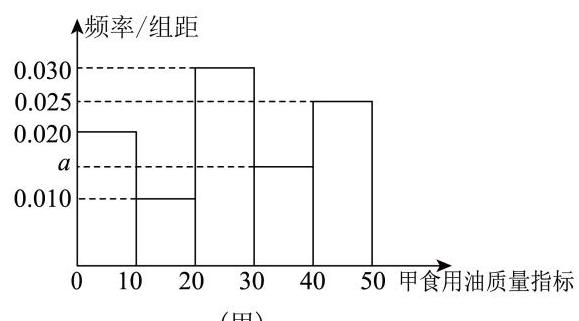
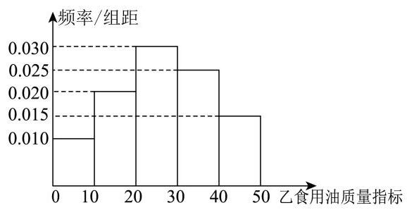
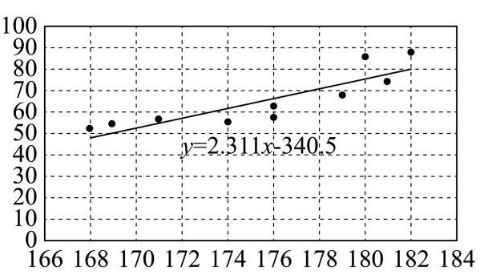
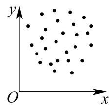
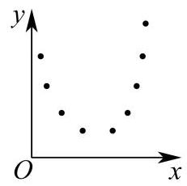
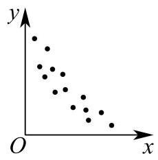
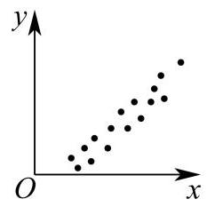

# 2026二模 概率与统计专题 · 教师版

> 本地预览：题目、答案及分类尚未全部审定。校对使用的PDF为教研整理版，尚未逐区确认区级印刷原卷。

## 样本统计量、抽样与总体估计

依据数据定义计算统计量，区分样本与总体及抽样方法。

### 徐汇 · 第9题

已知实数 ${a}_{1}$ 、 ${a}_{2}$ 、 ${a}_{3}$ 、 ${a}_{4}$ 、 ${a}_{5}$ 满足

$\left\{  {x \mid  \left( {x - {a}_{1}}\right) \left( {x - {a}_{2}}\right) \left( {x - {a}_{3}}\right) \left( {x - {a}_{4}}\right) \left( {x - {a}_{5}}\right)  = 0}\right\}   = \{ 1,2,3,4\}$ ,则 ${a}_{1}\text{ 、 }{a}_{2}\text{ 、 }{a}_{3}\text{ 、 }{a}_{4}\text{ 、 }{a}_{5}$ 的方差的最大值为___.

**考点：** 根集合确定重复元素，再比较方差

**难度依据：** 结合重数限制与方差最值

**【答案】** $\frac{34}{25}$

**【解析】**

**【详解】**设 ${a}_{1}\text{ 、 }{a}_{2}\text{ 、 }{a}_{3}\text{ 、 }{a}_{4}\text{ 、 }{a}_{5}$ 分别对应 $1,2,3,4, t,\left( {t = 1,2,3,4}\right)$ .

则 $\bar{a} = \frac{{10} + t}{5} = 2 + \frac{t}{5}$ ,

所以 ${a}_{1}\text{ 、 }{a}_{2}\text{ 、 }{a}_{3}\text{ 、 }{a}_{4}\text{ 、 }{a}_{5}$ 的方差为:

${s}^{2} = \frac{1}{5}\left\lbrack  {{\left( 1 - \bar{a}\right) }^{2} + {\left( 2 - \bar{a}\right) }^{2} + {\left( 3 - \bar{a}\right) }^{2} + {\left( 4 - \bar{a}\right) }^{2} + {\left( t - \bar{a}\right) }^{2}}\right\rbrack$

$= \frac{1}{5}\left\lbrack  {{\left( -1 - \frac{t}{5}\right) }^{2} + {\left( -\frac{t}{5}\right) }^{2} + {\left( 1 - \frac{t}{5}\right) }^{2} + {\left( 2 - \frac{t}{5}\right) }^{2} + {\left( \frac{4t}{5} - 2\right) }^{2}}\right\rbrack$

$= \frac{2}{25}\left( {2{t}^{2} - {10t} + {25}}\right)$

因为函数 $f\left( x\right)  = 2{x}^{2} - {10x} + {25}$ 在 $\left( {0,\frac{5}{2}}\right)$ 上单调递减,在 $\left( {\frac{5}{2},4}\right)$ 上单调递增,

且 $f\left( 1\right)  = f\left( 4\right)  = {17}$ .

所以当 $t = 1$ 或 4 时,该组数据的方差相等,且取得最大值,为 $\frac{2}{25} \times  {17} = \frac{34}{25}$ .

所以该组数据方差的最大值为: $\frac{34}{25}$ .

### 普陀 · 第1题

根据中国汽车工业协会发布的数据，2025 年 7 月至 2026 年 1 月，我国新能源汽车月度销量 (单位:万辆) 为:143.2,156.7,162.4,158.3,182.1,173.5,168.9，则这 7 个月新能源汽车销量的中位数为___万辆.

**考点：** 排序求样本中位数

**难度依据：** 排序求样本中位数

**【答案】** 162.4

**【解析】**

**【分析】**先将数据从小到大排列, 再根据中位数的定义可得.

**【详解】**将 2025 年 7 月至 2026 年 1 月，我国新能源汽车月度销量按从小到大排列:

143.2,156.7,158.3,162.4,168.9,173.5,182.1

数据个数为 7,所以中位数是第 $\frac{7 + 1}{2} = 4$ 个数,即162.4 万辆.

### 金山 · 第13题

为了了解申辉中学所有学生的每天平均体育运动时间，随机调查了该校 100 名学生，发现他们每天平均体育运动时间为 ${1.5}\mathrm{\;h}$ . 这里的总体是( )

A. 该校所有学生

B. 该校所有学生的每天平均体育运动时间

C. 所调查的 100 名学生

D. 所调查的 100 名学生的每天平均体育运动时间

**考点：** 总体与样本辨析

**难度依据：** 总体与样本辨析

**【答案】** B

**【解析】**

**【详解】**根据总体的概念可得, 这里的总体是该校所有学生的每天平均体育运动时间.故选项 B 正确.

### 青浦 · 第13题

下列说法中错误的是 ( )

A. 平均数、众数和中位数都是描述一组数据的集中趋势的统计量

B. 极差、方差、标准差都是描述一组数据的离散程度的统计量

C. 一组数据中比中位数大的数和比中位数小的数一样多

D. 总体的数据都分布在样本的极差范围内

> 当前题干与选项使不止一个选项错误，但所核PDF按单选给出答案，需核题目版本。

**考点：** 中位数和样本总体统计量判断

**难度依据：** 中位数和样本总体统计量判断

**核查说明：** 当前A/B正确；C关于中位数两侧个数相等的陈述一般不成立，例如1,2,2,2,3,4,5；D称总体数据全在样本极差范围内也不成立。当前MD答CD，父端所核教研PDF单选C，属于版本/命题冲突，不能擅定唯一标准答案。；合并稿答案为CD，具名整理版PDF物理第2页题干一致、第7页答案为C。C有重复中位数时两侧个数不必相同；D把样本极差视为范围且总体未必落入样本取值范围，同样有问题。单选冲突须核原始卷，暂不猜答案。

**【答案】** CD

**【解析】**

**【详解】**对于 $\mathrm{A}$ ,平均数、众数和中位数都是描述一组数据的集中趋势的量,所以 $\mathrm{A}$ 正确, 对于 B，极差反映的是一组数据最大值与最小值的差，方差和标准差反映了数据分散程度的大小,

所以极差、方差、标准差都是描述一组数据的离散程度的统计量,故 $\mathrm{B}$ 正确,

对于 $\mathrm{C}$ ,取1,2,3,4,4,5,6,7,8,这组数据的中位数是 4,比 4 小的数有 3 个,比 4 大的有 4

个，所以 C 错误,

对于 D, 样本的极差是数据最大值与最小值的差, 是数值不是范围,

且总体数据通常不都在样本数据的最大值和最小值之间, 故 D 错误.

### 黄浦 · 第6题

如图是某班级 30 名学生某次数学测验的得分茎叶图 (茎为十位, 叶为个位), 则这些测验分数的第 80 百分位数是___.

**考点：** 茎叶图与百分位

**难度依据：** 茎叶图与百分位

**【答案】** 76

**【解析】**

**【分析】**根据茎叶图结合百分位数的定义运算求解即可.

**【详解】**因为 ${30} \times  {0.8} = {24}$ ,可知第 80 百分位数是第 24 位数与 25 位数的平均数由茎叶图可知数据的第 24 位数与 25 位数分别为 75, 77,

所以第 80 百分位数是 $\frac{{75} + {77}}{2} = {76}$ .

## 事件关系、条件概率与全概率

明确样本空间，区分互斥、对立与独立，必要时分层分类。

### 奉贤 · 第9题

从 6 名男生和 4 名女生中选出 3 人参加人工智能技能培训. 设事件 $A$ :至少抽到一名女生， 事件 $B$ : 恰好抽到一名男生,则 $P\left( {B \mid  A}\right)  =$ ___.

**考点：** 古典概型条件概率；组合计数

**难度依据：** 古典概型条件概率；组合计数

**【答案】** $\frac{9}{25}\# \# {0.36}$

**【解析】**

**【分析】**利用古典概型的概率公式求出 $P\left( A\right) , P\left( {AB}\right)$ ,再由条件概率公式计算可得.

**【详解】**依题意可得 $P\left( A\right)  = \frac{{\mathrm{C}}_{10}^{3} - {\mathrm{C}}_{6}^{3}}{{\mathrm{C}}_{10}^{3}} = \frac{5}{6},\;P\left( {AB}\right)  = \frac{{\mathrm{C}}_{4}^{2}{\mathrm{C}}_{6}^{1}}{{\mathrm{C}}_{10}^{3}} = \frac{3}{10}$ ,

所以 $P\left( {B \mid  A}\right)  = \frac{P\left( {AB}\right) }{P\left( A\right) } = \frac{\frac{3}{10}}{\frac{5}{6}} = \frac{9}{25}$ .

### 崇明 · 第7题

从一副去掉大小王的 52 张扑克牌中随机抽取一张牌，事件 $A$ 表示 “取得的牌面是 $A$ ” ， 事件 $B$ 表示 “取得的牌的花色是黑桃”,则 $P\left( {B \mid  A}\right)$ 为___.

**考点：** 古典概型条件概率

**难度依据：** 古典概型条件概率

**【答案】** $\frac{1}{4}\# \# {0.25}$

**【解析】**

**【分析】**计算出 $P\left( A\right) , P\left( {AB}\right)$ ,利用条件概率公式进行求解.

**【详解】** $P\left( A\right)  = \frac{4}{52} = \frac{1}{13}, P\left( {AB}\right)  = \frac{1}{52}$ ,故 $P\left( {B \mid  A}\right)  = \frac{P\left( {AB}\right) }{P\left( A\right) } = \frac{\frac{1}{52}}{\frac{1}{13}} = \frac{1}{4}$ . 故答案为: $\frac{1}{4}$

### 徐汇 · 第10题

设 $A, B$ 是一个随机试验中的两个事件,且 $P\left( B\right)  = \frac{1}{3}, P\left( {\bar{B} \mid  A}\right)  = \frac{3}{5}, P\left( {\bar{B} \mid  \bar{A}}\right)  = \frac{9}{10}$ ,则 $P\left( A\right)  =$ ___.

**考点：** 对立事件转化并列全概率方程

**难度依据：** 逆用全概率公式

**【答案】** $\frac{7}{9}$

**【解析】**

**【分析】**根据给定的条件, 利用对立事件的概率公式, 以及全概率公式, 列出方程, 即可求解.

**【详解】**由 $P\left( {\bar{B} \mid  A}\right)  = \frac{3}{5}, P\left( {\bar{B} \mid  \bar{A}}\right)  = \frac{9}{10}$ ,可得 $P\left( {B \mid  A}\right)  = \frac{2}{5}, P\left( {B \mid  \bar{A}}\right)  = \frac{1}{10}$ ,且 $P\left( B\right)  = \frac{1}{3}$ , 则 $P\left( B\right)  = P\left( A\right) P\left( {B \mid  A}\right)  + P\left( \bar{A}\right) P\left( {B \mid  \bar{A}}\right)$ ,可得 $\frac{1}{3} = P\left( A\right)  \times  \frac{2}{5} + P\left( \bar{A}\right)  \times  \frac{1}{10}$ , 即 $\frac{1}{3} = P\left( A\right)  \times  \frac{2}{5} + \left\lbrack  {1 - P\left( A\right) }\right\rbrack   \times  \frac{1}{10} = \frac{3}{10}P\left( A\right)  + \frac{1}{10}$ ,可得 $P\left( A\right)  = \frac{7}{9}$ .

### 虹口 · 第14题

已知 $P\left( A\right)$ 和 $P\left( B\right)$ 分别表示事件 $A$ 和事件 $B$ 发生的概率,且 $0 < P\left( B\right)  < 1$ ,则在下列各项中，“ $A$ 和 $B$ 独立” 的充分条件是( ).

A. $P\left( A\right)  = 1 - P\left( B\right)$

B. $P\left( {A \mid  B}\right)  = P\left( {A \mid  \bar{B}}\right)$

C. $P\left( {A \cup  B}\right)  = P\left( A\right)  + P\left( B\right)$

D. $P\left( {A \mid  B}\right)  = P\left( {\bar{A} \mid  B}\right)$

**考点：** 条件概率与事件独立

**难度依据：** 条件概率与事件独立

**【答案】** B

**【解析】**

**【分析】**事件 $A$ 和 $B$ 独立的定义是 $P\left( {AB}\right)  = P\left( A\right) P\left( B\right)$ ,根据每个选项的条件,结合条件概率公式 $P\left( {A \mid  B}\right)  = \frac{P\left( {AB}\right) }{P\left( B\right) }$ 以及概率的基本性质,判断是否能推出 $P\left( {AB}\right)  = P\left( A\right) P\left( B\right)$ .

**【详解】**选项 $\mathrm{A}, P\left( A\right)  = 1 - P\left( B\right)$ ,则 $P\left( A\right)  + P\left( B\right)  = 1$ ,并不能推出 $P\left( {AB}\right)  = P\left( A\right) P\left( B\right)$ , 所以事件 $A$ 和 $B$ 不一定独立, $\mathrm{A}$ 错误.

选项 B, $P\left( {A \mid  B}\right)  = \frac{P\left( {AB}\right) }{P\left( B\right) }, P\left( {A \mid  \bar{B}}\right)  = \frac{P\left( {A\bar{B}}\right) }{P\left( \bar{B}\right) },\because P\left( {A \mid  B}\right)  = P\left( {A \mid  \bar{B}}\right)$ , $\therefore \frac{P\left( {AB}\right) }{P\left( B\right) } = \frac{P\left( {A\bar{B}}\right) }{P\left( \bar{B}\right) }$ .

$\because P\left( {A\bar{B}}\right)  = P\left( A\right)  - P\left( {AB}\right) , P\left( \bar{B}\right)  = 1 - P\left( B\right) ,\;\therefore \frac{P\left( {AB}\right) }{P\left( B\right) } = \frac{P\left( A\right)  - P\left( {AB}\right) }{1 - P\left( B\right) }$ .

$\therefore P\left( {AB}\right)  - P\left( {AB}\right) P\left( B\right)  = P\left( B\right) P\left( A\right)  - P\left( B\right) P\left( {AB}\right)$ .

$\therefore P\left( {AB}\right)  = P\left( A\right) P\left( B\right)$ ,即 $A$ 和 $B$ 独立, $\mathrm{B}$ 选项正确.

选项 C, $P\left( {A \cup  B}\right)  = P\left( A\right)  + P\left( B\right)  - P\left( {AB}\right)$ ,又 $P\left( {A \cup  B}\right)  = P\left( A\right)  + P\left( B\right) , P\left( {AB}\right)  = 0$ ,

$\therefore A$ 和 $B$ 不一定独立, $\mathrm{C}$ 错误.

选项 D, $P\left( {A \mid  B}\right)  = \frac{P\left( {AB}\right) }{P\left( B\right) }, P\left( {\bar{A} \mid  B}\right)  = \frac{P\left( {\bar{A}B}\right) }{P\left( B\right) }, P\left( {A \mid  B}\right)  = P\left( {\bar{A} \mid  B}\right) ,\therefore P\left( {AB}\right)  = P\left( {\bar{A}B}\right)$ . 又 $P\left( {\bar{A}B}\right)  = P\left( B\right)  - P\left( {AB}\right) ,\therefore P\left( {AB}\right)  = P\left( B\right)  - P\left( {AB}\right)$ ,可得 $P\left( {AB}\right)  = \frac{1}{2}P\left( B\right)$ ,也不能推出 $A$ 和 $B$ 独立, $\mathrm{D}$ 错误.

### 杨浦 · 第14题

事件 $A\text{ 、 }B$ 相互独立,若 $P\left( A\right)  = \frac{1}{2}, P\left( B\right)  = \frac{1}{3}$ ,则 $A$ 与 $\bar{B}$ 同时发生的概率为 ( ) .

A. 0

B. $\frac{1}{6}$

C. $\frac{5}{6}$

D. $\frac{1}{3}$

**考点：** 独立性与对立事件乘法

**难度依据：** 直接概率运算

**【答案】** D

**【解析】**

**【分析】**根据独立事件和对立事件概率公式求解即可.

**【详解】**事件 $A\text{ 、 }B$ 相互独立,则事件 $A\text{ 、 }\bar{B}$ 也相互独立.

事件 $\bar{B}$ 发生的概率为 $P\left( \bar{B}\right)  = 1 - P\left( B\right)  = 1 - \frac{1}{3} = \frac{2}{3}$ .

则 $A$ 与 $\bar{B}$ 同时发生的概率为 $P\left( {A\bar{B}}\right)  = P\left( A\right) P\left( \bar{B}\right)  = \frac{1}{2} \times  \frac{2}{3} = \frac{1}{3}$ .

### 松江 · 第14题

一个袋中有大小与质地完全相同的红、黄、蓝三个球, 从袋中依次随机不放回地摸出两个球，记“第一次取到红球”为事件 $A$ ，“第二次取到黄球”为事件 $B$ ，则( )

A. $A, B$ 相互独立

B. $P\left( B\right)  = \frac{1}{2}$

C. $P\left( {A \mid  B}\right)  = \frac{1}{2}$

D. $P\left( \bar{A}\right)  = \frac{1}{2}$

**考点：** 枚举不放回抽样判断条件概率和独立性

**难度依据：** 区分联合概率与独立事件

**【答案】** C

**【解析】**

**【分析】**根据给定条件,利用相互独立事件的定义判断 $\mathrm{A}$ ; 利用条件概率公式,结合古典概率计算判断 $\mathrm{{BCD}}$ .

**【详解】**对于 $\mathrm{A}, P\left( A\right)  = \frac{1}{3}, P\left( B\right)  = \frac{1}{3}, P\left( {AB}\right)  = \frac{1}{6}, P\left( {AB}\right)  \neq  P\left( A\right) P\left( B\right) , A, B$ 不独立, A 错误;

对于 $\mathrm{B}, P\left( B\right)  = \frac{2}{3} \times  \frac{1}{2} = \frac{1}{3},\mathrm{\;B}$ 错误;

对于 $\mathrm{C}, P\left( {AB}\right)  = \frac{1}{3} \times  \frac{1}{2} = \frac{1}{6}, P\left( {A \mid  B}\right)  = \frac{P\left( {AB}\right) }{P\left( B\right) } = \frac{\frac{1}{6}}{\frac{1}{3}} = \frac{1}{2},\mathrm{C}$ 正确;

对于 $\mathrm{D}, P\left( A\right)  = \frac{1}{3}$ ,则 $P\left( \bar{A}\right)  = \frac{2}{3},\mathrm{D}$ 错误.

### 浦东 · 第8题

一个家庭有两个孩子，生肖均为十二生肖之一 (等可能). 已知其中一个孩子属马，则另一个孩子也属马的概率为___.

**考点：** 区分至少一个属马与两人都属马

**难度依据：** 条件样本空间易误判

**【答案】** $\frac{1}{23}$

**【解析】**

**【详解】**两个孩子的生肖组合有 ${12} \times  {12} = {144}$ 种,

记事件 A “其中一个孩子属马”，事件 B “两个孩子都属马”，

则 $\mathrm{P}\left( A\right)  = 1 - \frac{{11} \times  {11}}{144} = \frac{23}{144},\mathrm{P}\left( {AB}\right)  = \frac{1 \times  1}{144} = \frac{1}{144}$ ,

所以 $P\left( {B \mid  A}\right)  = \frac{P\left( {AB}\right) }{P\left( A\right) } = \frac{\frac{1}{144}}{\frac{23}{144}} = \frac{1}{23}$ .

### 金山 · 第16题

已知全集 $U$ 是一个六元集合，任取 $U$ 的两个子集 $A$ 、 $B$ ( $A$ 、 $B$ 可以相等)，记事件 $M : B \subseteq  A$ ; 记事件 $N : B \subseteq  \bar{A}$ . 则 $P\left( {M \cup  N}\right)  =$ (   )

A. $\frac{95}{{2}^{11}}$

B. $\frac{665}{{2}^{11}}$

C. $\frac{697}{{2}^{11}}$

D. $\frac{729}{{2}^{11}}$

**考点：** 子集与补集事件；容斥与古典概型；按元素独立选择计数

**难度依据：** 子集与补集事件；容斥与古典概型；按元素独立选择计数

**【答案】** C

**【解析】**

**【分析】**分析基本事件空间所含基本事件的个数,事件 $M, N$ 及 $M \cap  N$ 所含基本事件个数, 再由和事件的概率公式求解.

**【详解】**因为全集 $U$ 是一个六元集合,所以任取 $U$ 的两个子集 $A\text{ 、 }B$ ,能形成 ${2}^{6} \times  {2}^{6} = {2}^{12}$ 对集合 $\left( {A, B}\right)$ ，即基本事件总数为 ${2}^{12}$ .

$U$ 中任一元素 $x$ ,满足事件 $M : B \subseteq  A$ ,有以下三种情况, $x \in  A, x \in  B;x \in  A, x \notin  B;x \notin  A$ 且 $x \notin  B$ ; 所以 $M$ 所含基本事件个数 ${3}^{6}$ ;

$U$ 中任一元素 $x$ 满足事件 $N : B \subseteq  \bar{A}$ ,有以下三种情况,

$x \notin  A, x \in  B;x \notin  A, x \notin  B;x \in  A$ 且 $x \notin  B$ ; 所以 $N$ 所含基本事件个数为 ${3}^{6}$ ,

事件 $M \cap  N$ 表示 $B \subseteq  A$ 且 $B \subseteq  \bar{A}$ 同时成立,所以 $B = \varnothing$ ,此时 $A$ 可以是 $U$ 的任意子集, 有 ${2}^{6}$ 个,即事件 $M \cap  N$ 所含基本事件有 ${2}^{6}$ 个,

所以 $P\left( {M \cup  N}\right)  = P\left( M\right)  + P\left( N\right)  - P\left( {M \cap  N}\right)  = \frac{{3}^{6}}{{2}^{12}} + \frac{{3}^{6}}{{2}^{12}} - \frac{{2}^{6}}{{2}^{12}} = \frac{697}{{2}^{11}}$ .

### 长宁 · 第9题

将 4 个不同的小球依次随机投入 3 个篮子中，每个篮子不空的概率为___(用分数表示) .

**考点：** 分球概率；分类计数

**难度依据：** 分球概率；分类计数

**【答案】** $\frac{4}{9}$

**【解析】**

**【分析】**利用分组分配法与古典概型概率公式计算即得.

**【详解】**4 个不同的小球依次随机投入 3 个篮子, 每个小球均有 3 种投法, 故总投法数为 ${3}^{4} = {81}$ 种;

要求每个篮子不空，需使其中一个篮子放 2 个球，另两个篮子各放 1 个球，故有投法数为 ${\mathrm{C}}_{4}^{2}{\mathrm{\;A}}_{3}^{3} = {36}$ 种.

由古典概型概率公式,可得概率为: $\frac{{\mathrm{C}}_{4}^{2}{\mathrm{\;A}}_{3}^{3}}{{3}^{4}} = \frac{36}{81} = \frac{4}{9}$ .

### 长宁 · 第14题

对于随机事件 $A\text{ 、 }B,$ “ $P\left( A\right)  = P\left( {A \mid  B}\right)$ ”是“ $A\text{ 、 }B$ 互相独立”的( )条件.

A. 充分非必要

B. 必要非充分

C. 充要

D. 非充分 非必要

**考点：** 独立事件及条件概率

**难度依据：** 独立事件及条件概率

**【答案】** C

**【解析】**

**【分析】**根据条件概率公式、独立事件的定义及充分条件、必要条件的定义判断即可.

**【详解】**因为 $P\left( {A \mid  B}\right)  = \frac{P\left( {AB}\right) }{P\left( B\right) }$ ,又 $P\left( A\right)  = P\left( {A \mid  B}\right)$ ,所以 $P\left( A\right)  = \frac{P\left( {AB}\right) }{P\left( B\right) }$ ,

从而有 $P\left( {AB}\right)  = P\left( A\right) P\left( B\right)$ ,所以 $A\text{ 、 }B$ 互相独立,充分性成立;

当 $A\text{ 、 }B$ 互相独立时,则 $P\left( {AB}\right)  = P\left( A\right) P\left( B\right)$ ,所以 $P\left( A\right)  = \frac{P\left( {AB}\right) }{P\left( B\right) } = P\left( {A \mid  B}\right)$ ,必要性成立.

综上,“ $P\left( A\right)  = P\left( {A \mid  B}\right)$ ” 是“ $A\text{ 、 }B$ 互相独立”的充要条件.

### 闵行 · 第5题

已知事件 $A$ 发生的概率 $P\left( A\right)  = {0.2}$ ，事件 $B$ 发生的概率 $P\left( B\right)  = {0.5}$ ，若事件 $A$ 与 $B$ 独立，则 $P\left( {A \cap  \bar{B}}\right)  =$ ___.

**考点：** 独立事件概率

**难度依据：** 独立事件概率

**【答案】** 0.1

**【解析】**

**【详解】**因为事件 $A$ 与 $B$ 独立,事件 $A$ 发生的概率 $P\left( A\right)  = {0.2}$ ,事件 $B$ 发生的概率 $P\left( B\right)  = {0.5},$

$\therefore P\left( {A \cap  \bar{B}}\right)  = P\left( A\right) P\left( \bar{B}\right)  = {0.2} \times  \left( {1 - {0.5}}\right)  = {0.2} \times  {0.5} = {0.1}$ .

### 青浦 · 第6题

某电子元件厂有甲、乙两条互不影响的生产线生产同型号元件，甲生产线的产量占全厂总产量的 $\frac{3}{5}$ ，其产品次品率为 5%；乙生产线的产量占全厂总产量的 $\frac{2}{5}$ ，其产品次品率为 10% . 若从全厂产品中随机抽取 1 件，抽到次品的概率为___.

**考点：** 全概率公式与分类概率

**难度依据：** 全概率公式与分类概率

**【答案】** 7% ## 0.07

**【解析】**

**【详解】**设抽到的产品来自甲生产线为事件 $A$ ,来自乙生产线为事件 $B$ ,抽到次品为事件 $C$ ,

则 $P\left( A\right)  = \frac{3}{5}, P\left( B\right)  = \frac{2}{5}, P\left( {C \mid  A}\right)  = 5\% , P\left( {C \mid  B}\right)  = {10}\%$ ,

所以 $P\left( C\right)  = P\left( {C \mid  A}\right) P\left( A\right)  + P\left( {C \mid  B}\right) P\left( B\right)  = \frac{3}{5} \times  5\%  + \frac{2}{5} \times  {10}\%  = 7\%$

### 静安 · 第7题

现有两个罐子，都放有 3 个球，这些球除颜色外，大小与质地都相同， $A$ 罐中放有 2 个

红球, 1 个白球, $B$ 罐中放有 3 个红球, 从两个罐子中各摸出 1 个球并交换, 这样交换 2 次后,白球还在 $A$ 罐子中的概率是___.

**考点：** 全概率与换球

**难度依据：** 全概率与换球

**【答案】** $\frac{5}{9}$

**【解析】**

**【详解】**用 ${A}_{1},{A}_{2}$ 分别表示交换 1 次,2 次后白球还在 $A$ 罐中的事件,

依题意, $P\left( {A}_{1}\right)  = \frac{2}{3}, P\left( \overline{{A}_{1}}\right)  = \frac{1}{3}, P\left( {{A}_{2} \mid  {A}_{1}}\right)  = \frac{2}{3}, P\left( {{A}_{2} \mid  \overline{{A}_{1}}}\right)  = \frac{1}{3}$ ,

由全概率公式得 $P\left( {A}_{2}\right)  = P\left( {{A}_{2} \mid  {A}_{1}}\right) P\left( {A}_{1}\right)  + P\left( {{A}_{2} \mid  \overline{{A}_{1}}}\right) P\left( \overline{{A}_{1}}\right)  = \frac{2}{3} \times  \frac{2}{3} + \frac{1}{3} \times  \frac{1}{3} = \frac{5}{9}$ ,

所以交换 2 次后,白球还在 $A$ 罐子中的概率是 $\frac{5}{9}$ .

### 静安 · 第15题

袋子里装有四枚围棋子, 其中两枚黑色棋子、两枚白色棋子, 从中随机取出两枚棋子, 那么互斥而不对立的事件是 ( ).

A. “至多有一枚白色棋子” 与 “至多有一枚黑色棋子”

B. “至多有一枚白色棋子” 与 “都是黑色棋子”

C. “恰好有一枚白色棋子” 与 “都是黑色棋子”

D. “至多有一枚白色棋子” 与 “都是白色棋子”

**考点：** 互斥事件与对立事件

**难度依据：** 互斥事件与对立事件

**【答案】** C

**【解析】**

**【分析】**利用对立事件、互斥事件的定义判断即可.

**【详解】**记随机取出两枚棋子,均为黑色棋子为事件 $A$ ,一枚黑色棋子、一枚白色棋子为事件 $B$ ,均为白色棋子为事件 $C$ .

对于 A: “至多有一枚白色棋子”包含事件 $A$ 、事件 $B$ ，“至多有一枚黑色棋子” 包含事件 $B$ 、

事件 $C$ .

两个事件都包含事件 $B$ ,能同时发生,不是互斥事件. $\mathrm{A}$ 不满足.

对于 $\mathrm{B}$ : “至多有一枚白色棋子”包含事件 $A$ 、事件 $B$ ,“都是黑色棋子”为事件 $A$ .

两个事件都包含事件 $A$ ，能同时发生，不是互斥事件.B 不满足.

对于 $\mathrm{C}$ : “恰好有一枚白色棋子”为事件 $B$ ，“都是黑色棋子”为事件 $A$ .

两个事件不能同时发生,且并集不是全集 (缺少事件 $C$ ),是互斥而不对立事件. $\mathrm{C}$ 满足.

对于 D: “至多有一枚白色棋子”包含事件 $A$ 、事件 $B$ ，“都是白色棋子”为事件 $C$ .

两个事件不能同时发生, 且并集是全集, 是对立事件.D 不满足.

### 黄浦 · 第9题

某射击社团共有 10 名成员，其中社长与副社长各一人，现随机抽取 4 人组成代表队参加校际联谊活动，则社长与副社长两人至少有一人参加联谊活动的概率为___.

**考点：** 古典概型；组合计数

**难度依据：** 古典概型；组合计数

**【答案】** $\frac{2}{3}$

**【解析】**

**【分析】**设相应事件,根据古典概型结合组合数可得 $P\left( \bar{A}\right)  = \frac{1}{3}$ ,结合对立事件概率公式求解.

**【详解】**设 “社长与副社长两人至少有一人参加联谊活动”为事件 $A$ ,

则 $P\left( \bar{A}\right)  = \frac{{\mathrm{C}}_{8}^{4}}{{\mathrm{C}}_{10}^{4}} = \frac{70}{210} = \frac{1}{3}$ ,可得 $P\left( A\right)  = 1 - P\left( \bar{A}\right)  = \frac{2}{3}$ ,

所以社长与副社长两人至少有一人参加联谊活动的概率为 $\frac{2}{3}$ .

## 分布列、期望与重复试验

识别二项分布、指示变量或离散随机变量，列分布并求期望方差。

### 嘉定 · 第10题

已知正四面体上的四个面上分别写有 1、2、3、4 , 游戏中甲、乙轮流抛掷该四面体, 谁抛出底面数字等于 4 则获胜且游戏结束. 甲先开始，则甲获胜的概率为___.

> 本题资料或解析有待核事项，预览不可作为已审定成品。

**考点：** 轮流独立试验的概率；无限等比级数求和

**难度依据：** 分类概率与无限等比求和

**核查说明：** 题干与答案解析尚未逐页对照原卷，数学内容未独立终审。

**【答案】** $\frac{4}{7}$

**【解析】**

**【分析】**根据题意，求出甲在第 $n$ (奇数)次获胜的概率，再由等比数列求和得解.

**【详解】**由题意,甲抛掷一次获胜的概率为 $\frac{1}{4}$ ,失败的概率为 $\frac{3}{4}$ ,

甲胜的概率分为无数种情况:第1次掷获胜，第3次掷获胜， 第2n+1次获胜，

概率分别为 ${p}_{1} = \frac{1}{4},{p}_{3} = {\left( \frac{3}{4}\right) }^{2} \times  \frac{1}{4},{p}_{5} = {\left( \frac{3}{4}\right) }^{4} \times  \frac{1}{4}$ ,

故 $\left\{  {p}_{n}\right\}  \left( {n = {2k} - 1, k \in  {\mathrm{N}}^{ * }}\right)$ 为以 $\frac{1}{4}$ 为首项, $\frac{9}{16}$ 为公比的等比数列,

故甲获胜的概率 $P = \frac{\frac{1}{4}}{1 - \frac{9}{16}} = \frac{4}{7}$ .

### 嘉定 · 第19题

某款足球机器人射点球时，射门点与球门中心的水平偏差(单位:cm)服从正态分布. 在正常状态下，偏差 $X \sim  N\left( {0,{20}^{2}}\right)$ ，规定 $\left| X\right|  > {60}$ 为“严重失误”.

(1)求一次射门出现严重失误的概率 $p$ (精确到 0.0001 )；

(2)假设每次射门相互独立，每次测试让机器人射门 16 次，若至少出现一次严重失误，则判定需要校准. 在正常状态下，求一次测试被判定需要校准的概率 $a$ (精确到 0.01 )，并说明该判定规则是否合理；

(3)因机械磨损，机器人射门精度下降，一次射门出现严重失误的概率增加到 5%，此时每次测试仍射门 16 次，但判定规则改为:若至少出现 2 次严重失误，才需要校准. 在磨损

状态下，求被判定需要校准的概率 $\beta$ (精确到 0.01 ). 此时，若一次校准的成本为 1 万元， 且每天测试 3 次，求日均校准成本的期望值(精确到百元).

参考公式与数据:

①若 $X \sim  N\left( {\mu ,{\sigma }^{2}}\right)$ ,则 $Z = \frac{X - \mu }{\sigma } \sim  N\left( {0,1}\right)$ .

②若 $Z \sim  N\left( {0,1}\right)$ ，则 $P\left( {Z > 3}\right)  \approx  {0.00135}$ ， $P\left( {Z > 2}\right)  \approx  {0.0228}$ .

参考数据: $\ln \left( {0.9973}\right)  \approx   - {0.002704},{0.95}^{16} \approx  {0.440},{0.95}^{15} \approx  {0.463}$ .

> 本题资料或解析有待核事项，预览不可作为已审定成品。

**考点：** (1) 正态分布标准化；(2) 独立重复试验与校准规则；(3) 二项分布尾概率与期望

**难度依据：** 正态概率与二项分布建模

**核查说明：** 重复稿曾出现20°，合并稿和具名PDF第4页文字均为 N(0,20²)；PDF为整理简答版，回核通过，仍非原始印刷原卷。

**【答案】** (1) 0.0027

(2) $a = {0.04}$ ，判定规则在正常状态下误判率约 4.2%，虽偏低但仍存在误报，基本合理但略偏保守.

(3) $\beta  = {0.19}$ ，5700元

**【解析】**

**【分析】**(1) 根据转化公式化为标准正态分布, 根据参考数据利用对称性求解;

(2)由题意转化为二项分布, 根据二项分布求概率, 由结果分析规则的合理性即可;

(3) 根据二项分布求出对应概率, 再由二项分布求期望即可.

**【小问 1 详解】**

令 $Z = \frac{X - \mu }{\sigma } = \frac{X}{20} \sim  N\left( {0,1}\right)$ ,

则 $P\left( {\left| X\right|  > {60}}\right)  = P\left( {X > {60}}\right)  + P\left( {X <  - {60}}\right)  = P\left( {Z > 3}\right)  + P\left( {Z <  - 3}\right)  = {2P}\left( {Z > 3}\right)$ ,

因为 $P\left( {Z > 3}\right)  \approx  {0.00135}$ ,

所以 $P\left( {\left| X\right|  > {60}}\right)  \approx  2 \times  {0.00135} = {0.0027}$ ,

即 $p = {0.0027}$ .

**【小问 2 详解】**

设 $Y$ 为 16 次射门中出现严重失误的次数,

则 $Y \sim  B\left( {{16},{0.0027}}\right)$ ,

则需要校准的概率 $a = P\left( {Y \geq  1}\right)  = 1 - P\left( {Y = 0}\right)  = 1 - {\left( 1 - {0.0027}\right) }^{16} = 1 - {0.9973}^{16}$ ,

因为 $\ln \left( {0.9973}\right)  \approx   - {0.002704}$ ,

所以 ${16}\ln \left( {0.9973}\right)  \approx   - {0.04327},{\mathrm{e}}^{-{0.04327}} \approx  {0.9577}$ ,

所以 ${0.9973}^{16} \approx  {0.9577}, a = 1 - {0.9577} = {0.0423} \approx  {0.04}$

在正常状态下 (无故障)，仍有约 4.2%的概率被误判为“需要校准”，

即存在约 4.2%的假阳性率.虽然不高, 但每天多次测试会累积误判次数,

可能造成不必要的校准成本. 若追求高可靠性，此规则略显敏感；

若容忍少量误判以确保及时发现故障, 则尚可接受.

综合来看, 该规则偏保守, 有一定合理性, 但可优化.

**【小问 3 详解】**

机器人因机械磨损，单次失误概率 ${p}^{\prime } = 5\%  = {0.05}$ ，测试次数为 16 次，

设 ${Y}^{\prime }$ 为 16 次射门中出现严重失误的次数，则 ${Y}^{\prime } \sim  B\left( {{16},{0.05}}\right)$ ，

则 $\beta  = P\left( {{Y}^{\prime } \geq  2}\right)  = 1 - P\left( {{Y}^{\prime } = 0}\right)  - P\left( {{Y}^{\prime } = 1}\right)$ ,

因为 $P\left( {{Y}^{\prime } = 0}\right)  = {\left( 1 - {0.05}\right) }^{16} = {0.95}^{16} \approx  {0.440}$ ,

$P\left( {{Y}^{\prime } = 1}\right)  = {\mathrm{C}}_{16}^{1}{0.05} \times  {0.95}^{15} = {16} \times  {0.05} \times  {0.463} \approx  {0.3704},$

所以 $\beta  = 1 - {0.440} - {0.3704} = {0.1896} \approx  {0.19}$ ,

设每天校准次数为随机变量 $\xi$ ,则 $\xi  \sim  B\left( {3,{0.19}}\right)$ ,

则每天校准次数的期望为 $E\left( \xi \right)  = 3 \times  {0.19} = {0.57}$ 次,

所以日均校准成本的期望 ${0.57} \times  {10000} = {5700}$ 元,即 57 百元.

### 普陀 · 第15题

某科技公司每位员工皆佩戴红色或蓝色中仅一种颜色的工牌，该公司为促进跨部门协作, 采用智能轮岗系统进行员工交换部门, 初始时, 甲部门有 2 名红色工牌员工、 1 名蓝色工牌员工，乙部门有 2 名红色工牌员工、 2 名蓝色工牌员工，系统执行一次随机交换指令: 从甲、乙 2 个部门中随机各选取 1 名员工进行交换，设交换后甲部门中红色工牌员工的人数为 $X$ ,则 $X$ 的期望为( )

A. $\frac{7}{4}$

B. $\frac{5}{3}$

C. $\frac{11}{6}$

D. $\frac{13}{6}$

**考点：** 随机交换后分布列与期望；按颜色分类计数

**难度依据：** 随机交换后分布列与期望；按颜色分类计数

**【答案】** C

**【解析】**

**【分析】**交换后甲部门红人数的变化取决于从甲选出的员工和从乙选出的员工颜色，分四种情况:甲出红、乙出红；甲出红、乙出蓝；甲出蓝、乙出红；甲出蓝、乙出蓝，由此得分布列, 随即可计算期望.

**【详解】**初始时, 甲部门有 2 名红色工牌员工、1 名蓝色工牌员工, 乙部门有 2 名红色工牌员工、 2 名蓝色工牌员工,

由已知 $X$ 的可能取值为1,2,3.

$P\left( {X = 1}\right)  = \frac{2}{3} \times  \frac{2}{4} = \frac{1}{3},\;P\left( {X = 2}\right)  = \frac{2}{3} \times  \frac{2}{4} + \frac{1}{3} \times  \frac{2}{4} = \frac{1}{2},\;P\left( {X = 3}\right)  = \frac{1}{3} \times  \frac{2}{4} = \frac{1}{6},$

所以 $E\left( X\right)  = 1 \times  \frac{1}{3} + 2 \times  \frac{1}{2} + 3 \times  \frac{1}{6} = \frac{11}{6}$ .

### 杨浦 · 第9题

已知随机变量 $X$ 服从二项分布 $B\left( {{90}, p}\right)$ ，若 $E\left\lbrack  X\right\rbrack   = {30}$ ，则 $D\left\lbrack  X\right\rbrack   =$ ___.

**考点：** 由期望求概率再求方差

**难度依据：** 直接利用分布公式

**【答案】** 20

**【解析】**

**【分析】**借助二项分布的期望与方差公式计算即可得.

**【详解】** $E\left\lbrack  X\right\rbrack   = {90p} = {30}$ ,则 $p = \frac{1}{3}$ ,则 $D\left\lbrack  X\right\rbrack   = {90} \times  \frac{1}{3} \times  \left( {1 - \frac{1}{3}}\right)  = {20}$ .

### 浦东 · 第19题

某奶茶品牌为了解消费者对奶茶甜度的偏好情况, 随机抽取了 100 名顾客进行甜度测试 (分数越高表示越偏好甜味)、统计结果显示，所有顾客的甜度偏好分数均分布在区间 [4,10] 内，具体数据见下表:

<table><tr><td>甜度偏好分数</td><td>[4,5)</td><td>[5,6)</td><td>[6,7)</td><td>[7,8)</td><td>[8,9)</td><td>[9,10]</td></tr><tr><td>人数</td><td>10</td><td>25</td><td>20</td><td>30</td><td>10</td><td>5</td></tr></table>

(1)估计该品牌奶茶消费者的平均甜度偏好分数(同一组数据用该区间的中点值作代表)；

(2)在这 100 名顾客中，用分层抽样的方法从甜度偏好分数在 $\lbrack 6,7)$ 、 $\lbrack 7,8)$ 这两组中共抽取 5 人. 再从这 5 人中随机抽取 3 人，记 $X$ 为 3 人中甜度偏好分数在 $\lbrack 7,8)$ 的人数，求 $X$ 的分布、期望和方差;

(3)该奶茶品牌把甜度偏好分数在 $\lbrack 7,9)$ 的消费者称“七分糖爱好者”，以样本估计总体、用频率代替概率,该品牌从某日消费人群中随机抽取 12 名消费者作为样本,记抽到 $k$ 个“七分糖爱好者”的概率为 ${P}_{k}$ ,问当 $k$ 为何值时 ${P}_{k}$ 最大?

**考点：** (1)组中值估计均值；(2)分层抽样后求分布列、期望方差；(3)相邻二项概率比求最大概率

**难度依据：** 多个统计模型与离散概率最值

**【答案】** (1) 6.7 (2)

<table><tr><td>$X$</td><td>1</td><td>2</td><td>3</td></tr><tr><td>$P$</td><td>$\frac{3}{10}$</td><td>$\frac{3}{5}$</td><td>$\frac{1}{10}$</td></tr></table>

$E\left( X\right)  = \frac{9}{5},\;D\left( X\right)  = \frac{9}{25}$

(3) $k = 5$

**【解析】**

**【分析】**(1) 根据平均数的概念, 求出结果即可;

(2)根据超几何分布的概念，求出分布列，再根据期望和方差的概念，求出结果即可;

(3)根据二项分布的概念，求出概率的通式，进而列出不等式组，求出最大值即可.

**【小问 1 详解】**

由题意, 随机抽取的 100 名顾客的甜度偏好分数的平均数为

$$
\bar{x} = \frac{{10} \times  {4.5} + {25} \times  {5.5} + {20} \times  {6.5} + {30} \times  {7.5} + {10} \times  {8.5} + 5 \times  {9.5}}{100} = {6.7}
$$

**【小问 2 详解】**

用分层抽样的方法,从甜度偏好分数在 $\lbrack 6,7)$ 这组中抽取 2 人，甜度偏好分数在 $\lbrack 7,8)$ 这组中抽取 3 人.

故 $P\left( {X = 1}\right)  = \frac{{\mathrm{C}}_{2}^{2} \cdot  {\mathrm{C}}_{3}^{1}}{{\mathrm{C}}_{5}^{3}} = \frac{3}{10}, P\left( {X = 2}\right)  = \frac{{\mathrm{C}}_{2}^{1} \cdot  {\mathrm{C}}_{3}^{2}}{{\mathrm{C}}_{5}^{3}} = \frac{3}{5}, P\left( {X = 3}\right)  = \frac{{\mathrm{C}}_{3}^{3}}{{\mathrm{C}}_{5}^{3}} = \frac{1}{10}$

因此， $X$ 的分布列为

<table><tr><td>$X$</td><td>1</td><td>2</td><td>3</td></tr><tr><td>$P$</td><td>$\frac{3}{10}$</td><td>$\frac{3}{5}$</td><td>$\frac{1}{10}$</td></tr></table>

故 $E\left( X\right)  = \frac{9}{5},\;D\left( X\right)  = E\left( {X}^{2}\right)  - {\left\lbrack  E\left( X\right) \right\rbrack  }^{2} = \frac{9}{25}$ .

**【小问 3 详解】**

由题, 抽到 “七分糖爱好者”的概率是 0.4 ,

抽到“七分糖爱好者”的人数服从二项分布,即 $k \sim  B\left( {{12},{0.4}}\right) ,{P}_{k} = {\mathrm{C}}_{12}^{k}{0.4}^{k}{0.6}^{{12} - k}$ ,

则 $\frac{{P}_{k + 1}}{{P}_{k}} = \frac{{\mathrm{C}}_{12}^{k + 1}{0.4}^{k + 1}{0.6}^{{12} - \left( {k + 1}\right) }}{{\mathrm{C}}_{12}^{k}{0.4}^{k}{0.6}^{{12} - k}} = \frac{2\left( {{12} - k}\right) }{3\left( {k + 1}\right) }$

当 $\frac{2\left( {{12} - k}\right) }{3\left( {k + 1}\right) } > 1$ ,即 $k < {4.2}$ 时 ${P}_{k + 1} > {P}_{k}$

当 $\frac{2\left( {{12} - k}\right) }{3\left( {k + 1}\right) } < 1$ ,即 $k > {4.2}$ 时 ${P}_{k + 1} < {P}_{k}$

因此, ${P}_{1} < {P}_{2} < {P}_{3} < {P}_{4} < {P}_{5}$ ,且 ${P}_{5} > {P}_{6} > {P}_{7} > {P}_{8} > {P}_{9} > {P}_{10} > {P}_{11} > {P}_{12}$ ,

所以,当 $k = 5$ 时, ${P}_{k}$ 最大.

### 虹口 · 第3题

已知离散型随机变量 $X$ 服从二项分布 $B\left( {8,\frac{1}{2}}\right)$ ，则 $D\left( X\right)  =$ ___.

**考点：** 二项分布方差

**难度依据：** 二项分布方差

**【答案】** 2

**【解析】**

**【分析】**利用二项分布的方差公式直接计算.

**【详解】**因为随机变量 $X$ 服从二项分布 $B\left( {8,\frac{1}{2}}\right)$ ,

所以 $D\left( X\right)  = 8 \times  \frac{1}{2} \times  \left( {1 - \frac{1}{2}}\right)  = 2$ .

故答案为:2.

### 虹口 · 第7题

将 ${\left( 2 - x\right) }^{4}$ 二项展开式中的各项等可能地随机重新排列,观察排列中是否存在系数为负数的项相邻,若存在,则记随机变量 $X = 1$ ,否则记 $X = 0$ ,则 $E\left\lbrack  X\right\rbrack   =$ ___.

**考点：** 二项展开负系数及捆绑排列；指示变量期望

**难度依据：** 二项展开负系数及捆绑排列；指示变量期望

**【答案】** $\frac{2}{5}\# \# {0.4}$

**【解析】**

**【详解】**二项式 ${\left( 2 - x\right) }^{4}$ 的通项公式为 ${T}_{r + 1} = {\mathrm{C}}_{4}^{r} \cdot  {2}^{4 - r} \cdot  {\left( -x\right) }^{r}$ ,

显然该二项式展开共有 5 项，

当 $r = 1,3$ 时，即第2,4项系数为负数，

因为各项等可能地随机重新排列,

所以排列数为 ${\mathrm{A}}_{5}^{5}$ ,

系数为负数的项相邻的排列数为 ${\mathrm{A}}_{2}^{2}{\mathrm{\;A}}_{4}^{4}$ ,

所以 $P\left( {X = 1}\right)  = \frac{{\mathrm{A}}_{2}^{2}{\mathrm{\;A}}_{4}^{4}}{{\mathrm{\;A}}_{5}^{5}} = \frac{2}{5}$ ,

因此 $E\left\lbrack  X\right\rbrack   = 1 \times  \frac{2}{5} + 0 \times  P\left( {X = 0}\right)  = \frac{2}{5}$ .

### 金山 · 第7题

已知随机变量 $X$ 的分布为 $\left( \begin{matrix} 1 & 2 & 3 \\  {0.4} & {0.2} & a \end{matrix}\right)$ ,则期望 $E\left\lbrack  X\right\rbrack   =$ ___.

**考点：** 离散分布列与期望

**难度依据：** 离散分布列与期望

**【答案】** 2

**【解析】**

**【详解】**由 ${0.4} + {0.2} + a = 1$ ,解得 $a = {0.4}$ ,

所以 $E\left\lbrack  X\right\rbrack   = 1 \times  {0.4} + 2 \times  {0.2} + 3 \times  {0.4} = 2$ .

### 长宁 · 第6题

已知随机变量 $X$ 的分布为

<table><tr><td>$X$</td><td>0</td><td>1</td><td>2</td></tr><tr><td>$P$</td><td>0.4</td><td>0.2</td><td>0.4</td></tr></table>

则 $X$ 的期望为___.

**考点：** 分布列与期望

**难度依据：** 分布列与期望

**【答案】** 1

**【解析】**

**【分析】**直接根据分布列求离散型随机变量的期望可得.

**【详解】**因为随机变量 $X$ 的分布为

<table><tr><td>$X$</td><td>0</td><td>1</td><td>2</td></tr><tr><td>$P$</td><td>0.4</td><td>0.2</td><td>0.4</td></tr></table>

所以 $E\left( X\right)  = 0 \times  {0.4} + 1 \times  {0.2} + 2 \times  {0.4} = 1$ .

### 黄浦 · 第17题

小明每天上学出发时会选择是否骑共享单车. 根据平台统计和他的使用习惯:若出发时不下雨，他选择骑共享单车的概率为 0.8 ；若出发时下雨，他选择骑共享单车的概率为 0.4 . 假设本周小明每天上学出发时下雨的概率均为 0.25 ，且出发地共享单车供应充足.

(1)求本周某天小明上学出发时选择骑共享单车去学校的概率；

(2)已知本周某天小明选择了骑共享单车去学校，求该天小明出发时不下雨的概率；

(3)设小明在本周的前三天中选择骑共享单车去学校的天数为 $X$ ，且这三天中每天的骑行选择相互独立,求随机变量 $X$ 的分布,并计算其数学期望 $E\left\lbrack  X\right\rbrack$ 和方差 $D\left\lbrack  X\right\rbrack$ .

**考点：** （1）全概率；（2）条件概率；（3）二项分布及期望方差

**难度依据：** 全概率条件概率二项分布

**【答案】** (1) ${0.7}\;\left( 2\right) \frac{6}{7}$

(3) $\left( \begin{matrix} 0 & 1 & 2 & 3 \\  {0.027} & {0.189} & {0.441} & {0.343} \end{matrix}\right) ;E\left\lbrack  X\right\rbrack   = {2.1};D\left\lbrack  X\right\rbrack   = {0.63}$

**【解析】**

**【分析】**(1) 设相应事件，根据题意结合全概率公式运算求解；

(2)根据题意结合贝叶斯公式运算求解；

(3)分析可知 $X \sim  B\left( {3,{0.7}}\right)$ ，结合二项分布求分布列、期望和方差.

**【小问 1 详解】**

设“小明上学出发时下雨”为事件 $A$ ，“小明选择骑共享单车去学校”为事件 $B$ .

由题意可知: $P\left( {B \mid  \bar{A}}\right)  = {0.8}, P\left( {B \mid  A}\right)  = {0.4}, P\left( A\right)  = {0.25}, P\left( \bar{A}\right)  = {0.75}$ ,

由全概率公式可得 $P\left( B\right)  = P\left( A\right) P\left( {B \mid  A}\right)  + P\left( \bar{A}\right) P\left( {B \mid  \bar{A}}\right)  = {0.7}$ ,

所以小明在本周某天选择骑共享单车去学校的概率为 0.7 .

**【小问 2 详解】**

由题意可知: $P\left( {\bar{A} \mid  B}\right)  = \frac{P\left( \bar{A}\right) P\left( {B \mid  \bar{A}}\right) }{P\left( B\right) } = \frac{{0.75} \times  {0.8}}{0.7} = \frac{6}{7}$ ,

所以小明出发时不下雨的概率为 $\frac{6}{7}$ .

**【小问 3 详解】**

由题意可知: $X \sim  B\left( {3,{0.7}}\right)$ ,

则 $P\left( {X = 0}\right)  = {\left( 1 - {0.7}\right) }^{3} = {0.027}, P\left( {X = 1}\right)  = {\mathrm{C}}_{3}^{1} \times  {0.7} \times  {\left( 1 - {0.7}\right) }^{2} = {0.189}$ ;

$P\left( {X = 2}\right)  = {\mathrm{C}}_{3}^{2} \times  {0.7}^{2} \times  \left( {1 - {0.7}}\right)  = {0.441};\;P\left( {X = 3}\right)  = {0.7}^{3} = {0.343};$

可知 $X$ 的分布列为 $\left( \begin{matrix} 0 & 1 & 2 & 3 \\  {0.027} & {0.189} & {0.441} & {0.343} \end{matrix}\right)$ ,

所以 $X$ 的数学期望 $E\left\lbrack  X\right\rbrack   = 3 \times  {0.7} = {2.1}$ ,方差 $D\left\lbrack  X\right\rbrack   = 3 \times  {0.7} \times  \left( {1 - {0.7}}\right)  = {0.63}$ .

## 正态分布与区间概率

利用密度曲线对称性、标准差和区间估计求概率。

### 奉贤 · 第7题

某食品厂生产一种零食，该种零食每袋的质量 $X$ (单位: $\mathrm{g}$ ) 服从正态分布 $N\left( {{65},{2.2}^{2}}\right)$ , 记作 $X \sim  N\left( {{65},{2.2}^{2}}\right)$ . 规定: 这种零食的质量在 ${62.8} \sim  {69.4}\mathrm{\;g}$ 之间的为合格品; 则这种零食的合格率为___. (结果精确到 0.001 );

参考 数据 : 若 $X \sim  N\left( {\mu ,{\sigma }^{2}}\right)$ ,则 $P\left( {\mu  - \sigma  \leq  X \leq  \mu  + \sigma }\right)  \approx  {0.6827}$ , $P\left( {\mu  - {2\sigma } \leq  X \leq  \mu  + {2\sigma }}\right)  \approx  {0.9545},\;P\left( {\mu  - {3\sigma } \leq  X \leq  \mu  + {3\sigma }}\right)  \approx  {0.9973}.$

**考点：** 正态分布对称性计算区间概率

**难度依据：** 正态分布对称性计算区间概率

**【答案】** 0.819

**【解析】**

**【详解】**因为零食每袋的质量 $X$ (单位: $\mathrm{g}$ ) 服从正态分布 $N\left( {{65},{2.2}^{2}}\right)$ ,

所以 $P\left( {{62.8} \leq  X \leq  {69.4}}\right)  = P\left( {{65} - {2.2} \leq  X \leq  {65} + 2 \times  {2.2}}\right)$

$= \frac{1}{2}P\left( {{65} - {2.2} \leq  X \leq  {65} + {2.2}}\right)  + \frac{1}{2}P\left( {{65} - 2 \times  {2.2} \leq  X \leq  {65} + 2 \times  {2.2}}\right)$

$= \frac{1}{2} \times  {0.6827} + \frac{1}{2} \times  {0.9545} = {0.8186} \approx  {0.819}$ .

### 宝山 · 第6题

已知随机变量 $X \sim  N\left( {2,{\sigma }^{2}}\right)$ ，且 $P\left( {X \geq  3}\right)  = \frac{1}{5}$ ，那么 $P\left( {X \leq  1}\right)  =$ ___.

**考点：** 正态分布对称性

**难度依据：** 正态分布对称性

**【答案】** $\frac{1}{5}$

**【解析】**

**【详解】**由 $X \sim  N\left( {2,{\sigma }^{2}}\right)$ 可知,正态曲线关于直线 $x = 2$ 对称.

因为 1 和 3 关于 $x = 2$ 对称,所以 $P\left( {X \leq  1}\right)  = P\left( {X \geq  3}\right)$ .

已知 $P\left( {X \geq  3}\right)  = \frac{1}{5}$ ，故 $P\left( {X \leq  1}\right)  = \frac{1}{5}$ .

### 徐汇 · 第14题

已知甲、乙两班在某次数学测验中成绩近似服从正态分布,甲班成绩 $X \sim  N\left( {{\mu }_{1},{\sigma }_{1}{}^{2}}\right)$ , 乙班成绩 $Y \sim  N\left( {{\mu }_{2},{\sigma }_{2}{}^{2}}\right)$ ,其密度曲线如图所示,则有( )

A. ${\mu }_{1} < {\mu }_{2}$ 且 ${\sigma }_{1} < {\sigma }_{2}$

B. ${\mu }_{1} > {\mu }_{2}$ 且 ${\sigma }_{1} > {\sigma }_{2}$

C. $P\left( {X \leq  {70}}\right)  = P\left( {Y \geq  {75}}\right)$

D. $P\left( {X \geq  {75}}\right)  > P\left( {Y \geq  {75}}\right)$

**考点：** 比较均值、标准差和对称概率

**难度依据：** 读图并用正态分布对称性

**【答案】** $\mathrm{C}$

**【解析】**

**【详解】**正态密度曲线关于 $x = \mu$ 对称,对称轴位置对应均值 $\mu$ ; 且 $\sigma$ 越大,曲线越矮胖, $\sigma$ 越小曲线越瘦高

从图中可知: $X$ 的对称轴为 $x = {70}, Y$ 的对称轴为 $x = {75}$ ,因此 ${\mu }_{1} = {70} < {\mu }_{2} = {75};X$ 曲线更矮胖,因此 ${\sigma }_{1} > {\sigma }_{2}$ ,故选项 $\mathrm{A}\text{ 、 }\mathrm{\;B}$ 错误;

由正态分布的对称性: $P\left( {X \leq  {\mu }_{1}}\right)  = P\left( {X \leq  {70}}\right)  = {0.5}, P\left( {Y \geq  {\mu }_{2}}\right)  = P\left( {Y \geq  {75}}\right)  = {0.5}$ , $C$ 正确;

$P\left( {Y \geq  {75}}\right)  = {0.5}$ ,而 ${\mu }_{1} = {70} < {75}$ ,所以 $P\left( {X \geq  {75}}\right)  < {0.5}$ ,因此

$P\left( {X \geq  {75}}\right)  < P\left( {Y \geq  {75}}\right)$ , D 错误

### 松江 · 第19题

质监部门从某超市销售的甲、乙两种食用油中各随机抽取 100 桶检测某项质量指标, 由检测结果得到如下的频率分布直方图:

(甲)

(乙)

(1)写出频率分布直方图(甲)中网的值；记甲、乙两种食用油 100 桶样本的质量指标的方差分别为 ${S}_{\mathrm{\text{ 甲 }}}^{2}$ 、 ${S}_{\mathrm{\text{ 乙 }}}^{2}$ ，试比较 ${S}_{\mathrm{\text{ 甲 }}}^{2}$ 与 ${S}_{\mathrm{\text{ 乙 }}}^{2}$ 的大小(只要求写出结果)；

(2)在甲、乙两种食用油中各随机抽取 1 桶，用频率估计概率，求恰有 1 桶的质量指标大于 10 且小于 40 的概率;

(3)由频率分布直方图可以认为，乙种食用油的质量指标值 $Z$ 服从正态分布 $N\left( {\mu ,{\sigma }^{2}}\right)$ . 其

中 $\mu$ 近似为样本平均数 $\bar{x},{\sigma }^{2}$ 近似为样本方差 ${s}^{2}$ ,现从乙种食用油中随机抽取 10 桶,设 $X$ 表示质量指标值位于 $\left( {{26.50},{38.45}}\right)$ 的桶数,求 $X$ 的数学期望. (结果保留两位小数)

注: ①同一组数据用该区间的中点值作代表; ②若 $Z \sim  N\left( {\mu ,{\sigma }^{2}}\right)$ ,则

$P\left( {\mu  - \sigma  < Z < \mu  + \sigma }\right)  = {0.6826}, P\left( {\mu  - {2\sigma } < Z < \mu  + {2\sigma }}\right)  = {0.9545}$

> 本题资料或解析有待核事项，预览不可作为已审定成品。

**考点：** (1)直方图面积与方差比较；(2)独立事件恰有一次概率；(3)估计均值方差，用正态对称与二项期望

**难度依据：** 从图表估计分布并串联不同概率模型

**核查说明：** 合并MD题干第(1)问“网的值”疑似OCR误识变量a；解析中方差先写142后写142.75，需回看PDF并复算。

**【答案】** (1) $a = {0.015},{S}_{\text{ 甲 }}^{2} > {S}_{\text{ 乙 }}^{2}$

(2) 0.475

(3) 3.41

**【解析】**

**【分析】**(1) 根据矩形的面积和等于 1 列出关于 $a$ 的方程,进而求出 $a$ 的值,再根据频率分布直方图中甲、乙食用油样本质量指标的波动程度, 进而比较方差大小.

(2)分别求出在甲、乙两种食用油中抽取 1 桶，其质量指标位于(10,40)的概率，然后求出恰有 1 桶食用油指标位于 $\left( {{10},{40}}\right)$ 的概率.

(3)先根据频率分布直方图求出 $\bar{x},{\sigma }^{2}$ ，然后求出从乙种食用油中随机抽取 1 桶，其质量指标位于(26.50,38.45)的概率，最后根据二项分布的期望公式 $E\left( X\right)  = {np}$ 计算 $X$ 的数学期望.

**【小问 1 详解】**

由题意 ${10} \times  \left( {{0.020} + {0.010} + {0.030} + a + {0.025}}\right)  = 1$ ,解得 $a = {0.015}$ .

由频率分布直方图可得 ${S}_{\text{ 甲 }}^{2} > {S}_{\text{ 乙 }}^{2}$ .

**【小问 2 详解】**

记事件 $A$ : 在甲种食用油中抽取 1 桶，其质量指标大于 10 且小于 40 .

记事件 $B$ : 在乙种食用油中抽取 1 桶，其质量指标大于 10 且小于 40 .

记事件 $C$ : 在甲、乙两种食用油中各随机抽取 1 桶，恰有 1 桶其质量指标大于 10 且小于 40 .

则 $P\left( A\right)  = {0.1} + {0.3} + {0.15} = {0.55}, P\left( B\right)  = {0.2} + {0.3} + {0.25} = {0.75}$ .

$\therefore P\left( C\right)  = P\left( A\right) P\left( \bar{B}\right)  + P\left( \bar{A}\right) P\left( B\right)  = {0.55} \times  {0.25} + {0.45} \times  {0.75} = {0.475}$ .

**【小问 3 详解】**

由题意 $\bar{x} = 5 \times  {0.1} + {15} \times  {0.2} + {25} \times  {0.3} + {35} \times  {0.25} + {45} \times  {0.15} = {26.5}$ .

${s}^{2} = {\left( {26.5} - 5\right) }^{2} \times  {0.1} + {\left( {26.5} - {15}\right) }^{2} \times  {0.2} + {\left( {26.5} - {25}\right) }^{2} \times  {0.3} + {\left( {26.5} - {35}\right) }^{2} \times  {0.25} + {\left( {26.5} - {45}\right) }^{2} \times  {0.15} = {142}.$

$\therefore Z \sim  N\left( {{26.5},{142.75}}\right)$ ,又 $\sigma  = \sqrt{142.75} \approx  {11.95}$ .

$\therefore P\left( {{26.5} - {11.95} < Z < {26.5} + {11.95}}\right)  = {0.6826},\therefore P\left( {{26.5} < Z < {26.5} + {11.95}}\right)  = {0.3413}$ 现从乙种食用油中随机抽取 10 桶，其质量指标位于(26.50,38.45)的概率为 0.3413 .

$\therefore X \sim  B\left( {{10},{0.3413}}\right) ,\therefore E\left( X\right)  = {10} \times  {0.3413} = {3.413} \approx  {3.41}$

### 浦东 · 第5题

某校高中三年级 600 名学生参加了区质量检测,已知数学检测成绩 $X$ 服从正态分布 $N\left( {{100},{\sigma }^{2}}\right)$ (试卷满分为 150 分). 统计结果显示,数学检测成绩介于 80 分到 120 分之间的人数为 450 名，则此次检测中成绩不低于 120 分的学生人数约为总人数的___(精确到 0.1%).

**考点：** 由中心区间频率计算单侧尾概率

**难度依据：** 正态对称与补事件

**【答案】** 12.5%

**【解析】**

**【详解】**由 $X \sim  N\left( {{100},{\sigma }^{2}}\right)$ 可知,正态分布曲线对称轴为 $X = {100}$ ,

可知 $P\left( {{80} < x < {120}}\right)  = \frac{450}{600} = \frac{3}{4}$ ,

所以 $P\left( {{100} < X < {120}}\right)  = \frac{3}{8}$ ,可得 $P\left( {{X}^{3}{120}}\right)  = \frac{1}{2} - \frac{3}{8} = \frac{1}{8}$ ,即成绩不低于 120 分的学生人数约为总人数的 12.5%.

### 静安 · 第6题

某汽车制造厂生产一种用于发动机的活塞销，其设计标准直径 $\mu$ 为 ${10.00}\mathrm{\;{mm}}$ . 根据长期生产数据，该活塞销的实际直径服从正态分布，方差 ${\sigma }^{2}$ 为 ${0.0004}{\mathrm{\;{mm}}}^{2}$ . 规定:活塞销的直径在 ${9.96}\mathrm{\;{mm}}$ 到 ${10.04}\mathrm{\;{mm}}$ 之间为合格品. 随机抽取一个活塞销,其为合格品的概率是 ___. (结果保留三位小数)

参考数据: 若随机变量 $X \sim  N\left( {\mu ,{\sigma }^{2}}\right)$ ,则 $P\left( {\mu  - \sigma  < X \leq  \mu  + \sigma }\right)  \approx  {0.683}$ , $P\left( {\mu  - {2\sigma } < X \leq  \mu  + {2\sigma }}\right)  \approx  {0.954},\;P\left( {\mu  - {3\sigma } < X \leq  \mu  + {3\sigma }}\right)  \approx  {0.997}.$

**考点：** 正态分布

**难度依据：** 正态分布

**【答案】** 0.954

**【解析】**

**【详解】**依题意,活塞销的直径 $d \sim  N\left( {{10.00},{0.02}^{2}}\right) ,\;\mu  = {10.00},\sigma  = {0.02}$ ,

因此 $P\left( {{9.96} \leq  d \leq  {10.04}}\right)  = P\left( {\mu  - {2\sigma } \leq  d \leq  \mu  + {2\sigma }}\right)  = {0.954}$ ,

所以随机抽取一个活塞销，其为合格品的概率是 0.954

## 回归、相关性与预测

由样本中心和相关方向理解回归，说明模型预测适用边界。

### 嘉定 · 第14题

生物学家在研究动物体重 $W$ (单位: $\mathrm{g}$ ) 与脉搏率 $f$ (单位:次 $\cdot  {\mathrm{{min}}}^{-1}$ ) 的关系时，获得了右表的数据,令 $x = \ln W, y = \ln f$ ,并拟合线性回归方程 $\widehat{y} = \widehat{a}x + \widehat{b}$ . 根据已知数据, 下列说法正确的是 ( )

<table><tr><td>动物名</td><td>体重 $W/\mathrm{g}$</td><td>脉搏率 $f/\left( {\text{ 次 } \cdot  {\text{ min }}^{-1}}\right)$</td></tr><tr><td>鼠</td><td>25</td><td>670</td></tr><tr><td>豚鼠</td><td>300</td><td>300</td></tr><tr><td>兔</td><td>2000</td><td>205</td></tr><tr><td>小狗</td><td>5000</td><td>120</td></tr><tr><td>大狗</td><td>30000</td><td>85</td></tr><tr><td>羊</td><td>50000</td><td>70</td></tr><tr><td>马</td><td>450000</td><td>38</td></tr></table>

A. 变量 $x$ 与 $y$ 成正相关，且 $\widehat{b} > 0$

B. 变量 $x$ 与 $y$ 成负相关，且 $\widehat{b} < 0$

C. 变量 $x$ 与 $y$ 成正相关，且 $\widehat{b} < 0$

D. 变量 $x$ 与 $y$ 成负相关，且 $\widehat{b} > 0$

> 本题资料或解析有待核事项，预览不可作为已审定成品。

**考点：** 线性回归与相关方向；对数变换与线性关系

**难度依据：** 回归中对数变换与截距

**核查说明：** 题干与答案解析尚未逐页对照原卷，数学内容未独立终审。

**【答案】** D

**【解析】**

**【分析】**由表格数据变化情况可得 $x$ 与 $y$ 负相关,然后由 $\widehat{b} = \bar{y} - \widehat{a}\bar{x}$ 可判断 $\widehat{b}$ 的符号.

**【详解】**由表格数据可得随着动物体重增加,脉搏率逐渐减小,即随着 $W$ 增加, $f$ 逐渐减小.

又函数 $y = \ln x$ 在 $\left( {0, + \infty }\right)$ 上单调递增,则随着 $x = \ln W$ 增加, $y = \ln f$ 逐渐减小,

从而 $x$ 与 $y$ 负相关， $\widehat{a} < 0$ . 注意到 $\widehat{b} = \bar{y} - \widehat{a}\bar{x}$ ,

又由题可得 $\bar{y} > 0,\bar{x} > 0$ ,结合 $\widehat{a} < 0$ ,

可得 $\widehat{b} > 0$ .

### 奉贤 · 第18题

某工厂生产的某种产品的月产量(单位:千件)与单位成本(单位:元/件)的数据如下:

<table><tr><td>月份</td><td>产量 $x$ (千件)</td><td>单位成本 $y$ (元/件)</td></tr><tr><td>1</td><td>2</td><td>73</td></tr><tr><td>2</td><td>3</td><td>72</td></tr><tr><td>3</td><td>4</td><td>71</td></tr><tr><td>4</td><td>3</td><td>73</td></tr><tr><td>5</td><td>4</td><td>69</td></tr><tr><td>6</td><td>5</td><td>68</td></tr></table>

(1)计算产量与单位成本的相关系数(无需过程);

(2)建立产量与单位成本的回归方程(写出必要的过程):

(3)若该工厂计划 7 月份生产 7 千件该产品，则单位成本预计是多少？

附:相关系数 $r$ 的计算公式: $r = \frac{\mathop{\sum }\limits_{{i = 1}}^{n}\left( {{x}_{i} - \overline{x}}\right) \left( {{y}_{i} - \overline{y}}\right) }{\sqrt{\mathop{\sum }\limits_{{i = 1}}^{n}{\left( {x}_{i} - \overline{x}\right) }^{2}\mathop{\sum }\limits_{{i = 1}}^{n}{\left( {y}_{i} - \overline{y}\right) }^{2}}}$ ;

回归系数计算公式: $\widehat{b} = \frac{\mathop{\sum }\limits_{{i = 1}}^{n}\left( {{x}_{i} - \bar{x}}\right) \left( {{y}_{i} - \bar{y}}\right) }{\mathop{\sum }\limits_{{i = 1}}^{n}{\left( {x}_{i} - \bar{x}\right) }^{2}} = \frac{\mathop{\sum }\limits_{{i = 1}}^{n}{x}_{i}{y}_{i} - n\bar{x} \cdot  \bar{y}}{\mathop{\sum }\limits_{{i = 1}}^{n}{x}_{i}^{2} - n{\bar{x}}^{2}},\widehat{a} = \bar{y} - \widehat{b}\bar{x} = \frac{\mathop{\sum }\limits_{{i = 1}}^{n}{y}_{i} - \widehat{b}\mathop{\sum }\limits_{{i = 1}}^{n}{x}_{i}}{n}$

**考点：** (1) 计算相关系数；(2) 拟合线性回归方程；(3) 代入预测单位成本

**难度依据：** 相关系数线性回归与预测

**【答案】** (1) $- \frac{10}{11}$

(2) $\widehat{y} =  - {1.82x} + {77.36}$

(3)64.62 元/件

**【解析】**

**【小问 1 详解】**

根据相关系数的公式 $r = \frac{\mathop{\sum }\limits_{{i = 1}}^{6}{x}_{i}{y}_{i} - 6\bar{x} \cdot  \bar{y}}{\sqrt{\mathop{\sum }\limits_{{i = 1}}^{6}{x}_{i}^{2} - 6{\bar{x}}^{2}}\sqrt{\mathop{\sum }\limits_{{i = 1}}^{6}{y}_{i}^{2} - 6{\bar{y}}^{2}}}$ ,

由表格数据可得 $\mathop{\sum }\limits_{{i = 1}}^{6}{x}_{i}{y}_{i} = {1481},\bar{x} = \frac{1}{6}\left( {2 + 3 + 4 + 3 + 4 + 5}\right)  = {3.5}$ ,

$\bar{y} = \frac{1}{6}\left( {{73} + {72} + {71} + {73} + {69} + {68}}\right)  = {71},$

$\mathop{\sum }\limits_{{i = 1}}^{6}{x}_{i}^{2} - 6{\bar{x}}^{2} = {79} - 6 \times  {3.5}^{2} = {5.5},\;\mathop{\sum }\limits_{{i = 1}}^{6}{y}_{i}^{2} - 6{\bar{y}}^{2} = {30268} - 6 \times  {71}^{2} = {22},$

于是 $r = \frac{\mathop{\sum }\limits_{{i = 1}}^{6}{x}_{i}{y}_{i} - 6\overline{xy}}{\sqrt{\mathop{\sum }\limits_{{i = 1}}^{6}{x}_{i}^{2} - 6{\bar{x}}^{2}}\sqrt{\mathop{\sum }\limits_{{i = 1}}^{6}{y}_{i}^{2} - 6{\bar{y}}^{2}}} = \frac{{1481} - 6 \times  {3.5} \times  {71}}{\sqrt{5.5} \times  \sqrt{22}} =  - \frac{10}{11}$ .

**【小问 2 详解】**

设回归直线方程为 $\widehat{y} = \widehat{b}x + \widehat{a}$ ,

根据公式可得 $\widehat{b} = \frac{\mathop{\sum }\limits_{{i = 1}}^{6}{x}_{i}{y}_{i} - 6\overline{xy}}{\mathop{\sum }\limits_{{i = 1}}^{6}{x}_{i}^{2} - 6{\bar{x}}^{2}} = \frac{{1481} - 6 \times  {3.5} \times  {71}}{5.5} =  - \frac{10}{5.5} =  - \frac{20}{11} \approx   - {1.82}$ ,

$\widehat{a} = \bar{y} - \widehat{b}\bar{x} = {71} - \left( {-\frac{20}{11}}\right)  \times  \frac{7}{2} = {71} + \frac{70}{11} \approx  {77.36},$

故回归直线方程为 $\widehat{y} =  - {1.82x} + {77.36}$ ;

**【小问 3 详解】**

根据(2)可知， $\widehat{y} =  - {1.82x} + {77.36}$ ，

当 $x = 7$ 时, $\widehat{y} =  - {1.82} \times  7 + {77.36} = {64.62}$ ,

所以预计成本是 64.62 元/件.

### 宝山 · 第13题

两个变量 $x$ 与 $y$ 之间的回归方程 ( )

A. 表示 $x$ 与 $y$ 之间的函数关系;

B. 表示 $x$ 与 $y$ 之间的不确定关系;

C. 反映 $x$ 与 $y$ 之间的真实关系;

D. 是反映 $x$ 与 $y$ 之间的真实关系的一种最佳拟合.

**考点：** 回归方程的拟合意义

**难度依据：** 回归方程的拟合意义

**【答案】** D

**【解析】**

**【分析】**根据回归直线方程的定义, 结合选项, 即可求解.

**【详解】**根据回归方程的定义，可得两个变量 $x$ 与 $y$ 之间的回归方程是反映 $x$ 与 $y$ 之间的真实关系的一种最佳拟合.

故选: D.

### 普陀 · 第6题

某大型管线网的局部呈网格结构，如图建立平面直角坐标系，一小型机器人沿管线移动执行巡检任务，在某次巡检的路径中经过了点: $\left( {-3, - 2}\right)$ 、 $\left( {-2, m}\right)$ 、 $\left( {-1, - 2}\right)$ 、 $\left( {0, - 1}\right)$ 、 $\left( {1,0}\right) \text{ 、 }\left( {2,1}\right) \text{ 、 }\left( {3,2}\right)$ ,若该机器人经过的点的纵坐标 $y$ 关于横坐标 $x$ 的一元线性回归方程是 $y = \frac{11}{14}x - \frac{5}{7}$ ，则 $m$ 的值为___.

> 本题资料或解析有待核事项，预览不可作为已审定成品。

**考点：** 回归直线过样本中心

**难度依据：** 回归直线过样本中心

**核查说明：** 本题具名修复经父agent独立复核；未据此判定全卷终审通过。；合并稿解析计算过程疑似中途截断，须核对原来源。

**【答案】** -3

**【解析】**

**【分析】**求出样本的中心点 $\left( {\bar{x},\bar{y}}\right)$ ,根据一元线性回归方程必经过中心点即可求解.

**【详解】**根据题意, 机器人经过的 7 个点的横坐标分别为 $- 3, - 2, - 1,0,1,2,3$ ,

其平均值为 $\bar{x} = \frac{-3 - 2 - 1 + 0 + 1 + 2 + 3}{7} = 0$ ,

回归直线经过样本中心点 $(\bar x,\bar y)$。代入 $\bar x=0$，得 $\bar y=-\frac57$。

又 $\bar y=\frac{-2+m-2-1+0+1+2}{7}=\frac{m-2}{7}$，故 $\frac{m-2}{7}=-\frac57$，解得 $m=-3$。

【补全说明】合并稿解析在横坐标均值处截断，后续推导依据题设独立补全，结果与教研整理PDF第8页简答一致，非PDF详细解析逐字转录。

### 普陀 · 第19题

2016-2025 年全国普通高中生均经费(单位:元)如下表所示:

<table><tr><td>年份</td><td>2016</td><td>2017</td><td>2018</td><td>2019</td><td>2020</td></tr><tr><td>生均经费</td><td>11500</td><td>12100</td><td>12800</td><td>13500</td><td>14300</td></tr><tr><td>年份</td><td>2021</td><td>2022</td><td>2023</td><td>2024</td><td>2025</td></tr><tr><td>生均经费</td><td>15100</td><td>15800</td><td>16500</td><td>17300</td><td>18100</td></tr></table>

2026 年全国两会明确, “十五五” (2026-2030年) 期间将深入实施县域普通高中振兴计划，持续增加普通高中生均经费的投入与学位供给.

(1)设上表中10年生均经费的平均数为 $\bar{x}$ ，现从这10个数据中不放回地随机抽取两个不同的数据，已知抽取的两个数据中至少有一个低于 $\bar{x}$ ，求两个数据都低于 $\bar{x}$ 的概率；

(2)在评估不同发展阶段的投入稳定性时，不仅看波动幅度，还需考虑增长基数，统计学中常用变异系数 ${CV}$ ( ${CV} = \frac{\text{ 标准差 }}{\text{ 平均数 }}$ ) 来衡量相对自身水平的波动程度. 将 2016-2020 作为阶段 $A$ ，2021-2025 作为阶段 $B$ ，分别计算 $A$ 、 $B$ 两阶段生均经费的标准差和变异系数 (结果均精确到 0.001 )，根据计算结果，你认为哪个阶段的投入更稳定；

(3)教育经济学研究显示，生均经费每增长1%，可带动学位供给增长 0.3%；而学位供给每增长 1%，可带动毛入学率约增长 0.5%. 已知 2025 年全国高中阶段毛入学率为 92.0%，“十五五”规划目标是在此基础上再提升 2 个百分点，根据预算报告，预计“十五五”期间生均经费年增长率可保持 5%. 请据此预测 2030 年全国高中阶段毛入学率, 并判断 5% 的增速能否支撑规划目标的实现.

**考点：** (1) 条件概率及组合计数；(2) 标准差与变异系数比较；(3) 连续增长预测

**难度依据：** 条件概率标准差变异系数及预测；不放回抽样组合计数

**【答案】** (1) $\frac{2}{7}$

(2)B 阶段的投入更稳定

(3)2030 年全国高中阶段毛入学率约为 95.5%，能支撑

**【解析】**

**【分析】**(1) 记事件 $E$ : 抽取的两个数据中至少有一个低于 $\overset{ - }{x}$ ,事件 $F$ : 抽取的两个数据都低于 $\bar{x}$ ,分析可知 $F \subseteq  E$ ,利用组合计数原理、古典概型的概率公式以及条件概率公式可求得 $P\left( {F \mid  E}\right)$ 的值;

(2)计算 $A$ 、 $B$ 两个阶段的变异系数，比较大小后可得出结论；

(3)根据题中信息可计算出 2025 年的毛入学增长率, 由此可求出 2030 年的毛入学增长率, 结合题意可得出结论.

**【小问 1 详解】**

由表格中的数据可得

$$
\bar{x} = \frac{{11500} + {12100} + {12800} + {13500} + {14300} + {15100} + {15800} + {16500} + {17300} + {18100}}{10} = {14700}
$$

记事件 $E$ : 抽取的两个数据中至少有一个低于 $\overset{ - }{x}$ ,事件 $F$ : 抽取的两个数据都低于 $\overset{ - }{x}$ ,

表格中的 10 个数据,其中小于 $\overset{ - }{x}$ 的数据有 5 个,大于 $\overset{ - }{x}$ 的数据有 5 个,

则 $P\left( E\right)  = 1 - P\left( \bar{E}\right)  = 1 - \frac{{\mathrm{C}}_{5}^{2}}{{\mathrm{C}}_{10}^{2}} = 1 - \frac{10}{45} = \frac{7}{9}, P\left( F\right)  = \frac{{\mathrm{C}}_{5}^{2}}{{\mathrm{C}}_{10}^{2}} = \frac{10}{45} = \frac{2}{9}$ ,

由题意可知 $F \subseteq  E$ ,由条件概率公式可得 $P\left( {F \mid  E}\right)  = \frac{P\left( {EF}\right) }{P\left( E\right) } = \frac{P\left( F\right) }{P\left( E\right) } = \frac{\frac{2}{9}}{\frac{7}{9}} = \frac{2}{7}$ ,

所以，已知抽取的两个数据中至少有一个低于 $\bar{x}$ ，则这两个数据都低于 $\bar{x}$ 的概率为 $\frac{2}{7}$ .

**【小问 2 详解】**

对于 $A$ 阶段,生均经费的平均数为 $x = \frac{{11500} + {12100} + {12800} + {13500} + {14300}}{5} = {12840}$ , 标准差为

${s}_{A} = \sqrt{\frac{{\left( {11500} - {12840}\right) }^{2} + {\left( {12100} - {12840}\right) }^{2} + {\left( {12800} - {12840}\right) }^{2} + {\left( {13500} - {12840}\right) }^{2} + {\left( {14300} - {12840}\right) }^{2}}{5}}$

$\approx  {991.161}$ ,

变异系数为 $C{V}_{A} = \frac{991.161}{12840} \approx  {0.077}$ ,

对于 $B$ 阶段,生均经费的平均数为 $x = \frac{{15100} + {15800} + {16500} + {17300} + {18100}}{5} = {16560}$ ,

标准差为

${s}_{B} = \sqrt{\frac{{\left( {15100} - {16560}\right) }^{2} + {\left( {15800} - {16560}\right) }^{2} + {\left( {16500} - {16560}\right) }^{2} + {\left( {17300} - {16560}\right) }^{2} + {\left( {18100} - {16560}\right) }^{2}}{5}}$

$\approx  {1061.320}$ ,

变异系数为 $C{V}_{B} = \frac{1061.320}{16560} \approx  {0.064}$ ,

所以 $C{V}_{A} > C{V}_{B}$ ,故 $B$ 阶段的投入更稳定.

**【小问 3 详解】**

2025 年毛入学率年增长率为 $5 \times  {0.3} \times  {0.5}\%  = {0.0075}$ ,

故 2030 年的毛入学率为 ${0.92} \times  {1.0075}^{5} \approx  {0.955} = {95.5}\%  > {92}\%  + 2\%$

故 5% 的增速能支撑.

### 浦东 · 第13题

某校学生会体育部长依据本校高三男生的身高(单位:cm)与体重(单位:kg)的抽样数据，运用电子办公软件求出了“体重”(y)关于“身高”(x)的回归方程，则该回归方程 ( )

身高体重

174 55

176 58

176 62

181 74

182 88

179 68

169 54

168 52

171 56

180 86

A. 表示 $x$ 与 $y$ 之间的函数关系

B. 表示 $x$ 与 $y$ 之间的不确定关系

C. 反映 $x$ 与 $y$ 之间的真实关系

D. 反映 $x$ 与 $y$ 之间的真实关系的一种最佳拟合

**考点：** 判断回归方程的统计意义

**难度依据：** 理解拟合而非确定关系

**【答案】** D

**【解析】**

**【详解】**根据线性回归方程的概念可知,回归方程反映 $x$ 与 $y$ 之间的真实关系的一种最佳拟合.

### 虹口 · 第18题

班主任小明查阅了某大学发表的一项本市高三学生手机使用情况的研究报告. 报告指出, 高三学生每周手机使用时长 $X$ (单位:小时) 总体上服从正态分布 $N\left( {{12},{4}^{2}}\right)$ .

(1)小明老师将自己所带班级(共 50 名学生)视为从本市高三学生总体中随机抽取的一个样本，能以此正态分布模型估算出全班每周平均手机使用时长超过 16 小时的人数，在此估

算基础上若在全班任选 3 位同学，则至少有 2 位同学的每周手机使用时长超过 16 小时的概率是多少? (结果用最简分数表示)

参考数据: 若 $X \sim  N\left( {\mu ,{\sigma }^{2}}\right)$ ,则 $P\left( {\left| {X - \mu }\right|  \leq  \sigma }\right)  \approx  {68}\%$ .

(2)小明老师发现小虹同学每周手机使用时长超过 16 小时，对其进行疏导劝解，并跟进统计出之后 5 周小虹每周手机使用时长 $x$ 与该周数学练习得分 $y$ (每周练习的难度相同且满分均为 150 分),制成表 1.以这 5 组数据建立回归方程 $y =  - {3.3x} + {146}$ . 请求出实数 $m$ 的值表 1

<table><tr><td></td><td>第 1 周</td><td>第 2 周</td><td>第 3 周</td><td>第 4 周</td><td>第 5 周</td></tr><tr><td>手机使用时长 $x$</td><td>20</td><td>18</td><td>22</td><td>16</td><td>14</td></tr><tr><td>练习得分 $y$</td><td>80</td><td>88</td><td>73</td><td>92</td><td>$m$</td></tr></table>

(3)受到鼓励的小虹制定了寒假复习计划表递交给小明老师，严格控制手机使用时长.小明老师统计发现该计划表中若第 $n$ 天能复习时长超过 5 小时 (记为“高效复习”),则第 $n + 1$ 天也能“高效复习”的概率为 $\frac{3}{4}$ ; 若第 $n$ 天不能“高效复习”,则第 $n + 1$ 天还能“高效复习”的概率为 $\frac{5}{7}$ . 设 ${P}_{n}\left( {1 \leq  n \leq  {28}}\right.$ , $n$ 为正整数) 表示第 $n$ 天能 “高效复习”的概率, ${P}_{1} = 1$ ,若 ${P}_{n} > {0.7}$ 表示复习计划表第 $n$ 天有效. 求证: 数列 $\left\{  {{P}_{n} - \frac{20}{27}}\right\}$ 是等比数列,并说明小虹的该复习计划表是否在寒假每一天均有效.

**考点：** (1) 正态估计及组合概率；(2) 回归直线过样本中心；(3) 全概率递推转等比数列

**难度依据：** 正态估计抽样与回归；概率递推转等比数列；不放回抽样组合

**【答案】** (1) $\frac{11}{175}$

(2) 100 (3)答案见解析

**【解析】**

**【分析】**(1) 根据正态分布的性质和概率相关知识计算即可.

(2)先求出 $x, y$ 的平均值，然后代入回归方程即可求出结果.

(3)先根据题意列出递推式,然后证明数列 $\left\{  {{P}_{n} - \frac{20}{27}}\right\}$ 是以 $\frac{1}{28}$ 为公比的等比数列,进而可根据等比数列的通项公式求出 ${P}_{n}$ ,并根据 $n$ 的范围证明结论即可.

**【小问 1 详解】**

由题意知,因为 $P\left( {\left| {X - {12}}\right|  \leq  4}\right)  = P\left( {8 \leq  X \leq  {16}}\right)  = {68}\%$ .

所以任取 1 人使用手机超过 16 小时的概率为 $P = \frac{1 - {68}\% }{2} = {0.16}$ ,

50 名同学中有 ${50} \times  {0.16} = 8$ 位超过 16 小时,

那么至少 2 位同学使用手机超过 16 小时的概率为 $P = \frac{{\mathrm{C}}_{8}^{2} \cdot  {\mathrm{C}}_{42}^{1} + {\mathrm{C}}_{8}^{3}}{{\mathrm{C}}_{50}^{3}} = \frac{11}{175}$ .

**【小问 2 详解】**

由题意得 $\bar{x} = \frac{1}{5}\left( {{20} + {18} + {22} + {16} + {14}}\right)  = {18},\bar{y} = \frac{1}{5}\left( {{80} + {88} + {73} + {92} + m}\right)  = \frac{{333} + m}{5}$ . 代入回归方程有 $\frac{{333} + m}{5} =  - {3.3} \times  {18} + {146}$ ,解得 $m = {100}$ .

**【小问 3 详解】**

证明: 由题意知 ${P}_{n + 1} = \frac{3}{4}{P}_{n} + \frac{5}{7}\left( {1 - {P}_{n}}\right)  = \frac{1}{28}{P}_{n} + \frac{5}{7}$ ,

所以 ${P}_{n + 1} - \frac{20}{27} = \frac{1}{28}{P}_{n} + \frac{5}{7} - \frac{20}{27} = \frac{1}{28}{P}_{n} - \frac{5}{189} = \frac{1}{28}\left( {{P}_{n} - \frac{20}{27}}\right)$

所以 $\left\{  {{P}_{n} - \frac{20}{27}}\right\}$ 是以 $\frac{1}{28}$ 为公比的等比数列.

所以 ${P}_{n} - \frac{20}{27} = \left( {{P}_{1} - \frac{20}{27}}\right) {\left( \frac{1}{28}\right) }^{n - 1} \Rightarrow  {P}_{n} = \frac{7}{27}{\left( \frac{1}{28}\right) }^{n - 1} + \frac{20}{27}$ .

因为 $n \in  \left\lbrack  {1,{28}}\right\rbrack$ 时, ${\left( \frac{1}{28}\right) }^{n - 1} > 0$ 恒成立,所以 ${P}_{n} > \frac{20}{27} > {0.7}$ .

所以小虹的该复习计划表在寒假每一天均有效.

### 闵行 · 第13题

以下是由变量 $x$ 与 $y$ 所绘制的散点图,则它们的线性相关程度较高且正相关的是 ( )

A. 

B. 

C. 

D. 

**考点：** 散点图与相关性

**难度依据：** 散点图与相关性

**【答案】** D

**【解析】**

**【详解】**对于 A: 散点杂乱无章，无规律可言，看不出两个变量有什么相关性；故 A 错误； 对于 B: 两个变量不具有线性相关性, 故 B 错误;

对于 C: 两个变量之间的关系为负相关关系; 故 C 错误;

对于 D: 两个变量之间的关系为正相关关系, 且散点图中的点分布在一条直线附近, 线性相关程度较高; 故 D 正确.

### 黄浦 · 第14题

变量 $x, y$ 之间的一组相关数据如表所示: 若 $x, y$ 之间的线性回归方程为 $\widehat{y} = \widehat{bx} + {12.28}$ ,则 $\widehat{b}$ 的值为 ( )

<table><tr><td>$x$</td><td>4</td><td>5</td><td>6</td><td>7</td></tr><tr><td>$y$</td><td>8.2</td><td>7.8</td><td>6.6</td><td>5.4</td></tr></table>

A. -0.92

B. -0.94

C. -0.96

D. -0.98

**考点：** 回归直线中心

**难度依据：** 回归直线中心

**【答案】** C

**【解析】**

**【分析】**本题先求样本点中心, 再利用线性回归方程过样本点中心直接求解即可.

**【详解】**解: $\bar{x} = \frac{4 + 5 + 6 + 7}{4} = {5.5},\bar{y} = \frac{{8.2} + {7.8} + {6.6} + {5.4}}{4} = 7$ ,

所以样本点中心: $\left( {{5.5},7}\right)$ ,

线性回归方程 $\widehat{y} = \widehat{b}x + {12.28}$ 过样本点中心 $\left( {{5.5},7}\right)$ ,则 $7 = {5.5}\widehat{b} + {12.28}$

解得: $\widehat{b} =  - {0.96}$ ，

故选: $\mathrm{C}$

**【点睛】**本题考查线性回归方程过样本点中心,是简单题.

## 列联表、独立性检验与统计综合

完整保留统计大题各小问，核对列联表、临界值、抽样与分布条件。

### 宝山 · 第19题

为调查大学数学专业的学生对中华优秀传统文化的了解情况，现对某大学的数学专业学生进行抽样调查.已知被调查的男、女生人数均为 ${20n}$ ( $n$ 为正整数),得到以下 $2 \times  2$ 列联表:

(1)调查结果显示有 97.5% 的把握认为该校学生对中华优秀传统文化的了解与性别有关， 但没有 99% 的把握认为该校学生对中华优秀传统文化的了解与性别有关，求 $n$ 的值；

(2)当 $n = 4$ 时，采用分层抽样的方式在“了解中华优秀传统文化”的学生中抽取 10 人.

①从这 10 人中随机抽取 3 人进行第二次调查，在第二次调查中，已知至少有 2 名女生被抽到，求抽到男生的概率；

②在“不了解中华优秀传统文化”的男生中再随机抽取 $m\left( {m \in  \mathbf{N}}\right)$ 人，然后从这 ${10} + m$ 人中随机抽取 2 人. 用随机变量 $X$ 表示抽到 “了解中华优秀传统文化”的女生人数,若随机变量 $X$ 的数学期望值不小于 $\frac{1}{2}$ ,求 $m$ 的最大值.

<table><tr><td></td><td>男生</td><td>女生</td><td>合计</td></tr><tr><td>了解</td><td></td><td>10n</td><td></td></tr><tr><td>不了解</td><td>5n</td><td></td><td></td></tr><tr><td>合计</td><td></td><td></td><td></td></tr></table>

参考公式: ${\chi }^{2} = \frac{n{\left( ad - bc\right) }^{2}}{\left( {a + b}\right) \left( {c + d}\right) \left( {a + c}\right) \left( {b + d}\right) }$ ,其中 $n = a + b + c + d$ .

参考数据:

<table><tr><td>$P\left( {{\chi }^{2} \geq  k}\right)$</td><td>0.05</td><td>0.025</td><td>0.010</td><td>0.005</td></tr><tr><td>$k$</td><td>3.841</td><td>5.024</td><td>6.635</td><td>7.879</td></tr></table>

**考点：** (1) 列联表和独立性检验；(2)①分层抽样后条件概率；②期望不等式求人数

**难度依据：** 列联表独立性检验条件概率及期望；分层抽样及组合计数

**【答案】** (1) $n = 2$

(2) $\frac{9}{10}$ ；② 6

**【解析】**

**【分析】**(1) 完善 $2 \times  2$ 列联表,根据 ${K}^{2}$ 的计算可得出关于 $n$ 的等式,即可解得正整数 $n$ 的值, 结合临界值表可得出结论;

(2)①分析可知，抽取的这 10 男生的人数为 6 女生的人数为 4 ，利用条件概率公式可求得所求事件的概率;

②随机变量 $X$ 的取值为: 0,1,2,求出期望再解不等式.

**【小问 1 详解】**

被调查的男女生人数均为 ${20n}\left( {n \in  {\mathbf{N}}^{ * }}\right)$ ,其中男生中不了解的有 ${5n}$ ,则了解的有 ${15n}$ , 其中女生中了解的有 ${10n}$ ,则不了解的有 ${10n}$ ,

则可得 $2 \times  2$ 列联表如下所示:

<table><tr><td></td><td>男生</td><td>女生</td><td>合计</td></tr><tr><td>了解</td><td>15n</td><td>10n</td><td>25n</td></tr><tr><td>不了解</td><td>5n</td><td>10n</td><td>15n</td></tr><tr><td>合计</td><td>20n</td><td>20n</td><td>40n</td></tr></table>

因 ${K}^{2} = \frac{{40n} \times  {\left( {15}n \times  {10}n - 5n \times  {10}n\right) }^{2}}{{20n} \times  {20n} \times  {25n} \times  {15n}} = \frac{8n}{3}$ ,

由题意,可知 ${5.024} < \frac{8n}{3} < {6.635}$ ,又 $n \in  {\mathrm{N}}^{ * }$ ,可得 $n = 2$ ;

**【小问 2 详解】**

① 当 $n = 4$ 时,了解中华优秀传统文化的男生有 60 人，女生有 40 人，

则采用分层抽样时, 在男生中抽取 6 人，女生中抽取 4 人，

再从这 10 人中随机抽取 3 人进行第二次调查,

记 “至少有 2 名女生被抽到” 为事件 $A$ ，“抽到男生”为事件 $B$ ，

则 $P\left( {B \mid  A}\right)  = \frac{n\left( {AB}\right) }{n\left( A\right) } = \frac{{\mathrm{C}}_{4}^{2}{\mathrm{C}}_{6}^{1}}{{\mathrm{C}}_{4}^{2}{\mathrm{C}}_{6}^{1} + {\mathrm{C}}_{4}^{3}} = \frac{36}{{36} + 4} = \frac{9}{10}$ ;

②根据题意可知这 ${10} + m$ 人中有 4 人是了解中华优秀传统文化的女生，

随机抽取 2 人，随机变量 $X$ 的取值为0,1,2，

$$
P\left( {X = 0}\right)  = \frac{{\mathrm{C}}_{6 + m}^{2}}{{\mathrm{C}}_{{10} + m}^{2}} = \frac{\left( {6 + m}\right) \left( {5 + m}\right) }{\left( {{10} + m}\right) \left( {9 + m}\right) },
$$

$$
P\left( {X = 1}\right)  = \frac{{\mathrm{C}}_{6 + m}^{1}{\mathrm{C}}_{4}^{1}}{{\mathrm{C}}_{{10} + m}^{2}} = \frac{2 \times  4\left( {6 + m}\right) }{\left( {{10} + m}\right) \left( {9 + m}\right) } = \frac{8\left( {6 + m}\right) }{\left( {{10} + m}\right) \left( {9 + m}\right) },
$$

$$
P\left( {X = 2}\right)  = \frac{{\mathrm{C}}_{4}^{2}}{{\mathrm{C}}_{{10} + m}^{2}} = \frac{2 \times  6}{\left( {{10} + m}\right) \left( {9 + m}\right) } = \frac{12}{\left( {{10} + m}\right) \left( {9 + m}\right) },
$$

则

$$
E\left( X\right)  = 0 \times  \frac{\left( {6 + m}\right) \left( {5 + m}\right) }{\left( {{10} + m}\right) \left( {9 + m}\right) } + 1 \times  \frac{8\left( {6 + m}\right) }{\left( {{10} + m}\right) \left( {9 + m}\right) } + 2 \times  \frac{12}{\left( {{10} + m}\right) \left( {9 + m}\right) } = \frac{8\left( {9 + m}\right) }{\left( {{10} + m}\right) \left( {9 + m}\right) } = \frac{8}{{10} + m}
$$

依题意,由 $\frac{8}{{10} + m} \geq  \frac{1}{2}$ ,解得 $m \leq  6$ ,

所以 $m$ 的最大值为 6 .

### 崇明 · 第18题

2025 年 11 月，教育部等五部门联合印发《关于实施学生体质强健计划的意见》，明确要求“中小学生每天综合体育活动时间不少于 2 小时”. 某学校为了解政策落实情况及其对学生视力的影响，随机抽取了 100 名学生进行每周累计体育活动时长的调查，得到如下频率分布表:

<table><tr><td>每周活动总时长 (单位:时)</td><td>$\lbrack 0,7)$</td><td>[7,14)</td><td>$\lbrack {14},{21})$</td><td>$\lbrack {21},{28})$</td><td>[28,35]</td></tr><tr><td>频率</td><td>0.15</td><td>0.25</td><td>0.35</td><td>0.15</td><td>0.1</td></tr></table>

同时，对这 100 名学生的视力进行了检查，将视力达到 5.0 及以上定为“视力良好”，低于 5. 0 定为“视力一般”，得到如下 $2 \times  2$ 列联表 (部分数据缺失):

<table><tr><td></td><td>视力良好</td><td>视力一般</td><td>合计</td></tr><tr><td>活动时间达标 (不少于 14 小时)</td><td>40</td><td></td><td></td></tr><tr><td>活动时间未达标 (低于 14 小时)</td><td></td><td>30</td><td></td></tr><tr><td>合计</td><td></td><td></td><td>100</td></tr></table>

(1)从活动时长在 $\left\lbrack  {0,7}\right)$ 和 $\left\lbrack  {{28},{35}}\right\rbrack$ 的学生中，按比例分层随机抽样抽取 5 人进行座谈. 若从这 5 人中随机抽取 2 人，设 $X$ 为抽取的 2 人中活动时长在 $\left\lbrack  {{28},{35}}\right\rbrack$ 的人数，求 $X$ 的分布列和数学期望 $E\left\lbrack  X\right\rbrack$ ;

(2)依据 $\alpha=0.05$ 的独立性检验，判断是否有 95% 的把握认为“视力情况”与“体育活动时长是否达标”有关.

参考公式及数据:

① ${\chi }^{2} = \frac{n{\left( ad - bc\right) }^{2}}{\left( {a + b}\right) \left( {c + d}\right) \left( {a + c}\right) \left( {b + d}\right) }$ ，其中 $n = a + b + c + d$ .

② $P\left( {{\chi }^{2} \geq  {6.635}}\right)  \approx  {0.01}$ ， $P\left( {{\chi }^{2} \geq  {5.024}}\right)  \approx  {0.025}$ ， $P\left( {{\chi }^{2} \geq  {3.841}}\right)  \approx  {0.05}$ ，

$P\left( {{\chi }^{2} \geq  {2.706}}\right)  \approx  {0.1}$

> 本题资料或解析有待核事项，预览不可作为已审定成品。

**考点：** (1) 分层抽样、分布列和数学期望；(2) 补列联表并做独立性检验

**难度依据：** 分层抽样分布列与独立性检验；分层抽样后的组合计数

**核查说明：** 合并底稿缺第(2)问；具名整理PDF物理第4页为“（2）依据α=0.05的独立性检验，判断是否有95%的把握认为‘视力情况’与‘体育活动时长是否达标’有关。”供回源补充，不擅自改变底稿。

**【答案】** (1)

<table><tr><td>$X$</td><td>0</td><td>1</td><td>2</td></tr><tr><td>$P$</td><td>$\frac{3}{10}$</td><td>$\frac{3}{5}$</td><td>$\frac{1}{10}$</td></tr></table>

$E\left( X\right)  = {0.8}$

(2)有 95%的把握认为“视力情况”与“体育活动时长是否达标”有关.

**【解析】**

**【分析】**(1) 通过按比例分层随机抽样确定 5 人各有几人来自 $\lbrack 0,7)$ 和 $\left\lbrack  {{28},{35}}\right\rbrack$ ,再确定 $X$ 的可能取值, 求得相应概率即可求解;

(2)先补全列联表,求得相应 ${\chi }^{2}$ ,再对比数据即可求解.

**【小问 1 详解】**

由于 $\left\lbrack  {0,7)\text{ 和 }\left\lbrack  {{28},{35}}\right\rbrack  \text{ 频率分别为 }{0.15},{0.1},\frac{0.15}{0.1} = \frac{3}{2}}\right\rbrack$ ,

则按比例分层随机抽样，抽取 5 人进行座谈，有 3 人来自 $\lbrack 0,7)$ ， 2 人来自 $\left\lbrack  {{28},{35}}\right\rbrack$ ， 由题意 $X$ 的可能取值为 0,1,2,

$$
P\left( {X = 0}\right)  = \frac{{\mathrm{C}}_{3}^{2}}{{\mathrm{C}}_{5}^{2}} = \frac{3}{10},
$$

$$
P\left( {X = 1}\right)  = \frac{{\mathrm{C}}_{3}^{1}{\mathrm{C}}_{2}^{1}}{{\mathrm{C}}_{5}^{2}} = \frac{3}{5},
$$

$$
P\left( {X = 2}\right)  = \frac{{\mathrm{C}}_{2}^{2}}{{\mathrm{C}}_{5}^{2}} = \frac{1}{10},
$$

所以 $X$ 的分布列是:

<table><tr><td>$X$</td><td>0</td><td>1</td><td>2</td></tr><tr><td>$P$</td><td>$\frac{3}{10}$</td><td>3 5</td><td>$\frac{1}{10}$</td></tr></table>

$E\left( X\right)  = 0 \times  \frac{3}{10} + 1 \times  \frac{3}{5} + 2 \times  \frac{1}{10} = {0.8}.$

**【小问 2 详解】**

由题意活动时间达标人数为 ${100} \times  \left( {{0.35} + {0.15} + {0.1}}\right)  = {60}$ ,

活动时间未达标人数为 ${100} \times  \left( {{0.15} + {0.25}}\right)  = {40}$ ,

故列联表如下:

<table><tr><td></td><td>视力良好</td><td>视力一般</td><td>合计</td></tr><tr><td>活动时间达标 (不少于 14 小时)</td><td>40</td><td>20</td><td>60</td></tr><tr><td>活动时间未达标 (低于 14 小时)</td><td>10</td><td>30</td><td>40</td></tr><tr><td>合计</td><td>50</td><td>50</td><td>100</td></tr></table>

零假设 ${H}_{0}$ : “视力情况”与“体育活动时长是否达标”无关.

根据列联表数据, 计算

$$
{\chi }^{2} = \frac{{100}{\left( {40} \times  {30} - {20} \times  {10}\right) }^{2}}{\left( {{40} + {20}}\right) \left( {{10} + {30}}\right) \left( {{40} + {10}}\right) \left( {{20} + {30}}\right) } = \frac{100}{6} \approx  {16.667} > {3.841},
$$

根据小概率值 $a = {0.05}$ 的独立性检验,判断 ${H}_{0}$ 不成立,

所以有 95%的把握认为“视力情况”与“体育活动时长是否达标”有关.

### 徐汇 · 第18题

为落实《全民健身条例》，某区体育局对本区居民的健身场所选择偏好进行调研. 数据显示，居民主要选择商业健身场馆(如健身房、体育中心)和社区公共运动场(如小区健身点、 街心公园) 两类场所.为了解年龄因素是否影响健身场所的选择, 研究人员将成年居民分为青壮年组 (≥18 岁且 < 40 岁) 和中老年组 (≥40 岁), 从该区随机抽取 170 名成年居民进行调查,得到如下不完整的 $2 \times  2$ 列联表:

<table><tr><td></td><td>青壮年</td><td>中老年</td><td>合计</td></tr><tr><td>商业健身场馆</td><td>60</td><td></td><td></td></tr><tr><td>社区公共运动场</td><td></td><td>50</td><td></td></tr><tr><td>合计</td><td>80</td><td></td><td>170</td></tr></table>

(1)请补充 $2 \times  2$ 列联表，并根据表中数据判断能否有 95% 的把握认为年龄与居民健身场所的选择有关;

(2)用分层抽样的方式从选择社区公共运动场的居民中抽取 14 个人，再从 14 个人中随机抽取 7 个人，用随机变量 $X$ 表示这 7 个人中中老年与青壮年人数之差的绝对值，求 $X$ 的分布和数学期望.

参考公式及数据: ${\chi }^{2} = \frac{n{\left( ad - bc\right) }^{2}}{\left( {a + b}\right) \left( {c + d}\right) \left( {a + c}\right) \left( {b + d}\right) }$ ,其中 $n = a + b + c + d$ .

<table><tr><td>$P\left( {{\chi }^{2} \geq  {\chi }_{0}}\right)$</td><td>0.1</td><td>0.05</td><td>0.025</td><td>0.01</td><td>0.005</td><td>0.001</td></tr><tr><td>${\chi }_{0}$</td><td>2.706</td><td>3.841</td><td>5.024</td><td>6.635</td><td>7.879</td><td>10.828</td></tr></table>

**考点：** (1)补列联表并计算卡方统计量；(2)分层抽样后按绝对差合并超几何概率并求期望

**难度依据：** 概率取值存在多种事件需合并

**【答案】** (1) 列联表见解析, 有 95%的把握认为年龄与健身场所选择有关

(2) $X$ 的分布见解析，数学期望为 $\frac{439}{143}$ (或约 3.07)

**【解析】**

**【分析】**(1) 先补全 2×2 列联表, 再代入卡方独立性检验公式计算统计量, 与 95% 置信度临界值比较, 判断年龄与健身场所选择是否有关联;

(2)先按分层抽样确定抽取的青壮、中老年人数，再用超几何分布计算随机变量 X 的各取值概率, 列出分布列并代入期望公式求数学期望.

**【小问 1 详解】**

根据已知数据计算空缺值,得到完整 $2 \times  2$ 列联表如下:

<table><tr><td></td><td>青壮年</td><td>中老年</td><td>合计</td></tr><tr><td>商业健身场馆</td><td>60</td><td>40</td><td>100</td></tr><tr><td>社区公共运动场</td><td>20</td><td>50</td><td>70</td></tr><tr><td>合计</td><td>80</td><td>90</td><td>170</td></tr></table>

${\chi }^{2} = \frac{{170}{\left( {60} \times  {50} - {40} \times  {20}\right) }^{2}}{{100} \times  {70} \times  {80} \times  {90}} = \frac{{170} \times  {\left( {3000} - {800}\right) }^{2}}{50400000} = \frac{{170} \times  {48400000}}{50400000} \approx  {16.33}$ 因为 16.33 > 3.841 ,

因此有 95%的把握认为年龄与居民健身场所的选择有关.

**【小问 2 详解】**

选择社区公共运动场的居民共 70 人，其中青壮年 20 人、中老年 50 人，抽样比为 $\frac{14}{70} = \frac{1}{5}$ , 因此抽取的样本中青壮年人数: ${20} \times  \frac{1}{5} = 4$ ,中老年人数: ${50} \times  \frac{1}{5} = {10}$ .

设抽取的 7 人中中老年人数为 $m$ ，则青壮年人数为 $7 - m$ ， $X = \left| {m - \left( {7 - m}\right) }\right|  = \left| {{2m} - 7}\right|$ .

因为青壮年共 4 人，故 $7 - m \leq  4$ ，解得 $m \geq  3$ ，又 $m \leq  7$ ，

因此 $m = 3,4,5,6,7$ ,对应 $X$ 的可能取值为1,3,5,7.

总情况数为 ${\mathrm{C}}_{14}^{7} = {3432}$ ,

$X = 1$ (对应 $m = 3$ 或 $m = 4$ ) 时, $P\left( {X = 1}\right)  = \frac{{\mathrm{C}}_{10}^{3}{\mathrm{C}}_{4}^{4} + {\mathrm{C}}_{10}^{4}{\mathrm{C}}_{4}^{3}}{{\mathrm{C}}_{14}^{7}} = \frac{{120} + {840}}{3432} = \frac{960}{3432} = \frac{40}{143}$ ,

$X = 3$ (对应 $m = 5$ ) 时, $P\left( {X = 3}\right)  = \frac{{\mathrm{C}}_{10}^{5}{\mathrm{C}}_{4}^{2}}{{\mathrm{C}}_{14}^{7}} = \frac{1512}{3432} = \frac{63}{143}$ ,

$X = 5$ (对应 $m = 6$ ) 时, $P\left( {X = 5}\right)  = \frac{{\mathrm{C}}_{10}^{6}{\mathrm{C}}_{4}^{1}}{{\mathrm{C}}_{14}^{7}} = \frac{840}{3432} = \frac{35}{143}$ ,

$X = 7$ (对应 $m = 7$ ) 时, $P\left( {X = 7}\right)  = \frac{{\mathrm{C}}_{10}^{7}{\mathrm{C}}_{4}^{0}}{{\mathrm{C}}_{14}^{7}} = \frac{120}{3432} = \frac{5}{143}$ ,

因此, $X$ 的分布列为:

<table><tr><td>$X$</td><td>1</td><td>3</td><td>5</td><td>7</td></tr><tr><td>$P$</td><td>40</td><td>63</td><td>35 143</td><td>5 143</td></tr></table>

所以 $E\left( X\right)  = 1 \times  \frac{40}{143} + 3 \times  \frac{63}{143} + 5 \times  \frac{35}{143} + 7 \times  \frac{5}{143} = \frac{439}{143} \approx  {3.07}$

### 杨浦 · 第17题

一次考试后，数学兴趣小组分析某班级考试成绩. 该班级共 40 人，将得分由高到低平均分为四组, 第一组 (均分最高的一组) 的数据为 141、140、138、134、133、133、133、132、132、132.

(1)求第一组的得分的均值与中位数；

(2)若从第一组中等可能的选取 2 名学生，求 2 人得分都在 135 分以上的概率；

(3)兴趣小组考察某客观题的得分情况. 将前 15 名学生作为高分组，后 25 名学生作为非高分组; 前 15 名学生中 13 人答对该题，后 25 名学生中 16 人答对该题.据此，填写表格，并判断是否有 95%的把握认为答对该题与进入高分组有关？

附: ${\chi }^{2} = \frac{n{\left( ad - bc\right) }^{2}}{\left( {a + b}\right) \left( {c + d}\right) \left( {a + c}\right) \left( {b + d}\right) }P\left( {{\chi }^{2} \geq  {6.635}}\right)  \approx  {0.01}, P\left( {{\chi }^{2} \geq  {5.024}}\right)  \approx  {0.025}$ , $P\left( {{\chi }^{2} \geq  {3.841}}\right)  \approx  {0.05},\;P\left( {{\chi }^{2} \geq  {2.706}}\right)  \approx  {0.1}.$

<table><tr><td></td><td>高分组</td><td>非高分组</td><td>总计</td></tr><tr><td>某客观题答对</td><td></td><td></td><td></td></tr><tr><td>某客观题答错</td><td></td><td></td><td></td></tr><tr><td>总计</td><td></td><td></td><td></td></tr></table>

**考点：** (1)均值与中位数；(2)组合求古典概率；(3)补列联表并进行卡方检验

**难度依据：** 三种统计概率方法转换

**【答案】** (1) 均值为134.8 , 中位数为133 ;

(2) $P = \frac{1}{15}$

(3)答案见解析，没有 95%的把握认为答对该题与进入高分组有关.

**【解析】**

**【分析】**(1) 利用平均数和中位数的概念即可求解;

(2)利用古典概型及组合数即可求解概率;

(3)利用独立性检验规则即可求解.

**【小问 1 详解】**

第一组共 10 个数据的均值为:

$\bar{x} = \frac{{141} + {140} + {138} + {134} + {133} + {133} + {133} + {132} + {132} + {132}}{10} = \frac{1348}{10} = {134.8}$ ,

第一组共 10 个数据按从低到高排序:132、132、132、133、133、133、134、138、140、141， 中位数为第 5、6 个数的平均值，即 $\frac{{133} + {133}}{2} = {133}$ ，

所以第一组的得分均值为 134.8 , 中位数为 133 ;

**【小问 2 详解】**

第一组中,得分在 135 分以上的共有 3 人,从 10 人中任选 2 人:

总选法数: ${\mathrm{C}}_{10}^{2} = {45}$ ,

两人都在 135 分以上的选法数: ${\mathrm{C}}_{3}^{2} = 3$ ,

所以 2 人得分都在 135 分以上的概率为: $P = \frac{3}{45} = \frac{1}{15}$ ;

**【小问 3 详解】**

根据题意填写列联表:

<table><tr><td></td><td>高分组</td><td>非高分组</td><td>总计</td></tr><tr><td>答对</td><td>13</td><td>16</td><td>29</td></tr><tr><td>答错</td><td>2</td><td>9</td><td>11</td></tr><tr><td>总计</td><td>15</td><td>25</td><td>40</td></tr></table>

零假设: 认为答对该题与进入高分组无关,

计算卡方: ${\chi }^{2} = \frac{{40} \times  {\left( {13} \times  9 - 2 \times  {16}\right) }^{2}}{{15} \times  {25} \times  {11} \times  {29}} \approx  {2.416} < {3.841}$

根据独立性检验规则, 可知没有 95%的把握认为答对该题与进入高分组有关.

### 虹口 · 第5题

某工厂为判断两种不同的操作方法是否对生产某种零件的合格个数有影响，收集了相关数据，绘制了 $2 \times  2$ 列联表，设原假设 ${H}_{0}$ :两种不同的操作方法对生产该种零件的合格个数没有影响,计算出统计量 ${\chi }^{2} = {5.284}$ ,已知 $P\left( {{\chi }^{2} \geq  {3.841}}\right)  \approx  {0.05}$ ,则在显著性水平 $a = {0.05}$ 下，推断的结论为___ ${H}_{0}$ . (用“拒绝”或“接受”填空)

**考点：** 独立性检验临界值与拒绝假设

**难度依据：** 独立性检验临界值与拒绝假设

**【答案】** 拒绝

**【解析】**

**【详解】**在独立性检验中,当计算出的统计量 ${\chi }^{2}$ 大于给定显著性水平 $a$ 对应的临界值时, 样本数据出现的概率小于 $a$ ,

属于小概率事件,根据小概率原理,我们拒绝原假设 ${H}_{0}$ ,认为两个变量之间存在显著关联, 本题中 ${\chi }^{2} = {5.284} > {3.841}$ ,所以拒绝 ${H}_{0}$ ,即认为两种操作方法对合格个数有影响.

### 金山 · 第17题

绝对零度 $(-273.15{}^{\circ}\mathrm C)$ 是一个只能逼近而不能达到的最低温度,那么这个数据是如何测得的? 吕同学通过查询资料，知道:①气体温度和气体压强存在线性关系；②当气体压强为 $0\left( {kPa}\right)$ 时, 气体温度达到绝对零度. 以下是吕同学在一次模拟实验时, 测得某种气体温度和气体压强的相关数据:

<table id="cross-table-1"><tr><td>数据</td><td>1</td><td>2</td><td>3</td><td>4</td><td>5</td><td>6</td></tr><tr><td>温度 $\left( {{}^{ \circ  }\mathrm{C}}\right)$</td><td>4.07</td><td>16.69</td><td>29.42</td><td>45.67</td><td>57.06</td><td>73.05</td></tr><tr><td>压强 $\left( {kPa}\right)$</td><td>103.095</td><td>107.734</td><td>112.461</td><td>118.469</td><td>122.706</td><td>128.758</td></tr></table>

(1)求该模拟实验中，该气体温度的平均值和方差；(精确到 0.01)

(2)若该次实验下气体压强 $y$ 关于气体温度 $x$ 的回归方程为 $y = {0.372x} + \widehat{b}$ ,预估该次实验下绝对零度的数值; (精确到 ${0.01}{}^{ \circ  }\mathrm{C}$ )

(3)为了验证实验的普适性，吕同学利用不同气体预估绝对零度，得到如下的一组数据. 若任取其中的 2 个数据,求该两个数据与绝对零度 $\left( {-{273.15}^{ \circ  }\mathrm{C}}\right.$ ) 的误差均小于 ${1}^{ \circ  }\mathrm{C}$ 的概率.

<table><tr><td>绝对零度 (℃)</td><td>-275.13</td><td>-274.56</td><td>-274.28</td><td>-273.57</td><td>-272.45</td><td>-271.67</td></tr></table>

> 本题资料或解析有待核事项，预览不可作为已审定成品。

**考点：** (1) 样本平均数和方差；(2) 回归直线估计零压强温度；(3) 组合计数计算概率

**难度依据：** 样本方差线性回归与抽样概率

**核查说明：** 题干表格OCR为407和128758，具名整理PDF物理第3页分别为4.07与128.758；合并稿原答案方差554.83与解析554.82冲突，需重新计算后修复。；按PDF表格精确计算方差为554.816466…，四舍五入为554.82；整理PDF物理第7页的答案554.83与第8页解析554.82冲突。；题干表格OCR为407和128758，具名整理PDF物理第3页分别为4.07与128.758；合并稿原答案方差554.83与解析554.82冲突，需重新计算后修复。；按PDF表格精确计算方差为554.816466…，四舍五入为554.82；整理PDF物理第7页的答案554.83与第8页解析554.82冲突。

**【答案】** (1) ${37.66}^{ \circ  }\mathrm{C},{554.82}\,({}^{\circ}\mathrm{C})^{2}$

(2) $- {272.92}^{ \circ  }\mathrm{C}$

(3) $\frac{1}{15}$

**【解析】**

**【分析】**(1) 根据平均值、方差的定义计算即可得解;

( 2 )求出 $\left( {\bar{x},\bar{y}}\right)$ ，代入回归方程求出 $\widehat{b}$ ，令 $y = 0$ ，即可求解；

(3)根据古典概型求解即可.

**【小问 1 详解】**

$\bar{x} = \frac{{4.07} + {16.69} + {29.42} + {45.67} + {57.06} + {73.05}}{6} = \frac{225.96}{6} = {37.66}\left( {{}^{ \circ  }\mathrm{C}}\right) ,$

${s}^{2} = \frac{{\left( {4.07} - {37.66}\right) }^{2} + {\left( {16.69} - {37.66}\right) }^{2} + {\left( {29.42} - {37.66}\right) }^{2} + {\left( {45.67} - {37.66}\right) }^{2} + {\left( {57.06} - {37.66}\right) }^{2}}{6}$

$$
+ \frac{{\left( {73.05} - {37.66}\right) }^{2}}{6} = \frac{3328.8988}{6} \approx  {554.82}
$$

**【小问 2 详解】**

$\bar{y} = \frac{{103.095} + {107.734} + {112.461} + {118.469} + {122.706} + {128.758}}{6} = \frac{693.223}{6} \approx  {115.5372}$

将 $\left( {\bar{x},\bar{y}}\right)$ ，即 $\left( {{37.66},{115.5372}}\right)$ 代入 $y = {0.372x} + \widehat{b}$ ，

解得 $\widehat{b} = {115.5372} - {14.00952} \approx  {101.5277}$ ,所以回归方程为 $y = {0.372x} + {101.5277}$ ,

令 $y = 0$ ,解得 $x =  - \frac{101.5277}{0.372} \approx   - {272.92}{}^{ \circ  }\mathrm{C}$ .

预估该次实验下绝对零度的数值为 $- {272.92}{}^{ \circ  }\mathrm{C}$ .

**【小问 3 详解】**

因为 $\left| {-{275.13} + {273.15}}\right|  = {1.98} \geq  1,\left| {-{274.56} + {273.15}}\right|  = {1.41} \geq  1$ ,

$\left| {-{274.28} + {273.15}}\right|  = {1.13} \geq  1,\left| {-{273.57} + {273.15}}\right|  = {0.42} < 1$ ,

$\left| {-{272.45} + {273.15}}\right|  = {0.70} < 1,\;\left| {-{271.67} + {273.15}}\right|  = {1.48} \geq  1,$

所以只有 -273.57, -272.45 两个数据与绝对零度 $\left( {-{273.15}^{ \circ  }\mathrm{C}}\right)$ 的误差小于 ${1}^{ \circ  }\mathrm{C}$ ,

所以 $P = \frac{{\mathrm{C}}_{2}^{2}}{{\mathrm{C}}_{6}^{2}} = \frac{1}{15}$

### 长宁 · 第17题

一次校内常规体检后，数学建模活动小组学生随机抽取了 10 名学生体重数据(单位: kg): 55, 58, 62, 74, 88, 68, 54, 52, 56, 86.

(1)求该组数据的极差和第 25 百分位数；

(2)依据体检数据，求得这 10 名学生体重 $y$ (单位: $\mathrm{{kg}}$ )关于身高 $x$ (单位: $\mathrm{{cm}}$ )的回归方程为 $y = {2.3x} + b$ ,已知这 10 名学生身高 (单位:cm) 的平均数为 176.3,求 $b$ 的值(精确到 0.1)

(3)体重(kg)与身高(m)平方的比称为体重指标，体重指标不低于 28.0 称为肥胖，为了解该校学生肥胖是否与性别有关,从已获得数据中随机抽样得到了如下 $2 \times  2$ 列联表.

<table><tr><td rowspan="2"></td><td colspan="2">男生</td><td colspan="2">女生</td><td rowspan="2">总计</td></tr><tr><td>观察值</td><td>预期值</td><td>观察值</td><td>预期值</td></tr><tr><td>不肥胖</td><td>99</td><td></td><td></td><td></td><td>168</td></tr><tr><td>肥胖</td><td></td><td></td><td>$m$</td><td></td><td></td></tr><tr><td>总计</td><td>120</td><td></td><td></td><td></td><td>200</td></tr></table>

求表中 $m$ 的值. 已知零假设为:肥胖与性别无关，计算男生肥胖人数的预期值(精确到 0.1).

**考点：** （1）极差及第25百分位数；（2）回归直线经过样本中心；（3）补充列联表及计算期望频数

**难度依据：** 百分位回归与列联表

**【答案】** (1) 36;55

(2) -340.2

(3) 11; 19.2

**【解析】**

**【分析】**(1) 先将数据从小到大排列, 进而最大值减最小值可得极差, 利用求百分位数步骤可得第 25 百分位数;

(2)先求 $\bar{y} = {65.3}$ ，将 $\left( {\bar{x},\bar{y}}\right)$ 代入回归方程可求 $b \approx   - {340.2}$ ；

(3)根据列联表的性质可得 $m = {11}$ ，因肥胖与性别无关，故 $E = {120} \times  \frac{{200} - {168}}{200} = {19.2}$ .

**【小问 1 详解】**

将数据从小到大排列:52, 54, 55, 56, 58, 62, 68, 74, 86, 88,

故极差 $R = {88} - {52} = {36}$ ,

因 ${10} \times  {25}\%  = {2.5}$ 不为整数,故第 25 百分位数是第三个数为 55 .

**【小问 2 详解】**

$$
\bar{y} = \frac{{52} + {54} + {55} + {56} + {58} + {62} + {68} + {74} + {86} + {88}}{10} = {65.3},
$$

因回归方程为 $y = {2.3x} + b$ 过样本中心点 $\left( {\bar{x},\bar{y}}\right)$ ,故 ${65.3} = {2.3} \times  {176.3} + b$ ,

得 $b = {65.3} - {2.3} \times  {176.3} \approx   - {340.2}$

**【小问 3 详解】**

由列联表的性质,女生不肥胖人数为 ${168} - {99} = {69}$ ,女生人数总计 ${200} - {120} = {80}$ ,

所以 $m = {80} - {69} = {11}$ ,

男生肥胖的预期值 $E = {120} \times  \frac{{200} - {168}}{200} = {19.2}$ .

### 闵行 · 第17题

某学校举办“乐动体育”比赛活动，高三年级共有 50 名学生报名参加“小球类项目”， 其中参加乒乓球项目的有 28 人，参加羽毛球项目的有 22 人，赛前进行了一道比赛通用规则判断题测试，答对得 5 分，答错得 0 分，统计结果加下表:

<table><tr><td></td><td>乒乓球项目</td><td>羽毛球项目</td></tr><tr><td>答对人数</td><td>19</td><td>16</td></tr><tr><td>答错人数</td><td>9</td><td>6</td></tr></table>

根据上述数据，回答下列问题:

(1)求这 50 名学生的平均得分；

(2)从这 50 名学生中随机选取 2 人做裁判. 设随机变量 $X$ 表示两名裁判的最高得分，求 $E\left\lbrack  X\right\rbrack$

(3)是否有 95%的把握认为该题的测试成绩与比赛项目有关？(附:

${\chi }^{2} = \frac{n{\left( ad - bc\right) }^{2}}{\left( {a + b}\right) \left( {c + d}\right) \left( {a + c}\right) \left( {b + d}\right) }, n = a + b + c + d, P\left( {{\chi }^{2} \geq  {3.841}}\right)  \approx  {0.05})$

**考点：** （1）加权平均分；（2）最高分的分布与期望；（3）列联表独立性检验

**难度依据：** 样本均值期望及独立性检验

**【答案】** (1) 3.5

(2) $\frac{32}{7}$

(3)没有 95% 的把握认为测试成绩与比赛项目有关.

**【解析】**

**【分析】**(1) 由条件根据平均数定义求结论;

(2)确定 $X$ 的可能取值，求 $X$ 取各值的概率，结合期望定义求结论；

(3)提出零假设，计算 ${\chi }^{2}$ ，根据其值与临界值的关系判断结论.

**【小问 1 详解】**

由题意,总答对人数为 ${19} + {16} = {35}$ ,

总得分为 ${35} \times  5 = {175}$ ,

因此平均得分 $\bar{x} = \frac{{35} \times  5 + {15} \times  0}{50} = {3.5}$ ;

**【小问 2 详解】**

学生得分只有 0 分和 5 分,因此最高得分 $X$ 的可能取值为 0,5 ;

因此 $P\left( {X = 0}\right)  = \frac{{\mathrm{C}}_{15}^{2}}{{\mathrm{C}}_{50}^{2}} = \frac{3}{35}, P\left( {X = 5}\right)  = \frac{{\mathrm{C}}_{35}^{2} + {\mathrm{C}}_{35}^{1}{\mathrm{C}}_{15}^{1}}{{\mathrm{C}}_{50}^{2}} = \frac{32}{35}$ ,

所以 $E\left\lbrack  X\right\rbrack   = 0 \times  \frac{3}{35} + 5 \times  \frac{32}{35} = \frac{32}{7}$ ;

**【小问 3 详解】**

列联表如下表:

<table><tr><td></td><td>答对</td><td>答错</td><td>合计</td></tr><tr><td>乒乓球</td><td>19</td><td>9</td><td>28</td></tr><tr><td>羽毛球</td><td>16</td><td>6</td><td>22</td></tr><tr><td>合计</td><td>35</td><td>15</td><td>50</td></tr></table>

零假设 ${H}_{0}$ 为: 该题的测试成绩与比赛项目无关,

则 ${\chi }^{2} = \frac{n{\left( ad - bc\right) }^{2}}{\left( {a + b}\right) \left( {c + d}\right) \left( {a + c}\right) \left( {b + d}\right) } = \frac{{50} \times  {\left( {19} \times  6 - {16} \times  9\right) }^{2}}{{35} \times  {15} \times  {28} \times  {22}} \approx  {0.139}$ ,

因为 $P\left( {{\chi }^{2} \geq  {3.841}}\right)  \approx  {0.05},{0.139} < {3.841}$ ,

故接受假设,即认为没有 95%的把握认为测试成绩与比赛项目有关.

### 青浦 · 第17题

在传染病学中，通常把从致病刺激物侵入机体或者对机体发生作用起，到机体出现反应或开始呈现该疾病对应的相关症状时止的这一阶段称为潜伏期. 一研究团队统计了某地区 1000 名患者的相关信息，得到如下表格:

<table><tr><td>潜伏期(单位:天)</td><td>$\left\lbrack  {0,2}\right\rbrack$</td><td>(2,4]</td><td>(4,6]</td><td>(6,8]</td><td>(8,10]</td><td>(10,12]</td><td>(12,14]</td></tr><tr><td>人数</td><td>50</td><td>150</td><td>200</td><td>300</td><td>200</td><td>60</td><td>40</td></tr></table>

(1)求这 1000 名患者的潜伏期的样本平均数值 $\overset{ - }{x}$ (同一组中的数据用该组区间的中点值作代表，结果四舍五入为整数)；

(2)该传染病的潜伏期受诸多因素的影响，为研究潜伏期与患者年龄的关系，以潜伏期是否超过 8 天为标准进行分层抽样，从上述 1000 名患者中抽取 200 人，得到如下列联表，请将列联表补充完整，并根据列联表判断，能否在犯错误的概率不超过 5%的前提下，认为潜伏期与患者年龄有关.

<table><tr><td></td><td>潜伏期≤8天</td><td>潜伏期>8天</td><td>总计</td></tr><tr><td>50 岁以上(含 50)</td><td></td><td></td><td>100</td></tr><tr><td>50 岁以下</td><td>65</td><td></td><td></td></tr><tr><td>总计</td><td></td><td></td><td>200</td></tr></table>

附: ${K}^{2} = \frac{n{\left( ad - bc\right) }^{2}}{\left( {a + b}\right) \left( {c + d}\right) \left( {a + c}\right) \left( {b + d}\right) }$ ，其中 $n = a + b + c + d$ .

<table><tr><td>$P\left( {{K}^{2} \geq  {k}_{0}}\right)$</td><td>0.05</td><td>0.025</td><td>0.010</td></tr><tr><td>${k}_{0}$</td><td>3.841</td><td>5.024</td><td>6.635</td></tr></table>

**考点：** (1) 分组数据平均数；(2) 分层抽样补列联表及独立性检验

**难度依据：** 分组平均数分层抽样与独立性检验

**【答案】** ( 1 )7 天 ( 2 )表格见解析，不能

**【解析】**

**【分析】**(1) 直接利用平均数的计算公式即可求解;

(2)根据频率计算完成列联表，套公式计算 ${K}^{2}$ ，对照参数即可下结论.

**【小问 1 详解】**

$\bar{x} = 1 \times  \frac{50}{1000} + 3 \times  \frac{150}{1000} + 5 \times  \frac{200}{1000} + 7 \times  \frac{300}{1000} + 9 \times  \frac{200}{1000} + {11} \times  \frac{60}{1000} + {13} \times  \frac{40}{1000} = \frac{6580}{1000} \; = {6.58} \approx  7$ (天).

**【小问 2 详解】**

由题设知: 潜伏期天数在 $\left\lbrack  {0,8}\right\rbrack$ 的频率为 0.7,潜伏期天数在 $(8,{14}\rbrack$ 的频率为 0.3,故 200 人中潜伏期在 $\left\lbrack  {0,8}\right\rbrack$ 上有 140 人，在 $(8,{14}\rbrack$ 上有 60 人.

列联表如下:

<table><tr><td></td><td>潜伏期≤8天</td><td>潜伏期>8天</td><td>总计</td></tr><tr><td>50 岁以上(含 50)</td><td>75</td><td>25</td><td>100</td></tr><tr><td>50 岁以下</td><td>65</td><td>35</td><td>100</td></tr><tr><td>总计</td><td>140</td><td>60</td><td>200</td></tr></table>

$\therefore {K}^{2} = \frac{{200} \times  {\left( {75} \times  {35} - {65} \times  {25}\right) }^{2}}{{100} \times  {100} \times  {140} \times  {60}} = \frac{50}{21} \approx  {2.381} < {3.841}$ ,

故在犯错误的概率不超过 5% 的前提下，不能认为潜伏期与患者年龄有关.

### 静安 · 第17题

下表是某品牌净化器的年销售量与年份的统计表.

<table><tr><td>年份</td><td>2021</td><td>2022</td><td>2023</td><td>2024</td><td>2025</td></tr><tr><td>年份代码 $x$</td><td>1</td><td>2</td><td>3</td><td>4</td><td>5</td></tr><tr><td>年销售量 $y$ (万台)</td><td>2</td><td>3.5</td><td>2.5</td><td>8</td><td>9</td></tr></table>

(1)用计算器计算净化器的年销售量 $y$ 关于年份代码 $x$ 的线性回归方程;(回归系数计算结果保留两位小数)

(2)为了调查 $A$ 、 $B$ 两地区人群对该品牌净化器的了解情况，调查机构在 $A$ 、 $B$ 两地区的人群中分别进行品牌知晓情况的问卷调查. 统计知晓与不知晓的人数，得到如下 $2 \times  2$ 列联表.

<table><tr><td></td><td>知晓</td><td>不知晓</td><td>合计</td></tr><tr><td>$A$ 地区</td><td>80</td><td>20</td><td>100</td></tr><tr><td>$B$ 地区</td><td>40</td><td>60</td><td>100</td></tr><tr><td>合计</td><td>120</td><td>80</td><td>200</td></tr></table>

试根据表中数据判断 $A\text{ 、 }B$ 两地区的人群对该品牌净化器的知晓情况是否有显著差异. (规定显著水平 $a = {0.05}$ )

附:关于回归方程 $y = \widehat{a}x + \widehat{b}$ ，回归系数的计算公式 $\left\{  \begin{array}{l} \widehat{a} = \frac{\mathop{\sum }\limits_{{i = 1}}^{n}\left( {{x}_{i} - \bar{x}}\right) \left( {{y}_{i} - \bar{y}}\right) }{\mathop{\sum }\limits_{{i = 1}}^{n}{\left( {x}_{i} - \bar{x}\right) }^{2}} \\  \widehat{b} = \frac{\mathop{\sum }\limits_{{i = 1}}^{n}{y}_{i} - \widehat{a}\mathop{\sum }\limits_{{i = 1}}^{n}{x}_{i}}{n} \end{array}\right.$ ,其中 $\left( {\bar{x},\bar{y}}\right)$ 为样本点的中心; ${\chi }^{2}$ 的计算公式 ${\chi }^{2} = \frac{n{\left( ad - bc\right) }^{2}}{\left( {a + b}\right) \left( {b + d}\right) \left( {a + c}\right) \left( {c + d}\right) }$ ;

<table><tr><td>$P\left( {{\chi }^{2} \geq  k}\right)  = a$</td><td>0.05</td><td>0.01</td><td>0.001</td></tr><tr><td>$k$</td><td>3.841</td><td>6.635</td><td>10.828</td></tr></table>

> 本题资料或解析有待核事项，预览不可作为已审定成品。

**考点：** （1）线性回归方程；（2）列联表独立性检验

**难度依据：** 回归与独立性检验

**核查说明：** 答案解析第530字符附近：损坏字符或字体覆盖风险，需回源并视觉检查（底稿扫描记录）；答案解析第580字符附近：损坏字符或字体覆盖风险，需回源并视觉检查（底稿扫描记录）

**【答案】** (1) $\widehat{y} = {1.85x} - {0.55}$

(2)在犯错误的概率不超过 0.05 的前提下，认为 $A$ 、 $B$ 两地区的人群对该品牌净化的知晓情况有显著差异

**【解析】**

**【分析】**(1) 计算出样本中心 $\left( {\bar{x},\bar{y}}\right)$ 以及回归系数 $\widehat{a}$ 和 $\widehat{b}$ ,即可求解;

(2)利用 $2 \times  2$ 列联表中的数据，代入 ${\chi }^{2}$ 公式计算观测值，并与临界值 3.841 进行比较， 从而判断两个分类变量是否有关.

**【小问 1 详解】**

由表可知,样本中心 $\left( {\bar{x},\bar{y}}\right)$ 为:

$$
\bar{x} = \frac{1 + 2 + 3 + 4 + 5}{5} = 3,\bar{y} = \frac{2 + {3.5} + {2.5} + 8 + 9}{5} = 5
$$

$\mathop{\sum }\limits_{{i = 1}}^{5}\left( {{x}_{i} - \overset{\text{ ― }}{x}}\right) \left( {{y}_{i} - \overset{\text{ ― }}{y}}\right)  = (1 - 3)(2 - 5) + (2 - 3)({3.5} - 5) + (3 - 3)({2.5} - 5) + (4 - 3)(8 - 5) + (5 - 3)(9 - 5)$

$$
= \left( {-2}\right)  \times  \left( {-3}\right)  + \left( {-1}\right)  \times  \left( {-{1.5}}\right)  + 0 + 1 \times  3 + 2 \times  4 = 6 + {1.5} + 0 + 3 + 8 = {18.5}\text{ . }
$$

$\mathop{\sum }\limits_{{i = 1}}^{5}{\left( {x}_{i} - \bar{x}\right) }^{2} = {\left( -2\right) }^{2} + {\left( -1\right) }^{2} + {0}^{2} + {1}^{2} + {2}^{2} = {10}$ . 则 $\widehat{a} = \frac{18.5}{10} = {1.85}$ .

$$
\widehat{b} = \bar{y} - \widehat{a}\bar{x} = 5 - {1.85} \times  3 = 5 - {5.55} =  - {0.55}
$$

所以，净化器的年销售量 $y$ 关于年份代码 $x$ 的线性回归方程为: $\widehat{y} = {1.85x} - {0.55}$ .

**【小问 2 详解】**

根据 $2 \times  2$ 列联表中的数据,计算 ${\chi }^{2}$ 的观测值:

$$
{\chi }^{2} = \frac{n{\left( ad - bc\right) }^{2}}{\left( {a + b}\right) \left( {c + d}\right) \left( {a + c}\right) \left( {b + d}\right) } = \frac{{200} \times  {\left( {80} \times  {60} - {20} \times  {40}\right) }^{2}}{{100} \times  {100} \times  {120} \times  {80}} = \frac{{200} \times  {\left( {4800} - {800}\right) }^{2}}{96000000}
$$

$$
= \frac{{200} \times  {4000}^{2}}{96000000} = \frac{32000000000}{96000000} = \frac{100}{3} \approx  {33.333}.
$$

因为 ${33.333} > {3.841}$ ,

所以，在犯错误的概率不超过 0.05 的前提下，认为 $A$ 、 $B$ 两地区的人群对该品牌净化器的知晓情况有显著差异.

