# 2026二模 立体几何专题 · 学生版

> 本地预览：题目、答案及分类尚未全部审定。校对使用的PDF为教研整理版，尚未逐区确认区级印刷原卷。

## 几何体的面积、体积与展开

由几何体参数和展开关系求面积体积，注意旋转后重叠部分。

### 奉贤 · 第5题

已知圆锥的高为 8，底面半径为 6，则该圆锥的侧面积为___.

### 宝山 · 第5题

将边长为 2 的正方形绕其一边旋转一周，所得几何体的体积为___.

### 崇明 · 第10题

如图,已知圆柱的一个截面边界是椭圆 $\Gamma$ ,其中 $\Gamma$ 的长轴 ${AC}$ 为该圆柱轴截面的对角线, 短轴长等于圆柱底面直径的长. 将圆柱侧面沿母线 ${AB}$ 展开，则椭圆 $\Gamma$ 在展开图中恰好为一个周期的三角函数图像. 若该段曲线是函数 $y = 1 - \sqrt{3}\sin \frac{x}{2}$ 的图像的一部分,则椭圆 $\Gamma$ 的离心率为___.

$B$

### 普陀 · 第8题

在 ${ABC}$ 中, $\angle {ACB} = \frac{\pi }{2},{AC} = 1$ ,过点 $A$ 作直线 $l//{BC}$ ,将 ${ABC}$ 绕直线 $l$ 旋转一周所得到的几何体记为 $\Omega$ ，若 $\Omega$ 的体积是 $\frac{4}{3}\pi$ ，则 $\Omega$ 的表面积为___.

### 杨浦 · 第7题

已知圆锥的底面半径为 1,体积为 $\frac{\sqrt{3}\pi }{3}$ ,则该圆锥的侧面积为___.

### 虹口 · 第2题

已知一个直三棱柱的侧棱长为 2，底面面积为 2，则该三棱柱的体积为___.

### 长宁 · 第15题

将下列平面图形沿等边三角形的边折起，不能折成如图所示几何体的是( ).

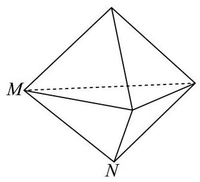

A.

B.

D.

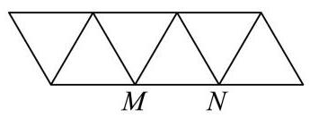

C.

> 本题资料或解析有待核事项，预览不可作为已审定成品。

### 闵行 · 第3题

已知球的表面积为 ${4\pi }$ ，则该球的体积为___.

### 静安 · 第1题

直径为 ${22}\mathrm{\;{cm}}$ 的球的表面积为___ ${\mathrm{{cm}}}^{2}$ . (计算结果保留 $\pi$ )

### 黄浦 · 第3题

底面半径为 1 、母线长为 3 的圆锥的侧面展开图中扇形的中心角为___.

### 黄浦 · 第11题

在空间直角坐标系 $O - {xyz}$ 中,将点集 $\left\{  {\left( {x, y, z}\right) \left.\parallel  x\right|  \leq  1,\left| y\right|  \leq  1,\left| z\right|  \leq  1}\right\}$ 所表示的立方体的表面满足 $z < 1$ 的部分记为 $S$ ,同时满足 “ $\left| \overrightarrow{OP}\right|  \leq  \sqrt{3}$ ” 与 “ $\{ Q \mid  \overrightarrow{OQ} = \lambda \overrightarrow{OP},\lambda  \in  \left\lbrack  {0,1}\right\rbrack  \}  \cap  S = \varnothing$ 或 $\{ P\}$ ”的点 $P$ 的集合所表示几何体的体积为___.

> 本题资料或解析有待核事项，预览不可作为已审定成品。

## 平行垂直与位置关系证明

运用线面判定或空间结构证明位置关系，反向命题须核反例。

### 崇明 · 第17题

如图，在直三棱柱 ${ABC} - {A}_{1}{B}_{1}{C}_{1}$ 中， ${AB} = {BC} = \sqrt{2}$ ， ${AC} = {A{A}_{1}} = 2$ ，且 $D$ ， $E$ 分别是 ${AC},{A}_{1}{C}_{1}$ 的中点.

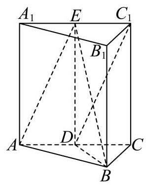

(1)证明: $D{C}_{1}//$ 平面 ${ABE}$ ；

(2)求三棱锥 ${C}_{1} - {ABE}$ 的体积.

> 本题资料或解析有待核事项，预览不可作为已审定成品。

### 普陀 · 第13题

已知直线 $l\text{ 、 }m$ 和平面 $a$ ，若 $m \subset  a$ ，则 “ $l$ 与 $m$ 不相交”是 “ $l//a$ ”的( )

A. 充分非必要条件必要条件

B. 必要非充分条件

C. 充分必要条件

D. 既非充分又非必要

### 长宁 · 第3题

已知向量 $\overrightarrow{a} = \left( {x,2,3}\right)$ ， $\overrightarrow{b} = \left( {2, y,6}\right)$ ，若 $\overrightarrow{a}\bot \overrightarrow{b}$ ，则实数 $x + y =$ ___.

### 黄浦 · 第13题

若 $a, b$ 是空间中的两条直线，则 “ $a//b$ ” 是 “存在平面 $a$ ，使 $a \subset  a, b \subset  a$ ” 的( ).

A. 充分非必要条件

B. 必要非充分条件

C. 充要条件

D. 既非充分也非必要条件

## 空间角、距离与体积综合

保留完整空间大题，综合线面关系、坐标和体积计算。

### 嘉定 · 第18题

如图，在 ${ABC}$ 中， $\angle {ACB} = {90}^{ \circ  }$ ， ${DA}\bot$ 平面 ${ABC}$ ， $M$ ， $N$ 分别是线段 ${AC}$ 、 ${DB}$ 的中点.

(1)求证: ${MN}\bot {AC}$ ；

(2)若 ${AC} = {BC} = {AD} = 2$ ，求直线 ${MN}$ 与平面 ${ABD}$ 所成角的大小.

> 本题资料或解析有待核事项，预览不可作为已审定成品。

### 奉贤 · 第19题

在四棱锥 $P - {ABCD}$ 中,四边形 ${ABCD}$ 是菱形, ${PA} = {PC} = 5,{PB} = {PD} = 2\sqrt{5}$ , ${AC} = 6$ ,点 $F$ 为 ${PD}$ 的中点,点 $E$ 为 ${PB}$ 上的点, $\overrightarrow{PE} = \lambda \overrightarrow{PB},\lambda  \in  \left( {0,1}\right)$ ,平面 ${AFE}$ 与棱 ${PC}$ 交于点 $G$ .

图1

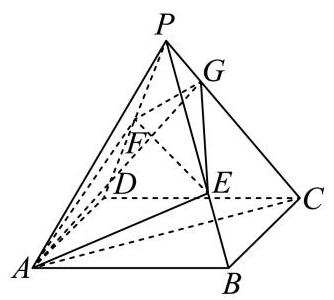

图2

(1)求证:异面直线 ${EF}$ 与 ${AC}$ 垂直；

(2)当 $\lambda  = \frac{2}{3}$ 时，求 ${AG}$ 与底面 ${ABCD}$ 所成的线面角大小.

### 宝山 · 第17题

如图，在四棱锥 $P - {ABCD}$ 中， ${ABCD}$ 是边长为 1 的正方形， ${PA}\bot$ 平面 ${ABCD}$ ， $E$ 是 ${PA}$ 的中点.

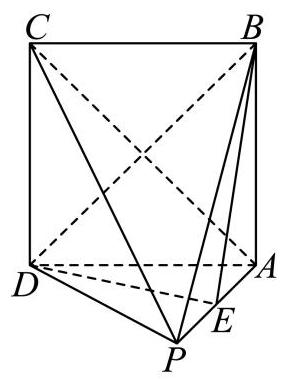

(1)求证: ${BD} \bot$ 平面 ${PAC}$ ；

(2)若直线 ${BE}$ 与平面 ${PAC}$ 所成角的正弦值为 $\frac{\sqrt{10}}{5}$ ，求三棱锥 $B - {PCD}$ 的体积.

### 崇明 · 第13题

在空间内, 异面直线所成角的取值范围是 ( )

A. $\left( {0,\frac{\pi }{2}}\right)$

B. $\left( {0,\frac{\pi }{2}}\right\rbrack$

C. $\left\lbrack  {0,\frac{\pi }{2}}\right)$

D. $\left\lbrack  {0,\frac{\pi }{2}}\right\rbrack$

### 徐汇 · 第17题

如图，在四棱锥 $P - {ABCD}$ 中， $\bigtriangleup  {PCD}$ 为等边三角形，底面 ${ABCD}$ 为直角梯形， ${AB}//{CD},{CD} \bot  {AD},{CD} = 4,{AB} = {AD} = 2$ .

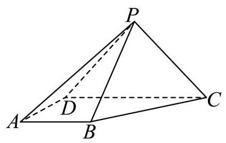

(1)求证: ${PB}\bot {CD}$ ；

(2)若四棱锥 $P - {ABCD}$ 的体积为 $4\sqrt{3}$ ，求直线 ${PD}$ 与平面 ${PBC}$ 所成角的大小.

### 普陀 · 第17题

如图，在正三棱柱 ${ABC} - {A}_{1}{B}_{1}{C}_{1}$ 中， $D$ 、 $E$ 分别是棱 ${A}_{1}{B}_{1}$ 、 ${A}_{1}A$ 的中点，且 ${A}_{1}A = {A}_{1}{B}_{1} = 2.$

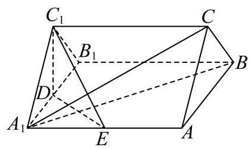

(1)求证:直线 ${A}_{1}B \bot$ 平面 ${C}_{1}{DE}$ ；

(2)求点 $A$ 到平面 ${A}_{1}{CB}$ 的距离.

### 杨浦 · 第18题

如图，在直四棱柱 ${ABCD} - {A}_{1}{B}_{1}{C}_{1}{D}_{1}$ 中， ${AB}//{CD}$ ， ${AD} \bot  {CD}$ ， ${AB} = 2$ ， ${AD} = 3$ ， ${CD} = 4$ .

(1)设 $E$ 是 ${C}_{1}{D}_{1}$ 的中点，求证: ${BE}//$ 平面 $A{A}_{1}{D}_{1}D$ ；

(2)若直四棱柱 ${ABCD} - {A}_{1}{B}_{1}{C}_{1}{D}_{1}$ 的体积为 36，求平面 ${D}_{1}{AC}$ 与平面 ${ABCD}$ 所成的锐二面角的大小.

> 本题资料或解析有待核事项，预览不可作为已审定成品。

### 松江 · 第10题

在四棱柱 ${ABCD} - {A}_{1}{B}_{1}{C}_{1}{D}_{1}$ 中，底面 ${ABCD}$ 为平行四边形， $\left| \overrightarrow{A{A}_{1}}\right|  = 2$ ，异面直线 $A{A}_{1}$ 与 ${BD}$ 的夹角为 $\arccos \frac{2}{5},\overrightarrow{AD} \cdot  \overrightarrow{D{C}_{1}} - \overrightarrow{AB} \cdot  \overrightarrow{B{C}_{1}} = 4$ ，则 $\left| \overrightarrow{B{D}_{1}}\right|  =$ ___.

### 松江 · 第17题

在如图所示的多面体中,已知四边形 ${ABCD}$ 是菱形, $\angle {ABC} = {60}^{ \circ  },{FA} \bot$ 平面 ${ABCD},{ED} \bot$ 平面 ${ABCD},{AB} = {FA} = {2ED} = 2$ ，点 $G$ 为线段 ${AF}$ 的中点.

(1)求证:平面 ${BDG}//$ 平面 ${CEF}$ ；

(2)求直线 ${BC}$ 与平面 ${BDG}$ 所成角的正弦值.

> 本题资料或解析有待核事项，预览不可作为已审定成品。

### 浦东 · 第17题

如图，在多面体 ${PQABCD}$ 中，平面 ${PAD} \bot$ 平面 ${ABCD}$ ， ${AB}//{CD}//{PQ}$ ， ${PD} \bot  {CD}$ ， $\bigtriangleup {PAD}$ 是边长为 $\sqrt{2}$ 的等边三角形， ${AB} = {PQ} = \frac{1}{2}{CD}$ .

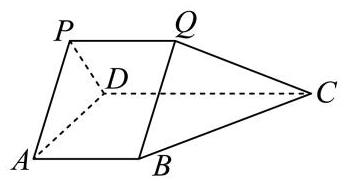

(1)求证: ${AB}\bot$ 平面 ${PAD}$ ；

(2)若 ${PC}$ 与平面 ${ABCD}$ 所成的角为 $\frac{\pi }{6}$ ，求多面体 ${PQABCD}$ 的体积.

### 虹口 · 第8题

在正四棱台 ${ABCD} - {A}_{1}{B}_{1}{C}_{1}{D}_{1}$ 中， ${AB} = 2,{A}_{1}{B}_{1} = 4$ ，异面直线 ${C}_{1}{D}_{1}$ 与 $A{A}_{1}$ 所成角为 $\frac{\pi }{3}$ ， 设二面角 $A - {A}_{1}{B}_{1} - {D}_{1}$ 的大小为 $\theta$ ，则 $\tan \theta  =$ ___.

### 虹口 · 第17题

如图,在底面半径为 2,侧面积为 $4\sqrt{5}\pi$ 的圆锥

$\mathrm{P} - \mathrm{O}$ 中, $A\text{ 、 }B\text{ 、 }C$ 为底面圆周上不同的三个点, $\angle {AOB} = \angle {BOC} = {45}^{ \circ  }$ .

(1)求直线 ${OB}$ 与平面 ${PAC}$ 所成角的正弦值

(2)设点 $D$ 为线段 ${PB}$ 上的动点(不含端点 $P$ 和 $B$ )，求证直线 ${OA}$ 与 ${CD}$ 不垂直

> 本题资料或解析有待核事项，预览不可作为已审定成品。

### 金山 · 第18题

已知长方形 ${ABCD}$ 中， ${AB} = 2,{BC} = 4$ ，点 $E$ 、 $F$ 分别为边 ${BC}$ 、 ${AD}$ 的中点(如图

1). 若将长方形 ${ABEF}$ 沿着边 ${EF}$ 翻折，得到二面角 ${A}_{1} - {EF} - D$ (如图 2). 已知二面角 ${A}_{1} - {EF} - D$ 的大小为 ${60}^{ \circ  }$ .

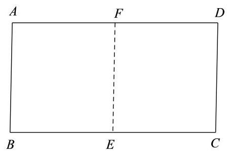

图1

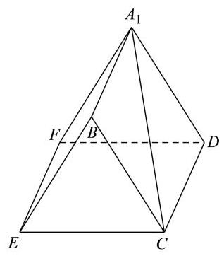

图2

(1)求证:平面 ${A}_{1}{FD}//$ 平面 ${BEC}$ ；

(2)求直线 $C{A}_{1}$ 与平面 ${A}_{1}{BEF}$ 所成角的大小.(结果用反三角表示)

> 本题资料或解析有待核事项，预览不可作为已审定成品。

### 长宁 · 第18题

如图， $P$ 是圆锥顶点， $O$ 是底面圆心，点 $A$ 、 $B$ 在底面圆周上， ${OA}\bot {OB}$ ， ${OA} = {OB} = 1$ .

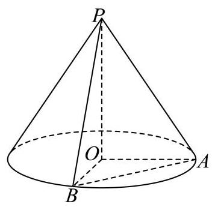

(1)若圆锥的侧面积为 ${2\pi }$ ，求圆锥的体积；

(2)若直线 ${PA}$ 与平面 ${POB}$ 所成角为 30，求二面角 $P - {AB} - O$ 的平面角的正切值

### 闵行 · 第18题

如图,圆柱 $O{O}_{1}$ 的轴截面 ${AB}{B}_{1}{A}_{1}$ 是边长为 4 的正方形, ${MN}$ 为底面圆 $O$ 的一条直径, 且 $\angle {BOM} = \frac{\pi }{3}$ .

(1)求异面直线 ${A}_{1}N$ 与 $B{B}_{1}$ 所成角的大小(用反三角表示)；

(2)求点 $A$ 到平面 ${A}_{1}{MN}$ 的距离.

> 本题资料或解析有待核事项，预览不可作为已审定成品。

### 青浦 · 第19题

如图,在三棱锥 $P - {ABC}$ 中, ${AB}$ 是 ${ABC}$ 外接圆的直径, $\bigtriangleup {PAC}$ 是边长为 2 的等边三角形， $E$ ， $F$ 分别是 ${PC}$ ， ${PB}$ 的中点， ${PB} = {AB}$ ， ${BC} = 4$ .

(1)求证:平面 ${PAC} \bot$ 平面 ${ABC}$ ；

(2)求直线 ${AB}$ 与平面 ${AEF}$ 所成角的正弦值.

### 静安 · 第9题

在代表我国古代数学成就的经典著作《九章算术》中, 称如下图中的多面体 ABCDEF 为 “刍(chu)甍(meng)”. 若底面 ${ABCD}$ 是边长为 4 的正方形， ${EF} = 2$ ，且 ${EF}//{AB}$ ， $\bigtriangleup {AED}$ 和 $\bigtriangleup {BFC}$ 是等腰直角三角形, $\angle {AED} = \angle {BFC} = {90}^{ \circ  }$ ,则 ${FC}$ 与底面 ${ABCD}$ 所成角的正弦值为___.

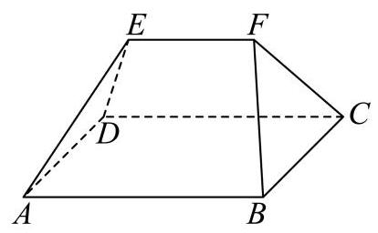

### 静安 · 第19题

如图,在长方体 ${ABCD} - {A}_{1}{B}_{1}{C}_{1}{D}_{1}$ 中, ${AB} = 4,{BC} = 3, C{C}_{1} = 2, M$ 是 ${AB}$ 的中点.

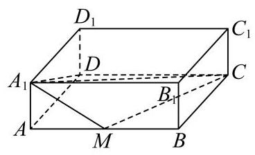

(1)求四棱锥 ${A}_{1} - {AMCD}$ 的体积；

(2)求平面 ${A}_{1}{AD}{D}_{1}$ 与平面 ${A}_{1}{MC}$ 所成的锐二面角的大小. (结果用反三角函数值表示)

### 黄浦 · 第18题

如图，在直三棱柱 ${ABC} - {A}_{1}{B}_{1}{C}_{1}$ 中，点 $D$ 、 $E$ 分别是棱 ${BC}\text{ 、 }C{C}_{1}$ 上的点(点 $D$ 异于点 $C)$ ,且 ${AD} \bot  {DE}$ .

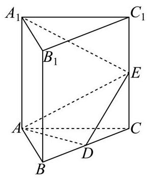

(1)求证:平面 ${ADE} \bot$ 平面 ${BC}{C}_{1}{B}_{1}$ ；

(2)若 ${ABC}$ 是正三角形, ${BC} = C{C}_{1}$ ,且三棱柱 ${ABC} - {A}_{1}{B}_{1}{C}_{1}$ 的体积是三棱锥 $E - {ADC}$ 的体积的 12 倍,求 ${A}_{1}E$ 与平面 ${ADE}$ 所成的角的大小.

> 本题资料或解析有待核事项，预览不可作为已审定成品。

## 截面、轨迹、动点与实际模型

从截面或可达点集确定几何约束，讨论定值、最值与长度。

### 嘉定 · 第12题

在包装设计中,常用长度和宽度描述物体体型. 长度 $l\left( V\right)$ 定义为物体上最远两点间的距离,宽度 $t\left( V\right)$ 定义为能夹住物体的两平行平面间的最小距离,即存在一对平行平面,使得物体上的所有点均位于两平面之间 (包括平面上). 现有一圆柱,其底面半径 $R$ 与高 $h$ 可任意调节，则 $\frac{l\left( V\right) }{t\left( V\right) }$ 的最小值为___

> 本题资料或解析有待核事项，预览不可作为已审定成品。

### 宝山 · 第15题

如图，正方体 ${ABCD} - {A}_{1}{B}_{1}{C}_{1}{D}_{1}$ 的棱长为 1，任作平面 $a$ 与对角线 $A{C}_{1}$ 垂直，使平面 $a$ 与正方体的六条棱都有公共点.记截面 ${PQRSWE}$ 的面积为S，截面周长为 $L$ ，则有( )

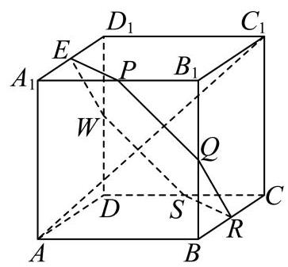

A. $\mathrm{S}$ 为定值， $L$ 为定值

B. $\mathrm{S}$ 为定值， $L$ 不为定值

C. $\mathrm{S}$ 不为定值， $L$ 为定值

D. $\mathrm{S}$ 不为定值， $L$ 不为定值

### 徐汇 · 第12题

如图为一架农业无人机沿固定航线匀速飞行，并在某时刻向下喷洒农药的示意图. 将种植坡面视为坡角为 $\theta$ 的平面，航线视为直线，无人机视为航线上的点，无人机在任意时刻喷洒农药的雾滴形成的形状均为以铅垂线为轴、母线与轴夹角为 ${45}^{ \circ  }$ 的圆锥及其内部. 若无人机飞行的海拔高度恒定，航线与种植坡面平行且距离为 3 米，假设无人机飞行时农药喷洒不间断且不受风速影响；则飞行过程中会在种植坡面上形成一条宽为 $L\left( \theta \right)$ 米的“农药条带”，当 ${0}^{ \circ  } \leq  \theta  \leq  {15}^{ \circ  }$ 时， $L\left( \theta \right)$ 的最大值为___. (结果精确到 0.01 )

航线 无人机

### 浦东 · 第11题

某光影科技实验室为长方体空间, 底面是边长为 4 米的正方形, 高为 3 米. 为营造动态光影效果，在底面一个顶点处安装射灯 $A$ ，在与该顶点相对的侧棱上、距底面 1 米处安装射灯 $I$ ,两盏射灯的光束方向由智能系统自动控制，始终使两束光线相互垂直，且它们的交汇点 $G$ 始终落在实验室天花板上. 则交汇点 $G$ 形成的轨迹长度为___米.

### 金山 · 第12题

申辉中学某个数学建模小组发现:人走路时，启动或者停下的瞬间，手中水平拿着的杯子里的水可能会被晃动得溢出杯口. 查询资料后发现: 液面和水平面的夹角 $\theta \left( {0 \leq  \theta  < \frac{\pi }{2}}\right)$ 与人走路的加速度 $a$ 以及重力加速度 $g$ 有关,满足关系: $\tan \theta  = \frac{a}{g}$ ,其中 $g = {10}\left( {\mathrm{\;m}/{\mathrm{s}}^{2}}\right)$ . 若甲同学走路启动瞬间的加速度为 $3\left( {\mathrm{\;m}/{\mathrm{s}}^{2}}\right)$ ，手中水平拿着一个底面边长为 $4\mathrm{\;{cm}}$ 和 $6\mathrm{\;{cm}}$ ， 高为 ${14}\mathrm{\;{cm}}$ 的长方体形状的杯子，则杯中最多装___ ${\mathrm{{cm}}}^{3}$ 的水，存在甲同学走路启动的瞬间杯中水不溢出的可能.

> 本题资料或解析有待核事项，预览不可作为已审定成品。

### 静安 · 第16题

设 $M\text{ 、 }N$ 分别是棱长为 1 的正方体的两个不同顶点,点 $P$ 在该正方体的表面上 (含棱和顶点) 运动,且不与 $M\text{ 、 }N$ 两点重合. 关于 $\overrightarrow{PM} \cdot  \overrightarrow{PN}$ ,给出下列两个结论:

① $\overrightarrow{PM} \cdot  \overrightarrow{PN}$ 存在最小值，且最小值小于零；

② $\overrightarrow{PM} \cdot  \overrightarrow{PN}$ 存在最大值，且最大值大于零.

则下列判断正确的选项是 ( ).

A. ①正确，②错误

B. ①错误，②正确

C. ①和②都错误

D. ①和②都正确

