# 2026二模 立体几何专题 · 教师版

> 本地预览：题目、答案及分类尚未全部审定。校对使用的PDF为教研整理版，尚未逐区确认区级印刷原卷。

## 几何体的面积、体积与展开

由几何体参数和展开关系求面积体积，注意旋转后重叠部分。

### 奉贤 · 第5题

已知圆锥的高为 8，底面半径为 6，则该圆锥的侧面积为___.

**考点：** 圆锥母线与侧面积

**难度依据：** 圆锥母线与侧面积

**【答案】** ${60\pi }$

**【解析】**

**【分析】**根据勾股定理求出母线长, 再根据圆锥的侧面积公式求解即可.

**【详解】**因为圆锥的高为 8,底面半径为 $r = 6$ ,

所以圆锥的母线长为 $l = \sqrt{{8}^{2} + {6}^{2}} = {10}$ ,

则圆锥的侧面积 $S = {\pi rl} = \pi  \times  6 \times  {10} = {60\pi }$ .

故答案为: ${60\pi }$ .

### 宝山 · 第5题

将边长为 2 的正方形绕其一边旋转一周，所得几何体的体积为___.

**考点：** 正方形旋转所得圆柱体积

**难度依据：** 正方形旋转所得圆柱体积

**【答案】** ${8\pi }$

**【解析】**

**【详解】**边长为 2 的正方形绕其一边旋转一周, 得到的几何体为圆柱, 则圆柱的体积为 $V = \pi  \times  {2}^{2} \times  2 = {8\pi }$ ,故填 ${8\pi }$ .

### 崇明 · 第10题

如图,已知圆柱的一个截面边界是椭圆 $\Gamma$ ,其中 $\Gamma$ 的长轴 ${AC}$ 为该圆柱轴截面的对角线, 短轴长等于圆柱底面直径的长. 将圆柱侧面沿母线 ${AB}$ 展开，则椭圆 $\Gamma$ 在展开图中恰好为一个周期的三角函数图像. 若该段曲线是函数 $y = 1 - \sqrt{3}\sin \frac{x}{2}$ 的图像的一部分,则椭圆 $\Gamma$ 的离心率为___.

$B$

**考点：** 圆柱斜截面与展开；周期振幅确定圆柱尺寸；椭圆离心率

**难度依据：** 圆柱斜截面与展开；周期振幅确定圆柱尺寸；椭圆离心率

**【答案】** $\frac{\sqrt{21}}{7}$

**【解析】**

**【分析】**由正弦函数的最值和周期求得圆柱的高和底面半径, 进而求得椭圆的长轴和短轴, 即可得离心率.

**【详解】**函数 $y = 1 - \sqrt{3}\sin \frac{x}{2}$ 的值域为 $\left\lbrack  {1 - \sqrt{3},1 + \sqrt{3}}\right\rbrack$ ,最小正周期 $T = \frac{2\pi }{\frac{1}{2}} = {4\pi }$ ,

依题意,圆柱的高 $h = \left| {AB}\right|  = 2\sqrt{3}$ ,设圆柱的底面半径为 $r$ ,则 ${2\pi r} = {4\pi }$ ,解得 $r = 2$ ,

椭圆短轴长 ${2b} = {2r} = 4$ ,即 $b = 2$ ,长轴长 ${2a} = \sqrt{{h}^{2} + {\left( 2r\right) }^{2}} = 2\sqrt{7}$ ,即 $a = \sqrt{7}$ , 所以椭圆的离心率 $e = \frac{\sqrt{{a}^{2} - {b}^{2}}}{a} = \sqrt{1 - \frac{{b}^{2}}{{a}^{2}}} = \frac{\sqrt{21}}{7}$ .

### 普陀 · 第8题

在 ${ABC}$ 中, $\angle {ACB} = \frac{\pi }{2},{AC} = 1$ ,过点 $A$ 作直线 $l//{BC}$ ,将 ${ABC}$ 绕直线 $l$ 旋转一周所得到的几何体记为 $\Omega$ ，若 $\Omega$ 的体积是 $\frac{4}{3}\pi$ ，则 $\Omega$ 的表面积为___.

**考点：** 旋转组合体的体积和表面积

**难度依据：** 旋转组合体的体积和表面积

**【答案】** $\left( {5 + \sqrt{5}}\right) \pi$

**【解析】**

**【分析】**将 $\bigtriangleup {ABC}$ 绕直线 $l$ 旋转一周,生成的几何体 $\Omega$ 是一个大圆柱挖去一个小圆锥的组合体, 利用圆柱与圆锥的体积以及表面积公式求解即可.

**【详解】** $\bigtriangleup  {ABC}$ 为直角三角形， $\angle {ACB} = \frac{\pi }{2}$ ， ${AC} = 1$ ，直线 $l//{BC}$ 且过点 $A$ ，

设 ${BC} = h$ ,所以斜边 ${AB} = \sqrt{A{C}^{2} + B{C}^{2}} = \sqrt{{1}^{2} + {h}^{2}} = \sqrt{1 + {h}^{2}}$ ,

将 $\bigtriangleup  {ABC}$ 绕直线 $l$ 旋转一周，生成的几何体 $\Omega$ 是一个大圆柱挖去一个小圆锥的组合体，

所以圆柱上底面半径 $R = {AC} = 1$ ,高 $h$ ,

被挖去的圆锥的底面半径 $r = 1$ ,高与圆柱相同,即 $h$ ,

则圆柱体积: ${V}_{\text{ 圆柱 }} = \pi {R}^{2}h = \pi  \cdot  {1}^{2} \cdot  h = {\pi h}$ ,

圆锥体积: ${V}_{\text{ 圆锥 }} = \frac{1}{3}\pi {r}^{2}h = \frac{1}{3}\pi  \cdot  {1}^{2} \cdot  h = \frac{1}{3}{\pi h}$ ,

所以组合体体积: $V = {V}_{\text{ 圆柱 }} - {V}_{\text{ 圆锥 }} = {\pi h} - \frac{1}{3}{\pi h} = \frac{2}{3}{\pi h}$ ,

则 $\frac{2}{3}{\pi h} = \frac{4}{3}\pi \implies h = 2$ ,即 ${BC} = 2$ ,所以 ${AB} = \sqrt{{1}^{2} + {2}^{2}} = \sqrt{5}$ ,

几何体 $\Omega$ 的表面积由三部分构成:

圆柱的侧面积: ${S}_{\text{ 柱侧 }} = {2\pi Rh} = {2\pi } \cdot  1 \cdot  2 = {4\pi }$ ,

圆柱的上底面面积: ${S}_{\text{ 上底 }} = \pi {R}^{2} = \pi  \cdot  {1}^{2} = \pi$ ,

圆锥的侧面积: 圆锥母线长为 ${AB} = \sqrt{5}\;,\;{S}_{\text{ 锥侧 }} = {\pi rl} = \pi  \cdot  1 \cdot  \sqrt{5} = \sqrt{5}\pi$ ,

所以总表面积: ${S}_{\text{ 总 }} = {S}_{\text{ 柱侧 }} + {S}_{\text{ 上底 }} + {S}_{\text{ 锥侧 }} = {4\pi } + \pi  + \sqrt{5}\pi  = \left( {5 + \sqrt{5}}\right) \pi$ .

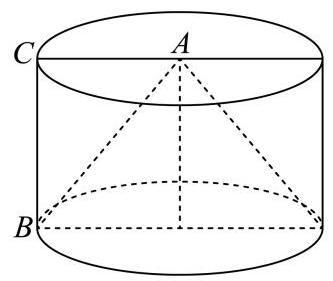

### 杨浦 · 第7题

已知圆锥的底面半径为 1,体积为 $\frac{\sqrt{3}\pi }{3}$ ,则该圆锥的侧面积为___.

**考点：** 由体积求高、母线和侧面积

**难度依据：** 空间几何量计算

**【答案】** ${2\pi }$

**【解析】**

**【分析】**先由题干条件计算圆锥的高, 再求圆锥的母线, 进而可求圆锥的侧面积.

**【详解】**由题得圆锥底面积 ${S}_{\text{ 底 }} = \pi {R}^{2} = \pi$ ,体积 $V = \frac{1}{3}{Sh} = \frac{1}{3}{\pi h} = \frac{\sqrt{3}\pi }{3}$ ,解得 $h = \sqrt{3}$ , 母线长 $l = \sqrt{{R}^{2} + {h}^{2}} = \sqrt{1 + 3} = 2$ ,故圆锥侧面积 ${S}_{\text{ 侧 }} = {\pi Rl} = {2\pi }$ .

故答案为: ${2\pi }$ .

### 虹口 · 第2题

已知一个直三棱柱的侧棱长为 2，底面面积为 2，则该三棱柱的体积为___.

**考点：** 直三棱柱体积

**难度依据：** 直三棱柱体积

**【答案】** 4

**【解析】**

**【分析】**根据三棱柱的体积公式计算求解.

**【详解】**设一个直三棱柱的侧棱长为 $h = 2$ ,底面面积为 $S = 2$ ,则该三棱柱的体积为 $V = {Sh} = 2 \times  2 = 4$ .

### 长宁 · 第15题

将下列平面图形沿等边三角形的边折起，不能折成如图所示几何体的是( ).

A.

B.

D.

C.

> 本题资料或解析有待核事项，预览不可作为已审定成品。

**考点：** 几何体展开图

**难度依据：** 几何体展开图

**核查说明：** 解析关于B能否折叠前后矛盾，需回查题图和原解，不据此确定。

**【答案】** B

**【解析】**

**【详解】**该几何体上的点 $M, N$ 是一条棱的两端点.对于 $\mathrm{A},\mathrm{B},\mathrm{D}$ 项，在折叠时，这两点会被带到几何体的两个不同顶点, 所有面可以无重叠地闭合, 形成完整的双三棱锥.

而对于 $\mathrm{B}$ ,折叠后,点 $M$ 和点 $N$ 是相对的两个顶点.

### 闵行 · 第3题

已知球的表面积为 ${4\pi }$ ，则该球的体积为___.

**考点：** 球表面积与体积

**难度依据：** 球表面积与体积

**【答案】** $\frac{4}{3}\pi$

**【解析】**

**【分析】**根据球体表面积计算公式求出球体半径, 再根据球体体积计算公式求出球体体积即可.

**【详解】**设球体的半径为 $R$ ,根据已知有: ${4\pi }{R}^{2} = {4\pi }$ ,解得 $R = 1$ ,所以球体体积为: $\frac{4}{3}\pi {R}^{3} = \frac{4}{3}\pi$

故答案为: $\frac{4}{3}\pi$ .

### 静安 · 第1题

直径为 ${22}\mathrm{\;{cm}}$ 的球的表面积为___ ${\mathrm{{cm}}}^{2}$ . (计算结果保留 $\pi$ )

**考点：** 球表面积

**难度依据：** 球表面积

**【答案】** 484π

**【解析】**

**【详解】**由题意知球的半径 $r = 1\mathrm{{lcm}}$ ,

所以球的表面积 $S = {4\pi }{r}^{2} = {4\pi } \times  {11}^{2} = {484\pi c}{m}^{2}$ .

### 黄浦 · 第3题

底面半径为 1 、母线长为 3 的圆锥的侧面展开图中扇形的中心角为___.

**考点：** 圆锥侧面展开

**难度依据：** 圆锥侧面展开

**【答案】** $\frac{2\pi }{3}$

**【解析】**

**【分析】**根据圆锥的侧面展开图结合扇形的弧长公式运算求解.

**【详解】**设侧面展开图中扇形的中心角为 $a$ ,

由题意可得: ${3a} = {2\pi } \times  1$ ,解得 $a = \frac{2\pi }{3}$ ,

所以侧面展开图中扇形的中心角为 $\frac{2\pi }{3}$ .

### 黄浦 · 第11题

在空间直角坐标系 $O - {xyz}$ 中,将点集 $\left\{  {\left( {x, y, z}\right) \left.\parallel  x\right|  \leq  1,\left| y\right|  \leq  1,\left| z\right|  \leq  1}\right\}$ 所表示的立方体的表面满足 $z < 1$ 的部分记为 $S$ ,同时满足 “ $\left| \overrightarrow{OP}\right|  \leq  \sqrt{3}$ ” 与 “ $\{ Q \mid  \overrightarrow{OQ} = \lambda \overrightarrow{OP},\lambda  \in  \left\lbrack  {0,1}\right\rbrack  \}  \cap  S = \varnothing$ 或 $\{ P\}$ ”的点 $P$ 的集合所表示几何体的体积为___.

> 本题资料或解析有待核事项，预览不可作为已审定成品。

**考点：** 射线可达点集；球体体积

**难度依据：** 射线可达点集；球体体积

**核查说明：** 射线可达区域及体积分解需独立数学核验。

**【答案】** $\frac{{20} + 2\sqrt{3}\pi }{3}$

**【解析】**

**【分析】**首先判断出 $\mathrm{S}$ 为正方体的四个侧面和下底面,然后得到 “ $\left| \overrightarrow{OP}\right|  \leq  \sqrt{3}$ ” 表示的几何体为正方体的外接球,满足条件的点 $P$ 即为从点 $O$ 出发的不超过 $\mathrm{S}$ 和球面的线段上的点,将它们分为射向上底面和其它五个面两个部分，相加即可得到所求几何体体积.

**【详解】**点集 $\{ \left( {x, y, z}\right) \parallel x \mid   \leq  1,\left| y\right|  \leq  1,\left| z\right|  \leq  1\}$ 表示的是以原点为中心的边长为 2 的正方体, $\mathrm{S}$ 为满足 $z < 1$ 的部分即除去了 $z = 1$ 后剩余的部分,也就是除了上底面以外的五个面, 条件 “ $\left| \overrightarrow{OP}\right|  \leq  \sqrt{3}$ ” 表示点 $P$ 在以原点为球心的半径为 $\sqrt{3}$ 的球体内,因为 $\sqrt{{1}^{2} + {1}^{2} + {1}^{2}} = \sqrt{3}$

所以这个球刚好也是正方体的外接球， $\left\{  {Q\left| {\;\overrightarrow{OQ} = \lambda \overrightarrow{OP}}\right. ,\lambda  \in  \left\lbrack  {0,1}\right\rbrack  }\right\}$ 即为线段 ${OP}$ ,

条件 “ $\left\{  {Q \mid  \overrightarrow{OQ} = \lambda \overrightarrow{OP},\lambda  \in  \left\lbrack  {0,1}\right\rbrack  }\right\}   \cap  S = \varnothing$ 或 $\{ P\}$ ” 表示线段 ${OP}$ 与 $\mathrm{S}$ 要么没有交点,要么交点就是 $P$ ,

考虑从 $O$ 点出发的线段 ${OP}$ ,射向上底面的线可以到达球面,这一部分构成 $\frac{1}{6}$ 个球体,

射向 $\mathrm{S}$ 包含的五个面可以到达正方体的表面,这一部分构成五个四棱锥,每个四棱锥都是正方体的 $\frac{1}{6}$ ,

所以所求几何体的体积为 $V = 5 \times  \frac{1}{6} \times  {2}^{3} + \frac{1}{6} \times  \frac{4}{3}\pi {\left( \sqrt{3}\right) }^{3} = \frac{20}{3} + \frac{2\sqrt{3}}{3}\pi  = \frac{{20} + 2\sqrt{3}\pi }{3}$ .

截面 $y = 0$

## 平行垂直与位置关系证明

运用线面判定或空间结构证明位置关系，反向命题须核反例。

### 崇明 · 第17题

如图，在直三棱柱 ${ABC} - {A}_{1}{B}_{1}{C}_{1}$ 中， ${AB} = {BC} = \sqrt{2}$ ， ${AC} = {A{A}_{1}} = 2$ ，且 $D$ ， $E$ 分别是 ${AC},{A}_{1}{C}_{1}$ 的中点.

(1)证明: $D{C}_{1}//$ 平面 ${ABE}$ ；

(2)求三棱锥 ${C}_{1} - {ABE}$ 的体积.

> 本题资料或解析有待核事项，预览不可作为已审定成品。

**考点：** (1) 平行四边形及线面平行判定；(2) 等体积转换求棱锥体积

**难度依据：** 线面平行与等体积法

**核查说明：** 答案解析第468字符附近：损坏字符或字体覆盖风险，需回源并视觉检查（底稿扫描记录）

**【答案】** (1) 证明见解析

(2) $\frac{1}{3}$

**【解析】**

**【分析】**(1) 由题意可得四边形 ${AD}{C}_{1}E$ 是平行四边形,则可得 $D{C}_{1}//{AE}$ ,再利用线面平行判定定理即可得证;

(2)由 $E$ 为 ${A}_{1}{C}_{1}$ 的中点，可得 ${V}_{{C}_{1} - {ABE}} = {V}_{{A}_{1} - {ABE}}$ ，再利用等体积法计算即可得解.

**【小问 1 详解】**

由直三棱柱性质可得 ${A}_{1}{C}_{1} = {AC},{A}_{1}{C}_{1}//{AC}$ ,

由 $D, E$ 分别是 ${AC},{A}_{1}{C}_{1}$ 的中点,则 ${C}_{1}E = {AD},{C}_{1}E//{AD}$ ,

则四边形 ${AD}{C}_{1}E$ 是平行四边形,故 $D{C}_{1}//{AE}$ ,

又 ${AE} \subset$ 平面 ${ABE}, D{C}_{1} \text{ ⊄ }$ 平面 ${ABE}$ ,故 $D{C}_{1}//$ 平面 ${ABE}$ ;

**【小问 2 详解】**

由 ${AB} = {BC} = \sqrt{2},{AC} = 2$ ，则 ${A{B}^{2}} + {B{C}^{2}} = {A{C}^{2}}$ ，

故 ${ABC}$ 为等腰直角三角形，则点 $D$ 到 ${AB}$ 的距离为 $\frac{1}{2}{BC} = \frac{\sqrt{2}}{2}$ ，

则点 $E$ 到 ${A}_{1}{B}_{1}$ 的距离为 $d = \frac{\sqrt{2}}{2}$ ,

由 $E$ 为 ${A}_{1}{C}_{1}$ 的中点,则点 ${A}_{1}$ 与点 ${C}_{1}$ 到平面 ${ABE}$ 的距离相等,

故 ${V}_{{C}_{1} - {ABE}} = {V}_{{A}_{1} - {ABE}} = {V}_{E - {A}_{1}{BA}} = \frac{1}{3}{S}_{\bigtriangleup {A}_{1}{BA}} \cdot  d = \frac{1}{3} \times  \frac{1}{2} \times  2 \times  \sqrt{2} \times  \frac{\sqrt{2}}{2} = \frac{1}{3}$ .

### 普陀 · 第13题

已知直线 $l\text{ 、 }m$ 和平面 $a$ ，若 $m \subset  a$ ，则 “ $l$ 与 $m$ 不相交”是 “ $l//a$ ”的( )

A. 充分非必要条件必要条件

B. 必要非充分条件

C. 充分必要条件

D. 既非充分又非必要

**考点：** 必要条件与反例；线线及线面位置关系

**难度依据：** 必要条件与反例；线线及线面位置关系

**【答案】** B

**【解析】**

**【分析】**根据线面判断及线线位置关系结合必要非充分条件定义判断.

**【详解】**当直线 $l$ 与平面 $a$ 相交,且交点不在直线 $m$ 上时,满足 “ $l$ 与 $m$ 不相交”, 但 “ $l//a$ ” 不成立,故充分性不成立;

若 $l//a$ ，则 $l$ 与 $a$ 无交点，所以“ $l$ 与 $m$ 不相交”，故必要性成立；

所以“ $l$ 与 $m$ 不相交”是“ $l//a$ ”的必要非充分条件.

### 长宁 · 第3题

已知向量 $\overrightarrow{a} = \left( {x,2,3}\right)$ ， $\overrightarrow{b} = \left( {2, y,6}\right)$ ，若 $\overrightarrow{a}\bot \overrightarrow{b}$ ，则实数 $x + y =$ ___.

**考点：** 空间向量垂直与数量积；空间线线垂直

**难度依据：** 空间向量垂直与数量积；空间线线垂直

**【答案】** -9

**【解析】**

**【详解】**因为 $\overrightarrow{a} = \left( {x,2,3}\right) ,\overrightarrow{b} = \left( {2, y,6}\right)$ ,又 $\overrightarrow{a} \bot  \overrightarrow{b}$ ,

所以 $\overrightarrow{a} \cdot  \overrightarrow{b} = {2x} + {2y} + 3 \times  6 = 0$ ,

则 $x + y =  - 9$ .

### 黄浦 · 第13题

若 $a, b$ 是空间中的两条直线，则 “ $a//b$ ” 是 “存在平面 $a$ ，使 $a \subset  a, b \subset  a$ ” 的( ).

A. 充分非必要条件

B. 必要非充分条件

C. 充要条件

D. 既非充分也非必要条件

**考点：** 空间直线共面条件；充分条件

**难度依据：** 空间直线共面条件；充分条件

**【答案】** A

**【解析】**

**【分析】**根据空间中线、面关系结合充分、必要条件分析判断.

**【详解】**若 $a//b$ ,可知直线 $a, b$ 是共面直线,则存在平面 $a$ ,使 $a \subset  a, b \subset  a$ ,即充分性成立;

若存在平面 $a$ ,使 $a \subset  a, b \subset  a$ ,则直线 $a, b$ 可能相交,即必要性不成立; 综上所述: “ $a//b$ ”是“存在平面 $a$ ,使 $a \subset  a, b \subset  a$ ”的充分非必要条件.

## 空间角、距离与体积综合

保留完整空间大题，综合线面关系、坐标和体积计算。

### 嘉定 · 第18题

如图，在 ${ABC}$ 中， $\angle {ACB} = {90}^{ \circ  }$ ， ${DA}\bot$ 平面 ${ABC}$ ， $M$ ， $N$ 分别是线段 ${AC}$ 、 ${DB}$ 的中点.

(1)求证: ${MN}\bot {AC}$ ；

(2)若 ${AC} = {BC} = {AD} = 2$ ，求直线 ${MN}$ 与平面 ${ABD}$ 所成角的大小.

> 本题资料或解析有待核事项，预览不可作为已审定成品。

**考点：** (1) 空间垂直关系证明；(2) 建系求直线与平面所成角

**难度依据：** 空间建系求线面角

**核查说明：** 题干与答案解析尚未逐页对照原卷，数学内容未独立终审。

**【答案】** (1) 证明见解析

(2) $\frac{\pi }{6}$

**【解析】**

**【分析】**(1) 建立适当空间直角坐标系,设 ${AC} = a,{BC} = b,{AD} = c$ ,求出 $\overrightarrow{MN},\overrightarrow{AC}$ ,利用 $\overrightarrow{MN} \cdot  \overrightarrow{AC} = 0$ 证明 ${MN} \bot  {AC}$ .

(2)求出平面 ${ABD}$ 的一个法向量 $\overrightarrow{n}$ ，利用 $\sin \theta  = \left| {\cos \langle \overrightarrow{MN},\overrightarrow{n}\rangle }\right|$ 即可求出直线 ${MN}$ 与平面 ${ABD}$ 所成角 $\theta$ 的大小.

**【小问 1 详解】**

由题可建立如图所示的空间直角坐标系. 设 ${AC} = a,{BC} = b,{AD} = c$ .

则 $C\left( {0,0,0}\right) , A\left( {-a,0,0}\right) , B\left( {0, b,0}\right) , D\left( {-a,0, c}\right) , M\left( {-\frac{a}{2},0,0}\right) , N\left( {-\frac{a}{2},\frac{b}{2},\frac{c}{2}}\right)$ .

所以 $\overrightarrow{MN} = \left( {0,\frac{b}{2},\frac{c}{2}}\right) ,\overrightarrow{AC} = \left( {a,0,0}\right)$

所以 $\overrightarrow{MN} \cdot  \overrightarrow{AC} = 0 \times  a + \frac{b}{2} \times  0 + \frac{c}{2} \times  0 = 0,\therefore {MN} \bot  {AC}$ ;

**【小问 2 详解】**

$\because {AC} = {BC} = {AD} = 2$ ,

$\therefore C\left( {0,0,0}\right) , A\left( {-2,0,0}\right) , B\left( {0,2,0}\right) , D\left( {-2,0,2}\right) , M\left( {-1,0,0}\right) , N\left( {-1,1,1}\right)$ .

$\therefore \overrightarrow{MN} = \left( {0,1,1}\right) ,\left| \overrightarrow{MN}\right|  = \sqrt{{0}^{2} + {1}^{2} + {1}^{2}} = \sqrt{2},\overrightarrow{AB} = \left( {2,2,0}\right) ,\overrightarrow{AD} = \left( {0,0,2}\right)$ .

记平面 ${ABD}$ 的一个法向量为 $\overrightarrow{n} = \left( {x, y, z}\right)$ ,

则 $\left\{  \begin{matrix} \overrightarrow{n} \cdot  \overrightarrow{AD} = {2z} = 0 \\  \overrightarrow{n} \cdot  \overrightarrow{AB} = {2x} + {2y} = 0 \end{matrix}\right.$ ,令 $x = 1$ ,则 $y =  - 1, z = 0$ .

$\therefore \overrightarrow{n} = \left( {1, - 1,0}\right) ,\left| \overrightarrow{n}\right|  = \sqrt{{1}^{2} + {\left( -1\right) }^{2} + {0}^{2}} = \sqrt{2}$ .

记直线 ${MN}$ 与平面 ${ABD}$ 所成角为 $\theta$ .

则 $\sin \theta  = \left| {\cos \langle \overrightarrow{MN},\overrightarrow{n}\rangle }\right|  = \frac{\left| \overrightarrow{MN} \cdot  \overrightarrow{n}\right| }{\left| \overrightarrow{MN}\right| \left| \overrightarrow{n}\right| } = \frac{\left| 0 \times  1 + 1 \times  \left( -1\right)  + 1 \times  0\right| }{\sqrt{2} \times  \sqrt{2}} = \frac{1}{2}$ .

又 $\because \theta  \in  \left\lbrack  {0,\frac{\pi }{2}}\right\rbrack  ,\therefore \theta  = \frac{\pi }{6}$ .

### 奉贤 · 第19题

在四棱锥 $P - {ABCD}$ 中,四边形 ${ABCD}$ 是菱形, ${PA} = {PC} = 5,{PB} = {PD} = 2\sqrt{5}$ , ${AC} = 6$ ,点 $F$ 为 ${PD}$ 的中点,点 $E$ 为 ${PB}$ 上的点, $\overrightarrow{PE} = \lambda \overrightarrow{PB},\lambda  \in  \left( {0,1}\right)$ ,平面 ${AFE}$ 与棱 ${PC}$ 交于点 $G$ .

图1

图2

(1)求证:异面直线 ${EF}$ 与 ${AC}$ 垂直；

(2)当 $\lambda  = \frac{2}{3}$ 时，求 ${AG}$ 与底面 ${ABCD}$ 所成的线面角大小.

**考点：** (1) 异面直线垂直证明；(2) 空间坐标及截面交点求线面角

**难度依据：** 空间垂直与线面角；空间坐标和法向量

**【答案】** (1) 证明见解析

(2) $\arcsin \frac{4\sqrt{65}}{65}$

**【解析】**

**【分析】**(1) 建立空间直角坐标系,求出 $\overrightarrow{EF},\overrightarrow{AC}$ ,计算求出 $\overrightarrow{EF} \cdot  \overrightarrow{AC} = 0$ ,从而证明结论;

(2)求出 $\overrightarrow{AE}$ ，进而求出点 $G$ ，进而求出 $\overrightarrow{AG}$ ，利用向量夹角的余弦公式求出线面角的大小.

**【小问 1 详解】**

已知四边形 ${ABCD}$ 是菱形,则 ${AC} \bot  {BD}$ ,设 ${AC} \cap  {BD} = O$ ,则 $O$ 是 ${AC},{BD}$ 的中点,

$\because {PA} = {PC} = 5,{PB} = {PD} = 2\sqrt{5}$ ,

$\therefore {PO} \bot  {AC},{PO} \bot  {BD}$ ,

$\because {AC} \cap  {BD} = O$ ，且 ${AC},{BD} \subset$ 平面 ${ABCD}$ ，

$\therefore {PO} \bot$ 平面 ${ABCD}$ ，

以 $O$ 为坐标原点， ${OA}$ 为 $x$ 轴， ${OB}$ 为 $y$ 轴， ${OP}$ 为 $z$ 轴，建立下图所示空间直角坐标系，

$\because {AC} = 6,\therefore {OA} = 3,{OP} = \sqrt{A{P}^{2} - O{A}^{2}} = \sqrt{{5}^{2} - {3}^{2}} = 4$ ,

${OB} = \sqrt{P{B}^{2} - O{P}^{2}} = \sqrt{{\left( 2\sqrt{5}\right) }^{2} - {4}^{2}} = 2,$

$\therefore A\left( {3,0,0}\right) , B\left( {0,2,0}\right) , C\left( {-3,0,0}\right) , D\left( {0, - 2,0}\right) , P\left( {0,0,4}\right)$ ,

$\because F$ 为 ${PD}$ 的中点,

$\therefore F\left( {0, - 1,2}\right)$ ,

$\because$ 点 $E$ 为 ${PB}$ 上的点， $\overrightarrow{PE} = \lambda \overrightarrow{PB},\overrightarrow{PB} = \left( {0,2, - 4}\right)$ ,

$\therefore \overrightarrow{PE} = \left( {0,{2\lambda }, - {4\lambda }}\right)$ ,则 $E\left( {0,{2\lambda },4 - {4\lambda }}\right)$ ,

$\therefore \overrightarrow{EF} = \left( {0, - 1 - {2\lambda }, - 2 + {4\lambda }}\right)$ ,

$\because \overrightarrow{AC} = \left( {-6,0,0}\right)$ ,

$\therefore \overrightarrow{EF} \cdot  \overrightarrow{AC} = 0 \times  \left( {-6}\right)  + \left( {-1 - {2\lambda }}\right)  \times  0 + \left( {-2 + {4\lambda }}\right)  \times  0 = 0$ ,故 $\overrightarrow{EF} \bot  \overrightarrow{AC}$ ,

$\therefore$ 异面直线 ${EF}$ 与 ${AC}$ 垂直.

**【小问 2 详解】**

当 $\lambda  = \frac{2}{3}$ 时, $E\left( {0,\frac{4}{3},\frac{4}{3}}\right) ,\overrightarrow{AE} = \left( {-3,\frac{4}{3},\frac{4}{3}}\right) ,\overrightarrow{AF} = \left( {-3, - 1,2}\right)$ ,

设 $\overrightarrow{n} = \left( {a, b, c}\right)$ 为平面 ${AEF}$ 的法向量,则 $\left\{  \begin{array}{l}  - {3a} + \frac{4}{3}b + \frac{4}{3}c = 0 \\   - {3a} - b + {2c} = 0 \end{array}\right.$ ,令 $a =  - 4$ , 则 $\overrightarrow{n} = \left( {-4, - 2, - 7}\right)$ ,

$\because A\left( {3,0,0}\right)$ ,

$\therefore$ 平面 ${AEF}$ 方程为: $- 4\left( {x - 3}\right)  - {2y} - {7z} = 0$ ,即 ${4x} + {2y} + {7z} = {12}$ ,

$\because P\left( {0,0,4}\right) , C\left( {-3,0,0}\right)$ ,

$\therefore \overrightarrow{PC} = \left( {-3,0, - 4}\right)$ ,直线 ${PC}$ 参数方程为: $\left\{  {\begin{array}{l} x =  - {3t} \\  y = 0 \\  z = 4 - {4t} \end{array}, t \in  \left\lbrack  {0,1}\right\rbrack  }\right.$ , 参数方程代入平面方程得 $4\left( {-{3t}}\right)  + 2 \times  0 + 7\left( {4 - {4t}}\right)  = {12}$ ,解得 $t = \frac{2}{5}$ ,

$\therefore G\left( {-\frac{6}{5},0,\frac{12}{5}}\right)$ ,故 $\overrightarrow{AG} = \left( {-\frac{21}{5},0,\frac{12}{5}}\right)$ ,

底面 ${ABCD}$ 的法向量为 $\overrightarrow{m} = \left( {0,0,1}\right)$ ,

设 ${AG}$ 与底面 ${ABCD}$ 所成角为 $\theta$ ，则

$\sin \theta  = \left| {\cos \overrightarrow{AG},\overrightarrow{m}}\right|  = \frac{\left| \overrightarrow{AG} \cdot  \overrightarrow{m}\right| }{\left| \overrightarrow{AG}\right|  \cdot  \left| \overrightarrow{m}\right| } = \frac{\frac{12}{5}}{\sqrt{{\left( -\frac{21}{5}\right) }^{2} + {\left( \frac{12}{5}\right) }^{2}} \times  1} = \frac{4\sqrt{65}}{65}$ ,

$\therefore {AG}$ 与底面 ${ABCD}$ 所成的线面角为 $\arcsin \frac{4\sqrt{65}}{65}$ .

### 宝山 · 第17题

如图，在四棱锥 $P - {ABCD}$ 中， ${ABCD}$ 是边长为 1 的正方形， ${PA}\bot$ 平面 ${ABCD}$ ， $E$ 是 ${PA}$ 的中点.

(1)求证: ${BD} \bot$ 平面 ${PAC}$ ；

(2)若直线 ${BE}$ 与平面 ${PAC}$ 所成角的正弦值为 $\frac{\sqrt{10}}{5}$ ，求三棱锥 $B - {PCD}$ 的体积.

**考点：** (1) 线线垂直推出线面垂直；(2) 空间向量求高再计算棱锥体积

**难度依据：** 线面垂直和棱锥体积；空间坐标法求线面角

**【答案】** (1)证明见解析

(2) $\frac{1}{6}$

**【解析】**

**【分析】**(1) 利用线面垂直判定定理,通过证明 ${BD}$ 垂直于平面 ${PAC}$ 内的两条相交直线 ${PA}$ 和 ${AC}$ ,从而证得 ${BD} \bot$ 平面 ${PAC}$ ;

(2)建立空间直角坐标系，求出直线方向向量与平面法向量，利用线面角的正弦值公式列方程,求解得到 ${PA}$ 的长度,再由棱锥体积公式得解.

**【小问 1 详解】**

如图,连接 ${AC},{BD}$ 交于点 $O$ ,可得点 $O$ 是 ${AC}$ 的中点,

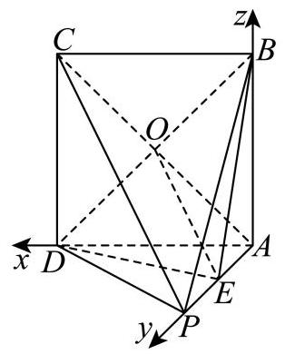

因为四边形 ${ABCD}$ 是边长为 1 的正方形,所以 ${AC} \bot  {BD}$ ,

又因为 ${PA} \bot$ 平面 ${ABCD},{BD} \subset$ 平面 ${ABCD}$ ,

所以 ${PA} \bot  {BD}$ ,

由 ${PA} \cap  {AC} = A,{PA},{AC} \subset$ 平面 ${PAC}$ ,

得 ${BD} \bot$ 平面 ${PAC}$ ;

**【小问 2 详解】**

设 ${PA} = b\;\left( {b > 0}\right)$ ,

以 $A$ 为原点， ${AD}$ 为 $x$ 轴， ${AP}$ 为 $y$ 轴， ${AB}$ 为 $z$ 轴，建立空间直角坐标系，

则 $A\left( {0,0,0}\right)$ ， $D\left( {1,0,0}\right)$ ， $P\left( {0, b,0}\right)$ ， $B\left( {0,0,1}\right)$ ， $C\left( {1,0,1}\right)$ ， $E\left( {0,\frac{b}{2},0}\right)$ ，

$\overrightarrow{BE} = \left( {0,\frac{b}{2}, - 1}\right) ,\overrightarrow{AP} = \left( {0, b,0}\right) ,\overrightarrow{PC} = \left( {1, - b,1}\right) ,$

设平面 ${PAC}$ 的一个法向量为 $\overrightarrow{n} = \left( {x, y, z}\right)$ ,

则 $\left\{  \begin{array}{l} \overrightarrow{n} \cdot  \overrightarrow{PC} = x - {by} + z = 0 \\  \overrightarrow{n} \cdot  \overrightarrow{AP} = {by} = 0 \end{array}\right.$ ,令 $x = 1$ ,可取 $\overrightarrow{n} = \left( {1,0, - 1}\right)$ ,

设直线 ${BE}$ 与平面 ${PAC}$ 所成角为 $\theta$ ，

则 $\sin \theta  = \frac{\left| \overrightarrow{BE} \cdot  \overrightarrow{n}\right| }{\left| \overrightarrow{BE}\right|  \cdot  \left| \overrightarrow{n}\right| } = \frac{\left| 0 \times  1 + \frac{b}{2} \times  0 + \left( -1\right)  \cdot  \left( -1\right) \right| }{\sqrt{2} \cdot  \sqrt{\frac{{b}^{2}}{4} + 1}} = \frac{1}{\sqrt{\frac{{b}^{2}}{2} + 2}} = \frac{\sqrt{10}}{5}$ ,

整理可得 ${b}^{2} = 1$ ,解得 $b = 1$ 或 $b =  - 1$ (舍去),即 ${PA} = 1$ ,

故 ${V}_{B - {PCD}} = {V}_{P - {BCD}} = \frac{1}{3} \cdot  {S}_{\bigtriangleup {BCD}} \cdot  {PA} = \frac{1}{3} \times  \frac{1}{2} \times  {1}^{2} \times  1 = \frac{1}{6}$ .

### 崇明 · 第13题

在空间内, 异面直线所成角的取值范围是 ( )

A. $\left( {0,\frac{\pi }{2}}\right)$

B. $\left( {0,\frac{\pi }{2}}\right\rbrack$

C. $\left\lbrack  {0,\frac{\pi }{2}}\right)$

D. $\left\lbrack  {0,\frac{\pi }{2}}\right\rbrack$

**考点：** 异面直线所成角范围

**难度依据：** 异面直线所成角范围

**【答案】** B

**【解析】**

**【分析】**由异面直线所成角的定义可得出答案.

**【详解】**由异面直线所成角的定义可知,过空间一点分别作相应直线的平行线,两条相交直线所成的直角或锐角为异面直线所成角,所以两条异面直线所成角的取值范围是 $\left( {0,\frac{\pi }{2}}\right\rbrack$ ,

故选 B.

**【点睛】**本题考查立体几何中异面直线所成的角,需要学生熟知异面直线的定义以及性质,考查了转化思想，属于基础题.

### 徐汇 · 第17题

如图，在四棱锥 $P - {ABCD}$ 中， $\bigtriangleup  {PCD}$ 为等边三角形，底面 ${ABCD}$ 为直角梯形， ${AB}//{CD},{CD} \bot  {AD},{CD} = 4,{AB} = {AD} = 2$ .

(1)求证: ${PB}\bot {CD}$ ；

(2)若四棱锥 $P - {ABCD}$ 的体积为 $4\sqrt{3}$ ，求直线 ${PD}$ 与平面 ${PBC}$ 所成角的大小.

**考点：** (1)利用中点和线面垂直证明线线垂直；(2)由体积确定高，建系用法向量求线面角

**难度依据：** 几何证明后建系计算空间角

**【答案】** (1) 证明见解析

(2) $\arcsin \frac{\sqrt{21}}{7}$

**【解析】**

**【分析】**(1) 取 ${CD}$ 的中点 $E$ ,利用等边三角形性质和直角梯形的性质证明 ${CD} \bot$ 面 ${PBE}$ ,

进而证明 ${PB} \bot  {CD}$ ;

(2)首先利用体积公式求出四棱锥的高，结合几何特征得到 ${PE}\bot$ 面 ${ABCD}$ ，然后建立空间直角坐标系, 求出面的法向量, 利用向量夹角公式求出线面角的正弦值.

**【小问 1 详解】**

取 ${CD}$ 的中点 $E$ ,连接 ${PE},{BE}$ ,

因为 ${AB}//{CD},{CD} = {2AB} = 4$ ，

则 ${DE} = {AB} = 2$ ，所以四边形 ${ABED}$ 是平行四边形，

又 ${CD} \bot  {AD}$ ，四边形 ${ABED}$ 是矩形，

所以 ${BE} \bot  {CD}$ ,

$\bigtriangleup {PCD}$ 为等边三角形, $E$ 为 ${CD}$ 的中点,

所以 ${PE} \bot  {CD}$ ,

${BE} \cap  {PE} = E,{BE},{PE} \subset$ 平面 ${PBE}$ ,

所以 ${CD} \bot$ 平面 ${PBE}$ ,

${PB} \subset$ 平面 ${PBE}$ ,所以 ${CD} \bot  {PB}$ .

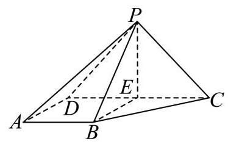

**【小问 2 详解】**

梯形 ${ABCD}$ 的面积为 $\frac{1}{2}\left( {2 + 4}\right)  \times  2 = 6$ ,

设四棱锥 $P - {ABCD}$ 的高为 $h$ ,体积为 $\frac{1}{3} \times  6 \times  h = 4\sqrt{3}$ ,

得 $h = 2\sqrt{3} = {PE}$ ,

所以 ${PE} \bot$ 平面 ${ABCD}$ ,

以 ${EB},{EC},{EP}$ 所在直线分别为 $x$ 轴、 $y$ 轴、 $z$ 轴建立空间直角坐标系 $E - {xyz}$ ,

$B\left( {2,0,0}\right) ,\;C\left( {0,2,0}\right) ,\;D\left( {0, - 2,0}\right) ,\;P\left( {0,0,2\sqrt{3}}\right) ,$

设面 ${PBC}$ 的法向量为 $\mathbf{n} = \left( {x, y, z}\right)$ ，

$\overrightarrow{PB} = \left( {2,0, - 2\sqrt{3}}\right) ,\overrightarrow{BC} = \left( {-2,2,0}\right)$ ,

$\left\{  {\begin{array}{l} \overrightarrow{n} \cdot  \overrightarrow{PB} = 0 \\  \overrightarrow{n} \cdot  \overrightarrow{BC} = 0 \end{array},\left\{  {\begin{array}{l} {2x} - 2\sqrt{3}z = 0 \\   - {2x} + {2y} = 0 \end{array},}\right. }\right.$

取 $z = 1, x = \sqrt{3}, y = \sqrt{3}$ ,

则 $n = \left( {\sqrt{3},\sqrt{3},1}\right) ,\overrightarrow{PD} = \left( {0, - 2, - 2\sqrt{3}}\right)$ ,

设直线 ${PD}$ 与平面 ${PBC}$ 所成角为 $\theta$ ,

$\sin \theta  = \left| {\cos \overrightarrow{PD},\overrightarrow{n}}\right|  = \frac{\left| \overrightarrow{PD} \cdot  \overrightarrow{n}\right| }{\left| \overrightarrow{PD}\right| \left| \overrightarrow{n}\right| } = \frac{4\sqrt{3}}{4 \times  \sqrt{7}} = \frac{\sqrt{21}}{7}.$

直线 ${PD}$ 与平面 ${PBC}$ 所成角的大小为 $\arcsin \frac{\sqrt{21}}{7}$ .

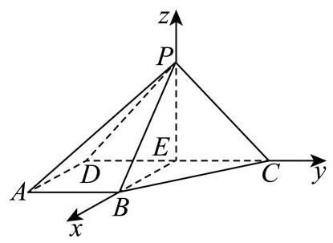

### 普陀 · 第17题

如图，在正三棱柱 ${ABC} - {A}_{1}{B}_{1}{C}_{1}$ 中， $D$ 、 $E$ 分别是棱 ${A}_{1}{B}_{1}$ 、 ${A}_{1}A$ 的中点，且 ${A}_{1}A = {A}_{1}{B}_{1} = 2.$

(1)求证:直线 ${A}_{1}B \bot$ 平面 ${C}_{1}{DE}$ ；

(2)求点 $A$ 到平面 ${A}_{1}{CB}$ 的距离.

**考点：** (1) 线线与线面垂直证明；(2) 等体积法或空间向量求点面距离

**难度依据：** 正棱柱线面垂直与点面距离；空间坐标与法向量求距离

**【答案】** (1)证明见解析

(2) $\frac{2\sqrt{21}}{7}$

**【解析】**

**【分析】**(1) 根据正三棱柱的结构可判断四边形 ${AB}{B}_{1}{A}_{1}$ 的形状,进行面面垂直、线面垂直、 线线垂直之间的转化; (2) 根据三棱锥 $C - {AB}{A}_{1}$ 的体积相等可求距离，也可利用空间向量求解距离问题.

**【小问 1 详解】**

如图 1,连接 $A{B}_{1}$ ,

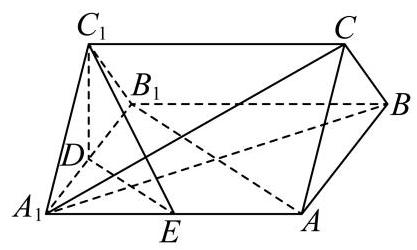

图1

由正三棱柱的结构特征可知,

在正三棱柱 ${ABC} - {{A}_{1}{B}_{1}{C}_{1}}$ 中 $\bigtriangleup  {A}_{1}{B}_{1}{C}_{1}$ 是正三角形，侧面均为矩形， $B{B}_{1} \bot$ 平面 ${A}_{1}{B}_{1}{C}_{1}$ . 因为 $D$ 是棱 ${A}_{1}{B}_{1}$ 的中点,所以 ${C}_{1}D \bot  {A}_{1}{B}_{1}$ ,

因为 $B{B}_{1} \subset$ 平面 ${AB}{B}_{1}{A}_{1}$ ,所以平面 ${A}_{1}{B}_{1}{C}_{1} \bot$ 平面 ${AB}{B}_{1}{A}_{1}$ .

又平面 ${A}_{1}{B}_{1}{C}_{1}\mathrm{Q}$ 平面 ${AB}{B}_{1}{A}_{1} = {A}_{1}{B}_{1}$ ，所以 ${C}_{1}D \bot$ 平面 ${AB}{B}_{1}{A}_{1}$ .

又 ${A}_{1}B \subset$ 平面 ${AB}{B}_{1}{A}_{1}$ ，所以 ${C}_{1}D \bot  {A}_{1}B$ .

因为 ${A}_{1}A = {A}_{1}{B}_{1} = 2$ ,所以矩形 ${AB}{B}_{1}{A}_{1}$ 为正方形,所以 $A{B}_{1} \bot  {A}_{1}B$ ,

又 ${DE}//A{B}_{1}$ ,所以 ${DE} \bot  {A}_{1}B$ ,

因为 ${C}_{1}D,{DE} \subset$ 平面 ${C}_{1}{DE},{C}_{1}D \cap  {DE} = D$ ,所以直线 ${A}_{1}B \bot$ 平面 ${C}_{1}{DE}$ .

**【小问 2 详解】**

方法一: 设点 $A$ 到平面 ${A}_{1}{CB}$ 的距离为 $h$ ,

因为 $C{C}_{1}//$ 平面 ${AB}{B}_{1}{A}_{1}$ ，所以 $C,{C}_{1}$ 到平面 ${AB}{B}_{1}{A}_{1}$ 的距离相等，都为 ${C}_{1}D = \sqrt{3}$ .

由 (1) 知,侧面均为正方形,所以 ${S}_{\bigtriangleup {A}_{1}{AB}} = \frac{1}{2} \times  2 \times  2 = 2,{A}_{1}C = {A}_{1}B = 2\sqrt{2}$ ,

又 ${BC} = 2$ ，所以 $\bigtriangleup  {A}_{1}{BC}$ 为等腰三角形，所以

${S}_{\bigtriangleup {A}_{1}{BC}} = \frac{1}{2}{BC} \cdot  \sqrt{{A}_{1}{C}^{2} - {\left( \frac{BC}{2}\right) }^{2}} = \frac{1}{2} \times  2 \times  \sqrt{7} = \sqrt{7}$ .

又 ${V}_{C - {A}_{1}{AB}} = {V}_{A - {A}_{1}{CB}}$ ,即 $\frac{1}{3}{S}_{\bigtriangleup {A}_{1}{AB}} \times  \sqrt{3} = \frac{1}{3}{S}_{\bigtriangleup {A}_{1}{BC}}h$ ,

所以 $\frac{1}{3} \times  2 \times  \sqrt{3} = \frac{1}{3} \times  \sqrt{7}h$ ,解得 $h = \frac{2\sqrt{21}}{7}$ ,即点 $A$ 到平面 ${A}_{1}{CB}$ 的距离为 $\frac{2\sqrt{21}}{7}$ .

方法二: 取 ${AB}$ 的中点 $F$ ,连接 ${DF}$ ,由 (1) 可知 $D{A}_{1},{DF}, D{C}_{1}$ 两两互相垂直, 所以以 D 为原点, 建立如图 2 所示的空间直角坐标系,

图2

则 ${A}_{1}\left( {1,0,0}\right) , A\left( {1,2,0}\right) , B\left( {-1,2,0}\right) , C\left( {0,2,\sqrt{3}}\right)$ ,

所以 $\overrightarrow{{A}_{1}A} = \left( {0,2,0}\right) ,\overrightarrow{{A}_{1}B} = \left( {-2,2,0}\right) ,\overrightarrow{{A}_{1}C} = \left( {-1,2,\sqrt{3}}\right)$ ,

设平面 ${A}_{1}{CB}$ 的法向量为 $\overrightarrow{n} = \left( {x, y, z}\right)$ ,

则 $\left\{  \begin{array}{l} \overrightarrow{n} \cdot  \overrightarrow{{A}_{1}B} = 0 \\  \overrightarrow{n} \cdot  \overrightarrow{{A}_{1}C} = 0 \end{array}\right.$ ,即 $\left\{  \begin{array}{l}  - {2x} + {2y} = 0 \\   - x + {2y} + \sqrt{3}z = 0 \end{array}\right.$ ,令 $x = 1$ ,则 $y = 1, z =  - \frac{\sqrt{3}}{3}$ ,

即 $\overrightarrow{n} = \left( {1,1, - \frac{\sqrt{3}}{3}}\right)$ ,所以点 $A$ 到平面 ${A}_{1}{CB}$ 的距离为 $\left| \frac{\overrightarrow{n} \cdot  \overrightarrow{{A}_{1}A}}{\left| \overrightarrow{n}\right| }\right|  = \frac{2}{\sqrt{\frac{7}{3}}} = \frac{2\sqrt{21}}{7}$ .

### 杨浦 · 第18题

如图，在直四棱柱 ${ABCD} - {A}_{1}{B}_{1}{C}_{1}{D}_{1}$ 中， ${AB}//{CD}$ ， ${AD} \bot  {CD}$ ， ${AB} = 2$ ， ${AD} = 3$ ， ${CD} = 4$ .

(1)设 $E$ 是 ${C}_{1}{D}_{1}$ 的中点，求证: ${BE}//$ 平面 $A{A}_{1}{D}_{1}D$ ；

(2)若直四棱柱 ${ABCD} - {A}_{1}{B}_{1}{C}_{1}{D}_{1}$ 的体积为 36，求平面 ${D}_{1}{AC}$ 与平面 ${ABCD}$ 所成的锐二面角的大小.

> 本题资料或解析有待核事项，预览不可作为已审定成品。

**考点：** (1)构造平行四边形证明线面平行；(2)体积求高，构造二面角平面角

**难度依据：** 立体构造与截面三角形计算

**核查说明：** 答案解析第503字符附近：损坏字符或字体覆盖风险，需回源并视觉检查（底稿扫描记录）

**【答案】** (1) 证明见解析

(2) $\arctan \frac{5}{3}$

**【解析】**

**【分析】**(1) 通过证明 ${BE}//{A{D}_{1}}$ ，得证 ${BE}//$ 平面 $A{A}_{1}{D}_{1}D$ ；

(2)过 $D$ 作 ${DH}\bot {AC}$ ，则 $\angle {D}_{1}{HD}$ 即为所求，利用直角三角形的性质计算出 ${\tan \angle {D}_{1}}{HD}$ 即可.

**【小问 1 详解】**

连接 $A{D}_{1}$ ，直四棱柱 ${ABCD} - {A}_{1}{B}_{1}{C}_{1}{D}_{1}$ 中， ${D}_{1}E//{DC}//{AB}$ ， ${D}_{1}{C}_{1} = {DC}$ ，

$E$ 是 ${C}_{1}{D}_{1}$ 的中点， ${D}_{1}E = \frac{1}{2}{DC} = 2$ ，则 ${D}_{1}E = {AB}$ ，所以 $A{D}_{1}{EB}$ 为平行四边形，

则有 ${BE}//A{D}_{1}$ ,又 ${BE} \text{ ⊄ }$ 平面 $A{A}_{1}{D}_{1}D, A{D}_{1} \subset$ 平面 $A{A}_{1}{D}_{1}D$ ,

所以 ${BE}//$ 平面 $A{A}_{1}{D}_{1}D$ ;

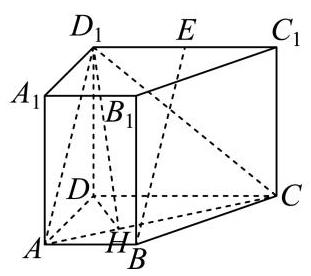

**【小问 2 详解】**

梯形 ${ABCD}$ 的面积 $S = \frac{1}{2} \times  \left( {2 + 4}\right)  \times  3 = 9$ ，

${V}_{{ABCD} - {A}_{1}{B}_{1}{C}_{1}{D}_{1}} = S \cdot  A{A}_{1} = {36}$ ，则 $A{A}_{1} = 4$ ，

过 $D$ 作 ${DH} \bot  {AC}$ ,交 ${AC}$ 于 $H$ ,连接 ${D}_{1}H$ ,

直四棱柱 ${ABCD} - {A}_{1}{B}_{1}{C}_{1}{D}_{1}$ 中, $D{D}_{1} \bot$ 平面 ${ABCD}$ ,则 ${DH}$ 为 ${D}_{1}H$ 在平面 ${ABCD}$ 内的射影,

由 ${DH} \bot  {AC}$ ,有 ${D}_{1}H \bot  {AC}$ ,所以 $\angle {D}_{1}{HD}$ 即为所求,

$\operatorname{Rt}\bigtriangleup {ACD}$ 中, ${AD} = 3,{CD} = 4$ ,有 ${AC} = 5$ ,又 ${AC} \cdot  {DH} = {AD} \cdot  {CD}$ ,则 ${DH} = \frac{12}{5}$ , $\tan \angle {D}_{1}{HD} = \frac{1}{DH} = \frac{{A}_{1}}{DH} = \frac{4}{\frac{12}{5}} = \frac{5}{3}$ ,所以锐角 $\angle {D}_{1}{HD} = \arctan \frac{5}{3}$ .

### 松江 · 第10题

在四棱柱 ${ABCD} - {A}_{1}{B}_{1}{C}_{1}{D}_{1}$ 中，底面 ${ABCD}$ 为平行四边形， $\left| \overrightarrow{A{A}_{1}}\right|  = 2$ ，异面直线 $A{A}_{1}$ 与 ${BD}$ 的夹角为 $\arccos \frac{2}{5},\overrightarrow{AD} \cdot  \overrightarrow{D{C}_{1}} - \overrightarrow{AB} \cdot  \overrightarrow{B{C}_{1}} = 4$ ，则 $\left| \overrightarrow{B{D}_{1}}\right|  =$ ___.

**考点：** 向量分解得到数量积，再求对角线长度

**难度依据：** 通过数量积消元并处理空间夹角

**【答案】** $\sqrt{37}$

**【解析】**

**【分析】**利用向量的运算法则将已知条件进行转化,进而求出 $\left| \overrightarrow{B{D}_{1}}\right|$ .

**【详解】**在四棱柱 ${ABCD} - {A}_{1}{B}_{1}{C}_{1}{D}_{1}$ 中,

$\overrightarrow{D{C}_{1}} = \overrightarrow{DC} + \overrightarrow{C{C}_{1}} = \overrightarrow{AB} + \overrightarrow{A{A}_{1}},\overrightarrow{B{C}_{1}} = \overrightarrow{BC} + \overrightarrow{C{C}_{1}} = \overrightarrow{AD} + \overrightarrow{A{A}_{1}}$ .

则 $\overrightarrow{AD} \cdot  \overrightarrow{D{C}_{1}} - \overrightarrow{AB} \cdot  \overrightarrow{B{C}_{1}} = \overrightarrow{AD} \cdot  \left( {\overrightarrow{AB} + \overrightarrow{A{A}_{1}}}\right)  - \overrightarrow{AB} \cdot  \left( {\overrightarrow{AD} + \overrightarrow{A{A}_{1}}}\right)$ .

根据向量乘法分配律展开可得:

$\overrightarrow{AD} \cdot  \overrightarrow{AB} + \overrightarrow{AD} \cdot  \overrightarrow{A{A}_{1}} - \overrightarrow{AB} \cdot  \overrightarrow{AD} - \overrightarrow{AB} \cdot  \overrightarrow{A{A}_{1}} = \overrightarrow{AD} \cdot  \overrightarrow{A{A}_{1}} - \overrightarrow{AB} \cdot  \overrightarrow{A{A}_{1}} = \left( {\overrightarrow{AD} - \overrightarrow{AB}}\right)  \cdot  \overrightarrow{A{A}_{1}}$ .

因为 $\overrightarrow{AD} - \overrightarrow{AB} = \overrightarrow{BD}$ ,所以 $\left( {\overrightarrow{AD} - \overrightarrow{AB}}\right)  \cdot  \overrightarrow{A{A}_{1}} = \overrightarrow{BD} \cdot  \overrightarrow{A{A}_{1}}$ .

已知 $\overrightarrow{AD} \cdot  \overrightarrow{D{C}_{1}} - \overrightarrow{AB} \cdot  \overrightarrow{B{C}_{1}} = 4$ ，即 $\overrightarrow{BD} \cdot  \overrightarrow{A{A}_{1}} = 4$ .

又已知异面直线 $A{A}_{1}$ 与 ${BD}$ 的夹角为 $\arccos \frac{2}{5}$ ，且 $\left| \overrightarrow{A{A}_{1}}\right|  = 2$ ，

设 $\overrightarrow{BD}$ 与 $\overrightarrow{A{A}_{1}}$ 的夹角为 $\theta$ ，则 $\cos \theta  = \frac{2}{5}$ .

根据向量点积公式 $\overrightarrow{a} \cdot  \overrightarrow{b} = \left| \overrightarrow{a}\right| \left| \overrightarrow{b}\right| \cos \theta$ ,可得 $\overrightarrow{BD} \cdot  \overrightarrow{A{A}_{1}} = \left| \overrightarrow{BD}\right| \left| \overrightarrow{A{A}_{1}}\right| \cos \theta$ ,

即 $4 = \left| \overrightarrow{BD}\right|  \times  2 \times  \frac{2}{5}$ ，解得 $\left| \overrightarrow{BD}\right|  = 5$ .

因为 $\overrightarrow{B{D}_{1}} = \overrightarrow{BD} + \overrightarrow{D{D}_{1}} = \overrightarrow{BD} + \overrightarrow{A{A}_{1}}$ ,根据向量模长公式可得

${\left| \overrightarrow{B{D}_{1}}\right| }^{2} = {\left( \overrightarrow{BD} + \overrightarrow{A{A}_{1}}\right) }^{2} = {\overrightarrow{BD}}^{2} + 2\overrightarrow{BD} \cdot  \overrightarrow{A{A}_{1}} + {\overrightarrow{A{A}_{1}}}^{2}.$

将 $\left| \overrightarrow{BD}\right|  = 5,\overrightarrow{BD} \cdot  \overrightarrow{A{A}_{1}} = 4,\left| \overrightarrow{A{A}_{1}}\right|  = 2$ 代入上式可得 ${\left| \overrightarrow{B{D}_{1}}\right| }^{2} = {5}^{2} + 2 \times  4 + {2}^{2} = {25} + 8 + 4 = {37}$ . 所以 $\left| \overrightarrow{B{D}_{1}}\right|  = \sqrt{37}$ .

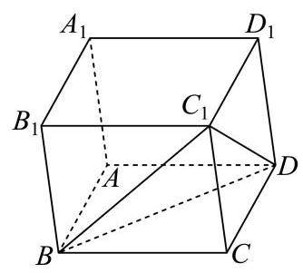

### 松江 · 第17题

在如图所示的多面体中,已知四边形 ${ABCD}$ 是菱形, $\angle {ABC} = {60}^{ \circ  },{FA} \bot$ 平面 ${ABCD},{ED} \bot$ 平面 ${ABCD},{AB} = {FA} = {2ED} = 2$ ，点 $G$ 为线段 ${AF}$ 的中点.

(1)求证:平面 ${BDG}//$ 平面 ${CEF}$ ；

(2)求直线 ${BC}$ 与平面 ${BDG}$ 所成角的正弦值.

> 本题资料或解析有待核事项，预览不可作为已审定成品。

**考点：** (1)借助中点和两组平行线证明面面平行；(2)建空间坐标求平面法向量与线面角

**难度依据：** 几何证明与向量计算结合

**核查说明：** 答案解析第477字符附近：损坏字符或字体覆盖风险，需回源并视觉检查（底稿扫描记录）；答案解析第710字符附近：损坏字符或字体覆盖风险，需回源并视觉检查（底稿扫描记录）

**【答案】** (1)证明见解析

(2) $\frac{\sqrt{2}}{4}$

**【解析】**

**【分析】**(1)连接 ${AC}$ 与 ${BD}$ ,相交于点 $O$ ,连接 ${OG},{DG}$ ,分别证明 ${OG}//{CF},{DG}//{EF}$ , 再由面面平行判定定理即可得证;

(2)以 $A$ 为坐标原点建立空间直角坐标系，确定直线 ${BC}$ 的方向向量与平面 ${BDG}$ 的法向量， 根据线面夹角的坐标运算求解即可.

**【小问 1 详解】**

连接 ${AC}$ 与 ${BD}$ ,相交于点 $O$ ,连接 ${OG},{DG}$ ,

因为菱形 ${ABCD}$ ,所以点 $O$ 是 ${AC}$ 的中点,

所以 ${OG}//{CF}$ ,

又 ${OG} \text{ ⊄ }$ 平面 ${CEF},{FC} \subset$ 平面 ${CEF}$ ,

所以 ${OG}//$ 平面 ${CEF}$ ,

因为 ${FA} \bot$ 平面 ${ABCD},{ED} \bot$ 平面 ${ABCD}$ ,

所以 ${FA}//{DE}$ ,

又 ${FA} = {2ED} = 2,{FA} = {2FG}$ ,所以四边形 ${DEFG}$ 是平行四边形,

所以 ${DG}//{EF}$ ，

又 ${DG} \text{ ⊄ }$ 平面 ${CEF},{EF} \subset$ 平面 ${CEF}$ ,

所以 ${DG}//$ 平面 ${CEF}$ ,

因为 ${OG} \cap  {DG} = G,{OG}\text{ 、 }{DG} \subset$ 平面 ${BDG}$ ,

所以平面 ${BDG}//$ 平面 ${CEF}$ ;

**【小问 2 详解】**

取 ${BC}$ 的中点 $M$ ,连接 ${AM}$ ,

因为 $\angle {ABC} = {60}^{ \circ  }$ ,四边形 ${ABCD}$ 是菱形,

所以 ${ABC}$ 是等边三角形,则 ${AM} \bot  {BC}$ ,

则建立以 $A$ 为原点,以 ${AM}\text{ 、 }{AD}\text{ 、 }{AF}$ 所在直线分别为 $x$ 轴、 $y$ 轴、 $z$ 轴的空间直角坐标系 $A - {xyz}$ ,如图所示:

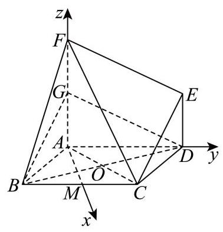

则 $B\left( {\sqrt{3}, - 1,0}\right) , C\left( {\sqrt{3},1,0}\right) , D\left( {0,2,0}\right) , G\left( {0,0,1}\right)$ ,

所以 $\overrightarrow{BC} = \left( {0,2,0}\right) ,\overrightarrow{BD} = \left( {-\sqrt{3},3,0}\right) ,\overrightarrow{DG} = \left( {0, - 2,1}\right)$ ,

设平面 ${BDG}$ 的法向量为 $\overrightarrow{n} = \left( {x, y, z}\right)$ ,

则 $\left\{  {\begin{array}{l} \overrightarrow{n} \cdot  \overrightarrow{BD} =  - \sqrt{3}x + {3y} = 0 \\  \overrightarrow{n} \cdot  \overrightarrow{DG} =  - {2y} + z = 0 \end{array} \Rightarrow  \left\{  \begin{array}{l} x = \sqrt{3}y \\  z = {2y} \end{array}\right. }\right.$ ,取 $y = 1$ ,则 $x = \sqrt{3}, z = 2$ ,所以 $\overrightarrow{n} = \left( {\sqrt{3},1,2}\right)$ ,

所以 $\cos \langle \overrightarrow{BC},\overrightarrow{n}\rangle  = \frac{\overrightarrow{BC} \cdot  \overrightarrow{n}}{\left| \overrightarrow{BC}\right|  \cdot  \left| \overrightarrow{n}\right| } = \frac{2}{2 \times  2\sqrt{2}} = \frac{\sqrt{2}}{4}$ ,

直线 ${BC}$ 与平面 ${BDG}$ 所成角的正弦值为 $\frac{\sqrt{2}}{4}$ .

### 浦东 · 第17题

如图，在多面体 ${PQABCD}$ 中，平面 ${PAD} \bot$ 平面 ${ABCD}$ ， ${AB}//{CD}//{PQ}$ ， ${PD} \bot  {CD}$ ， $\bigtriangleup {PAD}$ 是边长为 $\sqrt{2}$ 的等边三角形， ${AB} = {PQ} = \frac{1}{2}{CD}$ .

(1)求证: ${AB}\bot$ 平面 ${PAD}$ ；

(2)若 ${PC}$ 与平面 ${ABCD}$ 所成的角为 $\frac{\pi }{6}$ ，求多面体 ${PQABCD}$ 的体积.

**考点：** (1)面面垂直性质结合线面垂直判定；(2)利用投影角求长度并分割多面体体积

**难度依据：** 借垂直关系建模并合理分割

**【答案】** (1)证明见解析

(2) $\frac{2\sqrt{3}}{3}$

**【解析】**

**【分析】**(1) 利用面面垂直的性质和线面垂直的判定定理进行证明;

(2)将多面体拆分成直棱柱和三棱锥两部分，分别计算体积再求和.

**【小问 1 详解】**

证明: 取 ${AD}$ 的中点 $O$ ,连接 ${PO}$ ,

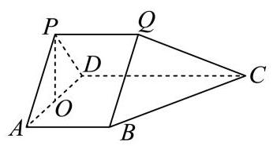

因为 $\bigtriangleup {PAD}$ 为等边三角形,且 $O$ 为 ${AD}$ 中点,

所以 ${PO} \bot  {AD}$

又平面 ${PAD} \bot$ 平面 ${ABCD}$ ,

平面 ${PAD} \cap$ 平面 ${ABCD} = {AD},{PO} \subset$ 平面 ${PAD}$ ,

所以 ${PO} \bot$ 平面 ${ABCD}$ .

又 ${AB} \subset$ 平面 ${ABCD}$ ,因而 ${PO} \bot  {AB}$

因为 ${AB}//{CD},{PD} \bot  {CD}$ ,所以 ${PD} \bot  {AB}$

由 ${PO} \subset$ 平面 ${PAD},{PD} \subset$ 平面 ${PAD},{PO} \cap  {PD} = P$ ,

所以 ${AB} \bot$ 平面 ${PAD}$ .

**【小问 2 详解】**

连接 ${PC}\text{ 、 }{OC}$ ,由题 (1) 可知, ${PO} \bot$ 平面 ${ABCD}$ ,

所以 ${PC}$ 在平面 ${ABCD}$ 内的投影为 ${OC}$ ,

故 $\angle {PCO}$ 是 ${PC}$ 与平面 ${ABCD}$ 所成的角,即 $\angle {PCO} = \frac{\pi }{6}$

$\tan \angle {PCO} = \frac{PO}{CO} = \frac{\sqrt{3}}{3}$ ，由题得， ${PO} = \frac{\sqrt{6}}{2}$ ， ${CO} = \frac{3\sqrt{2}}{2}$

因为 ${AB} \bot$ 平面 ${PAD},{AB}//{CD}$ ,所以 ${CD} \bot$ 平面 ${PAD}$ ,所以 ${CD} \bot  {AD}$ .

因此, ${CD} = \sqrt{C{O}^{2} - O{D}^{2}} = 2,{PQ} = \frac{1}{2}{CD} = 1$

取 ${CD}$ 的中点 $M$ ,连接 ${BM}\text{ 、 }{QM}$ ,

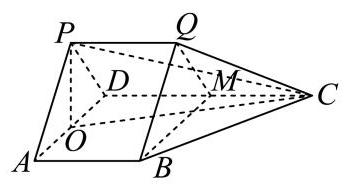

则 ${V}_{PQABCD} = {V}_{{PAD} - {QBM}} + {V}_{Q - {MBC}}$

$= {AB} \cdot  {S}_{\bigtriangleup {PAD}} + \frac{1}{3}{CM} \cdot  {S}_{\bigtriangleup {QMB}} = \frac{\sqrt{3}}{2} + \frac{\sqrt{3}}{6} = \frac{2\sqrt{3}}{3}$

所以多面体 ${PQABCD}$ 的体积是 $\frac{2\sqrt{3}}{3}$ .

### 虹口 · 第8题

在正四棱台 ${ABCD} - {A}_{1}{B}_{1}{C}_{1}{D}_{1}$ 中， ${AB} = 2,{A}_{1}{B}_{1} = 4$ ，异面直线 ${C}_{1}{D}_{1}$ 与 $A{A}_{1}$ 所成角为 $\frac{\pi }{3}$ ， 设二面角 $A - {A}_{1}{B}_{1} - {D}_{1}$ 的大小为 $\theta$ ，则 $\tan \theta  =$ ___.

**考点：** 棱台异面角与二面角

**难度依据：** 棱台异面角与二面角

**【答案】** $\sqrt{2}$

**【解析】**

**【分析】**法一在正四棱台中,由异面直线所成角可得 $\angle A{A}_{1}{B}_{1} = {60}$ ,再根据面面角定义计算求解即可, 法二建立空间直角坐标系, 求出关键点的坐标和关键平面的法向量, 进而利用二面角的向量求法并结合同角三角函数的基本关系求解即可.

**【详解】**法一: 在正四棱台 ${ABCD} - {A}_{1}{B}_{1}{C}_{1}{D}_{1}$ 中, ${C}_{1}{D}_{1}//{A}_{1}{B}_{1}$ ,

因为 ${AB} = 2$ ， ${A}_{1}{B}_{1} = 4$ ，所以 $\angle {A{A}_{1}{B}_{1}}$ 为异面直线 ${C}_{1}{D}_{1}$ 与 $A{A}_{1}$ 所成的角，

即 $\angle A{A}_{1}{B}_{1} = {60}$ ,过点 $A$ 作平面 ${A}_{1}{B}_{1}{C}_{1}{D}_{1}$ 的垂线,垂足为 $G$ ,

作直线 ${A}_{1}{B}_{1}$ 的垂线,垂足为 $H$ ,连接 ${GH}$ ,如图所示:

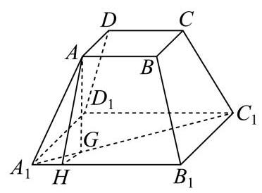

由正四棱台性质可知,点 $G$ 在线段 ${A}_{1}{C}_{1}$ 上, ${A}_{1}H = 1$ ,

所以 ${AH} = \sqrt{3},{A}_{1}G = \frac{1}{2}\left( {{A}_{1}{C}_{1} - {AC}}\right)  = \sqrt{2},{GH} = \sqrt{{A}_{1}{G}^{2} - {A}_{1}{H}^{2}} = 1$ ，

由二面角定义可知 $\angle {AHG}$ 即为二面角 $A - {A}_{1}{B}_{1} - {D}_{1}$ 的平面角,

而 $\tan \angle {AHG} = \frac{AG}{GH} = \sqrt{2}$ ,故 $\tan \theta  = \sqrt{2}$ .

法二: 如图,作出符合题意的图形,作下底面中心 ${O}_{1}$ ,上底面中心 $O$ , 以 ${O}_{1}$ 为原点,建立空间直角坐标系,设正四棱台的高为 $h$ ,

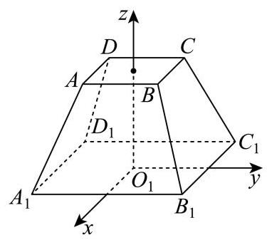

由题意得 ${AB} = 2,{A}_{1}{B}_{1} = 4$ ,则 ${C}_{1}\left( {-2,2,0}\right) ,{D}_{1}\left( {-2, - 2,0}\right) ,{B}_{1}\left( {2,2,0}\right) \; {A}_{1}\left( {2, - 2,0}\right) ,\;A\left( {1, - 1, h}\right)$ ,则 $\overrightarrow{{C}_{1}{D}_{1}} = \left( {0, - 4,0}\right) ,\;\overrightarrow{A{A}_{1}} = \left( {1, - 1, - h}\right)$ ,

因为异面直线 ${C}_{1}{D}_{1}$ 与 $A{A}_{1}$ 所成角为 $\frac{\pi }{3}$ ,

所以 $\frac{4}{4 \times  \sqrt{{1}^{2} + {\left( -1\right) }^{2} + {\left( -h\right) }^{2}}} = \frac{1}{2}$ ,解得 $h = \sqrt{2}$ ,

由题意得面 ${A}_{1}{B}_{1}{D}_{1}$ 的法向量为 $\overrightarrow{n} = \left( {0,0,1}\right)$ ,

则 $A\left( {1, - 1,\sqrt{2}}\right) ,\overrightarrow{A{A}_{1}} = \left( {1, - 1, - \sqrt{2}}\right) ,\overrightarrow{{A}_{1}{B}_{1}} = \left( {0,4,0}\right)$ ,

设面 $A{A}_{1}{B}_{1}$ 的法向量为 $\overrightarrow{m} = \left( {x, y, z}\right)$ ,

则 $\left\{  \begin{array}{l} \overrightarrow{A{A}_{1}} \cdot  \overrightarrow{m} = x - y - \sqrt{2}z = 0 \\  \overrightarrow{{A}_{1}{B}_{1}} \cdot  \overrightarrow{m} = {4y} = 0 \end{array}\right.$ ,令 $x = \sqrt{2}$ ,解得 $y = 0, z = 1$ ,

得到 $\overrightarrow{m} = \left( {\sqrt{2},0,1}\right)$ ,由图可知, $\theta$ 是锐角,则 $\cos \theta  = \frac{\left| \overrightarrow{m} \cdot  \overrightarrow{n}\right| }{\left| \overrightarrow{m}\right|  \cdot  \left| \overrightarrow{n}\right| } = \frac{1}{1 \times  \sqrt{3}} = \frac{\sqrt{3}}{3}$ ,

由已知得 $\sin \theta  > 0$ ，由同角三角函数的基本关系得 $\sin \theta  = \frac{\sqrt{6}}{3}$ ，

故 $\tan \theta  = \frac{\sin \theta }{\cos \theta } = \frac{\frac{\sqrt{6}}{3}}{\frac{\sqrt{3}}{3}} = \sqrt{2}$ .

### 虹口 · 第17题

如图,在底面半径为 2,侧面积为 $4\sqrt{5}\pi$ 的圆锥

$\mathrm{P} - \mathrm{O}$ 中, $A\text{ 、 }B\text{ 、 }C$ 为底面圆周上不同的三个点, $\angle {AOB} = \angle {BOC} = {45}^{ \circ  }$ .

(1)求直线 ${OB}$ 与平面 ${PAC}$ 所成角的正弦值

(2)设点 $D$ 为线段 ${PB}$ 上的动点(不含端点 $P$ 和 $B$ )，求证直线 ${OA}$ 与 ${CD}$ 不垂直

> 本题资料或解析有待核事项，预览不可作为已审定成品。

**考点：** (1) 圆锥高度与空间法向量求线面角；(2) 动点参数化、数量积证明不垂直

**难度依据：** 圆锥线面角和动线不垂直；空间坐标与数量积

**核查说明：** 题面∠AOB=∠BOC=45°，原解据图取AOC=90°；依赖A、C异侧位置，需核图以确认。

**【答案】** (1) $\frac{2\sqrt{2}}{3}$

(2)证明见解析

**【解析】**

**【分析】**(1) 利用侧面积求解出圆锥的高,再利用建系的方法,求出直线 ${OB}$ 与平面 ${PAC}$ 所成角的正弦值.

(2)利用向量的方法，将点 $D$ 在线段 ${PB}$ 上刻画为 $\overrightarrow{PD} = \lambda \overrightarrow{PB}$ . 接着证明直线 $\overrightarrow{OA}$ 与 $\overrightarrow{CD}$ 的数量积不为零.

**【小问 1 详解】**

$\because \angle {AOB} = \angle {BOC} = {45}^{ \circ  }$ ,

$\therefore \angle {AOC} = {90}^{ \circ  }$ ,

所以可以建立如右图所示的空间直角坐标系,

所以 $B\left( {\sqrt{2},\sqrt{2},0}\right) ,\overrightarrow{OB} = \left( {\sqrt{2},\sqrt{2},0}\right)$ ,设 ${OP} = a$ ,

则母线长为 $\sqrt{4 + {a}^{2}}$

则侧面积为 $\frac{1}{2}\sqrt{4 + {a}^{2}} \times  {2\pi } \times  2 = 2\sqrt{4 + {a}^{2}}\pi  = 4\sqrt{5}\pi$ ,

解得: $a = 4$ ，

所以 $P\left( {0,0,4}\right)$ ,

$A\left( {2,0,0}\right) , C\left( {0,2,0}\right) ,\overrightarrow{AC} = \left( {-2,2,0}\right) ,\overrightarrow{PA} = \left( {2,0, - 4}\right)$

设面 ${PAC}$ 的法向量为 $\overrightarrow{m} = \left( {{x}_{1},{y}_{1},{z}_{1}}\right)$

所以 $\overrightarrow{m} \cdot  \overrightarrow{AC} =  - 2{x}_{1} + 2{y}_{1} = 0,\overrightarrow{m} \cdot  \overrightarrow{PA} = 2{x}_{1} - 4{z}_{1} = 0$ ,

不妨令 ${x}_{1} = {y}_{1} = 1$ ,则 ${z}_{1} = \frac{1}{2}$ ,

所以 $\overrightarrow{m} = \left( {1,1,\frac{1}{2}}\right)$ ,设直线 ${OB}$ 与平面 ${PAC}$ 所成角为 $\theta$ ,

所以 $\sin \theta  = \left| {\cos \langle \overrightarrow{OB},\overrightarrow{m}\rangle }\right|  = \frac{\left| \overrightarrow{OB} \cdot  \overrightarrow{m}\right| }{\left| \overrightarrow{OB}\right|  \cdot  \left| \overrightarrow{m}\right| } = \frac{2\sqrt{2}}{2 \times  \sqrt{{1}^{2} + {1}^{2} + {\left( \frac{1}{2}\right) }^{2}}} = \frac{2\sqrt{2}}{3}$ .

**【小问 2 详解】**

因为 $D$ 为线段 ${PB}$ 上的动点,所以设 $\overrightarrow{PD} = \lambda \overrightarrow{PB},\lambda  \in  \left( {0,1}\right)$ ,

$\overrightarrow{CD} = \overrightarrow{CP} + \overrightarrow{PD}$ ,由 (1) 知 $\overrightarrow{PD} = \lambda \overrightarrow{PB} = \lambda \left( {\sqrt{2},\sqrt{2}, - 4}\right)  = \left( {\sqrt{2}\lambda ,\sqrt{2}\lambda , - {4\lambda }}\right)$ ,

$\overrightarrow{CP} = \left( {0, - 2,4}\right) ,\overrightarrow{CD} = \overrightarrow{CP} + \overrightarrow{PD} = \left( {\sqrt{2}\lambda ,\sqrt{2}\lambda  - 2,4 - {4\lambda }}\right) ,$

$\overrightarrow{OA} = \left( {2,0,0}\right) ,$

$\overrightarrow{OA} \cdot  \overrightarrow{CD} = 2\sqrt{2}\lambda  \neq  0,$

所以直线 ${OA}$ 与 ${CD}$ 不垂直.

### 金山 · 第18题

已知长方形 ${ABCD}$ 中， ${AB} = 2,{BC} = 4$ ，点 $E$ 、 $F$ 分别为边 ${BC}$ 、 ${AD}$ 的中点(如图

1). 若将长方形 ${ABEF}$ 沿着边 ${EF}$ 翻折，得到二面角 ${A}_{1} - {EF} - D$ (如图 2). 已知二面角 ${A}_{1} - {EF} - D$ 的大小为 ${60}^{ \circ  }$ .

图1

图2

(1)求证:平面 ${A}_{1}{FD}//$ 平面 ${BEC}$ ；

(2)求直线 $C{A}_{1}$ 与平面 ${A}_{1}{BEF}$ 所成角的大小.(结果用反三角表示)

> 本题资料或解析有待核事项，预览不可作为已审定成品。

**考点：** (1) 线面平行进而证面面平行；(2) 构造二面角平面角与线面角

**难度依据：** 翻折中的面面平行和线面角

**核查说明：** 答案解析第250字符附近：损坏字符或字体覆盖风险，需回源并视觉检查（底稿扫描记录）

**【答案】** (1) 证明过程见解析;

(2) $\arctan \frac{\sqrt{15}}{5}$

**【解析】**

**【分析】**(1) 由线线平行得到线面平行, 进而得到面面平行;

(2)先由二面角大小得到各边长，作出辅助线，得到线面垂直，进而求出线面角的大小 【小问 1 详解】

因为长方形 ${ABCD}$ 中， ${EC}//{FD}$ ，折叠过程中， ${A}_{1}F//{BE}$ ，

又 ${EC} \subset$ 平面 ${BEC}$ ， ${FD} \text{ ⊄ }$ 平面 ${BEC}$ ，故 ${FD}//$ 平面 ${BEC}$ ，

同理可得 ${A}_{1}F//$ 平面 ${BEC}$ ,

又 ${FD} \cap  {A}_{1}F = F,{FD},{A}_{1}F \subset$ 平面 ${A}_{1}{FD}$ ,所以平面 ${A}_{1}{FD}//$ 平面 ${BEC}$ ;

**【小问 2 详解】**

因为长方形 ${ABCD}$ 中,点 $E\text{ 、 }F$ 分别为边 ${BC}\text{ 、 }{AD}$ 的中点,

故 ${EF} \bot  {A}_{1}F,{EF} \bot  {DF}$ ,二面角 ${A}_{1} - {EF} - D$ 的平面角为 $\angle {A}_{1}{FD}$ ,即 $\angle {A}_{1}{FD} = {60}^{ \circ  }$ ,

又 ${AB} = 2,{BC} = 4$ ,所以 ${A}_{1}F = {DF} = 2,\therefore {A}_{1}{FD}$ 为等边三角形,

同理可得 $\bigtriangleup {BCE}$ 为等边三角形,

取 ${BE}$ 的中点 $H$ ,连接 ${CH},{A}_{1}H$ ,则 ${CH} \bot  {BE}$ ,

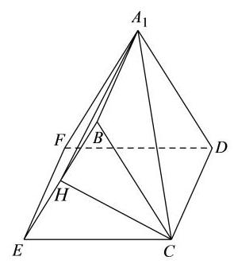

又 ${EF} \bot$ 平面 ${BEC},{CH} \subset$ 平面 ${BEC}$ ,故 ${EF} \bot  {CH}$ ,

因为 ${BE} \cap  {EF} = E,{BE},{EF} \subset$ 平面 ${A}_{1}{BEF}$ ,故 ${CH} \bot$ 平面 ${A}_{1}{BEF}$ ,

故直线 $C{A}_{1}$ 与平面 ${A}_{1}{BEF}$ 所成角为 $\angle H{A}_{1}C$ ,

${EH} = {BH} = 1,\angle {BEC} = {60}^{ \circ  }$ ,故 ${CH} = \sqrt{3}$ ,由勾股定理得 ${A}_{1}H = \sqrt{{A}_{1}{B}^{2} + B{H}^{2}} = \sqrt{5}$ , 则 $\tan \angle H{A}_{1}C = \frac{HC}{{A}_{1}H} = \frac{\sqrt{3}}{\sqrt{5}} = \frac{\sqrt{15}}{5}$ ,

直线 $C{A}_{1}$ 与平面 ${A}_{1}{BEF}$ 所成角的大小为 $\arctan \frac{\sqrt{15}}{5}$ .

### 长宁 · 第18题

如图， $P$ 是圆锥顶点， $O$ 是底面圆心，点 $A$ 、 $B$ 在底面圆周上， ${OA}\bot {OB}$ ， ${OA} = {OB} = 1$ .

(1)若圆锥的侧面积为 ${2\pi }$ ，求圆锥的体积；

(2)若直线 ${PA}$ 与平面 ${POB}$ 所成角为 30，求二面角 $P - {AB} - O$ 的平面角的正切值

**考点：** （1）侧面积求母线及圆锥体积；（2）线面角与二面角

**难度依据：** 圆锥体积线面角与二面角

**【答案】** (1) $\frac{\sqrt{3}}{3}\pi$

(2) $\sqrt{6}$

**【解析】**

**【分析】**(1) 根据条件求圆锥的高, 再求体积;

(2)首先根据线面角求 ${PO}$ ,再根据垂直关系,构造二面角的平面角,即可求解.

**【小问 1 详解】**

设圆锥的底面半径为 $r$ ,母线为 $l, r = 1$ ,

圆锥的侧面积 $s = {\pi rl} = {\pi l} = {2\pi }$ ,所以 $l = 2$ ,

则圆锥的高 $h = \sqrt{{l}^{2} - {r}^{2}} = \sqrt{3}$ ,

则圆锥的体积 $V = \frac{1}{3}\pi {r}^{2}h = \frac{1}{3}\pi  \cdot  \sqrt{3} = \frac{\sqrt{3}}{3}\pi$ ;

**【小问 2 详解】**

因为 ${PO} \bot$ 平面 ${OAB},{OA} \subset$ 平面 ${OAB}$ ,

所以 ${PO} \bot  {OA}$ ,又因为 ${OA} \bot  {OB},{PO} \cap  {OB} = O,{PO},{OB} \subset$ 平面 ${POB}$ ,

所以 ${OA} \bot$ 平面 ${POB}$ ,则 ${PA}$ 与平面 ${POB}$ 所成角为 $\angle {APO}$ ,所以 $\angle {APO} = {30}^{ \circ  }$ , 又因为 ${OA} = 1$ ,所以 ${PO} = \sqrt{3}$ ,取 ${AB}$ 的中点 $M$ ,连结 ${OM},{PM}$ ,

因为 ${OA} = {OB},{PA} = {PB}$ ,

所以 ${OM}\bot {AB}$ ， ${PM}\bot {AB}$ ， $\angle {PMO}$ 为二面角 $P - {AB} - O$ 的平面角，

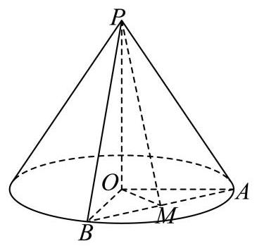

因为 ${OA} = {OB} = 1,{OA} \bot  {OB}$ ,

所以 ${OM} = \frac{1}{2}{AB} = \frac{\sqrt{2}}{2},\tan \angle {PMO} = \frac{PO}{OM} = \sqrt{6}$ ,

所以二面角 $P - {AB} - O$ 的平面角的正切值为 $\sqrt{6}$ .

### 闵行 · 第18题

如图,圆柱 $O{O}_{1}$ 的轴截面 ${AB}{B}_{1}{A}_{1}$ 是边长为 4 的正方形, ${MN}$ 为底面圆 $O$ 的一条直径, 且 $\angle {BOM} = \frac{\pi }{3}$ .

(1)求异面直线 ${A}_{1}N$ 与 $B{B}_{1}$ 所成角的大小(用反三角表示)；

(2)求点 $A$ 到平面 ${A}_{1}{MN}$ 的距离.

> 本题资料或解析有待核事项，预览不可作为已审定成品。

**考点：** （1）空间向量求异面直线夹角；（2）点到平面的距离

**难度依据：** 圆柱异面角与点面距；空间向量求角与距离

**核查说明：** 原解坐标差的纵坐标疑似符号错误，需核PDF并复算。

**【答案】** (1) $\arccos \frac{2\sqrt{5}}{5}$

(2) $\frac{4\sqrt{57}}{19}$

**【解析】**

**【分析】**(1) 建立空间直角坐标系, 把异面直线所成角转化为两条异面直线的方向向量的夹角求解

(2)通过(1)空间直角坐标系利用向量运算求点到平面距离

**【小问 1 详解】**

根据题意建立以底面圆心 $O$ 为原点, ${AB}$ 所在直线为 $y$ 轴, $O{O}_{1}$ 所在直线为 $z$ 轴,垂直于 ${AB}$ 方向为 $x$ 轴的空间直角坐标系,

则 $A\left( {0, - 2,0}\right) , B\left( {0,2,0}\right) ,{A}_{1}\left( {0, - 2,4}\right) ,{B}_{1}\left( {0,2,4}\right) , O\left( {0,0,0}\right) ,{O}_{1}\left( {0,0,4}\right)$

因为 $\angle {BOM} = \frac{\pi }{3}$ ，所以 $M\left( {-{\sqrt{3},1},0}\right)$ ， $N\left( {\sqrt{3}, - 1,0}\right)$

所以 $\overrightarrow{{A}_{1}N} = \left( {\sqrt{3}, - 1, - 4}\right) ,\overrightarrow{B{B}_{1}} = \left( {0,0,4}\right) ,\overrightarrow{{A}_{1}N} \cdot  \overrightarrow{B{B}_{1}} =  - {16}$ ，

$\left| \overrightarrow{{A}_{1}N}\right|  = \sqrt{{\left( \sqrt{3}\right) }^{2} + {\left( -1\right) }^{2} + {\left( -4\right) }^{2}} = \sqrt{20} = 2\sqrt{5},\left| \overrightarrow{B{B}_{1}}\right|  = 4$

设异面直线所成角为 $\theta$ ，则 $\cos \theta  = \frac{\left| \overrightarrow{{A}_{1}N} \cdot  \overrightarrow{B{B}_{1}}\right| }{\left| \overrightarrow{{A}_{1}N}\right|  \cdot  \left| \overrightarrow{B{B}_{1}}\right| } = \frac{16}{2\sqrt{5} \times  4} = \frac{2\sqrt{5}}{5}$ 所以异面直线 ${A}_{1}N$ 与 $B{B}_{1}$ 所成角为 $\arccos \frac{2\sqrt{5}}{5}$

**【小问 2 详解】**

$\overrightarrow{{A}_{1}M} = \left( {-\sqrt{3},3, - 4}\right) ,\overrightarrow{{A}_{1}N} = \left( {\sqrt{3},1, - 4}\right) ,\overrightarrow{NA} = \left( {-\sqrt{3}, - 1,0}\right) ,$

设平面 ${A}_{1}{MN}$ 的法向量为 $\overrightarrow{n} = \left( {x, y, z}\right)$ ,

则由 $\overrightarrow{{A}_{1}M} \cdot  \overrightarrow{n} = 0,\overrightarrow{{A}_{1}N} \cdot  \overrightarrow{n} = 0$ ,得 $\left\{  \begin{matrix}  - \sqrt{3}x + {3y} - {4z} = 0 \\  \sqrt{3}x + y - {4z} = 0 \end{matrix}\right.$ ,令 $y = 2$ ,则 $z = 1, x = \frac{2\sqrt{3}}{3}$ 所以 $\overrightarrow{n} = \left( {\frac{2\sqrt{3}}{3},2,1}\right)$

设点 $A$ 到平面 ${A}_{1}{MN}$ 的距离为 $d$ ,则 $d = \frac{\left| \overrightarrow{NA} \cdot  \overrightarrow{n}\right| }{\left| \overrightarrow{n}\right| } = \frac{\left| \left( -\sqrt{3}, - 1,0\right)  \cdot  \left( \frac{2\sqrt{3}}{3},2,1\right) \right| }{\sqrt{{\left( \frac{2\sqrt{3}}{3}\right) }^{2} + {2}^{2} + {1}^{2}}} = \frac{4\sqrt{57}}{19}$

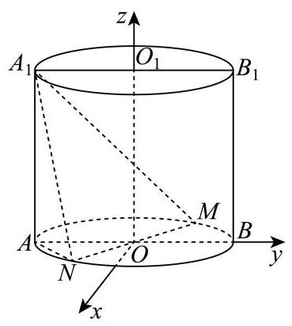

### 青浦 · 第19题

如图,在三棱锥 $P - {ABC}$ 中, ${AB}$ 是 ${ABC}$ 外接圆的直径, $\bigtriangleup {PAC}$ 是边长为 2 的等边三角形， $E$ ， $F$ 分别是 ${PC}$ ， ${PB}$ 的中点， ${PB} = {AB}$ ， ${BC} = 4$ .

(1)求证:平面 ${PAC} \bot$ 平面 ${ABC}$ ；

(2)求直线 ${AB}$ 与平面 ${AEF}$ 所成角的正弦值.

**考点：** (1) 线面垂直推出面面垂直；(2) 空间坐标和法向量求线面角

**难度依据：** 面面垂直与线面角；空间坐标及法向量

**【答案】** (1) 证明见解析

(2) $\frac{\sqrt{5}}{10}$

**【解析】**

**【分析】**(1) 先利用直径所对圆周角为直角和勾股定理得到线线垂直, 再利用线面垂直和面面垂直的判定定理进行证明;

(2)建立空间坐标系，写出相关点的坐标，求出直线的方向向量和平面的法向量，再利用线面角的向量法进行求解.

**【小问 1 详解】**

证明: 由题意知 ${BC} \bot  {AC}$ ,

则 ${AB} = \sqrt{A{C}^{2} + B{C}^{2}} = 2\sqrt{5}$ ，所以 ${PB} = {AB} = 2\sqrt{5}$ .

又 ${BC} = 4,{PC} = 2$ ,所以 $P{B}^{2} = P{C}^{2} + B{C}^{2}$ ,所以 ${PC} \bot  {BC}$ ,

又 ${PC} \cap  {AC} = C$ ,所以 ${BC} \bot$ 平面 ${PAC}$ ,

又 ${BC} \subset$ 平面 ${ABC}$ ,所以平面 ${PAC} \bot$ 平面 ${ABC}$ .

**【小问 2 详解】**

解: 以 $C$ 为坐标原点, ${CA},{CB}$ 在直线分别为 $x$ 轴, $y$ 轴, 过 $C$ 且垂直于平面 ${ABC}$ 的直线为 $z$ 轴,建立如图所示的空间直角坐标系,

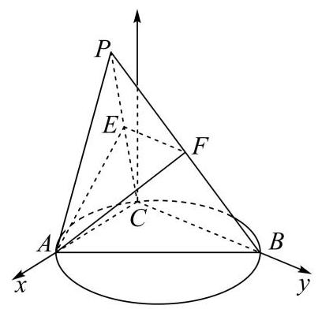

则 $A\left( {2,0,0}\right) , B\left( {0,4,0}\right) , P\left( {1,0,\sqrt{3}}\right) , E\left( {\frac{1}{2},0,\frac{\sqrt{3}}{2}}\right) , F\left( {\frac{1}{2},2,\frac{\sqrt{3}}{2}}\right)$ ,

所以 $\overrightarrow{AE} = \left( {-\frac{3}{2},0,\frac{\sqrt{3}}{2}}\right) ,\overrightarrow{EF} = \left( {0,2,0}\right) ,\overrightarrow{AB} = \left( {-2,4,0}\right)$ .

设平面 ${AEF}$ 的法向量为 $\overrightarrow{m} = \left( {x, y, z}\right)$ ,则 $\left\{  \begin{matrix} \overrightarrow{AE} \cdot  \overrightarrow{m} =  - \frac{3x}{2} + \frac{\sqrt{3}z}{2} = 0, \\  \overrightarrow{EF} \cdot  \overrightarrow{m} = {2y} = 0, \end{matrix}\right.$

则 $y = 0$ ,取 $z = \sqrt{3}$ ,得 $\overrightarrow{m} = \left( {1,0,\sqrt{3}}\right)$ .

设直线 ${AB}$ 与平面 ${AEF}$ 所成的角为 $\theta$ ,则 $\sin \theta  = \left| {\cos \theta \overrightarrow{AB},\overrightarrow{m}\theta }\right|  = \left| \frac{\overrightarrow{AB} \cdot  \overrightarrow{m}}{\left| \overrightarrow{AB}\right|  \cdot  \left| \overrightarrow{m}\right| }\right|  = \frac{\sqrt{5}}{10}$ ,

所以直线 ${AB}$ 与平面 ${AEF}$ 所成角的正弦值为 $\frac{\sqrt{5}}{10}$ .

### 静安 · 第9题

在代表我国古代数学成就的经典著作《九章算术》中, 称如下图中的多面体 ABCDEF 为 “刍(chu)甍(meng)”. 若底面 ${ABCD}$ 是边长为 4 的正方形， ${EF} = 2$ ，且 ${EF}//{AB}$ ， $\bigtriangleup {AED}$ 和 $\bigtriangleup {BFC}$ 是等腰直角三角形, $\angle {AED} = \angle {BFC} = {90}^{ \circ  }$ ,则 ${FC}$ 与底面 ${ABCD}$ 所成角的正弦值为___.

**考点：** 刍甍与线面角

**难度依据：** 刍甍与线面角

**【答案】** $\frac{\sqrt{6}}{4}\# \# \frac{1}{4}\sqrt{6}$

**【解析】**

**【分析】**设 ${AD}\text{ 、 }{BC}$ 的中点为 $M\text{ 、 }N, E\text{ 、 }F$ 在底面的投影为 ${E}^{\prime }\text{ 、 }{F}^{\prime }$ ,则 $\angle {FC}{F}^{\prime }$ 就是 ${FC}$ 与底面 ${ABCD}$ 所成角,再解三角形求正弦值即可.

**【详解】**设 ${AD}\text{ 、 }{BC}$ 的中点为 $M\text{ 、 }N, E\text{ 、 }F$ 在底面的投影为 ${E}^{\prime }\text{ 、 }{F}^{\prime }$ ,如图, 由对称性可知 ${E}^{\prime }\text{ 、 }{F}^{\prime }$ 在 ${MN}$ 上,

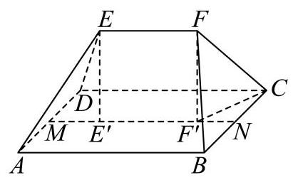

$\therefore \angle {FC}{F}^{\prime }$ 就是 ${FC}$ 与底面 ${ABCD}$ 所成角,

又 ${MN} = {AB} = {BC} = 4,{E}^{\prime }{F}^{\prime } = {EF} = 2$

$\therefore N{F}^{\prime } = 1,\;C{F}^{\prime 2} = \sqrt{C{N}^{2} + B{F}^{\prime 2}} = \sqrt{5}$ ,

又 $\bigtriangleup {BFC}$ 是等腰直角三角形, $\angle {BFC} = {90}^{ \circ  }$ ,

$\therefore {CF} = 2\sqrt{2}$ ， $F{F}^{\prime } = \sqrt{C{F}^{2} - C{F}^{\prime 2}} = \sqrt{3}$ ，

$\therefore \sin \angle {FC}{F}^{\prime } = \frac{F{F}^{\prime }}{CF} = \frac{\sqrt{3}}{2\sqrt{2}} = \frac{\sqrt{6}}{4}$ .

### 静安 · 第19题

如图,在长方体 ${ABCD} - {A}_{1}{B}_{1}{C}_{1}{D}_{1}$ 中, ${AB} = 4,{BC} = 3, C{C}_{1} = 2, M$ 是 ${AB}$ 的中点.

(1)求四棱锥 ${A}_{1} - {AMCD}$ 的体积；

(2)求平面 ${A}_{1}{AD}{D}_{1}$ 与平面 ${A}_{1}{MC}$ 所成的锐二面角的大小. (结果用反三角函数值表示)

**考点：** （1）棱锥体积；（2）二面角

**难度依据：** 棱锥体积与二面角

**【答案】** (1) 6

(2) $\arccos \left( \frac{3\sqrt{22}}{22}\right)$

**【解析】**

**【分析】**(1) 直接利用棱锥的体积公式求解;

(2)通过建立空间直角坐标系，得到两个平面的法向量进而求解二面角即可.

**【小问 1 详解】**

因为底面 ${AMCD}$ 是直角梯形,上底 ${AM} = 2$ ,下底 ${DC} = 4$ ,高 ${AD} = 3$ ,

因此梯形面积 ${S}_{AMCD} = \frac{\left( AM + DC\right) }{2} \cdot  {AD} = \frac{\left( 2 + 4\right) }{2} \times  3 = 9$ ,

四棱锥的高为 ${A}_{1}$ 到底面 ${ABCD}$ 的距离,即 $h = A{A}_{1} = 2$ ,

因此体积 $V = \frac{1}{3}{S}_{AMCD} \cdot  h = \frac{1}{3} \times  9 \times  2 = 6$ .

**【小问 2 详解】**

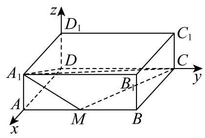

以 $D$ 为原点,分别以 ${DA},{DC}, D{D}_{1}$ 为 $x, y, z$ 轴建立空间直角坐标系,

根据题意得各点坐标 $A\left( {3,0,0}\right) , M\left( {3,2,0}\right) , C\left( {0,4,0}\right) ,{A}_{1}\left( {3,0,2}\right)$ ,

平面 ${A}_{1}{AD}{D}_{1}$ 的一个法向量为 $\overrightarrow{m} = \left( {0,1,0}\right)$ ,

在平面 ${A}_{1}{MC}$ 中,向量 $\overrightarrow{{A}_{1}M} = \left( {0,2, - 2}\right) ,\overrightarrow{MC} = \left( {-3,2,0}\right)$ ,设平面 ${A}_{1}{MC}$ 的法向量为 $\overrightarrow{n} = \left( {x, y, z}\right) ,$

则 $\left\{  \begin{array}{l} \overrightarrow{n} \cdot  \overrightarrow{{A}_{1}M} = {2y} - {2z} = 0 \\  \overrightarrow{n} \cdot  \overrightarrow{MC} =  - {3x} + {2y} = 0 \end{array}\right.$ 令 $y = 3$ ,得 $x = 2, z = 3$ ,即 $\overrightarrow{n} = \left( {2,3,3}\right)$ .

设锐二面角为 $\theta$ ,则 $\cos \theta  = \frac{\left| \overrightarrow{m} \cdot  \overrightarrow{n}\right| }{\left| \overrightarrow{m}\right|  \cdot  \left| \overrightarrow{n}\right| } = \frac{3}{1 \times  \sqrt{{2}^{2} + {3}^{2} + {3}^{2}}} = \frac{3\sqrt{22}}{22}$ ,

因此锐二面角大小为 $\arccos \left( \frac{3\sqrt{22}}{22}\right)$ .

### 黄浦 · 第18题

如图，在直三棱柱 ${ABC} - {A}_{1}{B}_{1}{C}_{1}$ 中，点 $D$ 、 $E$ 分别是棱 ${BC}\text{ 、 }C{C}_{1}$ 上的点(点 $D$ 异于点 $C)$ ,且 ${AD} \bot  {DE}$ .

(1)求证:平面 ${ADE} \bot$ 平面 ${BC}{C}_{1}{B}_{1}$ ；

(2)若 ${ABC}$ 是正三角形, ${BC} = C{C}_{1}$ ,且三棱柱 ${ABC} - {A}_{1}{B}_{1}{C}_{1}$ 的体积是三棱锥 $E - {ADC}$ 的体积的 12 倍,求 ${A}_{1}E$ 与平面 ${ADE}$ 所成的角的大小.

> 本题资料或解析有待核事项，预览不可作为已审定成品。

**考点：** （1）线面垂直证明面面垂直；（2）体积比确定点位置并求线面角

**难度依据：** 面面垂直与线面角

**核查说明：** 答案解析第5486字符附近：损坏字符或字体覆盖风险，需回源并视觉检查（底稿扫描记录）

**【答案】** (1) 证明见解析

(2) $\arcsin \frac{\sqrt{10}}{5}$

**【解析】**

**【分析】**(1) 证明出 ${AD} \bot$ 平面 ${BC}{C}_{1}{B}_{1}$ ,再利用面面垂直的判定定理可证得结论成立;

(2)解法一:设 ${BC} = {C{C}_{1}} = 2$ ，由 ${V}_{{ABC} - {A}_{1}{B}_{1}{C}_{1}} = {{12}{V}_{{\text{ 三 }\text{ 棱 }\text{ 锥 }}{E - {AEC}}}}$ 可求出 ${CE}$ 的长，以点 $A$ 为坐标原点, $\overrightarrow{CB}\text{ 、 }\overrightarrow{AD}\text{ 、 }\overrightarrow{A{A}_{1}}$ 的方向分别为 $x\text{ 、 }y\text{ 、 }z$ 轴的正方向建立空间直角坐标系,利用空间向量法可求得 ${A}_{1}E$ 与平面 ${ADE}$ 所成的角的大小;

解法二: 连接 ${A}_{1}D$ ,过 ${A}_{1}$ 作 ${A}_{1}G \bot$ 平面 ${ADE}$ ,垂足为 $G$ ,连接 ${GE}$ ,则 $\angle {A}_{1}{EG}$ 就是直线 ${A}_{1}E$ 与平面 ${ADE}$ 所成的角,取 ${AC}$ 的中点 $M$ ,连接 ${BM}$ ,取 ${CM}$ 的中点 $N$ ,连接 ${DN}$ , 证明出 ${DN}\bot$ 平面 ${AC}{C}_{1}{A}_{1}$ ,利用等体积法求出 ${A}_{1}G$ 的长,结合线面角的定义求解即可; 解法三: 设 $F$ 是 ${B}_{1}{C}_{1}$ 的中点,连接 ${A}_{1}F\text{ 、 }{DF}\text{ 、 }{EF}$ ,证明出 ${A}_{1}F//$ 平面 ${ADE}$ ,可知点 ${A}_{1}$ 与 $F$ 到平面 ${ADE}$ 的距离相等，证明出 ${EF} \bot$ 平面 ${ADE}$ ，可得出点 ${A}_{1}$ 到平面 ${ADE}$ 的距离等于 ${EF}$ 的长,并求出 ${A}_{1}E$ 的长,结合线面角的定义求解即可.

**【小问 1 详解】**

因为三棱柱 ${ABC} - {A}_{1}{B}_{1}{C}_{1}$ 是直三棱柱，所以 $C{C}_{1} \bot$ 平面 ${ABC}$ ，

又 ${AD} \subset$ 平面 ${ABC}$ ,所以 $C{C}_{1} \bot  {AD}$ ,

又 ${AD} \bot  {DE}, C{C}_{1} \cap  {DE} = E, C{C}_{1}\text{ 、 }{DE} \subset$ 平面 ${BC}{C}_{1}{B}_{1}$ ,所以 ${AD} \bot$ 平面 ${BC}{C}_{1}{B}_{1}$ , 又 ${AD} \subset$ 平面 ${ADE}$ ,所以平面 ${ADE} \bot$ 平面 ${BC}{C}_{1}{B}_{1}$ .

**【小问 2 详解】**

解法一: 由 ${AD} \bot$ 平面 ${BC}{C}_{1}{B}_{1},{BC} \subset$ 平面 ${BC}{C}_{1}{B}_{1}$ ,可知 ${AD} \bot  {BC}$ ,

又因为 ${ABC}$ 是正三角形,所以 ${BD} = {CD}$ .

设 ${BC} = C{C}_{1} = 2$ ，由 ${V}_{{ABC} - {A}_{1}{B}_{1}{C}_{1}} = {12}{V}_{\text{ 三棱锥 }E - {ADC}}$ ， ${S}_{\bigtriangleup {ABC}} = 2{S}_{\bigtriangleup {ADC}}$ ，

可得 $2{S}_{\bigtriangleup {ADC}} \cdot  2 = {12} \cdot  \frac{1}{3} \cdot  {S}_{\bigtriangleup {ADC}} \cdot  {CE}$ ，故 ${CE} = 1$ ，

以点 $A$ 为坐标原点， $\overrightarrow{CB}$ 、 $\overrightarrow{AD}$ 、 $\overrightarrow{A{A}_{1}}$ 的方向分别为 $x$ 、 $y$ 、 $z$ 轴的正方向建立如下图所示的空间直角坐标系,

则 ${A}_{1}\left( {0,0,2}\right) \text{ 、 }D\left( {0,0,\sqrt{3}}\right) \text{ 、 }A\left( {0,0,0}\right) \text{ 、 }E\left( {-1,\sqrt{3},1}\right)$ ,

所以 $\overrightarrow{AD} = \left( {0,\sqrt{3},0}\right) ,\overrightarrow{AE} = \left( {-1,\sqrt{3},1}\right) ,\overrightarrow{{A}_{1}E} = \left( {-1,\sqrt{3}, - 1}\right)$ ,

设平面 ${ADE}$ 的一个法向量为 $\overrightarrow{n} = \left( {x, y, z}\right)$ ,

则 $\left\{  \begin{array}{l} \overrightarrow{n} \cdot  \overrightarrow{AD} = \sqrt{3}y = 0 \\  \overrightarrow{n} \cdot  \overrightarrow{AE} =  - x + \sqrt{3}y + z = 0 \end{array}\right.$ ,取 $x = 1$ ,可得 $\overrightarrow{n} = \left( {1,0,1}\right)$ ,

设 ${A}_{1}E$ 与平面 ${ADE}$ 所成的角为 $a$ ,则 $\sin a = \frac{\left| \overrightarrow{n} \cdot  \overrightarrow{{A}_{1}E}\right| }{\left| \overrightarrow{n}\right|  \cdot  \left| \overrightarrow{{A}_{1}E}\right| } = \frac{2}{\sqrt{2} \cdot  \sqrt{5}} = \frac{\sqrt{10}}{5}$ ,

所以 ${A}_{1}E$ 与平面 ${ADE}$ 所成的角的大小为 $\arcsin \frac{\sqrt{10}}{5}$ .

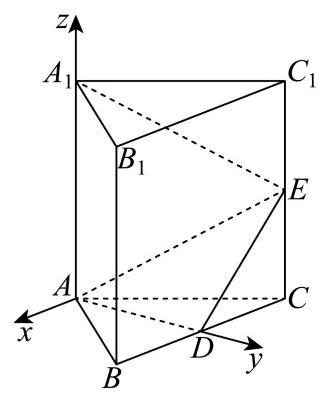

解法二: 连接 ${A}_{1}D$ ,过 ${A}_{1}$ 作 ${A}_{1}G \bot$ 平面 ${ADE}$ ,垂足为 $G$ ,连接 ${GE}$ , 则 $\angle {A}_{1}{EG}$ 就是直线 ${A}_{1}E$ 与平面 ${ADE}$ 所成的角,

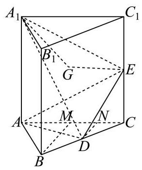

取 ${AC}$ 的中点 $M$ ，连接 ${BM}$ ，取 ${CM}$ 的中点 $N$ ，连接 ${DN}$ ，

因为 ${ABC}$ 为等边三角形， $M$ 为 ${AC}$ 的中点，所以 ${BM} \bot  {AC}$ ，

因为 $D$ 、 $N$ 分别为 ${BC}$ 、 ${CM}$ 的中点，所以 ${DN}//{BM}$ ，则 ${DN} \bot  {AC}$ ，

因为三棱柱 ${ABC} - {A}_{1}{B}_{1}{C}_{1}$ 为直三棱柱，所以 $A{A}_{1} \bot$ 平面 ${ABC}$ ，

因为 ${DN} \subset$ 平面 ${ABC}$ ,所以 ${DN} \bot$ 平面 $A{A}_{1}{C}_{1}C$ ,且 ${DN} = {CD}\sin {60}^{ \circ  } = \frac{\sqrt{3}}{2}$ ,

因为 ${S}_{\bigtriangleup {A{A}_{1}}E} = \frac{1}{2}A{A}_{1} \cdot  {AC} = \frac{1}{2} \times  {2}^{2} = 2$ ，故 ${V}_{\text{ 三棱锥 }D - A{A}_{1}E} = \frac{1}{3}{S}_{\bigtriangleup {A{A}_{1}E}} \cdot  {DN} = \frac{1}{3} \times  2 \times  \frac{\sqrt{3}}{2} = \frac{\sqrt{3}}{3}$ ，

因为 ${AD} \bot$ 平面 ${BC}{C}_{1}{B}_{1},{DE} \subset$ 平面 ${BC}{C}_{1}{B}_{1}$ ，所以 ${AD} \bot  {DE}$ ，

又因为 ${AD} = {AB}\sin {60}^{ \circ  } = 2 \times  \frac{\sqrt{3}}{2} = \sqrt{3},{DE} = \sqrt{C{D}^{2} + C{E}^{2}} = \sqrt{1 + 1} = \sqrt{2}$ ,

所以 ${S}_{\bigtriangleup {ADE}} = \frac{1}{2}{AD} \cdot  {DE} = \frac{1}{2} \times  \sqrt{3} \times  \sqrt{2} = \frac{\sqrt{6}}{2}$ ,

所以 ${V}_{\text{ 三棱锥 }{A}_{1} - {ADE}} = \frac{1}{3}{S}_{\bigtriangleup {ADE}} \cdot  {A}_{1}G = \frac{1}{3} \times  \frac{\sqrt{6}}{2} \times  {A}_{1}G = \frac{\sqrt{3}}{3}$ ,解得 ${A}_{1}G = \sqrt{2}$ ,

又 ${A}_{1}E = \sqrt{{A}_{1}{C}_{1}^{2} + {C}_{1}{E}^{2}} = \sqrt{{2}^{2} + {1}^{2}} = \sqrt{5}$ ,

故 $\sin \angle {A}_{1}{EG} = \frac{{A}_{1}G}{{A}_{1}E} = \frac{\sqrt{10}}{5}$ ,则 $\angle {A}_{1}{EG} = \arcsin \frac{\sqrt{10}}{5}$ ,

所以 ${A}_{1}E$ 与平面 ${ADE}$ 所成的角的大小为 $\arcsin \frac{\sqrt{10}}{5}$ .

解法三: 设 $F$ 是 ${B}_{1}{C}_{1}$ 的中点,连接 ${A}_{1}F\text{ 、 }{DF}\text{ 、 }{EF}$ ,

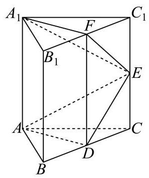

因为 $B{B}_{1}//C{C}_{1}, B{B}_{1} = C{C}_{1}$ ,故四边形 $B{B}_{1}{C}_{1}C$ 为平行四边形,

所以 ${BC}//{B}_{1}{C}_{1},{BC} = {B}_{1}{C}_{1}$ ,

因为 $D$ 、 $F$ 分别为 ${BC}$ 、 ${B}_{1}{C}_{1}$ 的中点，所以 ${BD}//{B}_{1}F$ ， ${BD} = {B}_{1}F$ ，

故四边形 $B{B}_{1}{FD}$ 为平行四边形,所以 $B{B}_{1}//{DF}, B{B}_{1} = {DF}$ ,

又因为 $A{A}_{1}//B{B}_{1}, A{A}_{1} = B{B}_{1}$ ,所以 $A{A}_{1}//{DF}, A{A}_{1} = {DF}$ ,

所以四边形 $A{A}_{1}{FD}$ 为平行四边形,所以 ${A}_{1}F//{AD}$ ,

因为 ${A}_{1}F \text{ ⊄ }$ 平面 ${ADE},{AD} \subset$ 平面 ${ADE}$ ,所以 ${A}_{1}F//$ 平面 ${ADE}$ ,

点 ${A}_{1}$ 与 $F$ 到平面 ${ADE}$ 的距离相等.

由四边形 ${BC}{C}_{1}{B}_{1}$ 是正方形， $E$ 、 $F$ 、 $D$ 分别为 $C{C}_{1}$ 、 ${B}_{1}{C}_{1}$ 、 ${BC}$ 的中点，

故 ${CD} = {CE} = {C}_{1}E = {C}_{1}F$ ，所以 $\angle {FE}{C}_{1} = \angle {CED} = \frac{\pi }{4}$ ，故 $\angle {FED} = \frac{\pi }{2}$ ，即 ${EF}\bot {ED}$ ， 又平面 ${ADE} \bot$ 平面 ${BC}{C}_{1}{B}_{1},{EF} \subset$ 平面 ${BC}{C}_{1}{B}_{1}$ ,平面 ${BC}{C}_{1}{B}_{1} \cap$ 平面 ${ADE} = {DE}$ ,

故 ${EF} \bot$ 平面 ${ADE}$ ,易知 ${EF} = \sqrt{{C}_{1}{E}^{2} + {C}_{1}{F}^{2}} = \sqrt{1 + 1} = \sqrt{2}$ ,故 ${A}_{1}$ 到平面 ${ADE}$ 的距离也为 $\sqrt{2}$ ,

又 ${A}_{1}E = \sqrt{{A}_{1}{C}_{1}^{2} + {C}_{1}{E}^{2}} = \sqrt{{2}^{2} + {1}^{2}} = \sqrt{5}$ ,

设 ${A}_{1}E$ 与平面 ${ADE}$ 所成的角为 $\theta$ ,则 $\sin \theta  = \frac{\sqrt{2}}{{A}_{1}E} = \frac{\sqrt{2}}{\sqrt{5}} = \frac{\sqrt{10}}{5}$ ,故 $\theta  = \arcsin \frac{\sqrt{10}}{5}$ ,

所以 ${A}_{1}E$ 与平面 ${ADE}$ 所成的角的大小为 $\arcsin \frac{\sqrt{10}}{5}$ .

## 截面、轨迹、动点与实际模型

从截面或可达点集确定几何约束，讨论定值、最值与长度。

### 嘉定 · 第12题

在包装设计中,常用长度和宽度描述物体体型. 长度 $l\left( V\right)$ 定义为物体上最远两点间的距离,宽度 $t\left( V\right)$ 定义为能夹住物体的两平行平面间的最小距离,即存在一对平行平面,使得物体上的所有点均位于两平面之间 (包括平面上). 现有一圆柱,其底面半径 $R$ 与高 $h$ 可任意调节，则 $\frac{l\left( V\right) }{t\left( V\right) }$ 的最小值为___

> 本题资料或解析有待核事项，预览不可作为已审定成品。

**考点：** 圆柱长度宽度与几何量；新定义及分段讨论；分段比值最小化

**难度依据：** 新定义下立体量分段最优化

**核查说明：** 题干与答案解析尚未逐页对照原卷，数学内容未独立终审。

**【答案】** $\sqrt{2}$

**【解析】**

**【分析】**分 $h \geq  {2R}$ 和 $h < {2R}$ 两种情况进行分析,可得结论.

**【详解】**圆柱体中,最远两点间的距离为 $l\left( V\right)  = \sqrt{{\left( 2R\right) }^{2} + {h}^{2}}$ ,

当 $h \geq  {2R}$ ,即 $\frac{h}{2R} \geq  1$ 时, $t\left( V\right)  = {2R},\frac{l\left( V\right) }{t\left( V\right) } = \frac{\sqrt{{\left( 2R\right) }^{2} + {h}^{2}}}{2R} = \sqrt{1 + {\left( \frac{h}{2R}\right) }^{2}} \geq  \sqrt{2}$ ,

当且仅当 $h = {2R}$ 时，等号成立；

当 $h < {2R}$ ,即 $\frac{2R}{h} > 1$ 时, $t\left( V\right)  = h,\frac{l\left( V\right) }{t\left( V\right) } = \frac{\sqrt{{\left( 2R\right) }^{2} + {h}^{2}}}{h} = \sqrt{1 + {\left( \frac{2R}{h}\right) }^{2}} > \sqrt{2}$ .

所以 $\frac{l\left( V\right) }{t\left( V\right) }$ 的最小值为 $\sqrt{2}$ .

### 宝山 · 第15题

如图，正方体 ${ABCD} - {A}_{1}{B}_{1}{C}_{1}{D}_{1}$ 的棱长为 1，任作平面 $a$ 与对角线 $A{C}_{1}$ 垂直，使平面 $a$ 与正方体的六条棱都有公共点.记截面 ${PQRSWE}$ 的面积为S，截面周长为 $L$ ，则有( )

A. $\mathrm{S}$ 为定值， $L$ 为定值

B. $\mathrm{S}$ 为定值， $L$ 不为定值

C. $\mathrm{S}$ 不为定值， $L$ 为定值

D. $\mathrm{S}$ 不为定值， $L$ 不为定值

**考点：** 正方体截面周长定值与面积变化

**难度依据：** 正方体截面周长定值与面积变化

**【答案】** C

**【解析】**

**【分析】**判断周长和面积是否为定值, 先判断截面各边之间的数量关系和位置关系, 将立体问题平面化求解即可.

**【详解】**如图所示,

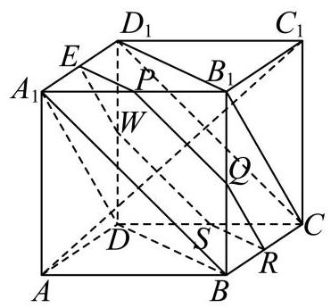

连接 ${B}_{1}{D}_{1},{B}_{1}C,{D}_{1}C$ ,易知平面 ${B}_{1}{D}_{1}C$ 与对角线 $A{C}_{1}$ 垂直,

又平面 $a$ 与对角线 $A{C}_{1}$ 垂直,所以平面 $a//$ 平面 ${B}_{1}{D}_{1}C$ ;

同理连接 ${A}_{1}B,{A}_{1}D,{BD}$ ,易知平面 ${A}_{1}{BD}$ 与对角线 $A{C}_{1}$ 垂直,

又平面 $a$ 与对角线 $A{C}_{1}$ 垂直，所以平面 $a//$ 平面 ${A}_{1}{BD}$ ；

又平面 $a \cap$ 平面 ${AB}{B}_{1}{A}_{1} = {PQ}$ ,平面 ${A}_{1}{BD} \cap$ 平面 ${AB}{B}_{1}{A}_{1} = {A}_{1}B$

从而可得 ${A}_{1}B//{PQ}$ ,同理可得 ${WS}//C{D}_{1}$ ,又 ${A}_{1}B//C{D}_{1}$ ,所以 ${WS}//{PQ}$ ,

同理可得 ${SR}//{EP}//{BD},{QR}//{EW}//{B}_{1}C$ , 将截面 ${PQRSWE}$ 各边展开如图:

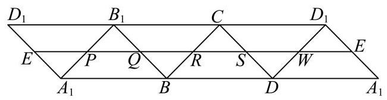

由平行关系知, ${PQRSWE}$ 的周长等于 $3\sqrt{2}$ 为定值;

由平行关系知, ${PQRSWE}$ 的形状为六边形,各边夹角为 ${120}^{ \circ  }$ ,且相邻两边之和为 $\sqrt{2}$ ,

设 ${PQ} = x$ ,则 ${QR} = \sqrt{2} - x$ ,则 ${PQRSWE}$ 的面积

$S = 2 \times  \frac{\sqrt{3}}{4} \times  {\left( \sqrt{2}\right) }^{2} - \frac{\sqrt{3}}{4}{x}^{2} - \frac{\sqrt{3}}{4}{\left( \sqrt{2} - x\right) }^{2} =  - \frac{\sqrt{3}}{2}{x}^{2} + \frac{\sqrt{6}}{2}x + \frac{\sqrt{3}}{2}$ ,

从而可知 $\mathrm{S}$ 是关于 $x$ 的二次函数,不为定值.

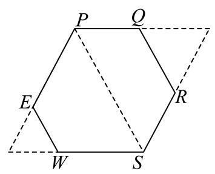

### 徐汇 · 第12题

如图为一架农业无人机沿固定航线匀速飞行，并在某时刻向下喷洒农药的示意图. 将种植坡面视为坡角为 $\theta$ 的平面，航线视为直线，无人机视为航线上的点，无人机在任意时刻喷洒农药的雾滴形成的形状均为以铅垂线为轴、母线与轴夹角为 ${45}^{ \circ  }$ 的圆锥及其内部. 若无人机飞行的海拔高度恒定，航线与种植坡面平行且距离为 3 米，假设无人机飞行时农药喷洒不间断且不受风速影响；则飞行过程中会在种植坡面上形成一条宽为 $L\left( \theta \right)$ 米的“农药条带”，当 ${0}^{ \circ  } \leq  \theta  \leq  {15}^{ \circ  }$ 时， $L\left( \theta \right)$ 的最大值为___. (结果精确到 0.01 )

航线 无人机

**考点：** 垂直航线截面求喷洒带宽，再求三角函数最值

**难度依据：** 空间截面建模与坡角转化

**【答案】** 6.93

**【解析】**

作垂直于无人机航线与平面 $a$ 的平面，与无人机航线交于点 $A$ ,与平面 $a$ 交于直线 ${BC}$ , 线段 ${BC}$ 的长为农药条带的宽度, ${BH}$ 为水平线

作 ${AD} \bot  {BC}$ 于 $D,{AD} \bot  {BH}$ 于 $H$ ,由坡角为 $\theta$ 易得 $\angle {HAD} = \theta$ ,

由题意得 $\angle {BAH} = \angle {CAH} = {45}^{ \circ  },\angle {BAC} = {90}^{ \circ  },{AD} = 3$ ,

则 $\angle {CAD} = {45}^{ \circ  } - \theta ,\angle {DCA} = {45}^{ \circ  } + \theta$ ,

所以 ${AC} = \frac{AD}{\cos \angle {CAD}} = \frac{3}{\cos \left( {{45}^{ \circ  } - \theta }\right) }$ ，

${BC} = \frac{AC}{\cos \angle {ACD}} = \frac{3}{\cos \left( {{45}^{ \circ  } - \theta }\right) \cos \left( {{45}^{ \circ  } + \theta }\right) } = \frac{3}{\sin \left( {{45}^{ \circ  } + \theta }\right) \cos \left( {{45}^{ \circ  } + \theta }\right) }$

$= \frac{6}{\sin \left( {{90}^{ \circ  } + {2\theta }}\right) } = \frac{6}{\cos {2\theta }},$

因为 ${0}^{ \circ  } \leq  \theta  \leq  {15}^{ \circ  }$ ,所以 ${0}^{ \circ  } \leq  {2\theta } \leq  {30}^{ \circ  },\frac{\sqrt{3}}{2} \leq  \cos {2\theta } \leq  1$ ,

$B{C}_{\max } = \frac{6}{\frac{\sqrt{3}}{2}} = 4\sqrt{3} \approx  {6.93}.$

### 浦东 · 第11题

某光影科技实验室为长方体空间, 底面是边长为 4 米的正方形, 高为 3 米. 为营造动态光影效果，在底面一个顶点处安装射灯 $A$ ，在与该顶点相对的侧棱上、距底面 1 米处安装射灯 $I$ ,两盏射灯的光束方向由智能系统自动控制，始终使两束光线相互垂直，且它们的交汇点 $G$ 始终落在实验室天花板上. 则交汇点 $G$ 形成的轨迹长度为___米.

**考点：** 建立空间坐标，用垂直数量积确定天花板圆轨迹

**难度依据：** 将空间垂直转化轨迹方程

**【答案】** $2\sqrt{2}\pi$

**【解析】**

**【详解】**如图建立空间直角坐标系:

则 $A\left( {4,0,0}\right) , I\left( {0,4,1}\right)$ ,设交点 $G\left( {x, y,3}\right)$ ,

所以 $\overrightarrow{AG} = \left( {x - 4, y,3}\right) ,\overrightarrow{IG} = \left( {x, y - 4,2}\right)$ ,

因为 ${AG} \bot  {IG}$ ,所以 $\overrightarrow{AG} \cdot  \overrightarrow{IG} = \left( {x - 4}\right) x + \left( {y - 4}\right) y + 3 \times  2 = 0$ ,

整理得 ${\left( x - 2\right) }^{2} + {\left( y - 2\right) }^{2} = 2$ ,

所以交点 $G$ 在天花板上的轨迹是以 $\left( {2,2,3}\right)$ 为圆心,半径为 $\sqrt{2}$ 的圆,

所以交汇点 $G$ 形成的轨迹长度为 $2\sqrt{2}\pi$ .

### 金山 · 第12题

申辉中学某个数学建模小组发现:人走路时，启动或者停下的瞬间，手中水平拿着的杯子里的水可能会被晃动得溢出杯口. 查询资料后发现: 液面和水平面的夹角 $\theta \left( {0 \leq  \theta  < \frac{\pi }{2}}\right)$ 与人走路的加速度 $a$ 以及重力加速度 $g$ 有关,满足关系: $\tan \theta  = \frac{a}{g}$ ,其中 $g = {10}\left( {\mathrm{\;m}/{\mathrm{s}}^{2}}\right)$ . 若甲同学走路启动瞬间的加速度为 $3\left( {\mathrm{\;m}/{\mathrm{s}}^{2}}\right)$ ，手中水平拿着一个底面边长为 $4\mathrm{\;{cm}}$ 和 $6\mathrm{\;{cm}}$ ， 高为 ${14}\mathrm{\;{cm}}$ 的长方体形状的杯子，则杯中最多装___ ${\mathrm{{cm}}}^{3}$ 的水，存在甲同学走路启动的瞬间杯中水不溢出的可能.

> 本题资料或解析有待核事项，预览不可作为已审定成品。

**考点：** 斜液面与长方体体积优化；倾角正切与高度差

**难度依据：** 斜液面与长方体体积优化；倾角正切与高度差

**核查说明：** 本题具名修复经父agent独立复核；未据此判定全卷终审通过。；原解对任意水平朝向的最优性仅以“向更远的地方爬”直观说明，必要的二维方向范围论证待补。

【答案】$321.6\ \mathrm{cm}^3$。

【解析·任意水平朝向补全】

由题意，液面倾角满足 $\tan\theta=3/10$。设加速度在水平面内的方向与杯底长为 $4\mathrm{cm}$ 的边成角 $\varphi$，沿该方向的杯底投影宽度为

$$w=4|\cos\varphi|+6|\sin\varphi|.$$

因此矩形四角液面最高点与最低点的高度差为 $\Delta h=\frac3{10}w$。同一方向上，以最高点恰好到杯口时可装水最多；液面高度是杯底坐标的一次函数，矩形中心对称，故平均液深是 $14-\frac{\Delta h}{2}$。

这里 $w\le\sqrt{4^2+6^2}=\sqrt{52}$，故 $\Delta h<14$，整个杯底都有水，不存在液面穿过杯底的截断情形。该方向的最大容积为

$$V=4\times6\left(14-\frac3{20}w\right).$$

又

$$w\ge4(|\cos\varphi|+|\sin\varphi|)\ge4,$$

因此

$$V\le24\left(14-\frac3{20}\times4\right)=321.6.$$

沿 $4\mathrm{cm}$ 的边加速时 $w=4$，上述等号成立，故所求为 $321.6\mathrm{cm}^3$。

【补全说明】原解仅比较两条边的朝向，未覆盖任意水平朝向；此处补齐二维投影宽度及平均深度证明，保留原题与答案。教研整理PDF第1—2页题干及第7页简答与此一致，但PDF未提供本题详细证明，本段不冒充原文。

### 静安 · 第16题

设 $M\text{ 、 }N$ 分别是棱长为 1 的正方体的两个不同顶点,点 $P$ 在该正方体的表面上 (含棱和顶点) 运动,且不与 $M\text{ 、 }N$ 两点重合. 关于 $\overrightarrow{PM} \cdot  \overrightarrow{PN}$ ,给出下列两个结论:

① $\overrightarrow{PM} \cdot  \overrightarrow{PN}$ 存在最小值，且最小值小于零；

② $\overrightarrow{PM} \cdot  \overrightarrow{PN}$ 存在最大值，且最大值大于零.

则下列判断正确的选项是 ( ).

A. ①正确，②错误

B. ①错误，②正确

C. ①和②都错误

D. ①和②都正确

**考点：** 正方体数量积最值；正方体动点

**难度依据：** 正方体数量积最值；正方体动点

**【答案】** A

**【解析】**

**【分析】**分 $M\text{ 、 }N$ 为同一平面的相邻顶点、 $M\text{ 、 }N$ 为同一平面的不相邻顶点及 $M\text{ 、 }N$ 为体对角线上两顶点进行讨论,可求出对应的 $\left| {MN}\right|$ 长度,取 ${MN}$ 中点为 $O$ ,利用空间向量线性运算与数量积公式可得 $\overrightarrow{PM} \cdot  \overrightarrow{PN} = {\left| \overrightarrow{PO}\right| }^{2} - \frac{1}{4}{\left| \overrightarrow{MN}\right| }^{2}$ ,再求出对应 $\left| {OP}\right|$ 范围即可得解.

**【详解】**设 ${MN}$ 中点为 $O$ ,

若 $M\text{ 、 }N$ 为同一平面的相邻顶点,则 $\left| {MN}\right|  = 1$ ,

则 $0 \leq  \left| {OP}\right|  \leq  \sqrt{{\left( \frac{1}{2}\right) }^{2} + {1}^{2} + {1}^{2}}$ ,即 $\left| {OP}\right|  \in  \left\lbrack  {0,\frac{3}{2}}\right\rbrack$ ,

$\overrightarrow{PM} \cdot  \overrightarrow{PN} = \left( {\overrightarrow{PO} + \overrightarrow{OM}}\right)  \cdot  \left( {\overrightarrow{PO} + \overrightarrow{ON}}\right)  = {\left| \overrightarrow{PO}\right| }^{2} - \frac{1}{4}{\left| \overrightarrow{MN}\right| }^{2} \in  \left\lbrack  {-\frac{1}{4},2}\right\rbrack$ ,

此时 $\overrightarrow{PM} \cdot  \overrightarrow{PN}$ 存在最小值,且最小值小于零,存在最大值,且最大值大于零;

若 $M\text{ 、 }N$ 为同一平面的不相邻顶点,则 $\left| {MN}\right|  = \sqrt{2}$ ,

则 $0 \leq  \left| {OP}\right|  \leq  \sqrt{{\left( \frac{\sqrt{2}}{2}\right) }^{2} + {1}^{2}}$ ,即 $\left| {OP}\right|  \in  \left\lbrack  {0,\frac{\sqrt{6}}{2}}\right\rbrack$ ,

$\overrightarrow{PM} \cdot  \overrightarrow{PN} = {\left| \overrightarrow{PO}\right| }^{2} - \frac{1}{4}{\left| \overrightarrow{MN}\right| }^{2} \in  \left\lbrack  {-\frac{1}{2},1}\right\rbrack$

此时 $\overrightarrow{PM} \cdot  \overrightarrow{PN}$ 存在最小值,且最小值小于零,存在最大值,且最大值大于零;

若 $M\text{ 、 }N$ 为体对角线上两顶点,则 $\left| {MN}\right|  = \sqrt{3}$ ,

则 $\frac{1}{2} \leq  \left| {OP}\right|  \leq  \frac{\sqrt{3}}{2}$ ，即 $\left| {OP}\right|  \in  \left\lbrack  {\frac{1}{2},\frac{\sqrt{3}}{2}}\right\rbrack$ ，

则 $\overrightarrow{PM} \cdot  \overrightarrow{PN} = {\left| \overrightarrow{PO}\right| }^{2} - \frac{1}{4}{\left| \overrightarrow{MN}\right| }^{2} \leq  \frac{3}{4} - \frac{3}{4} = 0$ ,

此时 $\overrightarrow{PM} \cdot  \overrightarrow{PN}$ 存在最小值,且最小值小于零,存在最大值,最大值等于零;

综上可得:①正确；②错误.

