# 2026二模 解析几何专题 · 教师版

> 本地预览：题目、答案及分类尚未全部审定。校对使用的PDF为教研整理版，尚未逐区确认区级印刷原卷。

## 直线、圆锥曲线基础量与标准方程

辨明曲线方向，以焦点、准线、渐近线和斜率求基本量。

### 嘉定 · 第5题

双曲线 $\frac{{x}^{2}}{9} - \frac{{y}^{2}}{16} = 1$ 的渐近线方程是___.

> 本题资料或解析有待核事项，预览不可作为已审定成品。

**考点：** 双曲线标准方程与渐近线

**难度依据：** 渐近线和标准方程互换

**核查说明：** 题干与答案解析尚未逐页对照原卷，数学内容未独立终审。

**【答案】** $y =  \pm  \frac{4}{3}x$

**【解析】**

**【分析】**直接由双曲线的方程求解即可

**【详解】**因为双曲线方程为 $\frac{{x}^{2}}{9} - \frac{{y}^{2}}{16} = 1$ ,

所以双曲线的渐近线方程为 $\frac{{x}^{2}}{9} - \frac{{y}^{2}}{16} = 0$ ,即 $y =  \pm  \frac{4}{3}x$ ,

故答案为: $y =  \pm  \frac{4}{3}x$

### 奉贤 · 第4题

若直线 $\left( {a - 1}\right) x + y - 1 = 0$ 与直线 ${3x} - y = 0$ 平行，则实数 $a$ 的值为___.

**考点：** 两直线平行与斜率

**难度依据：** 两直线平行与斜率

**【答案】** -2

**【解析】**

**【详解】**已知直线 $\left( {a - 1}\right) x + y - 1 = 0$ 与直线 ${3x} - y = 0$ 平行,

$\therefore$ 两直线斜率相等,即 $1 - a = 3$ ,解得 $a =  - 2$ ,

$\because$ 直线 $\left( {a - 1}\right) x + y - 1 = 0$ 的截距为 1,直线 ${3x} - y = 0$ 的截距为 0,不相等, $\therefore a =  - 2$ .

### 奉贤 · 第8题

点 $F$ 为抛物线 $C : {y}^{2} = {8x}$ 的焦点， $P$ 为 $C$ 上一点，若 $\bigtriangleup  {POF}$ 的面积为 $4\sqrt{2}$ ( $O$ 为坐标原点),则 $\left| {PF}\right|  =$ ___.

**考点：** 抛物线焦半径与三角形面积

**难度依据：** 抛物线焦半径与三角形面积

**【答案】** 6

**【解析】**

**【分析】**首先得到焦点坐标与准线方程,根据 $\bigtriangleup {POF}$ 的面积求出 $\left| {y}_{P}\right|$ ,从而求出 ${x}_{P}$ ,再由焦半径公式计算可得.

**【详解】**抛物线 $C : {y}^{2} = {8x}$ 的焦点为 $F\left( {2,0}\right)$ ,准线方程为 $x =  - 2$ ,

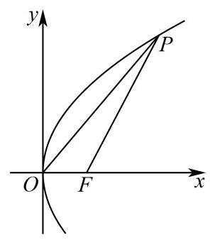

则 ${S}_{\bigtriangleup {POF}} = \frac{1}{2}\left| {OF}\right| \left| {y}_{P}\right|  = 4\sqrt{2}$ ,

所以 $\left| {y}_{P}\right|  = 4\sqrt{2}$ ,则 ${y}_{P}^{2} = 8{x}_{P}$ ,所以 ${x}_{P} = 4$ ,

所以 $\left| {PF}\right|  = {x}_{P} - \left( {-2}\right)  = 6$ .

故答案为:6

### 奉贤 · 第14题

已知双曲线的方程为 ${x}^{2} - \frac{{y}^{2}}{4} = \lambda$ ,则( )

A. 渐近线与 $\lambda$ 无关

B. 实轴长与 $\lambda$ 无关

C. 焦距与 $\lambda$ 无关

D. 焦点与 λ无关

**考点：** 含参双曲线渐近线与焦点

**难度依据：** 含参双曲线渐近线与焦点

**【答案】** A

**【解析】**

**【详解】**已知双曲线的方程为 ${x}^{2} - \frac{{y}^{2}}{4} = \lambda$ ,则 $\lambda  \neq  0$ ,

当 $\lambda  > 0$ 时, $\frac{{x}^{2}}{\lambda } - \frac{{y}^{2}}{4\lambda } = 1$ ,焦点在 $x$ 轴, ${a}^{2} = \lambda ,{b}^{2} = {4\lambda },{c}^{2} = {a}^{2} + {b}^{2} = {5\lambda }$ ,

当 $\lambda  < 0$ 时, $\frac{{y}^{2}}{-{4\lambda }} - \frac{{x}^{2}}{-\lambda } = 1$ ,焦点在 $y$ 轴, ${a}^{2} =  - {4\lambda },{b}^{2} =  - \lambda ,{c}^{2} = {a}^{2} + {b}^{2} =  - {5\lambda }$ ,

当 $\lambda  > 0$ 时,渐近线方程为 $y =  \pm  \sqrt{\frac{{b}^{2}}{{a}^{2}}}x =  \pm  {2x}$ ,实轴长为 ${2a} = 2\sqrt{\lambda }$ ,

焦距为 ${2c} = 2\sqrt{5\lambda }$ ，焦点为 $\left( {\pm \sqrt{5\lambda },0}\right)$ ；

当 $\lambda  < 0$ 时,渐近线方程为 $y =  \pm  \sqrt{\frac{{a}^{2}}{{b}^{2}}}x =  \pm  \sqrt{\frac{-{4\lambda }}{-\lambda }}x =  \pm  {2x}$ ,实轴长为 ${2a} = 4\sqrt{-\lambda }$ ,

焦距为 ${2c} = 2\sqrt{-{5\lambda }}$ ,焦点为 $\left( {0, \pm  \sqrt{-{5\lambda }}}\right)$ ;

$\therefore$ 渐近线与 $\lambda$ 无关,实轴长、焦距、焦点均与 $\lambda$ 有关.

### 宝山 · 第4题

若 $\overrightarrow{n} = \left( {1,2}\right)$ 是直线 $l : {ax} + y - 1 = 0$ 的一个法向量，则实数 $a$ 的值为___.

**考点：** 直线法向量与平行坐标比例；直线一般式及法向量

**难度依据：** 直线法向量与平行坐标比例；直线一般式及法向量

**【答案】** $\frac{1}{2}\# \# {0.5}$

**【解析】**

**【分析】**利用直线一般式的法向量形式, 结合已知法向量与该法向量平行的性质列比例式求解 $a$ 的值.

**【详解】**已知直线 $l$ 的方程为 ${ax} + y - 1 = 0$ ,

根据直线一般式 ${Ax} + {By} + C = 0$ 的法向量性质, $l$ 的法向量可表示为 $\left( {a,1}\right)$ ,

因为 $\overrightarrow{n} = \left( {1,2}\right)$ 是 $l$ 的一个法向量,故 $\left( {a,1}\right)$ 与 $\left( {1,2}\right)$ 平行,

由向量平行的坐标关系得: ${2a} = 1 \times  1$ ，解得 $a = \frac{1}{2}$ .

**【点睛】**本题考查直线法向量的概念和向量平行的坐标运算, 记住直线一般式 ${Ax} + {By} + C = 0$ 的法向量为 $\left( {A, B}\right)$ 可快速解题.

### 崇明 · 第10题

如图,已知圆柱的一个截面边界是椭圆 $\Gamma$ ,其中 $\Gamma$ 的长轴 ${AC}$ 为该圆柱轴截面的对角线, 短轴长等于圆柱底面直径的长. 将圆柱侧面沿母线 ${AB}$ 展开，则椭圆 $\Gamma$ 在展开图中恰好为一个周期的三角函数图像. 若该段曲线是函数 $y = 1 - \sqrt{3}\sin \frac{x}{2}$ 的图像的一部分,则椭圆 $\Gamma$ 的离心率为___.

$B$

**考点：** 圆柱斜截面与展开；周期振幅确定圆柱尺寸；椭圆离心率

**难度依据：** 圆柱斜截面与展开；周期振幅确定圆柱尺寸；椭圆离心率

**【答案】** $\frac{\sqrt{21}}{7}$

**【解析】**

**【分析】**由正弦函数的最值和周期求得圆柱的高和底面半径, 进而求得椭圆的长轴和短轴, 即可得离心率.

**【详解】**函数 $y = 1 - \sqrt{3}\sin \frac{x}{2}$ 的值域为 $\left\lbrack  {1 - \sqrt{3},1 + \sqrt{3}}\right\rbrack$ ,最小正周期 $T = \frac{2\pi }{\frac{1}{2}} = {4\pi }$ ,

依题意,圆柱的高 $h = \left| {AB}\right|  = 2\sqrt{3}$ ,设圆柱的底面半径为 $r$ ,则 ${2\pi r} = {4\pi }$ ,解得 $r = 2$ ,

椭圆短轴长 ${2b} = {2r} = 4$ ,即 $b = 2$ ,长轴长 ${2a} = \sqrt{{h}^{2} + {\left( 2r\right) }^{2}} = 2\sqrt{7}$ ,即 $a = \sqrt{7}$ , 所以椭圆的离心率 $e = \frac{\sqrt{{a}^{2} - {b}^{2}}}{a} = \sqrt{1 - \frac{{b}^{2}}{{a}^{2}}} = \frac{\sqrt{21}}{7}$ .

### 普陀 · 第3题

已知点 $P\left( {2, y}\right)$ 在抛物线 ${y}^{2} = {4x}$ 上，则 $P$ 点到抛物线焦点 $F$ 的距离为___.

**考点：** 抛物线焦半径

**难度依据：** 抛物线焦半径

**【答案】** 3

**【解析】**

**【分析】**利用焦点弦长的性质即可得出.

**【详解】** $\because$ 点 $P\left( {2, y}\right)$ 在抛物线 ${y}^{2} = {4x}$ 上,

$\therefore P$ 点到焦点 $F$ 的距离 $= 2 + 1 = 3$ .

故答案为: 3 .

**【点睛】**本题考查过焦点弦长的性质, 属于基础题.

### 杨浦 · 第8题

直线 $l : \left( {a - 3}\right) x + \left( {{2a} + 1}\right) y - 3 = 0$ 的一个法向量是 $\overrightarrow{n} = \left( {3,2}\right)$ ，则实数 $a =$ ___.

**考点：** 直线系数向量与给定法向量共线

**难度依据：** 运用法向量坐标关系

**【答案】** $- \frac{9}{4}$

**【解析】**

**【详解】**易知直线 $l : \left( {a - 3}\right) x + \left( {{2a} + 1}\right) y - 3 = 0$ 的一个法向量可以表示为 $\left( {a - 3,{2a} + 1}\right)$ , 又直线 $l$ 的一个法向量是 $\overrightarrow{n} = \left( {3,2}\right)$ ,所以两向量共线,

根据向量共线的坐标表示得 $2\left( {a - 3}\right)  - 3\left( {{2a} + 1}\right)  = 0$ ,解得 $a =  - \frac{9}{4}$ .

### 松江 · 第4题

已知抛物线 ${y}^{2} = {2px}\left( {p > 0}\right)$ 的准线恰好平分圆 ${\left( x + 2\right) }^{2} + {\left( y + 1\right) }^{2} = 1$ 的周长，则该抛物线的焦点坐标为___.

**考点：** 准线经过圆心确定焦点

**难度依据：** 将平分圆周转为经过圆心

**【答案】** $\left( {2,0}\right)$

**【解析】**

**【分析】**根据抛物线的准线经过圆心求出 $p$ 值,进而求出抛物线的焦点坐标.

**【详解】**因为抛物线 ${y}^{2} = {2px}\left( {p > 0}\right)$ 的准线恰好平分圆 ${\left( x + 2\right) }^{2} + {\left( y + 1\right) }^{2} = 1$ 的周长, 即直线 $x =  - \frac{p}{2}$ 经过圆心 $\left( {-2, - 1}\right)$ ，所以 $- 2 =  - \frac{p}{2}$ .

解得 $p = 4$ ,所以抛物线方程为 ${y}^{2} = {8x}$ .

所以该抛物线的焦点坐标为 $\left( {2,0}\right)$ .

### 虹口 · 第10题

已知焦点为 $F$ 的抛物线 $C : {y}^{2} = {4x}$ 上有两点 $A$ 和 $B$ ，且 $\angle {AFB} = {150}^{ \circ  }$ ， $E$ 为 $A$ 和 $B$ 的中点，过点 $E$ 作 $C$ 的准线的垂线，垂足为 $H$ ，则 $\frac{{\left| AB\right| }^{2}}{{\left| EH\right| }^{2}}$ 的最小值为___.

**考点：** 抛物线焦半径及焦点角；基本不等式求长度比最值；余弦定理表达弦长

**难度依据：** 抛物线焦半径及焦点角；基本不等式求长度比最值；余弦定理表达弦长

**【答案】** $2 + \sqrt{3}$

**【解析】**

**【分析】**设 $\left| {AF}\right|  = a,\left| {BF}\right|  = b$ ,根据中位线定理以及抛物线定义可得 $\left| {EH}\right|  = \frac{1}{2}\left( {a + b}\right)$ , 在 $\bigtriangleup {AFB}$ 中,由余弦定理以及基本不等式可得 $\left| {AB}\right|  \geq  \frac{2 - \sqrt{3}}{4}\left( {a + b}\right)$ ,即可求得 $\frac{{\left| AB\right| }^{2}}{{\left| EH\right| }^{2}}$ 的最小值.

**【详解】**设 $\left| {AF}\right|  = a,\left| {BF}\right|  = b$ ,作 ${AQ}$ 垂直抛物线的准线于点 $Q,{BP}$ 垂直抛物线的准线于点 $P$ .

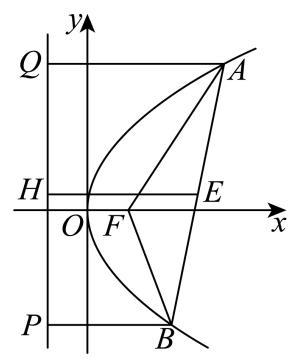

由抛物线的定义,知 $\left| {AF}\right|  = \left| {AQ}\right| ,\left| {BF}\right|  = \left| {BP}\right|$ ,根据中位线定理以及抛物线定义可得 $\left| {EH}\right|  = \frac{1}{2}\left( {a + b}\right) ,$

由余弦定理得 ${\left| AB\right| }^{2} = {a}^{2} + {b}^{2} - {2ab}\cos {150}^{ \circ  } = {a}^{2} + {b}^{2} + \sqrt{3}{ab} = {\left( a + b\right) }^{2} - \left( {2 - \sqrt{3}}\right) {ab}$ ,又 ${ab} \leq  {\left( \frac{a + b}{2}\right) }^{2}$

$\therefore {\left( a + b\right) }^{2} - \left( {2 - \sqrt{3}}\right) {ab} \geq  {\left( a + b\right) }^{2} - \frac{2 - \sqrt{3}}{4}{\left( a + b\right) }^{2} = \frac{2 + \sqrt{3}}{4}{\left( a + b\right) }^{2}$ ,当且仅当 $a = b$ 时, 等号成立,

$\therefore {\left| AB\right| }^{2} \geq  \frac{2 + \sqrt{3}}{4}{\left( a + b\right) }^{2}$ ,

$\therefore \frac{{\left| AB\right| }^{2}}{{\left| EH\right| }^{2}} \geq  \frac{\frac{2 + \sqrt{3}}{4}{\left( a + b\right) }^{2}}{{\left\lbrack  \frac{1}{2}\left( a + b\right) \right\rbrack  }^{2}} = 2 + \sqrt{3}$ ,即 $\frac{{\left| AB\right| }^{2}}{{\left| EH\right| }^{2}}$ 的最小值为 $2 + \sqrt{3}$ .

### 虹口 · 第13题

双曲线 ${y}^{2} - 2{x}^{2} = 1$ 的渐近线是( ).

A. $y =  \pm  \sqrt{2}x$

B. $x =  \pm  \sqrt{2}y$

C. $y =  \pm  {2x}$

D. $x =  \pm  {2y}$

**考点：** 双曲线渐近线

**难度依据：** 双曲线渐近线

**【答案】** A

**【解析】**

**【详解】**双曲线 ${y}^{2} - 2{x}^{2} = 1$ 的标准形式为 ${y}^{2} - \frac{{x}^{2}}{\frac{1}{2}} = 1$ ,

显然该双曲线焦点在 $y$ 轴上,其中 ${a}^{2} = 1,{b}^{2} = \frac{1}{2}$ ,即 $a = 1, b = \frac{\sqrt{2}}{2}$ ,

因为焦点在 $y$ 轴上的双曲线的渐近线公式是 $y =  \pm  \frac{a}{b}x$ ,且 $\frac{a}{b} = \frac{1}{\frac{\sqrt{2}}{2}} = \sqrt{2}$ ,

所以双曲线 ${y}^{2} - 2{x}^{2} = 1$ 的渐近线是 $y =  \pm  \sqrt{2}x$ .

### 金山 · 第15题

已知椭圆 ${\Gamma }_{1} : \frac{{x}^{2}}{{a}^{2}} + \frac{{y}^{2}}{{b}^{2}} = 1$ ,双曲线 ${\Gamma }_{2} : \frac{{y}^{2}}{{b}^{2}} - \frac{{x}^{2}}{{a}^{2}} = 1$ ,其中 $\left( {a > b > 0}\right)$ ,点 ${F}_{1}\text{ 、 }{F}_{2}$ 为椭圆 ${\Gamma }_{1}$ 的两个焦点,点 $P$ 是双曲线 ${\Gamma }_{2}$ 上一动点. 若双曲线 ${\Gamma }_{2}$ 的两条渐近线夹角的余弦值等于 $\frac{1}{3}$ ,则使得 $\bigtriangleup  {P{F}_{1}{F}_{2}}$ 为直角三角形的点 $P$ 有( )个

A. 3

B. 4

C. 6

D. 8

**考点：** 椭圆焦点与双曲线渐近线；渐近线夹角及直角点数

**难度依据：** 椭圆焦点与双曲线渐近线；渐近线夹角及直角点数

**【答案】** C

**【解析】**

**【分析】**先根据双曲线的渐近线夹角的余弦值求出 $\frac{b}{a}$ ,得到 $a = \sqrt{2}b$ ,分别按照 $\angle {F}_{1}P{F}_{2} = {90}^{ \circ  },\angle P{F}_{1}{F}_{2} = {90}^{ \circ  },\angle P{F}_{2}{F}_{1} = {90}^{ \circ  }$ 讨论求解.

**【详解】**双曲线 ${\Gamma }_{2} : \frac{{y}^{2}}{{b}^{2}} - \frac{{x}^{2}}{{a}^{2}} = 1$ 的渐近线方程为 $y =  \pm  \frac{b}{a}x$ ,

设渐近线 $y = \frac{b}{a}x$ 的倾斜角为 $\theta$ ,则 $\tan \theta  = \frac{b}{a}$ ,

$\because a > b > 0,\therefore 0 < \frac{b}{a} < 1,\therefore 0 < \tan \theta  < 1,\therefore 0 < \theta  < \frac{\pi }{4}$ ,

$\therefore$ 两条渐近线的夹角为 ${2\theta },\therefore \cos {2\theta } = \frac{1}{3}$ ,

$\because \cos {2\theta } = {\cos }^{2}\theta  - {\sin }^{2}\theta  = \frac{{\cos }^{2}\theta  - {\sin }^{2}\theta }{{\cos }^{2}\theta  + {\sin }^{2}\theta } = \frac{1 - {\tan }^{2}\theta }{1 + {\tan }^{2}\theta }$ ,

$\therefore \frac{1 - {\tan }^{2}\theta }{1 + {\tan }^{2}\theta } = \frac{1}{3},\therefore \frac{1 - {\left( \frac{b}{a}\right) }^{2}}{1 + {\left( \frac{b}{a}\right) }^{2}} = \frac{1}{3},\therefore \frac{b}{a} = \frac{\sqrt{2}}{2},\therefore a = \sqrt{2}b$ ,

椭圆 ${\Gamma }_{1} : \frac{{x}^{2}}{{a}^{2}} + \frac{{y}^{2}}{{b}^{2}} = 1,\;c = \sqrt{{a}^{2} - {b}^{2}} = \sqrt{{\left( \sqrt{2}b\right) }^{2} - {b}^{2}} = b$ ,

$\because$ 点 ${F}_{1}\text{ 、 }{F}_{2}$ 为椭圆 ${\Gamma }_{1}$ 的两个焦点, $\therefore {F}_{1}\left( {-b,0}\right) ,{F}_{2}\left( {b,0}\right)$ ,

当 $\angle {F}_{1}P{F}_{2} = {90}^{ \circ  }$ 时,以 ${F}_{1}{F}_{2}$ 为直径的圆的方程为 ${x}^{2} + {y}^{2} = {c}^{2} = {b}^{2}$ ,

双曲线 ${\Gamma }_{2} : \frac{{y}^{2}}{{b}^{2}} - \frac{{x}^{2}}{{a}^{2}} = 1$ ,将 $a = \sqrt{2}b$ 代入 ${\Gamma }_{2} : \frac{{y}^{2}}{{b}^{2}} - \frac{{x}^{2}}{{a}^{2}} = 1$ ,

得到 $\frac{{y}^{2}}{{b}^{2}} - \frac{{x}^{2}}{2{b}^{2}} = 1$ ,解得 ${y}^{2} = {b}^{2} + \frac{{x}^{2}}{2}$ ,

联立 $\left\{  \begin{array}{l} {x}^{2} + {y}^{2} = {b}^{2} \\  {y}^{2} = {b}^{2} + \frac{{x}^{2}}{2} \end{array}\right.$ ,将 ${y}^{2} = {b}^{2} + \frac{{x}^{2}}{2}$ 代入 ${x}^{2} + {y}^{2} = {b}^{2}$ ,

得到 ${x}^{2} + {b}^{2} + \frac{{x}^{2}}{2} = {b}^{2}$ ,解得 $x = 0$ ,

将 $x = 0$ 代入 ${y}^{2} = {b}^{2} + \frac{{x}^{2}}{2}$ ，解得 $y =  \pm  b$ ，

则有 2 个点 $P$ 满足 $\angle {F}_{1}P{F}_{2} = {90}^{ \circ  }$ ;

当 $\angle P{F}_{1}{F}_{2} = {90}^{ \circ  }$ 时,

过 ${F}_{1}$ 的直线为 $x =  - b$ ,将 $x =  - b$ 代入双曲线 $\frac{{y}^{2}}{{b}^{2}} - \frac{{x}^{2}}{2{b}^{2}} = 1$ ,

得到 $\frac{{y}^{2}}{{b}^{2}} - \frac{{\left( -b\right) }^{2}}{2{b}^{2}} = 1$ ,解得 $y =  \pm  \frac{\sqrt{6}}{2}b$ ,故有 2 个点 $P$ 满足 $\angle P{F}_{1}{F}_{2} = {90}^{ \circ  }$ ;

当 $\angle P{F}_{2}{F}_{1} = {90}^{ \circ  }$ 时,

过 ${F}_{2}$ 的直线为 $\mathrm{x} = \mathrm{b}$ ,将 $\mathrm{x} = \mathrm{b}$ 代入双曲线 $\frac{{y}^{2}}{{b}^{2}} - \frac{{x}^{2}}{2{b}^{2}} = 1$ ,

得到 $\frac{{y}^{2}}{{b}^{2}} - \frac{{b}^{2}}{2{b}^{2}} = 1$ ,解得 $y =  \pm  \frac{\sqrt{6}}{2}b$ ,故有 2 个点 $P$ 满足 $\angle P{F}_{2}{F}_{1} = {90}^{ \circ  }$ ;

综上可知,使得 $\bigtriangleup P{F}_{1}{F}_{2}$ 为直角三角形的点 $P$ 有 6 个,故选项 $\mathrm{C}$ 正确.

### 闵行 · 第8题

在 ${ABC}$ 中， ${AB} = 3,{AC} = 5,{BC} = 4$ ，点 $A$ 在以 $B$ 、 $C$ 为焦点的双曲线上，则该双曲线的两条渐近线的夹角大小为___.

**考点：** 双曲线焦点与渐近线夹角

**难度依据：** 双曲线焦点与渐近线夹角

**【答案】** $\frac{\pi }{3}$

**【解析】**

**【详解】**由题可知以 $B\text{ 、 }C$ 为焦点,则 ${2c} = \left| {BC}\right|  = 4 \Rightarrow  c = 2$ ,

又点 $A$ 在双曲线上,由双曲线的定义可得: $\parallel {AC}\left| -\right| {AB}\parallel  = 5 - 3 = {2a} \Rightarrow  a = 1$ ,

由双曲线的关系: ${c}^{2} = {a}^{2} + {b}^{2}$ 可得 $b = \sqrt{{c}^{2} - {a}^{2}} = \sqrt{4 - 1} = \sqrt{3}$ ,

设 ${BC}$ 在 $x$ 轴上,则双曲线的渐近线方程为 $y =  \pm  \sqrt{3}x$ ,

由 $y =  \pm  \sqrt{3}x$ 可得两条渐近线的倾斜角为 $\frac{\pi }{3}$ 和 $\frac{2\pi }{3}$ ,

根据直线夹角的定义 $\left\lbrack  {0,\frac{\pi }{2}}\right\rbrack$ 可得两条渐近线的夹角为 $\frac{\pi }{3}$ .

### 青浦 · 第2题

设抛物线 ${y}^{2} = {8x}$ 的准线方程为___.

**考点：** 抛物线标准方程与准线

**难度依据：** 抛物线标准方程与准线

**【答案】** $x =  - 2$

**【解析】**

**【分析】**由题意结合抛物线的标准方程确定其准线方程即可.

**【详解】**由抛物线方程 ${y}^{2} = {8x}$ 可得 ${2p} = 8$ ,则 $\frac{p}{2} = 2$ ,故准线方程为 $x =  - 2$ . 故答案为 $x =  - 2$ .

**【点睛】**本题主要考查由抛物线方程确定其准线的方法, 属于基础题.

### 青浦 · 第10题

已知点 $F$ 是双曲线 $E : \frac{{x}^{2}}{{a}^{2}} - \frac{{y}^{2}}{{b}^{2}} = 1\left( {a > 0, b > 0}\right)$ 的左焦点，经过原点 $O$ 的直线 $l$ 与双曲线 $E$ 交于 $P$ 、 $Q$ 两点，若 $\left| {PF}\right|  = 5\left| {QF}\right|$ 且 $\angle {PFQ} = {60}^{ \circ  }$ ，则双曲线 $E$ 的离心率为___.

**考点：** 双曲线定义和离心率；余弦定理求焦距

**难度依据：** 双曲线定义和离心率；余弦定理求焦距

**【答案】** $\frac{\sqrt{31}}{4}\# \# \frac{1}{4}\sqrt{31}$

**【解析】**

**【分析】**设 ${F}_{2}$ 是右焦点,由双曲线的对称性得 ${PFQ}{F}_{2}$ 是平行四边形,这样结合双曲线的定义可把 $\left| {PF}\right|$ 和 $\left| {P{F}_{2}}\right|$ 用 $a$ 表示,再应用余弦定理可得 $a, c$ 关系,从而得离心率.

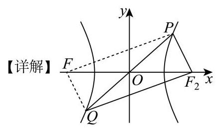

设 ${F}_{2}$ 是右焦点,由双曲线的对称性得 ${PFQ}{F}_{2}$ 是平行四边形, $\left| {P{F}_{2}}\right|  = \left| {QF}\right|$ ,

所以 $\left| {PF}\right|  = 5\left| {QF}\right|  = 5\left| {P{F}_{2}}\right|$ ,

又 $\left| {PF}\right|  - \left| {P{F}_{2}}\right|  = {2a}$ ,即 $4\left| {P{F}_{2}}\right|  = {2a},\left| {P{F}_{2}}\right|  = \frac{a}{2}$ ,则 $\left| {PF}\right|  = \frac{5a}{2}$ ,

因为 $\angle {PFQ} = {60}^{ \circ  }$ ,所以 $\angle {FP}{F}_{2} = {120}^{ \circ  }$ ,

由余弦定理得 ${\left| {F}_{1}{F}_{2}\right| }^{2} = {\left| PF\right| }^{2} + {\left| P{F}_{2}\right| }^{2} - 2\left| {PF}\right| \left| {P{F}_{2}}\right| \cos {120}^{ \circ  }$ ,

即 $4{c}^{2} = \frac{{25}{a}^{2}}{4} + \frac{{a}^{2}}{4} - 2 \times  \frac{5a}{2} \times  \frac{a}{2} \times  \left( {-\frac{1}{2}}\right)$ ,

得 $4{c}^{2} = \frac{{31}{a}^{2}}{4}$ ,即 $\frac{{c}^{2}}{{a}^{2}} = \frac{31}{16}$

所以离心率 $e = \frac{c}{a} = \frac{\sqrt{31}}{4}$ .

### 静安 · 第4题

双曲线 $\frac{{x}^{2}}{4} - {y}^{2} = 1$ 的两条渐近线夹角大小为___. (结果用反三角函数值表示)

**考点：** 双曲线渐近线夹角

**难度依据：** 双曲线渐近线夹角

**【答案】** $\arctan \frac{4}{3}$

**【解析】**

**【分析】**首先得到双曲线的两条渐近线, 再利用正切两角和差公式求解即可.

**【详解】**由题可得 $a = 2, b = 1$ ,因此渐近线方程为 $y =  \pm  \frac{b}{a}x =  \pm  \frac{1}{2}x$ ,

两条渐近线斜率为 ${k}_{1} = \tan {\theta }_{1} = \frac{1}{2},\;{k}_{2} = \tan {\theta }_{2} =  - \frac{1}{2}$ .

两直线夹角 $\theta  \in  \left( {0,\frac{\pi }{2}}\right\rbrack$ ,夹角公式为 $\tan \theta  = \left| \frac{{k}_{2} - {k}_{1}}{1 + {k}_{1}{k}_{2}}\right|$

代入得 $\tan \theta  = \left| \frac{-\frac{1}{2} - \frac{1}{2}}{1 + \left( \frac{1}{2}\right) \left( {-\frac{1}{2}}\right) }\right|  = \left| \frac{-1}{\frac{3}{4}}\right|  = \frac{4}{3}$ ,

由于 $\tan \theta  = \frac{4}{3}$ 且 $\theta  \in  \left( {0,\frac{\pi }{2}}\right\rbrack$ ，因此夹角大小为 $\arctan \frac{4}{3}$ .

### 黄浦 · 第2题

若直线 ${3x} + y - 2 = 0$ 与 $x - {ay} + 1 = 0$ 垂直，则 $a$ 的值为___.

**考点：** 两直线垂直

**难度依据：** 两直线垂直

**【答案】** 3

**【解析】**

**【详解】**若直线 ${3x} + y - 2 = 0$ 与 $x - {ay} + 1 = 0$ 垂直,

则 $3 \times  1 + 1 \times  \left( {-a}\right)  = 0$ ,解得 $a = 3$ .

### 黄浦 · 第10题

已知曲线 ${\Gamma }_{1} : {y}^{2} = {2px}\left( {p > 0}\right)$ 与曲线 ${\Gamma }_{2} : \frac{{y}^{2}}{{a}^{2}} - \frac{{x}^{2}}{{b}^{2}} = 1\left( {y > 0}\right)$ 交于两点 $P, Q$ 点 $F$ 是 ${\Gamma }_{1}$ 的焦点，点 $O$ 是坐标原点. 若 $\left| {PF}\right|  + \left| {QF}\right|  = {10}\left| {OF}\right|$ ，则 ${\Gamma }_{2}$ 的离心率为___.

**考点：** 抛物线双曲线与离心率

**难度依据：** 抛物线双曲线与离心率

**【答案】** $\sqrt{3}$

**【解析】**

**【分析】**联立抛物线和双曲线方程,根据韦达定理可得 ${x}_{1} + {x}_{2} = \frac{{2p}{b}^{2}}{{a}^{2}}$ ,结合抛物线的定义可得 $\frac{{b}^{2}}{{a}^{2}} = 2$ ,即可得双曲线离心率.

**【详解】**由题意可知: 抛物线 ${\Gamma }_{1} : {y}^{2} = {2px}\left( {p > 0}\right)$ 的焦点为 $F\left( {\frac{p}{2},0}\right)$ ,

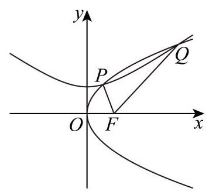

设 $P\left( {{x}_{1},{y}_{1}}\right) , Q\left( {{x}_{2},{y}_{2}}\right)$ ,

联立方程 $\left\{  \begin{array}{l} {y}^{2} = {2px} \\  \frac{{y}^{2}}{{a}^{2}} - \frac{{x}^{2}}{{b}^{2}} = 1 \end{array}\right.$ ,消去 $y$ 可得 $\frac{1}{{b}^{2}}{x}^{2} - \frac{2p}{{a}^{2}}x + 1 = 0$ ,

则 $\Delta  = \frac{4{p}^{2}}{{a}^{4}} - \frac{4}{{b}^{2}} > 0$ ,解得 ${pb} > {a}^{2}$ ,可得 ${x}_{1} + {x}_{2} = \frac{{2p}{b}^{2}}{{a}^{2}}$ ,

又因为 $\left| {PF}\right|  + \left| {QF}\right|  = {10}\left| {OF}\right|$ ,则 ${x}_{1} + \frac{p}{2} + {x}_{2} + \frac{p}{2} = {10} \times  \frac{p}{2}$ ,

即 ${x}_{1} + {x}_{2} = {4p}$ ,可得 $\frac{{2p}{b}^{2}}{{a}^{2}} = {4p}$ ,可得 $\frac{{b}^{2}}{{a}^{2}} = 2$ ,

所以双曲线 ${\Gamma }_{2}$ 的离心率为 $e = \frac{c}{a} = \sqrt{1 + \frac{{b}^{2}}{{a}^{2}}} = \sqrt{3}$ .

## 直线与曲线交点、弦及定值定点

联立与韦达需保留判别式、退化情形和分支限制，完整呈现综合大题。

### 嘉定 · 第20题

已知椭圆 $\Gamma  : \frac{{x}^{2}}{{a}^{2}} + \frac{{y}^{2}}{4} = 1\left( {a > 2}\right)$ 与直线 ${l}_{1} : y = \frac{x}{2}\text{ 、 }{l}_{2} : y =  - \frac{x}{2}$ . 过椭圆上一点 $P$ 作 ${l}_{1}$ 的平行线交 ${l}_{2}$ 于点 $M$ ，作 ${l}_{2}$ 的平行线交 ${l}_{1}$ 于点 $N$ .

(1)当 $P$ 为椭圆的上顶点时，求 $\left| {MN}\right|$ 的大小；

(2)若椭圆的离心率 $e = \frac{\sqrt{3}}{2}$ ，求椭圆 $\Gamma$ 的方程，并求 $\left| {\overrightarrow{OM} + \overrightarrow{ON}}\right|$ 的最大值与最小值；

(3)若 $\left| {MN}\right|$ 为定值(与点 $P$ 的位置无关)，求 $a$ 的值，并求此时四边形 ${ONPM}$ 面积的最大值.

> 本题资料或解析有待核事项，预览不可作为已审定成品。

**考点：** (1) 椭圆顶点与平行线关系；(2) 椭圆离心率与向量模的范围；(3) 定值条件与面积最值

**难度依据：** 椭圆与向量定值面积最值

**核查说明：** 题干与答案解析尚未逐页对照原卷，数学内容未独立终审。

**【答案】** (1) 4 (2)最大值为 4，最小值为 2

(3) $a = 8$ ，四边形 ${ONPM}$ 面积的最大值为 16

**【解析】**

**【分析】**(1) 根据条件分别求直线 ${PM}$ 和 ${PN}$ 的方程,再联立直线求交点 $M, N$ 的坐标, 即可求解;

(2)首先根据离心率求椭圆方程，再根据向量的平行四边形法则转化为求 $\left| \overrightarrow{OP}\right|$ 的最值;

(3)首先根据点 $P$ 的坐标求直线 ${PM}$ 和 ${PN}$ 的方程，通过联立直线方程求点 $M$ ， $N$ 的坐标,再代入两点间距离公式,根据定值求 $a$ ,首先角的关系求 $\cos \angle {MON}$ ,再根据 $\left| {MN}\right|$ 为定值 4，分两种情况，结合余弦定理和基本不等式求 $\bigtriangleup  {MON}$ 面积的最大值，再求四边形 ONPM 面积的最大值.

**【小问 1 详解】**

当点 $P$ 在椭圆的上顶点时, $P\left( {0,2}\right) ,{l}_{PM} : y = \frac{x}{2} + 2,{l}_{PN} : y =  - \frac{x}{2} + 2$ ,

联立 $\left\{  \begin{array}{l} y = \frac{x}{2} + 2 \\  y =  - \frac{x}{2} \end{array}\right.$ ,得 $\left\{  \begin{array}{l} x =  - 2 \\  y = 1 \end{array}\right.$ ,即 $M\left( {-2,1}\right)$ ,

联立 $\left\{  \begin{array}{l} y =  - \frac{x}{2} + 2 \\  y = \frac{x}{2} \end{array}\right.$ ，得 $\left\{  \begin{array}{l} x = 2 \\  y = 1 \end{array}\right.$ ，即 $N\left( {2,1}\right)$ ，

所以 $\left| {MN}\right|  = \left| {2 - \left( {-2}\right) }\right|  = 4$ ；

**【小问 2 详解】**

椭圆的离心率 $e = \frac{\sqrt{{a}^{2} - 4}}{a} = \frac{\sqrt{3}}{2}$ ,得 ${a}^{2} = {16}$ ,

所以椭圆方程为 $\frac{{x}^{2}}{16} + \frac{{y}^{2}}{4} = 1$ ;

由条件可知四边形 ${ONPM}$ 是平行四边形,所以 $\overrightarrow{OM} + \overrightarrow{ON} = \overrightarrow{OP}$ ,

设 $P\left( {{x}_{0},{y}_{0}}\right) , - 4 \leq  {x}_{0} \leq  4$ ,

所以 $\left| {\overrightarrow{OM} + \overrightarrow{ON}}\right|  = \left| \overrightarrow{OP}\right|  = \sqrt{{x}_{0}^{2} + {y}_{0}^{2}} = \sqrt{\frac{3}{4}{x}_{0}^{2} + 4} \in  \left\lbrack  {2,4}\right\rbrack$ ,

所以 $\left| {\overrightarrow{OM} + \overrightarrow{ON}}\right|$ 的最大值为 4 ,最小值为 2 ;

**【小问 3 详解】**

设 $P\left( {{x}_{0},{y}_{0}}\right)$ ,则 ${l}_{PM} : y - {y}_{0} = \frac{1}{2}\left( {x - {x}_{0}}\right) ,{l}_{PN} : y - {y}_{0} =  - \frac{1}{2}\left( {x - {x}_{0}}\right)$ ,

联立 $\left\{  \begin{array}{l} y - {y}_{0} = \frac{1}{2}\left( {x - {x}_{0}}\right) \\  y =  - \frac{1}{2}x \end{array}\right.$ ,解得: $x = \frac{{x}_{0}}{2} - {y}_{0}, y =  - \frac{{x}_{0}}{4} + \frac{{y}_{0}}{2}$ ,

即 $M\left( {\frac{{x}_{0}}{2} - {y}_{0}, - \frac{{x}_{0}}{4} + \frac{{y}_{0}}{2}}\right)$ ,

联立 $\left\{  \begin{array}{l} y - {y}_{0} =  - \frac{1}{2}\left( {x - {x}_{0}}\right) \\  y = \frac{1}{2}x \end{array}\right.$ ,解得: $x = \frac{{x}_{0}}{2} + {y}_{0}, y = \frac{{x}_{0}}{4} + \frac{{y}_{0}}{2}$ ,

即 $N\left( {\frac{{x}_{0}}{2} + {y}_{0},\frac{{x}_{0}}{4} + \frac{{y}_{0}}{2}}\right)$ ,

因为点 $P$ 在椭圆上,满足 $\frac{{x}_{0}^{2}}{{a}^{2}} + \frac{{y}_{0}^{2}}{4} = 1$ ,

所以 $\left| {MN}\right|  = \sqrt{4{y}_{0}^{2} + \frac{{x}_{0}^{2}}{4}} = \sqrt{4 \times  4 \times  \left( {1 - \frac{{x}_{0}^{2}}{{a}^{2}}}\right)  + \frac{{x}_{0}^{2}}{4}} = \sqrt{{16} + \left( {\frac{1}{4} - \frac{16}{{a}^{2}}}\right) {x}_{0}^{2}}$

因为 $\left| {MN}\right|$ 为定值，所以与 ${x}_{0}$ 无关，所以 $\frac{1}{4} - \frac{16}{{a}^{2}} = 0$ ，得 ${a}^{2} = {64}$ ，则 $a = 8$ ； 此时 $\left| {MN}\right|  = 4$ ,

如图: 由条件可知, $\tan \angle {NOx} = \frac{1}{2}$ ,则 $\cos \angle {NOx} = \frac{2}{\sqrt{5}} = \frac{2\sqrt{5}}{5}$ ,

$\cos \angle {MON} = \cos \left( {\pi  - 2\angle {NOx}}\right)  =  - \cos 2\angle {NOx} = 1 - 2{\cos }^{2}\angle {NOx} =  - \frac{3}{5}$ ,

则 $\sin \angle {MON} = \frac{4}{5}$ ，且 $\left| {MN}\right|$ 为定值 4 ，

$\bigtriangleup {MON}$ 中根据余弦定理, ${\left| MN\right| }^{2} = {\left| OM\right| }^{2} + {\left| ON\right| }^{2} - 2\left| {OM}\right| \left| {ON}\right| \cos \angle {MON}$ ,

$= {\left| OM\right| }^{2} + {\left| ON\right| }^{2} + \frac{6}{5}\left| {OM}\right| \left| {ON}\right|  \geq  \frac{16}{5}\left| {OM}\right| \left| {ON}\right|$ ,

即 $\left| {OM}\right| \left| {ON}\right|  \leq  5$ ，所以 ${S}_{\bigtriangleup {MON}} = \frac{1}{2}\left| {OM}\right| \left| {ON}\right| \sin \angle {MON} \leq  2$ ，

而四边形 ${ONPM}$ 是平行四边形， ${S}_{\square {ONPM}} = 2{S}_{\bigtriangleup {MON}} \leq  4$ ，当 $\left| {OM}\right|  = \left| {ON}\right|$ 时等号成立，

此时，四边形 ONPM 的最大值为 4 ，

如下图:由以上可知， $\cos \angle {MON} = \frac{3}{5}$ ， $\left| {MN}\right|  = 4$ ，

$\bigtriangleup {MON}$ 中根据余弦定理, ${\left| MN\right| }^{2} = {\left| OM\right| }^{2} + {\left| ON\right| }^{2} - 2\left| {OM}\right| \left| {ON}\right| \cos \angle {MON}$ ,

$= {\left| OM\right| }^{2} + {\left| ON\right| }^{2} - \frac{6}{5}\left| {OM}\right| \left| {ON}\right|  \geq  \frac{4}{5}\left| {OM}\right| \left| {ON}\right|$ ,

即 $\left| {OM}\right| \left| {ON}\right|  \leq  {20}$ ,所以 ${S}_{\bigtriangleup {MON}} = \frac{1}{2}\left| {OM}\right| \left| {ON}\right| \sin \angle {MON} \leq  8$ ,

而四边形 ${ONPM}$ 是平行四边形, ${S}_{\square {ONPM}} = 2{S}_{\bigtriangleup {MON}} \leq  {16}$ ,当 $\left| {OM}\right|  = \left| {ON}\right|$ 时等号成立,

综上两种情况可知,四边形 ${ONPM}$ 的最大值为 16 .

### 奉贤 · 第20题

已知椭圆 $\Gamma  : \frac{{x}^{2}}{{a}^{2}} + \frac{{y}^{2}}{{b}^{2}} = 1\left( {a > b > 0}\right)$ 经过点 $\left( {0,1}\right)$ ,离心率为 $\frac{\sqrt{2}}{2}$ . 过点 $M\left( {0, - m}\right)$ , $m > 0$ 的动直线 $l$ 交椭圆 $\Gamma$ 于 $C, D$ 两点.

(1)求椭圆下的方程；

(2)若直线 $l$ 与 ${x}^{2} + {y}^{2} = \frac{2}{3}$ 相切,求当 $m = 2$ 时, ${CD}$ 的长;

(3)若以 ${CD}$ 为直径的圆经过 $x$ 轴上方的定点 $P$ ，求点 $P$ 的坐标.

**考点：** (1) 离心率求椭圆方程；(2) 切线条件及弦长；(3) 数量积建立直径圆定点

**难度依据：** 椭圆方程弦长和直径圆定点；数量积表示圆周角

**【答案】** (1) $\frac{{x}^{2}}{2} + {y}^{2} = 1$

(2) $\frac{4\sqrt{21}}{11}$

(3) $P\left( {0,1}\right)$

**【解析】**

**【分析】**(1) 利用离心率及所过点计算即可得;

(2)设出直线 $l$ 后,利用圆的切线的性质计算可得 ${k}^{2}$ ，联立直线与曲线方程，消去 $y$ 可得与横坐标相关韦达定理, 再利用弦长公式计算即可得;

(3) 设 $l : y = {kx} - m, P\left( {s, t}\right) \left( {t > 0}\right)$ ,联立直线与曲线方程,消去 $y$ 可得与横坐标相关韦达定理,再利用圆上的点的性质,借助向量有 $\overrightarrow{PC} \cdot  \overrightarrow{PD} = 0$ ,计算后可得与 $s\text{ 、 }t\text{ 、 }k\text{ 、 }m$ 有关等式,再利用定点性质计算即可得解.

**【小问 1 详解】**

由题意可得 $\left\{  \begin{array}{l} \frac{c}{a} = \frac{\sqrt{2}}{2} \\  \frac{1}{{b}^{2}} = 1 \\  {a}^{2} = {b}^{2} + {c}^{2} \end{array}\right.$ ,解得 $\left\{  \begin{array}{l} a = \sqrt{2} \\  b = 1 \\  c = 1 \end{array}\right.$ ,

故椭圆 $\Gamma$ 的方程为 $\frac{{x}^{2}}{2} + {y}^{2} = 1$ ;

**【小问 2 详解】**

由 $m = 2$ ,则 $M\left( {0, - 2}\right)$ ,可设 $l : y = {kx} - 2, C\left( {{x}_{1},{y}_{1}}\right) \text{ 、 }D\left( {{x}_{2},{y}_{2}}\right)$ ,

则由直线 $l$ 与 ${x}^{2} + {y}^{2} = \frac{2}{3}$ 相切,可得 $\frac{\left| -2\right| }{\sqrt{{k}^{2} + 1}} = \sqrt{\frac{2}{3}}$ ,化简得 ${k}^{2} = 5$ ,

联立 $\left\{  \begin{array}{l} y = {kx} - 2 \\  \frac{{x}^{2}}{2} + {y}^{2} = 1 \end{array}\right.$ ，消去 $y$ 可得 $\left( {2{k}^{2} + 1}\right) {x}^{2} - {8kx} + 6 = 0$ ，

$\Delta  = {\left( -8k\right) }^{2} - 4\left( {2{k}^{2} + 1}\right)  \times  6 = {16}{k}^{2} - {24} = {16} \times  5 - {24} = {56} > 0,$

则 ${x}_{1} + {x}_{2} = \frac{8k}{2{k}^{2} + 1},\;{x}_{1}{x}_{2} = \frac{6}{2{k}^{2} + 1}$ ,

则 $\left| {CD}\right|  = \sqrt{{k}^{2} + 1} \cdot  \sqrt{{\left( {x}_{1} + {x}_{2}\right) }^{2} - 4{x}_{1}{x}_{2}} = \sqrt{{k}^{2} + 1} \cdot  \sqrt{{\left( \frac{8k}{2{k}^{2} + 1}\right) }^{2} - 4 \times  \frac{6}{2{k}^{2} + 1}} \; = \frac{\sqrt{{k}^{2} + 1}}{2{k}^{2} + 1} \cdot  \sqrt{{16}{k}^{2} - {24}} = \frac{2\sqrt{2} \cdot  \sqrt{{k}^{2} + 1} \cdot  \sqrt{2{k}^{2} - 3}}{2{k}^{2} + 1} \; = \frac{2\sqrt{2} \times  \sqrt{5 + 1} \times  \sqrt{2 \times  5 - 3}}{2 \times  5 + 1} = \frac{4\sqrt{21}}{11};$

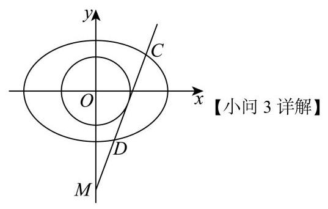

设 $l : y = {kx} - m, C\left( {{x}_{1},{y}_{1}}\right) \text{ 、 }D\left( {{x}_{2},{y}_{2}}\right) , P\left( {s, t}\right) \left( {t > 0}\right)$ ,

联立 $\left\{  \begin{array}{l} y = {kx} - m \\  \frac{{x}^{2}}{2} + {y}^{2} = 1 \end{array}\right.$ ,消去 $y$ 可得 $\left( {2{k}^{2} + 1}\right) {x}^{2} - {4kmx} + 2{m}^{2} - 2 = 0$ ,

$\Delta  = {\left( -4km\right) }^{2} - 4\left( {2{k}^{2} + 1}\right) \left( {2{m}^{2} - 2}\right)  = {16}{m}^{2}{k}^{2} - {16}{m}^{2}{k}^{2} + 8 - 8{m}^{2} + {16}{k}^{2}$

$= 8 - 8{m}^{2} + {16}{k}^{2} > 0$ ,即 $2{k}^{2} - {m}^{2} + 1 > 0$ ,

${x}_{1} + {x}_{2} = \frac{4km}{2{k}^{2} + 1},\;{x}_{1}{x}_{2} = \frac{2{m}^{2} - 2}{2{k}^{2} + 1},$

由点 $P$ 在以 ${CD}$ 为直径的圆上,则 $\overrightarrow{PC} \cdot  \overrightarrow{PD} = 0$ ,

由 $\overrightarrow{PC} = \left( {{x}_{1} - s,{y}_{1} - t}\right) ,\overrightarrow{PD} = \left( {{x}_{2} - s,{y}_{2} - t}\right)$ ,

则 $\overrightarrow{PC} \cdot  \overrightarrow{PD} = \left( {{x}_{1} - s}\right) \left( {{x}_{2} - s}\right)  + \left( {{y}_{1} - t}\right) \left( {{y}_{2} - t}\right)$

$= {x}_{1}{x}_{2} - s\left( {{x}_{1} + {x}_{2}}\right)  + {s}^{2} + {y}_{1}{y}_{2} - t\left( {{y}_{1} + {y}_{2}}\right)  + {t}^{2}$

$= {x}_{1}{x}_{2} - s\left( {{x}_{1} + {x}_{2}}\right)  + {s}^{2} + \left( {k{x}_{1} - m}\right) \left( {k{x}_{2} - m}\right)  - t\left( {k{x}_{1} - m + k{x}_{2} - m}\right)  + {t}^{2}$

$= \left( {{k}^{2} + 1}\right) {x}_{1}{x}_{2} - \left( {s + {km} + {tk}}\right) \left( {{x}_{1} + {x}_{2}}\right)  + {s}^{2} + {t}^{2} + {m}^{2} + {2tm}$

$$
= \frac{\left( {2{m}^{2} - 2}\right) \left( {{k}^{2} + 1}\right) }{2{k}^{2} + 1} - \frac{{4km}\left( {s + {km} + {tk}}\right) }{2{k}^{2} + 1} + \frac{\left( {{s}^{2} + {t}^{2} + {m}^{2} + {2tm}}\right) \left( {2{k}^{2} + 1}\right) }{2{k}^{2} + 1}
$$

$$
= \frac{-2{k}^{2} + 3{m}^{2} - 2 - {4kms} + 2{k}^{2}{s}^{2} + 2{k}^{2}{t}^{2} + {s}^{2} + {t}^{2} + {2tm}}{2{k}^{2} + 1}
$$

$$
= \frac{\left( {2{t}^{2} + 2{s}^{2} - 2}\right) {k}^{2} - {4msk} + 3{m}^{2} + {s}^{2} + {t}^{2} + {2tm} - 2}{2{k}^{2} + 1} = 0,
$$

即 $\left( {2{t}^{2} + 2{s}^{2} - 2}\right) {k}^{2} - {4msk} + 3{m}^{2} + {s}^{2} + {t}^{2} + {2tm} - 2 = 0$

故 $\left\{  \begin{array}{l} 2{t}^{2} + 2{s}^{2} - 2 = 0 \\   - {4s} = 0 \\  3{m}^{2} + {s}^{2} + {t}^{2} + {2tm} - 2 = 0 \end{array}\right.$ ,则有 $\left\{  \begin{array}{l} s = 0 \\  {t}^{2} = 1 \\  3{m}^{2} + {2tm} - 1 = 0 \end{array}\right.$ ,

由 $t > 0$ ,故 $t = 1$ ,则有 $3{m}^{2} + {2m} - 1 = \left( {{3m} - 1}\right) \left( {m + 1}\right)  = 0$ ,

即 $m = \frac{1}{3}$ 或 $m =  - 1$ ,由 $m > 0$ ,故 $m = \frac{1}{3}$ ,

即当且仅当 $m = \frac{1}{3}$ 时，以 ${CD}$ 为直径的圆经过 $x$ 轴上方的定点 $P$ ， 且 $P$ 点坐标为 $\left( {0,1}\right)$ .

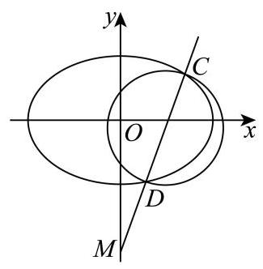

### 宝山 · 第20题

将以坐标原点为顶点,以 $x$ 轴为对称轴,并经过点 $P\left( {1,1}\right)$ 的抛物线记为 $C$ . 作两条直线分别与抛物线 $C$ 相交于点 $A\left( {{x}_{1},{y}_{1}}\right) \text{ 、 }B\left( {{x}_{2},{y}_{2}}\right)$ ,设 ${PA}\text{ 、 }{PB}$ 的斜率分别为 ${k}_{PA}\text{ 、 }{k}_{PB}$ ,且满足 ${k}_{PA} + {k}_{PB} = 0.$

(1)求抛物线 $C$ 的标准方程；

(2)证明:直线 ${AB}$ 的斜率 ${k}_{AB} =  - \frac{1}{2}$ ；

(3)若直线 ${AB}$ 在 $y$ 轴上的截距 $b \in  \left\lbrack  {0,1}\right\rbrack$ ，求 $\bigtriangleup  {ABP}$ 面积的最大值.

**考点：** (1) 代点求抛物线方程；(2) 联立及韦达关系证明弦斜率定值；(3) 弦长与点线距离建立面积函数

**难度依据：** 抛物线弦斜率定值与面积最值；构造函数求弦面积最大值

**【答案】** (1) ${y}^{2} = x$ ； (2) 证明见解析;

(3) $\frac{{16}\sqrt{3}}{9}$ .

**【解析】**

**【分析】**(1) 待定系数法设出抛物线的表达式,代入点 $P$ 的坐标求解即可;

(2)联立 ${PA}\text{ 、 }{PB}$ 与抛物线方程，求出 $A\text{ 、 }B$ 的坐标，利用斜率公式求解即可；

(3)用含 $b$ 的式子表示弦长 $\left| {AB}\right|$ 及点 $P$ 到直线 ${AB}$ 的距离，进而表示 $\bigtriangleup  {ABP}$ 面积，利用函数求最值即可.

**【小问 1 详解】**

由题意,设所求抛物线 $C$ 的方程为: ${y}^{2} = {mx}$ ,

点 $P\left( {1,1}\right)$ 代入抛物线 $C$ 的方程得: $m = 1$ ,

所以抛物线 $C$ 的标准方程为: ${y}^{2} = x$ .

**【小问 2 详解】**

由题意直线 ${PA}$ 的方程可设为 $y - 1 = {k}_{PA}\left( {x - 1}\right)$ ,

联立 $\left\{  \begin{array}{l} y - 1 = {k}_{PA}\left( {x - 1}\right) \\  {y}^{2} = x \end{array}\right.$ ,代入化简得 ${k}_{PA}{y}^{2} - y + 1 - {k}_{PA} = 0$ ,

由题意 $\Delta  > 0$ ,从而 ${y}_{1} \times  {y}_{P} = \frac{1 - {k}_{PA}}{{k}_{PA}}$ ,即 ${y}_{1} = \frac{1 - {k}_{PA}}{{k}_{PA}}$ ,

从而 ${x}_{1} = {y}_{1}^{2} = {\left( \frac{1 - {k}_{PA}}{{k}_{PA}}\right) }^{2}$ ,即 $A\left( {{\left( \frac{1 - {k}_{PA}}{{k}_{PA}}\right) }^{2},\frac{1 - {k}_{PA}}{{k}_{PA}}}\right)$ ;

同理可得 ${y}_{2} = \frac{1 - {k}_{PB}}{{k}_{PB}}, B\left( {{\left( \frac{1 - {k}_{PB}}{{k}_{PB}}\right) }^{2},\frac{1 - {k}_{PB}}{{k}_{PB}}}\right)$ ,

${y}_{1} + {y}_{2} = \frac{1 - {k}_{PA}}{{k}_{PA}} + \frac{1 - {k}_{PB}}{{k}_{PB}} = \frac{1}{{k}_{PA}} - 1 + \frac{1}{{k}_{PB}} - 1 = \frac{{k}_{PA} + {k}_{PB}}{{k}_{PA} \cdot  {k}_{PB}} - 2,$

又 ${k}_{PA} + {k}_{PB} = 0$ ，所以 ${y}_{1} + {y}_{2} = \frac{{k}_{PA} + {k}_{PB}}{{k}_{PA} \cdot  {k}_{PB}} - 2 =  - 2$ ，

所以 ${k}_{AB} = \frac{{y}_{1} - {y}_{2}}{{x}_{1} - {x}_{2}} = \frac{{y}_{1} - {y}_{2}}{{y}_{1}^{2} - {y}_{2}^{2}} = \frac{{y}_{1} - {y}_{2}}{\left( {{y}_{1} - {y}_{2}}\right) \left( {{y}_{1} + {y}_{2}}\right) } = \frac{1}{{y}_{1} + {y}_{2}} =  - \frac{1}{2}$ .

由(2)可知 ${k}_{AB} =  - \frac{1}{2}$ ，

设直线 ${AB}$ 的表达式为 $y =  - \frac{1}{2}x + b$ ,即 $x + {2y} - {2b} = 0$

联立 $\left\{  \begin{array}{l} {y}^{2} = x \\  x + {2y} - {2b} = 0 \end{array}\right.$ ,代入化简整理得: ${y}^{2} + {2y} - {2b} = 0$ ,

由 $b \in  \left\lbrack  {0,1}\right\rbrack$ 故 $\Delta  = {2}^{2} - 4 \times  1 \times  \left( {-{2b}}\right)  = 4 + {8b} > 0$ ,

从而 ${y}_{1} + {y}_{2} =  - 2,{y}_{1}{y}_{2} =  - {2b}$ ,

$\left| {AB}\right|  = \sqrt{1 + {\left( \frac{1}{{k}_{AB}}\right) }^{2}}\left| {{y}_{1} - {y}_{2}}\right|  = \sqrt{5} \times  \sqrt{{\left( {y}_{1} + {y}_{2}\right) }^{2} - 4{y}_{1}{y}_{2}} = \sqrt{{20} + {40b}}$

点 $P$ 到直线 ${AB}$ 的距离 $d = \frac{\left| 1 + 2 \times  1 - 2b\right| }{\sqrt{{1}^{2} + {2}^{2}}} = \frac{\left| 3 - 2b\right| }{\sqrt{5}}$ ，

${S}_{\bigtriangleup {ABP}} = \frac{1}{2}\left| {AB}\right|  \cdot  d = \frac{1}{2} \times  \sqrt{{20} + {40b}} \times  \frac{\left| 3 - 2b\right| }{\sqrt{5}} = \left( {3 - {2b}}\right) \sqrt{1 + {2b}},$

令 $t = \sqrt{1 + {2b}}$ ,则 $t \in  \left\lbrack  {1,\sqrt{3}}\right\rbrack  ,{S}_{\bigtriangleup {ABP}} = \left( {4 - {t}^{2}}\right) t = {4t} - {t}^{3}$ ,

设 $h\left( t\right)  = {4t} - {t}^{3}$ ,则 ${h}^{\prime }\left( t\right)  = 4 - 3{t}^{2}$ , 令 ${h}^{\prime }\left( t\right)  = 0$ ,解得 $t = \frac{2}{\sqrt{3}} = \frac{2\sqrt{3}}{3}$ (负值舍去)

则当 $t \in  \left\lbrack  {1,\frac{2\sqrt{3}}{3}}\right\rbrack$ 时, ${h}^{\prime }\left( t\right)  > 0, h\left( t\right)  = {4t} - {t}^{3}$ 单调递增;

当 $t \in  \left\lbrack  {\frac{2\sqrt{3}}{3},\sqrt{3}}\right\rbrack$ 时, ${h}^{\prime }\left( t\right)  < 0, h\left( t\right)  = {4t} - {t}^{3}$ 单调递减;

从而 $h{\left( t\right) }_{\max } = 4 \times  \frac{2\sqrt{3}}{3} - {\left( \frac{2\sqrt{3}}{3}\right) }^{3} = \frac{16}{9}\sqrt{3}$ ,

即 $\bigtriangleup  {ABP}$ 面积的最大值为 $\frac{16}{9}\sqrt{3}$ .

### 崇明 · 第20题

已知椭圆 $C : \frac{{x}^{2}}{4} + \frac{{y}^{2}}{3} = 1$ .

(1)求椭圆 $C$ 的离心率 $e$ ；

(2)已知椭圆右顶点为 $A$ ，设点 $M$ 为 $y$ 轴正半轴上一点，点 $P$ 为椭圆 $C$ 上的一点. 若 $\overrightarrow{AP} = 2\overrightarrow{PM}$ ,求点 $M$ 的坐标;

(3)已知 $G\left( {\frac{5}{2},0}\right)$ ，过点 $R\left( {4,0}\right)$ 的直线交椭圆 $C$ 于 $D$ ， $E$ 两点，直线 ${DG}$ 交直线 $x = 1$ 于点 $H$ ,证明: ${EH} \bot  y$ 轴.

**考点：** (1) 椭圆离心率；(2) 向量分点及椭圆坐标；(3) 直线与椭圆联立、韦达及坐标证明

**难度依据：** 椭圆离心率分点及直线定向；分点坐标和共线条件

**【答案】** (1) $\frac{1}{2}$ ;

(2) $\left( {0,\sqrt{6}}\right)$ ；

(3) 证明见详解.

**【解析】**

**【分析】**(1) 根据离心率定义直接计算可得;

(2)设 $M\left( {0, m}\right) , m > 0$ 利用向量关系表示出点 $P$ 坐标，代入椭圆方程即可得解；

(3)利用韦达定理表示出点 $E$ 的纵坐标，利用向量共线表示出点 $H$ 的纵坐标，证明 $E$ 和 $H$ 的纵坐标相等即可得证.

**【小问 1 详解】**

记椭圆 $C : \frac{{x}^{2}}{4} + \frac{{y}^{2}}{3} = 1$ 的长轴长为 ${2a}$ ,短轴长为 ${2b}$ ,焦距为 ${2c}$ ,

则 $a = 2, b = \sqrt{3}, c = \sqrt{{a}^{2} - {b}^{2}} = 1$ ,所以离心率 $e = \frac{c}{a} = \frac{1}{2}$ .

**【小问 2 详解】**

由题知, $A\left( {2,0}\right)$ ,设 $M\left( {0, m}\right) , m > 0, P\left( {{x}_{P},{y}_{P}}\right)$ ,

因为 $\overrightarrow{AP} = \left( {{x}_{P} - 2,{y}_{P}}\right) ,\overrightarrow{PM} = \left( {-{x}_{P}, m - {y}_{P}}\right) ,\overrightarrow{AP} = 2\overrightarrow{PM}$ ,

所以 $\left( {{x}_{P} - 2,{y}_{P}}\right)  = 2\left( {-{x}_{P}, m - {y}_{P}}\right)$ ,得 ${x}_{P} = \frac{2}{3},{y}_{P} = \frac{2m}{3}$ ,

代入椭圆方程得 $\frac{1}{9} + \frac{4{m}^{2}}{27} = 1$ ,解得 $m = \sqrt{6}$ (负根舍去)

**【小问 3 详解】**

易知,当直线 ${DE}$ 斜率为 0 时, $D, E$ 为长轴端点, $H$ 与右焦点重合,满足题意;

设直线 ${DE}$ 的方程为 $x = {ny} + 4, D\left( {{x}_{1},{y}_{1}}\right) , E\left( {{x}_{2},{y}_{2}}\right)$ ,

联立 $\left\{  \begin{array}{l} \frac{{x}^{2}}{4} + \frac{{y}^{2}}{3} = 1 \\  x = {ny} + 4 \end{array}\right.$ 得: $\left( {3{n}^{2} + 4}\right) {y}^{2} + {24ny} + {36} = 0$ ,

由 $\Delta  = {\left( {24}n\right) }^{2} - 4\left( {3{n}^{2} + 4}\right)  \times  {36} = {144}\left( {{n}^{2} - 4}\right)  > 0$ 得 $n <  - 2$ 或 $n > 2$ ,

则 ${y}_{1} + {y}_{2} = \frac{-{24n}}{3{n}^{2} + 4},{y}_{1}{y}_{2} = \frac{36}{3{n}^{2} + 4}$ ,

所以 $3\left( {{y}_{1} + {y}_{2}}\right)  =  - {2n}{y}_{1}{y}_{2}$ ,则 ${y}_{2} = \frac{-3{y}_{1}}{3 + {2n}{y}_{1}}$ ,

设 $H\left( {1, h}\right)$ ，因为 $D, H, G$ 三点共线，则 $\overrightarrow{DH}//\overrightarrow{HG}$ ， $\overrightarrow{DH} = \left( {1 - {x}_{1}, h - {y}_{1}}\right) ,\overrightarrow{HG} = \left( {\frac{3}{2}, - h}\right)$ ，

所以 $- h\left( {1 - {x}_{1}}\right)  = \frac{3}{2}\left( {h - {y}_{1}}\right)$ ,则 $h = \frac{3{y}_{1}}{5 - 2{x}_{1}} = \frac{3{y}_{1}}{5 - 2\left( {n{y}_{1} + 4}\right) } = \frac{-3{y}_{1}}{3 + {2n}{y}_{1}}$ ,

所以 $h = {y}_{2}$ ,所以 ${EH} \bot  y$ 轴.

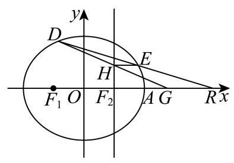

### 徐汇 · 第20题

已知无穷数列 $\left\{  {\lambda }_{n}\right\}$ 为严格增数列,且 ${\lambda }_{n} > 0$ . 双曲线 ${C}_{n}$ 的方程为 ${x}^{2} - {y}^{2} = {\lambda }_{n}{}^{2},{A}_{n}\text{ 、 }{B}_{n}$ 为双曲线 ${C}_{n}$ 上两个不同的动点,其中 ${A}_{n}$ 在双曲线 ${C}_{n}$ 的右支上.

(1)若 ${\lambda }_{1} = 1$ ，求双曲线 ${C}_{1}$ 的渐近线方程和焦点坐标；

(2)若 ${\lambda }_{1} = 1,{\lambda }_{2} = 2$ ，且点 $T\left( {t,0}\right)$ 为线段 ${A}_{1}{A}_{2}$ 的中点，求实数 $t$ 的取值范围；

(3)已知直线 ${A}_{n}{B}_{n}$ 过双曲线 ${C}_{n + 1}$ 的右顶点. 若 ${B}_{n}$ 在双曲线 ${C}_{n}$ 的右支上，则称弦 ${A}_{n}{B}_{n}$ 为双曲线 ${C}_{n}$ 的“同支弦”，否则称其为双曲线 ${C}_{n}$ 的“异支弦”. 是否存在等差数列 $\left\{  {\lambda }_{n}\right\}$ ，使得对于任意正整数 $n$ ,双曲线 ${C}_{n}$ “同支弦”弦长的最小值均大于双曲线 ${C}_{n}$ “异支弦”弦长的最小值? 若存在,请求出数列 $\left\{  {\lambda }_{n}\right\}$ 的通项公式; 若不存在,请说明理由.

**考点：** (1)求双曲线渐近线与焦点；(2)双曲线右支坐标与中点范围；(3)求两类弦长最小值并比较等差增长

**难度依据：** 直线联立和弦长最值与数列增长结合

**【答案】** (1) 渐近线方程 $y =  \pm  x$ ; 焦点坐标为 $\left( {\pm \sqrt{2},0}\right)$ .

(2) $\left\lbrack  {\frac{3}{2}, + \infty }\right)$

(3)不存在，理由见解析

**【解析】**

**【分析】**(1) 根据双曲线的标准方程求出 $a, b, c$ 的值,进而得到渐近线方程和焦点坐标.

(2)先设出 ${A}_{1},{A}_{2}$ 的坐标，再根据中点坐标公式得到 $t$ 关于 ${x}_{1},{x}_{2}$ 的表达式，最后结合双曲线的性质求出 $t$ 的取值范围.

(3)先设出直线 ${A}_{n}{B}_{n}$ 的方程，然后分别联立直线与双曲线 ${C}_{n},{C}_{n + 1}$ 的方程，求出 “同支弦” 和“异支弦”弦长的表达式，再根据条件列出不等式，进而判断是否存在满足条件的等差数列 $\left\{  {\lambda }_{n}\right\}$ .

**【小问 1 详解】**

当 ${\lambda }_{1} = 1$ 时,双曲线 ${C}_{1}$ 的方程为 ${x}^{2} - {y}^{2} = 1$ ,此时 $a = b = 1$ .

根据双曲线渐近线方程 $y =  \pm  \frac{b}{a}x$ 可得 $y =  \pm  x$ .

根据 ${c}^{2} = {a}^{2} + {b}^{2}$ 可得 $c = \sqrt{1 + 1} = \sqrt{2}$ ,焦点在 $x$ 轴上,所以焦点坐标为 $\left( {\pm \sqrt{2},0}\right)$ .

**【小问 2 详解】**

设 ${A}_{1}\left( {{x}_{1},{y}_{1}}\right) ,{A}_{2}\left( {{x}_{2},{y}_{2}}\right)$ ,因为 ${A}_{1}$ 在双曲线 ${C}_{1} : {x}^{2} - {y}^{2} = 1$ 的右支上,所以 ${x}_{1} \geq  1$ .

${A}_{2}$ 在双曲线 ${C}_{2} : {x}^{2} - {y}^{2} = 4$ 的右支上,所以 ${x}_{2} \geq  2$ .

已知点 $T\left( {t,0}\right)$ 为线段 ${A}_{1}{A}_{2}$ 的中点,根据中点坐标公式可得 $t = \frac{{x}_{1} + {x}_{2}}{2}$ .

因为 ${x}_{1} \geq  1,{x}_{2} \geq  2$ ,所以 ${x}_{1} + {x}_{2} \geq  3$ ,则 $t = \frac{{x}_{1} + {x}_{2}}{2} \geq  \frac{3}{2}$ .

即实数 $t$ 的取值范围是 $\left\lbrack  {\frac{3}{2}, + \infty }\right)$ .

**【小问 3 详解】**

${C}_{n}$ 的右顶点为 $\left( {{\lambda }_{n},0}\right)$ .

若直线 ${A}_{n}{B}_{n}$ 的斜率为 0,此时 ${A}_{n}\left( {{\lambda }_{n},0}\right) ,{B}_{n}\left( {-{\lambda }_{n},0}\right) ,{A}_{n}{B}_{n}$ 为异支弦, $\left| {{A}_{n}{B}_{n}}\right|  = 2{\lambda }_{n}$ . 若直线 ${A}_{n}{B}_{n}$ 的斜率不为 0,设直线 ${A}_{n}{B}_{n}$ 的方程为 $x = {ty} + {\lambda }_{n + 1}$ ,代入 ${x}^{2} - {y}^{2} = {\lambda }_{n}^{2}$ ,

得 $\left( {{t}^{2} - 1}\right) {y}^{2} + {2t}{\lambda }_{n + 1}y + {\lambda }_{n + 1}^{2} - {\lambda }_{n}^{2} = 0$ .

当 ${t}^{2} - 1 \neq  0$ 时, $\Delta  = 4{t}^{2}{\lambda }_{n + 1}^{2} - 4\left( {{t}^{2} - 1}\right) \left( {{\lambda }_{n + 1}^{2} - {\lambda }_{n}^{2}}\right)  = 4\left( {{t}^{2}{\lambda }_{n}^{2} + {\lambda }_{n + 1}^{2} - {\lambda }_{n}^{2}}\right)  > 0$

设 ${A}_{n}\left( {{x}_{1},{y}_{1}}\right) ,{B}_{n}\left( {{x}_{2},{y}_{2}}\right)$ ,则 ${y}_{1}{y}_{2} = \frac{{\lambda }_{n + 1}^{2} - {\lambda }_{n}^{2}}{{t}^{2} - 1}$

${\left| {A}_{n}{B}_{n}\right| }^{2} = \left( {{t}^{2} + 1}\right) {\left( {y}_{1} - {y}_{2}\right) }^{2} = \left( {{t}^{2} + 1}\right) \frac{4\left( {{t}^{2}{\lambda }_{n}^{2} + {\lambda }_{n + 1}^{2} - {\lambda }_{n}^{2}}\right) }{{\left( {t}^{2} - 1\right) }^{2}}.$

设 ${t}^{2} - 1 = a$ ,则 ${\left| {A}_{n}{B}_{n}\right| }^{2} = \frac{4\left( {a + 2}\right) \left( {a{\lambda }_{n}^{2} + {\lambda }_{n + 1}^{2}}\right) }{{a}^{2}} = 4\left( {{\lambda }_{n}^{2} + \frac{{\lambda }_{n + 1}^{2} + 2{\lambda }_{n}^{2}}{a} + \frac{2{\lambda }_{n + 1}^{2}}{{a}^{2}}}\right)$ .

当 ${A}_{n}{B}_{n}$ 为异支弦时, ${y}_{1}{y}_{2} > 0$ ,所以 ${t}^{2} - 1 > 0$ ,即 $a > 0$ .

所以 ${\left| {A}_{n}{B}_{n}\right| }^{2} > 4{\lambda }_{n}^{2} \Rightarrow  \left| {{A}_{n}{B}_{n}}\right|  > 2{\lambda }_{n}$ ,所以异支弦最小值为 $2{\lambda }_{n}$ .

当 ${A}_{n}{B}_{n}$ 为同支弦时, ${y}_{1}{y}_{2} < 0 \Rightarrow  a = {t}^{2} - 1 \in  \lbrack  - 1,0) \Rightarrow  \frac{1}{a} \leq   - 1$ .

因为 $- \frac{{\lambda }_{n + 1}^{2} + 2{\lambda }_{n}^{2}}{4{\lambda }_{n + 1}^{2}} >  - 1$ ,所以 ${\left| {A}_{n}{B}_{n}\right| }^{2} \geq  4\left( {{\lambda }_{n}^{2} - \left( {{\lambda }_{n + 1}^{2} + 2{\lambda }_{n}^{2}}\right)  + 2{\lambda }_{n + 1}^{2}}\right)  = 4\left( {{\lambda }_{n + 1}^{2} - {\lambda }_{n}^{2}}\right)$ .

所以同支弦长最小值为 $2\sqrt{{\lambda }_{n + 1}^{2} - {\lambda }_{n}^{2}}$ ,由已知 $2\sqrt{{\lambda }_{n + 1}^{2} - {\lambda }_{n}^{2}} > 2{\lambda }_{n}$ ,所以 ${\lambda }_{n + 1} > \sqrt{2}{\lambda }_{n}$ .

若 $\left\{  {\lambda }_{n}\right\}$ 是等差数列,设公差为 $d > 0$ ,则一定存在一个充分大的 $n$ ,使 $\left( {\sqrt{2} - 1}\right) {\lambda }_{n} > d$ .

此时 $\sqrt{2}{\lambda }_{n} > {\lambda }_{n} + d = {\lambda }_{n + 1}$ ,不合题意,所以不存在这样的等差数列 $\left\{  {\lambda }_{n}\right\}$ .

### 普陀 · 第20题

设 $a > 0, b > 0, m\text{ 、 }t \in  \mathbf{R}$ ,双曲线 $\Gamma  : \frac{{x}^{2}}{{a}^{2}} - \frac{{y}^{2}}{{b}^{2}} = 1$ 的一条渐近线方程是 $y = 2\sqrt{2}x$ , 点 $P$ 为 $\Gamma$ 右支上的一点,直线 $l$ 的方程是 $x - {my} - t = 0, O$ 是坐标原点.

(1)若点 $P$ 的坐标为 $\left( {3,8}\right)$ ，求双曲线 $\Gamma$ 的方程；

(2)若直线 $l$ 经过点 $O$ ，且与 $\Gamma$ 交于 $A$ 、 $B$ 两点，直线 ${PA}$ 、 ${PB}$ 的斜率分别为 ${k}_{1}$ 、 ${k}_{2}$ ， 求 ${k}_{1} \cdot  {k}_{2}$ 的值;

(3)设点 ${F}_{1}$ 是 $\Gamma$ 的左焦点，点 ${A}_{1}\text{ 、 }{A}_{2}$ 是 $\Gamma$ 的左、右两个顶点，直线 ${A}_{1}P$ 与直线 $x = 1$ 交于点 $M$ ,直线 $l$ 经过点 $P$ 与 $\Gamma$ 的右支交于另外一点 $Q$ ,若 $a = 3$ ,且直线 ${MQ}$ 恒过点 ${A}_{2}$ ,求 $\vartriangle  {F}_{1}{PQ}$ 周长的取值范围.

> 原题允许交点恰为右顶点，源解析未讨论这一情形，原答案不能直接作为标准答案。

**考点：** (1) 渐近线及点求双曲线方程；(2) 中心对称与点差法求斜率积；(3) 过焦点弦及周长范围

**难度依据：** 双曲线渐近线斜率积与焦点弦周长

**核查说明：** 第(3)问原结论[108,+∞)与字面题设冲突：P=(5,8√2),Q=A2=(3,0)满足条件，l:x-y/(4√2)-3=0，M=(1,4√2)，周长30+2√33<108。原解除以y2漏掉Q=A2分支；不得擅加Q异于A2，需核原始版本。；第(3)问字面题设存在反例：P=(5,8√2),Q=A2=(3,0)，l:x-y/(4√2)-3=0，M=(1,4√2)。F1P=18,F1Q=12,PQ=2√33，周长30+2√33<108。原解漏掉Q=A2分支，不能擅加排除条件。；第(3)原解由一条等式直接令两个系数为零，推理必要性待独立核查。

【已确认的题设冲突·原答案不可作标准答案】

第(3)问字面题设存在反例：P=(5,8√2),Q=A2=(3,0)，l:x-y/(4√2)-3=0，M=(1,4√2)。F1P=18,F1Q=12,PQ=2√33，周长30+2√33<108。原解漏掉Q=A2分支，不能擅加排除条件。

以下保留源答案与解析，供回源核对，并非确认其结论成立。

**【答案】** $\left( 1\right) {x}^{2} - \frac{{y}^{2}}{8} = 1$

(2) 8

(3) $\lbrack {108}, + \infty )$

**【解析】**

**【分析】**(1) 由题意得 $b = 2\sqrt{2}a$ ,再将点 $P$ 的坐标代入双曲线的方程,可求出 $a$ 的值,进而可得出 $b$ 的值,由此可得出双曲线的方程;

(2)设点 $P\left( {{x}_{3},{y}_{3}}\right)$ 、 $A\left( {{x}_{4},{y}_{4}}\right)$ ，易知点 $A$ 、 $B$ 关于原点对称，则 $B\left( {-{x}_{4}, - {y}_{4}}\right)$ ，利用点差法可求得 ${k}_{1} \cdot  {k}_{2}$ 的值；

(3)设点 $P\left( {{x}_{1},{y}_{1}}\right)$ 、 $Q\left( {{x}_{2},{y}_{2}}\right)$ ，则 ${X}_{1}$ 、 ${x}_{2} \in  \left( {0, + \infty }\right)$ ，将直线 $l$ 的方程与双曲线的方程联立,列出韦达定理,可得出 $\frac{{y}_{1} + {y}_{2}}{{y}_{1}{y}_{2}} =  - \frac{2mt}{{t}^{2} - 9}$ ,求出 ${A}_{1}P$ 的方程,由此可得出点 $M$ 的坐标,并求出直线 ${MQ}$ 的方程,将点 ${A}_{2}$ 的坐标代入直线 ${MQ}$ 的方程,结合韦达定理可得出 $t$ 的值,结合 ${y}_{1}{y}_{2} < 0$ 可得出 ${m}^{2}$ 的取值范围,在利用弦长公式以及双曲线的定义可求得 $\bigtriangleup P{F}_{1}Q$ 周长的取值范围.

**【小问 1 详解】**

由题意可知 $\frac{b}{a} = 2\sqrt{2}$ ,则 $b = 2\sqrt{2}a$ ,则双曲线的方程可化为 $\frac{{x}^{2}}{{a}^{2}} - \frac{{y}^{2}}{8{a}^{2}} = 1$ ,

将点 $P$ 的坐标代入双曲线的方程可得 $\frac{{3}^{2}}{{a}^{2}} - \frac{{8}^{2}}{8{a}^{2}} = 1$ ,解得 $a = 1$ ,故 $b = 2\sqrt{2}$ ,

所以双曲线 $\Gamma$ 的方程为 ${x}^{2} - \frac{{y}^{2}}{8} = 1$ .

**【小问 2 详解】**

由 (1) 可知,双曲线的方程为 $\frac{{x}^{2}}{{a}^{2}} - \frac{{y}^{2}}{8{a}^{2}} = 1$ ,即 $8{x}^{2} - {y}^{2} = 8{a}^{2}$ ,

设点 $P\left( {{x}_{3},{y}_{3}}\right) \text{ 、 }A\left( {{x}_{4},{y}_{4}}\right)$ ,易知点 $A\text{ 、 }B$ 关于原点对称,则 $B\left( {-{x}_{4}, - {y}_{4}}\right)$ ,

因为 $\left\{  \begin{array}{l} 8{x}_{3}^{2} - {y}_{3}^{2} = 8{a}^{2} \\  8{x}_{4}^{2} - {y}_{4}^{2} = 8{a}^{2} \end{array}\right.$ ,所以 $8\left( {{x}_{3}^{2} - {x}_{4}^{2}}\right)  - \left( {{y}_{3}^{2} - {y}_{4}^{2}}\right)  = 0$ ,故 $\frac{{y}_{3}^{2} - {y}_{4}^{2}}{{x}_{3}^{2} - {x}_{4}^{2}} = 8$ ,

所以 ${k}_{1} \cdot  {k}_{2} = \frac{{y}_{3} - {y}_{4}}{{x}_{3} - {x}_{4}} \cdot  \frac{{y}_{3} + {y}_{4}}{{x}_{3} + {x}_{4}} = \frac{{y}_{3}^{2} - {y}_{4}^{2}}{{x}_{3}^{2} - {x}_{4}^{2}} = 8$ .

**【小问 3 详解】**

因为 $a = 3$ ,所以双曲线的方程为 $\frac{{x}^{2}}{9} - \frac{{y}^{2}}{72} = 1$ ,即 $8{x}^{2} - {y}^{2} = {72}$ ,

易知点 ${A}_{1}\left( {-3,0}\right) \text{ 、 }{A}_{2}\left( {3,0}\right) \text{ 、 }{F}_{1}\left( {-9,0}\right)$ ,

设点 $P\left( {{x}_{1},{y}_{1}}\right) \text{ 、 }Q\left( {{x}_{2},{y}_{2}}\right)$ ,则 ${x}_{1}\text{ 、 }{x}_{2} \in  \left( {0, + \infty }\right)$ ,

联立 $\left\{  {\begin{array}{l} x = {my} + t \\  8{x}^{2} - {y}^{2} = {72} \end{array}\text{ 得 }\left( {8{m}^{2} - 1}\right) {y}^{2} + {16mty} + 8{t}^{2} - {72} = 0}\right.$ ，

则 $\left\{  \begin{array}{l} 8{m}^{2} - 1 \neq  0 \\  \Delta  = {\left( {16}mt\right) }^{2} - 4\left( {8{m}^{2} - 1}\right) \left( {8{t}^{2} - {72}}\right)  = {32}\left( {{72}{m}^{2} + {t}^{2} - 9}\right)  > 0 \end{array}\right.$ ,可得 $\left\{  \begin{array}{l} {m}^{2} \neq  \frac{1}{8} \\  {72}{m}^{2} + {t}^{2} > 9 \end{array}\right.$ ,

由韦达定理可得 ${y}_{1} + {y}_{2} =  - \frac{16mt}{8{m}^{2} - 1},{y}_{1}{y}_{2} = \frac{8{t}^{2} - {72}}{8{m}^{2} - 1}$ ,故 $\frac{{y}_{1} + {y}_{2}}{{y}_{1}{y}_{2}} =  - \frac{2mt}{{t}^{2} - 9}$ ①,

直线 ${A}_{1}P$ 的方程为 $y = \frac{{y}_{1}}{{x}_{1} + 3}\left( {x + 3}\right)$ ,在该直线方程中令 $x = 1$ 可得点 $M\left( {1,\frac{4{y}_{1}}{m{y}_{1} + t + 3}}\right)$ ,

直线 ${MQ}$ 的方程为 $y = \frac{{y}_{2} - \frac{4{y}_{1}}{m{y}_{1} + t + 3}}{{x}_{2} - 1}\left( {x - 1}\right)  + \frac{4{y}_{1}}{m{y}_{1} + t + 3}$ ,

将点 ${A}_{2}$ 的坐标代入直线 ${MQ}$ 的方程得 $\frac{{6m}{y}_{1}{y}_{2} + \left( {{4t} - {12}}\right) {y}_{1} + \left( {{2t} + 6}\right) {y}_{2}}{\left( {m{y}_{1} + t + 3}\right) \left( {m{y}_{2} + t - 1}\right) } = 0$ ,

即 ${6m}{y}_{1}{y}_{2} + \left( {{4t} - {12}}\right) {y}_{1} + \left( {{2t} + 6}\right) {y}_{2} = 0$ ②,

由①得 $m{y}_{1}{y}_{2} =  - \frac{{t}^{2} - 9}{2t}\left( {{y}_{1} + {y}_{2}}\right)$ ,代入②式得 $\left( {t + \frac{27}{t} - {12}}\right) {y}_{1} + \left( {-t + \frac{27}{t} + 6}\right) {y}_{2} = 0$ ,

故 $\left\{  \begin{array}{l} t + \frac{27}{t} - {12} = 0 \\   - t + \frac{27}{t} + 6 = 0 \end{array}\right.$ ,解得 $t = 9$ ,

所以 ${y}_{1}{y}_{2} = \frac{576}{8{m}^{2} - 1} < 0$ ,可得 $0 \leq  {m}^{2} < \frac{1}{8}$ ,

所以 $\left| {PQ}\right|  = \sqrt{1 + {m}^{2}} \cdot  \sqrt{{\left( {y}_{1} + {y}_{2}\right) }^{2} - 4{y}_{1}{y}_{2}} = \sqrt{1 + {m}^{2}} \cdot  \frac{{48}\sqrt{1 + {m}^{2}}}{\left| 8{m}^{2} - 1\right| } = \frac{{48}\left( {1 + {m}^{2}}\right) }{1 - 8{m}^{2}}$

$= \frac{-6\left( {1 - 8{m}^{2}}\right)  + {54}}{1 - 8{m}^{2}} = \frac{54}{1 - 8{m}^{2}} - 6 \in  \lbrack {48}, + \infty ),$

因为 $t = 9$ ,故直线 $l : x = {my} + 9$ 恒过右焦点 ${F}_{2}\left( {9,0}\right)$ ,

由双曲线的定义可得 $\left| {P{F}_{1}}\right|  - \left| {P{F}_{2}}\right|  = {2a} = 6$ ， $\left| {Q{F}_{1}}\right|  - \left| {Q{F}_{2}}\right|  = {2a} = 6$ ，

故 $\bigtriangleup P{F}_{1}Q$ 的周长为

$$
\left| {P{F}_{1}}\right|  + \left| {Q{F}_{1}}\right|  + \left| {PQ}\right|  = \left| {P{F}_{2}}\right|  + \left| {Q{F}_{2}}\right|  + 6 + \left| {PQ}\right|  = 2\left| {PQ}\right|  + {12} \in  \lbrack {108}, + \infty ),
$$

即 $\bigtriangleup P{F}_{1}Q$ 周长的取值范围是 $\lbrack {108}, + \infty )$ .

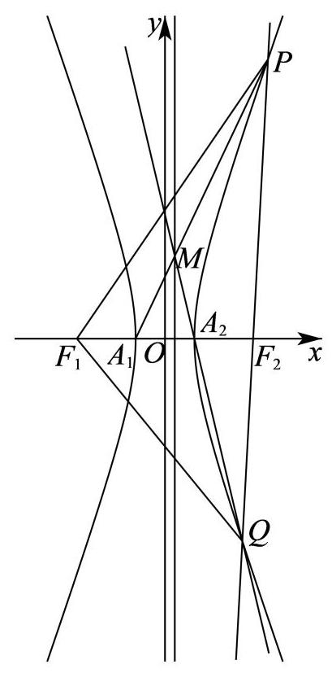

### 杨浦 · 第20题

已知 $A\text{ 、 }F$ 分别是双曲线 $\Gamma  : {x}^{2} - {y}^{2} = \lambda$ (常数 $\lambda  > 0$ ) 的右顶点和右焦点,记 $\Gamma$ 过一、 三象限的渐近线为 ${l}_{0}$ .

( 1 )求双曲线 $\Gamma$ 的离心率和渐近线 ${l}_{0}$ 的方程；

(2)设 $\lambda  = 2$ ， $Q$ 是 ${l}_{0}$ 上一点，若线段 ${FQ}$ 的中点 $P$ 在双曲线 $\Gamma$ 上，求点 $Q$ 的坐标；

(3)设 $\lambda  = 1$ ，过 $A$ 作两条相互垂直的直线与双曲线 $\Gamma$ 交于 $M$ 、 $N$ 两点(M在第一象限)， 若直线 ${AM}$ 、 ${AN}$ 分别与 ${l}_{0}$ 交于 $C$ 、 $D$ 两点，且 $\bigtriangleup  {AMN}$ 与 $\bigtriangleup  {ACD}$ 的面积之比为 2，求直线 ${AM}$ 的方程.

**考点：** (1)求离心率和渐近线；(2)设渐近线点并代入中点坐标；(3)设互相垂直直线，联立曲线和渐近线比较面积

**难度依据：** 直线参数与面积比综合计算

**【答案】** (1) $e = \sqrt{2};y = x$

(2) $\left( {1,1}\right)$

(3) $x - \left( {\sqrt{2} - 1}\right) y - 1 = 0$

**【解析】**

**【分析】**(1) 借助离心率定义与渐近线定义计算即可得;

(2)设 $Q\left( {m, m}\right)$ ，结合中点公式可表示出 $P$ 点坐标，代入双曲线方程计算即可得；

(3)设出直线 ${AM}$ 的方程，联立曲线可得点 $M$ 坐标，联立渐近线方程可得点 $C$ 坐标，利用直线 ${AM}$ 、 ${AN}$ 的关系计算可得点 $N$ 、点 $D$ 坐标，再利用面积公式计算即可得解.

**【小问 1 详解】**

由 ${x}^{2} - {y}^{2} = \lambda$ 可得 $\frac{{x}^{2}}{\lambda } - \frac{{y}^{2}}{\lambda } = 1$ ,则 $a = b = \sqrt{\lambda }$ ,则 $c = \sqrt{{a}^{2} + {b}^{2}} = \sqrt{2\lambda }$ ,

故双曲线 $\Gamma$ 的离心率 $e = \frac{c}{a} = \frac{\sqrt{2\lambda }}{\sqrt{\lambda }} = \sqrt{2}$ ,

渐近线 ${l}_{0}$ 的方程为 $y = \frac{b}{a}x = \frac{\sqrt{\lambda }}{\sqrt{\lambda }}x = x$ ;

**【小问 2 详解】**

由 $\lambda  = 2$ ,则双曲线方程为 $\frac{{x}^{2}}{2} - \frac{{y}^{2}}{2} = 1, F\left( {2,0}\right)$ ,设 $Q\left( {m, m}\right)$ ,

则线段 ${FQ}$ 的中点 $P$ 的坐标为 $\left( {\frac{2 + m}{2},\frac{m}{2}}\right)$ ,

有 $\frac{{\left( \frac{2 + m}{2}\right) }^{2}}{2} - \frac{{\left( \frac{m}{2}\right) }^{2}}{2} = 1$ ,解得 $m = 1$ ,故点 $Q$ 的坐标为 $\left( {1,1}\right)$ ;

**【小问 3 详解】**

由 $\lambda  = 1$ ,则双曲线方程为 ${x}^{2} - {y}^{2} = 1, A\left( {1,0}\right) \text{ 、 }F\left( {\sqrt{2},0}\right)$ ,

由题意可得直线 ${AM}$ 斜率存在且不为 0,

设直线 ${AM}$ 的方程为 $x = {ty} + 1$ ,则直线 ${AN}$ 的方程为 $x =  - \frac{1}{t}y + 1$ ,

$\left\{  \begin{array}{l} x = {ty} + 1 \\  {x}^{2} - {y}^{2} = 1 \end{array}\right.$ ,解得 $\left\{  \begin{array}{l} x = 1 \\  y = 0 \end{array}\right.$ 或 $\left\{  \begin{array}{l} x = \frac{-{t}^{2} - 1}{{t}^{2} - 1} \\  y = \frac{-{2t}}{{t}^{2} - 1} \end{array}\right.$ ,则 $M\left( {\frac{-{t}^{2} - 1}{{t}^{2} - 1},\frac{-{2t}}{{t}^{2} - 1}}\right)$ ,

由 $M$ 在第一象限,则 $\left\{  \begin{array}{l} \frac{-{t}^{2} - 1}{{t}^{2} - 1} > 0 \\  \frac{-{2t}}{{t}^{2} - 1} > 0 \end{array}\right.$ ,解得 $0 < t < 1$ ,

$\left\{  {\begin{array}{l} x = {ty} + 1 \\  y = x \end{array},\text{ 解得 }\left\{  {\begin{array}{l} x = \frac{1}{1 - t} \\  y = \frac{1}{1 - t} \end{array},\text{ 即 }C\left( {\frac{1}{1 - t},\frac{1}{1 - t}}\right) ,}\right. }\right.$

则 $N\left( {\frac{-{\left( -\frac{1}{t}\right) }^{2} - 1}{{\left( -\frac{1}{t}\right) }^{2} - 1},\frac{-2\left( {-\frac{1}{t}}\right) }{{\left( -\frac{1}{t}\right) }^{2} - 1}}\right)$ ,即 $N\left( {\frac{-1 - {t}^{2}}{1 - {t}^{2}},\frac{2t}{1 - {t}^{2}}}\right)$ ,

$D\left( {\frac{1}{1 - \left( {-\frac{1}{t}}\right) },\frac{1}{1 - \left( {-\frac{1}{t}}\right) }}\right)$ ,即 $D\left( {\frac{t}{t + 1},\frac{t}{t + 1}}\right)$ ,

$\frac{{S}_{\bigtriangleup {AMN}}}{{S}_{\bigtriangleup {ACD}}} = \frac{\frac{1}{2} \cdot  \left| {AM}\right|  \cdot  \left| {AN}\right| }{\frac{1}{2} \cdot  \left| {AC}\right|  \cdot  \left| {AD}\right| } = \frac{\left| {AM}\right|  \cdot  \left| {AN}\right| }{\left| {AC}\right|  \cdot  \left| {AD}\right| } = \frac{\left| AM\right| }{\left| AC\right| } \cdot  \frac{\left| AN\right| }{\left| AD\right| } = \left| \frac{{y}_{M}}{{y}_{C}}\right|  \cdot  \left| \frac{{y}_{N}}{{y}_{D}}\right|$

$= \left| \frac{\frac{-{2t}}{{t}^{2} - 1}}{\frac{1}{1 - t}}\right|  \cdot  \left| \frac{\frac{2t}{1 - {t}^{2}}}{\frac{t}{t + 1}}\right|  = \left| \frac{2t}{t + 1}\right|  \cdot  \left| \frac{2}{1 - t}\right|  = \frac{4t}{1 - {t}^{2}} = 2$ ,

即 ${t}^{2} + {2t} - 1 = 0$ ,则 $t =  - 1 \pm  \sqrt{2}$ ,又 $0 < t < 1$ ,故 $t = \sqrt{2} - 1$ ,

即直线 ${AM}$ 的方程为 $x = \left( {\sqrt{2} - 1}\right) y + 1$ ,整理得 $x - \left( {\sqrt{2} - 1}\right) y - 1 = 0$ .

### 松江 · 第20题

已知椭圆 $\Gamma  : \frac{{x}^{2}}{{a}^{2}} + \frac{{y}^{2}}{3} = 1\left( {a > 0}\right)$ 的左焦点为 $F\left( {-1,0}\right)$ ,过点 $Q\left( {-4,0}\right)$ 作斜率不为 0 的直线 $l$ 与椭圆 $\Gamma$ 交于 $M, N$ 两点.

(1)求椭圆下的离心率；

(2)设直线 ${MF}\text{ 、 }{NF}$ 的斜率分别为 ${k}_{1},{k}_{2}$ ，求 ${k}_{1} + {k}_{2}$ 的值；

(3)若点 $E$ 满足 $\left| {EM}\right|  = \left| {EN}\right|  = \left| {EF}\right|$ ，点 $D$ 在椭圆上， ${MD} \bot  x$ 轴，探究直线 ${EF}$ 与直线 ${DQ}$ 的斜率之积是否为定值？若为定值，请求出该值；若不为定值，请说明理由.

**考点：** (1)求椭圆离心率；(2)直线联立椭圆用韦达求焦点斜率和；(3)利用三角形外心与圆方程求斜率积

**难度依据：** 椭圆弦、外心及对称关系的代数计算

**【答案】** (1) $\frac{1}{2}$

(2) 0 (3) 是, -1

**【解析】**

**【分析】**(1) 根据已知确定椭圆参数, 即可求离心率;

(2)设直线 $l : y = k\left( {x + 4}\right) , k \neq  0, M\left( {{x}_{1},{y}_{1}}\right) , N\left( {{x}_{2},{y}_{2}}\right)$ ,联立椭圆方程并应用韦达定理, 代入 ${k}_{1} + {k}_{2} = k\left( {2 + \frac{3}{{x}_{1} + 1} + \frac{3}{{x}_{2} + 1}}\right)$ 化简即可得;

(3)由题设 $E$ 为 $\bigtriangleup  {MNF}$ 的外心，由 $M\left( {{x}_{1},{y}_{1}}\right)$ ，从而有 $D\left( {{x}_{1}, - {y}_{1}}\right)$ ，得 ${k}_{DQ} =  - k$ ，设出三角形外接圆的方程 ${x}^{2} + {y}^{2} + {D}^{\prime }x + {E}^{\prime }y + {F}^{\prime } = 0$ ,联立 $l : y = k\left( {x + 4}\right)$ 整理得一元二次方程,

其与(2)中方程同解得到等比例关系求得 ${E}^{\prime } =  - \frac{3}{k\left( {3 + 4{k}^{2}}\right) },{D}^{\prime } = \frac{8{k}^{2} + 3}{3 + 4{k}^{2}}$ ,进而确定 $E$ 坐标并求得 ${k}_{EF} = \frac{1}{k}$ ,即可得结论.

**【小问 1 详解】**

由题设 $c = 1,{b}^{2} = 3$ ,则 ${a}^{2} = {b}^{2} + {c}^{2} = 4 \Rightarrow  a = 2$ ,离心率为 $e = \frac{c}{a} = \frac{1}{2}$ ;

**【小问 2 详解】**

由 (1) 知, $\Gamma  : \frac{{x}^{2}}{4} + \frac{{y}^{2}}{3} = 1$ ,即 $3{x}^{2} + 4{y}^{2} = {12}$ ,

设直线 $l : y = k\left( {x + 4}\right) , k \neq  0, M\left( {{x}_{1},{y}_{1}}\right) , N\left( {{x}_{2},{y}_{2}}\right)$ ,

联立得 $\left( {3 + 4{k}^{2}}\right) {x}^{2} + {32}{k}^{2}x + {64}{k}^{2} - {12} = 0$ ,则 ${x}_{1} + {x}_{2} =  - \frac{{32}{k}^{2}}{3 + 4{k}^{2}},{x}_{1}{x}_{2} = \frac{{64}{k}^{2} - {12}}{3 + 4{k}^{2}}$ ,

${k}_{1} + {k}_{2} = \frac{{y}_{1}}{{x}_{1} + 1} + \frac{{y}_{2}}{{x}_{2} + 1} = \frac{k\left( {{x}_{1} + 4}\right) }{{x}_{1} + 1} + \frac{k\left( {{x}_{2} + 4}\right) }{{x}_{2} + 1} = k\left( {2 + \frac{3}{{x}_{1} + 1} + \frac{3}{{x}_{2} + 1}}\right) ,$

$\frac{3}{{x}_{1} + 1} + \frac{3}{{x}_{2} + 1} = \frac{3\left( {{x}_{1} + {x}_{2} + 2}\right) }{{x}_{1}{x}_{2} + {x}_{1} + {x}_{2} + 1} = \frac{2 - 8{k}^{2}}{4{k}^{2} - 1} =  - 2,$

所以 ${k}_{1} + {k}_{2} = k\left( {2 - 2}\right)  = 0$ ；

**【小问 3 详解】**

由 $\left| {EM}\right|  = \left| {EN}\right|  = \left| {EF}\right|$ ,则 $E$ 为 $\bigtriangleup {MNF}$ 的外心,

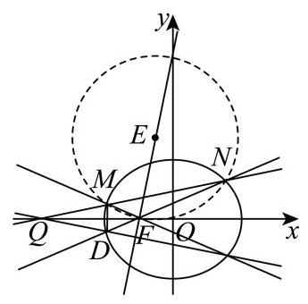

由 $M\left( {{x}_{1},{y}_{1}}\right)$ ,根据对称性知 $D\left( {{x}_{1}, - {y}_{1}}\right)$ ,则 ${k}_{DQ} = \frac{-{y}_{1}}{{x}_{1} + 4} =  - k$ ,

设过 $M, N, F$ 的圆为 ${x}^{2} + {y}^{2} + {D}^{\prime }x + {E}^{\prime }y + {F}^{\prime } = 0$ ,

过 $F\left( {-1,0}\right)$ 得, $1 - {D}^{\prime } + {F}^{\prime } = 0 \Rightarrow  {F}^{\prime } = {D}^{\prime } - 1$ ,

联立圆与直线 $l : y = k\left( {x + 4}\right)$ ,整理得

$\left( {1 + {k}^{2}}\right) {x}^{2} + \left( {8{k}^{2} + {D}^{\prime } + {E}^{\prime }k}\right) x + {16}{k}^{2} + 4{E}^{\prime }k + {D}^{\prime } - 1 = 0,$

上述方程与 $\left( {3 + 4{k}^{2}}\right) {x}^{2} + {32}{k}^{2}x + {64}{k}^{2} - {12} = 0$ 有同解,

所以 $\frac{1 + {k}^{2}}{3 + 4{k}^{2}} = \frac{8{k}^{2} + {D}^{\prime } + {E}^{\prime }k}{{32}{k}^{2}} = \frac{{16}{k}^{2} + 4{E}^{\prime }k + {D}^{\prime } - 1}{{64}{k}^{2} - {12}}$ ,可得

${E}^{\prime } =  - \frac{3}{k\left( {3 + 4{k}^{2}}\right) },{D}^{\prime } = \frac{8{k}^{2} + 3}{3 + 4{k}^{2}},$

外心 $E\left( {-\frac{{D}^{\prime }}{2}, - \frac{{E}^{\prime }}{2}}\right)$ ,则 ${k}_{EF} = \frac{-\frac{{E}^{\prime }}{2}}{-\frac{{D}^{\prime }}{2} + 1} = \frac{{E}^{\prime }}{{D}^{\prime } - 2} = \frac{-\frac{3}{k\left( {3 + 4{k}^{2}}\right) }}{\frac{8{k}^{2} + 3}{3 + 4{k}^{2}} - 2} = \frac{-\frac{3}{k}}{8{k}^{2} + 3 - 6 - 8{k}^{2}} = \frac{1}{k}$ , 所以 ${k}_{EF}{k}_{DQ} = \frac{1}{k} \cdot  \left( {-k}\right)  =  - 1$ 为定值.

### 浦东 · 第20题

已知双曲线 $C : {x}^{2} - \frac{{y}^{2}}{{b}^{2}} = 1\left( {b > 0}\right)$ 的左顶点为 $A$ ,过点 $D\left( {2,0}\right)$ 的直线 $l$ 交双曲线 $C$ 于 $M$ 、 $N$ 两点,点 $M$ 在第一象限.

(1)若双曲线 $C$ 的焦距为 $2\sqrt{5}$ ，求该双曲线 $C$ 的离心率 $e$ ；

(2)若 $b = \sqrt{3}$ ， $\bigtriangleup  {MAD}$ 为直角三角形，求点 $M$ 的坐标；

(3)若双曲线 $C$ 的一条渐近线方程为 $x + \sqrt{2}y = 0$ ，点 $M$ 、 $N$ 均在双曲线 $C$ 的右支，且存在实数 $\lambda \left( {\lambda  < \frac{4}{3}}\right)$ ,使得 $\overrightarrow{MN} = \lambda \overrightarrow{MD}$ 成立,求直线 $l$ 的倾斜角的取值范围.

**考点：** (1)焦距求离心率；(2)分类讨论直角并排除渐近线平行；(3)韦达与弦上向量比例求倾斜角范围

**难度依据：** 直角分类、双交点限制及比例范围

**【答案】** (1) $\sqrt{5}$

(2) $\left( {2,3}\right)$

(3) $\left( {\arctan \frac{\sqrt{2}}{2},\arctan \frac{\sqrt{10}}{2}}\right)$

**【解析】**

**【分析】**(1) 根据焦距和离心率公式求解即可;

(2)分 $\angle {ADM} = \frac{\pi }{2}$ ， $\angle {DMA} = \frac{\pi }{2}$ 两种情况讨论，根据垂直条件代入双曲线方程求解；

(3)根据渐近线方程得双曲线的方程，设直线 $l$ 的方程为 $x = {my} + 2$ ，联立方程，根据韦达定理求出 ${y}_{1} + {y}_{2},{y}_{1}{y}_{2}$ ,根据 $\overrightarrow{MN} = \lambda \overrightarrow{MD}$ 得到 $\frac{{y}_{2}}{{y}_{1}}$ 的范围,构造 $\frac{{\left( {y}_{1} + {y}_{2}\right) }^{2}}{{y}_{1}{y}_{2}}$ 的不等式, 解出 $m$ 的范围,进而求出倾斜角的范围.

**【小问 1 详解】**

由题， ${2c} = 2\sqrt{5}$ ，得 $c = \sqrt{5}$

故 $e = \frac{c}{a} = \sqrt{5}$

**【小问 2 详解】**

因为点 $M$ 在第一象限,故 $\angle {MAD}$ 不可能为直角;

若 $\angle {ADM} = \frac{\pi }{2}$ ，将 $x = 2$ 代入曲线 $C : {x}^{2} - \frac{{y}^{2}}{3} = 1$ ，得 $M\left( {2,3}\right)$ 符合题意，；

若 $\angle {DMA} = \frac{\pi }{2}$ ，设点 $M\left( {{x}_{0},{y}_{0}}\right)$ ，则 $\overrightarrow{MD} = \left( {2 - {x}_{0}, - {y}_{0}}\right) ,\overrightarrow{MA} = \left( {-1 - {x}_{0}, - {y}_{0}}\right)$ ，

则 $\overrightarrow{MD} \cdot  \overrightarrow{MA} = {x}_{0}^{2} - {x}_{0} - 2 + {y}_{0}^{2} = 0$

又因为点 $M$ 满足 ${x}_{0}^{2} - \frac{{y}_{0}^{2}}{3} = 1$ ,可得 $M\left( {\frac{5}{4},\frac{3\sqrt{3}}{4}}\right)$ ,此时 ${k}_{DM} = \frac{\frac{3\sqrt{3}}{4}}{\frac{5}{4} - 2} =  - \sqrt{3}$ ,

${DM}$ 与双曲线渐近线平行,不满足两个交点,舍去.

综上,点 $M$ 的坐标 $\left( {2,3}\right)$ ;

**【小问 3 详解】** 由题可得,双曲线 $C : {x}^{2} - 2{y}^{2} = 1$ ,

当直线 $l$ 的斜率不存在时,根据双曲线的对称性, $\overrightarrow{MN} = 2\overrightarrow{MD}$ ,不满足 $\lambda  < \frac{4}{3}$ ,

所以直线 $l$ 的斜率一定存在,

又 $\overrightarrow{MN} = \lambda \overrightarrow{MD}$ ,说明 $M, D, N$ 三点共线,且 $M, N$ 都在双曲线的右支上,所以直线 $l$ 的斜率不为 $0,1 < \lambda  < \frac{4}{3}$ ,

设直线 $l$ 的方程为 $x = {my} + 2, M\left( {{x}_{1},{y}_{1}}\right) \text{ 、 }N\left( {{x}_{2},{y}_{2}}\right)$ ,且 ${y}_{1} > 0,{y}_{2} < 0$ ,

联立方程 $\left\{  \begin{array}{l} x = {my} + 2 \\  {x}^{2} - 2{y}^{2} = 1 \end{array}\right.$ ,可得 $\left( {{m}^{2} - 2}\right) {y}^{2} + {4my} + 3 = 0$

显然 ${m}^{2} - 2 \neq  0,\Delta  = {\left( 4m\right) }^{2} - 4\left( {{m}^{2} - 2}\right)  \times  3 = 4{m}^{2} + {24} > 0$ ,

${y}_{1} + {y}_{2} = \frac{-{4m}}{{m}^{2} - 2} > 0,\;{y}_{1}{y}_{2} = \frac{3}{{m}^{2} - 2} < 0$ ,故 $0 < m < \sqrt{2}$

由 $\overrightarrow{MN} = \lambda \overrightarrow{MD}$ ,可得 ${y}_{2} - {y}_{1} =  - \lambda {y}_{1}$ ,且 $1 < \lambda  < \frac{4}{3}$ .

故 $\frac{{y}_{2}}{{y}_{1}} = 1 - \lambda  \in  \left( {-\frac{1}{3},0}\right)$

因此 $\frac{{\left( {y}_{1} + {y}_{2}\right) }^{2}}{{y}_{1}{y}_{2}} = \frac{{y}_{2}}{{y}_{1}} + \frac{{y}_{1}}{{y}_{2}} + 2$ ,

根据对勾函数 $y = x + \frac{1}{x}$ 的性质: $y$ 在 $\left( {-1,0}\right)$ 上单调递减，

可知 $\frac{{\left( {y}_{1} + {y}_{2}\right) }^{2}}{{y}_{1}{y}_{2}} = \frac{{y}_{2}}{{y}_{1}} + \frac{{y}_{1}}{{y}_{2}} + 2 <  - \frac{1}{3} + \left( {-3}\right)  + 2 =  - \frac{4}{3}$ ,

又 $\frac{{\left( {y}_{1} + {y}_{2}\right) }^{2}}{{y}_{1}{y}_{2}} = {\left( -\frac{4m}{{m}^{2} - 2}\right) }^{2} \cdot  \frac{{m}^{2} - 2}{3} = \frac{16}{3} \cdot  \frac{{m}^{2}}{{m}^{2} - 2}$ ,

故 $\frac{16}{3} \cdot  \frac{{m}^{2}}{{m}^{2} - 2} <  - \frac{4}{3}$ ,可得 $\frac{2}{\sqrt{10}} < m < \sqrt{2}$ .

所以，直线 $l$ 斜率的取值范围为 $\left( {\frac{\sqrt{2}}{2},\frac{\sqrt{10}}{2}}\right)$ ，

直线 $l$ 倾斜角的取值范围为 $\left( {\arctan \frac{\sqrt{2}}{2},\arctan \frac{\sqrt{10}}{2}}\right)$ .

### 虹口 · 第20题

设椭圆 $\Gamma  : \frac{{x}^{2}}{4} + {y}^{2} = 1$ 的左顶点为 $A$ .

(1)求 $\Gamma$ 的离心率；

(2)设 $\Gamma$ 的左焦点为 $F$ ，上顶点为 $B$ ，若点 $P$ 在 $\Gamma$ 上且位于 $y$ 轴右侧. $\overrightarrow{AB}//\overrightarrow{FP}$ ，求点 $P$ 的横坐标;

(3)设直线 $l : x - y + m = 0$ ， $l$ 与 $\Gamma$ 交于不同的两点 $C$ 和 $D$ ，若点 $A$ 在以 ${CD}$ 为直径的圆外,求实数 $m$ 的取值范围.

**考点：** (1) 椭圆离心率；(2) 向量平行转直线与椭圆交点；(3) 点在直径圆外转数量积及参数范围

**难度依据：** 椭圆离心率焦点弦和直径圆；平行坐标与点在圆外的数量积

**【答案】** (1) $\frac{\sqrt{3}}{2}$

(2) $x = \frac{\sqrt{5} - \sqrt{3}}{2}$

(3) $m \in  \left( {-\sqrt{5},\frac{6}{5}}\right)  \cup  \left( {2,\sqrt{5}}\right)$

**【解析】**

**【小问 1 详解】**

由椭圆方程可得 $a = 2, b = 1, c = \sqrt{{a}^{2} - {b}^{2}} = \sqrt{3}$ ,所以 $e = \frac{c}{a} = \frac{\sqrt{3}}{2}$ .

**【小问 2 详解】**

由条件可知 $A\left( {-2,0}\right) , B\left( {0,1}\right) , F\left( {-\sqrt{3},0}\right)$ ,

设直线 ${AB}$ 的斜率为 ${k}_{AB}$ ,直线 ${FP}$ 的斜率为 ${k}_{FP}$ ,

${k}_{AB} = \frac{1 - 0}{0 + 2} = \frac{1}{2}$ ,因为 $\overrightarrow{AB}//\overrightarrow{FP}$ ,所以 ${k}_{FP} = \frac{1}{2}$ ,

所以直线 ${FP}$ 的方程为 $y = \frac{1}{2}\left( {x + \sqrt{3}}\right)$ ,

联立椭圆: $\left\{  {\begin{matrix} \frac{{x}^{2}}{4} + {y}^{2} = 1 \\  y = \frac{1}{2}\left( {x + \sqrt{3}}\right)  \end{matrix} \Rightarrow  {x}^{2} + {\left( x + \sqrt{3}\right) }^{2} = 4 \Rightarrow  2{x}^{2} + 2\sqrt{3}x - 1 = 0}\right.$ ,

所以 $x = \frac{\sqrt{5} - \sqrt{3}}{2}$ 或 $x = \frac{-\sqrt{3} - \sqrt{5}}{2}$ ,

又因为点 $P$ 位于 $y$ 轴右侧,所以 $P$ 的横坐标为 $x = \frac{\sqrt{5} - \sqrt{3}}{2}$ .

**【小问 3 详解】**

设 $C\left( {{x}_{1},{y}_{1}}\right) , D\left( {{x}_{2},{y}_{2}}\right)$ ,联立椭圆

$\left\{  {\begin{array}{l} x - y + m = 0 \\  \frac{{x}^{2}}{4} + {y}^{2} = 1 \end{array} \Rightarrow  \frac{{\left( y - m\right) }^{2}}{4} + {y}^{2} = 1 \Rightarrow  5{y}^{2} - {2my} + {m}^{2} - 4 = 0,}\right.$

先确定有两个交点,即 $\Delta  = {\left( -2m\right) }^{2} - 4 \times  5 \times  \left( {{m}^{2} - 4}\right)  > 0$ ,

即 $4{m}^{2} - {20}{m}^{2} + {80} > 0 \Rightarrow   - {16}{m}^{2} + {80} > 0 \Rightarrow  {m}^{2} < 5$ ,

所以 $- \sqrt{5} < m < \sqrt{5}$ .

因为圆上任意一点与直径两端点连线所成的角为直角,

而点 $A$ 在以 ${CD}$ 为直径的圆外,所以 $\angle {CAD} < {90}^{ \circ  }$ ,等价于 $\overrightarrow{AC} \cdot  \overrightarrow{AD} > 0$ ,

由 $\overrightarrow{AC} = \left( {{x}_{1} + 2,{y}_{1}}\right) ,\overrightarrow{AD} = \left( {{x}_{2} + 2,{y}_{2}}\right)$ ,

所以 $\overrightarrow{AC} \cdot  \overrightarrow{AD} = \left( {{x}_{1} + 2}\right) \left( {{x}_{2} + 2}\right)  + {y}_{1}{y}_{2} > 0$ ,

即 $2{y}_{1}{y}_{2} - \left( {m - 2}\right) \left( {{y}_{1} + {y}_{2}}\right)  + {\left( m - 2\right) }^{2} > 0$ .

将 ${y}_{1} + {y}_{2} = \frac{2m}{5},{y}_{1}{y}_{2} = \frac{{m}^{2} - 4}{5}$ 代入可得,

$2 \cdot  \frac{{m}^{2} - 4}{5} - \left( {m - 2}\right)  \cdot  \frac{2m}{5} + {\left( m - 2\right) }^{2} > 0 \Rightarrow  2\left( {{m}^{2} - 4}\right)  - {2m}\left( {m - 2}\right)  + 5{\left( m - 2\right) }^{2} > 0$ ,

$2{m}^{2} - 8 - 2{m}^{2} + {4m} + 5\left( {{m}^{2} - {4m} + 4}\right)  > 0 \Rightarrow  5{m}^{2} - {16m} + {12} > 0 \Rightarrow  \left( {{5m} - 6}\right) \left( {m - 2}\right)  > 0$ ,

解得 $m < \frac{6}{5}$ 或 $m > 2$ ,结合 $- \sqrt{5} < m < \sqrt{5}$ ,

所以 $m \in  \left( {-\sqrt{5},\frac{6}{5}}\right)  \cup  \left( {2,\sqrt{5}}\right)$ .

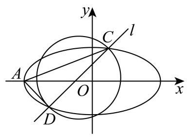

### 金山 · 第20题

已知抛物线 $\Gamma  : {y}^{2} = {4x}$ 的焦点为 $F$ ,准线为 $l$ ,点 $P\left( {{x}_{0},{y}_{0}}\right)$ 为抛物线上一动点,点 $O$ 为坐标原点.

(1)若 $\left| {OP}\right|  = \left| {PF}\right|$ ，求点 $P$ 的坐标；

(2)若直线 ${l}_{0} : y = {kx} + 4$ 与抛物线 $\Gamma$ 只有一个交点，求直线 ${l}_{0}$ 的方程；

(3)若 ${x}_{0} > 3$ ，过点 $P$ 作圆 $C : {\left( x - 1\right) }^{2} + {y}^{2} = 4$ 的两条切线，交准线 $l$ 于 $A\text{ 、 }B$ 两点，求 $\left| {AB}\right|$ 的取值范围.

**考点：** (1) 点距焦点和原点相等；(2) 方程一次情形及判别式；(3) 圆切线斜率方程与交点距离范围

**难度依据：** 抛物线与圆切线焦准关系；换元求切线交点距离范围

**【答案】** (1) $\left( {\frac{1}{2},\sqrt{2}}\right)$ 或 $\left( {\frac{1}{2}, - \sqrt{2}}\right)$

(2) $y = \frac{1}{4}x + 4$ 和 $y = 4$

(3) $\left( {4, + \infty }\right)$

**【解析】**

**【分析】**(1) 根据条件列出方程即可求解;

(2)联立抛物线方程，消元后得方程，分类讨论，根据方程有一根求解即可；

(3)设过 $P$ 点的切线方程，利用圆心到直线的距离等于半径求出关于直线斜率 $k$ 的方程， 再由切线与准线交点的纵坐标表示 $\left| {AB}\right|$ ,利用韦达定理化简,换元求取值范围即可.

**【小问 1 详解】**

由 ${y}^{2} = {4x}$ 可知 $F\left( {1,0}\right)$ ,

因为 $\left| {OP}\right|  = \left| {PF}\right|$ ,所以 ${x}_{0}^{2} + {y}_{0}^{2} = {\left( {x}_{0} - 1\right) }^{2} + {y}_{0}^{2}$ ,

即 ${x}_{0}^{2} = {\left( {x}_{0} - 1\right) }^{2} = {x}_{0}^{2} - 2{x}_{0} + 1$ ,解得 ${x}_{0} = \frac{1}{2}$ ,

代入抛物线方程， ${y}_{0}^{2} = 4{x}_{0} = 2 \Rightarrow  {y}_{0} =  \pm  \sqrt{2}$ ，

所以点 $P$ 的坐标为 $\left( {\frac{1}{2},\sqrt{2}}\right)$ 或 $\left( {\frac{1}{2}, - \sqrt{2}}\right)$ .

**【小问 2 详解】**

联立方程 $\left\{  \begin{array}{l} y = {kx} + 4 \\  {y}^{2} = {4x} \end{array}\right.$ ,可得 ${\left( kx + 4\right) }^{2} = {4x}$ ,即 ${k}^{2}{x}^{2} + \left( {{8k} - 4}\right) x + {16} = 0$ ,

因为只有一个交点,

所以 ${k}^{2} = 0$ ,即 $k = 0$ 时,方程只有一解,满足题意,此时 ${l}_{0} : y = 4$ ;

当 ${k}^{2} \neq  0$ 时,则需 $\Delta  = {\left( 8k - 4\right) }^{2} - 4 \times  {16}{k}^{2} = 0$ ,解得 $k = \frac{1}{4}$ ,

此时 ${l}_{0} : y = \frac{1}{4}x + 4$ .

综上,直线 ${l}_{0}$ 的方程为 $y = \frac{1}{4}x + 4$ 和 $y = 4$ .

**【小问 3 详解】**

设 $P\left( {{t}^{2},{2t}}\right) ,{t}^{2} > 3$ ,

由题意,切线与准线相交,故切线的斜率存在,设切线方程为 $y - {2t} = k\left( {x - {t}^{2}}\right)$ , 即 $y = {kx} - k{t}^{2} + {2t}$ ,

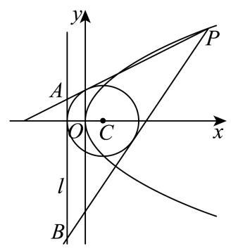

由圆 $C : {\left( x - 1\right) }^{2} + {y}^{2} = 4$ 知,圆心 $C\left( {1,0}\right)$ ,半径 $r = 2$ ,

所以 $\frac{\left| k \cdot  1 - k{t}^{2} + 2t - 0\right| }{\sqrt{{k}^{2} + 1}} = 2$ ,即 ${k}^{2}\left\lbrack  {{\left( 1 - {t}^{2}\right) }^{2} - 4}\right\rbrack   + k\left\lbrack  {{4t}\left( {1 - {t}^{2}}\right) }\right\rbrack   + 4{t}^{2} - 4 = 0$ ,

设 $A\left( {-1,{y}_{1}}\right) , B\left( {-1,{y}_{2}}\right)$ ,

$x =  - 1$ 代入切线方程可得, $y = k\left( {-1}\right)  - k{t}^{2} + {2t} =  - k\left( {{t}^{2} + 1}\right)  + {2t}$ ,

所以 ${y}_{1} =  - {k}_{1}\left( {{t}^{2} + 1}\right)  + {2t},{y}_{2} =  - {k}_{2}\left( {{t}^{2} + 1}\right)  + {2t}$ ,(其中 ${k}_{1},{k}_{2}$ 分别是 ${PA},{PB}$ 的斜率) 所以 $\left| {AB}\right|  = \left| {{y}_{1} - {y}_{2}}\right|  = \left| {{k}_{1} - {k}_{2}}\right|  \cdot  \left( {{t}^{2} + 1}\right)$ ,

又 ${k}_{1} + {k}_{2} =  - \frac{{4t}\left( {1 - {t}^{2}}\right) }{{\left( 1 - {t}^{2}\right) }^{2} - 4},{k}_{1} \cdot  {k}_{2} = \frac{4{t}^{2} - 4}{{\left( 1 - {t}^{2}\right) }^{2} - 4}$ ,

令 $u = {t}^{2} > 3$ ,则

$$
\left| {AB}\right|  = \sqrt{{\left( {k}_{1} + {k}_{2}\right) }^{2} - 4{k}_{1}{k2}} \cdot  \left( {u + 1}\right)  = \frac{\sqrt{{16}\left( {u - 1}\right) \left( {u + 3}\right) }}{\left| \left( u - 3\right) \left( u + 1\right) \right| } \cdot  \left( {u + 1}\right)  = \frac{\sqrt{{16}\left( {u - 1}\right) \left( {u + 3}\right) }}{u - 3},
$$

令 $s = u - 3 > 0$ ,则 $u = s + 3$ ,

所以 $\left| {AB}\right|  = \frac{4\sqrt{\left( {s + 2}\right) \left( {s + 6}\right) }}{s} = 4\sqrt{\frac{\left( {s + 2}\right) \left( {s + 6}\right) }{{s}^{2}}} = 4\sqrt{1 + \frac{8}{s} + \frac{12}{{s}^{2}}} = 4\sqrt{{12}{\left( \frac{1}{s} + \frac{1}{3}\right) }^{2} - \frac{1}{3}}$ , 因为 $\frac{1}{s} > 0$ ,所以 ${12}{\left( \frac{1}{s} + \frac{1}{3}\right) }^{2} - \frac{1}{3} > {12} \times  \frac{1}{9} - \frac{1}{3} = 1$ ,所以 $\left| {AB}\right|  > 4$ , 故求 $\left| {AB}\right|$ 的取值范围为 $\left( {4, + \infty }\right)$ .

### 长宁 · 第20题

双曲线 $\Gamma  : \frac{{x}^{2}}{3} - \frac{{y}^{2}}{{b}^{2}} = 1\left( {b > 0}\right)$ 经过点 $P\left( {2,1}\right)$ ，不垂直 $x$ 轴的直线与 $\Gamma$ 交于不同于 $P$ 的 $A$ 、 $B$ 两点，直线 ${PA}$ 、 ${PB}$ 分别与 $y$ 轴交于点 $M$ 、 $N$ .

(1)求 $\Gamma$ 的离心率；

(2)设直线 ${PA}$ 与 $x$ 轴交于点 $Q$ ，且 $\overrightarrow{MQ} = 2\overrightarrow{QP}$ ，求点 $A$ 的横坐标；

(3) 若 $M$ 、 $N$ 关于原点对称，证明:直线 ${AB}$ 经过定点.

> 本题资料或解析有待核事项，预览不可作为已审定成品。

**考点：** （1）双曲线离心率；（2）向量分点及直线与双曲线交点；（3）对称截距和直线定点

**难度依据：** 双曲线离心率与直线定点；分点坐标

**核查说明：** 分析与详解的定点参数表达不一致，需回核并数学验证。

**【答案】** (1) $e = \sqrt{2}$

(2) $\frac{14}{5}$

(3)证明见解析

**【解析】**

**【分析】**(1) 将点的坐标代入双曲线方程求得 ${b}^{2} = 3$ ,进而利用公式可得离心率;

(2)设出点的坐标，利用坐标运算，结合向量关系，联立求解即可；

(3)先求得 ${k}_{PA} + {k}_{PB} = 1$ ，设直线 ${AB} : y = {kx} + s$ ，与双曲线方程联立 ${x}^{2} - {y}^{2} = 3$ ，由韦达定理得 $s = 1 - {2k}$ ,即可求解定点.

**【小问 1 详解】**

将 $P\left( {2,1}\right)$ 代入双曲线方程 $\frac{{x}^{2}}{3} - \frac{{y}^{2}}{{b}^{2}} = 1\left( {b > 0}\right)$ 可得: $\frac{4}{3} - \frac{1}{{b}^{2}} = 1 \Rightarrow  {b}^{2} = 3$ ,

因为双曲线中 ${a}^{2} = 3$ ,所以 ${c}^{2} = {a}^{2} + {b}^{2} = 6$ ,

即离心率: $e = \frac{c}{a} = \frac{\sqrt{6}}{\sqrt{3}} = \sqrt{2}$ ;

**【小问 2 详解】**

设 $A\left( {{x}_{1},{y}_{1}}\right)$ ,直线 ${PA}$ 方程为 $y - 1 = \frac{{y}_{1} - 1}{{x}_{1} - 2}\left( {x - 2}\right)$ ,

令 $x = 0$ ,得 $y = \frac{-2{y}_{1} + 2}{{x}_{1} - 2} + 1 = \frac{{x}_{1} - 2{y}_{1}}{{x}_{1} - 2}$ ,即可知 $M\left( {0,\frac{{x}_{1} - 2{y}_{1}}{{x}_{1} - 2}}\right)$ ,

令 $y = 0$ ,得 $- 1 = \frac{{y}_{1} - 1}{{x}_{1} - 2}\left( {x - 2}\right)  \Rightarrow  x = 2 - \frac{{x}_{1} - 2}{{y}_{1} - 1} = \frac{2{y}_{1} - {x}_{1}}{{y}_{1} - 1}$ ,即可知 $Q\left( {\frac{2{y}_{1} - {x}_{1}}{{y}_{1} - 1},0}\right)$ ,

由 $\overrightarrow{MQ} = 2\overrightarrow{QP}$ ,可得: $\left( {\frac{2{y}_{1} - {x}_{1}}{{y}_{1} - 1}, - \frac{{x}_{1} - 2{y}_{1}}{{x}_{1} - 2}}\right)  = 2\left( {2 - \frac{2{y}_{1} - {x}_{1}}{{y}_{1} - 1},1}\right)$ ,

则由纵坐标对应相等可得 $- \frac{{x}_{1} - 2{y}_{1}}{{x}_{1} - 2} = 2 \Rightarrow  {y}_{1} = \frac{3{x}_{1} - 4}{2}$ ,

由 (1) 知双曲线化简为 ${x}^{2} - {y}^{2} = 3$ ,代入得 ${x}_{1}^{2} - {\left( \frac{3{x}_{1} - 4}{2}\right) }^{2} = 3 \Rightarrow  5{x}_{1}^{2} - {24}{x}_{1} + {28} = 0$ ,

解得 ${x}_{1} = \frac{14}{5}$ 或 ${x}_{1} = 2$ (因为此时与点 $P$ 重合故舍去),即 ${x}_{1} = \frac{14}{5}$ ;

**【小问 3 详解】**

设 $M\left( {0, m}\right)$ ,由 $M, N$ 关于原点对称得 $N\left( {0, - m}\right)$ ,

计算得直线 ${PA},{PB}$ 的斜率可得 ${k}_{PA} = \frac{1 + m}{2},{k}_{PB} = \frac{1 - m}{2}$ ,

所以有 ${k}_{PA} + {k}_{PB} = \frac{1 - m}{2} + \frac{1 + m}{2} = 1$ ,

设直线 ${AB} : y = {kx} + s$ ,联立 ${x}^{2} - {y}^{2} = 3$ ,

可得: ${x}^{2} - {\left( kx + s\right) }^{2} = 3 \Rightarrow  \left( {1 - {k}^{2}}\right) {x}^{2} - {2ksx} - {s}^{2} - 3 = 0$ ,

设 $A\left( {{x}_{A},{y}_{A}}\right) , B\left( {{x}_{B},{y}_{B}}\right)$ ,

由韦达定理得 ${x}_{A} + {x}_{B} = \frac{2ks}{1 - {k}^{2}},{x}_{A}{x}_{B} =  - \frac{{s}^{2} + 3}{1 - {k}^{2}}$ ,

由 ${k}_{PA} + {k}_{PB} = 1$ ,可得: $\frac{{y}_{A} - 1}{{x}_{A} - 2} + \frac{{y}_{B} - 1}{{x}_{B} - 2} = 1 \Rightarrow  \frac{k{x}_{A} + s - 1}{{x}_{A} - 2} + \frac{k{x}_{B} + s - 1}{{x}_{B} - 2} = 1$ ,

整理得: $\left( {k{x}_{A} + s - 1}\right) \left( {{x}_{B} - 2}\right)  + \left( {k{x}_{B} + s - 1}\right) \left( {{x}_{A} - 2}\right)  = \left( {{x}_{A} - 2}\right) \left( {{x}_{B} - 2}\right)$ ,

所以 ${2k}{x}_{A}{x}_{B} + \left( {s - 1 - {2k}}\right) \left( {{x}_{A} + {x}_{B}}\right)  - 4\left( {s - 1}\right)  = {x}_{A}{x}_{B} - 2\left( {{x}_{A} + {x}_{B}}\right)  + 4$ ,

所以 $\left( {{2k} - 1}\right) {x}_{A}{x}_{B} + \left( {s + 1 - {2k}}\right) \left( {{x}_{A} + {x}_{B}}\right)  - {4s} = 0$ ,

代入韦达定理可得: $\left( {{2k} - 1}\right) \left( {-\frac{{s}^{2} + 3}{1 - {k}^{2}}}\right)  + \left( {s + 1 - {2k}}\right) \frac{2ks}{1 - {k}^{2}} - {4s} = 0$ ,

所以 $- \left( {{2k} - 1}\right) \left( {{s}^{2} + 3}\right)  + \left( {s + 1 - {2k}}\right) {2ks} - {4s}\left( {1 - {k}^{2}}\right)  = 0$ ,

所以 $- {2k}{s}^{2} - {6k} + {s}^{2} + 3 + {2k}{s}^{2} + {2ks} - 4{k}^{2}s - {4s} + 4{k}^{2}s = 0$ ,

所以 $- {6k} + {s}^{2} + 3 + {2ks} - {4s} = 0$ ,

所以 ${2k}\left( {s - 3}\right)  + \left( {s - 3}\right) \left( {s - 1}\right)  = 0 \Rightarrow  \left( {s - 3}\right) \left( {{2k} + s - 1}\right)  = 0$ ,则 $s = 3$ 或 $s = 1 - {2k}$ , 当 $s = 1 - {2k}$ 时,直线 ${AB} : y = {kx} + 1 - {2k} = k\left( {x - 2}\right)  + 1$ 恒过点 $P\left( {2,1}\right)$ ,不符合题意, 故 $s = 3$ ,此时直线 ${AB} : y = {kx} + 3$ 恒过点 $\left( {0,3}\right)$ .

### 闵行 · 第20题

已知椭圆 $\Gamma  : \frac{{x}^{2}}{{a}^{2}} + \frac{{y}^{2}}{{b}^{2}} = 1\left( {a > b > 0}\right)$ 的焦距为 $4\sqrt{3}$ ，离心率为 $\frac{\sqrt{3}}{2}$ ，过点 $P\left( {2,1}\right)$ 的直线交椭圆于点 $A$ 、 $B$ .

(1)求Γ的方程；

(2)记 $\bigtriangleup  {OAP}$ 的面积为S，求证: $S \leq  2\sqrt{2}$ ；

(3)求 $\left| {PA}\right|  \cdot  \left| {PB}\right|$ 的最大值与最小值，并写出取最大值与最小值时直线 ${AB}$ 的方程.

**考点：** （1）焦距离心率求椭圆方程；（2）三角形面积上界；（3）焦点弦参数及弦积最值

**难度依据：** 椭圆方程面积与弦积最值

**【答案】** (1) $\frac{{x}^{2}}{16} + \frac{{y}^{2}}{4} = 1\;$ (2) 证明见解析

(3) 最大值 8 ，直线方程 $y = 1$ ；最小值 2 ，直线方程 $x = 2$

**【解析】**

**【分析】**(1) 根据椭圆已知的焦距和离心率求出参数 $a, b$ ,代入椭圆标准方程得到结果;

(2)将 $S$ 表示为 $A$ 点坐标的线性式，结合椭圆方程的参数形式，利用余弦函数的值域证明结论;

(3)设过点 $P$ 的直线参数方程，利用参数 $t$ 的几何意义将 $\left| {PA}\right|  \cdot  \left| {PB}\right|$ 转化为 $\left| {{t}_{1}{t}_{2}}\right|$ ，结合韦达定理得到表达式后求最值.

**【小问 1 详解】**

由题意得 ${2c} = 4\sqrt{3}$ ,故 $c = 2\sqrt{3}$ ,结合离心率 $e = \frac{c}{a} = \frac{\sqrt{3}}{2}$ 得 $a = 4$ .

由椭圆关系 ${b}^{2} = {a}^{2} - {c}^{2} = {16} - {12} = 4$ ,因此椭圆 $\Gamma$ 的方程为: $\frac{{x}^{2}}{16} + \frac{{y}^{2}}{4} = 1$ ;

**【小问 2 详解】**

设 $A\left( {{x}_{1},{y}_{1}}\right)$ ,因为 $P\left( {2,1}\right) , O\left( {0,0}\right)$ ,所以直线 ${OP} : y = \frac{1}{2}x$ ,即 $x - {2y} = 0$ ,

所以点 $A$ 到直线 ${OP}$ 的距离 $d = \frac{\left| {x}_{1} - 2{y}_{1}\right| }{\sqrt{{1}^{2} + {2}^{2}}} = \frac{\left| {x}_{1} - 2{y}_{1}\right| }{\sqrt{5}}$ ,又 $\left| {OP}\right|  = \sqrt{{1}^{2} + {2}^{2}} = \sqrt{5}$ ,

所以 $S = \frac{1}{2}\left| {OP}\right|  \cdot  d = \frac{1}{2} \times  \sqrt{5} \times  \frac{\left| {x}_{1} - 2{y}_{1}\right| }{\sqrt{5}} = \frac{1}{2}\left| {{x}_{1} - 2{y}_{1}}\right|$

由 $A$ 在椭圆上得 ${\left( \frac{{x}_{1}}{4}\right) }^{2} + {\left( \frac{{y}_{1}}{2}\right) }^{2} = 1$ ,所以可设 ${x}_{1} = 4\cos \theta ,{y}_{1} = 2\sin \theta$ ,

所以 ${x}_{1} - 2{y}_{1} = 4\cos \theta  - 4\sin \theta  = 4\sqrt{2}\cos \left( {\theta  + \frac{\pi }{4}}\right)$ ,

因此 $S = \frac{1}{2}\left| {{x}_{1} - 2{y}_{1}}\right|  = \frac{1}{2} \times  4\sqrt{2}\left| {\cos \left( {\theta  + \frac{\pi }{4}}\right) }\right|  \leq  \frac{1}{2} \times  4\sqrt{2} = 2\sqrt{2}$ ,得证.

**【小问 3 详解】**

设过 $P\left( {2,1}\right)$ 的直线 ${AB}$ 参数方程为 $\left\{  \begin{array}{l} x = 2 + t\cos a \\  y = 1 + t\sin a \end{array}\right.$ ( $t$ 为参数),

代入椭圆方程整理得: $\left( {{\cos }^{2}a + 4{\sin }^{2}a}\right) {t}^{2} + \left( {4\cos a + 8\sin a}\right) t - 8 = 0$ ，

由参数 $t$ 的几何意义得 $\left| {PA}\right|  \cdot  \left| {PB}\right|  = \left| {{t}_{1}{t}_{2}}\right|$ ,

结合韦达定理得: $\left| {PA}\right|  \cdot  \left| {PB}\right|  = \left| \frac{-8}{{\cos }^{2}a + 4{\sin }^{2}a}\right|  = \frac{8}{1 + 3{\sin }^{2}a}$ ,

斜率存在时,设斜率为 $k = \tan a$ ,化简得 $\left| {PA}\right|  \cdot  \left| {PB}\right|  = 2 + \frac{6}{1 + 4{k}^{2}}$ ,

由 ${k}^{2} \geq  0$ 得:当 $k = 0$ 时， $\left| {PA}\right|  \cdot  \left| {PB}\right|$ 取得最大值 8，对应直线方程为 $y = 1$ ；

当直线斜率不存在时,直线为 $x = 2$ ,此时 $\left| {PA}\right|  \cdot  \left| {PB}\right|  = 2$ ,为最小值.

综上, $\left| {PA}\right|  \cdot  \left| {PB}\right|$ 的最大值为 8,对应直线方程为 $y = 1$ ; 最小值为 2,对应直线方程为 $x = 2$

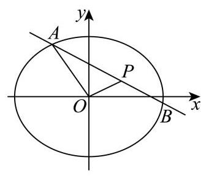

### 青浦 · 第20题

已知椭圆 ${C}_{1} : \frac{{x}^{2}}{4} + {y}^{2} = 1$ 与椭圆 ${C}_{2} : \frac{{x}^{2}}{2} + {y}^{2} = 1$ ，椭圆 ${C}_{2}$ 的左、右焦点分别为 ${F}_{1}$ 、 ${F}_{2}$ ， 点 $P$ 为椭圆 ${C}_{1}$ 上异于其左、右顶点的任一点,直线 ${l}_{1}\text{ 、 }{l}_{2}$ 均过点 $P$ .

(1)求 $\bigtriangleup  {P{F}_{1}{F}_{2}}$ 面积的最大值.

(2)若 ${l}_{1}$ 过点 ${F}_{1}$ 且与 ${C}_{2}$ 交于 $D$ 、 $E$ 两点， ${l}_{2}$ 过点 ${F}_{2}$ 且与 ${C}_{2}$ 交于 $M$ 、 $N$ 两点，当直线 ${l}_{1}$ 、 ${l}_{2}$ 的斜率 ${k}_{1}\text{ 、 }{k}_{2}$ 满足 ${k}_{1}{k}_{2} = \frac{1}{2}$ 时,证明: $\left| {DE}\right|  + \left| {MN}\right|$ 为定值;

(3)是否存在点 $P$ ，满足 ${l}_{1}\text{ 、 }{l}_{2}$ 均与 ${C}_{2}$ 相切，且 ${l}_{1} \bot  {l}_{2}$ ?若存在，求出点 $P$ 的坐标；若不存在, 请说明理由.

**考点：** (1) 焦距与椭圆纵坐标求面积；(2) 焦点弦长与斜率关系证明定值；(3) 切线判别式与垂直求点

**难度依据：** 双椭圆焦点弦长定值与切线垂直

**【答案】** (1) 1 (2) 证明见解析

(3)存在， $\left( {\frac{2\sqrt{6}}{3},\frac{\sqrt{3}}{3}}\right) ,\left( {\frac{2\sqrt{6}}{3}, - \frac{\sqrt{3}}{3}}\right) ,\left( {-\frac{2\sqrt{6}}{3},\frac{\sqrt{3}}{3}}\right) ,\left( {-\frac{2\sqrt{6}}{3}, - \frac{\sqrt{3}}{3}}\right)$ ，

**【解析】**

**【分析】**(1) 利用椭圆 ${C}_{2}$ 的焦点坐标和椭圆 ${C}_{1}$ 上的点的纵坐标范围,结合三角形的面积公式即可求解；

(2)通过联立直线与椭圆方程，用弦长公式表示 $\left| {DE}\right|$ 和 $\left| {MN}\right|$ ，再代入 ${k}_{1}{k}_{2} = \frac{1}{2}$ 化简，即可证明其和为定值;

(3)利用直线与椭圆相切时的判别式条件，结合韦达定理和垂直关系，联立椭圆方程即可求解点 $P$ .

**【小问 1 详解】**

对于椭圆 ${C}_{2} : \frac{{x}^{2}}{2} + {y}^{2} = 1$ 中， ${a}^{2} = 2,{b}^{2} = 1$ ，则 ${c}^{2} = {a}^{2} - {b}^{2} = 1$ ，所以 $c = 1$ ，

焦点 ${F}_{1}\left( {-1,0}\right) ,{F}_{2}\left( {1,0}\right) ,\left| {{F}_{1}{F}_{2}}\right|  = 2$ ,设点 $P\left( {{x}_{0},{y}_{0}}\right)$ 在 ${C}_{1} : \frac{{x}^{2}}{4} + {y}^{2} = 1$ 上,所以 $\left| {y}_{0}\right|  \leq  1$ ,

因为 $\bigtriangleup P{F}_{1}{F}_{2}$ 的面积 $S = \frac{1}{2} \cdot  \left| {{F}_{1}{F}_{2}}\right|  \cdot  \left| {y}_{0}\right|  = \frac{1}{2} \times  2\left| {y}_{0}\right|  = \left| {y}_{0}\right|$ ,

所以当 $\left| {y}_{0}\right|  = 1$ 时,面积取到最大值为 1 .

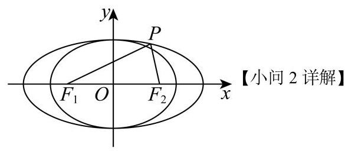

设直线 ${l}_{1} : y = {k}_{1}\left( {x + 1}\right)$ ,联立方程组 $\left\{  \begin{array}{l} y = {k}_{1}\left( {x + 1}\right) \\  \frac{{x}^{2}}{2} + {y}^{2} = 1 \end{array}\right.$ ,

整理得: $\left( {1 + 2{k}_{1}^{2}}\right) {x}^{2} + 4{k}_{1}^{2}x + 2{k}_{1}^{2} - 2 = 0$ ,

其中 $\Delta  = {\left( 4{k}_{1}^{2}\right) }^{2} - 4\left( {1 + 2{k}_{1}^{2}}\right) \left( {2{k}_{1}^{2} - 2}\right)  = 8\left( {{k}_{1}^{2} + 1}\right)  > 0$ ,

设 $D\left( {{x}_{1},{y}_{1}}\right) , E\left( {{x}_{2},{y}_{2}}\right)$ ,所以 ${x}_{1} + {x}_{2} =  - \frac{4{k}_{1}^{2}}{1 + 2{k}_{1}^{2}},{x}_{1}{x}_{2} = \frac{2{k}_{1}^{2} - 2}{1 + 2{k}_{1}^{2}}$ ,

所以 $\left| {DE}\right|  = \sqrt{1 + {k}_{1}^{2}} \cdot  \sqrt{{\left( {x}_{1} + {x}_{2}\right) }^{2} - 4{x}_{1}{x}_{2}} = \sqrt{1 + {k}_{1}^{2}} \cdot  \sqrt{{\left( -\frac{4{k}_{1}^{2}}{1 + 2{k}_{1}^{2}}\right) }^{2} - 4 \times  \frac{2{k}_{1}^{2} - 2}{1 + 2{k}_{1}^{2}}} = \frac{2\sqrt{2}\left( {1 + {k}_{1}^{2}}\right) }{1 + 2{k}_{1}^{2}}$ ,

同理,设 ${l}_{2} : y = {k}_{2}\left( {x - 1}\right)$ ,代入 ${C}_{2}$ 得: $\left| {MN}\right|  = \frac{2\sqrt{2}\left( {1 + {k}_{2}^{2}}\right) }{1 + 2{k}_{2}^{2}}$ ,

已知 ${k}_{1}{k}_{2} = \frac{1}{2}$ ，所以 ${k}_{2} = \frac{1}{2{k}_{1}}$ ，代入 $\left| {MN}\right|$ 得: $\left| {MN}\right|  = \frac{2\sqrt{2}\left( {1 + \frac{1}{4{k}_{1}^{2}}}\right) }{1 + 2 \times  \frac{1}{4{k}_{1}^{2}}} = \frac{\sqrt{2}\left( {1 + 4{k}_{1}^{2}}\right) }{1 + 2{k}_{1}^{2}}$ ，

所以 $\left| {DE}\right|  + \left| {MN}\right|  = \frac{2\sqrt{2}\left( {1 + {k}_{1}^{2}}\right) }{1 + 2{k}_{1}^{2}} + \frac{\sqrt{2}\left( {1 + 4{k}_{1}^{2}}\right) }{1 + 2{k}_{1}^{2}} = \frac{3\sqrt{2}\left( {1 + 2{k}_{1}^{2}}\right) }{1 + 2{k}_{1}^{2}} = 3\sqrt{2}$ ,

即 $\left| {DE}\right|  + \left| {MN}\right|$ 为定值.

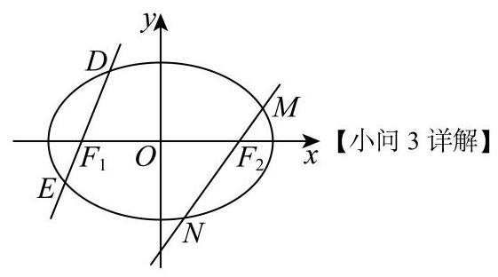

假设存在 $P\left( {{x}_{0},{y}_{0}}\right)$ ,若 ${x}_{0} =  \pm  \sqrt{2}$ ,则 $\left| {y}_{0}\right|  = \frac{\sqrt{2}}{2}$ ,此时直线 ${l}_{1},{l}_{2}$ 不垂直,

因此直线 ${l}_{1},{l}_{2}$ 的斜率存在,分别为 ${k}_{1},{k}_{2}$ ,由 ${l}_{1} \bot  {l}_{2}$ ,得 ${k}_{1}{k}_{2} =  - 1$ .

若直线 $l : y - {y}_{0} = k\left( {x - {x}_{0}}\right)$ ,即 $y = k\left( {x - {x}_{0}}\right)  + {y}_{0}$ ,

联立方程组 $\left\{  \begin{array}{l} y = k\left( {x - {x}_{0}}\right)  + {y}_{0} \\  \frac{{x}^{2}}{2} + {y}^{2} = 1 \end{array}\right.$ ，整理得: $\left( {1 + 2{k}^{2}}\right) {x}^{2} + {4k}\left( {{y}_{0} - k{x}_{0}}\right) x + 2{\left( {y}_{0} - k{x}_{0}\right) }^{2} - 2 = 0$ ，

若 $l$ 与 ${C}_{2}$ 相切,则 $\Delta  = {\left\lbrack  4k\left( {y}_{0} - k{x}_{0}\right) \right\rbrack  }^{2} - 4\left( {1 + 2{k}^{2}}\right) \left\lbrack  {2{\left( {y}_{0} - k{x}_{0}\right) }^{2} - 2}\right\rbrack   = 0$ ,

化简得: $\left( {2 - {x}_{0}^{2}}\right) {k}^{2} + 2{x}_{0}{y}_{0}k + 1 - {y}_{0}^{2} = 0$ ,

此方程的两根为 ${k}_{1},{k}_{2}$ ,且 ${\Delta }^{\prime } = {\left( 2{x}_{0}{y}_{0}\right) }^{2} - 4\left( {2 - {x}_{0}^{2}}\right) \left( {1 - {y}_{0}^{2}}\right)  = 4\left( {{x}_{0}^{2} + 2{y}_{0}^{2} - 2}\right)  > 0$ ,

所以 ${k}_{1}{k}_{2} = \frac{1 - {y}_{0}^{2}}{2 - {x}_{0}^{2}}$ ,由 ${k}_{1}{k}_{2} =  - 1$ ,得: $\frac{1 - {y}_{0}^{2}}{2 - {x}_{0}^{2}} =  - 1$ ,即 ${x}_{0}^{2} + {y}_{0}^{2} = 3$ ,

又因为 $P\left( {{x}_{0},{y}_{0}}\right)$ 在 ${C}_{1}$ 上,联立方程组 $\left\{  \begin{array}{l} {x}_{0}^{2} + {y}_{0}^{2} = 3 \\  \frac{{x}_{0}^{2}}{4} + {y}_{0}^{2} = 1 \end{array}\right.$ ,

解得 $\left\{  \begin{array}{l} {x}_{0} = \frac{2\sqrt{6}}{3} \\  {y}_{0} = \frac{\sqrt{3}}{3} \end{array}\right.$ 或 $\left\{  \begin{array}{l} {x}_{0} = \frac{2\sqrt{6}}{3} \\  {y}_{0} =  - \frac{\sqrt{3}}{3} \end{array}\right.$ 或 $\left\{  \begin{array}{l} {x}_{0} =  - \frac{2\sqrt{6}}{3} \\  {y}_{0} = \frac{\sqrt{3}}{3} \end{array}\right.$ 或 $\left\{  \begin{array}{l} {x}_{0} =  - \frac{2\sqrt{6}}{3} \\  {y}_{0} =  - \frac{\sqrt{3}}{3} \end{array}\right.$ ,

即存在点 ${P}_{1}\left( {\frac{2\sqrt{6}}{3},\frac{\sqrt{3}}{3}}\right) ,{P}_{2}\left( {\frac{2\sqrt{6}}{3}, - \frac{\sqrt{3}}{3}}\right) ,{P}_{3}\left( {-\frac{2\sqrt{6}}{3},\frac{\sqrt{3}}{3}}\right) ,{P}_{4}\left( {-\frac{2\sqrt{6}}{3}, - \frac{\sqrt{3}}{3}}\right)$ ,满足题意.

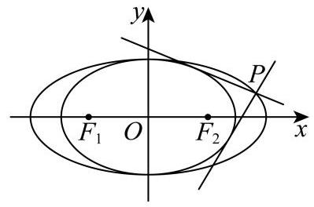

### 静安 · 第20题

在 ${xOy}$ 平面直角坐标系中, $O$ 为坐标原点. 设椭圆 $\Gamma  : \frac{{x}^{2}}{{a}^{2}} + \frac{{y}^{2}}{{b}^{2}} = 1\left( {a > b > 0}\right) ,\Gamma$ 的左、 右焦点分别为 ${F}_{1}\text{ 、 }{F}_{2},\left| {{F}_{1}{F}_{2}}\right|  = 2,\Gamma$ 的离心率为 $\frac{1}{2}$ .

(1)求椭圆 $\Gamma$ 的方程；

(2)过原点 $O$ 作两条相互垂直的射线，与椭圆 $\Gamma$ 分别交于 $A\text{ 、 }B$ 两点，证明:原点 $O$ 到直线 ${AB}$ 的距离为定值；

(3)过椭圆 $\Gamma$ 的右焦点 ${F}_{2}$ 且不与坐标轴垂直的直线 $l$ 与椭圆 $\Gamma$ 交于 $P\text{ 、 }Q$ 两点，点 $M$ 是点 $P$ 关于 $x$ 轴的对称点. 在 $x$ 轴上是否存在一个定点 $N$ ,使得 $M\text{ 、 }Q\text{ 、 }N$ 三点始终共线? 若存在,求出点 $N$ 的坐标; 若不存在,说明理由.

**考点：** （1）焦距离心率求椭圆方程；（2）垂直射线与点到弦距离定值；（3）对称点和焦点弦定点

**难度依据：** 椭圆定距与定点

**【答案】** (1) $\frac{{x}^{2}}{4} + \frac{{y}^{2}}{3} = 1$

(2)证明见解析(3)存在定点 $N\left( {4,0}\right)$ ，理由见解析

**【解析】**

**【分析】**(1) 利用待定系数法可求得椭圆的标准方程；

(2)设直线 ${AB}$ 的方程，并与椭圆联立方程组，利用韦达定理及 ${OA}\bot {OB}$ 的条件，建立直线参数间的关系, 再使用点到直线的距离公式即可证明.

(3) 设直线 $l$ 的方程为 $x = {my} + 1\left( {m \neq  0}\right)$ ,并与椭圆联立方程组,求出 ${y}_{1} + {y}_{2},{y}_{1}{y}_{2}$ 的值,结合三点共线则 ${k}_{MN} = {k}_{QN}$ 即可求解.

**【小问 1 详解】**

由题意知 ${2c} = 2$ ,即 $c = 1$ .

又因为离心率 $e = \frac{c}{a} = \frac{1}{2}$ ,所以 $a = 2$ ,所以 ${b}^{2} = {a}^{2} - {c}^{2} = 4 - 1 = 3$ .

故椭圆 $\Gamma$ 的方程为 $\frac{{x}^{2}}{4} + \frac{{y}^{2}}{3} = 1$ .

**【小问 2 详解】**

证明: 设 $A\left( {{x}_{1},{y}_{1}}\right) , B\left( {{x}_{2},{y}_{2}}\right)$ 。

因为 ${OA} \bot  {OB}$ ,所以 ${x}_{1}{x}_{2} + {y}_{1}{y}_{2} = 0$ .

设直线 ${AB}$ 的方程为 $x = {my} + n$ ,

联立方程组 $\left\{  \begin{array}{l} x = {my} + n \\  \frac{{x}^{2}}{4} + \frac{{y}^{2}}{3} = 1 \end{array}\right.$ ,消去 $x$ 得 $\left( {3{m}^{2} + 4}\right) {y}^{2} + {6mny} + 3{n}^{2} - {12} = 0$ ,

由韦达定理得 ${y}_{1} + {y}_{2} = \frac{-{6mn}}{3{m}^{2} + 4},{y}_{1}{y}_{2} = \frac{3{n}^{2} - {12}}{3{m}^{2} + 4}$ .

代入 ${x}_{1}{x}_{2} + {y}_{1}{y}_{2} = 0$ ，即 $\left( {m{y}_{1} + n}\right) \left( {m{y}_{2} + n}\right)  + {y}_{1}{y}_{2} = 0$ ，

整理得 $\left( {{m}^{2} + 1}\right) {y}_{1}{y}_{2} + {mn}\left( {{y}_{1} + {y}_{2}}\right)  + {n}^{2} = 0$ 。

代入韦达定理结果并化简得 $7{n}^{2} = {12}\left( {{m}^{2} + 1}\right)$ 。

原点 $O$ 到直线 ${AB}$ 的距离 $d = \frac{\left| n\right| }{\sqrt{1 + {m}^{2}}} = \sqrt{\frac{{n}^{2}}{{m}^{2} + 1}} = \sqrt{\frac{12}{7}} = \frac{2\sqrt{21}}{7}$ .

所以原点 $O$ 到直线 ${AB}$ 的距离为定值 $\frac{2\sqrt{21}}{7}$ .

**【小问 3 详解】**

存在定点 $N\left( {4,0}\right)$ ,理由如下:

由 (1) 知 ${F}_{2}\left( {1,0}\right)$ ,设直线 $l$ 的方程为 $x = {my} + 1\left( {m \neq  0}\right)$ ,

设 $P\left( {{x}_{1},{y}_{1}}\right) , Q\left( {{x}_{2},{y}_{2}}\right)$ ,则 $M\left( {{x}_{1}, - {y}_{1}}\right)$ ,

联立方程组 $\left\{  \begin{array}{l} x = {my} + 1 \\  \frac{{x}^{2}}{4} + \frac{{y}^{2}}{3} = 1 \end{array}\right.$ ,消去 $x$ 得 $\left( {3{m}^{2} + 4}\right) {y}^{2} + {6my} - 9 = 0$ , 由韦达定理得 ${y}_{1} + {y}_{2} = \frac{-{6m}}{3{m}^{2} + 4},{y}_{1}{y}_{2} = \frac{-9}{3{m}^{2} + 4}$ .

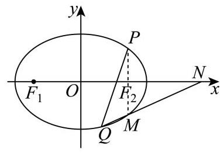

设 $N\left( {t,0}\right)$ ,若 $M, Q, N$ 三点共线,则 ${k}_{MN} = {k}_{QN}$ ,

即 $\frac{-{y}_{1}}{{x}_{1} - t} = \frac{{y}_{2}}{{x}_{2} - t}$ ,整理得 $- {y}_{1}\left( {{x}_{2} - t}\right)  = {y}_{2}\left( {{x}_{1} - t}\right)$ .

将 ${x}_{1} = m{y}_{1} + 1,{x}_{2} = m{y}_{2} + 1$ 代入上式,化简得 $\left( {t - 1}\right) \left( {{y}_{1} + {y}_{2}}\right)  - {2m}{y}_{1}{y}_{2} = 0$ .

代入韦达定理结果，得 $\left( {t - 1}\right) \frac{-{6m}}{3{m}^{2} + 4} - {2m}\frac{-9}{3{m}^{2} + 4} = 0$ .

化简得 $3\left( {t - 1}\right)  - 9 = 0$ ,解得 $t = 4$ .

所以存在定点 $N\left( {4,0}\right)$ ,使得 $M, Q, N$ 三点始终共线.

### 黄浦 · 第20题

已知点 ${F}_{1}\text{ 、 }{F}_{2}$ 分别是曲线 $\Gamma  : \frac{{x}^{2}}{6} + \frac{{y}^{2}}{2} = 1$ 的左、右焦点,动直线 $l$ 过点 ${F}_{1}$ 且不过点 ${F}_{2}$ , 它与 $\Gamma$ 交于点 $P\text{ 、 }Q$ .

(1)求点 ${F}_{1}\text{ 、 }{F}_{2}$ 的坐标；

(2)若 $\overrightarrow{{F}_{2}P} \cdot  \overrightarrow{{F}_{2}Q} = {11}$ ，求直线 $l$ 的方程；

(3)设直线 ${l}_{1}$ 过点 ${F}_{1}$ 且与 $l$ 垂直，直线 ${l}_{2} : x = m$ 与 ${l}_{1}$ 的交点为 $T$ ，求证:存在唯一的常数 $m$ ,使得点 $T$ 与 $\Gamma$ 的中心的连线平分线段 ${PQ}$ ,并求此时 $\frac{\left| PQ\right| }{\left| T{F}_{1}\right| }$ 的最大值.

> 本题资料或解析有待核事项，预览不可作为已审定成品。

**考点：** （1）椭圆焦点坐标；（2）向量数量积与弦；（3）弦中点定点及长度比最值

**难度依据：** 椭圆焦点弦与定点最值；数量积与弦

**核查说明：** 解析末尾均值不等式表达疑有OCR错误，需核原解。

**【答案】** (1) ${F}_{1}\left( {-2,0}\right) \text{ 、 }{F}_{2}\left( {2,0}\right)$

(2) $x + y + 2 = 0$ 或 $x - y + 2 = 0$ .

(3) $\sqrt{3}$

**【解析】**

**【分析】**(1) 求出椭圆 $\Gamma$ 的半焦距,可得出点 ${F}_{1}\text{ 、 }{F}_{2}$ 的坐标;

(2)设直线 $l$ 的方程为 $x = {ty} - 2$ ，设 $P\left( {{x}_{1},{y}_{1}}\right)$ 、 $Q\left( {{x}_{2},{y}_{2}}\right)$ ，将该直线方程与椭圆的方程联立,列出韦达定理,利用平面向量数量积的坐标运算以及韦达定理可求得 $t$ 的值,即可得出直线 $l$ 的方程；

(3)求出线段 ${PQ}$ 的中点 $N$ 的坐标，可得出直线 ${ON}$ 的斜率，将 $x = m$ 代入直线 $T{F}_{1}$ 的方程， 可得出点 $T$ 的坐标,即可求出直线 ${OT}$ 的斜率,结合题意可知直线 ${ON}\text{ 、 }{OT}$ 的斜率相等, 可求出 $m$ 的值,再求出 $\left| {PQ}\right| \text{ 、 }\left| {T{F}_{1}}\right|$ ,即可求得 $\frac{\left| PQ\right| }{\left| T{F}_{1}\right| }$ 的最大值.

**【小问 1 详解】**

椭圆 $\Gamma$ 的半焦距 $c = \sqrt{6 - 2} = 2$ ,故 ${F}_{1}\left( {-2,0}\right) \text{ 、 }{F}_{2}\left( {2,0}\right)$ .

**【小问 2 详解】**

由题意可知直线 $l$ 不与 $x$ 轴重合,设直线 $l$ 的方程为 $x = {ty} - 2$ ,设 $P\left( {{x}_{1},{y}_{1}}\right) \text{ 、 }Q\left( {{x}_{2},{y}_{2}}\right)$ ,

将 $x = {ty} - 2$ 代 入 $\frac{{x}^{2}}{6} + \frac{{y}^{2}}{2} = 1$ ，得 $\left( {{t}^{2} + 3}\right) {y}^{2} - {4ty} - 2 = 0$ ，则 $\Delta  = {16}{t}^{2} + 8\left( {{t}^{2} + 3}\right)  = {24}\left( {{t}^{2} + 1}\right)  > 0,$

故 ${y}_{1} + {y}_{2} = \frac{4t}{{t}^{2} + 3},{y}_{1} \cdot  {y}_{2} = \frac{-2}{{t}^{2} + 3}$ ,

又 $\overrightarrow{{F}_{2}P} = \left( {{x}_{1} - 2,{y}_{1}}\right) ,\overrightarrow{{F}_{2}Q} = \left( {{x}_{2} - 2,{y}_{2}}\right)$ ,

$\overrightarrow{{F}_{2}P} \cdot  \overrightarrow{{F}_{2}Q} = \left( {{x}_{1} - 2}\right) \left( {{x}_{2} - 2}\right)  + {y}_{1}{y}_{2} = \left( {t{y}_{1} - 4}\right) \left( {t{y}_{2} - 4}\right)  + {y}_{1}{y}_{2} = \left( {{t}^{2} + 1}\right) {y}_{1}{y}_{2} - {4t}\left( {{y}_{1} + {y}_{2}}\right)  + {16} \; = \frac{{t}^{2} + 1}{{t}^{2} + 3}\left( {-2}\right)  - {4t} \cdot  \frac{4t}{{t}^{2} + 3} + {16} = \frac{-{18}{t}^{2} - 2}{{t}^{2} + 3} + {16} = {11}$ ,解得 $t =  \pm  1$ ,

所以直线 $l$ 的方程为 $x + y + 2 = 0$ 或 $x - y + 2 = 0$ .

**【小问 3 详解】**

设线段 ${PQ}$ 的中点为 $N\left( {{x}_{0},{y}_{0}}\right)$ ,由 (2) 知 ${y}_{0} = \frac{2t}{{t}^{2} + 3},{x}_{0} = t{y}_{0} - 2 = \frac{-6}{{t}^{2} + 3}$ , 直线 ${ON}$ 的斜率 ${k}_{1} =  - \frac{t}{3}$ ,

易知直线 $T{F}_{1}$ 的方程为 $t\left( {x + 2}\right)  + y = 0$ ,

将 $x = m$ 代入直线 $T{F}_{1}$ 的方程 $t\left( {x + 2}\right)  + y = 0$ ,可得 $T\left( {m, - \left( {m + 2}\right) t}\right)$ ,

直线 ${OT}$ 的斜率 ${k}_{2} =  - \frac{\left( {m + 2}\right) t}{m}$ ,

因为直线 ${OT}$ 平分线段 ${PQ}$ ,则 ${k}_{1} = {k}_{2}$ ,所以 $- \frac{\left( {m + 2}\right) t}{m} =  - \frac{t}{3}$ 对任意的实数 $t$ 恒成立,

则 $\frac{m + 2}{m} = \frac{1}{3}$ ,解得 $m =  - 3$ ,

故存在唯一的常数 $m$ ,使得 ${OT}$ 平分线段 ${PQ}$ .

此时 $\left| {PQ}\right|  = \sqrt{1 + {t}^{2}}\left| {{y}_{1} - {y}_{2}}\right|  = \sqrt{1 + {t}^{2}} \cdot  \sqrt{{\left( \frac{4t}{{t}^{2} + 3}\right) }^{2} + \frac{8}{{t}^{2} + 3}} = \frac{2\sqrt{6}\left( {1 + {t}^{2}}\right) }{{t}^{2} + 3}$ ,

$\left| {T{F}_{1}}\right|  = \sqrt{1 + {t}^{2}}$ ,所以 $\frac{\left| PQ\right| }{\left| T{F}_{1}\right| } = 2\sqrt{6} \cdot  \frac{\sqrt{1 + {t}^{2}}}{{t}^{2} + 3}$ ,

令 $\sqrt{1 + {t}^{2}} = z$ ,则 $z \in  \lbrack 1, + \infty )$ ,故 $\frac{\left| PQ\right| }{\left| T{F}_{1}\right| } = \frac{2\sqrt{6}z}{{z}^{2} + 2} \leq  \frac{2\sqrt{6}z}{2\sqrt{2z}} = \sqrt{3}$ (当且仅当 $z = \sqrt{2} \in  \lbrack 1, + \infty )$

时， $\frac{\left| PQ\right| }{\left| T{F}_{1}\right| } = \sqrt{3}$ )，

所以 $\frac{\left| PQ\right| }{\left| T{F}_{1}\right| }$ 的最大值为 $\sqrt{3}$ .

## 轨迹、交点存在与几何计数

先把距离、对称和点集条件转换为轨迹，再讨论交点或构形。

### 嘉定 · 第11题

将函数 $y = {x}^{2}, x \in  \left\lbrack  {0,1}\right\rbrack$ 的图象绕坐标原点逆时针方向旋转角 $\theta \left( {0 \leq  \theta  \leq  a}\right)$ 得到曲线

C. 若对于每一个角 $\theta$ ，曲线 $C$ 都是一个函数的图象，则 $a$ 的最大值为___.

> 本题资料或解析有待核事项，预览不可作为已审定成品。

**考点：** 旋转图像与函数图像判定；抛物线旋转与切线斜率

**难度依据：** 旋转曲线与函数定义的综合判定

**核查说明：** 题干与答案解析尚未逐页对照原卷，数学内容未独立终审。

**【答案】** $\arctan \frac{1}{2}$

**【解析】**

**【详解】**由函数 $y = {x}^{2}, x \in  \left\lbrack  {0,1}\right\rbrack$ ,知 ${y}^{\prime } = {2x}, x \in  \left\lbrack  {0,1}\right\rbrack$ .

因为 ${y}^{\prime } = {2x}$ 在 $\left\lbrack  {0,1}\right\rbrack$ 上单调递增,所以 ${y}^{\prime } \in  \left\lbrack  {0,2}\right\rbrack$ .

由题可知，当函数 $y = {x}^{2}$ 旋转后得到的函数在点 $\left( {1,1}\right)$ 处的导数小于零,

即曲线 $C$ 在 $x = 1$ 处的切线的斜率小于零,

即曲线 $C$ 在 $x = 1$ 处的切线的倾斜角大于 $\frac{\pi }{2}$ 时,曲线 $C$ 上存在某点处的切线的倾斜角等于 $\frac{\pi }{2}$ .

此时,会出现一个 $x$ 对应两个 $y$ 值的情形,曲线 $C$ 不再是一个函数的图象.

所以 $a$ 的最大值为 $\frac{\pi }{2} - \arctan 2 = \arctan \frac{1}{2}$ .

### 嘉定 · 第17题

在复平面内,已知点 $A\text{ 、 }B\text{ 、 }C$ 对应的复数分别为 ${z}_{A} = 0\text{ 、 }{z}_{B} = 6\text{ 、 }{z}_{C} = 4 + 3\mathrm{i}$ ,其中 $i$ 是虚数单位.

(1)求 $\cos \angle {ACB}$ 的值；

(2)若复数 $z$ 满足 $\left| {z - {z}_{A}}\right|  = \left| {z - {z}_{B}}\right|  = \left| {{z}_{B} - {z}_{C}}\right|$ ，求 $z$ .

> 本题资料或解析有待核事项，预览不可作为已审定成品。

**考点：** (1) 数量积求夹角余弦；(2) 复数模的几何意义与圆的交点

**难度依据：** 复平面几何与数量积

**核查说明：** 题干与答案解析尚未逐页对照原卷，数学内容未独立终审。

**【答案】** (1) $\frac{\sqrt{13}}{65}$ ;

(2) $z = 3 + {2\mathrm{i}}$ 或 $z = 3 - {2\mathrm{i}}$ .

**【解析】**

**【分析】**(1) 由已知写出点 $A\text{ 、 }B\text{ 、 }C$ 的坐标,写出向量 $\overrightarrow{CA},\overrightarrow{CB}$ ,即可求 $\cos \angle {ACB}$ ;

(2)由已知可得复数 $z$ 对应的点到点 $A\left( {0,0}\right)$ 和点 $B\left( {6,0}\right)$ 距离相等，可知复数 $z$ 对应的点在 ${AB}$ 的垂直平分线上,即 $z$ 的实部为 3,再计算 $B$ 到 $C$ 的距离,由复数 $z$ 对应的点到原点的距离等于该值,即可解出 $z$ .

**【小问 1 详解】**

由已知可得, $A\left( {0,0}\right) , B\left( {6,0}\right) , C\left( {4,3}\right)$ ,所以 $\overrightarrow{CA} = \left( {-4, - 3}\right) ,\overrightarrow{CB} = \left( {2, - 3}\right)$ ,

所以 $\cos \angle {ACB} = \frac{\overrightarrow{CA} \cdot  \overrightarrow{CB}}{\left| \overrightarrow{CA}\right|  \cdot  \left| \overrightarrow{CB}\right| } = \frac{-4 \times  2 + \left( {-3}\right)  \times  \left( {-3}\right) }{\sqrt{{\left( -4\right) }^{2} + {\left( -3\right) }^{2}} \cdot  \sqrt{{2}^{2} + {\left( -3\right) }^{2}}} = \frac{\sqrt{13}}{65}$ ;

**【小问 2 详解】**

因为 $\left| {z - {z}_{A}}\right|  = \left| {z - {z}_{B}}\right| ,{z}_{A} = 0,{z}_{B} = 6$ ,所以 $\left| {z - 0}\right|  = \left| {z - 6}\right|$ ,

所以复数 $z$ 对应的点到点 $A\left( {0,0}\right)$ 到和点 $B\left( {6,0}\right)$ 距离相等,

所以这两点的中垂线是直线 $x = 3$ ,即复数 $z$ 的实部为 3,设 $z = 3 + y\mathrm{i},\;y \in  \mathbf{R}$ .

所以 $\left| {z - {z}_{A}}\right|  = \left| z\right|  = \left| {6 - \left( {4 + 3\mathrm{i}}\right) }\right|  = \left| {2 - 3\mathrm{i}}\right|  = \sqrt{13}$ ,

所以 $\left| z\right|  = \sqrt{{3}^{2} + {y}^{2}} = \sqrt{13}$ ,解得 $y =  \pm  2$ ,

所以 $z = 3 + 2\mathrm{i}$ 或 $z = 3 - 2\mathrm{i}$ .

### 崇明 · 第15题

已知 $A\left( {-a,0}\right) , B\left( {a,0}\right) ,{l}_{1} : {ax} - y = 0,{l}_{2} : {ax} + y = 0$ ,其中 $a > 1$ ,点 $P$ 为平面内一点,记点 $P$ 到 ${l}_{1},{l}_{2}$ 的距离分别为 ${d}_{1},{d}_{2}$ ,则下列条件中能使点 $P$ 的轨迹为椭圆的是 ( )

A. $\left| {PA}\right|  + \left| {PB}\right|  = {2a}$

B. ${\left| PA\right| }^{2} + {\left| PB\right| }^{2} = 4{a}^{2}$

C. ${d}_{1}^{2} + {d}_{2}^{2} = 4{a}^{2}$

D. ${d}_{1} + {d}_{2} = {4a}$

**考点：** 点到两定直线距离和与轨迹辨析

**难度依据：** 点到两定直线距离和与轨迹辨析

**【答案】** C

**【解析】**

**【分析】**根据椭圆的定义可判断 $\mathrm{A}$ 的真假; 求 $P$ 点的轨迹方程,判断 $\mathrm{{BCD}}$ 的真假.

**【详解】**对于 $\mathrm{A}$ ,因为 $\left| {PA}\right|  + \left| {PB}\right|  = {2a} = \left| {AB}\right|$ ,所以 $P$ 点轨迹为线段 ${AB}$ ,故 $\mathrm{A}$ 错误; 对于 $\mathrm{B}$ ,设 $P\left( {x, y}\right)$ ,则由 ${\left( x + a\right) }^{2} + {y}^{2} + {\left( x - a\right) }^{2} + {y}^{2} = 4{a}^{2} \Rightarrow  {x}^{2} + {y}^{2} = {a}^{2}$ ,所以 $P$ 点轨迹为圆, 故 B 错误;

对于 $\mathrm{C}$ ,由 ${\left( \frac{\left| ax - y\right| }{\sqrt{{a}^{2} + 1}}\right) }^{2} + {\left( \frac{\left| ax + y\right| }{\sqrt{{a}^{2} + 1}}\right) }^{2} = 4{a}^{2} \Rightarrow  {a}^{2}{x}^{2} + {y}^{2} = 2{a}^{2}\left( {{a}^{2} + 1}\right)$ ,

因为 $a > 1$ ,方程可化为 $\frac{{x}^{2}}{2\left( {{a}^{2} + 1}\right) } + \frac{{y}^{2}}{2{a}^{2}\left( {{a}^{2} + 1}\right) } = 1$ ,所以 $P$ 点轨迹为椭圆,故 $\mathrm{C}$ 正确; 对于 $\mathrm{D}$ ,由 $\frac{\left| ax - y\right| }{\sqrt{{a}^{2} + 1}} + \frac{\left| ax + y\right| }{\sqrt{{a}^{2} + 1}} = {4a} \Rightarrow  \left| {{ax} - y}\right|  + \left| {{ax} + y}\right|  = {4a}\sqrt{{a}^{2} + 1}$ ,

① 当 ${ax} - y \geq  0$ 且 ${ax} + y \geq  0$ ,即 $- {ax} \leq  y \leq  {ax}$ 时,

去绝对值可得 ${ax} - y + {ax} + y = {4a}\sqrt{{a}^{2} + 1}$ ,即 $x = 2\sqrt{{a}^{2} + 1}$ ,

此时结合约束条件 $- {2a}\sqrt{{a}^{2} + 1} \leq  y \leq  {2a}\sqrt{{a}^{2} + 1}$ 可知点 $P$ 的轨迹为垂直于 $x$ 轴的线段;

② 当 ${ax} - y \geq  0$ 且 ${ax} + y < 0$ ，即 $y <  - {ax}$ 且 $y \leq  {ax}$ ，

去绝对值可得 ${ax} - y - {ax} - y = {4a}\sqrt{{a}^{2} + 1}$ ,即 $y =  - {2a}\sqrt{{a}^{2} + 1}$ ,

此时结合约束条件 $- 2\sqrt{{a}^{2} + 1} \leq  x < 2\sqrt{{a}^{2} + 1}$ 可知点 $P$ 的轨迹为垂直于 $y$ 轴的线段;

③ 当 ${ax} - y < 0$ 且 ${ax} + y < 0$ ，即 $y <  - {ax}$ 且 $y > {ax}$ ，

去绝对值可得 $- {ax} + y - {ax} - y = {4a}\sqrt{{a}^{2} + 1}$ ,即 $x =  - 2\sqrt{{a}^{2} + 1}$ ,

此时结合约束条件 $- {2a}\sqrt{{a}^{2} + 1} < y < {2a}\sqrt{{a}^{2} + 1}$ 可知点 $P$ 的轨迹为垂直于 $x$ 轴的线段;

④ 当 ${ax} - y < 0$ 且 ${ax} + y \geq  0$ ,即 $y > {ax}$ 且 $- {ax} \leq  y$ ,

去绝对值可得 $- {ax} + y + {ax} + y = {4a}\sqrt{{a}^{2} + 1}$ ,即 $y = {2a}\sqrt{{a}^{2} + 1}$ ,

此时结合约束条件 $- 2\sqrt{{a}^{2} + 1} \leq  x < 2\sqrt{{a}^{2} + 1}$ 可知点 $P$ 的轨迹为垂直于 $y$ 轴的线段;

综上可知 $P$ 点轨迹为四条线段,故 $\mathrm{D}$ 错误.

### 徐汇 · 第16题

设 $m \in  \mathbf{R}$ . 定义点 $P\left( {m,\frac{1}{2}m - 1}\right)$ 的 $t -$ 相伴集合为 ${A}_{P - t} = \{ \left( {x, y}\right) \parallel x - m \mid   \leq  t$ 且 $\left. {\left| {y - \left( {\frac{1}{2}m - 1}\right) }\right|  \leq  t}\right\}$ ,其中 $t$ 为正实数. 给出以下两个命题:

① 若 $m = 0$ ，则其 1-相伴集合 ${A}_{P - 1}$ 所对应平面图形的面积为 2;

② 设 ${t}_{0} > 0$ ，若对任意实数 $m$ 及任意 $t \leq  {t}_{0}$ ，集合 ${A}_{P - t}$ 所对应平面图形与抛物线 ${x}^{2} = {2y}$ 均无公共点,则 ${t}_{0} < \frac{7}{12}$ .

则正确的选项是 ( )

A. ①是真命题，②是真命题

B. ①是假命题，②是假命题

C. ①是真命题，②是假命题

D. ①是假命题，②是真命题

> 本题资料或解析有待核事项，预览不可作为已审定成品。

**考点：** 由绝对值定义识别正方形，对中心位置分类判断无交点

**难度依据：** 双重量词和几何位置分类

**核查说明：** 合并MD集合定义的绝对值符号错乱，需回看PDF恢复。

**【答案】** D

**【解析】**

**【分析】**对于①，先判断出相伴集合的对应平面图形为正方形，即可得到面积；对于②，根据无交点的限制得出正方形的点应满足 $y < \frac{1}{2}{x}^{2}$ ,然后对不同的自变量范围分类讨论,综合得到 $t$ 的范围,进而得到 ${t}_{0}$ 的范围.

**【详解】**根据定义点 $P$ 的 $t$ -相伴集合即为以 $P$ 为中心的边长为 ${2t}$ 的正方形,

若 $m = 0$ ,则其 1- 相伴集合 ${A}_{P - 1}$ 对应平面图形的面积为 ${2}^{2} = 4$ ,①是假命题;

集合 ${A}_{P - t}$ 对应一系列正方形,它们与抛物线 ${x}^{2} = {2y}$ 即 $y = \frac{1}{2}{x}^{2}$ 均无公共点,

则意味着这些正方形都在抛物线下方即正方形内的点均满足 $y < \frac{1}{2}{x}^{2}$ ,对每一个正方形内的点,

有 ${y}_{\max } = \frac{1}{2}m - 1 + t$ ,则需满足 $\forall x \in  \left\lbrack  {m - t, m + t}\right\rbrack$ ,有 $\frac{1}{2}{x}^{2} > \frac{1}{2}m - 1 + t$ ,

设 $f\left( x\right)  = \frac{1}{2}{x}^{2}, f\left( x\right)$ 在 $\left\lbrack  {m - t, m + t}\right\rbrack$ 上的最小值记为 $h\left( m\right)$ ,

当 $m > t$ 时, $h\left( m\right)  = f\left( {m - t}\right)  = \frac{1}{2}{\left( m - t\right) }^{2}$ ,此时应有 $\frac{1}{2}{\left( m - t\right) }^{2} > \frac{1}{2}m - 1 + t$ ,

设 $u = m - t$ ,则 $u > 0$ ,不等式变为 $\frac{1}{2}{u}^{2} > \frac{1}{2}\left( {u + t}\right)  - 1 + t$ 即 $\frac{1}{2}{u}^{2} - \frac{1}{2}u + 1 - \frac{3}{2}t > 0$ , 令 $g\left( u\right)  = \frac{1}{2}{u}^{2} - \frac{1}{2}u + 1 - \frac{3}{2}t$ ,则 $g{\left( u\right) }_{\min } = g\left( \frac{1}{2}\right)  = \frac{1}{8} - \frac{1}{4} + 1 - \frac{3}{2}t = \frac{7}{8} - \frac{3}{2}t > 0$ ,所以 $t < \frac{7}{12}$

当 $- t < m \leq  t$ 时, $h\left( m\right)  = f\left( 0\right)  = 0$ ,此时应有 $0 > \frac{1}{2}m - 1 + t$ ,以 $m$ 为变量,

$\frac{1}{2}m - 1 + t$ 的最大值为 $\frac{1}{2}t - 1 + t = \frac{3}{2}t - 1 < 0$ ,所以 $t < \frac{2}{3}$ ;

当 $m \leq   - t$ 时, $h\left( m\right)  = f\left( {m + t}\right)  = \frac{1}{2}{\left( m + t\right) }^{2}$ ,此时应有 $\frac{1}{2}{\left( m + t\right) }^{2} > \frac{1}{2}m - 1 + t$ ,

设 $v = m + t$ ,则 $v \leq  0$ ,不等式变为 $\frac{1}{2}{v}^{2} > \frac{1}{2}\left( {v - t}\right)  - 1 + t$ 即 $\frac{1}{2}{v}^{2} - \frac{1}{2}v + 1 - \frac{1}{2}t > 0$ ,

令 $p\left( v\right)  = \frac{1}{2}{v}^{2} - \frac{1}{2}v + 1 - \frac{1}{2}t$ ,则 $p{\left( v\right) }_{\min } = p\left( 0\right)  = 1 - \frac{1}{2}t > 0$ ,所以 $t < 2$ ,

综上所述 $t < \frac{7}{12}$ ，要使对任意实数 $m$ 及任意 $t \leq  {t}_{0}$ 均满足无交点条件，则 ${t}_{0} < \frac{7}{12}$ ，②是真命题.

### 杨浦 · 第10题

设集合 $A = \{ z\parallel z + 1 \mid   = \left| {z - a}\right| , z \in  \mathbf{C}\} , B = \{ z\parallel z \mid   = 1, z \in  \mathbf{C}\}$ ，若 $A \cap  B \neq  \varnothing$ ，则实数 $a$ 的取值范围是___.

> 本题资料或解析有待核事项，预览不可作为已审定成品。

**考点：** 模的几何意义转化圆与直线相交，讨论退化

**难度依据：** 需处理两定点重合的退化情形

**核查说明：** 合并MD集合定义中绝对值与条件分隔符错乱，需对原卷修复。

**【答案】** $\left\lbrack  {-1,3}\right\rbrack$

**【解析】**

**【分析】**由 $\left| {z + 1}\right|  = \left| {z - a}\right|$ 知 $z$ 到 $\left( {-1,0}\right)$ 与 $\left( {a,0}\right)$ 距离相等,其轨迹是这两点的垂直平分线, $B = \{ z\parallel z \mid   = 1, z \in  \mathbf{C}\}$ 表示的轨迹是一个单位圆,两者有交点,等价于原点到直线的距离不大于 1,通过计算可得实数 $a$ 的取值范围.

**【详解】**集合 $A = \left\{  {z\begin{Vmatrix}{z + 1}\end{Vmatrix} = \left| {z - a}\right| , z \in  \mathbf{C}}\right\}$ ,由 $\left| {z + 1}\right|  = \left| {z - a}\right|$ ,即 $z$ 到 $\left( {-1,0}\right)$ 与 $\left( {a,0}\right)$ 距离相等,

即 $z$ 的轨迹为 $\left( {-1,0}\right)$ 与 $\left( {a,0}\right)$ 两点连线的垂直平分线,

设 $z = x + y\mathrm{i}$ ,所以 $\left| {x + 1 + y\mathrm{i}}\right|  = \left| {x - a - y\mathrm{i}}\right|$ ,所以 ${\left( x + 1\right) }^{2} + {y}^{2} = {\left( x - a\right) }^{2} + {y}^{2}$ ,化简得 $2\left( {a + 1}\right) x = {a}^{2} - 1,$

若 $a =  - 1$ ,等式化为 $0 = 0$ ,任何 $z$ 都满足,此时 $A$ 为整个复平面,满足 $A \cap  B \neq  \varnothing$ ;

若 $a \neq   - 1$ ,则 $x = \frac{a - 1}{2}$ ,即 $z$ 的轨迹为直线 $x = \frac{a - 1}{2}, B = \{ z\parallel z \mid   = 1, z \in  \mathbf{C}\}$ 表示的为圆: ${x}^{2} + {y}^{2} = 1$

$A \cap  B \neq  \varnothing$ 即直线 $x = \frac{a - 1}{2}$ 与圆 ${x}^{2} + {y}^{2} = 1$ 有交点，所以 $\left| \frac{a - 1}{2}\right|  \leq  1$ ，解得 $- 1 \leq  a \leq  3$ ，所以实数 $a$ 的取值范围是 $\left\lbrack  {-1,3}\right\rbrack$ .

### 杨浦 · 第11题

掷实心球时，将轨迹视为抛物线的一部分，设实心球离手位置在起掷点 $O$ 正上方 2 米, 出手角度 $a$ 即抛物线在该处切线与水平地面所成角,如图所示. 已知实心球轨迹最高点距离地面 3 米,若要成绩不小于 10 米 (实心球落地点到起掷点的距离),则出手角度 $a$ 的最大值为___. (精确到 ${0.1}^{ \circ  }$ ).

**考点：** 建立抛物线轨迹，利用高度和射程约束求切线角

**难度依据：** 建模并转化为参数取值

**【答案】** ${28.7}^{ \circ  }$

**【解析】**

**【分析】**建立平面直角坐标系,设抛物线方程 $y = a{x}^{2}$ ,利用已知点坐标结合已知条件,求出 $a$ 的范围; 对抛物线方程求导得到斜率表达式,结合条件得到 $\tan a$ ,进而求出 $a$ 即可.

**【详解】**

以最高点 $D$ 为坐标原点,以水平向右为 $x$ 轴正方向,以竖直向下为 $y$ 轴正方向,建立平面直角坐标系,

设抛物线方程为 $f\left( x\right)  = a{x}^{2}\left( {a > 0}\right)$ .

则 $A\left( {-\sqrt{\frac{1}{a}},1}\right) , B\left( {\sqrt{\frac{3}{a}},3}\right)$ .

由题意得 $\sqrt{\frac{3}{a}} - \left( {-\sqrt{\frac{1}{a}}}\right)  \geq  {10}$ ,即 $\frac{1 + \sqrt{3}}{\sqrt{a}} \geq  {10}$ ,所以 $a \leq  {\left( \frac{1 + \sqrt{3}}{10}\right) }^{2}$ ,取 $a = {\left( \frac{1 + \sqrt{3}}{10}\right) }^{2}$ .

又 ${f}^{\prime }\left( x\right)  = {2ax}$ ,则 ${f}^{\prime }\left( {-\sqrt{\frac{1}{a}}}\right)  = {2a}\left( {-\sqrt{\frac{1}{a}}}\right)  =  - 2\sqrt{a}$ .

易知 $a$ 为锐角,所以 $\tan a = 2 \times  \frac{1 + \sqrt{3}}{10} = \frac{1 + \sqrt{3}}{5}$ ,

所以 $a = \arctan \frac{1 + \sqrt{3}}{5} \approx  {28.7}^{ \circ  }$ .

故出手角度 $a$ 的最大值为 ${28.7}^{ \circ  }$ .

### 浦东 · 第10题

已知,圆 $O$ 是圆心在原点的单位圆,弦 ${AB}$ 平行于 $x$ 轴,并将圆分为两段弧. 将其中一段劣弧 $\overset{\text{ ⏜ }}{AB}$ 沿弦 ${AB}$ 翻折后恰好经过圆心. 若直线 $y = x + m$ 与翻折后得到的两段弧有四个不同的交点，则实数 $m$ 的取值范围为___.

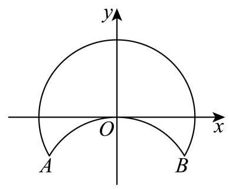

> 本题资料或解析有待核事项，预览不可作为已审定成品。

**考点：** 建立折叠后两圆弧并用交点范围约束

**难度依据：** 圆弧不是整圆，端点与相切须兼顾

**核查说明：** 题干第67字符附近：损坏字符或字体覆盖风险，需回源并视觉检查（底稿扫描记录）

**【答案】** $\left( {\frac{\sqrt{3} - 1}{2},\sqrt{2} - 1}\right)$

**【解析】**

**【详解】**根据题意可知优弧 ${AB}$ 所在的圆方程为 ${x}^{2} + {y}^{2} = 1$ ,劣弧 ${AB}$ 所在的圆方程为 ${x}^{2} + {\left( y + 1\right) }^{2} = 1,$

因为直线 $y = x + m$ 与翻折后得到的两段弧有四个不同的交点,

所以直线 $y = x + m$ 与优弧 ${AB}$ 和劣弧 ${AB}$ 各有两个不同的交点,

所以 $\left\{  \begin{array}{l} \frac{\left| m\right| }{\sqrt{2}} < 1 \\  \frac{\left| 1 + m\right| }{\sqrt{2}} < 1 \end{array}\right.$ ,解得 $- \sqrt{2} < m < \sqrt{2} - 1$ ,

又直线 $y = x + m$ 经过点 $A\left( {-\frac{\sqrt{3}}{2}, - \frac{1}{2}}\right)$ 时, $m =  - \frac{1}{2} - \left( {-\frac{\sqrt{3}}{2}}\right)  = \frac{\sqrt{3} - 1}{2}$ ,

所以要使直线 $y = x + m$ 与翻折后得到的两段弧有四个不同的交点,

$m$ 的取值范围为 $\left( {\frac{\sqrt{3} - 1}{2},\sqrt{2} - 1}\right)$

### 浦东 · 第11题

某光影科技实验室为长方体空间, 底面是边长为 4 米的正方形, 高为 3 米. 为营造动态光影效果，在底面一个顶点处安装射灯 $A$ ，在与该顶点相对的侧棱上、距底面 1 米处安装射灯 $I$ ,两盏射灯的光束方向由智能系统自动控制，始终使两束光线相互垂直，且它们的交汇点 $G$ 始终落在实验室天花板上. 则交汇点 $G$ 形成的轨迹长度为___米.

**考点：** 建立空间坐标，用垂直数量积确定天花板圆轨迹

**难度依据：** 将空间垂直转化轨迹方程

**【答案】** $2\sqrt{2}\pi$

**【解析】**

**【详解】**如图建立空间直角坐标系:

则 $A\left( {4,0,0}\right) , I\left( {0,4,1}\right)$ ,设交点 $G\left( {x, y,3}\right)$ ,

所以 $\overrightarrow{AG} = \left( {x - 4, y,3}\right) ,\overrightarrow{IG} = \left( {x, y - 4,2}\right)$ ,

因为 ${AG} \bot  {IG}$ ,所以 $\overrightarrow{AG} \cdot  \overrightarrow{IG} = \left( {x - 4}\right) x + \left( {y - 4}\right) y + 3 \times  2 = 0$ ,

整理得 ${\left( x - 2\right) }^{2} + {\left( y - 2\right) }^{2} = 2$ ,

所以交点 $G$ 在天花板上的轨迹是以 $\left( {2,2,3}\right)$ 为圆心,半径为 $\sqrt{2}$ 的圆,

所以交汇点 $G$ 形成的轨迹长度为 $2\sqrt{2}\pi$ .

### 虹口 · 第12题

在以 $O$ 为原点的空间直角坐标系中,设 $\overrightarrow{i} = \left( {1,0,0}\right) ,\overrightarrow{j} = \left( {0,1,0}\right) , A$ 和 $B$ 是两个点集, 设 $A = \left\{  {P\left| {\;\overrightarrow{OP} \cdot  \overrightarrow{j} = 1}\right. ,\left\langle  {\overrightarrow{OP},\overrightarrow{j}}\right\rangle   = \frac{\pi }{4}}\right\}$ ,对任意的 $Q \in  B$ ,总存在 $P \in  A$ ,使得 $\overrightarrow{OP} \cdot  \overrightarrow{OQ} = 2$ . 若 $T \in  B,\overrightarrow{OT} = x\overrightarrow{i} + y\overrightarrow{j}\left( {x\text{ 、 }y \in  \mathbf{R}}\right)$ 且 $\left| {\overrightarrow{OT} - \overrightarrow{j}}\right|  = 2$ ,则 $\overrightarrow{OT} \cdot  \overrightarrow{i}$ 的取值范围是___.

> 原题对点集只给出单向限制，尚不能唯一确定完整取值范围；源答案与条件的对称性也存在冲突。

**考点：** 空间数量积及向量夹角；圆与直线交点存在性；存在量词与点集条件

**难度依据：** 空间数量积及向量夹角；圆与直线交点存在性；存在量词与点集条件

**核查说明：** 题设仅说Q属于B时满足存在P的条件，并未说B等于所有满足条件的点构成的最大集合。即使按最大集合理解，T=(x,y,0)的存在条件为|2-y|≤|x|，与x²+(y-1)²=4联立关于x对称，源答案区间不关于x对称，不能作为字面题设已确定的完整范围。

**【答案】** $\left\lbrack  {-2,\frac{-1 - \sqrt{7}}{2}}\right\rbrack   \cup  \left\lbrack  {\frac{-1 + \sqrt{7}}{2},2}\right\rbrack$

**【解析】**

**【分析】**根据空间向量数量积的坐标表示公式, 结合直线与圆的位置关系进行求解即可.

**【详解】**设 $P\left( {{x}_{1},{y}_{1},{z}_{1}}\right)$ ,因为 $\overrightarrow{OP} \cdot  \overrightarrow{j} = 1,\overrightarrow{OP},\overrightarrow{j} = \frac{\pi }{4}$ ,

所以 ${y}_{1} = 1$ ,且 $\sqrt{{x}_{1}^{2} + 1 + {z}_{1}^{2}} \cdot  1 \cdot  \frac{\sqrt{2}}{2} = 1 \Rightarrow  {x}_{1}^{2} + 1 + {z}_{1}^{2} = 2 \Rightarrow  {x}_{1}^{2} + {z}_{1}^{2} = 1$ ,

即 $P\left( {{x}_{1},1,{z}_{1}}\right)$ ,且 ${x}_{1}^{2} + {z}_{1}^{2} = 1$ ,显然 $- 1 \leq  {x}_{1} \leq  1$ ,

设 $Q\left( {a, b, c}\right)$ ,因为 $\overrightarrow{OP} \cdot  \overrightarrow{OQ} = 2$ ,所以 $a{x}_{1} + b + c{z}_{1} = 2$ ,

因为 $\overrightarrow{OT} = x\overrightarrow{i} + y\overrightarrow{j}\left( {x\text{ 、 }y \in  \mathbf{R}}\right)$ ,

所以 $\overrightarrow{OT} = \left( {x, y,0}\right)$ ,

因为 $\left| {\overrightarrow{OT} - \overrightarrow{j}}\right|  = 2$ ,

所以 $\sqrt{{x}^{2} + {\left( y - 1\right) }^{2}} = 2 \Rightarrow  {x}^{2} + {\left( y - 1\right) }^{2} = 4$ ,

因为 $T \in  B$ ,所以 $x{x}_{1} + y = 2 \Rightarrow  y = 2 - x{x}_{1}$ ,代入 ${x}^{2} + {\left( y - 1\right) }^{2} = 4$ 中,

得 ${x}^{2} + {\left( 2 - x{x}_{1} - 1\right) }^{2} = 4 \Rightarrow  \left( {1 + {x}_{1}^{2}}\right) {x}^{2} - 2{x}_{1}x - 3 = 0$ ,

$\Delta  = 4{x}_{1}^{2} + {12}\left( {1 + {x}_{1}^{2}}\right)  = {12} + {16}{x}_{1}^{2} > 0,$

因此直线 $x{x}_{1} + y - 2 = 0$ 与圆 ${x}^{2} + {\left( y - 1\right) }^{2} = 4$ 有两个不同的交点,

因为 $- 1 \leq  {x}_{1} \leq  1$ ,所以直线 $y = 2 - x{x}_{1}$ 的斜率 $- {x}_{1}$ 的取值范围为 $- 1 \leq   - {x}_{1} \leq  1$ , 如下图所示:

由 $\left\{  {\begin{array}{l} {x}^{2} + {\left( y - 1\right) }^{2} = 4 \\  y = x + 2 \end{array} \Rightarrow  2{x}^{2} + {2x} - 3 = 0 \Rightarrow  x = \frac{-1 \pm  \sqrt{7}}{2}}\right.$

直线 $y = x + 2$ 与圆 ${x}^{2} + {\left( y - 1\right) }^{2} = 4$ 的交点坐标为 $A\left( {\frac{-1 - \sqrt{7}}{2},0}\right) , B\left( {\frac{-1 + \sqrt{7}}{2},0}\right)$ , 又因为直线 $y = x + 2$ 、直线 $y =  - x + 2$ 斜率互为相反数,且过同一点 $\left( {0,2}\right)$ ,与圆 ${x}^{2} + {\left( y - 1\right) }^{2} = 4$ 都是关于纵轴对称,

所以当 $- 1 \leq   - {x}_{1} \leq  1$ 时, $x \in  \left\lbrack  {-2,\frac{-1 - \sqrt{7}}{2}}\right\rbrack   \cup  \left\lbrack  {\frac{-1 + \sqrt{7}}{2},2}\right\rbrack$

因为 $\overrightarrow{OT} \cdot  \overrightarrow{i} = x$ ,

所以 $\overrightarrow{OT} \cdot  \overrightarrow{i}$ 的取值范围是 $\left\lbrack  {-2,\frac{-1 - \sqrt{7}}{2}}\right\rbrack   \cup  \left\lbrack  {\frac{-1 + \sqrt{7}}{2},2}\right\rbrack$ .

### 长宁 · 第12题

等腰 ${ABC}$ 的三个顶点均在椭圆 $\Gamma  : \frac{{x}^{2}}{2026} + {y}^{2} = 1$ 上，且 $A\text{ 、 }B\text{ 、 }C$ 中有且仅有两个点是椭圆 $\Gamma$ 的顶点，则满足条件的 ${ABC}$ 共有___个.

**考点：** 椭圆顶点与等腰三角形计数

**难度依据：** 椭圆顶点与等腰三角形计数

**【答案】** 20

**【解析】**

**【详解】**如图所示:

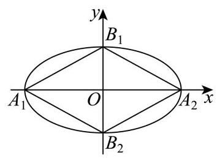

由题意可得 ${A}_{1}\left( {-\sqrt{2026},0}\right) ,{A}_{2}\left( {\sqrt{2026},0}\right) ,{B}_{1}\left( {0,1}\right) ,{B}_{2}\left( {0, - 1}\right)$ ,

以 ${A}_{1}{B}_{1}$ 或 ${A}_{1}{B}_{2}$ 或 ${A}_{2}{B}_{1}$ 或 ${A}_{2}{B}_{2}$ 为等腰三角形的底边,

在两侧可各作一个等腰三角形,共有 $4 \times  2 = 8$ 个;

以 ${A}_{1}{B}_{1}$ 或 ${A}_{1}{B}_{2}$ 或 ${A}_{2}{B}_{1}$ 或 ${A}_{2}{B}_{2}$ 为等腰三角形的腰,

则 $\left| {{A}_{1}{B}_{1}}\right|  = \sqrt{{2026} + 1} = \sqrt{2027}$ ,

设另一点为 $P\left( {x, y}\right)$ ，

若 $\left| {P{B}_{1}}\right|  = \left| {{A}_{1}{B}_{1}}\right|$ ,

即 ${x}^{2} + {\left( y - 1\right) }^{2} = {2027}$ ,

由 $\left\{  \begin{array}{l} {x}^{2} + {\left( y - 1\right) }^{2} = {2027} \\  \frac{{x}^{2}}{2026} + {y}^{2} = 1 \end{array}\right.$ ,解得 $y =  - \frac{2}{2025} \in  \left( {-1,1}\right)$ ,符合题意; (舍去 $y = 0$ );

同理,若 $\left| {P{A}_{2}}\right|  = \left| {{A}_{2}{B}_{1}}\right|$ ,

即 ${\left( x - \sqrt{2026}\right) }^{2} + {y}^{2} = {2027}$ ,

由 $\left\{  \begin{array}{l} {\left( x - \sqrt{2026}\right) }^{2} + {y}^{2} = {2027} \\  \frac{{x}^{2}}{2026} + {y}^{2} = 1 \end{array}\right.$ ，解得 $x = \frac{{405} + \sqrt{2026}}{2025} > \sqrt{2026}$ ，不符题意；

故只能 $\left| {P{B}_{1}}\right|  = \left| {{A}_{1}{B}_{1}}\right|$ ,

这样的点关于 $y$ 轴对称,共有 2 个,

故共有 $4 \times  2 = 8$ 个;

以 ${B}_{1}{B}_{2}$ 为腰,

因为 $\left| {{B}_{1}{B}_{2}}\right|  = 2$ ,

设另一点为 $P\left( {x, y}\right)$ ，

若 $\left| {P{B}_{1}}\right|  = \left| {{B}_{1}{B}_{2}}\right|  = 2$ ,

即 ${x}^{2} + {\left( y - 1\right) }^{2} = 4$ ,

由 $\left\{  \begin{array}{l} {x}^{2} + {\left( y - 1\right) }^{2} = 4 \\  \frac{{x}^{2}}{2026} + {y}^{2} = 1 \end{array}\right.$ ,解得 $y = \frac{2023}{2025} \in  \left( {-1,1}\right)$ ,

同理若 $\left| {P{B}_{2}}\right|  = \left| {{B}_{1}{B}_{2}}\right|  = 2$ ,

即 ${x}^{2} + {\left( y + 1\right) }^{2} = 4$ ,

由 $\left\{  \begin{array}{l} {x}^{2} + {\left( y + 1\right) }^{2} = 4 \\  \frac{{x}^{2}}{2026} + {y}^{2} = 1 \end{array}\right.$ ，解得 $y =  - \frac{2023}{2025} \in  \left( {-1,1}\right)$ ，

这样的点关于 $y$ 轴对称，共有 4 个；

若 ${A}_{1}{A}_{2},{B}_{1}{B}_{2}$ 为底,则三角形中有三个点是椭圆 $\Gamma$ 的顶点,不合题意;

综上,共有 $8 + 8 + 4 = {20}$ 个这样的等腰三角形.

### 闵行 · 第15题

若平面直角坐标系 ${xOy}$ 中的点 $P$ 到 $x$ 轴与 $y$ 轴的距离之和为 1,现有以下两个命题:

①存在点 $P$ 到 $x$ 轴与 $y$ 轴的距离之差为 1 ；

②存在点 $P$ 到 $x$ 轴与 $y$ 轴的距离之积为 1 .

则以下选项正确的是 ( )

A. ①不正确，②不正确

B. ①正确，②正确

C. ①正确，②不正确

D. ①不正确，②正确

> 本题资料或解析有待核事项，预览不可作为已审定成品。

**考点：** 点到坐标轴距离；基本不等式

**难度依据：** 点到坐标轴距离；基本不等式

**核查说明：** 底稿B、C选项文字相同，需回核题图。

**【答案】** C

**【解析】**

**【详解】**设 $P\left( {m, n}\right)$ ,则 $\left| m\right|  + \left| n\right|  = 1$ ,

对于①,当 $m = 0$ 时, $\left| n\right|  = 1$ ,故 $\left| n\right|  - \left| m\right|  = 1$ ,满足点 $P$ 到 $x$ 轴与 $y$ 轴的距离之差为 1,① 正确;

对于②，由基本不等式可得 $\left| m\right|  + \left| n\right|  \geq  2\sqrt{\left| m\right|  \cdot  \left| n\right| }$ ，即 $2\sqrt{\left| m\right|  \cdot  \left| n\right| } \leq  1$ ，故 $\left| m\right|  \cdot  \left| n\right|  \leq  \frac{1}{4}$ ，②错误.

### 青浦 · 第15题

已知垂直竖在水平地面上相距 20 米的两根旗杆的高分别为 10 米和 15 米, 地面上的动点 $P$ 到两旗杆顶点的仰角相等,则点 $P$ 的轨迹是

A. 椭圆

B. 圆

C. 双曲线

D. 抛物线

**考点：** 等仰角转距离比与圆轨迹

**难度依据：** 等仰角转距离比与圆轨迹

**【答案】** B

**【解析】**

**【详解】**如图, 建立直角坐标系

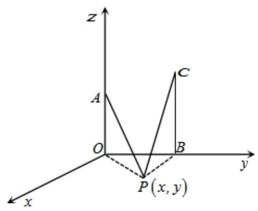

依题意可得, $\left| {OA}\right|  = {10},\left| {BC}\right|  = {15},\left| {OB}\right|  = {20},\angle {APO} = \angle {BPC}$

则 $O\left( {0,0}\right) , A\left( {0,{10}}\right) , B\left( {{20},0}\right) , C\left( {{20},{15}}\right)$

设 $P\left( {x, y}\right)$ ,因为 $\angle {APO} = \angle {BPC}$ ,所以 $\tan \angle {APO} = \tan \angle {BPC}$

则 $\frac{\left| OA\right| }{\left| OP\right| } = \frac{\left| BC\right| }{\left| BP\right| }$ ，即 $\frac{10}{\sqrt{{x}^{2} + {y}^{2}}} = \frac{15}{\sqrt{{\left( x - {20}\right) }^{2} + {y}^{2}}}$

化简可得 ${x}^{2} + {32x} + {y}^{2} - {320} = 0$ ,即 ${\left( x + {16}\right) }^{2} + {y}^{2} = {576}$

所以 $P$ 点轨迹为圆,故选 B

### 静安 · 第11题

若满足 $\left| z\right|  = 5$ ，且 $\left| {z + 5}\right|  - \left| {z - 5}\right|  = 6$ 的复数 $z$ 有两个，分别设为 ${z}_{1}\text{ 、 }{z}_{2}$ ，则 $\left| {{z}_{1} - {z}_{2}}\right|  =$ ___.

> 本题资料或解析有待核事项，预览不可作为已审定成品。

**考点：** 复数对应点与轨迹；圆与双曲线交点

**难度依据：** 复数对应点与轨迹；圆与双曲线交点

**核查说明：** 仅本题解析局部回核；其他题未据此判定终审通过。；源解析曾误写y²=±16/5；已回源并独立复核修订为y=±16/5。

**【答案】** $\frac{32}{5}$

**【解析】**

**【分析】**设 $Z\left( {x, y}\right)$ ,根据复数的几何意义分析可得 ${x}^{2} + {y}^{2} = {25},\frac{{x}^{2}}{9} - \frac{{y}^{2}}{16} = 1\left( {x > 0}\right)$ , 联立方程运算求解即可.

**【详解】**设 $Z\left( {x, y}\right) , O\left( {0,0}\right) ,{F}_{1}\left( {-5,0}\right) ,{F}_{2}\left( {5,0}\right)$ ,

因为 $\left| z\right|  = 5$ ,则 $\left| {OZ}\right|  = 5$ ,可知点 $Z$ 的轨迹是以 $O\left( {0,0}\right)$ 为圆心,半径为 5 的圆,

可得 ${x}^{2} + {y}^{2} = {25}$ ；

且 $\left| {z + 5}\right|  - \left| {z - 5}\right|  = 6$ ,则 $\left| {Z{F}_{1}}\right|  - \left| {Z{F}_{2}}\right|  = 6 < {10}$ ,可知点 $Z$ 的轨迹是以 ${F}_{1},{F}_{2}$ 为焦点的双曲线的右支,

则 $a = 3, c = 5, b = \sqrt{{c}^{2} - {a}^{2}} = 4$ ,可得 $\frac{{x}^{2}}{9} - \frac{{y}^{2}}{16} = 1\left( {x > 0}\right)$ ,

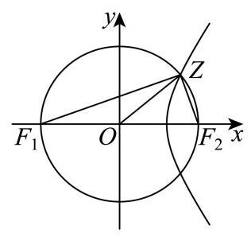

联立方程 $\left\{  \begin{array}{l} {x}^{2} + {y}^{2} = {25} \\  \frac{{x}^{2}}{9} - \frac{{y}^{2}}{16} = 1 \end{array}\right.$ ,解得 $\left\{  \begin{array}{l} {x}^{2} = \frac{369}{25} \\  {y}^{2} = \frac{256}{25} \end{array}\right.$ ,

且 $x > 0$ ,则 $\left\{  \begin{array}{l} x = \frac{3\sqrt{41}}{5} \\  y =  \pm  \frac{16}{5} \end{array}\right.$ ,可得 ${Z}_{1}\left( {\frac{3\sqrt{41}}{5},\frac{16}{5}}\right) ,{Z}_{2}\left( {\frac{3\sqrt{41}}{5}, - \frac{16}{5}}\right)$ ,

所以 $\left| {{z}_{1} - {z}_{2}}\right|  = \left| {{Z}_{1} - {Z}_{2}}\right|  = \frac{32}{5}$ .

【复核修订说明】上述开平方后的变量由原合并稿误写的 $y^2$ 更正为 $y$。独立联立方程得 $y^2=256/25$，故 $y=\pm16/5$；两交点纵坐标之差为 $32/5$，与教研整理PDF第8页答案一致。该PDF仅提供本题简答，局部解析修订属于独立复算，不冒充PDF原文。

## 距离、范围与面积最值

把复数或几何约束化为圆弧、公共区域及目标函数，检验最值可达。

### 宝山 · 第11题

已知点 $P\text{ 、 }Q$ 分别是椭圆 $\frac{{x}^{2}}{9} + \frac{{y}^{2}}{5} = 1$ 和圆 ${\left( x - 2\right) }^{2} + {y}^{2} = 1$ 上的两个动点,且点 $A\left( {2,1}\right)$ ，则 $\left| {PA}\right|  + \left| {PQ}\right|$ 的最大值为___.

**考点：** 椭圆焦点定义与圆上距离最值；三角不等式及等号条件

**难度依据：** 椭圆焦点定义与圆上距离最值；三角不等式及等号条件

**【答案】** $7 + \sqrt{17}$ ## $\sqrt{17} + 7$

**【解析】**

**【分析】**根据给定条件,利用椭圆的定义将所求最大值转化为求值 $5 + \left| {PA}\right|  - \left| {P{F}^{\prime }}\right|$ 的最大值, 再结合圆的性质求解.

**【详解】**因为 $F\left( {2,0}\right)$ 为椭圆 $\frac{{x}^{2}}{9} + \frac{{y}^{2}}{5} = 1$ 的右焦点,设其左焦点为 ${F}^{\prime }\left( {-2,0}\right)$ ,

圆 ${\left( x - 2\right) }^{2} + {y}^{2} = 1$ 的圆心 $C\left( {2,0}\right)$ ,半径 $r = 1$ ,由椭圆的定义得 $\left| {PF}\right|  = 6 - \left| {P{F}^{\prime }}\right|$ ,

则 $\left| {PQ}\right|  + \left| {PA}\right|  \leq  \left| {PF}\right|  + 1 + \left| {PA}\right|  = 6 - \left| {P{F}^{\prime }}\right|  + 1 + \left| {PA}\right|  = 7 + \left| {PA}\right|  - \left| {P{F}^{\prime }}\right|$ ,

而 $\left| {PA}\right|  - \left| {P{F}^{\prime }}\right|  \leq  \left| {A{F}^{\prime }}\right|  = \sqrt{{16} + 1} = \sqrt{17}$ ,当且仅当点 $P$ 在直线 $A{F}^{\prime }$ 上时取等号, 所以当 $P$ 是线段 $A{F}^{\prime }$ 延长线与椭圆的交点、 $Q$ 是线段 ${PF}$ 延长线与圆的交点时, $\left| {PA}\right|  + \left| {PQ}\right|$ 取得最大值 $7 + \sqrt{17}$ .

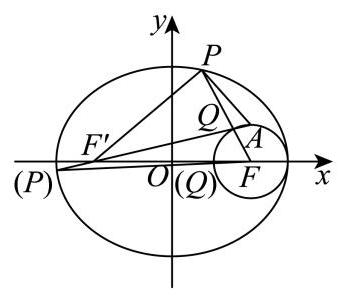

### 徐汇 · 第11题

已知复数 ${w}_{1},{w}_{2}$ 满足 $\overline{{w}_{1}} - \overline{{w}_{2}} = \frac{4}{{w}_{1} - {w}_{2}}$ ,记满足 $\left| {z - {w}_{i}}\right|  \in  \left\lbrack  {1,3}\right\rbrack  \left( {i = 1,2}\right)$ 的复数 $z$ 组成的集合为 $A$ . 若 ${z}_{1} \in  A$ 且 ${z}_{2} \in  A$ ，则 $\left| {{z}_{1} - {z}_{2}}\right|$ 的取值范围是___.

> 本题资料或解析有待核事项，预览不可作为已审定成品。

**考点：** 模约束确定圆环交集与最远点距离

**难度依据：** 需辨认两个约束同时成立并优化距离

**核查说明：** 教研整理PDF第1页题面同时满足两圆环，第8页答案为[0,4√2]；合并MD答案[0,8]与两圆环交集条件不符，原解析把两个点分别放在不同圆环上，须整体重写并独立复核。

**【答案】** $[0,4\sqrt{2}]$

**【解析·独立复核修订】**

由题设分式有意义，$w_1\ne w_2$。两边同乘 $w_1-w_2$，得

$$
|w_1-w_2|^2=4,\qquad |w_1-w_2|=2.
$$

设两圆心的中点为 $m=(w_1+w_2)/2$。根据平行四边形公式，对任意 $z\in A$，有

$$
|z-w_1|^2+|z-w_2|^2
=2|z-m|^2+\frac12|w_1-w_2|^2
=2|z-m|^2+2.
$$

因为两个距离都不超过 $3$，所以 $2|z-m|^2+2\le18$，即 $|z-m|\le2\sqrt2$。于是

$$
|z_1-z_2|\le |z_1-m|+|z_2-m|\le4\sqrt2.
$$

还需证明每个值可以达到。令 $u=(w_1-w_2)/2$，则 $|u|=1$。对任意 $t\in[0,2\sqrt2]$，取

$$
z_1=m+\mathrm{i}tu,\qquad z_2=m-\mathrm{i}tu.
$$

由于 $u$ 与 $\mathrm{i}u$ 在复平面内垂直，四个距离均等于 $\sqrt{1+t^2}$，属于 $[1,3]$，故 $z_1,z_2\in A$；此时 $|z_1-z_2|=2t$。当 $t$ 取遍 $[0,2\sqrt2]$，距离取遍 $[0,4\sqrt2]$。

因此答案为 **$[0,4\sqrt2]$**。PDF第8页答案与此一致；合并MD写 $[0,8]$，其解析把 $z_1,z_2$ 分别放在不同圆心的圆上，未保证每点同时属于两个圆环交集，不能成立。

### 普陀 · 第16题

在直角坐标平面中,方程 $\left( {x + \sqrt{9 - {y}^{2}}}\right) \left( {x - \sqrt{{18} - 2{y}^{2}}}\right)  = 0$ 表示的曲线称为 “ $G$ 圆". 点 $P, Q$ 是 “ $G$ 圆”上的任意两点, $O$ 为坐标原点. 对如下两个命题:

①若点 $A\left( {-3,0}\right) \text{ 、 }B\left( {3,0}\right)$ ，则 $\left| {PA}\right|  + \left| {PB}\right|$ 的值不可能等于 8 ；

②若 ${OP} \bot  {OQ}$ ，则 $\frac{1}{{\left| OP\right| }^{2}} + \frac{1}{{\left| OQ\right| }^{2}}$ 的取值范围为 $\left\lbrack  {\frac{1}{6},\frac{2}{9}}\right\rbrack$ .

则下列结论中正确的是 ( )

A. ①为真②为真

B. ①为真②为假

C. ①为假②为真

D. ①为假 ②为假

**考点：** 半圆半椭圆拼接曲线及距离范围；新定义曲线与命题真假；垂直向量坐标关系

**难度依据：** 半圆半椭圆拼接曲线及距离范围；新定义曲线与命题真假；垂直向量坐标关系

**【答案】** C

**【解析】**

**【分析】**先根据方程可得曲线是由半个圆和半个椭圆组成的一条曲线, 再对条件①判断, 根据椭圆的定义及计算圆的一点到两个定点的距离和范围可得命题的真假; 对条件②根据 $P, Q$ 两点的位置关系分四种情况分别讨论可得所求式子的范围,进而可得结果.

**【详解】**因为方程 $\left( {x + \sqrt{9 - {y}^{2}}}\right) \left( {x - \sqrt{{18} - 2{y}^{2}}}\right)  = 0$ 等价于: $x + \sqrt{9 - {y}^{2}} = 0\left( {x \leq  0}\right)$ 或 $x - \sqrt{{18} - 2{y}^{2}} = 0\left( {x \geq  0}\right) .$

若 $x + \sqrt{9 - {y}^{2}} = 0\left( {x \leq  0}\right)$ ,则 ${x}^{2} + {y}^{2} = 9\left( {x \leq  0}\right)$ ,表示圆心在原点 $O$ ,半径为 $r = 3$ 的左半个圆;

若 $x - \sqrt{{18} - 2{y}^{2}} = 0\left( {x \geq  0}\right)$ ,则 $\frac{{x}^{2}}{18} + \frac{{y}^{2}}{9} = 1\left( {x \geq  0}\right)$ ,表示长半轴为 $a = 3\sqrt{2}$ ,短半轴为 $b = 3$ 的右半个椭圆; 如图:

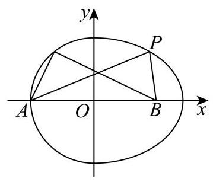

对于①，若点 $P$ 在右半个椭圆上，点 $A\left( {-3,0}\right)$ 、 $B\left( {3,0}\right)$ 是椭圆 $\frac{{x}^{2}}{18} + \frac{{y}^{2}}{9} = 1$ 的焦点， 根据椭圆的定义: $\left| {PA}\right|  + \left| {PB}\right|  = {2a} = 6\sqrt{2} > 8$ ,所以在右半个椭圆上不存在点 $P$ 满足 $\left| {PA}\right|  + \left| {PB}\right|  = 8$

若点 $P$ 在左半个圆上,点 $A\left( {-3,0}\right) \text{ 、 }B\left( {3,0}\right)$ 是圆 ${x}^{2} + {y}^{2} = 9$ 的一条直径的两个端点, 设 $P\left( {x, y}\right)$ ,则 $\left| {PA}\right|  + \left| {PB}\right|  = \sqrt{{\left( x + 3\right) }^{2} + {y}^{2}} + \sqrt{{\left( x - 3\right) }^{2} + {y}^{2}} = \sqrt{{18} + {6x}} + \sqrt{{18} - {6x}}$ 所以 ${\left( \left| PA\right|  + \left| PB\right| \right) }^{2} = {36} + 2\sqrt{\left( {{18} + {6x}}\right) \left( {{18} - {6x}}\right) } = {36} + {12}\sqrt{9 - {x}^{2}}$ ,

因为 $- 3 \leq  x \leq  0$ ,所以 $0 \leq  9 - {x}^{2} \leq  9,0 \leq  \sqrt{9 - {x}^{2}} \leq  3,{36} \leq  {\left( \left| PA\right|  + \left| PB\right| \right) }^{2} \leq  {36} + {36}$ , 即 $6 \leq  \left| {PA}\right|  + \left| {PB}\right|  \leq  6\sqrt{2}$ ,而 $8 \in  \left\lbrack  {6,6\sqrt{2}}\right\rbrack$ ,所以存在点 $P$ 满足 $\left| {PA}\right|  + \left| {PB}\right|  = 8$ ; 所以命题①为假命题.

对于②，若 $P$ 点在左半个圆上， $\left| {OP}\right|  = 3$ ， $\frac{1}{{\left| OP\right| }^{2}} = \frac{1}{9}$ ；

若 $P$ 点在右半个椭圆上,则 ${\left| OP\right| }^{2} = {x}^{2} + {y}^{2} = {18} - 2{y}^{2} + {y}^{2} = {18} - {y}^{2}$ ,因为 $- 3 \leq  y \leq  3$ , 所以 $9 \leq  {18} - {y}^{2} \leq  {18}$ ,即 $9 \leq  {\left| OP\right| }^{2} \leq  {18},\frac{1}{{\left| OP\right| }^{2}} \in  \left\lbrack  {\frac{1}{18},\frac{1}{9}}\right\rbrack$ . 下面对 $P, Q$ 的位置分四种情况讨论:

(i) 若 $P, Q$ 都在左半个圆上时, $\left| {OP}\right|  = 3,\left| {OQ}\right|  = 3,\frac{1}{{\left| OP\right| }^{2}} = \frac{1}{9},\frac{1}{{\left| OQ\right| }^{2}} = \frac{1}{9}$ , 所以 $\frac{1}{{\left| OP\right| }^{2}} + \frac{1}{{\left| OQ\right| }^{2}} = \frac{1}{9} + \frac{1}{9} = \frac{2}{9}$ ;

(ii) 若 $P$ 在左半个圆上, $Q$ 在右半个椭圆上时, $\frac{1}{{\left| OP\right| }^{2}} = \frac{1}{9},\frac{1}{{\left| OQ\right| }^{2}} \in  \left\lbrack  {\frac{1}{18},\frac{1}{9}}\right\rbrack$ , 所以 $\frac{1}{9} + \frac{1}{18} \leq  \frac{1}{{\left| OP\right| }^{2}} + \frac{1}{{\left| OQ\right| }^{2}} \leq  \frac{1}{9} + \frac{1}{9}$ ,即 $\frac{1}{{\left| OP\right| }^{2}} + \frac{1}{{\left| OQ\right| }^{2}} \in  \left\lbrack  {\frac{1}{6},\frac{2}{9}}\right\rbrack$ ;

(iii) 若 $Q$ 在左半个圆上, $P$ 在右半个椭圆上时, $\frac{1}{{\left| OQ\right| }^{2}} = \frac{1}{9},\frac{1}{{\left| OP\right| }^{2}} \in  \left\lbrack  {\frac{1}{18},\frac{1}{9}}\right\rbrack$ , 所以 $\frac{1}{9} + \frac{1}{18} \leq  \frac{1}{{\left| OQ\right| }^{2}} + \frac{1}{{\left| OP\right| }^{2}} \leq  \frac{1}{9} + \frac{1}{9}$ ,即 $\frac{1}{{\left| OP\right| }^{2}} + \frac{1}{{\left| OQ\right| }^{2}} \in  \left\lbrack  {\frac{1}{6},\frac{2}{9}}\right\rbrack$ ;

(iv) 若 $P, Q$ 都在右半个椭圆上时,设 $P\left( {3\sqrt{2}\cos a,3\sin a}\right) , Q\left( {3\sqrt{2}\cos \beta ,3\sin \beta }\right)$ , 且 $a,\beta  \in  \left\lbrack  {-\frac{\pi }{2},\frac{\pi }{2}}\right\rbrack$ ,因为 ${OP} \bot  {OQ}$ ,所以 $\overrightarrow{OP} \cdot  \overrightarrow{OQ} = 0$ ,

即 ${18}\cos a\cos \beta  + 9\sin a\sin \beta  = 0,2\cos a\cos \beta  =  - \sin a\sin \beta$ .

所以 $\frac{1}{{\left| OP\right| }^{2}} = \frac{1}{{18}{\cos }^{2}a + 9{\sin }^{2}a} = \frac{1}{9\left( {{\cos }^{2}a + 1}\right) }$ ,

$\frac{1}{{\left| OQ\right| }^{2}} = \frac{1}{{18}{\cos }^{2}\beta  + 9{\sin }^{2}\beta } = \frac{1}{9\left( {{\cos }^{2}\beta  + 1}\right) },$

所以 $\frac{1}{{\left| OP\right| }^{2}} + \frac{1}{{\left| OQ\right| }^{2}} = \frac{1}{9\left( {{\cos }^{2}a + 1}\right) } + \frac{1}{9\left( {{\cos }^{2}\beta  + 1}\right) } = \frac{1}{9}\left( {\frac{1}{{\cos }^{2}a + 1} + \frac{1}{{\cos }^{2}\beta  + 1}}\right) \; = \frac{{\cos }^{2}a + {\cos }^{2}\beta  + 2}{9\left( {{\cos }^{2}a \cdot  {\cos }^{2}\beta  + {\cos }^{2}a + {\cos }^{2}\beta  + 1}\right) },$

又因为 $2\cos a\cos \beta  =  - \sin a\sin \beta$ ,两边平方得 $4{\cos }^{2}a{\cos }^{2}\beta  = {\sin }^{2}a{\sin }^{2}\beta$ , $4{\cos }^{2}a{\cos }^{2}\beta  = \left( {1 - {\cos }^{2}a}\right) \left( {1 - {\cos }^{2}\beta }\right)$ ,化简整理得

$3{\cos }^{2}a{\cos }^{2}\beta  = 1 - {\cos }^{2}a - {\cos }^{2}\beta ,$

所以

$$
\frac{1}{{\left| OP\right| }^{2}} + \frac{1}{{\left| OQ\right| }^{2}} = \frac{{\cos }^{2}a + {\cos }^{2}\beta  + 2}{3\left( {1 - {\cos }^{2}a - {\cos }^{2}\beta }\right)  + 9{\cos }^{2}a + 9{\cos }^{2}\beta  + 9}
$$

$$
\frac{{\cos }^{2}a + {\cos }^{2}\beta  + 2}{6\left( {{\cos }^{2}a + {\cos }^{2}\beta  + 2}\right) } = \frac{1}{6}.
$$

综上所述， $\frac{1}{{\left| OP\right| }^{2}} + \frac{1}{{\left| OQ\right| }^{2}}$ 的取值范围为 $\left\lbrack  {\frac{1}{6},\frac{2}{9}}\right\rbrack$ ，故②正确；

### 松江 · 第12题

记号 $\max \{ a, b\}$ 表示 $a\text{ 、 }b$ 中取较大的数,如 $\max \{ 1,2\}  = 2$ . 在平面直角坐标系中,定义 $d\left( {A, B}\right)  = \max \left\{  {\left| {{x}_{1} - {x}_{2}}\right| ,\left| {{y}_{1} - {y}_{2}}\right| }\right\}$ 为两点 $A\left( {{x}_{1},{y}_{1}}\right) \text{ 、 }B\left( {{x}_{2},{y}_{2}}\right)$ 的 “切比雪夫距离”. 已知点 $O$ 为坐标原点,点 $C$ 在圆 ${\left( x - 1\right) }^{2} + {\left( y - 1\right) }^{2} = 1$ 上,点 $A$ 在直线 ${3x} + {4y} - {10} = 0$ 上, 则 $d\left( {C, A}\right)  + d\left( {C, O}\right)$ 的最小值为___.

**考点：** 将新距离转为正方形边长，分类求最值

**难度依据：** 新距离建模及圆上分段优化

**【答案】** $\frac{10}{7}$

**【解析】**

**【分析】**先利用几何直观判断 $d\left( {C, A}\right)$ 取最小值的情形,再结合 $d\left( {C, O}\right)$ 构造出需要优化的目标函数，最后通过分类讨论得到最小值.

**【详解】**设点 $C\left( {x, y}\right)$ ,与点 $C$ 的切比雪夫距离为 $R$ 的点构成了一个以点 $C$ 为中心,边长为 ${2R}$ 的正方形,

要让 $R$ 最小,直线应经过正方形的右上角或左下角,即 $\left( {x - R, y - R}\right)$ 或 $\left( {x + R, y + R}\right)$ ,

代入直线方程可得 $3\left( {x - R}\right)  + 4\left( {y - R}\right)  - {10} = 0$ 或 $3\left( {x + R}\right)  + 4\left( {y + R}\right)  - {10} = 0$ ,

于是有 ${R}_{\min } = \frac{\left| 3x + 4y - {10}\right| }{3 + 4}$ ,即 $d\left( {C, A}\right)$ 的最小值为 $\frac{\left| 3x + 4y - {10}\right| }{7}$ ,

由圆的圆心为 $\left( {1,1}\right)$ 且半径为 1 可知圆在第一象限,所以有 $x \geq  0, y \geq  0$ ,

则 $d\left( {C, O}\right)  = \max \{ \left| {x - 0}\right| ,\left| {y - 0}\right| \}  = \max \{ x, y\}$ ,

因此需要优化的目标函数为 $f\left( {x, y}\right)  = \frac{\left| 3x + 4y - {10}\right| }{7} + \max \{ x, y\}$ ,下面分类讨论,

当 ${3x} + {4y} \leq  {10}$ 且 $x \geq  y$ 时, $f\left( {x, y}\right)  = \frac{{10} - {3x} - {4y}}{7} + x = \frac{{10} + 4\left( {x - y}\right) }{7} \geq  \frac{10}{7}$ ,

当 ${3x} + {4y} \leq  {10}$ 且 $x \leq  y$ 时, $f\left( {x, y}\right)  = \frac{{10} - {3x} - {4y}}{7} + y = \frac{{10} + 3\left( {y - x}\right) }{7} \geq  \frac{10}{7}$ ,

即当 ${3x} + {4y} \leq  {10}$ 时 $f\left( {x, y}\right)  \geq  \frac{10}{7}$ ，当且仅当 $x = y$ 时取等号，

当 $x = y$ 时,联立 $x = y$ 和圆的方程得到 ${\left( x - 1\right) }^{2} + {\left( x - 1\right) }^{2} = 1$ ,解得 $x = y = 1 \pm  \frac{\sqrt{2}}{2}$ ,

取较小的一组解 $x = y = 1 - \frac{\sqrt{2}}{2}$ 进行验算得 ${3x} + {4y} = 7\left( {1 - \frac{\sqrt{2}}{2}}\right)  < {10}$ ,符合前提条件;

当 ${3x} + {4y} > {10}$ 时, $x \leq  \frac{10}{7}$ 和 $y \leq  \frac{10}{7}$ 不可能同时成立(否则

${3x} + {4y} \leq  3 \times  \frac{10}{7} + 4 \times  \frac{10}{7} = {10}$ ),

因此必定有 $\max \{ x, y\}  > \frac{10}{7}$ ,所以 $f\left( {x, y}\right)  = \frac{{3x} + {4y} - {10}}{7} + \max \{ x, y\}  > 0 + \frac{10}{7} = \frac{10}{7}$ ,

综上所述， $f\left( {x, y}\right)$ 的最小值也即 $d\left( {C, A}\right)  + d\left( {C, O}\right)$ 的最小值为 $\frac{10}{7}$ .

**【点睛】**目标函数优化问题一定要注意计算出来的最值能否取得.

### 虹口 · 第9题

已知复数 $z$ 满足 $z + \frac{1}{z}$ 是实数，则 $\left| {z - 2 - \frac{\mathrm{i}}{2}}\right|$ 的最小值为___.

> 本题资料或解析有待核事项，预览不可作为已审定成品。

**考点：** 实数条件与模的几何最值；实轴与单位圆上的距离最值

**难度依据：** 实数条件与模的几何最值；实轴与单位圆上的距离最值

**核查说明：** 仅本题解析局部回核；其他题未据此判定终审通过。

**【答案】** $\frac{1}{2}$

**【解析】**

**【分析】**设 $z = a + b\mathrm{i}$ ,代入 $z + \frac{1}{z}$ 中化简,由 $z + \frac{1}{z}$ 是实数,得 $b = 0$ 或 ${a}^{2} + {b}^{2} = 1$ ,利用复数模的几何意义求 $\left| {z - 2 - \frac{\mathrm{i}}{2}}\right|$ 的最小值

**【详解】**设 $z = a + b\mathrm{i}$ ,则 $z + \frac{1}{z} = a + b\mathrm{i} + \frac{1}{a + b\mathrm{i}} = a + b\mathrm{i} + \frac{a - b\mathrm{i}}{\left( {a + b\mathrm{i}}\right) \left( {a - b\mathrm{i}}\right) } \; = a + \frac{a}{{a}^{2} + {b}^{2}} + \left( {b - \frac{b}{{a}^{2} + {b}^{2}}}\right) \mathrm{i},$

因为 $z + \frac{1}{z}$ 是实数,所以 $b - \frac{b}{{a}^{2} + {b}^{2}} = \frac{b\left( {{a}^{2} + {b}^{2} - 1}\right) }{{a}^{2} + {b}^{2}} = 0$ ,

所以 $b = 0$ 或 ${a}^{2} + {b}^{2} = 1$ ,

当 $b = 0$ 时, $z$ 的轨迹是 $x$ 轴 (除原点外),

此时 $\left| {z - 2 - \frac{\mathrm{i}}{2}}\right|$ 的几何意义表示 $x$ 轴上的点 (除原点) 和 $\left( {2,\frac{1}{2}}\right)$ 的距离,此时 $\left| {z - 2 - \frac{\mathrm{i}}{2}}\right|  \geq  \frac{1}{2}$ ,

当 ${a}^{2} + {b}^{2} = 1$ 时,复数 $z$ 的轨迹是以原点为圆心,1为半径的圆,如图,

根据复数模的几何意义可知, $\left| {z - 2 - \frac{\mathrm{i}}{2}}\right|$ 的几何意义是圆上的点到 $\left( {2,\frac{1}{2}}\right)$ 的距离,

由图可知, $\left| {z - 2 - \frac{\mathrm{i}}{2}}\right|$ 的最小值为 $\left| {OA}\right|  - 1 = \sqrt{{2}^{2} + {\left( \frac{1}{2}\right) }^{2}} - 1 = \frac{\sqrt{17}}{2} - 1$ .

因为 $\frac{\sqrt{17}}{2} - 1 > \frac{1}{2}$ ,所以 $\left| {z - 2 - \frac{\mathrm{i}}{2}}\right|$ 的最小值为 $\frac{1}{2}$ .

【复核修订说明】依据教研整理PDF第7页答案，去除合并稿答案后的OCR脏串。另独立验证：$z\ne0$，实数条件给出实轴去原点与单位圆两种轨迹；实轴分支在 $z=2$ 时取到 $1/2$，单位圆分支的最小距离为 $\sqrt{17}/2-1>1/2$，故全局最小值为 $1/2$。

### 长宁 · 第10题

已知复数 $z$ 满足: $\left| z\right|  = 1$ ，且 $\left| {z - \mathrm{i}}\right|  \leq  1$ ，则 $\left| {z\mathrm{i} - 1}\right|$ 的最小值为___.

**考点：** 复数模与圆弧最值；圆弧距离最值

**难度依据：** 复数模与圆弧最值；圆弧距离最值

**【答案】** $\sqrt{3}$

**【解析】**

**【分析】**设 $z = a + b\mathrm{i}, a \in  \mathbf{R}, b \in  \mathbf{R}$ ,由题意易得 ${a}^{2} + {b}^{2} = 1,\frac{1}{2} \leq  b \leq  1$ ,表示出 $\left| {z\mathrm{i} - 1}\right|$ 即可求出答案.

**【详解】**设 $z = a + b\mathrm{i}, a \in  \mathbf{R}, b \in  \mathbf{R}$ ,

则 $\left| z\right|  = \sqrt{{a}^{2} + {b}^{2}} = 1 \Rightarrow  {a}^{2} + {b}^{2} = 1$ ,

$\left| {z - \mathrm{i}}\right|  = \left| {a + \left( {b - 1}\right) \mathrm{i}}\right|  = \sqrt{{a}^{2} + {\left( b - 1\right) }^{2}} \leq  1 \Rightarrow  {a}^{2} + {\left( b - 1\right) }^{2} \leq  1$

化简得: ${a}^{2} + {b}^{2} - {2b} + 1 \leq  1 \Rightarrow  \frac{1}{2} \leq  b \leq  1$ ,

$\left| {z\mathrm{i} - 1}\right|  = \left| {a\mathrm{i} - b - 1}\right|  = \sqrt{{\left( -b - 1\right) }^{2} + {a}^{2}} = \sqrt{{a}^{2} + {b}^{2} + {2b} + 1} = \sqrt{{2b} + 2}$ ,

又 $\frac{1}{2} \leq  b \leq  1$

所以 $3 \leq  {2b} + 2 \leq  4$

所以 $\sqrt{3} \leq  \sqrt{{2b} + 2} \leq  2$

所以 $\left| {z\mathrm{i} - 1}\right|$ 的最小值为 $\sqrt{3}$ .

### 青浦 · 第12题

已知平面内的三个非零向量 $\overrightarrow{a},\overrightarrow{b},\overrightarrow{c}$ ，满足: $\left\langle  {\overrightarrow{a},\overrightarrow{b}}\right\rangle   = \frac{\pi }{4}$ ， $\left| {\overrightarrow{a} - \overrightarrow{b}}\right|  = 2$ ， $\left| {\overrightarrow{b} - \overrightarrow{c}}\right|  = \left| {\overrightarrow{c} - \overrightarrow{a}}\right|  = \sqrt{17}$ ，则当 $\frac{\overrightarrow{a} \cdot  \overrightarrow{c} - \overrightarrow{b} \cdot  \overrightarrow{c}}{\left| \overrightarrow{c}\right| }$ 取得最大值时， $\left| \overrightarrow{c}\right|  =$ ___.

**考点：** 数量积投影最值及向量终点几何；圆周角轨迹与坐标；基本不等式求最值

**难度依据：** 数量积投影最值及向量终点几何；圆周角轨迹与坐标；基本不等式求最值

**【答案】** $\sqrt{7}$

**【解析】**

**【分析】**先通过题干向量关系和几何法确定过点 $A, B$ 的圆,再通过坐标法将 “投影最值” 转化为 “圆上动点” 的最值问题,再结合一般不等式求解即可.

**【详解】**设 $A, B$ 分别为 $\overrightarrow{a},\overrightarrow{b}$ 的终点, $M$ 为 ${AB}$ 中点,由 $\left| {\overrightarrow{a} - \overrightarrow{b}}\right|  = \left| {AB}\right|  = 2$ ,得 $\left| {AM}\right|  = 1$ , 又 $\left| {\overrightarrow{c} - \overrightarrow{a}}\right|  = \left| {\overrightarrow{c} - \overrightarrow{b}}\right|  = \sqrt{17}$ ,故 $\overrightarrow{c}$ 的终点 $C$ 在 ${AB}$ 的中垂线上,

且由勾股定理得 $\left| {CM}\right|  = \sqrt{{\left| \overrightarrow{AC}\right| }^{2} - {\left| AM\right| }^{2}} = \sqrt{{17} - 1} = 4$ .

如图所示，建立坐标系:

$M\left( {0,0}\right) ,\;A\left( {1,0}\right) ,\;B\left( {-1,0}\right) ,\;C\left( {0, \pm  4}\right) ,$

公共起点 $O\left( {x, y}\right)$ (即 $\overrightarrow{a} = \overrightarrow{OA},\overrightarrow{b} = \overrightarrow{OB},\overrightarrow{c} = \overrightarrow{OC}$ ).

在 $\bigtriangleup {OAB}$ 中,由正弦定理可得 $\frac{AB}{\sin \angle {AOB}} = \frac{2}{\sin \frac{\pi }{4}} = 2\sqrt{2} = {2R}$ ,

$R$ 为 $\bigtriangleup {OAB}$ 外接圆半径,故 $R = \sqrt{2}$ ,

令 $\bigtriangleup {OAB}$ 外接圆圆心为 $G$ ,易知 $G$ 在线段 ${AB}$ 垂直平分线上,可设为 $\left( {0, \pm  1}\right)$ ,

根据对称性,以 $C\left( {0,4}\right) , G\left( {0,1}\right)$ 为例,可得 $O$ 所在圆的方程为 ${x}^{2} + {\left( y - 1\right) }^{2} = 2$ ,

$\overrightarrow{a} - \overrightarrow{b} = \overrightarrow{OA} - \overrightarrow{OB} = \left( {2,0}\right) ,\overrightarrow{c} = \overrightarrow{OC} = \left( {-x,4 - y}\right)$ ,令 $k = \frac{\overrightarrow{a} \cdot  \overrightarrow{c} - \overrightarrow{b} \cdot  \overrightarrow{c}}{\left| \overrightarrow{c}\right| }$ ,

则 $k = \frac{\left( {\overrightarrow{a} - \overrightarrow{b}}\right)  \cdot  \overrightarrow{c}}{\left| \overrightarrow{c}\right| } = \frac{-{2x}}{\sqrt{{x}^{2} + {\left( y - 4\right) }^{2}}}$ ,

代入 ${x}^{2} =  - {y}^{2} + {2y} + 1$ ,得: ${k}^{2} = \frac{4\left( {-{y}^{2} + {2y} + 1}\right) }{-{6y} + {17}}$ ,

令 $t =  - {6y} + {17}\left( {t > 0}\right)$ ,由基本不等式得: ${k}^{2} = \frac{-t - \frac{49}{t} + {22}}{9} \leq  \frac{-{14} + {22}}{9} = \frac{8}{9}$ ,

当且仅当 $t = 7$ 等号成立,即 ${\left| \overrightarrow{c}\right| }^{2} = t = 7$ ,故 $\left| \overrightarrow{c}\right|  = \sqrt{7}$ ,

由对称性可知当 $C\left( {0, - 4}\right)$ ,圆的方程为 ${x}^{2} + {\left( y + 1\right) }^{2} = 2$ 时,同理可得最大值为 $\sqrt{7}$ .

### 静安 · 第12题

设 $a > 0$ ,函数 $f\left( x\right)  = \left\{  \begin{array}{l} x + 2, x <  - a \\  \sqrt{{a}^{2} - {x}^{2}}, - a \leq  x \leq  a \\   - \sqrt{x} - 1, x > a \end{array}\right.$ ,给出下列三个结论:

① $y = f\left( x\right)$ 在区间 $\left( {a - 1, + \infty }\right)$ 上单调递减；

② 当 $a \geq  1$ 时， $y = f\left( x\right)$ 存在最大值；

③ 设 $M\left( {{x}_{1}, f\left( {x}_{1}\right) }\right) \left( {{x}_{1} \leq  a}\right) , N\left( {{x}_{2}, f\left( {x}_{2}\right) }\right) \left( {{x}_{2} > a}\right)$ ，则 $\left| {MN}\right|  > 1$ .

其中所有正确结论的序号是___.

**考点：** 分段函数最值；点间距离

**难度依据：** 分段函数最值；点间距离

**【答案】** ②③

**【解析】**

**【分析】**对①: 结合 $f\left( x\right)  = x + 2, x <  - a$ 的单调性,令 $a - 1 <  - a$ 即可得反例; 对②: 利用函数性质判断 $y = f\left( x\right)$ 的单调性,则可求出各段的上界,再令 $\left\{  \begin{array}{l} a \geq   - a + 2 \\  a \geq   - \sqrt{a} - 1 \end{array}\right.$ 计算即可得; 对③:分 ${x}_{1} <  - a$ 及 $- a \leq  {x}_{1} \leq  a$ 进行讨论，当 ${x}_{1} <  - a$ 时，利用点到直线的距离公式计算即可得解; 当 $- a \leq  {x}_{1} \leq  a$ 时,计算出 ${y}_{M} - {y}_{N}$ 即可得解.

**【详解】**对①:若 $a - 1 <  - a$ ，即 $0 < a < \frac{1}{2}$ 时，有 $f\left( x\right)  = x + 2, x <  - a$ ，

则 $y = f\left( x\right)$ 在区间 $\left( {a - 1, - a}\right)$ 上单调递增，故①错误；

对②:由 $f\left( x\right)  = \left\{  \begin{matrix} x + 2, x <  - a \\  \sqrt{{a}^{2} - {x}^{2}}, - a \leq  x \leq  a \\   - \sqrt{x} - 1, x > a \end{matrix}\right.$ ，

则当 $x <  - a$ 时， $f\left( x\right)$ 单调递增，当 $- a \leq  x \leq  0$ 时， $f\left( x\right)$ 单调递增，

当 $0 < x \leq  a$ 时， $f\left( x\right)$ 单调递减，当 $x > a$ 时， $f\left( x\right)$ 单调递减，

则 $x <  - a$ 时, $f\left( x\right)  = x + 2 <  - a + 2$ ,当 $- a \leq  x \leq  a$ 时, $f\left( x\right)  = \sqrt{{a}^{2} - {x}^{2}} \leq  a$ ,

当 $x > a$ 时, $f\left( x\right)  =  - \sqrt{x} - 1 <  - \sqrt{a} - 1$ ,

要使得 $y = f\left( x\right)$ 存在最大值,则 $\left\{  \begin{array}{l} a \geq   - a + 2 \\  a \geq   - \sqrt{a} - 1 \end{array}\right.$ ,解得 $a \geq  1$ ,故②正确；

对③:由题意可得 $N\left( {{x}_{2}, - \sqrt{{x}_{2}} - 1}\right)$ ，若 ${x}_{1} <  - a$ ，则 $M$ 在 $y = x + 2\left( {x <  - a}\right)$ 上，

则 $\left| {MN}\right|  \geq  \frac{\left| {x}_{2} + \sqrt{{x}_{2}} + 1 + 2\right| }{\sqrt{2}} = \frac{\left| {x}_{2} + \sqrt{{x}_{2}} + 3\right| }{\sqrt{2}}$ ,

由 ${x}_{2} > a > 0$ ,则 $\left| {MN}\right|  \geq  \frac{\left| {x}_{2} + \sqrt{{x}_{2}} + 3\right| }{\sqrt{2}} > \frac{3}{\sqrt{2}} > 1$ ;

若 $- a \leq  {x}_{1} \leq  a$ ,则 $M\left( {{x}_{1},\sqrt{{a}^{2} - {x}_{1}^{2}}}\right)$ ,

有 ${y}_{M} - {y}_{N} = \sqrt{{a}^{2} - {x}_{1}^{2}} - \left( {-\sqrt{{x}_{2}} - 1}\right)  > 0 + \sqrt{a} + 1 > 1$ ,故 $\left| {MN}\right|  > 1$ ;

综上可得: $\left| {MN}\right|  > 1$ 恒成立，故③正确.

### 黄浦 · 第12题

如图所示，某圆形游乐园的半径为 140 米，其圆心在点 $A$ 处，游乐园内有一圆形广场， 其半径为 20 米,圆心在与点 $A$ 相距 60 米的点 $B$ 处,游客中心位于圆形广场的边界线与 $A$ , $B$ 连线的交点 $O$ 处. 现打算在游乐园的边界线与圆形广场的边界线上各选一点 $C, D$ ,在这两处各建一座游乐设施(其占地大小忽略不计)，将 $\bigtriangleup  {OCD}$ 的内部区域作为游客的休闲区并使其面积最大，则此最大面积为___.

**考点：** 圆与三角形面积最值；导数求最值

**难度依据：** 圆与三角形面积最值；导数求最值

**【答案】** ${750}\sqrt{15}$ 平方米

**【解析】**

**【分析】**过点 $B$ 作 ${BE} \bot  {OD}$ ,垂足为 $E$ ,则 $\left| {OD}\right|  = 2\sqrt{B{D}^{2} - B{E}^{2}}$ . 记点 $A$ 到直线 ${OD}$ 的距离为 $d$ ,则点 $C$ 到直线 ${OD}$ 的距离的最大值为 $\left| {CA}\right|  + d = {140} + d$ . 以 $O$ 为坐标原点直线 ${OB}$ 为 $x$ 轴,过 $O$ 垂直于 ${OB}$ 的直线为 $y$ 轴,建立平面直角坐标系,设直线 ${OD}$ 的方程为 $y = {kx}$ ,根据点到直线的距离公式,将 $\bigtriangleup  {OCD}$ 的面积表示为 $k$ 的函数，利用导数分析其单调性, 并求得最大值.

**【详解】**由题意知, $\left| {AB}\right|  = {60},\left| {OB}\right|  = {20},\left| {AC}\right|  = {140},\left| {BD}\right|  = {20}$ ,

所以 $\left| {AO}\right|  = {40}$ .

过点 $B$ 作 ${BE} \bot  {OD}$ ,垂足为 $E$ ,则 $\left| {OD}\right|  = 2\sqrt{B{D}^{2} - B{E}^{2}}$ .

记点 $A$ 到直线 ${OD}$ 的距离为 $d$ ,则点 $C$ 到直线 ${OD}$ 的距离的最大值为 $\left| {CA}\right|  + d = {140} + d$ . 如图所示,以 $O$ 为坐标原点,直线 ${OB}$ 为 $x$ 轴,过 $O$ 垂直于 ${OB}$ 的直线为 $y$ 轴,建立平面直角坐标系,

则 $O\left( {0,0}\right) , A\left( {-{40},0}\right) , B\left( {{20},0}\right)$ .

易知,直线 ${OD}$ 的斜率存在,设直线 ${OD}$ 的方程为 $y = {kx}$ ,即 ${kx} - y = 0$ ,

则 $\left| {BE}\right|  = \frac{\left| {20}k\right| }{\sqrt{{k}^{2} + 1}},\;d = \frac{\left| {40}k\right| }{\sqrt{{k}^{2} + 1}}$ ,

所以 $\left| {OD}\right|  = 2\sqrt{{400} - \frac{{400}{k}^{2}}{{k}^{2} + 1}} = \frac{40}{\sqrt{{k}^{2} + 1}}$ .

$\bigtriangleup  {OCD}$ 的最大面积为

$$
\frac{1}{2}\left| {OD}\right| \left( {{140} + d}\right)  = \frac{1}{2} \cdot  \frac{40}{\sqrt{{k}^{2} + 1}} \cdot  \left( {{140} + \frac{\left| {40}k\right| }{\sqrt{{k}^{2} + 1}}}\right)  = \frac{2800}{\sqrt{{k}^{2} + 1}} + \frac{{800}\left| k\right| }{{k}^{2} + 1} = {400}\left( {\frac{7}{\sqrt{{k}^{2} + 1}} + \frac{2\left| k\right| }{{k}^{2} + 1}}\right)
$$

由圆的对称性,不妨令 $k \geq  0$ .

设 $f\left( k\right)  = {400}\left( {\frac{7}{\sqrt{{k}^{2} + 1}} + \frac{2k}{{k}^{2} + 1}}\right) , k \geq  0$ ,则

${f}^{\prime }\left( k\right)  = {400}\left\lbrack  {\frac{7 \times  \left( {-\frac{1}{2}}\right)  \times  {2k}}{\left( {{k}^{2} + 1}\right) \sqrt{{k}^{2} + 1}} + \frac{2\left( {{k}^{2} + 1}\right)  - {2k} \cdot  {2k}}{{\left( {k}^{2} + 1\right) }^{2}}}\right\rbrack   = {400} \times  \frac{-{7k}\sqrt{{k}^{2} + 1} - 2{k}^{2} + 2}{{\left( {k}^{2} + 1\right) }^{2}},$

令 $g\left( k\right)  =  - {7k}\sqrt{{k}^{2} + 1} - 2{k}^{2} + 2$ ,则 ${g}^{\prime }\left( k\right)  =  - 7\left( {\sqrt{{k}^{2} + 1} + \frac{{k}^{2}}{\sqrt{{k}^{2} + 1}}}\right)  - {4k} < 0$ 恒成立,

所以 $g\left( k\right)$ 在 $\lbrack 0, + \infty )$ 上单调递减.

令 $g\left( k\right)  = 0$ ,得 $- {7k}\sqrt{{k}^{2} + 1} - 2{k}^{2} + 2 = 0$ ,

即 ${7k}\sqrt{{k}^{2} + 1} =  - 2{k}^{2} + 2$ ,化简得 $\left( {{15}{k}^{2} - 1}\right) \left( {3{k}^{2} + 4}\right)  = 0$ .

因为 $3{k}^{2} + 4 > 0$ ,所以 ${k}^{2} = \frac{1}{15}$ ,所以 $k = \frac{\sqrt{15}}{15}$ .

所以当 $0 \leq  k < \frac{\sqrt{15}}{15}$ 时, $g\left( k\right)  > 0,{f}^{\prime }\left( k\right)  > 0$ ; 当 $k \geq  \frac{\sqrt{15}}{15}$ 时, $g\left( k\right)  < 0,{f}^{\prime }\left( k\right)  < 0$ .

所以 $f\left( k\right)$ 在 $\left\lbrack  {0,\frac{\sqrt{15}}{15}}\right)$ 上单调递增,在 $\left( {\frac{\sqrt{15}}{15}, + \infty }\right)$ 上单调递减.

所以 $f\left( k\right)$ 在 $k = \frac{\sqrt{15}}{15}$ 处取得极大值,即最大值,最大值为

$f\left( \frac{\sqrt{15}}{15}\right)  = {400} \times  \frac{{15}\sqrt{15}}{8} = {750}\sqrt{15}.$

所以 $\bigtriangleup  {OCD}$ 的最大面积为 ${750}\sqrt{15}$ 平方米.

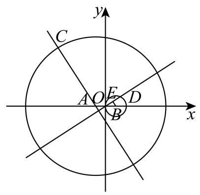

