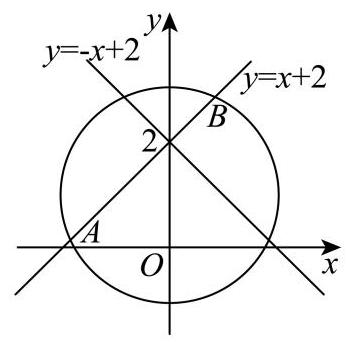

# 2026二模 集合与逻辑专题 · 教师版

> 本地预览：题目、答案及分类尚未全部审定。校对使用的PDF为教研整理版，尚未逐区确认区级印刷原卷。

## 集合运算、元素约束与参数

区分元素互异性、集合运算和根集去重，先确定实际元素再求参数。

### 嘉定 · 第1题

已知集合 $A = \left\{  {a,{a}^{2}}\right\}$ ，且 $1 \in  A$ ，则 $a =$ ___.

> 本题资料或解析有待核事项，预览不可作为已审定成品。

**考点：** 集合元素互异性与参数

**难度依据：** 集合互异性排除候选

**核查说明：** 题干与答案解析尚未逐页对照原卷，数学内容未独立终审。

**【答案】** -1

**【解析】**

**【详解】**由题意可知, $a = 1$ 或 ${a}^{2} = 1$ ,即 $a = 1$ 或 $a =  - 1$ ,

当 $a = 1$ 时,集合 $A = \{ 1,1\}$ ,不满足集合元素互异性,舍去;

当 $a =  - 1$ 时,集合 $A = \{  - 1,1\}$ ,符合题意,所以 $a =  - 1$ .

### 奉贤 · 第1题

已知集合 $A = \{ {3a}\} , B = \left\{  {9,{a}^{2}}\right\}$ ，若 $A \subseteq  B$ ，则实数 $a =$ ___.

**考点：** 子集关系及元素互异性

**难度依据：** 子集关系及元素互异性

**【答案】** 0

**【解析】**

**【详解】**因为 $A \subseteq  B$ ,所以 ${3a} = 9$ 或 ${3a} = {a}^{2}$ ,

解得 $a = 3$ ,或 $a = 0$ ,

当 $a = 3$ 时， ${a}^{2} = 9$ ，集合 $B$ 中的元素不满足互异性，舍去；

当 $a = 0$ 时， $B = \{ 9,0\}$ ，满足题意，故 $a = 0$

### 宝山 · 第1题

已知集合 $A = \{ 0,3\} , B = \{ 0,4\}$ ，则 $A \cup  B =$ ___.

**考点：** 有限集合并集

**难度依据：** 有限集合并集

**【答案】** $\{ 0,3,4\}$

**【解析】**

**【详解】**因为集合 $A = \{ 0,3\} , B = \{ 0,4\}$ ,所以 $A \cup  B = \{ 0,3,4\}$ .

### 崇明 · 第1题

集合 $A = \{ 2,4,6,8,{10}\} , B = \left( {-1,6}\right)$ ，则 $A \cap  B =$ ___.

**考点：** 有限集合与区间交集

**难度依据：** 有限集合与区间交集

**【答案】** $\{ 2,4\}$

**【解析】**

**【分析】**根据交集的概念运算.

**【详解】**由题意得, $A \cap  B = \{ 2,4\}$ .

故答案为: $\{ 2,4\}$

### 徐汇 · 第9题

已知实数 ${a}_{1}$ 、 ${a}_{2}$ 、 ${a}_{3}$ 、 ${a}_{4}$ 、 ${a}_{5}$ 满足

$\left\{  {x \mid  \left( {x - {a}_{1}}\right) \left( {x - {a}_{2}}\right) \left( {x - {a}_{3}}\right) \left( {x - {a}_{4}}\right) \left( {x - {a}_{5}}\right)  = 0}\right\}   = \{ 1,2,3,4\}$ ,则 ${a}_{1}\text{ 、 }{a}_{2}\text{ 、 }{a}_{3}\text{ 、 }{a}_{4}\text{ 、 }{a}_{5}$ 的方差的最大值为___.

**考点：** 根集合确定重复元素，再比较方差

**难度依据：** 结合重数限制与方差最值

**【答案】** $\frac{34}{25}$

**【解析】**

**【详解】**设 ${a}_{1}\text{ 、 }{a}_{2}\text{ 、 }{a}_{3}\text{ 、 }{a}_{4}\text{ 、 }{a}_{5}$ 分别对应 $1,2,3,4, t,\left( {t = 1,2,3,4}\right)$ .

则 $\bar{a} = \frac{{10} + t}{5} = 2 + \frac{t}{5}$ ,

所以 ${a}_{1}\text{ 、 }{a}_{2}\text{ 、 }{a}_{3}\text{ 、 }{a}_{4}\text{ 、 }{a}_{5}$ 的方差为:

${s}^{2} = \frac{1}{5}\left\lbrack  {{\left( 1 - \bar{a}\right) }^{2} + {\left( 2 - \bar{a}\right) }^{2} + {\left( 3 - \bar{a}\right) }^{2} + {\left( 4 - \bar{a}\right) }^{2} + {\left( t - \bar{a}\right) }^{2}}\right\rbrack$

$= \frac{1}{5}\left\lbrack  {{\left( -1 - \frac{t}{5}\right) }^{2} + {\left( -\frac{t}{5}\right) }^{2} + {\left( 1 - \frac{t}{5}\right) }^{2} + {\left( 2 - \frac{t}{5}\right) }^{2} + {\left( \frac{4t}{5} - 2\right) }^{2}}\right\rbrack$

$= \frac{2}{25}\left( {2{t}^{2} - {10t} + {25}}\right)$

因为函数 $f\left( x\right)  = 2{x}^{2} - {10x} + {25}$ 在 $\left( {0,\frac{5}{2}}\right)$ 上单调递减,在 $\left( {\frac{5}{2},4}\right)$ 上单调递增,

且 $f\left( 1\right)  = f\left( 4\right)  = {17}$ .

所以当 $t = 1$ 或 4 时,该组数据的方差相等,且取得最大值,为 $\frac{2}{25} \times  {17} = \frac{34}{25}$ .

所以该组数据方差的最大值为: $\frac{34}{25}$ .

### 普陀 · 第10题

设 $a \in  \mathbf{R}$ ,集合 $M = \{  - 1, - 2, - a\} , N = \left\{  {x \mid  {x}^{2} - {ax} \leq  0}\right\}$ ,若集合 $A \subseteq  \left( {M \cap  N}\right)$ ,且满足条件的 $A$ 恰有 2 个，则 $a$ 的取值范围为___.

**考点：** 交集元素个数与子集个数；含参二次不等式解集

**难度依据：** 交集元素个数与子集个数；含参二次不等式解集

**【答案】** $\{ a \mid   - 2 < a \leq   - 1$ 或 $a = 0\}$

**【解析】**

**【分析】**由题意得出 $M \cap  N$ 是一元集,然后按 $a$ 的正负或 0 分类讨论求解.

**【详解】**由题意 $M \cap  N$ 的子集恰有 2 个,所以 $M \cap  N$ 是一元集,

若 $a = 0$ ,则 $N = \{ 0\}$ ,而 $M = \{  - 1, - 2,0\} , M\text{ 、 }{QN} = \{ 0\}$ 满足题意,

若 $a > 0$ ,则 $- a < 0, N = \{ x \mid  0 \leq  x \leq  a\}$ ,此时 $M \cap  N = \varnothing$ ,不合题意;

若 $a < 0$ ,则 $- a > 0, N = \{ x \mid  a \leq  x \leq  0\} , M \cap  N$ 只含一个元素,则 $- 2 < a \leq   - 1$ ,

综上, $a$ 的取值范围是 $\{ a \mid   - 2 < a \leq   - 1$ 或 $a = 0\}$ .

### 杨浦 · 第1题

设全集 $U = \{ x \mid  1 \leq  x \leq  6, x \in  \mathbf{Z}\} , B = \{ 1,2\}$ ，用列举法表示 ${\eth }_{U}B =$ ___.

> 本题资料或解析有待核事项，预览不可作为已审定成品。

**考点：** 列出全集后求补集

**难度依据：** 基本集合运算

**核查说明：** 合并MD补集符号出现非标准OCR字符，需回看PDF恢复。

**【答案】** $\{ 3,4,5,6\}$

**【解析】**

**【分析】**由集合的补集运算结合集合的表示法即可求解.

**【详解】**由题意得 $U = \{ 1,2,3,4,5,6\}$ ,则 ${\partial }_{J}B = \{ 3,4,5,6\}$ .

### 松江 · 第1题

已知集合 $A = \{ x \mid  x\rangle 0\} , B = \{  - 1,0,1,2\}$ ，则 $A \cap  B$ 等于___.

**考点：** 描述法与列举法求交集

**难度依据：** 直接集合运算

**【答案】** $\{ 1,2\}$

**【解析】**

**【详解】**试题分析: $A \cap  B = \{ x \mid  x > 0\}  \cap  \{  - 1,0,1,2\}  = \{ 1,2\}$

考点: 集合运算

**【方法点睛】**

1. 用描述法表示集合，首先要弄清集合中代表元素的含义，再看元素的限制条件，明确集合类型, 是数集、点集还是其他的集合.

### 浦东 · 第1题

已知全集 $U = \left( {0, + \infty }\right)$ ，集合 $A = \lbrack 2, + \infty )$ ，则 ${\widetilde{\partial }}_{1}A =$ ___.

> 本题资料或解析有待核事项，预览不可作为已审定成品。

**考点：** 在指定全集中求补集

**难度依据：** 基本区间运算

**核查说明：** 合并MD补集符号出现非标准OCR字符，需回看PDF恢复。

**【答案】** (0,2)

**【解析】**

**【详解】** $U = \left( {0, + \infty }\right) , A = \lbrack 2, + \infty ),{\partial }_{J}A = \left( {0,2}\right)$ .

### 虹口 · 第1题

设全集为 $U = \{  - 2, - 1,0,1,2,3\}$ ，集合 $A = \left\{  {x\left| {\;\frac{x}{x - 2} \geq  0}\right. , x \in  U}\right\}$ ，则 $\bar{A} =$ ___.

**考点：** 有限全集上的补集；分式不等式及定义域

**难度依据：** 有限全集上的补集；分式不等式及定义域

**【答案】** $\{ 1,2\}$

**【解析】**

**【分析】**根据分式不等式的解法,可求得集合 $A$ ,即可得答案.

**【详解】**由 $\frac{x}{x - 2} \geq  0$ ,得 $\left\{  \begin{array}{l} x\left( {x - 2}\right)  \geq  0 \\  x - 2 \neq  0 \end{array}\right.$ ,解得 $x > 2$ 或 $x \leq  0$ ,

又 $x \in  U$ ,所以 $A = \{  - 2, - 1,0,3\}$ ,则 $\bar{A} = \{ 1,2\}$ .

### 长宁 · 第1题

已知集合 $A = \{ 1,2,3\} , B = \left( {2, + \infty }\right)$ ，则 $A \cap  B =$ ___.

> 本题资料或解析有待核事项，预览不可作为已审定成品。

**考点：** 集合交集

**难度依据：** 集合交集

**核查说明：** 底稿答案括号与集合符号疑似误识，待核PDF。

**【答案】** (3)

**【解析】**

**【详解】**集合 $A = \{ 1,2,3\} , B = \left( {2, + \infty }\right)$ ,则 $A \cap  B = \{ 3\}$ .

### 闵行 · 第1题

已知集合 $A = \{ 1,2,3,4\} , B = \{ 3,4,5,6\}$ ，则 $A \cap  B =$ ___.

**考点：** 集合交集

**难度依据：** 集合交集

**【答案】** $\{ 3,4\}$

**【解析】**

**【分析】**利用交集的定义求解.

**【详解】**集合 $A = \{ 1,2,3,4\} , B = \{ 3,4,5,6\}$ ,则 $A \cap  B = \{ 3,4\}$

### 青浦 · 第1题

已知集合 $A = \{ 0,1,2,3\}$ ，集合 $B = \left( {-1,1}\right)$ ，则 $A \cap  B =$ ___.

**考点：** 有限集合与区间的交集

**难度依据：** 有限集合与区间的交集

**【答案】** $\{ 0\}$

**【解析】**

**【详解】**因为集合 $A = \{ 0,1,2,3\}$ ,集合 $B = \left( {-1,1}\right)$ ,所以 $A \cap  B = \{ 0\}$

### 静安 · 第14题

已知集合 $A = \left\{  {x\left| {\;{x}^{2} - x - 6 = 0}\right. }\right\}  , B = \left\{  {x\left| {\;\frac{x + 3}{1 - x} > 0}\right. }\right\}$ ，则 $A \cap  B =$ ( ).

A. $\{  - 2,3\}$

B. $\left( {-3,1}\right)$

C. $\{ 3\}$

D. $\{  - 2\}$

**考点：** 集合关系；分式不等式

**难度依据：** 集合关系；分式不等式

**【答案】** D

**【解析】**

**【详解】**由 ${x}^{2} - x - 6 = 0$ 解得 $x =  - 2$ 或 $x = 3$ ,即集合 $A = \{  - 2,3\}$ , 由 $\frac{x + 3}{1 - x} > 0$ 可得 $\left( {x + 3}\right) \left( {1 - x}\right)  > 0$ ,解得 $- 3 < x < 1$ ,即集合 $B = \{ x \mid   - 3 < x < 1\}$ ; 所以 $A \cap  B = \{  - 2\}$ .

### 黄浦 · 第1题

若 $A = \left\lbrack  {-1,1}\right\rbrack$ ， $B = \left\{  {x\left| {\;{x}^{2} - {2x} \leq  0}\right. }\right\}$ ，则 $A \cap  B =$ ___.

**考点：** 集合交集；二次不等式

**难度依据：** 集合交集；二次不等式

**【答案】** $\left\lbrack  {0,1}\right\rbrack$

**【解析】**

**【分析】**解不等式化简集合 $B$ ，进而可求交集.

**【详解】**由题意可知: 集合 $B = \left\{  {x\left| {\;{x}^{2} - {2x} \leq  0}\right. }\right\}   = \left\lbrack  {0,2}\right\rbrack$ ,

且集合 $A = \left\lbrack  {-1,1}\right\rbrack$ ，所以 $A \cap  B = \left\lbrack  {0,1}\right\rbrack$ .

## 充分必要条件与包含关系

将条件转为集合包含或空间关系，用反例检验反向推理。

### 嘉定 · 第13题

已知陈述句 $a$ 是 $\beta$ 的充分非必要条件. 若集合 $M = \{ x \mid  x$ 满足 $a\} , N = \{ x \mid  x$ 满足 $\beta \}$ ,则 $M$ 与 $N$ 的关系为( )

A. $M \subset  N$

B. $M \supset  N$

C. $M = N$

D. $M \cap  N = \varnothing$

> 本题资料或解析有待核事项，预览不可作为已审定成品。

**考点：** 充分非必要条件与集合包含

**难度依据：** 由蕴含判断集合包含

**核查说明：** 题干与答案解析尚未逐页对照原卷，数学内容未独立终审。

**【答案】** A

**【解析】**

**【分析】**根据充要条件和集合的包含关系可得.

**【详解】**因为 $a$ 是 $\beta$ 的充分非必要条件,所以 $a$ 成立时 $\beta$ 一定成立

所以 $x$ 满足 $a$ 时, $x$ 一定满足 $\beta$ ,所以 $M \subset  N$ ,

又 $\beta$ 成立时推不出 $a$ 成立,即 $x$ 满足 $\beta$ 时 $x$ 不一定满足 $a$ ,所以 $N$ 不是 $M$ 的子集.

故选: A

### 宝山 · 第14题

在 ${ABC}$ 中， $A, B$ 均为锐角，设甲: $\sin A < \sin C$ ；乙: ${ABC}$ 是钝角三角形，则甲是乙的 ( )

A. 充要条件

B. 充分不必要条件

C. 必要不充分条件

D. 既不充分也不必要条件

> 本题资料或解析有待核事项，预览不可作为已审定成品。

**考点：** 充分必要性与反例；正弦定理判断三角形

**难度依据：** 充分必要性与反例；正弦定理判断三角形

**核查说明：** 合并稿选项A充要、B充分不必要、C必要不充分；具名整理PDF物理第2页选项A充分非必要、B必要非充分、C充要，PDF第6页答案B而合并稿答案C，结论文字一致但选项顺序不同，发布时按对应题面核对。

**【答案】** C

**【解析】**

**【分析】**举反例否定充分性, 利用正弦定理并结合题意证明必要性即可.

**【详解】**对于充分性,设 $A = \frac{\pi }{4}, C = \frac{\pi }{3}$ ,显然满足甲,

此时 $B = \frac{5\pi }{12},\;{ABC}$ 不是钝角三角形,故充分性不成立;

对于必要性,若 ${ABC}$ 是钝角三角形,则 $C > \frac{\pi }{2}$ ,则 $a < c$ ,

由正弦定理可知 $\sin A < \sin C$ ,则必要性成立,

即甲是乙的必要不充分条件, 故 C 正确.

故选:C

### 徐汇 · 第13题

已知 $a\text{ 、 }b \in  \mathbf{R}$ ，则 “ $\ln a > \ln b$ ” 是 “ ${\mathrm{e}}^{a - b} > 1$ ” 的( )

A. 充分非必要条件

B. 必要非充分条件

C. 充要条件

D. 既非充分又非必要条件

**考点：** 对数条件有定义域限制，比较蕴含关系

**难度依据：** 结合定义域判断必要性

**【答案】** A

**【解析】**

**【详解】** $\ln a > \ln b$ 等价于 $a > b > 0,{\mathrm{e}}^{a - b} > 1$ 等价于 $a > b$ ,

$a > b > 0$ 可以推出 $a > b$ ,但 $a > b$ 无法推出 $a > b > 0$ ,因为还存在 $0 > a > b$ 这种可能性, 所以“ $\ln a > \ln b$ ” 是 “ ${\mathrm{e}}^{a - b} > 1$ ” 的充分不必要条件.

### 普陀 · 第13题

已知直线 $l\text{ 、 }m$ 和平面 $a$ ，若 $m \subset  a$ ，则 “ $l$ 与 $m$ 不相交”是 “ $l//a$ ”的( )

A. 充分非必要条件必要条件

B. 必要非充分条件

C. 充分必要条件

D. 既非充分又非必要

**考点：** 必要条件与反例；线线及线面位置关系

**难度依据：** 必要条件与反例；线线及线面位置关系

**【答案】** B

**【解析】**

**【分析】**根据线面判断及线线位置关系结合必要非充分条件定义判断.

**【详解】**当直线 $l$ 与平面 $a$ 相交,且交点不在直线 $m$ 上时,满足 “ $l$ 与 $m$ 不相交”, 但 “ $l//a$ ” 不成立,故充分性不成立;

若 $l//a$ ，则 $l$ 与 $a$ 无交点，所以“ $l$ 与 $m$ 不相交”，故必要性成立；

所以“ $l$ 与 $m$ 不相交”是“ $l//a$ ”的必要非充分条件.

### 虹口 · 第4题

设 $a : x \leq  m$ ， $\beta  : \left| {x - 2}\right|  \leq  1$ ，若 $a$ 是 $\beta$ 的必要条件，则实数 $m$ 的取值范围是___.

**考点：** 必要条件化集合包含；绝对值不等式解集

**难度依据：** 必要条件化集合包含；绝对值不等式解集

**【答案】** $\{ m \mid  m \geq  3\}$

**【解析】**

**【详解】**由 $\left| {x - 2}\right|  \leq  1$ 得 $- 1 \leq  x - 2 \leq  1$ ,得 $1 \leq  x \leq  3$ ,

因为 $a$ 是 $\beta$ 的必要条件,所以 $\{ x \mid  1 \leq  x \leq  3\}  \subseteq  \{ x \mid  x \leq  m\}$ ,得 $m \geq  3$ ,

故实数 $m$ 的取值范围是 $\{ m \mid  m \geq  3\}$ .

### 金山 · 第4题

设 $a : 1 \leq  x \leq  4,\beta  : x \leq  m$ ，若 $a$ 是 $\beta$ 的充分条件，则实数 $m$ 的取值范围是___.

**考点：** 充分条件转集合包含

**难度依据：** 充分条件转集合包含

**【答案】** $\lbrack 4, + \infty )$

**【解析】**

**【分析】**由题意得出 $\left\lbrack  {1,4}\right\rbrack   \subseteq  ( - \infty , m\rbrack$ ,由此可得出实数 $m$ 的取值范围.

**【详解】** $\because a : 1 \leq  x \leq  4,\beta  : x \leq  m$ ,若 $a$ 是 $\beta$ 的充分条件, $\left\lbrack  {1,4}\right\rbrack   \subseteq  ( - \infty , m\rbrack$ ,则 $m \geq  4$ .

因此，实数 $m$ 的取值范围是 $\lbrack 4, + \infty )$ .

故答案为 $\lbrack 4, + \infty )$ .

**【点睛】**本题考查利用充分条件求参数，一般转化为集合的包含关系求解，考查运算求解能力, 属于基础题.

### 黄浦 · 第13题

若 $a, b$ 是空间中的两条直线，则 “ $a//b$ ” 是 “存在平面 $a$ ，使 $a \subset  a, b \subset  a$ ” 的( ).

A. 充分非必要条件

B. 必要非充分条件

C. 充要条件

D. 既非充分也非必要条件

**考点：** 空间直线共面条件；充分条件

**难度依据：** 空间直线共面条件；充分条件

**【答案】** A

**【解析】**

**【分析】**根据空间中线、面关系结合充分、必要条件分析判断.

**【详解】**若 $a//b$ ,可知直线 $a, b$ 是共面直线,则存在平面 $a$ ,使 $a \subset  a, b \subset  a$ ,即充分性成立;

若存在平面 $a$ ,使 $a \subset  a, b \subset  a$ ,则直线 $a, b$ 可能相交,即必要性不成立; 综上所述: “ $a//b$ ”是“存在平面 $a$ ,使 $a \subset  a, b \subset  a$ ”的充分非必要条件.

## 量词、命题真假与存在性

逐一处理量词、反例及存在性，综合大题保留全部小问。

### 嘉定 · 第15题

设数列 $\left\{  {a}_{n}\right\}$ 满足 ${a}_{1} = 1$ ,且 ${a}_{n + 1} = \frac{\left( {{\lambda n} - 2}\right)  \cdot  {a}_{n}}{{n}^{2} + 1}$ ,其中 $\lambda  \in  \mathbf{R}$ . 下列选项中错误的是 ( )

A. 存在 $\lambda$ ,使得存在正整数 $\mathbf{N}$ ,当 $n \geq  \mathbf{N}$ 时,总有 ${a}_{n + 1} < {a}_{n}$

B. 存在 $\lambda$ ,使得不存在正整数 $\mathbf{N}$ ,当 $n \geq  \mathbf{N}$ 时,总有 ${a}_{n + 1} > {a}_{n}$

C. 对任意 $\lambda$ ，都不存在正整数 $\mathbf{N}$ ，使得当 $n \geq  \mathbf{N}$ 时，总有 ${a}_{n + 1} > {a}_{n}$

D. 存在 $\lambda$ ,使得不存在正整数 $\mathbf{N}$ ,当 $n \geq  \mathbf{N}$ 时,总有 ${a}_{n + 1} < {a}_{n}$

> 本题资料或解析有待核事项，预览不可作为已审定成品。

**考点：** 含参递推数列的最终单调性；量词否定与反例

**难度依据：** 递推长期行为与量词判断

**核查说明：** 题干与答案解析尚未逐页对照原卷，数学内容未独立终审。

**【答案】** C

**【解析】**

**【详解】**对于 $\mathrm{A}$ ,令 $\lambda  = 3$ ,则 ${a}_{n + 1} = \frac{\left( {{3n} - 2}\right) {a}_{n}}{{n}^{2} + 1} \Rightarrow  \frac{{a}_{n + 1}}{{a}_{n}} = \frac{{3n} - 2}{{n}^{2} + 1}$ ,

存在 $\mathbf{N} = 3$ ,当 $n \geq  \mathbf{N} = 3$ 时,有 ${3n} - 2 > 0$ 且 $\frac{{3n} - 2}{{n}^{2} + 1} < 1$ ,所以 ${a}_{n + 1} < {a}_{n}$ ,故 $\mathrm{A}$ 正确;

对于 $\mathrm{B}$ ,令 $\lambda  = 3$ ,则 ${a}_{n + 1} = \frac{\left( {{3n} - 2}\right) {a}_{n}}{{n}^{2} + 1} \Rightarrow  \frac{{a}_{n + 1}}{{a}_{n}} = \frac{{3n} - 2}{{n}^{2} + 1}$ ,

当 $n = 1$ 时， ${a}_{2} = \frac{\left( {3 - 2}\right) {a}_{1}}{{1}^{2} + 1} \Rightarrow  \frac{{a}_{2}}{{a}_{1}} = \frac{1}{2} \Rightarrow  {a}_{2} < {a}_{1}$ ，

当 $n = 2$ 时， ${a}_{3} = \frac{\left( {3 \times  2 - 2}\right) {a}_{2}}{{2}^{2} + 1} \Rightarrow  \frac{{a}_{3}}{{a}_{2}} = \frac{4}{5} \Rightarrow  {a}_{3} < {a}_{2}$ ，

由 $\mathrm{A}$ 当 $n \geq  3$ 时,总有 ${a}_{n + 1} < {a}_{n}$ ,

因此不存在正整数 $\mathbf{N}$ ,对所有的 $n \geq  \mathbf{N}$ ,总有 ${a}_{n + 1} > {a}_{n}$ ,故 $\mathrm{B}$ 正确;

对于 $\mathrm{C}$ ,令 $\lambda  = \frac{3}{2}$ ,则 ${a}_{n + 1} = \frac{\left( {\frac{3}{2}n - 2}\right) {a}_{n}}{{n}^{2} + 1} \Rightarrow  \frac{{a}_{n + 1}}{{a}_{n}} = \frac{\frac{3}{2}n - 2}{{n}^{2} + 1}$ ,

当 $n \geq  2$ 时,有 $0 < \frac{\frac{3}{2}n - 2}{{n}^{2} + 1} < 1$ ,

又因为 ${a}_{1} = 1,{a}_{2} = \frac{\left( \frac{3}{2} - 2\right) }{2} \times  1 =  - \frac{1}{4} < 0$ ,而 $\frac{{a}_{3}}{{a}_{2}} < 1$ ,所以 ${a}_{2} < {a}_{3} < 0$ ,

则 $n \geq  2$ 时,总有 ${a}_{n} < \frac{\frac{3}{2}n - 2}{{n}^{2} + 1}{a}_{n} = {a}_{n + 1} < 0$ ,

因此当 $\lambda  = \frac{3}{2}$ 时,存在 $N = 2$ ,当 $n \geq  N = 2$ 时,有 ${a}_{n + 1} > {a}_{n}$ ,故 $\mathrm{C}$ 错误;

对于 $\mathrm{D}$ ,令 $\lambda  = 0$ ,则 ${a}_{n + 1} = \frac{-2{a}_{n}}{{n}^{2} + 1} \Rightarrow  \frac{{a}_{n + 1}}{{a}_{n}} = \frac{-2}{{n}^{2} + 1}$ ,数列 $\left\{  {a}_{n}\right\}$ 正负交替出现,

因此不存在正整数 $N$ ,对所有的 $n \geq  N$ ,总有 ${a}_{n + 1} < {a}_{n}$ ,故 D 正确;

### 宝山 · 第12题

已知集合 $A = \{ x \mid  1 \leq  x \leq  n, x \in  \mathbf{Z}\} , S \subseteq  A$ ，当 $a\text{ 、 }b \in  S$ 且 $a \neq  b$ 时，都有 $\left| {a - b}\right|  > 2$ ，若满足条件的集合 $\mathrm{S}$ 至少有 100 个，则正整数 $n$ 的最小值是___.

**考点：** 限制元素间距的子集计数；按末元素建立递推；分类计数

**难度依据：** 限制元素间距的子集计数；按末元素建立递推；分类计数

**【答案】** 12

**【解析】**

**【分析】**设 $f\left( n\right)$ 表示集合 $\{ 1,2,3,\cdots , n\}$ 中,满足要求的集合 $\mathrm{S}$ 的个数,得到 $f\left( n\right)  = f\left( {n - 1}\right)  + f\left( {n - 3}\right)$ ,从而求出答案.

**【详解】**设 $A = \{ 1,2,3,\cdots , n\} , S \subseteq  A$ ,当 $a\text{ 、 }b \in  S$ 且 $a \neq  b$ 时,都有 $\left| {a - b}\right|  > 2$ ,

设 $f\left( n\right)$ 表示集合 $\{ 1,2,3,\cdots , n\}$ 中，满足要求的集合 $\mathrm{S}$ 的个数，

若 $\mathrm{S}$ 中无 $n$ ,则有 $f\left( {n - 1}\right)$ 个集合满足要求,

若 $\mathrm{S}$ 中有 $n$ ,要想满足要求,则 $\mathrm{S}$ 中无 $n - 1, n - 2$ ,故有 $f\left( {n - 3}\right)$ 个集合满足要求,

所以 $f\left( n\right)  = f\left( {n - 1}\right)  + f\left( {n - 3}\right)$ ,

当 $n = 1$ 时， $A = \{ 1\}$ ，故 $S = \varnothing ,\{ 1\}$ ，即 $f\left( 1\right)  = 2$ ，

当 $n = 2$ 时， $A = \{ 1,2\}$ ，故 $S = \varnothing ,\{ 1\} ,\{ 2\}$ ，即 $f\left( 2\right)  = 3$ ，

当 $n = 3$ 时， $A = \{ 1,2,3\}$ ，故 $S = \varnothing ,\{ 1\} ,\{ 2\} ,\{ 3\}$ ，即 $f\left( 3\right)  = 4$ ，

故 $f\left( 4\right)  = f\left( 3\right)  + f\left( 1\right)  = 4 + 2 = 6, f\left( 5\right)  = f\left( 4\right)  + f\left( 2\right)  = 6 + 3 = 9$ ,

$f\left( 6\right)  = f\left( 5\right)  + f\left( 3\right)  = 9 + 4 = {13},\;f\left( 7\right)  = f\left( 6\right)  + f\left( 4\right)  = {13} + 6 = {19},$

$f\left( 8\right)  = f\left( 7\right)  + f\left( 5\right)  = {19} + 9 = {28}, f\left( 9\right)  = f\left( 8\right)  + f\left( 6\right)  = {28} + {13} = {41},$

$f\left( {10}\right)  = f\left( 9\right)  + f\left( 7\right)  = {41} + {19} = {60},\;f\left( {11}\right)  = f\left( {10}\right)  + f\left( 8\right)  = {60} + {28} = {88},$

$f\left( {12}\right)  = f\left( {11}\right)  + f\left( 9\right)  = {88} + {41} = {129} > {100},$

故正整数 $n$ 的最小值为 12 .

### 徐汇 · 第19题

已知函数 $y = f\left( x\right)$ ,其中 $f\left( x\right)  = \frac{{2a} - 1 + g\left( x\right) }{a - g\left( x\right) }, a \in  \mathbf{R}$ 且 $a > 0$ .

(1)设 $g\left( x\right)  = {2}^{x}$ ，写出函数 $y = f\left( x\right)$ 的定义域，并判断是否存在正数 $a$ ，使得函数 $y = f\left( x\right)$ 为奇函数,说明理由;

(2)设 $g\left( x\right)  = {\log }_{2}x$ . 若关于 $x$ 的方程 $f\left( x\right)  = g\left( x\right)$ 的解集为单元素集合,求正数 $a$ 的值.

**考点：** (1)定义域对称与奇函数验证；(2)换元化二次方程并排除分母零点

**难度依据：** 既需判别式又需剔除不合法根

**【答案】** (1) $\left\{  {x \mid  x \neq  {\log }_{2}a}\right\}  , a = 1$ ;

(2) $a = \frac{1}{3}$ 或 $a = 5 - 2\sqrt{5}$ 或 $a = 5 + 2\sqrt{5}$

**【解析】**

**【分析】**(1) 由分母不等于 0 解出定义域,由奇函数的定义域关于原点对称求出 $a$ 的值,再利用奇函数的定义检验即可;

(2)令 $t = {\log }_{2}x$ ，则原命题可等价于方程 ${t}^{2} + \left( {1 - a}\right) t + {2a} - 1 = 0, t \neq  a$ 的解集为单元素集合,分一元二次方程有两相等实根且不等于 $a$ 与一元二次方程有两不相等实根且有一个根等于 $a$ ,分别求出 $a$ 的值即可.

**【小问 1 详解】**

由题意知: $f\left( x\right)  = \frac{{2a} - 1 + {2}^{x}}{a - {2}^{x}}, a > 0$ ,

分母不等于 0 得: $a - {2}^{x} \neq  0$ ,

解得: $x \neq  {\log }_{2}a$ ,

所以函数 $y = f\left( x\right)$ 的定义域为 $\{ x \mid  x \neq  {\log }_{2}a\}$ ,

要使函数 $y = f\left( x\right)$ 为奇函数,则定义域关于原点对称,

则 ${\log }_{2}a = 0$ ,解得 $a = 1$ ,

当 $a = 1$ 时， $f\left( x\right)  = \frac{1 + {2}^{x}}{1 - {2}^{x}}$ ，定义域为 $\{ x \mid  x \neq  0\}$ ，

此时 $f\left( {-x}\right)  = \frac{1 + {2}^{-x}}{1 - {2}^{-x}} = \frac{{2}^{x} + 1}{{2}^{x} - 1} =  - f\left( x\right)$ ,满足奇函数的定义,

所以存在正数 $a = 1$ ,使得函数 $y = f\left( x\right)$ 为奇函数.

**【小问 2 详解】**

由题意知: $f\left( x\right)  = \frac{{2a} - 1 + {\log }_{2}x}{a - {\log }_{2}x}, a > 0$ ,

则 $f\left( x\right)  = g\left( x\right)$ 等价于 $\frac{{2a} - 1 + {\log }_{2}x}{a - {\log }_{2}x} = {\log }_{2}x$ ,其中 $x > 0$ 且 $x \neq  {2}^{a}$ ,

化简得: ${\left( {\log }_{2}x\right) }^{2} + \left( {1 - a}\right) {\log }_{2}x + {2a} - 1 = 0$ ,

令 $t = {\log }_{2}x, t \neq  a$ ,

原命题等价于: ${t}^{2} + \left( {1 - a}\right) t + {2a} - 1 = 0, t \neq  a$ 的解集为单元素集合,

① 方程有两相等实根，且不等于 $a$ ，

所以 $\Delta  = {\left( 1 - a\right) }^{2} - 4\left( {{2a} - 1}\right)  = 0$ ,

化简得: ${a}^{2} - {10a} + 5 = 0 \Rightarrow  {\left( a - 5\right) }^{2} = {20}$ ,

解得: $a = 5 \pm  2\sqrt{5}$ ，

验证根是否等于 $a$ ,

当 $a = 5 + 2\sqrt{5}$ 时,根 $t =  - \frac{1 - a}{2} = 2 + \sqrt{5} \neq  a$ ,满足题意,

当 $a = 5 - 2\sqrt{5}$ 时,根 $t =  - \frac{1 - a}{2} = 2 - \sqrt{5} \neq  a$ ,满足题意,

② 方程有两不等实根，且其中一个根为 $a$ ，

则将 $t = a$ 代入方程: ${a}^{2} + \left( {1 - a}\right) a + {2a} - 1 = 0 \Rightarrow  {3a} - 1 = 0 \Rightarrow  a = \frac{1}{3}$ ，

当 $a = \frac{1}{3}$ 时，此时方程为 ${t}^{2} + \frac{2}{3}t - \frac{1}{3} = 0 \Rightarrow  3{t}^{2} + {2t} - 1 = 0 \Rightarrow  \left( {{3t} - 1}\right) \left( {t + 1}\right)  = 0$ ，

解得: $t = \frac{1}{3}$ (舍)或 $t =  - 1$ ，满足题意.

综上所述: 正数 $a$ 的取值为 $a = \frac{1}{3}$ 或 $a = 5 - 2\sqrt{5}$ 或 $a = 5 + 2\sqrt{5}$ .

### 杨浦 · 第10题

设集合 $A = \{ z\parallel z + 1 \mid   = \left| {z - a}\right| , z \in  \mathbf{C}\} , B = \{ z\parallel z \mid   = 1, z \in  \mathbf{C}\}$ ，若 $A \cap  B \neq  \varnothing$ ，则实数 $a$ 的取值范围是___.

> 本题资料或解析有待核事项，预览不可作为已审定成品。

**考点：** 模的几何意义转化圆与直线相交，讨论退化

**难度依据：** 需处理两定点重合的退化情形

**核查说明：** 合并MD集合定义中绝对值与条件分隔符错乱，需对原卷修复。

**【答案】** $\left\lbrack  {-1,3}\right\rbrack$

**【解析】**

**【分析】**由 $\left| {z + 1}\right|  = \left| {z - a}\right|$ 知 $z$ 到 $\left( {-1,0}\right)$ 与 $\left( {a,0}\right)$ 距离相等,其轨迹是这两点的垂直平分线, $B = \{ z\parallel z \mid   = 1, z \in  \mathbf{C}\}$ 表示的轨迹是一个单位圆,两者有交点,等价于原点到直线的距离不大于 1,通过计算可得实数 $a$ 的取值范围.

**【详解】**集合 $A = \left\{  {z\begin{Vmatrix}{z + 1}\end{Vmatrix} = \left| {z - a}\right| , z \in  \mathbf{C}}\right\}$ ,由 $\left| {z + 1}\right|  = \left| {z - a}\right|$ ,即 $z$ 到 $\left( {-1,0}\right)$ 与 $\left( {a,0}\right)$ 距离相等,

即 $z$ 的轨迹为 $\left( {-1,0}\right)$ 与 $\left( {a,0}\right)$ 两点连线的垂直平分线,

设 $z = x + y\mathrm{i}$ ,所以 $\left| {x + 1 + y\mathrm{i}}\right|  = \left| {x - a - y\mathrm{i}}\right|$ ,所以 ${\left( x + 1\right) }^{2} + {y}^{2} = {\left( x - a\right) }^{2} + {y}^{2}$ ,化简得 $2\left( {a + 1}\right) x = {a}^{2} - 1,$

若 $a =  - 1$ ,等式化为 $0 = 0$ ,任何 $z$ 都满足,此时 $A$ 为整个复平面,满足 $A \cap  B \neq  \varnothing$ ;

若 $a \neq   - 1$ ,则 $x = \frac{a - 1}{2}$ ,即 $z$ 的轨迹为直线 $x = \frac{a - 1}{2}, B = \{ z\parallel z \mid   = 1, z \in  \mathbf{C}\}$ 表示的为圆: ${x}^{2} + {y}^{2} = 1$

$A \cap  B \neq  \varnothing$ 即直线 $x = \frac{a - 1}{2}$ 与圆 ${x}^{2} + {y}^{2} = 1$ 有交点，所以 $\left| \frac{a - 1}{2}\right|  \leq  1$ ，解得 $- 1 \leq  a \leq  3$ ，所以实数 $a$ 的取值范围是 $\left\lbrack  {-1,3}\right\rbrack$ .

### 松江 · 第16题

已知数列 $\left\{  {a}_{n}\right\}$ 满足 ${a}_{n + 1} = 2{a}_{n}^{2} - 1\left( {n\text{ 为正整数 }}\right)$ ,关于数列 $\left\{  {a}_{n}\right\}$ 有以下两个命题: ①若 $1 < {a}_{3} < \frac{17}{8}$ ,则 ${a}_{1}$ 的取值范围是 $\left( {1,\frac{3\sqrt{2}}{4}}\right)$ ; ②若 ${a}_{1} + {a}_{3} = 0$ ,则 ${a}_{1}$ 的所有可能取值的个数是 4 个. 则以下选项正确的是 ( )

A. ①是真命题，②是假命题

B. ①是假命题，②是真命题

C. 两个都是真命题

D. 两个都是假命题

**考点：** 递推回代解不等式及高次方程，判断两个命题

**难度依据：** 递推嵌套与正负支不可遗漏

**【答案】** B

**【解析】**

**【分析】**根据数列 $\left\{  {a}_{n}\right\}$ 的递推关系式确定 ${a}_{2},{a}_{3}$ 与 ${a}_{1},{a}_{2}$ 的等式关系,结合不等式的性质由 $1 < {a}_{3} < \frac{17}{8}$ 确定 ${a}_{2}$ 的范围,从而得 ${a}_{1}$ 的取值范围即可判断①; 确定 ${a}_{1},{a}_{3}$ 的等式关系求解一元高次方程的根从而得 ${a}_{1}$ 的所有可能取值，即可判断②.

**【详解】**因为 ${a}_{n + 1} = 2{a}_{n}^{2} - 1$ ,所以 ${a}_{n + 1} + 1 = 2{a}_{n}^{2} \geq  0$ ,则 ${a}_{n + 1} \geq   - 1\left( {n\text{ 为正整数 }}\right)$ , 对于①因为 ${a}_{3} = 2{a}_{2}^{2} - 1$ ，若 $1 < {a}_{3} < \frac{17}{8}$ ，则 $1 < 2{a}_{2}^{2} - 1 < \frac{17}{8}$ ，解得 $1 < {a}_{2} < \frac{5}{4}$ 或 $- \frac{5}{4} < {a}_{2} <  - 1$ (舍),

又 ${a}_{2} = 2{a}_{1}^{2} - 1$ ，则 $1 < 2{a}_{1}^{2} - 1 < \frac{5}{4}$ ，解得 $1 < {a}_{1} < \frac{3\sqrt{2}}{4}$ 或 $- \frac{3\sqrt{2}}{4} < {a}_{1} <  - 1$ ，故①是假命题； ②因为 ${a}_{2} = 2{a}_{1}^{2} - 1,{a}_{3} = 2{a}_{2}^{2} - 1$ ,所以 ${a}_{3} = 8{a}_{1}^{4} - 8{a}_{1}^{2} + 1$ , 若 ${a}_{1} + {a}_{3} = 0$ ,则 $8{a}_{1}^{4} - 8{a}_{1}^{2} + {a}_{1} + 1 = 0$ ,整理得 $\left( {4{a}_{1}^{2} - 2{a}_{1} - 1}\right) \left( {2{a}_{1} - 1}\right) \left( {{a}_{1} + 1}\right)  = 0$ , 解得 ${a}_{1} =  - 1,{a}_{1} = \frac{1}{2},{a}_{1} = \frac{1 + \sqrt{5}}{4},{a}_{1} = \frac{1 - \sqrt{5}}{4}$ ,则 ${a}_{1}$ 的所有可能取值的个数是 4 个,故②是真命题.

### 虹口 · 第12题

在以 $O$ 为原点的空间直角坐标系中,设 $\overrightarrow{i} = \left( {1,0,0}\right) ,\overrightarrow{j} = \left( {0,1,0}\right) , A$ 和 $B$ 是两个点集, 设 $A = \left\{  {P\left| {\;\overrightarrow{OP} \cdot  \overrightarrow{j} = 1}\right. ,\left\langle  {\overrightarrow{OP},\overrightarrow{j}}\right\rangle   = \frac{\pi }{4}}\right\}$ ,对任意的 $Q \in  B$ ,总存在 $P \in  A$ ,使得 $\overrightarrow{OP} \cdot  \overrightarrow{OQ} = 2$ . 若 $T \in  B,\overrightarrow{OT} = x\overrightarrow{i} + y\overrightarrow{j}\left( {x\text{ 、 }y \in  \mathbf{R}}\right)$ 且 $\left| {\overrightarrow{OT} - \overrightarrow{j}}\right|  = 2$ ,则 $\overrightarrow{OT} \cdot  \overrightarrow{i}$ 的取值范围是___.

> 原题对点集只给出单向限制，尚不能唯一确定完整取值范围；源答案与条件的对称性也存在冲突。

**考点：** 空间数量积及向量夹角；圆与直线交点存在性；存在量词与点集条件

**难度依据：** 空间数量积及向量夹角；圆与直线交点存在性；存在量词与点集条件

**核查说明：** 题设仅说Q属于B时满足存在P的条件，并未说B等于所有满足条件的点构成的最大集合。即使按最大集合理解，T=(x,y,0)的存在条件为|2-y|≤|x|，与x²+(y-1)²=4联立关于x对称，源答案区间不关于x对称，不能作为字面题设已确定的完整范围。

**【答案】** $\left\lbrack  {-2,\frac{-1 - \sqrt{7}}{2}}\right\rbrack   \cup  \left\lbrack  {\frac{-1 + \sqrt{7}}{2},2}\right\rbrack$

**【解析】**

**【分析】**根据空间向量数量积的坐标表示公式, 结合直线与圆的位置关系进行求解即可.

**【详解】**设 $P\left( {{x}_{1},{y}_{1},{z}_{1}}\right)$ ,因为 $\overrightarrow{OP} \cdot  \overrightarrow{j} = 1,\overrightarrow{OP},\overrightarrow{j} = \frac{\pi }{4}$ ,

所以 ${y}_{1} = 1$ ,且 $\sqrt{{x}_{1}^{2} + 1 + {z}_{1}^{2}} \cdot  1 \cdot  \frac{\sqrt{2}}{2} = 1 \Rightarrow  {x}_{1}^{2} + 1 + {z}_{1}^{2} = 2 \Rightarrow  {x}_{1}^{2} + {z}_{1}^{2} = 1$ ,

即 $P\left( {{x}_{1},1,{z}_{1}}\right)$ ,且 ${x}_{1}^{2} + {z}_{1}^{2} = 1$ ,显然 $- 1 \leq  {x}_{1} \leq  1$ ,

设 $Q\left( {a, b, c}\right)$ ,因为 $\overrightarrow{OP} \cdot  \overrightarrow{OQ} = 2$ ,所以 $a{x}_{1} + b + c{z}_{1} = 2$ ,

因为 $\overrightarrow{OT} = x\overrightarrow{i} + y\overrightarrow{j}\left( {x\text{ 、 }y \in  \mathbf{R}}\right)$ ,

所以 $\overrightarrow{OT} = \left( {x, y,0}\right)$ ,

因为 $\left| {\overrightarrow{OT} - \overrightarrow{j}}\right|  = 2$ ,

所以 $\sqrt{{x}^{2} + {\left( y - 1\right) }^{2}} = 2 \Rightarrow  {x}^{2} + {\left( y - 1\right) }^{2} = 4$ ,

因为 $T \in  B$ ,所以 $x{x}_{1} + y = 2 \Rightarrow  y = 2 - x{x}_{1}$ ,代入 ${x}^{2} + {\left( y - 1\right) }^{2} = 4$ 中,

得 ${x}^{2} + {\left( 2 - x{x}_{1} - 1\right) }^{2} = 4 \Rightarrow  \left( {1 + {x}_{1}^{2}}\right) {x}^{2} - 2{x}_{1}x - 3 = 0$ ,

$\Delta  = 4{x}_{1}^{2} + {12}\left( {1 + {x}_{1}^{2}}\right)  = {12} + {16}{x}_{1}^{2} > 0,$

因此直线 $x{x}_{1} + y - 2 = 0$ 与圆 ${x}^{2} + {\left( y - 1\right) }^{2} = 4$ 有两个不同的交点,

因为 $- 1 \leq  {x}_{1} \leq  1$ ,所以直线 $y = 2 - x{x}_{1}$ 的斜率 $- {x}_{1}$ 的取值范围为 $- 1 \leq   - {x}_{1} \leq  1$ , 如下图所示:

由 $\left\{  {\begin{array}{l} {x}^{2} + {\left( y - 1\right) }^{2} = 4 \\  y = x + 2 \end{array} \Rightarrow  2{x}^{2} + {2x} - 3 = 0 \Rightarrow  x = \frac{-1 \pm  \sqrt{7}}{2}}\right.$

直线 $y = x + 2$ 与圆 ${x}^{2} + {\left( y - 1\right) }^{2} = 4$ 的交点坐标为 $A\left( {\frac{-1 - \sqrt{7}}{2},0}\right) , B\left( {\frac{-1 + \sqrt{7}}{2},0}\right)$ , 又因为直线 $y = x + 2$ 、直线 $y =  - x + 2$ 斜率互为相反数,且过同一点 $\left( {0,2}\right)$ ,与圆 ${x}^{2} + {\left( y - 1\right) }^{2} = 4$ 都是关于纵轴对称,

所以当 $- 1 \leq   - {x}_{1} \leq  1$ 时, $x \in  \left\lbrack  {-2,\frac{-1 - \sqrt{7}}{2}}\right\rbrack   \cup  \left\lbrack  {\frac{-1 + \sqrt{7}}{2},2}\right\rbrack$

因为 $\overrightarrow{OT} \cdot  \overrightarrow{i} = x$ ,

所以 $\overrightarrow{OT} \cdot  \overrightarrow{i}$ 的取值范围是 $\left\lbrack  {-2,\frac{-1 - \sqrt{7}}{2}}\right\rbrack   \cup  \left\lbrack  {\frac{-1 + \sqrt{7}}{2},2}\right\rbrack$ .

### 虹口 · 第16题

设 $y = f\left( x\right)$ 和 $y = g\left( x\right)$ 是两个不同的函数,且定义域和值域均为 $\mathbf{R}$ ,设 $M = \left\{  {\left( {a, b}\right)  \mid  f\left( a\right) \rangle g\left( b\right) , a, b \in  \mathbf{R}}\right\}$ ,则对于以下两个结论,说法正确的是 ( )

结论①:若当 $\left( {a, b}\right)  \in  M$ ，恒有 $\left( {-a, b}\right)  \in  M$ ，则函数 $y = f\left( x\right)$ 一定是偶函数；

结论②:若当 $\left( {a, b}\right)  \in  M$ ，恒有 $\left( {-a, - b}\right)  \in  M$ ，则函数 $y = g\left( x\right)$ 可以不是偶函数.

A. ①和②都正确

B. ①正确，②错误

C. ①错误，②正确

D. ①和② 都错误

**考点：** 量词条件及函数奇偶性；函数值域与对称推理；二元点集映射条件

**难度依据：** 量词条件及函数奇偶性；函数值域与对称推理；二元点集映射条件

**【答案】** B

**【解析】**

**【分析】**对于结论①,利用反证法假设存在 $f\left( a\right)  > f\left( {-a}\right)$ ,找到 $g\left( b\right)$ 满足 $f\left( a\right)  > g\left( b\right)  > f\left( {-a}\right)$ ,引出矛盾即可证明正确; 对于结论②,采用类似的分析找到 $f\left( a\right)$ 满足 $g\left( b\right)  > f\left( a\right)  > g\left( {-b}\right)$ ,利用 $f\left( a\right)  > g\left( {-b}\right)$ 推出 $f\left( {-a}\right)  > g\left( b\right)  > g\left( {-b}\right)$ ,再利用 $f\left( {-a}\right)  > g\left( {-b}\right)$ 推出 $f\left( a\right)  > g\left( b\right)$ ,引出矛盾即可证明错误.

**【详解】**对于结论①,若函数 $y = f\left( x\right)$ 不是偶函数,则存在 $f\left( a\right)  \neq  f\left( {-a}\right)$ ,

不妨设 $f\left( a\right)  > f\left( {-a}\right)$ (否则用 $- a$ 取代 $a$ ),因为 $y = f\left( x\right)$ 和 $y = g\left( x\right)$ 值域均为 $\mathbf{R}$ ,

则存在 $b \in  \mathbf{R}$ 使得 $g\left( b\right)  = \frac{f\left( a\right)  + f\left( {-a}\right) }{2}$ ,此时有 $f\left( a\right)  > g\left( b\right)  > f\left( {-a}\right)$ ,

根据 $f\left( a\right)  > g\left( b\right)$ ,依题意有 $f\left( {-a}\right)  > g\left( b\right)$ ,这与 $g\left( b\right)  > f\left( {-a}\right)$ 矛盾,

故函数 $y = f\left( x\right)$ 一定是偶函数，结论①正确；

对于结论②，若函数 $y = g\left( x\right)$ 不是偶函数，则存在 $g\left( b\right)  \neq  g\left( {-b}\right)$ ，

不妨设 $g\left( b\right)  > g\left( {-b}\right)$ (否则用 $- b$ 取代 $b$ ),因为 $y = f\left( x\right)$ 和 $y = g\left( x\right)$ 值域均为 $\mathbf{R}$ ,

则存在 $a \in  \mathbf{R}$ 使得 $f\left( a\right)  = \frac{g\left( b\right)  + g\left( {-b}\right) }{2}$ ,此时 $g\left( b\right)  > f\left( a\right)  > g\left( {-b}\right)$ ,

依题意,由 $f\left( a\right)  > g\left( {-b}\right)$ 有 $f\left( {-a}\right)  > g\left( {-\left( {-b}\right) }\right)$ ,即 $f\left( {-a}\right)  > g\left( b\right)$ ,所以

$f\left( {-a}\right)  > g\left( {-b}\right) ,$

而 $f\left( {-a}\right)  > g\left( {-b}\right)$ 可推出 $f\left( {-\left( {-a}\right) }\right)  > g\left( {-\left( {-b}\right) }\right)$ 即 $f\left( a\right)  > g\left( b\right)$ ,与 $g\left( b\right)  > f\left( a\right)$ 矛盾,

故函数 $y = g\left( x\right)$ 一定是偶函数,结论②错误.

**【点睛】**本题采用了反证法证明奇偶性, 通过灵活利用已知条件得到矛盾的结果, 并利用了两个实数之间总能找到一个实数这一结论.

### 金山 · 第16题

已知全集 $U$ 是一个六元集合，任取 $U$ 的两个子集 $A$ 、 $B$ ( $A$ 、 $B$ 可以相等)，记事件 $M : B \subseteq  A$ ; 记事件 $N : B \subseteq  \bar{A}$ . 则 $P\left( {M \cup  N}\right)  =$ (   )

A. $\frac{95}{{2}^{11}}$

B. $\frac{665}{{2}^{11}}$

C. $\frac{697}{{2}^{11}}$

D. $\frac{729}{{2}^{11}}$

**考点：** 子集与补集事件；容斥与古典概型；按元素独立选择计数

**难度依据：** 子集与补集事件；容斥与古典概型；按元素独立选择计数

**【答案】** C

**【解析】**

**【分析】**分析基本事件空间所含基本事件的个数,事件 $M, N$ 及 $M \cap  N$ 所含基本事件个数, 再由和事件的概率公式求解.

**【详解】**因为全集 $U$ 是一个六元集合,所以任取 $U$ 的两个子集 $A\text{ 、 }B$ ,能形成 ${2}^{6} \times  {2}^{6} = {2}^{12}$ 对集合 $\left( {A, B}\right)$ ，即基本事件总数为 ${2}^{12}$ .

$U$ 中任一元素 $x$ ,满足事件 $M : B \subseteq  A$ ,有以下三种情况, $x \in  A, x \in  B;x \in  A, x \notin  B;x \notin  A$ 且 $x \notin  B$ ; 所以 $M$ 所含基本事件个数 ${3}^{6}$ ;

$U$ 中任一元素 $x$ 满足事件 $N : B \subseteq  \bar{A}$ ,有以下三种情况,

$x \notin  A, x \in  B;x \notin  A, x \notin  B;x \in  A$ 且 $x \notin  B$ ; 所以 $N$ 所含基本事件个数为 ${3}^{6}$ ,

事件 $M \cap  N$ 表示 $B \subseteq  A$ 且 $B \subseteq  \bar{A}$ 同时成立,所以 $B = \varnothing$ ,此时 $A$ 可以是 $U$ 的任意子集, 有 ${2}^{6}$ 个,即事件 $M \cap  N$ 所含基本事件有 ${2}^{6}$ 个,

所以 $P\left( {M \cup  N}\right)  = P\left( M\right)  + P\left( N\right)  - P\left( {M \cap  N}\right)  = \frac{{3}^{6}}{{2}^{12}} + \frac{{3}^{6}}{{2}^{12}} - \frac{{2}^{6}}{{2}^{12}} = \frac{697}{{2}^{11}}$ .

### 黄浦 · 第15题

设函数 $y = f\left( x\right)$ 的定义域为 $\mathbf{R}$ ,则下列结论: ①若 $y = f\left( x\right)$ 是奇函数或偶函数，且在区间 $\lbrack 0, + \infty )$ 上严格增,则对任意的 ${x}_{1},{x}_{2} \in  \mathbf{R}, f\left( {x}_{1}\right)  > f\left( {x}_{2}\right)  \Rightarrow  {x}_{1}^{2} > {x}_{2}^{2}$ 或 ${x}_{1}^{3} > {x}_{2}^{3}$ ; ② 若对任意的 ${x}_{1},{x}_{2} \in  \mathbf{R},{x}_{1}^{2} = {x}_{2}^{2} \Rightarrow  {\left\lbrack  f\left( {x}_{1}\right) \right\rbrack  }^{2} = {\left\lbrack  f\left( {x}_{2}\right) \right\rbrack  }^{2}$ ,则 $y = f\left( x\right)$ 是奇函数或偶函数. 其中正确的说法是( ).

A. ①和②均正确

B. ①正确，②错误

C. ①错误，②正确

D. ①和② 均错误

**考点：** 奇偶性；逻辑反例

**难度依据：** 奇偶性；逻辑反例

**【答案】** B

**【解析】**

**【分析】**对于①:根据函数奇偶性和单调性的性质分析判断；对于②:举反例说明即可.

**【详解】**对于①:若 $y = f\left( x\right)$ 是奇函数且在区间 $\lbrack 0, + \infty )$ 上严格增，

则 $y = f\left( x\right)$ 在区间 $( - \infty ,0\rbrack$ 上严格增,可知 $y = f\left( x\right)$ 在定义域 $\mathbf{R}$ 上严格增,

因为 $f\left( {x}_{1}\right)  > f\left( {x}_{2}\right)$ ,则 ${x}_{1} > {x}_{2}$ ,可得 ${x}_{1}^{3} > {x}_{2}^{3}$ ;

若 $y = f\left( x\right)$ 是偶函数且在区间 $\lbrack 0, + \infty )$ 上严格增,且 $f\left( {x}_{1}\right)  > f\left( {x}_{2}\right)$ ,

则 $f\left( \left| {x}_{1}\right| \right)  > f\left( \left| {x}_{2}\right| \right)$ ,且 $\left| {x}_{1}\right|  \geq  0,\left| {x}_{2}\right|  \geq  0$ ,

可得 $\left| {x}_{1}\right|  > \left| {x}_{2}\right|$ ,所以 ${x}_{1}^{2} > {x}_{2}^{2}$ ;

综上所述: ①正确;

对于②: 例如 $f\left( x\right)  = \left\{  \begin{array}{l} x, x \neq   - 1 \\  1, x =  - 1 \end{array}\right.$ ,

可知对任意的 ${x}_{1},{x}_{2} \in  \mathbf{R},{x}_{1}^{2} = {x}_{2}^{2} \Rightarrow  {\left\lbrack  f\left( {x}_{1}\right) \right\rbrack  }^{2} = {\left\lbrack  f\left( {x}_{2}\right) \right\rbrack  }^{2}$ ,

但 $f\left( 1\right)  = f\left( {-1}\right)  = 1, f\left( 2\right)  =  - f\left( {-2}\right)  = 2$ ,所以 $y = f\left( x\right)$ 既不是奇函数也不是偶函数, 故②错误.

